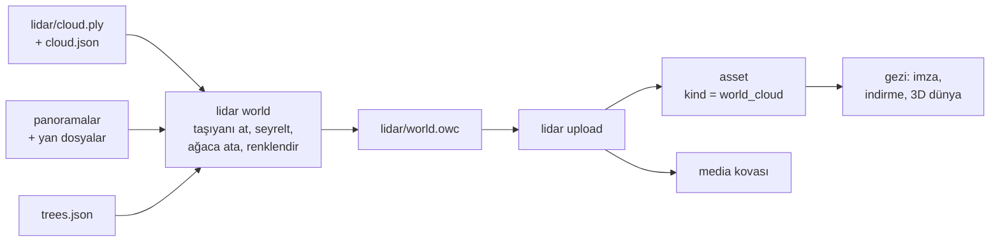

# 3D Dünya (İP17)

5 Kasım 2026 · Yusuf

360° gezide sahip bir düğmeye basınca panorama fotoğrafı LiDAR taramasının renkli nokta bulutuna dönüşür. Kamera yükselir ve bahçe 3D olarak görünür. Her ağacın üzerinde ölçüleri çizilir: boy, taç çapı, taç tabanı. Bu doküman deneyimi, veriyi, yetkileri ve kodu anlatır.

Bulutun dosya biçimi bileşenler arası bir sözleşmedir: [arayuzler.md](arayuzler.md#3d-dünya-bulutu). Ölçümlerin kendisi [lidar-olcumleri.md](lidar-olcumleri.md)'dedir.

## 1. Kapsam ve durum

| Konu | Durum |
| --- | --- |
| Web bulutu biçimi (`world.owc`, `orchados.world_cloud/1`) | Sözleşme yazıldı |
| `orchados-pipeline lidar world`: renklendirme, seyreltme, paketleme | Var |
| `lidar upload` ile `world_cloud` asset'inin yüklenmesi | Var |
| Veritabanı: `asset_kind` `world_cloud`, sahibe okuma ve imza | Var (migration `20261107500000`, `20261107500100`) |
| Gezide geçiş efekti, 3D dünya, ağaç ölçüleri, renk kipleri | Var (Faz 1) |
| Demo turu verisi: sentetik bulut (sürüm 5) ve taç ölçümleri (sürüm 4) | Var |
| Kademeli yükleme (önce dörtte bir, sonra kalanı), denetimler arası geçiş, boy değişimi kipi | Var (Faz 2) |
| Kış iskeleti ve budama görünümü | Var (Faz 2b): bulut dosyasında isteğe bağlı iskelet ve kesim dizileri, `lidar world --skeleton --pruning`, 3D dünyada tüpler, kırmızı budanan dallar ve kesim noktaları, demo verisi sürüm 6 (A'nın iki kış taraması) |
| Oktree ile ayrıntı düzeyi (çok büyük bahçeler) | Faz 2b; gerçek bulut boyutu görülünce karar |
| Uzman paneli ve ofis çalışma alanında 3D dünya, büyüklük sınıfı önerisinin kabulü | Var (Faz 3, §9) |
| Bahçede gezinme: göz hizasında yürüme kipi, zemindeki panorama noktaları ve birine iniş | Var (§10) |
| Gerçek LiDAR verisi | Karar (11 Kasım 2026): kit LiDAR'lı yapılır. Kayıt adımı (MCAP → bulut) tasarlandı, uygulaması `claude/lidar-registration` dalında ([lidar-olcumleri.md](lidar-olcumleri.md) §1); kitin kendisi bekleniyor |

[MVP.md](MVP.md)'de "Gerçek 3D model" kapsam dışıdır. 3D dünya bir model değil, ölçülmüş bulutun kendisidir ve ayrı bir iş paketidir ([plan.md](plan.md), İP17).

## 2. Kararlar

- **Sahibe nokta bulutu gösterilir (5 Kasım 2026, sahip).** Taramalarda bahçede insan olmaz. Bu yüzden bulutun kişileri kaydetmesi engel sayılmadı. Önceki kural ham bulutu yalnız personele açıyordu ([lidar-olcumleri.md](lidar-olcumleri.md) §8). Bu kural ham `cloud.ply` için geçerli kalır. Sahibe yalnız ondan türetilen web bulutu açılır.
- **Personel izi yine gösterilmez (H05, T23).** Web bulutu zaman, yörünge ve kare sırası taşımaz. Taşıyan kişi (sensörün 1,5 m çevresi) buluttan atılır. Panoramalar zaten zamansız ayrık noktalardır. Bu kural yeni kararla değişmedi.
- **Model değil, bulut.** Ağaçlar noktalarıyla görünür; şematik ağaç çizilmez. Ölçüler ağacın üzerine çizgiyle konur ve "yaklaşık" diye etiketlenir. Değerin kendisi panelde, belirsizliğiyle yazılır. Tek taraftan görülmüş ya da ölçülemeyen ağaçta çizim yoktur, yalnız noktalar vardır.
- **Gizleme:** Ops bir dünya bulutunu panorama gibi gizleyebilir (T20, H01; `private.media_target`).

## 3. Deneyim

1. **Düğme:** Gezide, bakılan ziyaretin dünya bulutu varsa görüntünün sağ üstünde "3D dünya" düğmesi çıkar.
2. **Yükleme:** Bulut imzalanır ve indirilir. Görüntünün ortasında "3D dünya yükleniyor… %42" yazar. Panorama bu sırada ekranda kalır.
3. **İlk kare panoramanın aynısı:** 3D kamera, panoramanın kamerasıyla aynı yerde durur. Bakış yönü, eğimi ve dikey görüş açısı da aynıdır (PSV'den okunur). Ekrandaki fotoğraf kameranın çevresindeki bir kürenin üzerine çizilir. Bu yüzden ilk karede bir şey değişmiş görünmez.
4. **Tarama dalgası (0,1–1,5 sn):** Kameradan dışarı doğru parlak bir halka yayılır. Halka kameranın yakınında yavaş, uzakta hızlı ilerler; ilk ağaçların noktalara dönüştüğü görülür. Halkanın geçtiği yerde noktalar belirir. Fotoğraf, o yönde görülen bulut halkadan yakın olduğu yerlerde silinir. Bunun için bulutun panoramadan görünen derinliği (512 × 256 eşdikdörtgen) bir kez hesaplanır. Gökyüzü fotoğraf olarak kalır ve 1,0–1,5 sn arasında söner.
5. **Yükseliş (1,5–2,8 sn):** Fotoğraf tamamen gidince kamera yükselir. Hedef, bakılan yönde 12–40 m ileride zemindeki bir noktadır. Kamera onun 28–90 m gerisinde ve 38° yukarıdadır. Kamera ancak fotoğraf gittikten sonra hareket eder. Böylece fotoğraf hiçbir zaman paralaksla kaymaz.
6. **Ölçüler (1,9–2,7 sn):** Her ölçülmüş ağaçta gövdeden tepeye boy çizgisi, taç ortasında taç çapı halkası ve taç tabanında kesikli halka belirir. Etiketlerde kod ve boy yazar; hangi ağaçların etiketlendiği bulunulan yere göre değişir (§10.3).
7. **Dünyada gezinme:** Sürükleyerek çevirme, iki parmak ya da tekerlekle yakınlaştırma, sağ tuşla ya da üç parmakla kaydırma vardır (three.js `OrbitControls`). Göz hizasında yürüme ve panorama noktalarına iniş §10'dadır. Bir ağaca ya da etiketine dokununca ağacın noktaları sarıya döner. Panelde kodu, sınıfı, boyu, taç çapı, taç hacmi ve taç tabanı yazar. Panelde "Ağaca yaklaş" ve "Ağaç karnesi" düğmeleri bulunur.
8. **Renk kipleri:** Fotoğraf renkleri (varsayılan), ağaç boyu, taç çapı ve boy değişimi. Ölçü kiplerinde ağaçlar viridis rampasıyla boyanır, zemin ve ölçülmemiş ağaçlar gri olur. Gösterge en küçük ve en büyük değeri yazar.
   - **Boy değişimi (Faz 2):** Her ağacın boyu, o ağacı ölçmüş bir önceki denetimle karşılaştırılır. Kısalan ağaçlar turuncu-kırmızı, değişmeyenler gri, uzayanlar yeşil boyanır. Rampa iki yana simetriktir ve en büyük değişime göre ölçeklenir (en az ±0,1 m). Kip yalnız bakılan denetimde değişim hesaplanabilen bir ağaç varsa sunulur. Panelde "Boy değişimi +0,32 m (önceki ölçüm 15 Tem 2025)" yazar; 1 cm'nin altındaki fark "Değişmedi" olarak gösterilir.
   - **Kış iskeleti (Faz 2b):** Kış taramasında her ağacın dal iskeleti açık renkli tüplerle çizilir. Kalınlık iskeletin yarıçapıdır; en ince tüp 1,2 cm'dir. Önceki kış taramasından bu yana budanan dallar kırmızı tüplerle, kesim noktaları kırmızı toplarla gösterilir. Üst çubukta "Dal iskeleti" kutusu iskeleti açıp kapatır; iskelet açıkken noktalar soluklaşır. Gösterge kesim sayısını yazar. Ağaç panelinde "Budama: 3 kesim, 2,4 m dal" gibi bir satır çıkar; kesim yoksa "Kesim yok". Bu değerler çizilen geometriden (iskelet ve kesim dizileri) hesaplanır. Ölçüm satırları (`pruning_cut_count`, `pruning_status`) ağaç karnesindedir.
   - **Denetim (Faz 2):** Bulutu olan birden çok denetim varsa üst çubukta denetim seçilir. Seçilen denetimin bulutu ilk kez kademeli indirilir. Eski bulut çözülürken yenisi belirir (1,4 sn). Noktalar karıştırılmış sırada olduğu için ilk `k` noktayı çizmek düzgün bir örnektir; eskinin `k`'sı azalır, yeninin artar. Etiketler, ölçü çizgileri, panel ve renkler seçilen denetimin ölçümlerine geçer. Başka bir oturumun bulutu, kendi orijininden ilk bulutun düzlemine yerleştirilir. Kamera yerinde kalır.
9. **Geri dönüş:** "Panoramaya dön" ya da Escape ile ölçüler söner. Kamera, ziyaretçinin bıraktığı yerden panoramanın kamerasına iner (1 sn) ve fotoğraf yeniden belirir. Gezi, aynı panoramada ve aynı bakışta kaldığı yerden devam eder.

**Az hareket tercihi** (`prefers-reduced-motion`): Dalga ve uçuş oynatılmaz; dünya doğrudan genel görünümde açılır, dönüş anında olur. Sürüklemede ataletli kayma yoktur.

**Erişilebilirlik:** Dünya bir bölgedir (`role="region"`, "3D dünya"). Açılınca odak ona geçer, Escape önce seçili ağacı, sonra dünyayı kapatır. Ağaç etiketleri düğmedir ve klavyeyle seçilir. Bütün düğmeler 44 px'tir. Yükleme notu `role="status"`, hata notu `role="alert"`'tir. Dünya açıkken panorama sürükleme, tekerlek ve ok tuşlarını almaz.

**Kademeli yükleme (Faz 2):** Bulut HTTP aralık istekleriyle gelir. Önce başlık (ilk 64 KB) indirilir. Sonra her dizinin ilk dörtte biri indirilir ve sahne hemen bununla kurulur. Kalan noktalar arkadan gelir ve aynı katmanı tamamlar. 20 binden az noktalı bulut tek adımda gelir. Aralık desteklemeyen bir sunucu ilk istekte bütün dosyayı döndürür, o zaman tek adımda açılır (`lib/world/stream.ts`). Yerel depoda ve demo aynasında aralık destekleniyor (206).

**Hata:** İmza ya da indirme başarısız olursa "3D dünya açılamadı" notu çıkar; geri düğmesi çalışır. Demo oturumu görüntü sınırını aşmışsa sınır notu çıkar. WebGL yoksa düğme hiç çıkmaz, çünkü gezi de açılmaz.

## 4. Veri

- **Renklendirme:** Her nokta, kendisini gören en yakın panoramanın pikselinden renk alır. Bir noktanın görülüp görülmediği, her panorama için buluttan çıkarılan bir derinlik tamponuyla bulunur. Hiçbir panoramanın görmediği noktalar (taç içi, arkası) en yakın renkli komşusunun rengini alır.
- **Seyreltme:** 4 cm voksel, en çok 1,5 milyon nokta. Noktalar sabit tohumla karıştırılmış sıradadır. Dosyanın her ön kısmı düzgün bir alt örnektir; Faz 2'de akıtma buna dayanır.
- **Boyut:** Nokta başına 11 bayt (konum 6, renk 3, ağaç 2). Demo parselinde birkaç MB'tır.
- **Yerleşim:** Web, ağaç ve panorama konumlarını bulutun yerel düzlemine çevirir (`lib/world/geometry.ts`, `localFrame`: işleme hattının `geo.LocalFrame`'i, milimetre içinde birim testle). Panoramanın kamera yüksekliği, buluttan bulunan zemin (2 m'lik hücrelerde ağaca ait olmayan en alçak nokta) artı ziyaretin `camera_height_m`'idir.
- **Ölçüler:** `lidar_crown` ölçümleri (`tree_height`, `crown_diameter`, `crown_volume`, `crown_base_height`) gezinin zaten okuduğu yoldan gelir (`crownsOfVisits`). Çizim karnedeki taç çizimiyle aynı kuralları kullanır (`crownGuide`).

## 5. Yetkiler

| Kim | Dünya bulutu satırı | Dosya |
| --- | --- | --- |
| Sahip, hissedar, demo ziyaretçisi | Yayımlanmış ziyaretlerinin bulutu (`asset_parcel_reader_kinds`, `asset_select`) | İmzalanır (`authz.parcel_reader_media_object`); demoda herkese açık `demo-media` aynası, `demo_hit('sign')` sayacıyla |
| Kurum personeli | Hepsi, incelemedeki ziyaretler dahil | Hepsi; uzman panelinde ve ofis çalışma alanında personel imzasıyla (§9) |
| Başkası | Hiçbiri | Hiçbiri |

Ham `point_cloud`, yörünge ve GNSS kayıtları yalnız personele açıktır; bu değişmedi. pgTAP: `supabase/tests/79_world_cloud.test.sql`.

**LiDAR kaydı kapısı (18 Kasım 2026):** Bulutun bir LiDAR kaydı varsa (`pose.registration_id`), parsel okuyucuları onu yalnız kayıt ziyaretin geçerli kabulüyse (`accepted`) görür; incelemedeki, reddedilmiş ya da yerine yenisi gelmiş kaydın bulutu personelde kalır. Kaydı olmayan bulutlar (demo, sentetik) bugünkü gibi görünür. Kural: [veri-modeli.md](veri-modeli.md#lidar-kaydı-ve-kapısı).

## 6. Kod

| Dosya | Görevi |
| --- | --- |
| `services/pipeline/src/orchados_pipeline/lidar/world.py` | `lidar world`: taşıyanı atma, seyreltme, ağaç ataması, renklendirme, `world.owc` |
| `services/pipeline/src/orchados_pipeline/lidar/upload.py` | `world.owc`'nin yüklenmesi, `world_cloud` asset'i |
| `apps/web/src/lib/world/format.ts` | Dosya okuyucu: başlık, dizi aralıkları, parçalardan bulut kurma (ve testler için yazıcı) |
| `apps/web/src/lib/world/stream.ts` | Kademeli indirme (aralık istekleri) |
| `apps/web/src/lib/world/visits.ts` | Bulutu olan denetimler, önceki ölçüme göre boy değişimi |
| `apps/web/src/lib/world/skeleton.ts` | Kış iskeletinden ağaç başına kesim sayısı ve kesilen dal uzunluğu |
| `apps/web/src/lib/world/geometry.ts` | Yerel düzlem, sahne eksenleri, zemin ızgarası, derinlik panoraması, geçiş zaman çizelgesi, kamera pozları, renk rampası (saf, birim testli) |
| `apps/web/src/components/portal/world-scene.ts` | three.js sahnesi: denetim başına nokta katmanı ve dalga gölgelendiricisi, katmanlar arası çözülme, fotoğraf küresi, ölçü çizgileri, etiketler, yörünge denetimi, WebGL bağlamının serbest bırakılması |
| `apps/web/src/components/portal/world-view.tsx` | İmza, kademeli indirme, denetim seçimi, arayüz katmanı; gezi tarafından dinamik yüklenir |
| `apps/web/src/components/portal/tour.tsx`, `tour-viewer.tsx` | Düğme, PSV bakışının okunması, dünya açıkken panoramanın etkileşiminin kapatılması |

**Performans ilkeleri:**
- three.js'in ek kodu yalnız dünyayı açana iner.
- Dünya her karede değil, yalnız değişince çizilir: geçişte, yörüngede, sönümlemede.
- Noktalar tek çizim çağrısıdır; ölçü çizgileri ağaç başına iki küçük çizgi kümesidir.
- Kapanınca bağlam hemen serbest kalır (`forceContextLoss`). Gezi ile dünya arasında gidip gelmek bağlam biriktirmez.

## 7. Faz 2 ve sonrası

- **Yapıldı (Faz 2):** Kademeli yükleme (dörtte bir, sonra kalanı), denetimler arası geçiş, boy değişimi kipi.
- **Yapıldı (Faz 2b):** Kış iskeleti ve budama görünümü. Yeni asset türü açılmadı. İskelet ve kesimler aynı `world_cloud` dosyasında isteğe bağlı dizilerdir ([arayuzler.md](arayuzler.md#3d-dünya-bulutu), "Kış iskeleti ve budama"). Web bu dizileri noktalardan sonra tek bir aralık isteğiyle indirir. Parçalar tek bir `InstancedMesh` ile tüp olarak çizilir (altı yüzlü silindir).
- **Oktree (Faz 2b):** Bir hektarı aşan bahçelerde kademeli yükleme yetmezse yaklaştıkça ayrıntı (COPC/Potree tarzı). Gerçek bulut boyutu görülünce karar verilir.
- **Demo sınırı:** Sentetik ağaçlar yıllar arasında çizimde büyümez (sürüm 1 medyası değişmez). Bu yüzden demoda boy değişimi çoğunlukla "Değişmedi"dir; kısalan ağaçlar kuruyan ve sorunlu olanlardır.
- **Yapıldı (Faz 3):** Uzman panelinde ve ofis çalışma alanında aynı dünya; büyüklük sınıfı önerisinin tek tıkla kabulü (§9).
- **Gerçek veri:** Kayıt adımından gelen ilk bulutta renklendirme hizası (kamera-LiDAR kalibrasyonu, zaman eşlemesi) ve zemin kestiriminin sağlamlığı denenir.

## 8. Test

- **Gezinme (§10):** birim `src/lib/world/walk.test.ts` (yürüme adımı, koşma, çapraz hız, dönüş, sınırlar, çift tıklanan noktaya yürüme, bakış ve eğim sınırı, zemine ışın, en yakın nokta, yön dönüşümü); tarayıcı `demo-tour.spec.ts` › "3D world" › "walks at eye level…" (yürüme kipi, düğme boyutları, tuşlarla yürüme, yön düğmesiyle dönme, kuşbakışına dönüş, en yakın panoramaya iniş ve gezinin orada sürmesi) ve `staff-lidar.spec.ts` (personelde yürüme kipi, panorama noktası yok).

- **Birim (Vitest):** `src/lib/world/world.test.ts`. Kapsadığı konular: biçim gidiş dönüşü, hizalama, bozuk dosyaların reddi, işleme hattıyla aynı yerel düzlem, eksenler, zemin, derinlik panoraması, geçişte kameranın fotoğraf gitmeden kıpırdamaması, poz, renk ve seçim. Faz 2'de eklenenler: kademeli indirme (aralıklı, aralıksız ve küçük bulut), bulut orijininin yerleşimi, değişim rampası, önceki ölçüme göre boy değişimi. Faz 2b: kış dizilerinin okunması, tek aralıkla indirilmesi, ağaç başına kesim ve kesilen uzunluk.
- **İşleme hattı (pytest):** biçim, belirlenim, taşıyanın atılması, örtülen noktanın örten yüzeyin rengini almaması, ağaç ataması, başlıkta zaman olmaması.
- **Veritabanı (pgTAP):** `79_world_cloud.test.sql`.
- **Tarayıcı:** demo verisinde düğme, yükleme, giriş, ağaç seçimi, renk kipleri, boy değişimi, 2025 denetimine geçiş ve geri dönüş (`tests/e2e/demo-tour.spec.ts` › "3D world").
- **Faz 3 (personel):** birim `src/lib/lidar/lidar.test.ts` (en yeni öneri, durumlar, düşük güven, toplu uygulamanın gruplaması, ağaç başına LiDAR değerleri) ve `world.test.ts` › "overview start"; entegrasyon `tests/integration/staff-lidar.test.ts` (uzmanın ağaç değerleri ve önerisi, incelemedeki ziyaretin bulutu, personel imzası ve dosyanın okunması, sahibe incelemedeki ziyaretten hiçbir şey gitmemesi, kabul); tarayıcı `tests/e2e/staff-lidar.spec.ts` (uzman: LiDAR bloğu, ağaçla açılan dünya, büyüklük sınıfı kipi, kabul; ofis: tablo sütunu, dünyadan uygulama, düşük güvenin uygulanmaması, uyuşmayanları seçip toplu uygulama). Test verisi: `tests/e2e/lidar-fixtures.ts` (ölçümler `record_lidar_measurements` ile, küçük sentetik bulut).

## 9. Faz 3: personel ekranları

**Karar (11 Kasım 2026, sahip):** Kit LiDAR'lı yapılır. LiDAR verisi pilotun ilk taramasından itibaren gelir; bu yüzden personelin bu veriyi kullanması öne alındı. Önceki durumda LiDAR ölçümleri ve 3D dünya yalnız sahip portalında ve demoda vardı; ofis aracı ve uzman paneli LiDAR verisini hiç okumuyordu.

Faz 3 yeni tablo, migration ya da yetki eklemez. Personel bulut satırlarını ve dosyalarını zaten okuyabiliyordu (§5). Büyüklük sınıfının kabulü, ağacın `age_class` alanını ofisin ve uzmanın zaten kullandığı satır yetkisiyle (`tree_update`) yazar.

### 9.1 Büyüklük sınıfı önerisi

- **Kaynak:** Ağacın parseldeki en yeni `size_class` ölçümü (`lidar_crown`, kaynak `algorithm`). Personel incelemedeki ziyaretlerin ölçümlerini de görür. Aynı ziyarette birden çok satır varsa en yenisi alınır.
- **Gösterim:** "LiDAR önerisi: Verimli (güven 0,9)", ölçüldüğü tarama tarihiyle. Öneri kayıtlı sınıftan farklıysa vurgulanır. Kayıtlı sınıf "bilinmiyor" ise her öneri farklı sayılır.
- **Düşük güven:** Güveni 0,5'in altındaki öneri (tek taraftan görülmüş, değen ya da yapraksız taç; [lidar-olcumleri.md](lidar-olcumleri.md) §4) gösterilir ama tek tıkla kabul ve toplu uygulama ona kapalıdır. Kişi sınıfı yine elle seçebilir.
- **Kabul:** Ağacın `age_class`'ı önerilen sınıf olur. Ölçüm satırı değişmez; öneri ile kayıtlı sınıf ayrı kalır. Böylece pilotta önerinin ofis kişisinin verdiği sınıfla uyumu ölçülebilir ([lidar-olcumleri.md](lidar-olcumleri.md) §7).

### 9.2 Uzman paneli

- **Ağaç incelemesi:** Değer varsa "LiDAR ölçümleri" bloğu çıkar. Bu ziyaretin ve önceki ziyaretin LiDAR değerleri yan yanadır: ağaç boyu, taç çapı, taç hacmi, ana kol sayısı, kesim sayısı, budama durumu. Altında büyüklük sınıfı önerisi, kayıtlı sınıf ve öneri farklıysa "Öneriyi kabul et" düğmesi bulunur. Değerler yalnız LiDAR'ın (`algorithm`) değerleridir. Uzmanın kendi girdiği değer karar panelinde kalır ve kaynak önceliğiyle sahibe gidenin önüne geçer ([lidar-olcumleri.md](lidar-olcumleri.md) §9).
- **3D dünya:** Parselin bulutu olan bir ziyareti varsa ziyaret başlığında "3D dünya" düğmesi çıkar. Dünya bu ziyaretin bulutuyla açılır; bu ziyaretin bulutu yoksa parselin en yeni bulutuyla. Seçili ağaç varsa kamera ona uçar ve ağaç seçili gelir. Ağaç panelinde "Bu ağacı incele" bağlantısı inceleme sayfasında o ağacı açar.

### 9.3 Ofis çalışma alanı

- **Ağaç özellikleri sekmesi:** Tabloda "LiDAR önerisi" sütunu vardır. "Öneriyle uyuşmayanları seç" düğmesi, önerisi kayıtlı sınıftan farklı ve güveni yeterli ağaçları seçer. "LiDAR önerisini uygula" seçili ağaçların her birine kendi önerisini yazar; önerisi olmayan ya da güveni düşük ağaçlar atlanır ve sayısı yazılır.
- **3D dünya:** Sekme çubuğunun üstündeki "3D dünya" düğmesi parselin en yeni bulutunu açar. Ağaç panelinde kayıtlı sınıf, öneri ve "Öneriyi uygula" düğmesi bulunur.

### 9.4 Personel dünyası

Sahibin dünyasıyla aynı bileşendir (`world-view.tsx`, `world-scene.ts`). Farkları:

- **Panoramasız açılış:** Dünya bir panoramadan değil, doğrudan genel görünümde açılır (az hareket tercihindeki gibi). Kamera, bulutun güney kenarının ortasından kuzeye bakan noktanın gerisindedir. "Kapat" ya da Escape dünyayı hemen kapatır.
- **Bütün ziyaretler:** Denetim seçicide parselin bulutu olan bütün ziyaretleri bulunur. Yayımlanmamış olanların yanında "incelemede" yazar. Bulutu olan tek ziyaret varsa seçici yerine üst çubukta o ziyaretin adı yazar; panorama olmadığı için bulutun hangi taramadan geldiği böylece görünür.
- **İmza:** Personel imzası (`createMediaSigner`, kullanıcı kapsamı). Sunucu yalnız o parselin bir `world_cloud` asset'ini imzalar.
- **Renk kipi "Büyüklük sınıfı":** Yalnız personelde vardır. Önerisi kayıtlı sınıftan farklı ağaçlar turuncu, aynı olanlar yeşil, önerisi olmayanlar gri boyanır. Öneri bakılan denetimin değil, ağacın en yeni önerisidir (§9.1).
- **Ağaç paneli:** Ölçülerin altında kayıtlı sınıf ve öneri satırı vardır. Uzmanda inceleme bağlantısı, ofiste "Öneriyi uygula" düğmesi bulunur.
- **LiDAR kaydı bandı** ([tasarım](superpowers/specs/2026-11-18-lidar-kayit-adimi-design.md) §5.9; `registration-band.tsx`): Dünyanın üstünde, seçili ziyaretin en yeni LiDAR kaydı (`lidar_registration`) gösterilir; ziyarette incelemede bekleyen bir kayıt varsa bant onu (en yenisini) gösterir, böylece panodan gelen operasyon her zaman karar verebileceği kayda bakar. Dünya, bandın kaydının bulutunu (`pose.registration_id`) gösterir; o kaydın bulutu yoksa ziyaretin en yeni bulutu açılır ve bant bunu söyler. Kayıt `pending_review` ise üstte "LiDAR kaydı incelemede" bandı çıkar: kalite özeti (GNSS sapması, gövde tutarlılığı, kapsama, PPK durumu) ve nedenler. Operasyon rolüne "Kabul et" ve "Reddet" düğmeleri görünür; ret için not istenir (`decide_lidar_registration`). `rejected` kayıtta "LiDAR kaydı reddedildi" ve not, `accepted` kayıtta karar ve karar veren yazar. Ziyaretin önceki kayıtları varsa sayısı ve durumları özetlenir. Personel bekleyen kaydın bulutunu görür; inceleme bunun için var. Kabulden sonra ölçümler ve bulut sahibe hemen açılır ([veri-modeli.md](veri-modeli.md#lidar-kaydı-ve-kapısı)).
- **Operasyon panosu:** "İncelemede bekleyen LiDAR kayıtları" listesi; her satırda parsel, ziyaret, kayıt tarihi ve nedenler. Satırdaki bağlantı personel dünyasını o ziyaretle açar: ofis envanter çalışma alanı, `?dunya=<ziyaret>` (envanter yoksa da dünya düğmesi oradadır). Uzman panelindeki dünyada da bant görünür; düğmeler yalnız operasyon rolü olan kullanıcıya çıkar.

### 9.5 Kod

| Dosya | Görevi |
| --- | --- |
| `apps/web/src/lib/lidar/size-class.ts` | Ağaç başına en yeni öneri, uyuşmazlık, kabul edilebilirlik (saf, birim testli) |
| `apps/web/src/lib/lidar/facts.ts` | Ağaç başına ziyaretin LiDAR değerleri (yalnız `algorithm`, en yenisi; saf) |
| `apps/web/src/lib/lidar/staff.ts` | Personel verisi: ziyaretlerin LiDAR değerleri, bulutlar, ağaç konumları, öneriler; personel imzası |
| `apps/web/src/components/staff/staff-world.tsx` | Düğme ve tam ekran katman; `WorldView`'ı personel seçenekleriyle açar |
| `apps/web/src/components/portal/world-view.tsx`, `world-scene.ts` | Ortak dünya: imzalama, ağaç bağlantısı ve panel satırları dışarıdan; `start` yoksa genel görünümle açılış (`startOverview`, `lib/world/geometry.ts` › `overviewStart`); "Büyüklük sınıfı" kipi |
| `apps/web/src/components/expert/lidar-block.tsx` | Ağaç incelemesindeki LiDAR bloğu ve öneri kabulü |
| `apps/web/src/components/office/tree-attribute-editor.tsx` | Ofiste öneri sütunu, uyuşmayanları seçme, önerileri uygulama |
| `apps/web/src/app/uzman/actions.ts`, `app/ofis/parsel/[parcelId]/envanter/duzenle/actions.ts` | Öneri kabulü (`setTreeAttributes`) ve personel imzası eylemleri |

### 9.6 Sonraki işler

- **Konum denetimi:** Buluttaki gövde ile envanter konumunun karşılaştırılması (üçgenlemeyi doğrulamak ya da yerine geçmek). Bulutun ağaç ataması bugün envanter konumuna dayandığı için bu ayrı bir yöntem ister; gerçek bulut gelince tasarlanır.
- **Ofis üçgenleme aracında dünya:** Envanter kaydedilmeden önce ağaç ataması yoktur; bulutun bu aşamada nasıl kullanılacağı gerçek veriyle karar verilir.

## 10. Bahçede gezinme

**İstek (11 Kasım 2026, sahip):** 3D dünyada panoramadaki gibi bahçenin içinde gezinmek. Önceki dünya yalnız kuşbakışıydı: kamera bir noktanın çevresinde döner, zeminin altına inmez; dünyadan başka bir panorama noktasına geçilemez. İki yol birlikte yapıldı.

### 10.1 Panorama noktaları

- Gezide, bakılan denetimin her panorama noktası zeminde beyaz bir halka olarak durur (yarıçap 0,32–0,5 m). Denetim değişince halkalar o denetimin noktalarına geçer.
- **İniş:** Bir halkaya tıklayınca kamera, o noktada panorama kamerasının yüksekliğine (zemin + ziyaretin `camera_height_m`'i) şu anki bakış yönüyle iner (1,1 sn; az hareket tercihinde anında). Ölçüler ve etiketler bu sırada söner. Sonra dünya kapanır ve gezi o denetimde, o panoramada, aynı yöne bakarak sürer. Adres o panoramayı gösterir.
- **Seçim:** Tıklamaya en yakın halka 28 px, en yakın ağaç 48 px içinde aranır. İkisi de varsa ekranda tıklamaya daha yakın olan kazanır.
- **Klavye ve ekran okuyucu:** Üst çubuktaki "En yakın panoramaya in" düğmesi, kuşbakışında bakılan yere, yürürken durulan yere en yakın noktaya iner.
- Personel dünyasında gezi ve panorama noktası yoktur; düğme ve halkalar çıkmaz.

### 10.2 Yürüme kipi

- **Geçiş:** Üst çubuktaki "Yürü" düğmesi kamerayı kuşbakışının baktığı yere, göz hizasına (zemin + 1,6 m) indirir; yön korunur, bakış yataya iner (0,9 sn). "Kuşbakışı" aynı yönle yukarıya ve geriye çıkarır. Kuşbakışında zemine çift tıklamak da o noktada yürümeye başlatır.
- **Bakış:** Sürükleyerek etrafa bakılır. Eğim ±80° ile sınırlıdır; görüş açısı 70°.
- **Yürüme:** W/S ya da ↑/↓ ileri geri, A/D yana adım, ←/→ dönüş (90°/sn), Shift koşma. Hız 3 m/sn, koşarken 7,5 m/sn. Çapraz yürüme tek yönden hızlı değildir. Kamera zemini izler (2 m'lik zemin ızgarası) ve bulutun sınırından çıkmaz. Ağaçların içinden geçilebilir; çarpışma yoktur.
- **Çift tıklama:** Zemine çift tıklayınca oraya yürünür ve yüz o yöne döner. "Ağaca yaklaş" yürürken ağacın 4 m önüne kadar yürütür.
- **Telefon:** Sağ altta dört düğmeli yön takımı vardır: ileri, geri, sola dön, sağa dön. Basılı tutulunca yürür ya da döner. Klavyeyle basılınca kısa bir adım atılır. Düğmeler 44 px'tir.
- **Odak:** Tuşlar dünya bölgesine odak varken çalışır. Seçim kutularında (denetim, renk) ok tuşları kutuya kalır. Pencere odağı kaybedince yürüme durur. Escape yine önce seçili ağacı, sonra dünyayı kapatır.

**Uyarı:** Bulut fotoğraf değil, nokta kümesidir; göz hizasından ve yakından seyrek görünür. Gerçek LiDAR bulutunda nokta yoğunluğu ve nokta boyutu göz hizası için yeniden ayarlanabilir.

### 10.3 Etiketler ve seçim

**İstek (12 Kasım 2026, sahip):** Etiket ve seçim kameranın yerinden bağımsızdı. Yürürken ya da bir ağaca yaklaşmışken ekranda çok fazla etiket vardı ve bakılan ağacın arkasındaki ağaç yanlışlıkla seçilebiliyordu. Önceki kural: kameraya en yakın 20 ağacın etiketi; tıklamaya ekranda en yakın ağacın gövde ortası (48 px içinde).

- **Yakın kip:** yürürken, ya da kuşbakışında kamera baktığı noktaya 25 m'den yakınken ("Ağaca yaklaş" kamerayı 10–18 m'ye getirir). Yalnız çevredeki ağaçlar etiketlenir ve seçilebilir: yürürken durulan yerin 15 m, yaklaşınca bakılan noktanın 10 m çevresi. En çok 8 etiket gösterilir, kameraya en yakınlar önce.
- **Uzak kip (kuşbakışı):** bütün ağaçlar seçilebilir. Etiketi, kameraya daha yakın bir ağacın etiketiyle çakışmayan her ağaç etiketlenir (en çok 80). Böylece yukarıdan bakınca sığdığı kadar çok ağaç görünür, etiketler üst üste binmez.
- **Seçili ağaç:** ekrandaysa etiketi her iki kipte de görünür.
- **Önden arkaya seçim:** Her ağacın ekrandaki silueti zeminden tepeye uzanır, genişliği taç çapı kadardır; ölçülmemiş ağaçta 1,5 m yarıçap varsayılır. Tıklama birden çok siluete düşerse kameraya en yakın ağaç seçilir. Bakılan ağacın arkasındaki ağaç böylece onun içinden seçilemez. Hiçbir siluete düşmeyen tıklama, ortası 24 px içindeki ağacı seçer.
- **Panorama halkası:** halka ile ağaç arasında kameraya yakın olan kazanır. Yakın kipte yalnız çevredeki halkalar seçilebilir.
- **Uzun ağaç:** tepesi ekran dışında kalsa da gövdesi ekrandaysa ağaç seçilebilir; etiketi görünmez.
- **Denetimler altında etiket yok:** Üst çubuk, ağaç paneli ve köşedeki yürüme düğmeleri ile açıklamanın kapladığı yere etiket konmaz; orada okunamaz ve tıklanamaz. Seçili ağacın etiketi de oraya düşünce gizlenir. Bu alanlar `data-world-chrome` ile işaretlidir.
- Etiket katmanı kipini `data-scope` (`near`, `far`) ile gösterir; tarayıcı testi buna bakar.

### 10.4 Kod

| Dosya | Görevi |
| --- | --- |
| `apps/web/src/lib/world/labels.ts` | Yakın/uzak kip, gösterilecek etiketler (çakışma elemesi), önden arkaya seçim (saf, birim testli; §10.3) |
| `apps/web/src/lib/world/walk.ts` | Yürüme adımı, noktaya yürüme, bakış, sınırlar, zemine ışın, en yakın nokta (saf, birim testli) |
| `apps/web/src/components/portal/world-scene.ts` | Gezinme durumu (`orbit`/`walk`), uçuşlar (kip geçişi, iniş), halkalar (`InstancedMesh`), sürükleyerek bakış, çift tıklama |
| `apps/web/src/components/portal/world-view.tsx` | "Yürü"/"Kuşbakışı", "En yakın panoramaya in", yön takımı (`PadButton`), tuşlar, inişte `onExit({ visitId, panoramaId, azimuthDeg })` |
| `apps/web/src/components/portal/tour.tsx` | Denetimlerin panorama noktalarını dünyaya verir; inişte o denetime ve panoramaya geçer |

