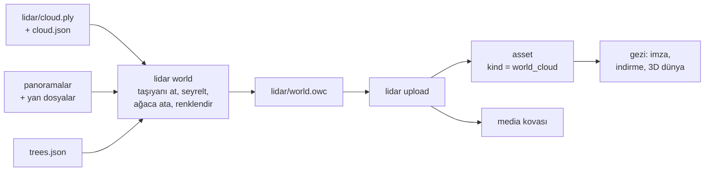

# 3D Dünya (İP17)

5 Kasım 2026 · Yusuf

360° gezide sahip bir düğmeye basınca panorama fotoğrafı LiDAR taramasının renkli nokta bulutuna dönüşür. Kamera yükselir ve bahçe 3D olarak görünür. Her ağacın üzerinde ölçüleri çizilir: boy, taç çapı, taç tabanı. Bu doküman deneyimi, veriyi, yetkileri ve kodu anlatır.

Bulutun dosya biçimi bileşenler arası bir sözleşmedir: [arayuzler.md](arayuzler.md#3d-dünya-bulutu). Ölçümlerin kendisi [lidar-olcumleri.md](lidar-olcumleri.md)'dedir.

## 1. Kapsam ve durum

| Konu | Durum |
| --- | --- |
| Web bulutu biçimi (`world.owc`, `orchados.world_cloud/1`) | Sözleşme yazıldı |
| `orchados-pipeline lidar world`: renklendirme, seyreltme, paketleme | Var |
| `lidar upload` ile `world_cloud` asset'inin yüklenmesi | Var |
| Veritabanı: `asset_kind` `world_cloud`, sahibe okuma ve imza | Var (migration `20261107500000`, `20261107500100`) |
| Gezide geçiş efekti, 3D dünya, ağaç ölçüleri, renk kipleri | Var (Faz 1) |
| Demo turu verisi (sürüm 4): sentetik bulut ve taç ölçümleri | Var |
| Oktree ile akıtma, ziyaretler arası büyüme, kış iskeleti ve budama görünümü | Faz 2 |
| Uzman paneli ve ofis aracında 3D dünya | Faz 3 |
| Gerçek LiDAR verisi | Kayıt adımı (MCAP → bulut) ve LiDAR'lı kit bekleniyor ([lidar-olcumleri.md](lidar-olcumleri.md) §1) |

[MVP.md](MVP.md)'de "Gerçek 3D model" kapsam dışıdır. 3D dünya bir model değil, ölçülmüş bulutun kendisidir ve ayrı bir iş paketidir ([plan.md](plan.md), İP17).

## 2. Kararlar

- **Sahibe nokta bulutu gösterilir (5 Kasım 2026, sahip).** Taramalarda bahçede insan olmaz. Bu yüzden bulutun kişileri kaydetmesi engel sayılmadı. Önceki kural ham bulutu yalnız personele açıyordu ([lidar-olcumleri.md](lidar-olcumleri.md) §8). Bu kural ham `cloud.ply` için geçerli kalır. Sahibe yalnız ondan türetilen web bulutu açılır.
- **Personel izi yine gösterilmez (H05, T23).** Web bulutu zaman, yörünge ve kare sırası taşımaz. Taşıyan kişi (sensörün 1,5 m çevresi) buluttan atılır. Panoramalar zaten zamansız ayrık noktalardır. Bu kural yeni kararla değişmedi.
- **Model değil, bulut.** Ağaçlar noktalarıyla görünür; şematik ağaç çizilmez. Ölçüler ağacın üzerine çizgiyle konur ve "yaklaşık" diye etiketlenir. Değerin kendisi panelde, belirsizliğiyle yazılır. Tek taraftan görülmüş ya da ölçülemeyen ağaçta çizim yoktur, yalnız noktalar vardır.
- **Gizleme:** Ops bir dünya bulutunu panorama gibi gizleyebilir (T20, H01; `private.media_target`).

## 3. Deneyim

1. **Düğme:** Gezide, bakılan ziyaretin dünya bulutu varsa görüntünün sağ üstünde "3D dünya" düğmesi çıkar.
2. **Yükleme:** Bulut imzalanır ve indirilir. Görüntünün ortasında "3D dünya yükleniyor… %42" yazar. Panorama bu sırada ekranda kalır.
3. **İlk kare panoramanın aynısı:** 3D kamera, panoramanın kamerasıyla aynı yerde durur. Bakış yönü, eğimi ve dikey görüş açısı da aynıdır (PSV'den okunur). Ekrandaki fotoğraf kameranın çevresindeki bir kürenin üzerine çizilir. Bu yüzden ilk karede bir şey değişmiş görünmez.
4. **Tarama dalgası (0,1–1,5 sn):** Kameradan dışarı doğru parlak bir halka yayılır. Halka kameranın yakınında yavaş, uzakta hızlı ilerler; ilk ağaçların noktalara dönüştüğü görülür. Halkanın geçtiği yerde noktalar belirir. Fotoğraf, o yönde görülen bulut halkadan yakın olduğu yerlerde silinir. Bunun için bulutun panoramadan görünen derinliği (512 × 256 eşdikdörtgen) bir kez hesaplanır. Gökyüzü fotoğraf olarak kalır ve 1,0–1,5 sn arasında söner.
5. **Yükseliş (1,5–2,8 sn):** Fotoğraf tamamen gidince kamera yükselir. Hedef, bakılan yönde 12–40 m ileride zemindeki bir noktadır. Kamera onun 28–90 m gerisinde ve 38° yukarıdadır. Kamera ancak fotoğraf gittikten sonra hareket eder. Böylece fotoğraf hiçbir zaman paralaksla kaymaz.
6. **Ölçüler (1,9–2,7 sn):** Her ölçülmüş ağaçta gövdeden tepeye boy çizgisi, taç ortasında taç çapı halkası ve taç tabanında kesikli halka belirir. En yakın 40 ağacın etiketinde kod ve boy yazar.
7. **Dünyada gezinme:** Sürükleyerek çevirme, iki parmak ya da tekerlekle yakınlaştırma, sağ tuşla ya da üç parmakla kaydırma vardır (three.js `OrbitControls`). Bir ağaca ya da etiketine dokununca ağacın noktaları sarıya döner. Panelde kodu, sınıfı, boyu, taç çapı, taç hacmi ve taç tabanı yazar. Panelde "Ağaca yaklaş" ve "Ağaç karnesi" düğmeleri bulunur.
8. **Renk kipleri:** Fotoğraf renkleri (varsayılan), ağaç boyu ve taç çapı. Ölçü kiplerinde ağaçlar viridis rampasıyla boyanır, zemin ve ölçülmemiş ağaçlar gri olur. Gösterge en küçük ve en büyük değeri yazar.
9. **Geri dönüş:** "Panoramaya dön" ya da Escape ile ölçüler söner. Kamera, ziyaretçinin bıraktığı yerden panoramanın kamerasına iner (1 sn) ve fotoğraf yeniden belirir. Gezi, aynı panoramada ve aynı bakışta kaldığı yerden devam eder.

**Az hareket tercihi** (`prefers-reduced-motion`): Dalga ve uçuş oynatılmaz; dünya doğrudan genel görünümde açılır, dönüş anında olur. Sürüklemede ataletli kayma yoktur.

**Erişilebilirlik:** Dünya bir bölgedir (`role="region"`, "3D dünya"). Açılınca odak ona geçer, Escape önce seçili ağacı, sonra dünyayı kapatır. Ağaç etiketleri düğmedir ve klavyeyle seçilir. Bütün düğmeler 44 px'tir. Yükleme notu `role="status"`, hata notu `role="alert"`'tir. Dünya açıkken panorama sürükleme, tekerlek ve ok tuşlarını almaz.

**Hata:** İmza ya da indirme başarısız olursa "3D dünya açılamadı" notu çıkar; geri düğmesi çalışır. Demo oturumu görüntü sınırını aşmışsa sınır notu çıkar. WebGL yoksa düğme hiç çıkmaz, çünkü gezi de açılmaz.

## 4. Veri

- **Renklendirme:** Her nokta, kendisini gören en yakın panoramanın pikselinden renk alır. Bir noktanın görülüp görülmediği, her panorama için buluttan çıkarılan bir derinlik tamponuyla bulunur. Hiçbir panoramanın görmediği noktalar (taç içi, arkası) en yakın renkli komşusunun rengini alır.
- **Seyreltme:** 4 cm voksel, en çok 1,5 milyon nokta. Noktalar sabit tohumla karıştırılmış sıradadır. Dosyanın her ön kısmı düzgün bir alt örnektir; Faz 2'de akıtma buna dayanır.
- **Boyut:** Nokta başına 11 bayt (konum 6, renk 3, ağaç 2). Demo parselinde birkaç MB'tır.
- **Yerleşim:** Web, ağaç ve panorama konumlarını bulutun yerel düzlemine çevirir (`lib/world/geometry.ts`, `localFrame`: işleme hattının `geo.LocalFrame`'i, milimetre içinde birim testle). Panoramanın kamera yüksekliği, buluttan bulunan zemin (2 m'lik hücrelerde ağaca ait olmayan en alçak nokta) artı ziyaretin `camera_height_m`'idir.
- **Ölçüler:** `lidar_crown` ölçümleri (`tree_height`, `crown_diameter`, `crown_volume`, `crown_base_height`) gezinin zaten okuduğu yoldan gelir (`crownsOfVisits`). Çizim karnedeki taç çizimiyle aynı kuralları kullanır (`crownGuide`).

## 5. Yetkiler

| Kim | Dünya bulutu satırı | Dosya |
| --- | --- | --- |
| Sahip, hissedar, demo ziyaretçisi | Yayımlanmış ziyaretlerinin bulutu (`asset_parcel_reader_kinds`, `asset_select`) | İmzalanır (`authz.parcel_reader_media_object`); demoda herkese açık `demo-media` aynası, `demo_hit('sign')` sayacıyla |
| Kurum personeli | Hepsi | Hepsi |
| Başkası | Hiçbiri | Hiçbiri |

Ham `point_cloud`, yörünge ve GNSS kayıtları yalnız personele açıktır; bu değişmedi. pgTAP: `supabase/tests/79_world_cloud.test.sql`.

## 6. Kod

| Dosya | Görevi |
| --- | --- |
| `services/pipeline/src/orchados_pipeline/lidar/world.py` | `lidar world`: taşıyanı atma, seyreltme, ağaç ataması, renklendirme, `world.owc` |
| `services/pipeline/src/orchados_pipeline/lidar/upload.py` | `world.owc`'nin yüklenmesi, `world_cloud` asset'i |
| `apps/web/src/lib/world/format.ts` | Dosya okuyucu (ve testler için yazıcı) |
| `apps/web/src/lib/world/geometry.ts` | Yerel düzlem, sahne eksenleri, zemin ızgarası, derinlik panoraması, geçiş zaman çizelgesi, kamera pozları, renk rampası (saf, birim testli) |
| `apps/web/src/components/portal/world-scene.ts` | three.js sahnesi: noktalar ve dalga gölgelendiricisi, fotoğraf küresi, ölçü çizgileri, etiketler, yörünge denetimi, WebGL bağlamının serbest bırakılması |
| `apps/web/src/components/portal/world-view.tsx` | İmza, indirme (ilerlemeyle), arayüz katmanı; gezi tarafından dinamik yüklenir |
| `apps/web/src/components/portal/tour.tsx`, `tour-viewer.tsx` | Düğme, PSV bakışının okunması, dünya açıkken panoramanın etkileşiminin kapatılması |

**Performans ilkeleri:**
- three.js'in ek kodu yalnız dünyayı açana iner.
- Dünya her karede değil, yalnız değişince çizilir: geçişte, yörüngede, sönümlemede.
- Noktalar tek çizim çağrısıdır; ölçü çizgileri ağaç başına iki küçük çizgi kümesidir.
- Kapanınca bağlam hemen serbest kalır (`forceContextLoss`). Gezi ile dünya arasında gidip gelmek bağlam biriktirmez.

## 7. Faz 2 ve sonrası

- **Akıtma:** Seyrek bulutla açılış, yaklaştıkça ayrıntı; oktree (COPC/Potree tarzı) ya da karıştırılmış sıranın parça parça indirilmesi.
- **Zaman:** Ziyaret kaydırıcısıyla aynı ağacın yıldan yıla büyümesi; iki bulutun farkı.
- **Kış:** İskelet düğümlerinin tüplerle çizilmesi, budanan dalların kırmızı gösterilmesi (`skeleton.json`, `pruning.json`).
- **Personel:** Uzman panelinde ve ofis aracında aynı dünya; büyüklük sınıfı önerisinin tek tıkla kabulü.
- **Gerçek veri:** Kayıt adımından gelen ilk bulutta renklendirme hizası (kamera-LiDAR kalibrasyonu, zaman eşlemesi) ve zemin kestiriminin sağlamlığı denenir.

## 8. Test

- **Birim (Vitest):** `src/lib/world/world.test.ts`. Kapsadığı konular: biçim gidiş dönüşü, hizalama, bozuk dosyaların reddi, işleme hattıyla aynı yerel düzlem, eksenler, zemin, derinlik panoraması, geçişte kameranın fotoğraf gitmeden kıpırdamaması, poz, renk ve seçim.
- **İşleme hattı (pytest):** biçim, belirlenim, taşıyanın atılması, örtülen noktanın örten yüzeyin rengini almaması, ağaç ataması, başlıkta zaman olmaması.
- **Veritabanı (pgTAP):** `79_world_cloud.test.sql`.
- **Tarayıcı:** demo verisinde düğme, yükleme, giriş, ağaç seçimi ve geri dönüş (`tests/e2e/world.spec.ts`).
