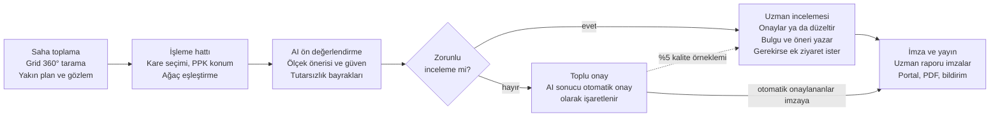
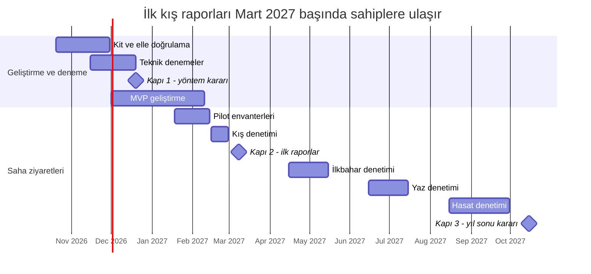

# Antep Fıstığı Bahçe Denetimi — MVP Dokümanı

17 Ekim 2026 · Yusuf

## Özet

Gaziantep'teki Antep fıstığı bahçe sahiplerine, bahçeye gitmeden bahçelerinin durumunu kanıtıyla görebilecekleri bağımsız bir denetim hizmeti sunuyoruz. Kendi saha personelimiz parseli periyodik olarak 360° kamera ve GPS ile grid şeklinde tarar. AI ön değerlendirmeyi yapar, uzman onaylar. Sahip; parsel karnesini, sağlık haritasını, bahçe gezisini ve ağaç karnesini web portalında görür.

**Hedef kullanıcı:** Bahçeden uzakta yaşayan ya da bahçeye erişimi kısıtlı olan sahipler. Bahçede düzenli veri girecek kimse yok; işleri yevmiyeciler yapıyor. Sahip ağaç sayısını ve kesin sınırı çoğunlukla bilmiyor.

**Pilot:** 1–4 bahçe, ortalama 20 dönüm, bahçe başına yaklaşık 300 ağaç. Ağaçlar çoğunlukla sıralı; yer yer sıra arasında ağaç ve kurumuş ağaçlardan kalan boş yerler var.

**Parsel tanımı:** Bu dokümanda "parsel", sahibin fiilen kullandığı bahçe bölümüdür. Bölgedeki bahçelerin çoğu hisseli ve rızai taksimlidir; örneğin tapudaki tek bir ada/parsel üç kişi arasında bölüşülmüş olabilir. Bu yüzden parselimiz tapudaki ada/parselle aynı olmak zorunda değildir. Sınırı sahip gösterir; tapu sınırı karşılaştırması ve sınır ihlali tespiti hizmetin kapsamında değildir.

**Temel ilkeler**

- **Saha toplar, karar vermez.** Personel standart görüntü ve basit gözlem toplar. Değerlendirmeyi AI ve uzman yapar.
- **Ölçtüğünü söyle, ölçmediğini iddia etme.** Her gösterge tanımlı bir ölçeğe ve görünür bir kanıta dayanır.
- **Her bulgu kaynağına izlenebilir.** Karneden ağaca, ağaçtan fotoğrafa, fotoğraftan zamana, konuma ve çekene inilir.
- **Belirsizlik açıkça gösterilir.** Tahminler aralıkla, karnenin kendisi de denetim güveniyle verilir.
- **Bağımsızlık.** Veriyi kendi personelimiz toplar; sahibin işçileri ya da bekçisi toplamaz.

## MVP kapsamı

MVP, kayıttan rapora kadar tek bir uçtan uca döngüyü kapsar. Havadan ve sensörden gelen veriler bilinçli olarak dışarıda tutuldu. Tarama süresi kritik değil; bu yüzden her ziyarette grid tarama yapılır.

| Bileşen | MVP'de | Not |
| --- | --- | --- |
| Sahip kaydı ve parsel tanımı | Var | Kaydı operasyon açar. İP12: müşteri siteden kendisi de kaydolur (SMS doğrulaması) ve başvurur; bayrakla açılır ([musteri-yonetimi.md](musteri-yonetimi.md)) |
| Envanter: sınır, ağaç haritası, kodlama | Var | Grid taramadan üçgenlemeyle, parsel başına bir kez |
| Periyodik grid 360° tarama | Var | Her ziyarette iki yönde |
| Yakın plan örneklem fotoğrafı | Var | Sorunlu ağaçlar ve tabakalı örneklem |
| İşleme hattı: kare seçimi, ağaç eşleştirme | Var | MVP'de operatör bilgisayarında |
| AI ön değerlendirme | Var | Kalite kontrolü ve görsel ön etiket, teşhis yok |
| Uzman paneli | Var | İnceleme, düzeltme, imza |
| Portal: karne, harita, gezi, ağaç karnesi | Var | Mobil öncelikli web, uygulama indirme yok |
| PDF ziyaret raporu ve bildirimler | Var | SMS/WhatsApp ile link |
| Verim tahmini | Hayır | Yaz ziyaretinde sadece meyve yükü ölçeği |
| Drone, uydu, IoT sensör | Hayır | v2 ve sonrası |
| Gerçek 3D model | Hayır | Gezi, Street View tarzı panoramalarla |
| Kendi AI modeli | Hayır | Uzman kararları etiketli veri olarak birikir |
| Ödeme altyapısı | İP12 | Dönüm başına yıllık fiyat, teklif, kartla ödeme (iyzico, 3DS) ve havale; bayraklar kapalıyken birleşir. Açılana kadar faturalandırma elle |
| Demo turu | İP13 | Bahçe sahibi adayı hesap açmadan, ayrı demo projesinde geçici bir hesapla iki sentetik bahçeyi sahip portalında rehberli turla gezer; demo hiçbir şey yazamaz, PDF'ler "ÖRNEK RAPOR" filigranlı ([demo-turu.md](demo-turu.md)) |

## Roller

Dört rol var ve her rolün kendi arayüzü bulunuyor. Değerlendirme yetkisi sadece uzmandadır.

| Rol | Kim | Ne yapar | Arayüz |
| --- | --- | --- | --- |
| Parsel sahibi | Bahçeden uzakta yaşayan sahip; hisseli parselde diğer hissedarlar izleyici olarak eklenir | Raporu izler, ağaç ağaç inceler, bulguya soru bırakır | Web portalı (link ve telefon doğrulaması) |
| Saha personeli | Öğrenci ya da okur yazar tarım işçisi; eğitimli ve sertifikalı | Envanter ve grid tarama yapar, yakın plan çeker, evet/hayır gözlem sorularını cevaplar | Saha uygulaması (Android, offline) |
| Uzman | Ziraat mühendisi, uzaktan çalışır | İşaretli vakaları inceler, sınıfı onaylar ya da düzeltir, öneri yazar, raporu imzalar | Uzman paneli (web) |
| Operasyon yöneticisi | Başlangıçta kurucu | Müşteri, parsel, ziyaret planı, personel ve kalite takibi; işleme hattını çalıştırır | Yönetim paneli (MVP'de basit) |

## Modül 1 – Arazi sahibi kaydı

Kayıt, sahibin kabaca bildiği bilgilerle başlar. Kesin bilgiler envanter ziyaretinde sahada çıkarılır. MVP'de kaydı operasyon yöneticisi, sahiple telefonda ya da yüz yüze görüşerek açar.

**Self-servis kayıt (İP12):** Müşteri siteden ad, cep telefonu, e-posta ve parolayla kaydolur; telefon SMS koduyla doğrulanınca profili ve rıza kayıtları oluşur. Bahçelerini (konum, kaba sınır, alan, yetki, giriş izni) ve paketini seçip başvurur. Operasyon alanı doğrulayıp teklif verir; ödeme tamamlanınca bahçe aşağıdaki döngüye `registered` olarak girer. Ayrıntı: [musteri-yonetimi.md](musteri-yonetimi.md).

**Akış**

1. **İlk temas:** Tavsiye, telefon ya da WhatsApp.
2. **Sahip bilgileri:** Ad soyad, telefon (giriş için), isteğe bağlı e-posta, iletişim tercihi (WhatsApp/SMS).
3. **Parsel bilgileri** (her parsel için):
   - İl, ilçe, köy
   - Tapu referansı (opsiyonel, sadece kayıt amaçlı): ada/parsel numarası, hisseli mi, rızai taksimle kullanılan bölüm hangisi
   - Kaba konum ve sınır: haritada sahibin işaretlediği alan ya da sahibin tarifi
   - Tahmini alan (dönüm), sulu/kıraç, tahmini ağaç sayısı
   - Erişim notu: yol, kapı, anahtar kimde, komşu ya da bekçi telefonu
   - Sahada sınırı gösterecek kişi: sahibin kendisi ya da yetkilendirdiği bir akraba, komşu veya bekçi
4. **Kaba sınır:** Sahibin haritada çizdiği ya da tarif ettiği alan `kaynak: sahip_beyanı` olarak saklanır. Kesin sınır envanter ziyaretinde çıkarılır. TKGM poligonu, varsa, sadece bahçeyi haritada bulmak için arka plan olarak gösterilir; bahçe sınırı yerine geçmez.
5. **Yetki ve izin:** Tapu sahibi, vekâlet ya da varis beyanı alınır. Sahip, denetim için bahçeye girilmesine izin verdiğini beyan eder.
6. **KVKK:** Konum, fotoğraf ve kişisel veriler için aydınlatma metni ve açık rıza alınır. Görüntülerde kişiler görünebilir; bu, aydınlatma metninde belirtilir. Saklama süresi sözleşmede yazılır.
7. **Hizmet paketi:** Ziyaret tipleri, fiyat ve ilk envanter tarihi belirlenir.
8. **Portal daveti:** SMS ya da WhatsApp ile link gönderilir, giriş telefon doğrulamasıyla yapılır. Sahip isterse hissedarları izleyici olarak ekler.

**Parsel yaşam döngüsü:** Kayıt → Envanter planlandı → Envanter tamamlandı → Aktif izleme → Pasif.

**Hizmetten çıkarma (İP14):** Müşteri bir bahçeyi üyeliği sürerken hizmetten çıkarabilir ([bahce-yonetimi.md](bahce-yonetimi.md) §5). Çıkış gününde bahçenin planlı ziyaretleri iptal edilir ve parsel **Pasif** olur. Hiçbir şey silinmez: medya, ölçümler ve raporlar kalır. 90 gün boyunca parsel salt okunurdur: müşteri ve davet ettiği hissedarlar raporları görür, soru sorulamaz, hissedar davet edilemez. Bu sürede operasyon parseli yaşam döngüsü ekranından sürdüremez; bahçe ancak ek teklifle (geri ekleme) yeniden hizmete girer. Süre sonunda müşterinin ve davet ettiklerinin erişimi kalkar.

**Sınır notu:** Haritadaki sınır, sahibin gösterdiği fiili kullanım sınırıdır. Tapu ya da mülkiyet sınırı iddiası taşımaz ve sınır anlaşmazlıklarında kanıt olarak sunulmaz. Bu ibare sözleşmede ve her raporda yer alır.

## Modül 2 – Envanter çıkarımı

Envanter, her parselin dijital haritasını bir kez çıkarır. Sonraki tüm taramalar bu haritaya göre eşleştirilir ve karşılaştırılır. Ağaç konumları sahada ağaç ağaç alınmaz; grid taramanın panoramalarından **üçgenlemeyle** çıkarılır. Sahada sadece sınır yürüyüşü, grid tarama ve belirsiz ağaçlar için kısa bir doğrulama turu yapılır. 20 dönümlük bir bahçede saha süresi yaklaşık 2–2,5 saat; envanter de periyodik taramayla aynı kitle yapılır.

**Neden bu yöntem:** Panoramalardan ağaç tespit eden algoritma, periyodik taramalarda her ziyarette "ağaç yerinde mi, yeni dikim var mı" kontrolü için zaten gerekli. Envanter için yazılan kod, her ziyarette değişim tespiti olarak yeniden kullanılır. Ağaç ağaç RTK ile konum almaya göre saha süresi yarıya iner.

**Sahada (ilk ziyaret)**

1. **Hazırlık:** Sahibin kaba sınırı ve harita altlığı cihaza offline indirilir. Kitte GNSS ham kaydı başlatılır. Envanter otların kısa olduğu dönemde yapılır (hasat sonrası ya da kış), çünkü uzun ot gövde diplerini kapatır.
2. **Kullanım sınırının çıkarılması:** Sahibin ya da yetkilendirdiği kişinin gösterdiği sınır boyunca kitle yürünür. Personel her köşede telefondan "köşe" işareti koyar; köşelerin konumu sonradan PPK ile santimetreye düzeltilir. Sınırı belirleyen işaretler fotoğraflanır: sınır taşı, çit, duvar, yol, komşu bahçeyle ayrım hattı. Sınırı gösteren kişi sahada yoksa personel sahiple telefonda konuşarak ilerler.
3. **Grid tarama:** Modül 3 protokolüyle, motosikletle yapılır. Her ağacın dört yönden ilk referans görüntüsü, yani "sıfır noktası" oluşur.

**Ofiste**

4. **Gövde konumlarının çıkarılması:** Ofisteki kişi, haritada her ağaç için iki farklı panoramada gövdeye tıklar ve yazılım konumu üçgenler (ağaç başına ~10 sn). Her tıklama, gövde tespit modeli için etiketli veri olur. Model eğitildikçe konumları kendisi önerir; insan sadece onaylar ve düzeltir.
5. **Kodlama ve boş yerler:** Yazılım gövde konumlarına sıra doğruları oturtur ve her yere bir kod verir. Sıra düzeninde beklenen ama gövde bulunamayan pozisyonlar "boş yer" olarak işaretlenir.
6. **Ağaç özelliklerinin ilk değerlendirmesi:** Panoramalardan yaş sınıfı (fidan / genç / verimli / yaşlı, taç ve gövde büyüklüğüne göre), dip sürgünü, belirgin kuruma ve görülebiliyorsa aşı durumu işaretlenir. Görüntüden karar verilemeyenler "belirsiz" kalır. Cinsiyet envanterde "bilinmiyor" başlar.
7. **Altyapı:** Kuyu, havuz, damla sulama hattı, çit, kapı ve kulübe panoramalar üzerinden işaretlenir.
8. **Doğrulama listesi:** Belirsiz ağaçlar, fidan olabilecek boş yerler, çok gövdeli ya da dipten sürgün vermiş ağaçlar bir listeye girer; tipik olarak ağaçların %10–15'i.

**Sahada (doğrulama turu)**

9. **Hedefli doğrulama:** Uygulama personeli listedeki ağaçlara yönlendirir; personel yakın fotoğraf çeker ve soruları cevaplar. Ağaçları bulmak için kod ve sıra sayımı yeterli, ayrıca jalon gerekmez. Bu tur ayrı bir gidiş olabileceği gibi, ilk periyodik ziyaretle birleştirilebilir.
10. **Onaylar:** Uzman ağaç özelliklerini ve kodlamayı kontrol edip envanter raporunu imzalar. Sahip sınırı portalda onaylar.

**Süre (20 dönüm, ~300 ağaç)**

| Adım | Nerede | Süre |
| --- | --- | --- |
| Varış, kit kontrolü, sınırı gösterecek kişiyle buluşma | Saha | 20–30 dk |
| Sınır yürüyüşü | Saha | 30–45 dk |
| Grid tarama (motosikletle) | Saha | 45–55 dk |
| Video işleme | İşleme istasyonu, gözetimsiz | 1–1,5 saat |
| Gövde üçgenleme | Ofis | ~50 dk; model geldikçe azalır |
| Ağaç özellikleri ve altyapı | Ofis | ~30 dk |
| Doğrulama turu (~30–45 ağaç) | Saha | 30–45 dk |
| Uzman kontrolü | Uzaktan | 30–50 dk |

**Pilotta referans sıralarla doğrulama:** Her pilot bahçede 2–3 sıra (40–60 ağaç) ayrıca jalon ve ikinci bir RTK alıcısıyla ağaç ağaç ölçülür ve otomatik sonuçla karşılaştırılır.

| Ölçüt | Kabul eşiği |
| --- | --- |
| Yakalama oranı, yetişkin ağaçlar | %99 ve üstü |
| Yakalama oranı, fidanlar | Ayrı ölçülür; düşükse boş yerlerin hepsi doğrulama turuna girer |
| Yanlış alarm | %1'in altında |
| Konum hatası | Ağaçların %95'inde 50 cm'nin altında |
| Kodlama hatası | %1'in altında |

Eşikler tutmazsa yedek yol: otomatik sonuç üzerine tüm ağaçları kapsayan bir saha doğrulama turu. Referans ölçüm için gereken ikinci RTK alıcısı ve jalon (~400–600 $) sadece pilot dönemde kullanılır.

**Kodlama kuralı**

| Durum | Kod | Örnek |
| --- | --- | --- |
| Sıradaki yer | S{sıra}-{pozisyon} | S5-12 |
| Sıra arasındaki ağaç | Önceki yerin kodu + harf | S5-12a |
| Ağacı olmayan yer | Yer kodu korunur, ağaç kaydı boş | S5-13 (boş) |

Sıra yönü ve numaralandırmanın başladığı köşe parsel başına bir kez seçilir ve bir daha değişmez. Bir ağaç kurusa ya da kesilse bile yer kodu korunur; boş yere yeni ağaç dikilirse aynı koda yeni bir ağaç kaydı bağlanır.

**Cinsiyet notu:** Kışın yaprak ve çiçek olmadığı için cinsiyeti ayırt etmek zordur. Envanterde "bilinmiyor" olarak başlayan cinsiyet, ilkbahar ziyaretinde çiçeklerden belirlenir.

**Çıktılar**

| Çıktı | İçerik |
| --- | --- |
| Kullanım sınırı (sürüm 1) | Poligon, alan (m² ve dönüm), sahip onayı |
| Ağaç ve yer haritası | Her yerin kodu ve konumu, konumun belirsizliği; ağaç özellikleri |
| Envanter özeti | Yer, ağaç, boş yer ve ara ağaç sayısı; aşısız ağaç sayısı; yaş dağılımı. Dişi/erkek oranı ilkbahar ziyaretinden sonra eklenir |
| Referans görüntüler | Her ağacın dört yönden panorama kesitleri; doğrulama turundaki ağaçlar için yakın planlar |
| Envanter raporu | Uzman imzalı; portalda ve PDF olarak |

**Kabul kriteri:** Sınır sahip tarafından onaylanmış, tüm ağaçlar ve boş yerler kodlanmış, doğrulama listesi kapanmış, grid tarama kapsaması kalite kapısından geçmiş ve uzman onayı alınmış olmalı.

## Modül 3 – Periyodik tarama

Her ziyarette parsel iki yönde, yani grid şeklinde, 360° kamera ve GPS ile taranır. Ardından seçilen ağaçlarda yakın plan fotoğraf çekilir. Lansman paketleri ([fiyatlandirma.md](fiyatlandirma.md)): **Standart** yılda 4 periyodik ziyaret (aşağıdaki takvim), **Temel** 2 ziyaret (kış ve hasat), **Kapsamlı** 6 ziyaret.

> **Karar (28 Ekim):** Ziyaret sayısı paketle seçilir; 3 ziyaretlik paket yok. Kapsamlı paketin altı ziyaretlik takvimi [metodoloji.md](metodoloji.md)'de henüz tanımlı değil; uzman onayı bekliyor.

**Ziyaret takvimi**

| Ziyaret | Dönem | Odak | Yakın plan konusu |
| --- | --- | --- | --- |
| Kış | Aralık–Şubat | Budama, kuru dal, eksik ya da kesilmiş ağaç, gövde | Gövde ve kesim yerleri |
| İlkbahar | Nisan–Mayıs | Çiçeklenme, don hasarı, cinsiyet doğrulama, psilla ve kımıl belirtileri | Çiçek ve sürgün |
| Yaz | Haziran–Temmuz | Meyve yükü, göz kurdu, kuraklık stresi | Salkım |
| Hasat | Ağustos–Ekim | Hırsızlık izleri, hasadın tamamlanması, dal kırığı, yangın riski | Dal kırıkları |

**Tarama protokolü**

1. **Ön kontrol** (uygulamada zorunlu liste): Lens temiz mi, pil ve depolama yeterli mi, RTK ham kaydı açık mı, ışık uygun mu? Şafak, gün batımı, yağmur ve yoğun tozda tarama yapılmaz.
2. **Zaman eşleme:** Personel telefonda GPS saatini gösteren QR kodu kameraya okutur. Yazılım kamera saati ile GPS saati arasındaki farkı buradan hesaplar.
3. **Rota:** Uygulama parsel için sabit bir grid rotası üretir. Önce sıra boyunca tüm koridorlar, sonra dik koridorlar, en son parsel kenarları gezilir. Personel haritada konumunu ve kalan rotayı görür. Karşılaştırılabilirlik için rota, kamera yüksekliği ve tarama yöntemi parsel başına sabittir.
4. **Çekim ayarları:** 360° video en az 30 fps, hızlı enstantane (1/1000 sn ve üstü), sabitleme açık. Kamera ve RTK anteni aynı direkte durur.
5. **Hareket:** Yavaş yürüyüş. Çok taşlı bölümlerde uygulama "dur-çek-yürü" moduna geçer: her 4 m'de bip sesi gelir, personel 2 saniye durur.
6. **Yakın plan görevleri:** Tarama bitince uygulama bir ağaç listesi verir:
   - Önceki ziyarette Dikkat, Sorunlu ya da Kuru olan ağaçlar
   - Tabakalı rastgele örneklem: 10×10 m hücrelerden dengeli seçilen, ağaçların %10'u
   - Personelin taramada "Sorun gördüm" diye işaretlediği ağaçlar
7. **Yakın plan protokolü:** Mevsime göre 2–3 sabit çekim yapılır; ekranda "böyle çek" örneği durur. 3–4 evet/hayır gözlem sorusu cevaplanır. Personel isterse sesli not bırakır. Fotoğraflar sadece uygulama içinden çekilir, galeriden yükleme yapılamaz.
8. **Kalite kapısı:**
   - Cihazda: Bulanık ya da karanlık yakın plan kabul edilmez, zorunlu adım atlanamaz.
   - İşlemeden sonra: Her panoramaya kalite skoru verilir ve kapsama haritası çıkar. Kapsama eşiğin altındaysa ya da kör nokta varsa yeniden tarama görevi açılır.
9. **Yükleme:** Ham video onlarca GB tuttuğu için kameranın hafıza kartıyla ofise getirilir ve işleme hattına verilir. Yakın plan fotoğraflar ve gözlemler internet olunca uygulamadan senkronize olur.

**Ziyaret kaydı:** Personel, tarih, başlangıç ve bitiş saati, hava, ekipman seri numaraları, GPS izi ve sahada yaşanan sorunlar.

**Saha uygulaması ekranları:** Bugünkü görevler · Ön kontrol · Rota ve harita · Yakın plan görevi · Ağaç gözlem formu · Ziyaret özeti ve bitir. Arayüz büyük butonlu, ikonlu ve sade Türkçedir; her soru referans görselle gelir.

## Modül 4 – Değerlendirme akışı

Hiçbir bulgu tek bir kaynağa dayanmaz. Saha gözlemi, AI ön değerlendirmesi ve uzman kararı ayrı ayrı kaydedilir. Portalda sadece uzman onayından geçmiş sonuçlar görünür.

Kural tutan ağaçlar uzmana gider. Diğerleri toplu onaylanır ama örneklemle yine denetlenir. Rapor her durumda uzman imzasıyla yayımlanır.

**İşleme hattı**

1. **Stitch:** 360° video birleştirilir. MVP'de bu adım kameranın masaüstü yazılımıyla yapılır; sonra SDK ile otomatikleştirilir.
2. **Konum:** GPS izi PPK ile düzeltilir ve video ile zaman olarak eşlenir.
3. **Kare seçimi:** Her 3–4 m'lik dilimde netlik skoru en yüksek kare seçilir ve panorama noktası olur.
4. **Hazırlık:** Panoramaların yönü düzeltilir, hızlı yükleme için çözünürlük katmanları üretilir.
5. **Ağaç eşleştirme:** Her ağaç için, kameranın ağaca en yakın geçtiği panoramalardan ağaca bakan bir kesit çıkarılır. Grid tarama sayesinde bu kesitler dört yönden gelir. Sıra dizilişi haritayla karşılaştırılır, ağaç var/yok kontrol edilir.
6. **AI ön değerlendirme:** Aşağıda.
7. **Uzman incelemesi:** Aşağıda.
8. **Yayın:** Karne hesaplanır, rapor üretilir, sahibe bildirim gider.

**AI ön değerlendirme**

- **Girdi:** Bu ziyaretin dört yönden ağaç kesitleri, önceki ziyaretin aynı açıdan kesitleri, varsa yakın plan fotoğraflar ve personelin cevapları.
- **Çıktı** (yapılandırılmış JSON):
  - Her ölçek için önerilen değer ve 0–1 arası bir güven skoru
  - "Ağaç görünüyor mu?" sorusunun cevabı
  - Tutarsızlık bayrakları: personelin cevabı görüntüyle çelişiyor ya da önceki ziyarete göre büyük bir değişim var
- **Model:** Genel amaçlı bir görsel LLM kullanılır. Hızlı bir model triaj yapar, belirsiz vakalar güçlü bir modele gider.
- **Sınır:** AI hastalık teşhisi koymaz; sadece görünür belirtileri işaretler.

**Uzman incelemesi**

- **Zorunlu incelemeye giden ağaçlar:**
  - AI güveni eşiğin altında olanlar
  - Önerilen sınıfı Sorunlu, Kuru ya da Yok olanlar
  - Önceki ziyarete göre sınıfı değişenler
  - Personel ile AI arasında tutarsızlık olanlar
  - Personelin "Sorun gördüm" dedikleri
- **Toplu onay:** Kalan ağaçlar toplu onaylanır. Ancak bunların rastgele %5'i kalite örneklemi olarak uzmana yine gösterilir.
- **Uzmanın işi:** Ölçekleri onaylar ya da düzeltir, bulgu ve öneri yazar, gerekirse ek ziyaret ister ve ziyaret raporunu imzalar.
- **Hedef:** Uzman ağaçların yaklaşık %10–15'ini detaylı inceler. Gerçek oran pilotta ölçülecek.

**Ölçekler**

Her ölçeğin tanımı ve referans fotoğrafları "Denetim Metodolojisi" belgesinde durur.

| Ölçek | Değerler | Ziyaret |
| --- | --- | --- |
| Kuru dal | 0 yok · 1 <%10 · 2 %10–30 · 3 >%30 | Tümü |
| Gövde ve dip | 0–3: yara, oyuk, kabuk soyulması, dip sürgünü | Tümü |
| Budama | Yapılmış / kısmi / yapılmamış | Kış |
| Taç doluluğu | 0 normal · 1 hafif seyrek · 2 belirgin seyrek · 3 çok seyrek | İlkbahar, yaz (yapraklı dönem) |
| Don hasarı | 0–3 | İlkbahar |
| Zararlı belirtisi | Yok / hafif / belirgin + tür (psilla, göz kurdu, kımıl) | İlkbahar, yaz |
| Meyve yükü | 0–3 | Yaz |
| Hasat sonrası | Hasat tamam / eksik; dal kırığı var / yok | Hasat |

**Genel sınıf kuralı** (yukarıdan aşağı, ilk tutan kural geçerlidir):

1. **Yok:** Konumda ağaç görünmüyor; iki yönden doğrulanmış ve uzman onaylamış.
2. **Kuru:** Yapraklı dönemde canlı sürgün ya da yaprak yok, veya uzman kuru beyan etmiş.
3. **Sorunlu:** Herhangi bir ölçek 3, ya da zararlı belirtisi belirgin.
4. **Dikkat:** Herhangi bir ölçek 2, ya da zararlı belirtisi hafif.
5. **Sağlıklı:** Diğer tüm durumlar.

Kurallar metodoloji belgesinde sürümlenir ve her karne hangi sürümle üretildiğini gösterir. Uzmanın her onayı ve düzeltmesi etiketli veri olarak saklanır; ileride Antep fıstığına özel bir model eğitmenin temeli bu veri olacak.

## Modül 5 – Durum izleme portalı

Sahip portala rapor linkinden girer ve karne, harita, gezi ve ağaç karnesi zinciriyle her bulgudan kaynağına iner. Portal mobil öncelikli bir web uygulamasıdır ve giriş telefon doğrulamasıyla yapılır. PDF rapor, portalın sadece bir çıktısıdır.

**1. Bahçelerim:** Parsel listesi; her parsel için son ziyaret tarihi, genel durum skoru ve kritik bulgu sayısı.

**2. Parsel karnesi:** Üstte 0–100 arası genel durum skoru ve önceki ziyarete göre trendi. Altında boyut boyut göstergeler yer alır ve her satır haritayı ilgili filtreyle açar.

| Boyut | Gösterge |
| --- | --- |
| Envanter | Yer, ağaç, boş yer ve ara ağaç sayısı; önceki ziyarete göre kaybolan ve yeni ağaçlar |
| Bahçe yapısı | Dişi/erkek oranı (genelde 1 erkeğe 8–10 dişi önerilir), aşısız ağaç sayısı, yaş dağılımı |
| Sağlık dağılımı | Beş sınıfın yüzdesi ve değişimi |
| Mekânsal desen | 10×10 m hücre ısı haritası; sorunların kümelendiği bölgeler |
| Bakım uyumu | Budanan ağaç oranı, toprak işleme ve yabani ot durumu |
| Zararlı belirtileri | Belirti görülen ağaç sayısı ve türü, bölge |
| Meyve yükü (yaz) | Ölçek dağılımı; var yılı / yok yılı |
| Denetim güveni | Kapsama oranı, panorama ve yakın plan sayısı, uzmanın incelediği oran, uzman imzası, metodoloji sürümü |

Genel durum skoru için öneri: sınıf ağırlıklarının ortalaması (Sağlıklı 100, Dikkat 60, Sorunlu 20, Kuru ve Yok 0). Ağırlıklar metodoloji belgesinde kesinleşecek.

**3. Sağlık haritası:**

- Her ağaç, sınıfına göre renkli bir nokta; boş yerler ayrı işaretle gösterilir.
- Katmanlar: hücre ısı haritası, kapsama izi, bahçe sınırı.
- Filtreler: sınıf, "bu ziyarette değişenler", ziyaret seçici.

**4. Bahçe gezisi (360°):**

- Haritada izin üzerindeki bir noktaya dokunulunca o noktanın panoraması açılır.
- Yerdeki oklarla dört yöne ilerlenir; grid tarama sayesinde her koridora girilebilir.
- Ağaçların üzerinde sınıfına göre renkli işaretçiler durur; işaretçiye dokununca ağaç karnesi açılır.
- Köşede konumu ve bakış yönünü gösteren mini harita vardır.
- Zamanda gezinme: Aynı nokta, farklı ziyaret tarihlerinde görülebilir.

**5. Ağaç karnesi:**

- Kimlik: kod, konum, cinsiyet, aşı, yaş sınıfı, envantere giriş tarihi.
- Son ziyaretin ölçekleri ve genel sınıfı.
- Sınıf zaman çizelgesi: ziyaret ziyaret.
- Fotoğraf geçmişi: aynı açıdan kesitler ziyaret ziyaret yan yana, dört yönden; varsa yakın planlar.
- Bulgular, uzman notları ve öneriler.
- Kanıt bilgisi: her fotoğraf için tarih, saat, konum, çeken personel ve bütünlük doğrulaması (hash).

**6. Ziyaret raporu:** Bulgu listesi önem sırasıyla verilir ve her bulgu ağaç karnesine bağlanır. Raporda kapsama haritası, uzman imzası ve PDF indirme seçeneği bulunur.

**7. Bildirimler:** "Rapor hazır" bildirimi gider. Kritik bir bulgu, uzman onaylar onaylamaz raporu beklemeden bildirilir. Bildirimler SMS ya da WhatsApp ile portal linki olarak gönderilir.

**8. Soru bırakma:** Sahip bir ağaca ya da bulguya soru yazar, uzman cevaplar. MVP'de basit bir yorum dizisi olarak tasarlanır.

## Veri modeli

Modelin omurgası parsel → yer → ağaç → ziyaret zinciridir. AI'ın ve uzmanın görüşleri ayrı satırlarda tutulur; böylece kimin neyi söylediği her zaman izlenebilir. Konum alanları PostGIS geometrisidir.

Aşağıdaki tablo MVP'nin ihtiyacını tarif eder. Yeni sensörlere ve robotlara hazır, sensörden bağımsız hedef model [veri-modeli.md](veri-modeli.md) dosyasında; oradaki öneri, MVP'nin doğrudan o modelle başlaması.

| Varlık | Temel alanlar | Bağlı olduğu varlık |
| --- | --- | --- |
| Owner (sahip) | Ad, telefon, iletişim tercihi, KVKK rızası ve tarihi | — |
| Parcel | İl/ilçe/köy, tapu referansı (ada/parsel, hisse; opsiyonel), alan, sulu/kıraç, erişim notu, yaşam döngüsü durumu, numaralandırma başlangıç köşesi | — |
| ParcelAccess | Kullanıcı, rol (sahip / izleyici) | Owner, Parcel |
| Boundary | Poligon, kaynak (sahip_beyanı / saha), sürüm, tarih, sahip onayı | Parcel |
| Slot (yer) | Kod (S5-12, S5-12a), konum, sıra, pozisyon, tip (sıra / ara) | Parcel |
| Tree | Cinsiyet, aşı, yaş sınıfı, ilk görülme, durum (aktif / kayıp) | Slot |
| Visit | Tip, tarih, personel, ekipman, hava, metodoloji sürümü, durum (planlandı / tarandı / işlendi / incelemede / yayınlandı) | Parcel |
| Track | GPS izi (çizgi), kaynak (ppk / rtk / telefon) | Visit |
| Panorama | Konum, yön, zaman, kalite skoru, dosya | Visit |
| Media | Tür (kesit / yakın plan / sınır), konum, zaman, hash, kalite, çeken | Visit, Tree (opsiyonel) |
| Observation | Personelin gözlem cevapları, sesli not | Visit, Tree |
| Assessment | Kaynak (ai / uzman), ölçek değerleri, genel sınıf, güven, model ya da uzman kimliği | Visit, Tree |
| Finding | Tür, önem, açıklama, öneri, kanıt medyaları, onaylayan uzman | Visit; Tree ya da alan |
| ParcelScore | Boyut, değer, metodoloji sürümü | Visit |
| Comment | Metin, yazan, zaman | Tree ya da Finding |

**Kurallar**

- Media kayıtları değiştirilemez. Hash yükleme anında hesaplanır, sunucu zamanı ayrıca tutulur.
- Portalda gösterilen değer, uzmanın Assessment kaydıdır. Toplu onaylanan AI kaydı "otomatik onay" olarak işaretlenir.
- Boundary ve metodoloji sürümlenir; eski raporlar kendi sürümleriyle gösterilmeye devam eder.
- 10×10 m hücreler ayrı tabloda tutulmaz, parsel geometrisinden sorgu anında üretilir.

## Teknik mimari ve donanım kiti

Mimari tek kişinin yönetebileceği biçimde tasarlandı: yönetilen bir backend, tek bir web uygulaması, tek bir saha uygulaması ve bir işleme hattı. MVP'de işleme hattı operatör bilgisayarında çalışır. Ölçeklenebilir hedef mimari, veri hacmi ve maliyet hesabı [teknik-mimari.md](teknik-mimari.md) dosyasında.

| Bileşen | Teknoloji | Not |
| --- | --- | --- |
| Saha uygulaması | Flutter (Android), Drift/SQLite, offline harita | Rota, görevler, yakın plan, gözlem formu; RTK alıcısına Bluetooth ile bağlanır |
| Backend | Supabase: Postgres + PostGIS, Auth (telefon doğrulaması), Storage | Senkronizasyon ve rol bazlı erişim |
| Medya depolama | Cloudflare R2 | Panoramalar ve kesitler; dışa aktarım ücreti olmaması görüntüleme maliyetini düşürür |
| İşleme hattı | Python: ffmpeg, OpenCV (netlik skoru), RTKLIB (PPK), eşleştirme betikleri | Ham video saklanmaz, sadece seçilen panoramalar |
| Stitch | Kamera üreticisinin masaüstü yazılımı, sonra SDK | Ölçeklenmenin ilk darboğazı |
| AI | Görsel LLM API'si, yapılandırılmış JSON çıktı | Hızlı model triaj yapar, belirsiz vakalar güçlü modele gider |
| Portal ve uzman paneli | Next.js, MapLibre, Photo Sphere Viewer (VirtualTour ve Markers eklentileri) | Tek web uygulaması, rol bazlı |
| Bildirim | SMS / WhatsApp ile link | MVP'de elle ya da basit bir SMS servisiyle |

**Donanım kiti** (fiyatlar yaklaşık, satın almadan önce güncel fiyat kontrol edilmeli)

| Parça | Örnek | Yaklaşık fiyat | Not |
| --- | --- | --- | --- |
| 360° kamera | Insta360 X serisi ya da benzeri | 400–600 $ | SDK erişimi ve dışa aktarım formatı satın almadan önce kontrol edilmeli |
| RTK GNSS alıcısı ve anten | u-blox ZED-F9P tabanlı (ör. ArduSimple) | 300–500 $ | PPK için ham veri kaydeder |
| Düzeltme verisi | TUSAGA-Aktif (CORS-TR) aboneliği | Açık soru | PPK için istasyon verisi |
| Direk ve bağlantı | Sırt çantası direği, titreşim sönümleyici | — | Kamera ve anten aynı direkte |
| Android telefon | Orta segment | — | Saha uygulaması ve yakın plan |
| GNSS kaydedici | ESP32 + microSD | — | LiDAR'sız kitte Raspberry Pi gerekmez |
| Güç ve depolama | Batarya, kamera için microSD kartlar | — | Video kameranın kartıyla ofise gelir |

Kitin ayrıntılı tasarımı, LiDAR'lı sürümü ve maliyeti [tarama-kiti.md](tarama-kiti.md) dosyasında.

Kit sökülüp takılabilir tasarlanır; aynı kit ileride traktöre, ATV'ye ya da motosiklete de bağlanabilir. MVP'de tarama yürüyerek yapılır.

## Yol haritası ve takvim

İlk gerçek denetim raporları, Şubat 2027'deki kış ziyaretinden sonra Mart başında sahiplere ulaşır. Takvim fıstık mevsimlerine bağlı. Geliştirme, kış denetimine yetişecek şekilde planlandı.

**Aşamalar**

- **Kit ve elle doğrulama:** Kit siparişi ve kamera SDK başvurusu. Kendi bahçende QField ile elle envanter. Metodoloji belgesinin ilk taslak sürümü.
- **Teknik denemeler:** Tek bir koridorda 360° çekim. Telefon GPS'i ile RTK'nın eşleştirme doğruluğunun karşılaştırılması. Panoramalardan gövde üçgenleme denemesi. Kare seçimi ve gezilebilir panorama demosu.
- **MVP geliştirme:** Saha uygulaması, işleme hattı, ofis üçgenleme aracı, uzman paneli ve portal.
- **Pilot envanterleri:** 1–4 bahçede Modül 2 envanteri; her bahçede 2–3 referans sırayla doğrulama.

**Karar kapıları**

- **Kapı 1:** Eşleştirme doğruluğu kendi bahçende %95'i geçerse geliştirmeye devam edilir. Geçmezse tarama yöntemi ya da konum çözümü değiştirilir.
- **Kapı 2:** Kış raporları sahiplere teslim edilir; geri bildirim ve fiyat sorusu toplanır.
- **Kapı 3:** Dört mevsimin sonuçlarıyla fiyat, paket ve ölçekleme kararı verilir.

## Başarı ölçütleri, riskler ve açık sorular

Pilotun asıl sorusu şu: Eşleştirme güvenilir mi ve sahipler bu rapor için para öder mi? Hedefi boş kalan ve "pilotta ölçülecek" denen eşikler ilk ziyaretlerden sonra kesinleşecek.

**Başarı ölçütleri (pilot)**

| Ölçüt | Hedef |
| --- | --- |
| Ağaç eşleştirme doğruluğu (uzman kontrolünde) | %95 ve üstü |
| Envanter yakalama oranı, yetişkin ağaçlar (referans sıralarda) | %99 ve üstü |
| Tarama kapsaması | %95 ve üstü |
| Personel ile uzman arasında gözlem uyumu | %85 ve üstü |
| Ziyaret başına uzman süresi | Pilotta ölçülecek |
| Ziyaret başına saha ve işleme süresi | Pilotta ölçülecek |
| Sahip etkileşimi | Her raporun açılması ve ağaç karnesine inilmesi |
| "İşe yaradı" anı | En az bir bulgunun sahibi bir aksiyona yöneltmesi |
| Ödeme isteği | En az 2 sahipten somut bir fiyat cevabı |

**Riskler**

| Risk | Etkisi | Önlem |
| --- | --- | --- |
| Stitch otomatikleştirilemiyor | İşleme tek kişide darboğaz olur | SDK başvurusu kamera alınmadan yapılır; alternatif kamera değerlendirilir |
| Yanlış ağaca eşleştirme (özellikle ara ağaçlar) | Bulgu yanlış ağaca yazılır, güven kaybolur | Referans sıralarla doğrulanmış envanter, dört yönden kesit, sıra dizilişi kontrolü, uzman onayı |
| Envanterde ağaç kaçırma (özellikle fidan ve kütük) | Eksik envanter sonraki tüm ziyaretlere taşınır | Otların kısa olduğu dönemde envanter, boş yerlerin doğrulama turuna alınması, fidan için ayrı yakalama ölçümü |
| Engebe ve titreşim | Bulanık ve eğik kareler | N kareden en iyisi, hızlı enstantane, dur-çek-yürü, kalite kapısı |
| Kışın yaprak olmaması | Sağlık değerlendirmesi zayıf kalır | Kış ölçekleri dal, gövde ve budamayla sınırlı tutulur |
| AI'ın yanlış güveni | Hatalı toplu onay | Rastgele %5 uzman kontrolü, eşik ayarı |
| Personel kalitesi | Eksik ya da yanlış veri | Eğitim ve sertifika, tutarsızlık bayrakları, personel başına uyum skoru |
| Veri hacmi | Depolama ve aktarım maliyeti | Ham video saklanmaz, panoramalar sıkıştırılır |
| KVKK ve girme izni | Hukuki risk | Açık rıza, aydınlatma metni, yazılı giriş izni |
| Sınırın yanlış gösterilmesi | Komşu bahçenin ağaçları envantere girer ya da sahibinkiler dışarıda kalır | Sınırı sahip portalda onaylar; sınır notu sözleşmede |

**Açık sorular**

- [x] Paket ve fiyat: Yılda kaç periyodik ziyaret olacak? *(İP12 kararı: fiyat dönüm başına ve yıllık, paket yıllık ziyaret sayısıdır, minimum ücret var. 28 Ekim: lansman fiyat listesi, Temel 2, Standart 4, Kapsamlı 6 ziyaret; [fiyatlandirma.md](fiyatlandirma.md).)*
- [ ] Uzman kim olacak ve nasıl ücretlendirilecek?
- [ ] TUSAGA-Aktif aboneliğinin koşulları ve maliyeti ne?
- [ ] Seçilecek 360° kameranın SDK erişimi var mı?
- [ ] Mevcut bahçe yönetim uygulamasından hangi parçalar yeniden kullanılabilir?
- [ ] Kapsama ve AI güven eşikleri ne olacak?
- [ ] Metodoloji belgesini ve referans fotoğrafları kim hazırlayacak? Bir araştırma kurumuyla birlikte hazırlanabilir mi?
- [ ] Ürün ve marka adı ne olacak?
