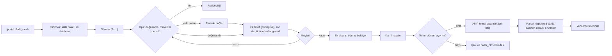
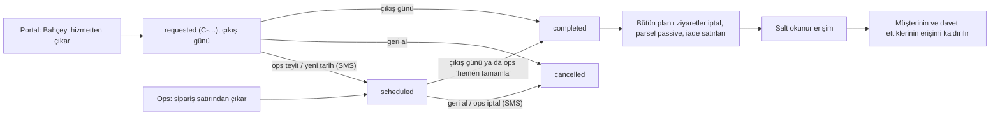

# Üyelik Boyunca Bahçe Ekleme ve Çıkarma (İP14): Tasarım

28 Ekim 2026 · Yusuf · Sürüm 2

Bir müşterinin birden fazla bahçesi olabilir. Müşteri, üyeliği sürdükçe hesabına bahçe ekleyip çıkarabilecek:

1. Üyeliği olan müşteri portalda "Bahçe ekle"ye basar: ana sayfada, "Bahçelerim" başlığında ya da Hesabım › Bahçelerim'de. Bugünkü başvuru sihirbazı açılır. Paket üyeliğin paketidir ve fiyat önizlemesi kalan döneme göre yapılır.
2. Operasyon alanı ve konumu doğrular, mükerrer bahçe uyarısına bakar ve **ek teklif** verir. Ek teklifin hizmeti mevcut dönemin bitiş gününde biter. Fiyat, kalan ziyaret hakkına göre orantılanır.
3. Müşteri teklifi onaylar ve kartla ya da havaleyle öder. Bahçe parsel olarak kaydedilir, ops envanteri planlar. Bahçe bir sonraki yenilemeye girer.
4. Müşteri bahçeyi "Hizmetten çıkar"ır (bahçenin sayfasından ya da Hesabım › Bahçelerim'den). Nedenini ve zamanını seçer: 30 gün sonra, dönem sonunda ya da, yalnızca ilk 14 günde ve açıkça seçerek, cayma hakkıyla bugün. Talep çıkış gününde kendiliğinden işler. Ops tarihi teyit eder ya da müşteriyle anlaşarak değiştirir.
5. Çıkış gününde parselin bütün planlı ziyaretleri iptal edilir ve parsel `passive` olur. Faturalanıp yapılmamış ziyaretlerin bedeli, satıra daha önce yapılmış iadeler düşülerek iade sırasına girer. Müşteri ve davet ettiği hissedarlar raporları 90 gün salt okunur görür, sonra bu erişim kalkar. Veri silinmez.
6. Yenileme teklifi o gün hizmette olan bütün bahçeleri içerir; çıkarılanlar düşer.

Yeni bir üyelik tablosu açılmaz. Üyelik dönemi, İP12'nin **temel siparişidir**: başvurudan gelen ilk sipariş, ops'un parsel teklifi ya da yenileme. Ek siparişler `addon_of_order_id` ile temel siparişe bağlanır ve onunla aynı gün biter. Çıkarma için tek yeni tablo `public.garden_removal`'dır.

**Mevcut veriler taşınmaz.** main'deki her siparişte `addon_of_order_id` boş olacağı için hepsi temel sipariştir. İP12'de iki ayrı başvuru yapmış bir müşterinin bugün iki ayrı dönemi vardır. Bunlar §4.4'teki çoklu dönem kurallarıyla okunur ve yenileme zamanı gelince ek teklifle tek döneme toplanabilir.

Mevcut fonksiyonların imzaları değişmez; bir kısmı aynı imzayla yeniden yazılır (§9.6). Müşteriye ve sözleşmeye dokunan yeni yollar, sunucu tarafındaki `org_billing_setting.garden_changes_enabled` anahtarına bağlıdır. Anahtar barındırılan projelerde kapalı olarak birleşir. İş iki dalgada dört akışa bölündü (§17). Akış A'nın teslim sınırı §9.13'tedir.

Bağlam:
- [musteri-yonetimi.md](musteri-yonetimi.md) (İP12): tablolar, fonksiyonlar, kilit sırası, hata kodu ve denetim kalıpları. Bu doküman onun üzerine yazılır. Burada tekrarlanmayan her kural oradaki gibidir.
- [demo-turu.md](demo-turu.md) (İP13) §6: yazma kilidi, hesap kilidi, drift denetimi.
- [veri-modeli.md](veri-modeli.md), [MVP.md](MVP.md) (parsel yaşam döngüsü).
- [hukuk/hizmet-sozlesmesi-taslagi.md](hukuk/hizmet-sozlesmesi-taslagi.md) Md. 2, 8, 8A, 8B, 12; [hukuk/iptal-iade-politikasi-taslagi.md](hukuk/iptal-iade-politikasi-taslagi.md).

Temel: `main` ≥ `8ce1252` (#66 ve #67 birleşti). En yeni migration `20261101120300_demo_guard_drift.sql`. `scripts/check-migration-order.sh` main'de ve CI'da çalışır; daha eski damgalı yeni migration'ı reddeder. İP14'ün migration aralığı `20261102120000`–`20261102129999`.

## 1. Kapsam

| Alan | İP14'te |
| --- | --- |
| Üyelik dönemi | Temel sipariş ve ek siparişler, ortak bitiş. Bir müşteride birden çok dönem için okuma kuralları ve birleştirme yolu (§4.4). Müşteri ve ops için okuma fonksiyonları |
| Bahçe ekleme | Portal girişleri; sihirbazda üyelik bilgisi, kilitli paket ve ek önizleme; ops doğrulaması; mükerrer uyarısı; ek teklif (`pricing-v2`); kabulde, ödemede ve aktivasyonda dönem ve çift kapsama denetimleri; yenilemeye dahil etme |
| Geri ekleme | Aynı müşterinin pasif parseli yeniden kullanılır. Yayımlanmış envanter varsa envanter ücreti alınmaz. Devirle çıkarılan parsel yeniden bağlanamaz |
| Başvuru ve teklif aşamasında çıkarma | Gönderilmiş ya da teklif verilmiş başvurudan tek bahçeyi geri çekme; ödenmemiş siparişi düzeltmeye açma (teslim sınırında "yapılabilirse", §9.13) |
| Bahçe çıkarma | Müşteri talebi (açık cayma seçeneğiyle) ya da ops kararı; çıkış günü; iade hesabı ve iade satırları; planlı ziyaretlerin iptali; parselin pasife alınması; salt okunur erişim süresi; erişimin kapsamlı kaldırılması |
| Üyeliği sonlandırma | Tüm bahçeleri çıkarma. İdari fesihte (`ops_terminate_order`) ek siparişler de sona erer |
| Yenileme | Dönemin hizmetteki bütün bahçeleri. Ek sipariş yenileme hedefi olamaz. Teklif başına en çok 50 bahçe |
| Back office | Çıkarma kuyruğu ve ayrıntısı, ek teklif, müşteri panelinde üyelik ve bahçeler, sipariş satırı durumları, parsel hizmet kartı, ayarlar |
| Bildirim | Çıkarma planlandı, tarihi değişti, iptal edildi, bahçe çıkarıldı, erişim bitiyor |
| Hukuk taslakları | Çoklu bahçe, ek sipariş, bahçe bazında fesih, iade, cayma, ön bilgilendirme |

**Kapsam dışı:**
- Bir üyelikte farklı paketler. Dönemin paketi temel siparişin paketidir; paket yenilemede değişir.
- Yenilenmeyen üyelikte erişimin otomatik kapanması, yani Md. 12/4'ün dönem sonunda uygulanması. Karara bağlandı: 12/4 bütün sona erme hallerine uygulanır; T08 ilk dönem bitişinden önce ([hukuk/kararlar.md](hukuk/kararlar.md) H23). Bu İP'de yapılmaz (§19).
- Bahçenin başka müşteriye tek adımda devri. Devir, eski sahipte çıkarma ve yeni sahipte yeni başvurudur (§13).
- Ziyaret penceresi (Ek-2) modeli ve ziyaret planlamasının siparişe bağlanması. Envanteri ve ziyaretleri ops bugünkü gibi elle planlar.
- Hissedarın kendi adına çıkarma talebi; erişimi kalkan hissedara SMS.
- KVKK silme ve anonimleştirme (İP12 §19).
- Demo turunda faturalama ekranları (İP13 §1).

## 2. Kararlar

- **Kullanıcı kararı (28 Ekim):** "Müşterinin birden fazla bahçesi olabilir ve üyeliği boyunca bahçe ekleyip çıkarabilmeli hesabına." Açık seçimlerde önerilen seçenek uygulanır.
- **Kullanıcı kararları (28 Ekim, açık sorulara yanıt):**
    - **Fiyat:** Bahçe fiyatı minimum ücret ve dönüm başına ücretle hesaplanır; hangisi büyükse o alınır (`max(dönüm × birim fiyat, minimum ücret)`, İP12'deki gibi). Ek bahçeye özel bir fark uygulanmaz: aynı formül kalan ziyaret hakkına göre orantılanır. Minimum ücret de orantılanır (§6). Envanter ücreti tam alınır.
    - **Cayma:** Çok bahçeli bir siparişte tek bir bahçe için cayma hakkı kullanılabilir. Envanter sayımı yapıldıysa envanter ücreti iade edilmez. Yapılmış periyodik ziyaretlerin bedeli de düşülür (md. 15/1-(h)). Karar: tacir Sahip'e de cayma sözleşmeyle tanınır (hukuk/kararlar.md H10); düşme yalnızca hizmete erken başlama onayı varsa uygulanır (H11, T03).
    - **Erişim:** Çıkarılan bahçede 90 gün salt okunur erişim yeterli.
- **Hedef: müşterinin tek bir üyelik dönemi vardır ve bütün bahçeleri aynı gün biter.**
    - Müşteri tek bir bitiş tarihi ve tek bir yenileme teklifi görür (Md. 12/2: yenileme teklifi bitimden 45 gün önce verilir).
    - İP12 tablolarında en az kırılma budur. Yeni üyelik tablosu açılmaz; `service_order` ve `quote` tablolarına boş bırakılabilir tek bir sütun eklenir (`addon_of_order_id`). Mevcut fonksiyonların imzaları değişmez.
    - `ops_issue_parcel_quote` yenilemede istenen parselleri zaten kabul ediyor. Dönemin bütün bahçeleri tek yenileme teklifinde toplanır.
    - **Mevcut çoklu dönemler:** Veri taşıması yapılmaz. Birden çok temel siparişi olan müşteri için okuma, ek teklif ve birleştirme kuralları §4.4'tedir. Üyeye "Ayrı dönemle teklif ver" yalnızca ops'un açık onayıyla verilir.
    - Seçilmeyen: her ek bahçeye ayrı bir yıllık sipariş (bugünkü davranış). Fiyat formülü değişmezdi, ama dönemler dağılır ve yenileme bahçe bahçe bölünür.
    - Seçilmeyen: ayrı bir `customer_membership` tablosu. Temel sipariş dönemin başını, sonunu ve paketini zaten taşıyor; ikinci bir kaynak tutarsızlık riski getirir. Ayrıca `public.membership` adı org rolleri tablosunda kullanılıyor.
- **Ek bahçenin fiyatı kalan ziyaret hakkına göre orantılanır** (`pricing-v2`, §6).
    - Ziyaret hakkı = yıllık ziyaret × kalan gün ÷ dönem günü. Yarım yukarı yuvarlanır, en az 1'dir.
    - **Neden gün değil ziyaret:** Hizmetin birimi ziyarettir. Md. 8A/2 ve 12/3 iade tutarını da ziyaret bedeliyle tanımlıyor. Hak teklif satırına (`quote_item.visits`) yazılır ve çıkarmadaki iade aynı sayıdan hesaplanır. Saf gün orantısı küsuratlı ziyaret üretirdi.
    - **Neden ziyaret penceresi (Ek-2) değil:** Pencereler veritabanında modellenmiyor. Üç ziyaretlik paketin hangi pencereleri kullandığı belirsiz (MVP açık sorusu). Zaman orantısı belirlenimlidir, test edilebilir ve dört pencereye yakın sonuç verir (§6 örneği).
    - Envanter yapılmadan periyodik ziyaret yapılmaz. Envanter ancak sonraki bir uygun dönemde yapılabilecekse ops başlangıç olarak o tarihi önerir; ziyaret hakkı buna göre azalır.
    - Minimum ücret aynı oranla orantılanır, böylece ziyaret başına asgari bedel sabit kalır. Envanter ücreti tam alınır, çünkü tek seferlik bir iştir. İkisi de insan onayı bekler (§19).
    - Fiyat listesi, teklif günü yürürlükte olan yayımlı listedir. Bu İP12 kuralıdır ve Md. 12/2 ile aynıdır. Liste teklifte dondurulur.
    - **Son ek günü:** `addon_last_day = dönem sonu − addon_min_days + 1` (varsayılan 30 gün). Ek teklif bu güne kadar geçerlidir, en geç bu günün sonunda ödenir ve bu günden sonra ne kabul edilir ne kartla ödenir (`addon_base_closed`). Daha sonra gelen ek bahçe, yenileme ödenip aktifleşince yeni döneme tam yıl olarak eklenir.
- **Ek bahçe bir başvuruyla gelir.** Bugünkü başvuru ve doğrulama adımları aynen kullanılır, yeni bir müşteri ekranı açılmaz. Ops teklif türünü seçer: üyelik varsa varsayılan ek tekliftir; bugünkü `ops_issue_quote` "ayrı dönem" seçeneği olarak kalır ve üyeye açık bir onayla verilir. Ops, müşterinin sahip olduğu mevcut parseller için başvurusuz ek teklif de verebilir (§4.3).
- **Çıkarmanın birimi bahçedir, yani sipariş satırıdır.** Satıra `removed_on` ve `garden_removal_id` bir kez yazılır. Sipariş ancak son bahçesi çıkınca sona erer.
- **Çıkış günü ve cayma:**
    - Müşteri üç seçenekten birini **açıkça** seçer:
        - "30 gün sonra" (varsayılan): bugün + `removal_notice_days` (30; Md. 12/3) ile satırın dönem sonunun ertesi gününden hangisi önce geliyorsa o gün.
        - "Dönem sonunda": satırın dönem sonunun ertesi günü.
        - "Cayma hakkımı kullanıyorum": yalnızca cayma süresinde gösterilir. Çıkış bugündür.
        - Karar: "hemen" seçeneği (çıkış yarın) eklenecek, varsayılan kalkacak (hukuk/kararlar.md H20, T05). Uygulandı: dört seçenek, varsayılan yok (§22.1).
    - **Cayma, bir zamanlama seçiminden çıkarılmaz.** Tüketicinin kullandığı bir haktır, bu yüzden ayrı bir seçenektir.
    - **Cayma süresi:** talep günü (İstanbul) ≤ `withdrawal_until` olmalı. `withdrawal_until` = siparişin `activated_at` günü + 14 (`private.withdrawal_until`). Karar: süre etkinleşme gününden sayılmaya devam eder (Sahip lehine uzatma; hukuk/kararlar.md H13).
    - Talep ops onayı beklemez; çıkış günü gelince kendiliğinden işler. Md. 12/3 fesih hakkını iki tarafa da veriyor; ops onayı bir hak değil, operasyonel bir kontroldür. Ops tarihi müşteriyle anlaşarak değiştirebilir; müşteriye SMS gider.
    - **Ödeme bekleyen bir siparişte bulunan bahçe için çıkarma talebi alınmaz** (`parcel_order_pending`). Önce o sipariş iptal edilir ya da düzeltilir; ödenmiş bir yenilemenin satırı ise çıkarmaya dahil edilir.
- **İade (varsayılan, ayarlanabilir):**
    - **Faturalanan ziyaret:** İşletmenin kendi tetiklediği yeniden taramalar sayılmaz: bir `extra_visit` takip isteğine bağlanmış ziyaretler (işleme hattının kapsama isteği ya da uzmanın ek ziyaret isteği). Aynı gün yapılmış iki tarama tek ziyaret sayılır. Sayı en çok ziyaret hakkı kadar olur.
    - **Kullanılmayan ziyaret × satırın ziyaret bedeli.** Envanter payı yalnızca envanter yapıldıysa tutulur, yapılmadıysa iade edilir (Md. 12/3, 8A/2).
    - **Önceki iadeler düşülür:** iade = max(0, hesap − satıra daha önce açılmış ya da yapılmış iadeler). Md. 8A kaçırılmış ziyaret iadeleri de buna dahildir; böylece bir ziyaret iki kez ödenmez. Satıra bağlanamayan kalemsiz iade (çok satırlı siparişte havale ya da `void`) varsa sistem iade satırı açmaz, yalnızca hesabı gösterir; ops karar verir.
    - **Dönemi biten satır:** Dönemi çıkış gününden önce biten satır çıkarma iadesine girmez. O dönemin kaçırılmış ziyaretleri yalnızca Md. 8A süreciyle iade edilir.
    - **Cayma:** Satırın tamamı iade edilir. Yapılmış envanterin payı ve yapılmış periyodik ziyaretlerin bedeli düşülür (Md. 8B; Mesafeli Sözleşmeler Yönetmeliği md. 15/1-(h); hukuk/kararlar.md H11: kesinti yalnızca erken başlama onayı varsa, T03).
    - **Mükerrer kayıt** (ops'un hatası, neden `duplicate`): Satırın tamamı iade edilir, yalnızca yapılmış ziyaretler düşülür.
    - **İade satırları:** Sistemce `requested` durumunda açılır; ops bugünkü iade ekranından işler. `removal_refund_mode = 'manual'` iken ya da satıra bağlanamayan iade varken tutar yalnızca hesaplanıp gösterilir.
    - Bu varsayılan muhafazakârdır: sözleşme taslağıyla uyumludur, para ops işlemeden çıkmaz, hesap dondurulmuş teklif satırından yapılır ve her satırın KDV payı ayrıca yazılır.
- **Veri silinmez.** Kural, KVKK gereği "sözleşme, erişim ve saklama süresi içinde silinmez; süre dolunca silinir ya da anonim hale getirilir" olarak okunur (hukuk/kararlar.md H25).
    - Parsel `passive` olur. Medya, ölçüm ve raporlar kalır (CLAUDE.md).
    - Erişim süresi `removal_access_days` (90; Md. 12/4) gündür. Bu süre boyunca parsel salt okunurdur: soru sorulamaz, hissedar davet edilemez.
    - **Süre bitince kaldırılan erişim:**
        - müşterinin kendi sahip satırı,
        - müşterinin davet ettiği hissedarlar,
        - parselde başka sahip kalmıyorsa bütün hissedarlar.

      Parseldeki diğer sahipler kalır. Ops "herkesin erişimini kaldır"ı seçebilir; seçim denetime yazılır.
    - Devirde erişim süresi 0'dır. Ayardan kısa bir süre yalnızca `transfer` ya da `duplicate` nedeniyle veya gerekçe notuyla verilebilir.
- **Geri ekleme aynı müşteri için aynı parseli kullanır.**
    - Ops başvurudaki bahçeyi müşterinin eski parseline bağlar. Aktivasyon parseli pasiften çıkarır, sahip erişimini yeniden verir ve önceki çıkarmanın açık erişim penceresini kapatır.
    - Başka bir müşterinin parseli gizlilik nedeniyle bağlanamaz; yeni sahip yeni bir parsel alır. Devirle (`transfer`) çıkarılmış parsel aynı müşteriye de bağlanamaz.
- **Çift kapsama yok.**
    - Bir parsel, dönemleri çakışan iki siparişte bulunamaz.
    - Bu kural teklif verilirken, bağlamada ve kabulde parsel başına bir danışma kilidi (`parcel_coverage:<parsel>`) altında denetlenir. Hesap başına 50 bahçe sınırı da kabulde müşteri kilidi altında yeniden sayılır.
- **Üyeliği sonlandırma:**
    - Önerilen yol "Tüm bahçeleri çıkar"dır.
    - İdari fesih (`ops_terminate_order`) temel siparişte şunları da yapar:
        - aktif ek siparişleri sona erdirir,
        - ödeme bekleyen ek siparişleri iptal eder,
        - açık ek teklifleri iptal eder.
- **Sunucu anahtarı: `org_billing_setting.garden_changes_enabled`** (varsayılan kapalı).
    - Kapalıyken `customer_request_garden_removal`, `ops_request_garden_removal`, `ops_issue_addon_quote` ve `customer_addon_preview` `garden_changes_closed` döner. Üyenin ek siparişe dönüşecek başvurusu da (`addon_base_order` dolu) `customer_submit_application`'da aynı hatayı alır. Portal girişleri gizlenir; ops başvuru sayfası üyeye de İP12 teklifini (önizleme ve "Teklif ver") gösterir.
    - Ayrı bir web bayrağı yoktur.
    - Açılmış kayıtlar anahtar kapalıyken de işler.
- **Demo:**
    - Demo hesabının müşteri profili ve siparişi yoktur; okuma fonksiyonları boş döner.
    - Yeni müşteri yazma fonksiyonları ilk satırda `private.assert_not_demo()` çağırır.
    - Yeni tablo demo korumalarını alır. Yeni bildirim fonksiyonu demo süzgecini taşır.

## 3. Kavramlar ve roller

| Kavram | Tanım |
| --- | --- |
| Temel sipariş | `addon_of_order_id is null` olan sipariş: başvurudan gelen ilk sipariş, parsel teklifi ya da yenileme. Üyelik dönemini (`service_start`–`service_end`) ve paketi belirler |
| Ek sipariş | `addon_of_order_id = <temel sipariş>` olan sipariş. Kendi teklifi, ödemesi, makbuzu ve cayma süresi vardır; karar: ayrı bir mesafeli sözleşmedir (hukuk/kararlar.md H13). Bitişi temel siparişin bitişidir |
| Üyelik dönemi | Bugünü kapsayan aktif temel sipariş ve ona bağlı aktif ek siparişler. Ödenmiş bir yenileme "sonraki dönem"dir |
| Ana dönem | Müşterinin birden çok dönemi varsa portalın ve ek teklifin kullandığı dönem (`is_primary`, §4.4) |
| Son ek günü | `addon_last_day = service_end − addon_min_days + 1`: ek teklifin kabul edilebileceği ve ödenebileceği son gün |
| Hizmetteki bahçe | Aktif bir siparişin `parcel_id` taşıyan satırı. Bugün satırın dönemi içindedir ve `removed_on` boş ya da bugünden sonradır (`private.parcel_served_on`) |
| Faturalanan ziyaret | Ziyaret hakkından düşülen periyodik tarama (§7.1) |
| Cayma süresi sonu | `withdrawal_until` = siparişin `activated_at` günü (İstanbul) + 14. O gün dahildir |
| Çıkarma | `public.garden_removal` kaydı (`C-2026-000001`): bir parselin bir müşteri için hizmetten çıkışı |
| Çıkış günü | `effective_on`: bahçenin hizmette olmadığı ilk gün. Son hizmet günü bir önceki gündür |
| Erişim sonu | `access_until`: o gün §5.4'teki erişimler kaldırılır |

| Rol | Ekleme | Çıkarma |
| --- | --- | --- |
| Müşteri (ödeyen sahip) | Başvuru, teklif onayı, ödeme | Talep (30 gün, dönem sonu ya da cayma), önizleme, geri alma |
| Hissedar | — | Talep edemez. Çıkış bilgisini görür. Müşterinin davet ettiği hissedarın erişimi müşterininkiyle birlikte biter |
| Ops | Doğrulama, mükerrer kontrolü, parsele bağlama, ek teklif | Çıkarma açma, tarih teyidi ve değişikliği, erişim kapsamı, iptal, hemen tamamlama; iade işleme |
| Sistem (pg_cron) | Aktivasyonda dönem denetimi | Çıkış gününde tamamlama, erişim bildirimi, erişimin kaldırılması |
| Saha, uzman | Değişmez | Planlı ziyaretleri iptal edilmiş görür |
| Demo | Okur, yazamaz | — |

## 4. Bahçe ekleme



### 4.1 Akış

1. **Giriş.** Şu iki koşul sağlanınca müşteri "Bahçe ekle"yi görür: `my_service_period()` bir ana dönem (`is_primary`) döndürür ve `garden_changes_enabled` açıktır. Girişler:
    - portal ana sayfasında bir kart (açık taslak yoksa),
    - "Bahçelerim" başlığının yanında bir düğme,
    - `/portal/hesap` sayfasındaki "Bahçelerim" yönetim bölümü.

    Hepsi `/portal/basvuru/yeni`'ye gider. Üyeliği olmayan müşteri için bugünkü "Bahçenizi kaydedin" akışı aynen kalır.
2. **Sihirbaz.**
    - **Paket:** Paket seçimi üyeliğin paketiyle seçili ve kilitli gelir. Taslak `customer_create_application(p_package_id => <üyelik paketi>)` ile açılır; ikinci bir yazma yoktur. Daha önce açılmış bir taslağın paketi farklıysa bir kez `customer_set_application_package` ile düzeltilir.
    - **Paket kullanılamıyorsa:** Üyeliğin paketi artık etkin değilse ya da fiyatı yoksa (`public_package_prices` listesinde değilse) sihirbaz yerine "Ek bahçe için ekibimizle iletişime geçin" açıklaması çıkar. Ops bu durumda parsel ya da başvuru yolunu temel paketle kullanır.
    - **Bant ve liste:** Üstte paket, hizmet bitişi ve "fiyat kalan döneme göre hesaplanır" notu yer alır. Altında salt okunur "Hesabınızdaki bahçeler" listesi bulunur.
    - **Önizleme:** `customer_addon_preview` ile yapılır. Son ek günü geçtiyse (`addon_period_too_short`) şu açıklama çıkar: "Ek bahçeniz yenilemeyle başlayan yeni döneme eklenir."
3. **Gönderim.** Bugünkü `customer_submit_application` kullanılır. Başvuru başına en çok 10 bahçe olur (`too_many_gardens`). Hesapta hizmette ve ödeme bekleyen bahçelerle birlikte en çok 50 bahçe olabilir (`account_garden_limit`); bu sınır teklifte ve kabulde denetlenir.
4. **Ops incelemesi** (`/operasyon/basvuru/[id]`):
    - Ops alanı ve konumu bugünkü gibi doğrular (`ops_verify_application_garden`).
    - Her bahçe için `ops_garden_overlaps` sonucu gösterilir: sınırı bahçenin konumunu içeren ya da kaba sınırıyla kesişen parseller ve konumu 200 m içinde kalan parseller.
    - Bahçe müşterinin eski (pasif) parseliyse ops onu `ops_link_application_garden_parcel` ile bağlar. Başka bir müşterinin parseliyse ya da devirle çıkarılmışsa bahçe ret (`duplicate`) ya da yeni parsel olur.
    - Fazla ya da yanlış bahçeyi ops `ops_withdraw_application_garden` ile geri çeker (§9.13).
5. **Ek teklif.**
    - Ops önce `ops_preview_addon_quote` ile önizler, sonra `ops_issue_addon_quote(p_base_order_id => <üyelik>, p_application_id => …)` ile teklifi verir.
    - Varsayılan temel sipariş `ops_customer_service_period.addon_base_order_id`'dir.
    - Fiyat §6'ya göre hesaplanır. Geçerlilik `min(bugün + geçerlilik, addon_last_day)` olur. Müşteriye `quote_ready` gider.
6. **Kabul ve ödeme.**
    - Bugünkü `customer_accept_quote` ve ödeme yolları kullanılır.
    - **Kabulde:**
        - Temel sipariş `active` olmalı ve bugün ≤ `addon_last_day` olmalı, değilse `addon_base_closed`.
        - Çift kapsama ve hesap sınırı kilit altında yeniden denetlenir.
        - Sipariş `addon_of_order_id` alır.
        - Ödeme süresi `addon_last_day` gününün sonunu aşmaz. `ops_extend_payment_due` ek siparişte bu sınırın ötesine tarih veremez.
    - **Kartla ödeme:** `payment_begin` aynı koşulda `addon_base_closed` döner, böylece son ek gününden sonra para alınmaz.
    - **Havale:** `ops_record_manual_payment` havaleyi her zaman kaydeder, çünkü para bankaya gelmiştir. Dönem kapandıysa aktivasyon reddeder ve iade açar (7. adım).
7. **Aktivasyon** (`private.activate_order`):
    - **Dönem kapandıysa:** Ek siparişte temel sipariş artık `active` değilse ya da bugün > `addon_last_day` ise sipariş aktifleşmez. Sistem siparişi `cancelled` (`addon_base_closed`) yapar, siparişin bütün başarılı ödemeleri için `order_closed` iadesi açar ve `order.activation_refused` yazar. Bu yalnızca para alındıktan sonra dönem kapanırsa olur: incelemede bekleyen ya da gece yarısını geçen bir kart ödemesi, geç kaydedilen bir havale.
    - **Dönem ve parsel:** Aksi halde `service_start` = önerilen başlangıç ile bugünden büyük olanıdır; `service_end` = temel siparişin `service_end` değeri. Yeni bahçeye `registered` parsel açılır.
    - **Bağlanmış bahçe:**
        - Parsel pasiften çıkar ve sahip erişimi yeniden verilir.
        - Başvurudaki ayrıntı (`private.parcel_detail`: tapu, saha iletişim) güncellenir.
        - Parselde arazi ölçümüyle (`field_survey`) bir sınır yoksa ve kaba sınır son sınırdan farklıysa yeni bir `owner_declared` sınır sürümü eklenir. Eski sürümler kalır.
        - Aynı müşterinin bu parseldeki önceki çıkarmasının açık erişim penceresi kapanır (`resumed`, §5.4).
    - Envanter bekleyen parsel bugünkü `parcels_awaiting_inventory` sayacında görünür.
8. **Yenileme.**
    - Ops temel siparişi yeniler (`ops_issue_parcel_quote(p_renewal_of_order_id => <temel>)`).
    - Yenileme ekranı temel siparişin ve ek siparişlerin hizmetteki parsellerini işaretli getirir.
    - Ek siparişin kendisi yenilenmez; `renewals_due` sayacına ve `ops_orders.renewal_due` bayrağına girmez.
    - Hizmetteki bütün bahçeleri ertesi gün başka bir siparişle kapsanan ya da çıkmakta olan temel sipariş için yenileme uyarısı söner (`private.renewal_due`).

### 4.2 Dönem sonu yakınken ya da yenileme ödenmişken

- **Son ek günü geçtiyse:** Ek teklif, yenileme siparişi aktifleşince yeni temel siparişe verilir. Başlangıç yeni dönemin ilk günü olduğu için ziyaret hakkı tamdır. Yenileme ödenmiş ve aktifse `private.addon_base_order` bunu kendiliğinden seçer.
- **Ek sipariş yenilemeden sonra aktifleşirse:**
    - **Açık yenileme teklifi:** Ops teklifi yeniden verir; eskisi `superseded` olur.
    - **Ödenmiş yenileme:** Ops sonraki dönem için parsel yoluyla ek teklif verir (§4.3). `ops_customer_gardens.in_next_period = false` bu durumu ops'a gösterir.

### 4.3 Mevcut parseller için ek teklif

`ops_issue_addon_quote(p_base_order_id, p_parcel_ids => …)` müşterinin sahip olduğu (`parcel_access` `owner`) parselleri başvurusuz olarak ek teklife koyar. Alan, `ops_issue_parcel_quote`'taki gibi son sınırdan ya da tahminden alınır. Devirle çıkarılmış parsel `parcel_not_reusable` döner. Şu durumlarda kullanılır:
- çıkarılmış ama erişimi sürmekte olan bir bahçeyi geri eklemek,
- yenileme ödendikten sonra eklenen bahçeyi sonraki döneme taşımak,
- pilot parselini üyeliğe katmak,
- iki dönemi birleştirmek (§4.4).

### 4.4 Birden çok dönem

Bir müşterinin birden çok temel siparişi iki yoldan olabilir: İP12'deki mevcut veriler (her başvuru kendi bir yıllık siparişini açtı) ve ops'un "Ayrı dönemle teklif ver" seçeneği.

- **Okuma:**
    - `my_service_period` ve `ops_customer_service_period` her güncel temel sipariş için bir satır döner; sıralama `period_end`'e göredir.
    - Ödenmiş yenileme ayrı satır değildir, önceki satırın `next_*` alanlarıdır.
    - Tam olarak bir satır `is_primary = true` taşır: ek teklifin bağlanacağı dönem ya da onun önceki dönemi. Ek teklif dönemi yoksa en geç biten dönem seçilir.
    - `period_count > 1` iken portal şu notu gösterir: "Birden fazla hizmet döneminiz var; yenileme zamanı geldiğinde ekibimiz bahçelerinizi tek döneme toplamayı önerecek." Ops panelleri de bir uyarı gösterir.
- **Ek teklifin temel siparişi** (`private.addon_base_order`):
    - Adaylar: kalan günü (`service_end − max(bugün, service_start) + 1`) `addon_min_days`'ten az olmayan aktif temel siparişler.
    - Seçilen: hizmetin en erken başlayabildiği aday. Eşitlikte bitişi en geç olan, sonra id sırasıyla ilki.
    - Böylece bugünü kapsayan uzun dönem önce gelir; birden çok güncel dönem varsa en geç biten seçilir ve dönemler o yöne toplanır.
- **Birleştirme:**
    - Erken biten X dönemi yenilenmez. X'in bahçeleri, geç biten Y dönemine parsel yoluyla ek teklifle taşınır: `ops_issue_addon_quote(p_base_order_id => Y, p_parcel_ids => X'in bahçeleri, p_proposed_service_start => X.service_end + 1)`.
    - Fiyat kalan döneme göre orantılanır.
    - X'in bütün bahçeleri ertesi gün kapsanınca X'in yenileme uyarısı söner (`private.renewal_due`).
- **Ayrı dönem:** Ops "Ayrı dönemle teklif ver"i (bugünkü `ops_issue_quote`) üyeye yalnızca açık bir onay kutusuyla verir. Veritabanı bunu engellemez (§19).

## 5. Bahçe çıkarma



### 5.1 Müşteri talebi

1. **Girişler.**
    - **Parsel sayfası:** Ödeyen sahibe (`my_gardens` satırı varsa) bir "Hizmet" kartı gösterilir. Kartta hizmet dönemi, ziyaret durumu (`visits_used`/`visits_entitled`) ve varsa cayma süresinin sonu yer alır.
    - **`/portal/hesap` › "Bahçelerim":** Her bahçe durumuyla listelenir. "Hizmetten çıkar" düğmesi parsel sayfasındaki forma götürür.
    - **Siparişsiz (pilot) sahip parseli:** "Bu bahçeyi çıkarmak için bize ulaşın" yazar.
2. **Form.**
    - Neden: `sold`, `not_needed`, `dissatisfied`, `cost` ya da `other`.
    - İsteğe bağlı not (en çok 1000 karakter).
    - **Zaman:** her seçenek kendi tarihiyle ve kendi tahmini iadesiyle gösterilir. Her seçenek için `customer_garden_removal_preview` ayrı çağrılır.
        - "Hemen" (çıkış yarın; §22.1),
        - "30 gün sonra",
        - "Dönem sonunda",
        - yalnızca `withdrawal_until ≥ bugün` iken: "Cayma hakkımı kullanıyorum: bahçe bugün hizmetten çıkar, ödediğiniz tutar iade edilir (yapılmış envanter ve ziyaretler hariç)."
    - Önizleme çıkış gününü, tahmini iadeyi ("en fazla") ve erişim sonunu gösterir.
    - Hiçbir seçenek önceden işaretli değildir (§22.1).
    - Zorunlu onay kutusu.
3. **Talep.** `customer_request_garden_removal(p_parcel_id, p_reason, p_timing, p_note, p_cancel_order_id)` (§22.1) bir `C-…` numarası verir ve kaydı `requested` olarak yazar. SMS gönderilmez; durum kartta görünür. Müşteri kendi talebini tamamlanana kadar geri alabilir (`customer_cancel_garden_removal`). Ops'un açtığı çıkarmayı (`initiated_by = 'ops'`: devir, mükerrer kayıt, ops'un açtığı tarih) müşteri geri alamaz (`removal_not_open`); onu yalnızca ops iptal eder. `my_gardens.removal_initiated_by` bunu portala taşır: ops'un açtığı kayıtta "Talebi geri al" yerine "Bu çıkarmayı ekibimiz başlattı; değişiklik için bize ulaşın." görünür.
4. **Engeller.**
    - **Ödeme bekleyen sipariş:** Bahçe ödeme bekleyen bir siparişteyse (örneğin kabul edilmiş ama ödenmemiş yenileme) talep `parcel_order_pending` döner. Portal o siparişe yönlendirir: "Siparişi iptal et" ya da, başvurudan geliyorsa, "Bahçe listesini değiştir".
    - **Cayma süresi:** Süre geçtiyse cayma seçeneği `withdrawal_expired` döner. Süre sınırında (14. gün kabul, 15. gün ret) test edilir.

### 5.2 Ops

- **Kuyruk:** `/operasyon/cikarma`. Ayrıntı sayfasında hesap önizlemesi (`ops_garden_removal_preview`) gösterilir:
    - planlı ziyaretler, çekilmiş ama yayımlanmamış ziyaretler, açık takip istekleri, bekleyen davetler, açık iadeler,
    - ödeme bekleyen siparişler, erişim kapsamı,
    - varsa tamamlamayı durduran engel (`blocked_reason`).
- **Eylemler:**
    - **Tarihi teyit et ya da değiştir:** `ops_schedule_garden_removal` (tarih, erişim günü, "herkesin erişimini kaldır", not). Tarih talepten farklıysa not zorunludur. İlk teyitte `garden_removal_scheduled`, sonraki her tarih değişikliğinde `garden_removal_rescheduled` gider.
    - **Hemen tamamla:** `ops_complete_garden_removal`. Çıkış günü gelmiş olmalıdır.
    - **İptal:** `ops_cancel_garden_removal`, not zorunlu. Müşteriye `garden_removal_cancelled` gider.
- **Erişim süresi:** Ayardaki `removal_access_days`'ten kısa bir süre yalnızca neden `transfer` ya da `duplicate` iken veya not girildiğinde kabul edilir. Denetime eski ve yeni değer yazılır.
- **Ops'un açtığı çıkarma:**
    - Sipariş ayrıntısında satır başına "Bahçeyi çıkar" vardır: `ops_request_garden_removal(neden, tarih, erişim günü, not, herkesin erişimini kaldır)`.
    - Kayıt doğrudan `scheduled` açılır ve müşteriye `garden_removal_scheduled` gider.
    - Devirde neden `transfer` ve erişim günü 0'dır.
- **Üyeliği sonlandırma:**
    - Müşteri panelinde "Tüm bahçeleri çıkar", hizmetteki her satır için aynı tarihle `ops_request_garden_removal` çağırır. Önerilen yol budur.
    - Siparişin tamamını `ops_terminate_order` ile feshetmek idari durumlar için kalır ve parsele dokunmaz. Temel siparişte bu işlem aynı işlem içinde şunları yapar:
        - aktif ek siparişleri `terminated` yapar (neden `base_terminated`),
        - ödeme bekleyen ek siparişleri `cancelled` yapar; para tutulmuşsa her başarılı ödeme için `order_closed` iadesi açılır, süren bir kart denemesi varsa sipariş mutabakata bırakılır,
        - açık ek teklifleri `cancelled` yapar,
        - başka bir aktif siparişte satırı kalmayan bahçelerin açık çıkarmalarını sistemce iptal eder (SMS gitmez).

### 5.3 Tamamlama (`private.complete_garden_removal`)

Gece çalışan `garden-removal-housekeeping` ya da ops'un "hemen tamamla" eylemi tek işlemde şunları yapar:

1. **Kilitler.**
    - Sıra: `parcel_coverage:<parsel>` → etkilenen siparişler ve müşterinin bu parseli içeren ödeme bekleyen siparişleri (id sırasıyla) → çıkarma kaydı.
    - Kayıt `requested` ya da `scheduled` değilse ya da çıkış günü gelmediyse hiçbir şey yapılmaz (idempotent).
    - `requested` kayıt önce `requested_effective_on` ile planlanır.
2. **Ödeme bekleyen siparişler.**
    - Para tutulmayan ve canlı kart denemesi olmayan sipariş sistemce `cancelled` olur (`garden_removed`).
    - Aksi halde kayıt tamamlanmaz: `blocked_reason = 'pending_order'` yazılır, `garden_removal.blocked` bir kez denetlenir ve ops kuyruğunda uyarı çıkar. Housekeeping ertesi gün yeniden dener.
    - Bu durum §5.1'deki engel nedeniyle yalnızca yarışlarda oluşabilir.
3. **Satırlar.**
    - **Etkilenen satırlar:** müşterinin bu parseldeki, `active` ya da `completed` siparişlerdeki, `removed_on` boş ve `service_end ≥ effective_on` olan satırları. Buna ödenmiş yenilemenin satırı da girer.
    - Her etkilenen satıra `removed_on = max(effective_on, service_start)` ve `garden_removal_id` yazılır.
    - Dönemi çıkış gününden önce biten satıra dokunulmaz. Tek istisna talep edilen satırdır: dönemi çıkış gününden bir gün önce bitiyorsa ("Dönem sonunda", ya da 30 günden az kalmışken "30 gün sonra") ona `removed_on = effective_on` (= `service_end + 1`, hizmet verilmeyen ilk gün) ve `garden_removal_id` yazılır. İadeye girmez; bahçe erişim süresi boyunca `my_gardens`'ta `removed` görünür.
    - **Etkilenen satır yoksa:**
        - Talep edilen satırın siparişi `terminated` ya da `cancelled` ise kayıt sistemce iptal edilir (iç not `order_terminated`).
        - Aksi halde kayıt iadesiz tamamlanır (`none`): dönem sonunda çıkış, yenileme yok, iade 0. Talep edilen satır yukarıdaki istisnayla işaretlenir.
4. **İade hesabı.** §7'ye göre yapılır ve `calculation`, `refund_mode`, `refund_kurus` alanlarına yazılır.
5. **Operasyon tarafı.** Parsel `effective_on` gününde başka bir aktif satırla hizmette değilse:
    - türü `inventory`, `periodic_scan` ya da `verification` olan **bütün** `planned` ziyaretler tarihten bağımsız olarak `cancelled` yapılır. Tarihi geçmiş planlı ziyaret yapılmamıştır ve zaten kullanılmamış sayılır.
    - açık ve planlı takip istekleri (`followup_request`) `cancelled` yapılır,
    - bekleyen hissedar davetleri `cancelled` yapılır,
    - parsel `passive` olur.

    Bu, main'deki yaşam döngüsü kuralını korur: parsel pasife geçmeden önce planlı ziyaretler iptal edilmiş olmalıdır. Sayılar denetime yazılır (`cancelled_visits`, `cancelled_followups`, `cancelled_invitations`). Çıkış gününden önce çekilmiş ziyaretler normal yayımlanır ve bildirilir.
6. **Kayıt.** Durum `completed` olur ve `blocked_reason` boşaltılır. İade modu `unused_visits`, `withdrawal` ya da `duplicate` ise ve tutar 0'dan büyükse iade satırları açılır (§7.3).
7. **Boşalan siparişler.** Hepsinde aktör `system`, iç not `all_gardens_removed`'dır.
    - Bütün satırları çıkmış bir ek sipariş `terminated` olur.
    - Temel sipariş, ancak kendi satırları ve aktif ek siparişlerinin bütün satırları çıkmışsa `terminated` olur. O ek siparişler de onunla birlikte sona erer.
    - Böyle sona eren temel siparişin ödeme bekleyen ek siparişleri `cancelled`, açık ek teklifleri `cancelled` olur. Para tutulmuş ek siparişte her başarılı ödeme için `order_closed` iadesi açılır (`activate_order`'ın `addon_base_closed` yolu gibi). Süren bir kart denemesi olan ek sipariş mutabakata kalır; ödeme tamamlanırsa aktivasyon onu reddedip iade eder (§4.1 adım 7).
8. **Denetim ve bildirim.** `garden_removal.completed` yazılır ve `garden_removal_completed` gönderilir.

### 5.4 Erişim süresi

- **Salt okunur dönem** (`private.parcel_read_only`):
    - **Koşul:** parselde `completed` durumda, `access_revoked_at` boş bir çıkarma vardır ve parsel bugün aktif bir satırla hizmette değildir. Koşul parselin durumuna değil, çıkarma kaydına bakar.
    - **Yasaklananlar:**
        - sahip ve hissedar soru ve yanıt yazamaz ya da düzenleyemez,
        - hissedar davet edilemez,
        - API'den `parcel_access` eklenemez.

      Hata kodu `parcel_read_only`'dir. Uzman ve ops yanıtları serbesttir.
    - **Ops'un sürdürmesi:** Bu dönemde ops parseli `ops_set_parcel_passive(false)` ile sürdüremez (`parcel_removed`). Geri ekleme ek teklifle olur. Böylece sipariş olmadan ziyaret planlanamaz.
- **Erişim bildirimi:** `access_until − 7` gününde, erişim süresi en az 14 gün ise `garden_access_ending` bir kez gönderilir.
- **`access_until` geldiğinde:**
    - **Geri eklenmiş parsel:** Parsel bugün aynı müşterinin bir satırıyla hizmetteyse hiçbir şey silinmez. `access_revoked_at` yazılır ve `garden_removal.access_revoked {removed: 0, reason: 'resumed'}` denetlenir. Geri eklemede `activate_order` bu pencereyi zaten kapatır (`garden_removal.access_closed`).
    - **Aksi halde kaldırılanlar:**
        - müşterinin kendi sahip satırı,
        - müşterinin davet ettiği hissedarlar: onaylanmış `viewer_invitation.invited_by` = müşteri, ya da `parcel_access.granted_by` = müşteri,
        - parselde başka sahip kalmıyorsa bütün hissedar satırları,
        - `revoke_all_access` seçilmişse diğer sahipler dahil herkes. Parseli başka bir müşterinin bugün ya da sonrasını kapsayan bir satırı varsa (aktif, dönemi henüz başlamamış olsa da; ya da ödeme bekleyen) bu seçenek yok sayılır.
        - Parselde kendi satırı bugün ya da sonrasını kapsayan başka bir kullanıcının erişim satırı hiçbir durumda kaldırılmaz.
    - **Denetim:** `access_revoked_at` yazılır ve `garden_removal.access_revoked {removed_user_ids, kept, reason: 'expired'}` denetlenir. Kullanıcı kimlikleri takma addır; ad ve telefon yazılmaz.

### 5.5 Başvuru ve teklif aşamasında çıkarma (teslim sınırında "yapılabilirse", §9.13)

| Aşama | Yol |
| --- | --- |
| Taslak | Bugünkü `customer_remove_application_garden` (satır silinir) |
| Gönderildi ya da teklif verildi | `customer_withdraw_application_garden`: `withdrawn_at` yazılır. Açık teklif `cancelled`, başvuru `submitted` olur. Tek bahçe kaldıysa `last_garden` döner ve müşteri başvurunun tamamını geri çeker |
| Kabul edildi, ödeme bekliyor | `customer_revise_order`: sipariş `cancelled` olur (neden `customer_revision`; ödeme ya da canlı deneme varsa bugünkü hatalar). Başvuru `accepted → submitted` olur, müşteri bahçeyi geri çeker, ops yeni teklif verir |
| Aktif | §5.1 |

- Geri çekilen bahçe ön izlemeye, teklife ve doğrulamaya girmez (`garden_withdrawn`). Bahçe satırı silinmez, çünkü eski teklif satırları ona bağlıdır.
- Bu fonksiyonlar teslim edilmezse portal ve back office bugünkü yolları kullanır: `customer_decline_quote(p_request_revision => true)`, `customer_cancel_order` ve `ops_reject_application`.

## 6. Ek teklif fiyatı (`pricing-v2`, tek kaynak: `private.price_lines_v2`)

| Adım | Formül |
| --- | --- |
| Dönem | `period_start`, `period_end`: temel siparişin `service_start` ve `service_end` değerleri. `period_days = period_end − period_start + 1` |
| Başlangıç | `start = max(önerilen gün ya da bugün, bugün, period_start)` |
| Kalan gün | `remaining_days = period_end − start + 1`. `addon_min_days` değerinden azsa, yani `start > addon_last_day` ise `addon_period_too_short` |
| Ziyaret hakkı | `visits = min(V, max(1, round(V × remaining_days / period_days)))` (`private.addon_visits`); V = üyeliğin yıllık ziyareti, temel siparişin teklifinde dondurulmuş `quote.periodic_visits_per_year` (paketin bugünkü değeri değil; önizleme, verilen teklif ve çıkarmadaki ziyaret bedeli aynı V'yi kullanır) |
| Faturalanan alan | `tenths = ceil(area_m2 / 100)` (v1 ile aynı) |
| Ziyaret tutarı | `visit_amount = round(visits × tenths × unit_price / 10)` |
| Minimum | `minimum = round(minimum_fee × visits / V)` |
| Envanter | Satırda `inventory = true` ise `inventory_fee`, değilse 0 |
| Satır tabanı | `line_base = max(visit_amount, minimum) + envanter` |
| İndirim, KDV, toplam | v1 ile aynı |

- **v1 ile eşitlik:** `visits = V` ve bütün satırlarda `inventory = first_year` ise sonuç `pricing-v1` ile birebir aynıdır. Bu bir test koşuludur.
- **Envanter kuralı:** Yeni bahçede her zaman `true`'dur. Bağlanmış bahçede ve parsel satırında, parselde yayımlanmış (`published`) bir `inventory` ziyareti yoksa `true`'dur.
- **Teklife yazılanlar:**
    - `quote_item.visits` satırın ziyaret hakkıdır; `minimum_fee_kurus` orantılanmış minimumdur.
    - `quote.first_year` = satırlardan herhangi birinde envanter var.
    - `quote.proposed_service_start` = `start`.
    - `quote.valid_until` = `min(bugün + geçerlilik, addon_last_day)`.
- **`quote.inputs`:** v1 anahtarları, ayrıca:
    - `formula = 'pricing-v2'`,
    - `addon {base_order_id, base_order_number, period_start, period_end, service_start, remaining_days, period_days, visits_per_year, visits, addon_last_day}`,
    - her alan satırında `inventory` ve (varsa) `parcel_id`.
- **Paket:** Temel siparişin teklifindeki paket kullanılır. Başvurudaki paket farklıysa yok sayılır ve ops ekranı bunu uyarı olarak gösterir. Paketin güncel listede fiyatı yoksa `package_not_priced`.
- **Sınır:** `price_lines_v2` ve `price_lines` en çok 50 alan alır. v1'in sınırı 10'du; `price_preview` de 50'ye çıkar.

**Örnek (lansman fiyatları, seed; [fiyatlandirma.md](fiyatlandirma.md)):**
- **Dönem ve paket:** 1 Kasım 2026–31 Ekim 2027 (365 gün), standart paket: V = 4, birim 18.000, minimum 1.120.000, envanter 600.000, KDV %20. Son ek günü 2 Ekim 2027.
- **Ziyaret hakkı:** 15 dönümlük ek bahçe 1 Nisan 2027'de başlıyor. Kalan 214 gün, 4 × 214 / 365 = 2,35 → 2 ziyaret.
- **Fiyat:** 2 × 150 × 18.000 / 10 = 540.000 kuruş. Orantılı minimum 1.120.000 × 2 / 4 = 560.000 daha büyük olduğu için 560.000 geçerli. Yeni bahçe olduğu için envanter 600.000 eklenir: taban 1.160.000. KDV dahil **1.392.000 kuruş** (13.920,00 TL). Envanterle tam yıl 2.064.000 kuruş olurdu.
- **Ek-2 ile karşılaştırma:** Nisan–Ekim arasında ilkbahar, yaz ve hasat pencereleri kalır. Önce envanter yapılacağı için 2 periyodik ziyaret gerçekçidir.
- **Ödeme planı (installments-v1, [musteri-yonetimi.md](musteri-yonetimi.md) §5.6):** Ek sipariş de envanter ödemesi ve ziyaret başına ödemelerle ödenir: envanter (KDV dahil 720.000) kabulde, 2 ziyaret ödemesi (her biri 336.000 = 672.000 / 2) kalan dönemin ilk iki ziyaret penceresine (ilkbahar, yaz), pencere başından `installment_lead_days` gün önce. Ek sipariş envanter ödemesiyle etkinleşir. Envanteri olmayan ek siparişte ilk ziyaret ödemesi etkinleştirir. Ziyaret ödemesi sayısı satırın ziyaret hakkıdır (en az 1). Kalan dönemde yeterli pencere yoksa eksik ziyaret ödemeleri başa, kabul gününe konur.

## 7. Çıkarmada iade (`removal-v1`)

> T05'ten sonra açılan çıkarmalar `removal-v2` ile hesaplanır (§22.2); kaydedilmiş `removal-v1` hesapları değişmez.

### 7.1 Satır hesabı

| Adım | Formül |
| --- | --- |
| Satır tutarı | `amount = service_order_item.amount_kurus`, teklif satırının `line_total_kurus` değeri (KDV dahil) |
| Envanter payı | `inventory_share = line_base > 0 ? round(amount × inventory_fee / line_base) : 0` (`quote_item`'dan) |
| Hizmet payı | `service_amount = amount − inventory_share` |
| Ziyaret hakkı | `entitled = quote_item.visits` |
| Faturalanan yapılmış ziyaret | `used`: parseldeki `periodic_scan` ziyaretlerinden durumu `captured`, `processed`, `in_review` ya da `published` olanlar. Ziyaret günü satırın `service_start` günü ile `max(removed_on − 1, min(hesap günü, service_end))` arasında olmalı: tamamlama çıkış günü ya da sonrasında yapıldığında çıkış günü (ve tamamlama gününe kadar) çekilmiş ziyaretler de yapılmış sayılır. Yapılmış envanter ve ziyaret hiçbir zaman iade edilmez (§2, cayma dahil). Önizlemede (çıkış günü ileride) aralık `removed_on − 1`'de biter. Bir `extra_visit` takip isteğinin (`planned` ya da `done`, kaynağı ne olursa olsun) `target_session_id`'si olan ziyaretler sayılmaz (`visits_excluded`). Aynı İstanbul günündeki ziyaretler bir sayılır. Sonuç en çok `entitled` olur |
| Envanter yapıldı | `inventory_done`: aynı aralıkta (hesap günü dahil) parselde `captured` ya da sonraki durumda bir `inventory` ziyareti var |
| Kullanılmayan | `unused = entitled − used` |
| Ziyaret bedeli | `visit_fee = floor(service_amount / entitled)` |
| Hesap, `unused_visits` | `(unused = entitled ? service_amount : unused × visit_fee) + (inventory_done ? 0 : inventory_share)` |
| Hesap, `withdrawal` | `amount − (inventory_done ? inventory_share : 0) − used × visit_fee` |
| Hesap, `duplicate` | `amount − used × visit_fee` |
| Önceki iadeler | `already_refunded`: (a) ödeme kalemi bu satır olan (`payment_item.order_item_id = satır`) ya da bu satırı çıkaran bir çıkarmanın açtığı (`refund.garden_removal_id`, satır o kaydın `calculation.lines`'ında) ve durumu `requested`, `processing`, `succeeded` ya da `failed` olan iadeler; (b) siparişin ödemelerindeki kalemsiz iadeler (`payment_item_id` boş ya da bakiye kalemi), `overpayment`, `provider_mismatch` ve başka çıkarmaların açtığı iadeler (`garden_removal_id` dolu) hariç, aynı durumlarla. `failed` iade yalnızca hâlâ sonuçlanabiliyorsa sayılır (`retryable` `false` değil; `payment_refund_claim`'in kuralı): İP12'de yeniden denenebilir ya da ops tarafından başarılı kapatılabilir (`ops_resolve_refund`); sayılmasaydı toplam iade hakkı aşabilirdi. Kesin reddedilmiş ya da ops'un başarısız kapattığı iade (`retryable = false`) hiç ödenmediği ve bir daha talep edilemediği için sayılmaz; yerine açılan yeni iade sayılır. Tek satırlı siparişte (b)'nin tamamı satıra yazılır. Çok satırlı siparişte orantılı pay (`round(Σ × amount / order.total_kurus)`) yazılır ve satır `unattributed` işaretlenir |
| Ödenmemiş pay | `unpaid_kurus`: satırın henüz ödenmemiş, iptal edilmemiş ödeme planı payları (`order_installment_item`, durumu `pending` olan ödemelerin `amount − paid − cancelled` payı; installments-v1, [musteri-yonetimi.md](musteri-yonetimi.md) §5.6, H35/H36). Tek ödemeli eski siparişte ve tamamı ödenmiş satırda 0 |
| Kesilen pay | `installments_cut_kurus = min(unpaid, max(0, hesap − already_refunded))`: hak edilen tutar önce ödenmemiş paylardan düşülür; payların bu kadarı `cancelled` olur (`private.cut_line_installments`, son ödemeden geriye doğru, neden `garden_removed`). Ödenmemiş bir tutar iade edilmez |
| İade | `refund = max(0, hesap − already_refunded − installments_cut)`: yalnızca ödenmiş olanın fazlası iade edilir |
| KDV payı | `refund_vat = round(refund × vat_rate_bp / (10000 + vat_rate_bp))`; oran dondurulmuş `quote.vat_rate_bp` |

**Modlar:**
- `withdrawal`: kayıtta `withdrawal = true` ise, yalnızca talep edilen satıra.
- `duplicate`: neden `duplicate` ise (yalnızca ops).
- `unused_visits`: varsayılan. Ödenmiş yenilemenin henüz başlamamış satırında `used = 0` ve envanter yapılmamıştır, yani satırın tamamı iade edilir.
- `manual`: ayar `manual` ise ya da herhangi bir satır `unattributed` ise. Bütün satırlar için hesap yapılır, iade satırı açılmaz. Ops bugünkü `ops_request_refund` ile karar verir.
- `none`: satır tutarı 0 ise (pilot ya da ücretsiz satır) ya da etkilenen satır yoksa.

Kaydın `refund_mode` değeri `manual` ya da `none` değilse, talep edilen satırın modudur.

**Örnekler:**
Lansman fiyatlarıyla ([fiyatlandirma.md](fiyatlandirma.md)); hukuk metinlerindeki örnekler (sözleşme Md. 12/3, iade politikası §5) aynı rakamları kullanır. pgTAP'te ilk iki örnek yuvarlak test fiyatlarıyla (1.200.000 kuruşluk satır, `testing.use_round_prices`), üçüncüsü bu rakamlarla sınanır (`46_garden_removals`).
- **Temel örnek:** 20 dönüm, standart paketin yenileme yılı (envanter yok), 1.728.000 kuruş (KDV dahil), 4 ziyaret hakkı, 1 yapılmış. Ziyaret bedeli 432.000, iade **1.296.000**. KDV payı 216.000.
- **Md. 8A ile:** Aynı satırda 1 ziyaret yapılmış, 1 ziyaret kaçırılmış ve Md. 8A ile 432.000 iade edilmiş. Hesap 3 × 432.000 = 1.296.000; önceki iadeler 432.000; iade **864.000**. Toplam iade 1.296.000'dir, yani yapılmamış üç ziyaretin bedeli.
- **İlk yıl, envanter ücreti 600.000:**
    - taban 2.040.000, satır tutarı 2.448.000,
    - envanter payı 720.000, hizmet payı 1.728.000,
    - ziyaret bedeli yine 432.000,
    - envanter yapılmadıysa iade 1.296.000 + 720.000 = 2.016.000.
- **İşleme hattının yeniden taraması** (`extra_visit` isteğine bağlı) yapılmış ziyaret sayılmaz; iadeyi azaltmaz.
- **Ödeme planıyla (installments-v1, H36):** Temel örnekteki satır ziyaret başına ödeniyor (4 × 432.000) ve iki ödeme yapılmış (864.000), biri yapılmış ziyaret. Hesap 1.296.000; ödenmemiş 864.000 kesilir (son iki ziyaret ödemesi iptal), iade 1.296.000 − 864.000 = **432.000**. Müşterinin cebinden çıkan 432.000, yani yapılmış tek ziyaretin bedeli (`58_visit_installments`).
- **Cayma, ödeme planıyla:** İlk yıl satırı 2.448.000 (envanter 720.000 + 4 × 432.000), yalnızca envanter ödemesi yapılmış, envanter yapılmamış. Hesap 2.448.000; ödenmemiş 1.728.000 kesilir, iade 720.000.

### 7.2 `calculation` (kayıtta ve önizlemede)

```json
{
  "formula": "removal-v1",
  "as_of": "2027-03-01",
  "effective_on": "2027-03-01",
  "mode": "unused_visits",
  "refund_kurus": 864000,
  "refund_vat_kurus": 144000,
  "unallocated_kurus": 0,
  "unattributed_refunds": false,
  "unpaid_kurus": 0,
  "installments_cut_kurus": 0,
  "lines": [
    {"order_item_id": "…", "order_id": "…", "order_number": "S-2026-000012", "removed_on": "2027-03-01",
     "amount_kurus": 1728000, "vat_rate_bp": 2000, "inventory_share_kurus": 0, "inventory_done": false,
     "visits_entitled": 4, "visits_used": 1, "visits_excluded": 1, "visit_fee_kurus": 432000,
     "gross_kurus": 1296000, "already_refunded_kurus": 432000, "unattributed": false,
     "unpaid_kurus": 0, "installments_cut_kurus": 0,
     "refund_kurus": 864000, "refund_vat_kurus": 144000, "mode": "unused_visits"}
  ]
}
```

- Kişisel veri içermez.
- `unpaid_kurus` ve `installments_cut_kurus` ödeme planıyla eklenen anahtarlardır (§7.1); formül adı `removal-v1` kalır, çünkü tek ödemeli siparişte ikisi de 0'dır ve sonuç öncekiyle aynıdır.
- Önizlemede `used` o günkü sayıdır. Çıkışa kadar yapılacak ziyaretler sayılmadığı için tutar bir üst sınırdır ("en fazla").

### 7.3 İade satırları (`private.open_removal_refunds`)

- Her satır için siparişin `succeeded` ödemeleri en yeniden geriye taranır; ödemeler id sırasıyla kilitlenir.
- **Kalem:** satırın ödeme kalemi (`payment_item.order_item_id = satır`); yoksa bakiye kalemi (`order_item_id is null`).
- **Tutar:** `private.refund_room` sınırı içinde kalır.
- **Tür,** `ops_request_refund` kuralıyla aynı:
    - havale → `manual`,
    - kart, tam tutar ve aynı gün → `void`,
    - kart, diğer durumlar → `refund`.
- **Satır alanları:**
    - neden: `withdrawal` modunda `withdrawal`, diğerlerinde `termination`,
    - not: `garden_removal:<C-…>`,
    - `requested_by = null` (sistem),
    - `refund.garden_removal_id` dolu.
- Hiçbir ödemeye dağıtılamayan tutar `calculation.unallocated_kurus` alanına yazılır ve ops ekranında uyarı olarak görünür.
- Kartla tek çekimde iade iyzico'ya kalem bazında gider (bugünkü `payment_refund_claim`). İade başarılı olunca bugünkü `refund_completed` bildirimi gider.

## 8. Durum makineleri

### 8.1 Üyelik dönemi (türetilir, tablo yok)

| Durum | Koşul |
| --- | --- |
| yok | Bitmemiş aktif temel sipariş yok |
| aktif | Bugünü kapsayan aktif bir temel sipariş var |
| yenilendi | Ek olarak onun yenilemesi olan, başlangıcı ileride, aktif bir temel sipariş var (ödenmiş yenileme) |
| bitti | Temel sipariş `completed`: dönem bitti, yenilenmedi |
| sona erdi | Son bahçe çıktı ya da idari fesih; dönemin siparişleri `terminated` |
| birden çok dönem | Birden çok güncel temel sipariş (§4.4); her biri yukarıdaki durumlardan birindedir |

### 8.2 Sipariş satırı (türetilir; `my_gardens.state`)

`pending` (sipariş `awaiting_payment`; `my_gardens`'ta görünmez) → `upcoming` (ödenmiş, dönemi ileride) → `in_service` → `leaving` (açık çıkarma) → `removed` (`removed_on` dolu, erişim sürüyor). Çıkarma yoksa `in_service` → `ended` (dönem bitti; `my_gardens`'ta görünmez).

### 8.3 `garden_removal`

| Geçiş | Fonksiyon | Koşul |
| --- | --- | --- |
| → `requested` | `customer_request_garden_removal` | Anahtar açık; hizmette ya da ödenmiş yenilemede bir satır var; açık çıkarma yok; parsel müşterinin ödeme bekleyen bir siparişinde değil; cayma seçildiyse süre içinde |
| → `scheduled` | `ops_request_garden_removal` | Anahtar açık; aynı koşullar (cayma yok); kısa erişim süresi için neden ya da not |
| `requested → scheduled`, `scheduled → scheduled` (yeni tarih) | `ops_schedule_garden_removal` | Tarih bugünden etkilenen son satırın bitişinin ertesi gününe kadar; talepten farklıysa not zorunlu |
| `requested`/`scheduled → cancelled` | `customer_cancel_garden_removal`, `ops_cancel_garden_removal` (not zorunlu, SMS), sistem (`ops_terminate_order`, `order_terminated`) | Tamamlanmamış |
| `requested`/`scheduled → completed` | `private.complete_garden_removal` (housekeeping, `ops_complete_garden_removal`) | `coalesce(effective_on, requested_effective_on) ≤ bugün`; para tutan ödeme bekleyen sipariş engeli yok |

- `completed` ve `cancelled` son durumlardır.
- Açık kayıtta `blocked_reason` yazılıp boşaltılabilir.
- Tamamlanmış kayıtta yalnızca `access_notice_sent_at` ve `access_revoked_at` değişir (`garden_removal_guard`).

### 8.4 Mevcut makinelere eklenen geçişler

| Nesne | Geçiş | Fonksiyon |
| --- | --- | --- |
| Başvuru | `quoted → submitted` (açık teklif `cancelled`) | `customer_withdraw_application_garden`, `ops_withdraw_application_garden`, `ops_link_application_garden_parcel` |
| Başvuru | `accepted → submitted` | `customer_revise_order` |
| Başvuru bahçesi | etkin → geri çekildi (`withdrawn_at`) | `*_withdraw_application_garden` |
| Sipariş | `awaiting_payment → cancelled` (`customer_revision`) | `customer_revise_order` |
| Sipariş | `awaiting_payment → cancelled` (sistem, `garden_removed`) | `private.complete_garden_removal` |
| Sipariş | `awaiting_payment → cancelled` (sistem, `addon_base_closed`), ödemeler için `order_closed` iadeleri | `private.activate_order` |
| Sipariş | `awaiting_payment → cancelled` (sistem, `base_terminated`) | `public.ops_terminate_order`, `private.complete_garden_removal` |
| Sipariş | `active → terminated` (sistem, `all_gardens_removed`) | `private.complete_garden_removal` |
| Sipariş | `active → terminated` (ek sipariş, `base_terminated`) | `public.ops_terminate_order` |
| Teklif | `issued → cancelled` (açık ek teklif, temel dönem kapandı) | `public.ops_terminate_order`, `private.complete_garden_removal` |
| Parsel | `* → passive` | `private.complete_garden_removal` |
| Parsel | `passive →` ziyaretlerin gösterdiği adım | `private.activate_order` (geri ekleme). `ops_set_parcel_passive(false)` salt okunur dönemde `parcel_removed` döner |

## 9. Veri modeli

### 9.1 Genel kurallar

- İP12 §6.1'deki kurallar aynen geçerlidir:
    - `security definer`, `set search_path = ''` ve `comment on function`,
    - önce revoke, sonra açık grant,
    - P0001 neden kodları ve yalnızca alan adı taşıyan `detail`,
    - koşullu güncelleme ve `state_changed`,
    - açık aktörle denetim,
    - ops'un kendi kaydı üzerinde işlem yapması `forbidden`.
- **Kilit sırası:** başvuru → teklif → `customer_gardens:<müşteri>` (danışma kilidi) → `parcel_coverage:<parsel>` (danışma kilidi, parsel id sırasıyla) → sipariş(ler) (id sırasıyla) → çıkarma → ödeme(ler) (id sırasıyla) → iade. Danışma kilitleri `pg_advisory_xact_lock(hashtextextended('<ad>:' || id, 0))` ile alınır.
- **Eşzamanlı talepler:** `garden_removal_open_uq` ihlali (23505) yakalanır ve `garden_removal_open` olarak döner. `ops_issue_parcel_quote`'taki `state_changed` kalıbı kullanılır.
- **"Bugün"** `private.istanbul_today()` değeridir.
- **Ziyaret günü** `coalesce((started_at at time zone 'Europe/Istanbul')::date, planned_date)` ifadesidir.
- Aynı imzayla yeniden yazılan her fonksiyon, main'deki son gövdesinden kopyalanır ve yalnızca §9.6'da yazan değişiklikleri alır. Örneğin `payment_begin`'in son gövdesi `20261101100000`'dedir.

### 9.2 Enum'lar

```sql
create type public.garden_removal_status as enum ('requested', 'scheduled', 'completed', 'cancelled');
create type public.garden_removal_reason as enum ('sold', 'not_needed', 'dissatisfied', 'cost', 'transfer', 'duplicate', 'other');
-- Ayrı dosya (20261102120000):
alter type public.notification_template add value if not exists 'garden_removal_scheduled';
alter type public.notification_template add value if not exists 'garden_removal_rescheduled';
alter type public.notification_template add value if not exists 'garden_removal_cancelled';
alter type public.notification_template add value if not exists 'garden_removal_completed';
alter type public.notification_template add value if not exists 'garden_access_ending';
```

Müşteri yalnızca `sold`, `not_needed`, `dissatisfied`, `cost` ve `other` nedenlerini seçebilir. `transfer` ve `duplicate` ops'a aittir.

### 9.3 Değişen tablolar

```sql
alter table public.org_billing_setting
  add column garden_changes_enabled boolean not null default false,
  add column addon_min_days smallint not null default 30 check (addon_min_days between 1 and 180),
  add column removal_notice_days smallint not null default 30 check (removal_notice_days between 0 and 90),
  add column removal_access_days smallint not null default 90 check (removal_access_days between 0 and 365),
  add column removal_refund_mode text not null default 'unused_visits'
    check (removal_refund_mode in ('unused_visits', 'manual'));

alter table public.quote
  add column addon_of_order_id uuid references public.service_order (id),
  add constraint quote_addon_not_renewal check (addon_of_order_id is null or renewal_of_order_id is null);
create index quote_addon_idx on public.quote (addon_of_order_id);

alter table public.service_order
  add column addon_of_order_id uuid references public.service_order (id),
  add constraint service_order_addon_check
    check (addon_of_order_id is null or (addon_of_order_id <> id and renewal_of_order_id is null));
create index service_order_addon_idx on public.service_order (addon_of_order_id);

alter table public.application_garden add column withdrawn_at timestamptz;

alter table public.service_order_item
  add column removed_on date,
  add column garden_removal_id uuid,            -- FK → garden_removal (tablo kurulduktan sonra)
  add constraint service_order_item_removed_check check ((removed_on is null) = (garden_removal_id is null)),
  add constraint service_order_item_id_order_uq unique (id, order_id);
create index service_order_item_removal_idx on public.service_order_item (garden_removal_id);

alter table public.refund add column garden_removal_id uuid;   -- FK → garden_removal
create index refund_garden_removal_idx on public.refund (garden_removal_id);
```

- `private.document_sequence.kind` check'ine ve `private.next_document_number` kontrolüne `'C'` (çıkarma) eklenir; imza aynı kalır.
- `public.audit_event.entity_type` check'ine `'garden_removal'` eklenir.
- `private.service_order_item_guard` aynı adla yeniden yazılır:
    - DELETE yoktur,
    - `parcel_id` boştan dolu değere bir kez yazılır,
    - `removed_on` ile `garden_removal_id` birlikte, boştan dolu değere bir kez yazılır,
    - başka hiçbir sütun değişmez.
- `ops_billing_setting` yeni sütunları döner (`setof public.org_billing_setting`; satır yoksa varsayılanlarla). `ops_save_billing_setting` beş yeni anahtarı kabul eder ve aralıkları denetler.
- Seed: yerel org için `garden_changes_enabled = true`.

### 9.4 `public.garden_removal`

```sql
create table public.garden_removal (
  id uuid primary key default gen_random_uuid(),
  org_id uuid not null references public.org (id) on delete cascade,
  customer_user_id uuid not null references auth.users (id) on delete restrict,
  number text not null unique check (number ~ '^C-[0-9]{4}-[0-9]{6}$'),
  parcel_id uuid not null references public.parcel (id),
  order_id uuid not null,                         -- talep anındaki hizmet satırının siparişi
  order_item_id uuid not null,
  garden_name text not null,                      -- erişim kalktıktan sonra da geçmişte görünsün diye
  status public.garden_removal_status not null default 'requested',
  initiated_by text not null check (initiated_by in ('customer', 'ops')),
  reason public.garden_removal_reason not null,
  customer_note text check (length(customer_note) <= 1000),
  ops_note text check (length(ops_note) <= 2000),                           -- iç
  at_period_end boolean not null default false,
  withdrawal boolean not null default false,
  requested_effective_on date not null,
  effective_on date,
  access_days smallint not null check (access_days between 0 and 365),
  access_until date,
  revoke_all_access boolean not null default false,                         -- iç
  blocked_reason text check (blocked_reason in ('pending_order')),           -- iç
  refund_mode text check (refund_mode in ('unused_visits', 'withdrawal', 'duplicate', 'manual', 'none')),
  refund_kurus bigint check (refund_kurus >= 0),
  calculation jsonb check (calculation is null or jsonb_typeof(calculation) = 'object'),
  requested_by uuid references auth.users (id) on delete set null,          -- iç
  decided_by uuid references auth.users (id) on delete set null,            -- iç
  requested_at timestamptz not null default now(),
  scheduled_at timestamptz,
  completed_at timestamptz,
  cancelled_at timestamptz,
  cancelled_by text check (cancelled_by in ('customer', 'ops', 'system')),
  access_notice_sent_at timestamptz,
  access_revoked_at timestamptz,
  created_at timestamptz not null default now(),
  updated_at timestamptz not null default now(),
  unique (id, customer_user_id, org_id),
  foreign key (order_id, customer_user_id, org_id) references public.service_order (id, customer_user_id, org_id),
  foreign key (order_item_id, order_id) references public.service_order_item (id, order_id),
  check (not (withdrawal and at_period_end)),
  check (initiated_by = 'customer' or not withdrawal),
  check (status not in ('scheduled', 'completed')
         or (effective_on is not null and access_until is not null and scheduled_at is not null)),
  check ((status = 'completed') = (completed_at is not null and refund_mode is not null and refund_kurus is not null)),
  check ((status = 'cancelled') = (cancelled_at is not null and cancelled_by is not null)),
  check (status in ('requested', 'scheduled') or blocked_reason is null),
  check (access_until is null or access_until >= effective_on)
);
create unique index garden_removal_open_uq on public.garden_removal (parcel_id, customer_user_id)
  where status in ('requested', 'scheduled');
create index garden_removal_org_status_idx on public.garden_removal (org_id, status, effective_on);
create index garden_removal_customer_idx on public.garden_removal (customer_user_id);
create index garden_removal_order_item_idx on public.garden_removal (order_item_id);
create index garden_removal_order_idx on public.garden_removal (order_id);
create index garden_removal_parcel_idx on public.garden_removal (parcel_id);
-- service_order_item.garden_removal_id ve refund.garden_removal_id FK'leri burada eklenir.
```

**Tetikleyiciler:**
- `garden_removal_touch_updated_at`.
- `garden_removal_guard`:
    - DELETE yoktur.
    - Şu sütunlar hiç değişmez: `id`, `org_id`, `customer_user_id`, `number`, `parcel_id`, `order_id`, `order_item_id`, `garden_name`, `initiated_by`, `reason`, `at_period_end`, `withdrawal`, `requested_effective_on`, `requested_at`.
    - `completed` ya da `cancelled` satırda yalnızca `access_notice_sent_at`, `access_revoked_at` ve `updated_at` değişir.
    - Kullanıcı silinince `requested_by` ve `decided_by` boşaltılabilir (`private.only_unlinks_users`).

### 9.5 RLS ve sütun yetkileri

- **`garden_removal`:**
    - `revoke all on public.garden_removal from anon, authenticated`.
    - RLS açık. Politika `garden_removal_select`: `customer_user_id = (select auth.uid()) or org_id in (select authz.user_org_ids('{ops}'))`.
    - **İç sütunlar:** `ops_note`, `requested_by`, `decided_by`, `blocked_reason` ve `revoke_all_access`. Bunların dışındaki bütün sütunlar `authenticated` rolüne verilir. Ops iç sütunları `ops_garden_removals` ve `ops_garden_removal_preview` ile okur.
    - API'den yazma yoktur.
- **Yeni sütunlar** mevcut sütun yetki listelerine eklenir:
    - `quote.addon_of_order_id`, `service_order.addon_of_order_id`, `application_garden.withdrawn_at`, `refund.garden_removal_id`.
    - `service_order_item` tablosunun bütün sütunları zaten veriliyor; `org_billing_setting` yalnızca ops tarafından okunur.
- **`BILLING_COLUMNS`** (`apps/web/src/lib/billing/columns.ts`): yeni `garden_removal` listesi ve güncellenen listeler. `billing-columns` entegrasyon testi listeleri izinlerle karşılaştırır.
- **Hissedar** çıkarma kaydını göremez. Parselin hizmet durumunu `parcel_service_status` ile okur; bu fonksiyon faturalama bilgisi döndürmez.

| Okuma | Müşteri | Hissedar | Ops | Saha, uzman | Demo |
| --- | --- | --- | --- | --- | --- |
| `garden_removal` satırları | Kendi (iç sütunlar hariç) | — | Org | — | Boş |
| `my_service_period`, `my_gardens` | Kendi | Boş | Kendi | Boş | Boş |
| `parcel_service_status` | Erişimi olan parsel | Erişimi olan parsel | Org | — | `none` |
| `ops_*` | — | — | Org | — | — |

### 9.6 Fonksiyonlar

Herkese açık (`public`) adlar, parametreler, dönüş sütunları ve hata kodları sözleşmedir. `private` adları önerilir; akış A gerekirse değiştirir ve PR'da yazar.

**Yardımcılar (`private`):**
- `addon_visits(p_visits_per_year smallint, p_start date, p_period_start date, p_period_end date) returns smallint`: immutable, §6.
- `price_lines_v2(p_org_id uuid, p_package_id uuid, p_areas_m2 numeric[], p_inventory boolean[], p_visits smallint, p_discount_bp integer default 0, p_on date default null, p_year_visits smallint default null)`:
    - `price_lines` ile aynı sütunları döner.
    - `p_year_visits`: orantının V'si (üyeliğin dondurulmuş V'si); boşsa paketin bugünkü V'si. Ek teklif yolları hep üyeliğin V'sini verir.
    - Hatalar: `invalid_input` (detail `areas`, `inventory`, `visits` ya da `discount_bp`), `no_price_list`, `package_not_priced`.
- `parcel_served_on(p_parcel_id uuid, p_day date) returns boolean`: aktif bir siparişte `service_start ≤ p_day ≤ service_end` ve `removed_on` boş ya da `> p_day` olan satır.
- `parcel_in_service(p_parcel_id uuid, p_from date, p_to date, p_exclude_order_id uuid default null) returns boolean`. Şunlardan biri varsa `true` döner:
    - aktif bir siparişte, `[service_start, coalesce(removed_on − 1, service_end)]` aralığı verilen aralıkla çakışan bir satır;
    - `awaiting_payment` bir siparişte bu parseli içeren bir satır, amaçlanan dönemi verilen aralıkla çakışıyorsa.
        - Parsel `quote_item.parcel_id` alanından ya da bağlanmış `application_garden.parcel_id` alanından bulunur.
        - Amaçlanan dönem ek siparişte [teklif başlangıcı ile bugünden büyük olanı, temel siparişin bitişi], diğerlerinde [önerilen başlangıç ya da bugün, + 1 yıl − 1 gün].
- `lock_parcel_coverage(p_parcel_ids uuid[]) returns void`: `parcel_coverage:<parsel>` kilitleri, id sırasıyla.
- `account_garden_count(p_org_id uuid, p_user_id uuid, p_from date, p_to date) returns integer`: aralıkta hizmette olan ya da ödeme bekleyen bir siparişte bulunan farklı parseller, ayrıca ödeme bekleyen siparişlerdeki bağlanmamış bahçe satırları.
- `addon_base_order(p_org_id uuid, p_user_id uuid) returns public.service_order`: §4.4 kuralı.
- `addon_last_day(o public.service_order) returns date`: `o.service_end − addon_min_days + 1`.
- `withdrawal_until(o public.service_order) returns date`: `(o.activated_at at time zone 'Europe/Istanbul')::date + 14`. Kullanıldığı yerler: `my_gardens`, önizleme ve talep.
- `renewal_due(o public.service_order, p_notice integer) returns boolean`. Şunların hepsi sağlanırsa `true` döner:
    - `o` aktif bir temel sipariştir ve `service_end < bugün + p_notice`,
    - yenilemesi olan bir sipariş yoktur (`awaiting_payment`, `active` ya da `completed`),
    - `o`'nun ya da aktif ek siparişlerinin `service_end` gününde hizmette olan ve şu iki koşulu sağlayan en az bir parseli vardır: açık çıkarması yoktur ve `service_end + 1` gününde başka bir siparişle kapsanmaz.

    `ops_billing_summary` ayrıca bugünkü gibi `issued` yenileme teklifi olanları saymaz.
- `write_addon_quote(...) returns uuid`: `write_quote`'un v2 karşılığı. `price_list:<org>` kilidini alır; başlığı, satırları ve `inputs`'u yazar; `quote_ready` gönderir.
- `parcel_read_only(p_parcel_id uuid) returns boolean`: §5.4.
- `removal_calculation(p_removal_id uuid, p_effective_on date) returns jsonb`: §7.2. Yazmaz.
- `open_removal_refunds(p_removal_id uuid) returns integer`: §7.3.
- `complete_garden_removal(p_removal_id uuid, p_actor uuid, p_role text) returns boolean`: §5.3. Bu çağrıyla tamamlandıysa `true` döner.
- `garden_removal_housekeeping() returns jsonb`: dönüş `{scheduled, completed, blocked, cancelled, access_notices, access_revoked, access_resumed, failed}`. Kayıtlar parsel sırasıyla işlenir (çok parselli çağıranların kilit sırası). Her tamamlama ve her erişim sonu kendi alt işleminde çalışır: hata yalnızca o kaydı geri alır, `garden_removal.housekeeping_failed {step, sqlstate, message}` denetlenir, `failed` sayılır ve ertesi gece yeniden denenir.
- `enqueue_garden_notification(p_template public.notification_template, p_org_id uuid, p_user_id uuid, p_ref_id uuid, p_ref text, p_path text, p_parcel_id uuid) returns integer`:
    - `enqueue_billing_notification`'ın kardeşidir; o fonksiyon değişmez.
    - Değişkenler `{ref, path, parcel_name}`; `notification.parcel_id` doldurulur.
    - Demo süzgeci aynıdır (`private.is_demo_org`, `authz.is_demo_account`).

**Müşteri (`authenticated`):**
- `my_service_period()` → `table (org_id uuid, base_order_id uuid, base_order_number text, package_id uuid, package_name text, periodic_visits_per_year smallint, period_start date, period_end date, next_base_order_id uuid, next_period_start date, next_period_end date, renewal_quote_id uuid, addon_base_order_id uuid, addon_until date, garden_count integer, garden_changes_enabled boolean, is_primary boolean, period_count integer)`.
    - **Satırlar:** müşterinin `service_end ≥ bugün` olan aktif temel siparişleri. Aynı koşulu sağlayan başka bir aktif temel siparişin yenilemesi olanlar ayrı satır olmaz. Sıralama `period_end`, `base_order_id`. Hiç yoksa satır dönmez.
    - `next_*`: `renewal_of_order_id = base` olan aktif temel sipariş.
    - `renewal_quote_id`: `base` için `issued` durumdaki yenileme teklifi.
    - `addon_base_order_id`, `addon_until`: `private.addon_base_order` sonucu ve onun `addon_last_day` günü. Her satırda aynıdır.
    - `garden_count`: `base` ve aktif ek siparişlerinde bugün hizmette olan farklı parsel sayısı.
    - `is_primary`: tam olarak bir satırda `true` (§4.4). `period_count`: satır sayısı.
- `my_gardens()` → `table (order_item_id uuid, order_id uuid, order_number text, base_order_id uuid, is_addon boolean, order_status public.order_status, parcel_id uuid, garden_name text, parcel_status public.parcel_status, state text, service_start date, service_end date, removed_on date, visits_entitled smallint, visits_used integer, withdrawal_until date, in_next_period boolean, next_order_item_id uuid, removal_id uuid, removal_number text, removal_status public.garden_removal_status, removal_effective_on date, access_until date, removal_initiated_by text)`. `removal_initiated_by`: seçilen çıkarmanın `initiated_by` değeri (`customer` ya da `ops`; çıkarma yoksa boş).
    - **Satırlar:** müşterinin her parseli için en çok bir satır döner. Satır şu sırayla seçilir:
        1. bugünü kapsayan, `removed_on` boş ya da bugünden sonra olan aktif satır,
        2. yoksa başlangıcı ileride olan en erken aktif satır (`upcoming`),
        3. yoksa erişimi sürmekte olan (`access_until ≥ bugün`, `access_revoked_at` boş) bir çıkarmayla kapanmış en son satır (`removed`).

      Sıralama `service_start`, `line_no`.
    - **Alanlar:**
        - `state`: `in_service`, `leaving` (açık çıkarma), `upcoming` ya da `removed`.
        - `base_order_id`: `coalesce(addon_of_order_id, id)`.
        - `next_order_item_id`: seçilen satırdan sonra başlayan aktif satır (ödenmiş yenileme).
        - `in_next_period`: `base`'in ödenmiş bir yenilemesi yoksa `null`, varsa `next_order_item_id is not null`.
        - `removal_*`: parsel ve müşteri için en son çıkarma kaydı. `removal_effective_on = coalesce(effective_on, requested_effective_on)`.
        - `withdrawal_until`: `private.withdrawal_until(sipariş)`.
        - `visits_used`: §7.1'deki faturalanan ziyaret sayısı.
- `parcel_service_status(p_parcel_id uuid)` → `table (status text, leaving_on date, removed_on date, access_until date)`.
    - Erişimi olan sahip ya da hissedar ya da org'un ops'u için bir satır döner; başkasına satır dönmez.
    - `status` değerleri:
        - `in_service`: bugün hizmette bir satır var,
        - `leaving`: hizmette bir satır ve açık bir çıkarma var,
        - `removed`: hizmette satır yok; son çıkarma `completed` ve erişim sürüyor,
        - `none`: siparişsiz pilot parseli, demo ya da yenilenmeyen dönem.
- `customer_addon_preview(p_areas_m2 numeric[])` → `price_lines` sütunları ile `base_order_id uuid, service_start date, service_end date, periodic_visits_per_year smallint`.
    - Başlangıç bugün ile temel siparişin başlangıcından büyük olanıdır. Bütün satırlarda envanter vardır; indirim yoktur.
    - Hatalar: `not_customer`, `no_membership` (aktif temel sipariş yok), `addon_period_too_short` (temel sipariş var ama hiçbirinin son ek günü gelmemiş değil), `invalid_input` (`areas`), `no_price_list`, `package_not_priced`.
- `customer_withdraw_application_garden(p_garden_id uuid) returns void` (yapılabilirse).
    - Hatalar: `demo_read_only`, `not_found`, `application_not_open` (`submitted` ya da `quoted` değil), `garden_withdrawn`, `last_garden`, `state_changed`.
- `customer_revise_order(p_order_id uuid, p_note text default null) returns uuid` (yapılabilirse): başvurunun kimliğini döner.
    - Hatalar: `demo_read_only`, `not_found`, `not_revisable` (başvurusu olmayan teklif), `order_active`, `order_not_payable`, `has_payments`, `payment_in_progress`, `invalid_input` (`note`), `state_changed`.
- `customer_garden_removal_preview(p_parcel_id uuid, p_at_period_end boolean default false, p_withdrawal boolean default false)` → `table (order_item_id uuid, effective_on date, withdrawal boolean, withdrawal_until date, access_until date, visits_entitled smallint, visits_used integer, refund_estimate_kurus bigint, line_count integer)`.
    - Hatalar: `not_customer`, `not_found`, `not_in_service`, `garden_removal_open`, `parcel_order_pending`, `withdrawal_expired`, `invalid_input` (`withdrawal`: iki seçenek birden).
- `customer_request_garden_removal(p_parcel_id uuid, p_reason text, p_note text default null, p_at_period_end boolean default false, p_withdrawal boolean default false) returns uuid`.
    - **Hatalar:**
        - `demo_read_only` ve `not_customer`,
        - `not_found`: parsel yok ya da erişim yok,
        - `garden_changes_closed`,
        - `not_in_service`,
        - `garden_removal_open`: eşzamanlı talep de buna çevrilir,
        - `parcel_order_pending`,
        - `withdrawal_expired`,
        - `invalid_input`: `reason`, `note` ya da `withdrawal`,
        - `state_changed`.
    - **Kilit:** `parcel_coverage:<parsel>`.
    - **Satır seçimi:** Satır, müşterinin bugün hizmette olan satırıdır. Yalnızca ödenmiş yenilemenin satırı varsa o seçilir; çıkış günü o satırın başlangıcıdır.
    - **Çıkış günü:**
        - `p_withdrawal` ise bugün. Bunun için bugün ≤ `private.withdrawal_until(sipariş)` olmalıdır.
        - `p_at_period_end` ise satırın `service_end + 1` günü.
        - Diğer durumlarda bugün + `removal_notice_days` ile `service_end + 1`'den önce gelen.
    - `access_days` ayardan alınır.
- `customer_cancel_garden_removal(p_removal_id uuid) returns void`.
    - Hatalar: `demo_read_only`, `not_found`, `removal_not_open`, `state_changed`.

**Ops (`authenticated`, ops rolü; müşterinin kendi kaydı `forbidden`):**
- `ops_customer_service_period(p_org_id uuid, p_user_id uuid)` ve `ops_customer_gardens(p_org_id uuid, p_user_id uuid)`: `my_*` ile aynı sütunlar.
- `ops_garden_overlaps(p_garden_id uuid)` → `table (parcel_id uuid, parcel_name text, parcel_status public.parcel_status, same_customer boolean, in_service boolean, inside_boundary boolean, distance_m numeric)`.
    - Org'daki parseller arasından şunlar döner:
        - son sınırı bahçenin konumunu içeren ya da bahçenin kaba sınırıyla kesişen parseller (zorunlu),
        - konumu 200 m içinde olan parseller (yapılabilirse; teslim edilmezse `distance_m` boş döner).
    - `same_customer` alanı, başvurunun müşterisinin parselde sahip erişimi ya da sipariş satırı olup olmadığını gösterir.
- `ops_link_application_garden_parcel(p_garden_id uuid, p_parcel_id uuid) returns void`.
    - `p_parcel_id = null` verilirse bağ kaldırılır.
    - **Koşullar:**
        - başvuru `submitted` ya da `quoted` olmalı,
        - parsel aynı org'da olmalı,
        - müşterinin parselde sahip erişimi ya da sipariş satırı olmalı,
        - müşterinin bu parseldeki son tamamlanmış çıkarmasının nedeni `transfer` olmamalı,
        - parsel `[bugün, bugün + 1 yıl]` aralığında hizmette olmamalı, değilse `parcel_in_service`.

      Müşteri ya da devir koşulu sağlanmazsa `parcel_not_reusable` döner.
    - **Kilit:** `parcel_coverage:<parsel>`.
    - `quoted` ise açık teklif `cancelled` olur, başvuru `submitted`'a döner.
    - Diğer hatalar: `not_found`, `forbidden`, `application_not_open`, `garden_withdrawn`, `state_changed`.
- `ops_withdraw_application_garden(p_garden_id uuid, p_note text) returns void` (yapılabilirse): müşteri sürümü gibidir; not zorunludur.
- `ops_preview_addon_quote(p_base_order_id uuid, p_application_id uuid default null, p_parcel_ids uuid[] default null, p_proposed_service_start date default null, p_discount_bp integer default 0)` → `table (line_no integer, application_garden_id uuid, parcel_id uuid, garden_name text, area_m2 numeric, area_source text, inventory boolean, billable_area_tenths integer, visits smallint, unit_price_kurus bigint, minimum_fee_kurus bigint, inventory_fee_kurus bigint, visit_amount_kurus bigint, line_base_kurus bigint, line_discount_kurus bigint, line_subtotal_kurus bigint, line_vat_kurus bigint, line_total_kurus bigint, price_list_id uuid, price_list_version integer, vat_rate_bp integer, service_start date, service_end date, periodic_visits_per_year smallint)`.
    - Doğrulanmamış bahçe beyan edilen alanla hesaplanır (`estimated`).
- `ops_issue_addon_quote(p_base_order_id uuid, p_application_id uuid default null, p_parcel_ids uuid[] default null, p_proposed_service_start date default null, p_valid_days integer default null, p_discount_bp integer default 0, p_discount_note text default null, p_note_to_customer text default null) returns uuid`.
    - **Girdi:**
        - Anahtar açık olmalı, değilse `garden_changes_closed`.
        - `p_application_id` ile `p_parcel_ids` parametrelerinden tam olarak biri verilir; aksi halde `invalid_input` (`application_id`).
    - **Temel sipariş:**
        - Aynı org'da ve aynı müşterinin olmalı; `addon_of_order_id` boş ve durumu `active` olmalı. Değilse `invalid_input` (`base_order_id`).
        - Başlangıç son ek gününden sonraysa `addon_period_too_short`.
    - **Başvuru yolu:**
        - Başvuru `submitted` ya da `quoted` olmalı; `application_not_open`.
        - Geri çekilmemiş en az bir bahçe olmalı; `application_incomplete` (`gardens`).
        - Bütün bahçeler doğrulanmış olmalı; `garden_not_verified`.
        - Açık teklif `superseded` olur; başvuru `quoted`'a geçer.
    - **Parsel yolu:**
        - 1–50 farklı parsel verilir ve müşteri hepsinde `owner` olmalıdır; değilse `invalid_input` (`parcel_ids`).
        - Devirle çıkarılmış parsel `parcel_not_reusable` döner.
        - Aynı temel siparişe verilmiş, bu parsellerden birini içeren `issued` durumdaki ek teklifler `superseded` olur.
    - **Ortak kurallar:**
        - Önce `customer_gardens:<müşteri>` kilidi, sonra bağlanmış ve parsel satırlarının `parcel_coverage` kilitleri alınır.
        - Bu satırlar `[start, period_end]` aralığında hizmette olmamalı; `parcel_in_service`.
        - Hesaptaki bahçeler ile yeni satırların toplamı 50'yi aşamaz; `account_garden_limit`.
        - Geçerlilik koşulları `check_quote_terms` ile denetlenir; geçerlilik `addon_last_day` ile sınırlıdır.
        - Fiyat hataları: `no_price_list`, `package_not_priced`.
- `ops_garden_removals(p_org_id uuid, p_status text default null, p_limit integer default 200)` → `table (id uuid, number text, status public.garden_removal_status, customer_user_id uuid, customer_name text, parcel_id uuid, garden_name text, order_id uuid, order_number text, order_item_id uuid, initiated_by text, reason public.garden_removal_reason, customer_note text, ops_note text, at_period_end boolean, withdrawal boolean, requested_effective_on date, effective_on date, access_days smallint, access_until date, refund_mode text, refund_kurus bigint, planned_visits_before integer, planned_visits_after integer, requested_at timestamptz, scheduled_at timestamptz, completed_at timestamptz, cancelled_at timestamptz, access_revoked_at timestamptz, blocked_reason text, revoke_all_access boolean)`.
    - `p_status = null` açık kayıtları (`requested`, `scheduled`), `'all'` hepsini, bir enum değeri yalnızca o durumu döner.
    - Sıralama: çıkış gününe göre artan.
- `ops_garden_removal_preview(p_removal_id uuid, p_effective_on date default null) returns jsonb`: §7.2 alanları, ayrıca:
    - `access_until`, `withdrawal`, `blocked_reason`,
    - `planned_visits_before`, `planned_visits_after`, `captured_unpublished`, `open_followups`, `pending_invitations`, `open_refunds`,
    - `pending_orders` (ödeme bekleyen siparişlerin numaraları),
    - `access_scope {customer_owner, invited_viewers, other_viewers, other_owners}` (sayılar).
- `ops_request_garden_removal(p_order_item_id uuid, p_reason text, p_effective_on date, p_note text default null, p_access_days integer default null, p_revoke_all_access boolean default false) returns uuid`.
    - Kaydı `scheduled` açar; `withdrawal` her zaman `false`'tur. `parcel_coverage` kilidi alınır.
    - `p_access_days < removal_access_days` yalnızca neden `transfer` ya da `duplicate` iken veya not verildiğinde kabul edilir.
    - Hatalar: `not_found`, `forbidden`, `garden_changes_closed`, `not_in_service`, `garden_removal_open`, `parcel_order_pending`, `invalid_input` (`reason`, `effective_on`, `access_days`, `note`).
- `ops_schedule_garden_removal(p_removal_id uuid, p_effective_on date, p_note text default null, p_access_days integer default null, p_revoke_all_access boolean default null) returns void`.
    - Boş verilen `p_access_days` ve `p_revoke_all_access` mevcut değeri korur. Kısa erişim süresi kuralı aynıdır.
    - **Bildirim:** İlk teyitte `garden_removal_scheduled` (ref_id = çıkarma kimliği) gider. Daha sonra tarih değişirse `garden_removal_rescheduled` gider; ref_id her değişiklikte yeni bir uuid'dir ve denetimde `change_id` olarak yer alır.
    - Hatalar: `not_found`, `forbidden`, `removal_not_open`, `invalid_input` (`effective_on`, `access_days`; tarih talepten farklıysa `note`), `state_changed`.
- `ops_cancel_garden_removal(p_removal_id uuid, p_note text) returns void`: müşteriye `garden_removal_cancelled` gider.
- `ops_complete_garden_removal(p_removal_id uuid) returns void`.
    - Hatalar: `removal_not_open`, `removal_not_due`, `state_changed`. Engel varsa (`pending_order`) `parcel_order_pending` döner.

**Aynı imzayla yeniden yazılanlar:**

| Fonksiyon | Değişiklik |
| --- | --- |
| `private.price_lines` | Alan sınırı 10'dan 50'ye; başka hiçbir şey değişmez |
| `public.ops_preview_quote`, `public.ops_issue_quote` | Geri çekilmiş bahçeler dışarıda. `ops_issue_quote` bağlanmış bahçelerde `parcel_coverage` kilidi alır ve `parcel_in_service` denetler; bağlanmamış bahçeler dahil `account_garden_limit` denetler |
| `public.ops_verify_application_garden` | Geri çekilmiş bahçe `garden_withdrawn` |
| `public.ops_issue_parcel_quote` | Parsel sınırı 50. Yenileme hedefi ek siparişse `invalid_input` (`renewal_of_order_id`). Müşteri ve parsel kilitleri alınır. Parseller yeni dönemde (`[başlangıç, + 1 yıl − 1 gün]`; yenilemede de, ilk siparişte de) hizmetteyse `parcel_in_service` (`parcel_ids`). `coalesce(effective_on, requested_effective_on) ≤ başlangıç` olan açık bir çıkarması varsa `garden_removal_open` (`parcel_ids`). Devirle çıkarılmışsa `parcel_not_reusable`. Ayrıca `account_garden_limit` |
| `public.customer_accept_quote` | **Ek teklif:** temel sipariş `active` olmalı ve bugün ≤ `addon_last_day`, değilse `addon_base_closed`; siparişe `addon_of_order_id` yazılır; `payment_due_at = min(şimdi + ödeme süresi, addon_last_day gününün sonu)`. **Bütün teklifler:** `customer_gardens` ve `parcel_coverage` kilitleri altında `parcel_in_service` ve `account_garden_limit` yeniden denetlenir. Teklifteki bir parselin (müşteri için) açık bir çıkarması varsa ya da teklif verildikten sonra açılmış, iptal edilmemiş bir çıkarması varsa `garden_removal_open` döner |
| `public.payment_begin` (`20261101100000` gövdesi) | Siparişin bir satırının parselinde müşterinin açık çıkarması varsa `garden_removal_open`. Ek siparişte temel sipariş aktif değilse ya da bugün > `addon_last_day` ise `addon_base_closed` |
| `public.ops_record_manual_payment` | Açık çıkarma için `garden_removal_open`. Dönem denetimi yapmaz: havale kaydedilir, aktivasyon karar verir |
| `public.ops_extend_payment_due` | Ek siparişte `p_due_on > addon_last_day` ise `invalid_input` (`due_on`) |
| `private.activate_order` | **Ek sipariş:** temel sipariş aktif değilse ya da bugün > `addon_last_day` ise aktivasyon yok; sipariş sistemce `cancelled` (`addon_base_closed`), her başarılı ödeme için `open_system_refund(…, 'order_closed')`, `order.activation_refused`. Aksi halde `service_start = max(önerilen başlangıç ya da bugün, bugün)`, `service_end` = temel siparişin bitişi. **Her satır:** sahip erişimi yoksa eklenir; parsel `passive` ise ziyaretlerin gösterdiği adıma döner (`private.parcel_lifecycle_status`); aynı müşterinin bu parseldeki tamamlanmış ve erişimi açık çıkarmalarında `access_revoked_at` yazılır (`garden_removal.access_closed`, `resumed`). **Bağlanmış bahçe:** `private.parcel_detail` başvurudaki ayrıntıyla güncellenir; `field_survey` sınırı yoksa ve kaba sınır farklıysa yeni bir `owner_declared` sınır sürümü eklenir (`boundary:<parsel>` kilidi, sürüm + 1) |
| `public.ops_terminate_order` | Temel siparişle ek siparişleri id sırasıyla kilitlenir. Temel siparişte aktif ek siparişler `terminated` (`base_terminated`, her biri için denetim), para tutulmayan ödeme bekleyen ekler `cancelled`, açık ek teklifler `cancelled` olur. Sona eren siparişlerin satırlarındaki açık çıkarmalardan, parseli başka bir aktif siparişte satırı olmayanlar sistemce `cancelled` olur (SMS gitmez) |
| `public.ops_set_parcel_passive` | `p_passive = false` ve `private.parcel_read_only(parsel)` ise `parcel_removed` |
| `public.ops_billing_summary` | `drop` ve yeniden `create`. `renewals_due` `private.renewal_due` ile sayılır (ek sipariş hariç). Sona üç sütun eklenir: `garden_removals_requested integer`, `garden_removals_due integer` (açık ve çıkış günü ≤ bugün + 7), `garden_removals_blocked integer` |
| `public.ops_orders` | `drop` ve yeniden `create`. `renewal_due` `private.renewal_due` ile hesaplanır (ek siparişte `false`). Sona `addon_of_order_id uuid` eklenir |
| `public.ops_billing_setting`, `public.ops_save_billing_setting` | Yeni ayarlar |
| `private.next_document_number` | `'C'` |
| `private.service_order_item_guard` | §9.3 |
| `private.demo_guard_drift` | §9.10 |
| `testing.purge_billing_users` | `garden_removal` kimlikleri `v_entities`'e eklenir (§9.12) |

### 9.7 Hata kodları

| SQLSTATE | Yeni kodlar |
| --- | --- |
| 42501 | `demo_read_only` (İP13'ten; web listesine eklenir) |
| P0001 | `no_membership`, `addon_period_too_short`, `addon_base_closed`, `parcel_in_service`, `parcel_not_reusable`, `account_garden_limit`, `garden_withdrawn`, `last_garden`, `not_revisable`, `not_in_service`, `garden_removal_open`, `parcel_order_pending`, `withdrawal_expired`, `removal_not_open`, `removal_not_due`, `garden_changes_closed`, `parcel_read_only`, `parcel_removal_scheduled`, `parcel_removed`, `withdrawal_period_open` (T03, §21.1) |

- `too_many_gardens` yalnızca başvuru başına 10 sınırı için kalır. Hesap sınırının metni: "Hesabınızda aynı anda en fazla 50 bahçe hizmet alabilir; daha fazlası için bizimle iletişime geçin."
- **Web'deki yerleri:**
    - Kodlar `BILLING_ERRORS` listesine (`lib/billing/errors.ts`), Türkçe metinler `billingText.errors` alanına (`messages/billing.ts`) eklenir.
    - Ops ziyaret ve yaşam döngüsü formlarına ulaşan `parcel_removal_scheduled` ve `parcel_removed`, `lib/operations` listelerine ve `tr.ts`'deki operasyon hata metinlerine eklenir (akış A).
    - Portaldaki soru ve hissedar formlarına ulaşan `parcel_read_only`, `lib/portal/questions.ts` ve `viewers.ts` içinde eşlenir (akış C).
    - `payment_begin`'in yeni kodları, `payments` Edge Function'ında (`BEGIN_STATUS`, 409; akış A) ve portaldaki `START_ERRORS` listesinde (akış C) yer alır.

### 9.8 Tetikleyiciler ve cron

| Tetikleyici | Tablo | Kural |
| --- | --- | --- |
| `garden_removal_guard`, `garden_removal_touch_updated_at` | `garden_removal` | §9.4 |
| `zz_parcel_read_only` (`private.guard_parcel_read_only`) | `question`, `question_reply` (insert, update) | API kullanıcısı (`authenticated`, `anon`), org'un uzmanı ya da ops'u değil ve `parcel_read_only` → `parcel_read_only` |
| aynı | `parcel_access` (insert) | API kullanıcısı ve ops değil ve `parcel_read_only` → `parcel_read_only` |
| aynı | `private.viewer_invitation` (insert) | Rol fark etmeksizin `parcel_read_only` → `parcel_read_only`. `owner_invite_viewer` security definer olduğu için rol denetimi yapılamaz |
| `session_guard_removal` (`private.guard_removal_visit`) | `session` (`before insert or update of planned_date, status`) | API kullanıcısı; tür `inventory`, `periodic_scan` ya da `verification`; yeni durum `planned`. (a) Parselde açık bir çıkarma var ve `planned_date ≥ coalesce(effective_on, requested_effective_on)` → `parcel_removal_scheduled`. (b) `parcel_read_only` → `parcel_passive` |

| Cron işi | Zaman | İş |
| --- | --- | --- |
| `garden-removal-housekeeping` | `30 0 * * *` (`billing-housekeeping`'den sonra) | `select private.garden_removal_housekeeping()`: çıkış günü gelen kayıtları tamamlar, erişim bildirimini gönderir, erişimi kaldırır |

- `billing_housekeeping` değişmez. Ek siparişler temel siparişle aynı gün `completed` olur.
- **Security definer yolları:** `create_verification_tour` ve benzeri yollar, bugünkü pasif parsel korumasında olduğu gibi ziyaret korumasını aşar. Bu bilinçli olarak kabul edilmiştir (§19).

### 9.9 Denetim kaydı

| Grup | Eylemler |
| --- | --- |
| Çıkarma (`garden_removal`) | `garden_removal.requested` (customer, ops; details: `withdrawal`, `at_period_end`, `access_days`) |
| | `.scheduled` (ops, system; details: `from_effective_on`, `to_effective_on`, `from_access_days`, `to_access_days`, `revoke_all_access`, `change_id`) |
| | `.cancelled` (customer, ops, system) |
| | `.blocked` (system; `reason`) |
| | `.completed` (ops, system; details: `effective_on`, `refund_mode`, `refund_kurus`, `lines`, `parcel_passive`, `cancelled_visits`, `cancelled_followups`, `cancelled_invitations`, `cancelled_orders`) |
| | `.access_closed` (system; `reason: resumed`) |
| | `.access_revoked` (system; details: `removed_user_ids`, `kept`, `reason`) |
| Başvuru bahçesi | `application_garden.withdrawn` (customer, ops; details: `from`, `quote_cancelled`), `application_garden.linked` (ops; details: `parcel_id` ya da null) |
| Başvuru | `application.reopened` (customer; `customer_revise_order`) |
| Teklif ve sipariş | `quote.issued` ve `order.created` ayrıntılarına `addon_of_order_id` eklenir |
| | `quote.cancelled` (system; reason `base_closed`) |
| | `order.cancelled` (customer, reason `customer_revision`; system, reason `garden_removed`, `addon_base_closed` ya da `base_terminated`) |
| | `order.activation_refused` (system; `reason`, `refunds`) |
| | `order.terminated` (system, reason `all_gardens_removed`; ops, reason `base_terminated`) |

`details` kişisel veri taşımaz: ad, telefon ve bahçe adı yazılmaz. Kullanıcı kimlikleri takma addır.

### 9.10 Demo korumaları

- `select private.attach_demo_guard('public.garden_removal');`
- `select private.attach_demo_account_guard('public.garden_removal', 'customer_user_id');`
- `private.demo_guard_drift()` aynen kopyalanıp yeniden yazılır. Eklenenler:
    - hesap koruması satırı `('public.garden_removal', 'demo_account_scope_customer_user_id')`,
    - `private.assert_not_demo()` işaretini taşıması gereken fonksiyonlar: `customer_request_garden_removal`, `customer_cancel_garden_removal`; teslim edildiyse `customer_withdraw_application_garden` ve `customer_revise_order`,
    - `('private', 'enqueue_garden_notification', 'private.is_demo_org(')`.
- Yeni müşteri yazma fonksiyonları ilk satırda `private.assert_not_demo()` çağırır.
- Bildirimler `private.enqueue_billing_notification` ya da onun kardeşi `private.enqueue_garden_notification` ile gider; ikisi de demo süzgecini taşır.

### 9.11 Migration dosyaları

| Dosya | İçerik |
| --- | --- |
| `20261102120000_garden_notification_enum_values.sql` | Beş `notification_template` değeri (ayrı dosya: `add value` aynı işlemde kullanılamaz) |
| `20261102120100_garden_membership_schema.sql` | Enum'lar, §9.3 sütunları ve kısıtları, `garden_removal`, FK'ler, korumalar, RLS ve yetkiler, demo korumaları, belge türü `C`, denetim türü |
| `20261102120200_garden_addons.sql` | `pricing-v2`, kapsama ve dönem yardımcıları, üyelik okumaları, ek teklif, bağlama, mükerrer araması; (yapılabilirse) bahçe geri çekme ve `customer_revise_order`; §9.6'daki teklif, kabul, ödeme, vade ve aktivasyon fonksiyonlarının yeniden yazılması; `ops_orders` |
| `20261102120300_garden_removals.sql` | Çıkarma fonksiyonları, iade, tamamlama, housekeeping ve cron, salt okunur ve ziyaret korumaları, `ops_terminate_order`, `ops_set_parcel_passive`, `ops_billing_summary`, ayarlar, bildirim fonksiyonu, drift |
| `20261102120400_garden_review_fixes.sql` | PR #71 inceleme düzeltmeleri (§20): `failed` iadeler, müşterinin ops çıkarmasını geri alamaması, çıkış günü ziyaretleri, ek teklifte üyeliğin V'si, housekeeping alt işlemleri, çıkarma iadelerinin satıra bağlanması, dönem sonunda satır işareti |
| `20261102120500_garden_integration_fixes.sql` | Bütünleşik inceleme düzeltmeleri (§20): kesin başarısız iade sayılmaz, para tutan ek siparişin kapanışta iadesi, erişim sonunda ödeyen diğer sahibin korunması, `my_gardens.removal_initiated_by`, anahtar kapalıyken `customer_addon_preview` ve ek siparişe dönüşecek başvuru |

Gerekirse aralık içinde (`…120400` ve sonrası) ileriye dönük ek dosyalar açılabilir. Main'deki dosyalara dokunulmaz.

### 9.12 Test temizliği ve yardımcılar

- `testing.purge_billing_users`, `session_replication_role = replica` ile çalışır; bu ayar FK tetikleyicilerini de kapatır. `garden_removal` satırlarını genel `testing._delete_by('customer_user_id', …)` zaten siler; döngüsel FK için özel bir sıra gerekmez. Yapılacaklar:
    - `garden_removal` kimlikleri `v_entities`'e eklenir: `union all select id from public.garden_removal where customer_user_id = any(p_user_ids)`. Böylece sistem ya da ops aktörlü `garden_removal.*` denetim satırları da silinir.
    - `27_testing_purge`, temizlikten sonra ne bir `garden_removal` satırının ne de onun denetim satırlarının kaldığını doğrular.
- **Yeni test fonksiyonları** (yalnızca yerel ve CI):
    - `testing.run_garden_removal_housekeeping() returns jsonb`,
    - `testing.set_order_period(p_order_id uuid, p_start date, p_end date) returns void`: bir siparişin dönemini doğrudan değiştirir; testlerde "dönemin ortası" durumunu kurmak için.
- **`apps/web/tests/local-db.ts`:** `runGardenRemovalHousekeeping()`, `setOrderPeriod(orderId, start, end)`.
- **`apps/web/tests/integration/billing-fixture.ts`:** `activeOrderFor(customer, areasM2?)` (ödenmiş ilk sipariş), `addonOrderFor(customer, baseOrderId, areasM2?)`.
- **`apps/web/tests/e2e/billing-helpers.ts`:**
    - `activeMember(email, password?)`: sipariş ve parsel kimlikleri,
    - `opsAddonQuote(applicationId, baseOrderId)`,
    - `removalFor(email, password, parcelId, opts?)`: `opts` = `{atPeriodEnd?, withdrawal?, complete?}`.

### 9.13 Akış A'nın teslim sınırı

- **Zorunlu:**
    - şema (§9.2–9.5, `application_garden.withdrawn_at` dahil) ve bütün hata kodları,
    - `pricing-v2`, kapsama ve dönem yardımcıları, üyelik okumaları,
    - ek teklif (iki yol), bağlama, mükerrer araması (içerme ve kesişme),
    - kabul, ödeme, vade ve aktivasyon değişiklikleri, `ops_terminate_order`, `ops_set_parcel_passive`, `ops_orders`, `ops_billing_summary`, ayarlar,
    - çıkarma, iade, tamamlama, housekeeping, korumalar, bildirimler, drift,
    - web sözleşme dosyaları ve test yardımcıları.
- **Yapılabilirse:** `customer_revise_order`, `customer_withdraw_application_garden`, `ops_withdraw_application_garden` ve getirdikleri `quoted/accepted → submitted` geçişleri; `ops_garden_overlaps`'in 200 m yakınlık araması.
- **Kesilirse:**
    - A bunları PR'da ve §20'de "Teslim edilmeyenler" başlığıyla yazar.
    - C ve D, `database.types.ts`'te bulunmayan fonksiyonun düğmesini gizler ve §5.5'teki bugünkü yolları kullanır.
- **Ara kilometre taşları:**
    - M1: `120000`–`120200`, tipler ve sözleşme dosyaları,
    - M2: `120300` ve çıkarma testleri.

    Aynı dal, tek PR.

## 10. Bildirimler

| Şablon | Ne zaman | ref_id | path | Metin |
| --- | --- | --- | --- | --- |
| `garden_removal_scheduled` | Ops tarihi ilk kez teyit ettiğinde ya da çıkarmayı ops açtığında | çıkarma | `/portal/parsel/<parcel_id>` | `orchadOS: {parcel_name} adlı bahçenizin hizmetten çıkışı planlandı ({ref}). Çıkış tarihi ve ayrıntılar: {link}` |
| `garden_removal_rescheduled` | Ops planlanmış tarihi değiştirdiğinde | her değişiklikte yeni uuid | `/portal/parsel/<parcel_id>` | `orchadOS: {parcel_name} adlı bahçenizin hizmetten çıkış tarihi değişti ({ref}). Yeni tarih ve ayrıntılar: {link}` |
| `garden_removal_cancelled` | Ops iptal ettiğinde (müşterinin kendi iptalinde ve sistem iptalinde gitmez) | çıkarma | `/portal/parsel/<parcel_id>` | `orchadOS: {parcel_name} adlı bahçeniz için çıkarma işlemi iptal edildi ({ref}); bahçeniz hizmette kalıyor. Ayrıntılar: {link}` |
| `garden_removal_completed` | Tamamlanınca | çıkarma | Erişim süresi > 0 ise `/portal/parsel/<parcel_id>`, değilse `/portal` | `orchadOS: {parcel_name} adlı bahçeniz hizmetten çıkarıldı ({ref}). Raporlarınız silinmedi; erişim süresi ve iade bilgisi: {link}` |
| `garden_access_ending` | Erişim sonundan 7 gün önce, bir kez; erişim süresi ≥ 14 gün ise | çıkarma | `/portal/parsel/<parcel_id>` | `orchadOS: hizmetten çıkan {parcel_name} adlı bahçenizin raporlarına erişim 7 gün sonra kapanacak ({ref}). Raporları indirmek için: {link}` |
| `withdrawal_received` (T03) | Cayma kaydedilince (portal talebi ya da ops kaydı), gecikmeksizin | çıkarma | `/portal/parsel/<parcel_id>` | `orchadOS: {parcel_name} adlı bahçeniz için cayma bildiriminiz alındı ({ref}). İade ve ayrıntılar: {link}` |
| `addon_order_closed` (T18) | Para tutan ödeme bekleyen ek sipariş dönemi kapandığı için iptal edilince (`addon_base_closed`, `base_terminated`) | sipariş (S-…) | `/portal/siparis/<id>` | `orchadOS: {ref} numaralı ek siparişiniz, hizmet dönemi kapandığı için iptal edildi. Ödediğiniz tutar 14 gün içinde aynı yöntemle, masrafsız iade edilir: {link}` |

- Alıcı yalnızca müşteridir. Tarih, tutar ve neden SMS'e yazılmaz.
- Bütün şablonlar `private.enqueue_garden_notification` ile gider. `parcel_name` boşsa metin "bahçenizin", "bahçeniz" biçimine düşer.
- `notification_ref_once` aynı şablonun aynı kayıt için ikinci kez gitmesini engeller. Tarih değişikliği bu yüzden ayrı bir şablonla ve her değişiklikte yeni bir ref_id ile gider.
- Ek teklif bugünkü `quote_ready` ile, iade sonucu bugünkü `refund_completed` ile bildirilir.
- `_shared/messaging.ts`: beş şablon `ACCOUNT_REF_PREFIX` içinde `"C"` önekini alır; `parcel_name` bu şablonlar için okunur. `tr.ts`'ye bildirim etiketleri eklenir.

## 11. Müşteri portalı (akış C)

**Sözcükler:**
- Portalda yalnızca şu sözcükler kullanılır: "Üyeliğiniz" (dönem, paket, bitiş), "bahçe", "teklif", "ödeme".
- "Temel sipariş" ve "ek sipariş" yalnızca back office'te geçer. Sipariş numarası (S-…) yalnızca sipariş ve ödeme sayfalarında bir ayrıntıdır.
- Biçimlendirilmiş tarihlerin sonuna asla ek getirilmez ("10 Mart'a" yazılmaz). Ek gerekirse ifade değiştirilir: "Hizmet bitişi: 31 Ekim 2027", "Çıkış tarihi: 12 Aralık 2026", "Raporlar şu tarihe kadar açık: 10 Mart 2027".

| Yol | Değişiklik |
| --- | --- |
| `/portal` | "Üyeliğiniz" kartı: paket, "Hizmet bitişi: …", bahçe sayısı, yenileme durumu ("Yenileme teklifiniz hazır"). `period_count > 1` ise çoklu dönem notu (§4.4). Üyeye "Bahçe ekle" kartı (anahtar açık ve taslak yoksa). "Bahçelerim" başlığında "Bahçe ekle" düğmesi. Bahçe rozetleri `my_gardens.state`'ten gelir: "Çıkış tarihi: 12 Aralık 2026", "Hizmet dışı · raporlar şu tarihe kadar açık: 10 Mart 2027", "Sonraki dönemde başlıyor: 1 Kasım 2027" |
| `/portal/basvuru/yeni`, `/[id]` | Üyeye: kilitli paket (taslak `p_package_id` ile açılır), bant ("Ek bahçeleriniz … paketiyle hizmet alır · Hizmet bitişi: … · fiyat kalan döneme göre hesaplanır"), "Hesabınızdaki bahçeler" listesi, `customer_addon_preview` önizlemesi. Son ek günü geçtiyse açıklama; paket kullanılamıyorsa "Ek bahçe için ekibimizle iletişime geçin". Gönderilmiş ya da teklif verilmiş başvuruda bahçe başına "Başvurudan çıkar" (teslim edildiyse); geri çekilen bahçe soluk ve etiketli |
| `/portal/teklif/[id]` | Her teklifte "Hizmet bitişi: …". Ek teklifse başlık "Mevcut üyeliğinize ek bahçe teklifi · hizmet bitişi: 31 Ekim 2027"; hizmet dönemi, ziyaret hakkı `visits/V` ve satır bazında envanter. Teklifin son geçerlilik günü belirgin yazılır |
| `/portal/siparis/[id]` | Ödeme bekleyen ve başvurudan gelen siparişte "Bahçe listesini değiştir (sipariş iptal edilir, yeni teklif hazırlanır)" düğmesi: `customer_revise_order`, onay kutusuyla; teslim edilmediyse bugünkü "Siparişi iptal et". Ardından `portalHref.application(id, { bilgi: "siparis_duzeltmeye_acildi" })`. Ek siparişte "Üyeliğinize eklenen bahçe" bilgisi |
| `/portal/parsel/[parcelId]` | Ödeyen sahibe "Hizmet" kartı (§5.1): dönem, ziyaretler, cayma süresi. Form: neden, not, üç zaman seçeneği (her biri kendi tarihi ve tahmini iadesiyle), onay. Düğme "Bahçeyi hizmetten çıkar (raporlarınız silinmez)". Açık çıkarmada durum ve, müşterinin kendi talebiyse, "Talebi geri al"; ops'un açtığı kayıtta "Bu çıkarmayı ekibimiz başlattı; değişiklik için bize ulaşın". `parcel_order_pending` gelirse siparişe bağlantı. Anahtar kapalıysa form yerine "Bahçe çıkarmak için bize ulaşın". Çıkarılmış parselde herkese bant ("Bu bahçe hizmetten çıkarıldı. Raporlar şu tarihe kadar açık: …"); soru ve hissedar formları gizlenir |
| `/portal/hesap` | "Üyeliğiniz" özeti ve **"Bahçelerim" yönetim bölümü**: her bahçe durumuyla; "Hizmetten çıkar" (parsel formuna) ve "Bahçe ekle" düğmeleri. Siparişsiz sahip parselinde "Bu bahçeyi çıkarmak için bize ulaşın" |

- **Bildirim kodları** (`PORTAL_NOTICES`, `?bilgi=`): `cikarma_istendi`, `cikarma_geri_alindi`, `bahce_basvurudan_cikarildi`, `siparis_duzeltmeye_acildi`. Her yönlendirme `portalHref` ile kurulur; elle sorgu dizesi yazılmaz.
- **Metinler:** `messages/portal-billing.ts` içinde yeni `membership`, `gardens` ve `removal` blokları ile `home`, `application`, `quote` ve `order` eklemeleri. `tr.ts`'ye dokunulmaz.
- **Hata eşlemeleri:**
    - `parcel_read_only`, `lib/portal/questions.ts` ve `viewers.ts` içinde eşlenir; metni `portal-billing.ts`'tedir.
    - `garden_removal_open` ve `addon_base_closed` `START_ERRORS` listesine (`lib/portal-billing/payments.ts`) eklenir.
- **Tablo okumaları** `BILLING_COLUMNS` ile yapılır. Hissedar ve demo için kart yoktur; bant `parcel_service_status` ile gelir. Demo turunun bütün adımları değişmeden çalışır.
- **Bağlanmış bahçe:** Başvurudaki bir bahçede `parcel_id` dolu olsa bile, sipariş aktif değilse parsel bağlantısı gösterilmez.

## 12. Back office (akış D)

| Yol | Değişiklik |
| --- | --- |
| `/operasyon` | "Müşteri ve ödeme" kartına `garden_removals_requested`, `garden_removals_due` ve `garden_removals_blocked` eklenir; hepsi kuyruğa bağlanır |
| `OpsNav` | "Bahçe çıkarma" |
| `/operasyon/cikarma` (yeni) | Kuyruk; süzgeç açık / tamamlanan / iptal / tümü (`ops_garden_removals`); engelli kayıtlar işaretli |
| `/operasyon/cikarma/[id]` (yeni) | Müşteri, parsel, sipariş, satırlar, `ops_garden_removal_preview`. Uyarılar: `unallocated_kurus`, `unattributed_refunds`, `blocked_reason`, ödeme bekleyen siparişler. Erişim kapsamı sayıları. Eylemler: tarihi teyit et / değiştir (tarih, erişim günü, "herkesin erişimini kaldır", not; tarih değişince müşteriye SMS gider), hemen tamamla, iptal (müşteriye SMS gider). Tamamlanınca açılan iadelere bağlantılar (`refund.garden_removal_id`) |
| `/operasyon/basvuru/[id]` | Üyelik paneli (`ops_customer_service_period`; birden çok dönem uyarısı). Haritada müşterinin mevcut parselleri soluk bir katmanda. Bahçe başına mükerrer uyarısı (`ops_garden_overlaps`), "Eski parsele bağla" ve "Başvurudan çıkar" (teslim edildiyse). Ek teklif önizlemesi ve üyelik varsa birincil "Ek teklif ver". İkincil "Ayrı dönemle teklif ver" (bugünkü) yalnızca "Bu müşteriye ikinci bir dönem açılacak" onay kutusuyla |
| `/operasyon/teklif/yeni?siparis=` | Yenileme: temel siparişin ve ek siparişlerinin hizmetteki parselleri işaretli gelir; açık çıkarması olanlar işaretsiz ve etiketlidir; müşterinin diğer parselleri işaretsiz listelenir. Ek sipariş verilirse temel siparişe yönlendirilir. Teklif verildikten sonra eklenen bahçeler için uyarı. Müşterinin geç biten başka bir dönemi varsa "Dönemleri birleştir" önerisi: `?ek=<Y>&siparis=<X>` |
| `/operasyon/teklif/yeni?ek=<baseOrderId>` (yeni mod) | Mevcut parseller için ek teklif (`ops_issue_addon_quote`, parsel yolu). `&siparis=<X>` ile X'in hizmetteki parselleri işaretli ve başlangıç X'in bitişinin ertesi günü gelir |
| `/operasyon/teklif/[id]` | Ek teklif bilgisi (`inputs.addon`, son ek günü) |
| `/operasyon/siparis` ve `/[id]` | `ops_orders.addon_of_order_id` ile "Ek sipariş" sütunu ve rozeti; ek siparişte yenileme rozeti çıkmaz. Satır durumu: Hizmette / Çıkacak · tarih / Çıkarıldı · tarih. Temel siparişte "Ek siparişler", ek siparişte "Temel sipariş". Satır başına "Bahçeyi çıkar" formu. Fesih formunda: "Ek siparişler de sona erer, ödeme bekleyen ekler ve açık ek teklifler iptal edilir; parsellere dokunulmaz. Bahçe bazında çıkarma için satırdaki formu kullanın" |
| `/operasyon/sahip/[profileId]` | `CustomerAccountPanel` içine "Üyelik" (dönem(ler), paket, sonraki dönem, yenileme teklifi) ve "Bahçeler" (`ops_customer_gardens`; `in_next_period = false` uyarısı) bölümleri; "Ek teklif ver" ve "Tüm bahçeleri çıkar" eylemleri |
| `/operasyon/parsel/[parcelId]` | "Hizmet" kartı: `parcel_service_status`, kapsayan sipariş ya da "Siparişsiz (pilot)", çıkarma bağlantısı. Yaşam döngüsü formu `parcel_removed` hatasını gösterir |
| `/operasyon/ayarlar` | `garden_changes_enabled`, `addon_min_days`, `removal_notice_days`, `removal_access_days`, `removal_refund_mode` |

Metinler `messages/back-office.ts` içindedir. Durum etiketleri ve hata metinleri `messages/billing.ts` içindedir (akış A).

## 13. Uç durumlar

| Durum | Davranış |
| --- | --- |
| Son bahçe çıkar | Dönemin bütün siparişleri `terminated` olur (sistem, `all_gardens_removed`). Ödeme bekleyen ekler ve açık ek teklifler iptal edilir; yenileme önerilmez. Portal "Üyeliğiniz sona erdi" der; "Bahçe ekle" yerine yeni başvuru çıkar |
| Temel siparişin bahçeleri çıktı, ek siparişte bahçe var | Temel sipariş dönemin çapası olarak `active` kalır; yenileme onun üzerinden yapılır |
| Ödenmiş yenileme varken çıkarma | Yenilemedeki satır da biter (`removed_on = service_start`); tamamı iade edilir (envanter yok, ziyaret yok) |
| Kabul edilmiş, ödenmemiş yenilemede bahçe | Çıkarma talebi `parcel_order_pending` döner. Müşteri siparişi iptal eder; ops yenilemeyi o bahçe olmadan yeniden verir |
| Açık yenileme teklifinde çıkarılan bahçe | Kabul `garden_removal_open` döner (çıkarma teklif verildikten sonra açıldı); ops teklifi yeniden verir. `ops_issue_parcel_quote` açık çıkarmalı parseli zaten reddeder |
| Dönem sonunda çıkış, yenileme yok | Kayıt satırsız tamamlanır, iade 0; parsel pasif, erişim süresi başlar |
| Kaçırılmış ziyaret daha önce Md. 8A ile iade edildi | Çıkarma iadesinden düşülür (§7.1 örneği) |
| Bitmiş dönemin kaçırılmış ziyaretleri | Çıkarma iadesine girmez; yalnızca Md. 8A |
| İşleme hattı ya da uzman yeniden taraması | Yapılmış ziyaret sayılmaz; iadeyi azaltmaz |
| Çok satırlı siparişte kalemsiz iade | Kayıt `manual` olur; ops hesabı görür ve karar verir |
| Yenileme teklif edildikten ya da ödendikten sonra eklenen bahçe | §4.2 |
| Son ek günü geçti | Ek teklif verilmez (`addon_period_too_short`), kabul edilmez, kartla ödenmez (`addon_base_closed`). Yenileme aktifleşince ek teklif yeni döneme tam yıl olarak verilir |
| Ödeme sırasında temel dönem kapandı ya da son ek günü geçti (incelemedeki kart, geç havale) | Aktivasyon reddedilir; sipariş iptal, `order_closed` iadesi |
| İki dönemli müşteri (mevcut veriler) | §4.4: her dönem ayrı satır, ana dönem işaretli; yenilemede ek teklifle birleştirme |
| Teklif aşamasında | Bahçe geri çekilir, açık teklif iptal edilir, başvuru `submitted`'a döner. Tek bahçe kaldıysa başvurunun tamamı geri çekilir |
| Geri ekleme | Erişim sürerken parsel yoluyla ek teklif; erişim bittikten sonra başvuru ve ops'un bağlaması. Yayımlanmış envanter varsa envanter ücreti alınmaz. Aktivasyon parseli pasiften çıkarır, sahip erişimini verir ve önceki erişim penceresini kapatır; yeniden davet edilen hissedarlar korunur |
| Devir (bahçe satıldı) | Ops çıkarması: neden `transfer`, erişim süresi 0. Yeni sahip kendi başvurusuyla yeni parsel alır; eski sahip parseli yeniden bağlayamaz ya da ek teklife koyamaz (`parcel_not_reusable`) |
| Hissedarlar | Talep edemez. Çıkışta bekleyen davetler iptal edilir. Müşterinin davet ettiği hissedarın erişimi müşterininkiyle birlikte kalkar. Parselde başka sahip yoksa bütün hissedarlar kaldırılır. Onlara SMS gitmez |
| Parselde birden çok sahip satırı | Yalnızca çıkan müşterinin sahip satırı ve davet ettikleri kaldırılır. Diğer sahipler, ops "herkesin erişimini kaldır"ı seçmedikçe kalır |
| Kısmi havaleyle ödenmiş sipariş | İade bakiye kalemine yazılır, kalem tavanı korunur. Dağıtılamayan tutar `unallocated_kurus` olarak ops'a gösterilir |
| Kartla tek çekim | İade, satırın ödeme kalemine yazılır (iyzico kalem iadesi). Aynı gün ve tam tutarsa `void` |
| Çıkışta çekilmiş ama yayımlanmamış ziyaret | Normal yayımlanır ve `report_ready` gider. Faturalanan periyodik taramaysa yapılmış ziyaret sayılır |
| Planlı ziyaretler | Çıkışta tarihten bağımsız hepsi iptal edilir. Çıkarma açıkken çıkış günü ve sonrasına planlama ya da tarih taşıma `parcel_removal_scheduled` döner |
| Ops salt okunur dönemde parseli sürdürmek ister | `parcel_removed`; geri ekleme ek teklifle olur |
| Açık uzman takip istekleri | `cancelled` olur |
| Pilot parseli (siparişsiz) | Müşteri çıkaramaz ("bize ulaşın"). Ops bugünkü `ops_set_parcel_passive` ile pasife alır; salt okunur koruması uygulanmaz |
| Dönem bitti, yenilenmedi | Bugünkü gibi; erişim kalır (§19) |
| Çift kapsama | Teklifte, bağlamada ve kabulde parsel kilidi altında `parcel_in_service` |
| Bahçe sınırları | Başvuru başına 10 (`too_many_gardens`), hesapta 50 (`account_garden_limit`), yenileme teklifinde 50 |
| Anahtar kapalı | Yeni talepler ve ek teklifler `garden_changes_closed` döner. Açılmış kayıtlar işlemeye devam eder; durdurmak için ops kaydı iptal eder |
| İdari fesih (`ops_terminate_order`) | Ek siparişler de sona erer; açık çıkarmalar sistemce iptal edilir; parsellere dokunulmaz |
| Demo | Okuma fonksiyonları boş döner; yazmalar `demo_read_only` |
| Eşzamanlılık | Danışma kilitleri (müşteri, parsel), sonra siparişler (id sırasıyla), sonra çıkarma. İki eşzamanlı kabulde biri `parcel_in_service` alır. İki eşzamanlı talepte biri `garden_removal_open` alır. Housekeeping ile ops aynı anda tamamlamaya çalışırsa tek tamamlama, tek iade kümesi ve tek bildirim oluşur |

## 14. Test stratejisi

- **pgTAP (A), yeni dosyalar:**
    - `45_garden_addons`:
        - `addon_visits` tablosu; `price_lines_v2`'nin v1 ile eşitliği; orantılı minimum; satır bazında envanter,
        - ek teklifin `inputs` anahtarları ve hata kodları; geçerliliğin `addon_last_day` sınırı,
        - kabul: `addon_of_order_id`, ödeme süresi sınırı, `addon_base_closed`,
        - `payment_begin` ve `ops_extend_payment_due` sınırları,
        - aktivasyonun reddi (temel sipariş sona erdi ya da son ek günü geçti): iptal ve `order_closed` iadesi,
        - aynı bitiş günüyle aktivasyon,
        - bağlanmış parsel: pasiften dönüş, sahip erişimi, `parcel_detail` güncellemesi, sınır sürümü kuralı (`field_survey` varken sürüm eklenmez); devirden sonra `parcel_not_reusable`,
        - **iki örtüşen temel sipariş:** `my_service_period` satırları, `is_primary`, `period_count`, `addon_base_order`,
        - ödenmiş yenilemede `my_gardens` tek satır döner ve `in_next_period = true`,
        - yenileme: ek sipariş hedef olamaz; `renewals_due` ve `ops_orders.renewal_due` ek siparişi saymaz, birleştirilmiş dönemde söner; `ops_orders.addon_of_order_id`,
        - `ops_issue_parcel_quote`'ta `parcel_in_service` ve `garden_removal_open`,
        - `ops_terminate_order` zinciri (ek siparişler, ödeme bekleyenler, açık teklifler, açık çıkarmalar),
        - `account_garden_limit`,
        - (teslim edildiyse) bahçe geri çekme ve `customer_revise_order`; mükerrer araması.
    - `46_garden_removals`:
        - talep: bildirim süresi, dönem sonu, açık cayma (14. gün kabul, 15. gün `withdrawal_expired`), iki seçenek birden `invalid_input`; geri alma; ops talebi, planlama, iptal ve tamamlama,
        - kısa erişim süresi kuralı; `rescheduled` ve `cancelled` bildirimleri,
        - housekeeping'in iki kez çalışması (idempotentlik),
        - iade modları: `unused_visits`, `withdrawal` (yapılmış ziyaret düşülür), `duplicate`, `manual`, `none`; envanter yapılmadıysa payın iadesi,
        - önceki iadeler: (a) kalemde bir `missed_visit` iadesi, (b) kalemsiz havalede tek satırlı sipariş (düşülür), (c) çok satırlı sipariş (`manual` ve `unattributed`); (d) dönem sonunda çıkışta biten satır dışarıda kalır,
        - faturalanan ziyaret: işleme hattının yeniden taraması iadeyi azaltmaz; aynı gün iki tarama bir sayılır; tavan `entitled`,
        - kalem ve bakiye seçimi, `unallocated_kurus`, KDV payı,
        - ödeme bekleyen sipariş: talepte `parcel_order_pending`; tamamlamada para yoksa iptal, para varsa `blocked`; tarih koruma kopyasıyla yazılmış kayıtla `payment_begin` ve `ops_record_manual_payment`'in `garden_removal_open` dönmesi,
        - tarihi geçmiş olanlar dahil bütün planlı ziyaretlerin iptali; takip isteği ve davet iptali; ayrıntıdaki sayılar; pasif parsel,
        - salt okunur korumaları (soru ekleme ve düzenleme, yanıt, davet, erişim); ziyaret koruması (insert ve `planned_date` güncellemesi); `ops_set_parcel_passive(false)` için `parcel_removed`,
        - erişim kapsamı: çıkan müşterinin satırı ve davet ettikleri kaldırılır, diğer sahip kalır; tek sahipte bütün hissedarlar kaldırılır; `revoke_all_access`,
        - **geri ekleme:** yeniden ekle, hissedarı yeniden davet et, `access_until`'i geç; hissedar kalır ve gerekçe `resumed` olur,
        - `access_days 0` ile erişim bildirimi ve erişimin kaldırılması,
        - boşalan siparişlerin sona ermesi; yenileme satırı; sona eren siparişte satırsız kaydın sistemce iptali.
    - `47_garden_security`:
        - fonksiyon yetkileri (açık ad listesi; `anon` hiçbirini çalıştıramaz),
        - sütun yetkileri (iç sütunları seçen müşteri 42501 alır),
        - başka müşterinin satırları görünmez,
        - demo (`demo_read_only`, `zz_demo_read_only`, hesap koruması, `demo_guard_drift()` boş),
        - denetim ayrıntısında ve bildirim değişkenlerinde kişisel veri yok.
- **pgTAP (A), güncellenecek mevcut dosyalar:**
    - `00_schema`, `23_notifications` (şablonları sayıyorsa), `26_parcel_lifecycle`, `27_testing_purge`,
    - `30_billing_schema` (enum etiketleri), `31_billing_rls` (fonksiyon yetki listesi; iç sütun listesine `garden_removal`'ın `ops_note`, `requested_by`, `decided_by`, `blocked_reason`, `revoke_all_access` sütunları),
    - `32_applications_quotes`, `33_orders_payments`, `34_refunds`, `36_billing_notifications_audit`,
    - `35_billing_security`, `40_payment_begin_in_review`, `42_payment_begin_buyer_email`, `43_demo_write_guard`, `44_demo_account_lockdown`.

    `34_refunds` ve `36_billing_notifications_audit`, aktif bir siparişin parseli için iki yenileme dışı parsel teklifi kesip kabul ediyor; yeni çift kapsama kuralı bunları reddeder. Bu kurulumlar ayrı parsellerle ya da yenileme olarak yeniden kurulur; doğrulamalar zayıflatılmaz. A, değişiklikten önce `git grep -n ops_issue_parcel_quote supabase/tests apps/web/tests` çalıştırır ve sahip olduğu dosyalardaki her çakışan kurulumu uyarlar.
- **Vitest birim:**
    - A: `billing/*` (hata kodları); `notifications/messaging.test.ts` (beş şablon, `C` öneki, `parcel_name` olan ve olmayan metin); `lib/payments/handlers.test.ts` (`BEGIN_STATUS`); `lib/operations` hata listeleri.
    - C: `customer-home.test.tsx`; çıkarma formu ayrıştırıcısı; tarih metinlerinde ek olmaması.
    - D: `urls`, `validation`.
- **Entegrasyon:**
    - A: `garden-membership-db.test.ts`:
        - tam akış: üye, ek başvuru, ek teklif, kabul, havale ve aynı bitiş günü; çıkarma, tamamlama, iade satırı ve erişimin kaldırılması,
        - eşzamanlılık: `Promise.all` ile `ops_complete_garden_removal` ve housekeeping → tek tamamlama,
        - aynı parseli içeren iki teklifin `Promise.all` kabulü → biri `parcel_in_service`,
        - iki eşzamanlı çıkarma talebi → biri `garden_removal_open` (ham 23505 değil),
        - yenileme kabul edilir, çıkarma talebi `parcel_order_pending` döner; sipariş iptal edilince talep ve tamamlama yapılır; eski sipariş artık ödenemez.
    - A: `billing-columns.test.ts`; şekil değiştiyse `billing-db.test.ts`.
    - C: `customer-gardens.test.ts`. D: `back-office-gardens.test.ts`.
- **E2E:**
    - C: `customer-gardens.spec.ts`:
        - üye ana sayfadan ikinci bahçeyi ekler ve sihirbazda kilitli paketi görür,
        - ops ek teklifi yardımcıyla verir; müşteri kabul eder ve sahte kartla öder,
        - bahçe listede görünür,
        - Hesabım › Bahçelerim'den parsel formuna gider, üç seçeneği görür, çıkarma ister ve geri alır,
        - tamamlanmış çıkarmada bant görünür, soru formu görünmez.
    - D: `back-office-gardens.spec.ts`:
        - başvuru sayfasından ek teklif,
        - kuyruk, tarih teyidi ve hemen tamamlama; parsel pasif olur, iade kuyruğa düşer,
        - yenileme ekranında ek bahçe işaretli, çıkarılan işaretsiz.
    - Mevcut `customer-journey`, `portal-owner`, `back-office-flow`, `back-office-access` ve `demo-tour` geçmelidir.

## 15. Yayına alma

1. **Birleştirme:** Barındırılan projelerde `garden_changes_enabled = false` (varsayılan); yerel seed'de `true`. Yeni ortam değişkeni ya da secret yoktur. Cron işini migration kurar. `deploy-db*` sonrasındaki demo drift denetimi yeni tabloyu ve yeni bildirim fonksiyonunu da kapsar.
2. **Test projesi:** Anahtar `/operasyon/ayarlar` sayfasından açılır. Duman listesi:
    - sahte ödemeyle ek bahçe,
    - çıkarma talebi, ops'un bugünü teyit etmesi, hemen tamamlama, iade satırı ve havale iadesi,
    - tarih değişikliği SMS'i,
    - erişim günü 0 ile çıkarma ve ertesi housekeeping'de erişimin kalkması,
    - yenileme ekranının ön seçimi.
3. **Pilot kapıları:**
    - hukuki metinlerin [yayın şartları](hukuk/kararlar.md#yayin) ile T05 ve T18: sözleşme, iade, ön bilgilendirme (§16),
    - fiyat kararları (§19).

    Bunlar tamamlanınca anahtar açılır.
4. **Geri alma:** Anahtar kapatılır. Yeni talepler ve ek teklifler durur, portal girişleri gizlenir. Planlanmış çıkarmalar işlemeye devam eder; durdurmak için ops kaydı iptal eder.

## 16. İnsan eylemi

| Kim | Ne |
| --- | --- |
| Avukat | Karara bağlandı: [hukuk/kararlar.md](hukuk/kararlar.md) (H13, H18–H23). Anahtarı açmadan önce [yayın şartları](hukuk/kararlar.md#yayin), T05 ve T18 |
| Yusuf | Minimum ücretin orantılanması, envanter ücreti ve geçerlilik süresi, `addon_min_days`, bildirim süresi, iade modu, hesap başına bahçe sınırı; pilotta anahtarı açma kararı |
| Ops | Kuyruk, engelli kayıtlar ve iade işleme rutini (`kullanim-kilavuzu.md`) |

## 17. Paralel geliştirme planı

**Adım 0 (orkestratör):** Bu doküman tek başına bir docs PR'ıyla `docs/bahce-yonetimi.md` olarak main'e konur. Depo artık herkese açık; GitHub Actions PR'larda çalışır ve her akış CI sonucunu bildirir.

| Akış | Dalga | Dal | Bağımlılık |
| --- | --- | --- | --- |
| A Veri modeli ve sözleşmeler | 1 | `claude/ip14-veri-modeli` | — |
| B Hukuk taslakları ve dokümanlar | 1 | `claude/ip14-hukuk-dokumanlar` | — |
| C Müşteri portalı | 2 | `claude/ip14-portal` | A |
| D Back office | 2 | `claude/ip14-back-office` | A |

**Sahiplik:**
- **A:**
    - yeni migration'lar (`20261102120000`–`…129999`), `supabase/tests/**`, `supabase/testing/**`, `seed.sql`, `config.toml`, `supabase/README.md`,
    - `_shared/messaging.ts`, `_shared/payments/handlers.ts` (yalnızca `BEGIN_STATUS`), `payments/index.ts` (yalnızca hata yorumu),
    - `database.types.ts`, `lib/billing/**`, `messages/billing.ts`, `lib/notifications/**`, `lib/payments/handlers.test.ts`,
    - `lib/operations/mutations.ts` ve `urls.ts` (yalnızca hata listeleri), `tr.ts` (yalnızca bildirim etiketleri ve operasyon hata metinleri `parcel_removal_scheduled`, `parcel_removed`),
    - `tests/local-db.ts`, `billing-fixture.ts`, `billing-columns.test.ts`, `garden-membership-db.test.ts`, `e2e/billing-helpers.ts`,
    - dokümanlar: `veri-modeli.md` ve bu dokümanın sonuna eklenecek "§20 Uygulama notları".
- **B:**
    - `docs/hukuk/**`, `messages/legal.ts` ve testi, `lib/legal/**`,
    - `musteri-yonetimi.md`, `kullanim-kilavuzu.md`, `MVP.md`, `plan.md`, `CLAUDE.md`, `deployment.md`.
- **C:**
    - `app/portal/**`, `components/portal/**`, `components/portal-billing/**`, `lib/portal/**`, `lib/portal-billing/**`, `messages/portal-billing.ts`,
    - testler: `customer-journey.spec.ts`, `customer-gardens.spec.ts`, `portal-owner.spec.ts`, `customer-billing.test.ts`, `customer-gardens.test.ts`, `portal.test.ts`, `portal-fixture.ts`.
- **D:**
    - `app/operasyon/**`, `components/back-office/**`, `components/operations/ops-nav.tsx`, `lib/back-office/**`, `messages/back-office.ts`,
    - testler: `back-office-flow.spec.ts`, `back-office-gardens.spec.ts`, `back-office-access.spec.ts`, `back-office.test.ts`, `back-office-gardens.test.ts`.

**Kurallar:**
- Adlar ve imzalar §6, §7, §9 ve §10'daki gibidir. Bir akış bir sözleşmeyi değiştirmek zorunda kalırsa bunu PR'da açıkça yazar.
- Dalga 2'de yeni migration eklenmez. Veritabanında hata bulunursa PR'da yazılır ve A'nın aralığında ileriye dönük bir düzeltme açılır.
- Her ajan PR'dan önce son main'i birleştirir. Dal zaten gönderilmişse rebase yapılmaz, force-push yapılmaz.
- Docker çalışmazsa birim testleri, lint ve build çalıştırılır; PR yine açılır ve doğrulamayı CI yapar.

## 18. Doküman güncellemeleri

- **`plan.md` (B):** İP14 satırı (P1, ~8 gün), Gantt, durum tablosu (tasarım, A, B, C, D), karar satırı.
- **`CLAUDE.md` (B):**
    - "Önce oku" listesine bu doküman eklenir; "İP0–İP12" ifadesi "İP0–İP14" olur.
    - Migration satırındaki "şu an `20261101120300`" ifadesi "şu an `20261102120300`" olur. A aralıkta daha sonraki bir dosya açarsa bunu PR'da ve §20'de yazar; satır bir izleme düzeltmesiyle güncellenir.
- **`musteri-yonetimi.md` (B):** §1 "Yenileme" satırına, §4.9, §5.3, §6.9 ve §19'a İP14'e yönlendiren kısa notlar eklenir; doküman yeniden yazılmaz.
- **`kullanim-kilavuzu.md` (B):** "0 · Başvuru ve ödeme" bölümüne bahçe ekleme ve çıkarma, rol rol.
- **`MVP.md` (B):** Yaşam döngüsü notu: çıkarmada `passive`, salt okunur dönem ve sürdürme yasağı.
- **`deployment.md` (B):** Anahtar, cron, duman listesi, geri alma.
- **`veri-modeli.md` (A):** Özet bölüm.
- **`hukuk/` (B):**
    - Sözleşme, iade politikası ve ön bilgilendirme taslaklarının ikinci sürümleri (`mesafeli-v2-taslak`, `iade-v2-taslak`, `onbilgi-v2-taslak`); `legal.ts` ve `versions.ts` eşlenir.
    - `hukuk/README.md`'ye avukat soruları yazılır.
    - KVKK aydınlatma metninin sürümü değişmez; ilgili soru README'ye yazılır.

## 19. Açık sorular ve kabul edilen riskler

- ~~Ek bahçede minimum ücretin orantılanması ve envanter ücretinin tam alınması~~: kullanıcı onayladı (§2). Envanterin yeniden kullanımda geçerliliği: 24 ay (hukuk/kararlar.md H19, T18).
- ~~Orantı birimi ve yuvarlama (yarım yukarı, en az 1 ziyaret), `addon_min_days = 30` ve son ek günü kuralı~~: karara bağlandı; ek teklif hesabı rakamla gösterir ve başlangıç günü kalan pencereleri aşmaz (hukuk/kararlar.md H19, T18).
- ~~Ek siparişin hukuki niteliği (ayrı sözleşme ya da ek) ve cayma süresinin başlangıcı (aktivasyon günü ya da kabul günü)~~: karara bağlandı; ayrı mesafeli sözleşme, süre etkinleşme gününden (H13).
- ~~Bahçe bazında fesih: 30 gün bildirim, "dönem sonunda" seçeneği, kaçırılmış ziyaretlerin iade hesabına girmesi ve 8A iadelerinin düşülmesi~~: karara bağlandı; Sahip dilediği zaman fesheder ("hemen" eklenir, varsayılan kalkar), iade "kalan" yöntemiyle, Şirket yalnızca haklı sebeplerle çıkarır (H20, T05); dönem sonunda yapılamayan ziyaretler kendiliğinden iade edilir (H21, T06).
- ~~Çok bahçeli siparişte tek bahçe için açık cayma; cayma süresinde yapılmış envanter ve ziyaretlerin düşülmesi~~: kullanıcı onayladı (§2). Karara bağlandı: tacire de cayma tanınır (H10); md. 15/1-(h) için ayrı isteğe bağlı erken başlama kutusu (H11, T03).
- ~~90 gün salt okunur erişim (kullanıcı onayladı, §2); hissedarların ve diğer sahiplerin erişimi, devirde 0 gün; KVKK saklama süresi [X] ile ilişkisi~~: karara bağlandı; erişim saklama değildir, KVKK metni §7'ye satır girdi (hukuk/kararlar.md H22).
- İade modu varsayılanı (`unused_visits`; ops işleyene kadar para çıkmaz).
- Ek teklifin teklif günündeki listeyle fiyatlanması; üyeliğin eski listesiyle değil.
- Hesap başına 50 bahçe sınırı.
- **Kabul edilen riskler:**
    - **Yenilenmeyen üyelik:** Erişim süresiz kalır; çıkarılan bahçede ise 90 gün sonra kalkar. Karara bağlandı: 12/4 bütün sona erme hallerine uygulanır; T08 ilk dönem bitişinden önce (hukuk/kararlar.md H23). Uygulandı (§22.4), `service_end_access_flow_enabled` anahtarının arkasında; anahtar açılana kadar `ops_terminate_order` gerçek müşteride kullanılmaz.
    - **Zaman orantısı:** Ziyaret hakkı zaman orantısıyla hesaplanır. Envanterin geç yapılabildiği bahçede hak, yapılabilecek ziyareti aşabilir. Ops başlangıcı öteleyerek bunu önler; kalan fark Md. 8A ile iade edilir ve çıkarmada düşülür.
    - **Ayrı dönem:** `ops_issue_quote` (ayrı dönem) üyeliği olan müşteriye de verilebilir ve ikinci bir dönem açar. Arayüz ek teklifi varsayılan yapar ve ayrı dönemi açık onaya bağlar; veritabanı engellemez. Çoklu dönem §4.4'teki kurallarla okunur.
    - **Pilot parselleri:** Ops'un elle pasife aldığı pilot parselleri salt okunur olmaz; koruma yalnızca çıkarılmış parsellere uygulanır. T08 ile (§22.4) anahtar açıkken pilot parsellerine de aynı erişim akışı uygulanır.
    - **Security definer yolları:** `create_verification_tour` gibi yollar, bugünkü pasif parsel korumasında olduğu gibi ziyaret korumasını aşar. Yalnızca ops ve saha ekibi çağırabilir; çıkışta planlı her ziyaret yine iptal edilir.
    - **Ekstra ziyaret bağlantısı:** Ops bir `extra_visit` isteğini olağan bir periyodik ziyarete bağlarsa o ziyaret faturalanan ziyaret sayılmaz. Bu, müşteri lehine bir hatadır.
    - **Kalemsiz iade:** Çok satırlı siparişte kalemsiz iadeler satıra bağlanamaz. Kayıt `manual` olur ve ops karar verir.

## 20. Uygulama notları

Akış A (`claude/ip14-veri-modeli`) bu dokümanın §6, §7, §9 ve §10'daki sözleşmelerini uyguladı. Herkese açık adlar, imzalar, dönüş sütunları, hata kodları ve bildirim metinleri dokümandaki gibidir. Aşağıdakiler dokümanın bıraktığı seçimler ve küçük sapmalardır.

**Migration dosyaları:** `20261102120000_garden_notification_enum_values.sql`, `20261102120100_garden_membership_schema.sql`, `20261102120200_garden_addons.sql`, `20261102120300_garden_removals.sql`. `20261102120400_garden_review_fixes.sql` (PR #71 incelemesinin ileriye dönük düzeltmeleri). **Son dosya `20261102120500_garden_integration_fixes.sql`** (bütünleşik incelemenin düzeltmeleri). CLAUDE.md'deki "şu an" işaretçisi `20261102120500` olur.

**İnceleme düzeltmeleri (PR #71, `20261102120400`):** Adlar, imzalar, JSON alanları ve hata kodları korunur. Eklenenler: `garden_removal_housekeeping` dönüşüne `failed` anahtarı; `private.price_lines_v2`'ye son sırada `p_year_visits smallint default null` (private, eski çağrılar aynen çalışır); denetim eylemi `garden_removal.housekeeping_failed`. Davranış değişiklikleri: `customer_cancel_garden_removal` ops'un açtığı kayıtta `removal_not_open` döner (§5.1); `removal-v1` `failed` iadeleri ve çıkış günü ziyaretlerini sayar, çıkarma iadelerini kendi satırına bağlar (§7.1); ek teklif üyeliğin dondurulmuş V'siyle fiyatlanır (§6); dönem sonunda çıkarmada talep edilen satır işaretlenir (§5.3).

**Bütünleşik inceleme düzeltmeleri (`20261102120500`, `docs/gorevler/ip14-entegrasyon-duzeltme.md`):** `my_gardens` ve `ops_customer_gardens` sona `removal_initiated_by text` sütununu alır (`drop` ve yeniden `create`, yetkiler yeniden verildi). Davranış değişiklikleri: `removal-v1` `retryable = false` olan `failed` iadeyi saymaz (§7.1); `close_base_addons` para tutan ödeme bekleyen ek siparişi de iptal edip `order_closed` iadesi açar (§5.2, §5.3); `removal_access_scope` `revoke_all_access`'i başka bir müşterinin bugün ya da sonrasını kapsayan satırı varken yok sayar ve böyle bir kullanıcının satırını hiç kaldırmaz (§5.4); anahtar kapalıyken `customer_addon_preview` ve üyenin ek siparişe dönüşecek başvurusu `garden_changes_closed` döner (§2). Web: portal ops'un açtığı çıkarmada geri alma düğmesini göstermez; ops başvuru sayfası anahtar kapalıyken İP12 önizlemesini ve teklif formunu gösterir (ayrı dönem onayı istenmez); bitmiş dönemin yenilemesi ek siparişlerin bahçelerini de işaretli getirir, aktif dönemde dönem içinde başlayacak bahçeler de işaretlidir.

**Teslim edilmeyenler:** Yok. "Yapılabilirse" maddeleri de teslim edildi: `customer_withdraw_application_garden`, `ops_withdraw_application_garden`, `customer_revise_order` ve getirdikleri `quoted/accepted → submitted` geçişleri; `ops_garden_overlaps`'in 200 m yakınlık araması (`distance_m` dolu döner).

**`private` yardımcıları** (§9.6'da önerilenlere ek olarak):
- Ayar ve kapsama: `billing_setting` (kayıt yoksa varsayılanlarla ayarlar; `ops_billing_setting` de bunu döner), `coverage_lines` (aktif ve ödeme bekleyen satırların kapsadığı günler), `lock_customer_gardens`, `order_line_parcels`, `quote_line_parcels`, `has_open_removal`, `parcel_transferred`, `addon_base_open`, `parcel_has_inventory`.
- Okumalar: `service_periods` (`my_service_period` ve `ops_customer_service_period`), `customer_gardens` (`my_gardens` ve `ops_customer_gardens`), `billed_visits` (§7.1'in faturalanan ziyaret sayısı; `my_gardens.visits_used` ve iade hesabı aynı fonksiyonu kullanır), `require_ops_customer`.
- Ek teklif: `addon_lines`, `addon_start`, `addon_base_for_ops`, `check_addon_parcels`, `write_addon_quote`.
- Çıkarma: `removal_calc` (hesabın kendisi; `removal_calculation(p_removal_id, p_effective_on)` kaydı okuyup onu çağırır, müşteri önizlemesi doğrudan çağırır), `removal_access_scope` (erişim kapsamı; önizlemenin sayıları ve erişimin kaldırılması aynı kuralı okur), `terminate_emptied_order`, `close_base_addons`, `removal_target`, `customer_removal_plan`, `removal_for_ops`, `check_access_days`, `removal_last_effective`, `withdraw_application_garden`.
- `authz.parcel_read_only(uuid)` ve `authz.parcel_open_removal_from(uuid)`: korumalar API kullanıcısı olarak çalışır ve `private` şemasını kullanamaz; `authz.is_demo_org` kalıbıyla security definer sarmalayıcılar. `anon` çalıştıramaz.

**Kararlar ve küçük sapmalar:**
- **Korumalarda "API kullanıcısı":** `zz_parcel_read_only` (soru, yanıt, `parcel_access`) ve `session_guard_removal`, mevcut pasif parsel koruması gibi `current_user in ('authenticated', 'anon')` ile karar verir. Security definer yollar (`activate_order`, `ops_resolve_viewer_invitation`, `create_verification_tour`) bu yüzden korumaya takılmaz. `private.viewer_invitation` için koruma her rolde çalışır (§9.8).
- **Geri eklemede sıra:** `activate_order`, salt okunur korumasına takılmamak için önce aynı müşterinin açık erişim penceresini kapatır (`garden_removal.access_closed`, `resumed`), sonra sahip erişimini ekler.
- **Temel siparişin başlangıcı:** `activate_order`'da `greatest(…, bugün)` yalnızca ek siparişe uygulanır; temel sipariş (yenileme dahil) main'deki gibi `coalesce(önerilen başlangıç, bugün)` ile başlar.
- **İade satırının kalemi:** Havale iadesi (`manual`) satırın ödeme kalemine ya da bakiye kalemine yazılır; böylece aynı siparişin başka bir bahçesi çıkarıldığında önceki iade satıra bağlanabilir ve kayıt gereksiz yere `manual` olmaz. Yalnızca `void` kalemsizdir (bugünkü `ops_request_refund` kuralı). Görev tanımındaki "manual iadeler kalem taşımaz" ifadesinden bu noktada ayrılındı.
- **İade satırları kayıt açıkken açılır:** `garden_removal_guard` tamamlanmış kayıtta `calculation`'ı değiştirmeye izin vermediği için `open_removal_refunds` kayıt `scheduled` iken çalışır (`unallocated_kurus` yazılır), sonra kayıt `completed` olur.
- **`ops_complete_garden_removal`:** Siparişi bu arada sona ermiş ve satırı kalmamış kaydı sistem bu çağrıda iptal ettiyse hata vermeden döner (iptal geri alınmasın diye). Başka bir yol kaydı tamamladıysa ya da iptal ettiyse `state_changed`.
- **Tamamlamada planlama:** `requested` kayıt tamamlanırken `requested_effective_on` ile planlanır ve `garden_removal.scheduled` (çağıranın aktörü ve rolüyle, `change_id: null`) denetlenir; SMS gitmez. Housekeeping'in `scheduled` sayısı bu kayıtları sayar.
- **Erişim süresi kuralı:** Kısa erişim süresi neden ya da not olmadan verilirse hata `invalid_input` (`access_days`) olur. `ops_schedule_garden_removal` kuralı yalnızca erişim süresi değiştiğinde yeniden denetler.
- **Müşteri talebi:** Parselde müşterinin `owner` satırı olmalıdır (`not_found`). Yalnızca ödenmiş yenileme satırı varsa çıkış günü o satırın başlangıcıdır; cayma seçildiyse bugündür.
- **`parcel_service_status`:** `leaving` parseldeki herhangi bir açık çıkarmaya bakar; `removed` en son tamamlanan çıkarmanın açık penceresine bakar.
- **`my_gardens.removal_*`:** Seçilen satırı kapatan çıkarma, yoksa açık çıkarma, yoksa en son çıkarma.
- **`ops_withdraw_application_garden`:** Zorunlu not bahçenin `verification_note` sütununa (iç sütun) yazılır; denetim kaydına serbest metin yazılmaz.
- **`ops_garden_removal_preview.captured_unpublished`:** Yalnızca envanter, periyodik tarama ve doğrulama ziyaretlerini sayar.
- **`account_garden_count`:** Ödeme bekleyen siparişlerdeki bağlanmamış yeni bahçeler pencereden bağımsız sayılır.
- **Bildirim bağlantısı:** Erişim süresi 0 olan tamamlamada yol `/portal`'dır; `_shared/messaging.ts` içindeki `portalLink` artık `/portal` yolunu da kabul eder (önceden yalnızca `/portal/...`).
- **`ops_billing_summary` ve `ops_orders`:** `drop` ve yeniden `create` edildi; yetkiler yeniden verildi. `renewals_due` ve `renewal_due` `private.renewal_due` ile hesaplanır.

**Akış C ve D için test yardımcıları:**
- `supabase/testing/purge.sql`: `testing.run_garden_removal_housekeeping()`, `testing.set_order_period(p_order_id, p_start, p_end)`; `purge_billing_users` çıkarma kayıtlarını ve onların denetim satırlarını da siler.
- `apps/web/tests/local-db.ts`: `runGardenRemovalHousekeeping()`, `setOrderPeriod(orderId, start, end)`.
- `apps/web/tests/integration/billing-fixture.ts`: `activeOrderFor(customer, areasM2?)`, `addonOrderFor(customer, baseOrderId, areasM2?)`, ayrıca `submitGardens`, `payByTransfer`, `addDays`. `removeCustomers` sipariş satırlarındaki parselleri de temizler.
- `apps/web/tests/e2e/billing-helpers.ts`: `activeMember(email, password?)`, `opsAddonQuote(applicationId, baseOrderId)`, `removalFor(email, password, parcelId, opts?)`, `istanbulToday()`.

## 21. Hukuk takip işleri: erken başlama, cayma ve ek teklif dökümü (T03, T18)

Kararlar: [hukuk/kararlar.md](hukuk/kararlar.md) H10, H11, H13, H19; migration'lar `20261103100500_early_performance_withdrawal.sql`, `20261103100600_addon_breakdown.sql` ve inceleme düzeltmeleri `20261103100700_legal_review_fixes.sql`. Bu bölüm yukarıdaki bölümlerin ilgili kurallarını değiştirir.

### 21.1 Erken başlama onayı ve planlama yasağı (T03)

- **Onay:** Teklif kabul ekranında ayrı, işaretsiz ve isteğe bağlı bir kutu vardır (metni H11 (a); `src/lib/legal/early-performance.ts`). İşaretlenirse kabul ayrı bir `consent_record` (`early_performance`, `quote_acceptance`, teklif ve sipariş kimliği, şablon özeti) yazar; işaretlenmezse teklif yine kabul edilir ([musteri-yonetimi.md](musteri-yonetimi.md) §6.9). `private.has_early_performance(order)` bunu okur.
- **Yasak:** `session` üzerindeki `session_guard_withdrawal` tetikleyicisi (yalnızca API kullanıcıları; güvenlik tanımlı yollar etkilenmez), planlı `inventory` ya da `periodic_scan` eklemeyi ve böyle bir ziyaretin gününü planlı iken koymayı ya da değiştirmeyi `withdrawal_period_open` ile reddeder, eğer gün (`planned_date`, yoksa İstanbul bugünü) için karar veren satır:
    - parselin o günü kapsayan etkinleşmiş sipariş satırının siparişi `withdrawal_until`'e kadar (dahil) cayma süresindeyse ve `early_performance` onayı yoksa;
    - o günü kapsayan etkinleşmiş satır yoksa ve parselin daha sonra başlayan ödenmiş bir siparişi o gün cayma süresindeyse (`withdrawal_until` dahil) ve `early_performance` onayı yoksa (sözleşme 8B/4: hizmet başlangıcından önce planlanan envanter de cayma süresi bitmeden yapılmaz);
    - o günü kapsayan etkinleşmiş satır yoksa ve parsel ödeme bekleyen bir siparişteyse (sözleşme ödenmeden hizmet yok).
  Günü kapsayan bir satır varsa parselin diğer siparişleri yok sayılır: daha sonra başlayan ödenmiş bir yenileme, süren siparişin ziyaretlerini engellemez. Her `service_order` `customer_accept_quote`'tan gelir (her sipariş mesafeli sözleşmedir); siparişi olmayan parseller (pilot, kâğıt sözleşme) etkilenmez. Durum değişikliği hiçbir zaman reddedilmez: saha uygulaması ziyaretleri `planned`'den PostgREST güncellemesiyle çıkarır ve kuyruğu takılmamalıdır. Doğrulama ziyaretleri (`verification`) hizmet değildir, yasak kapsamında değildir.
- **Kesinti (§7.1'i değiştirir):** removal-v1 cayma modunda envanter payını ve yapılmış ziyaretleri yalnızca siparişin `early_performance` onayı varsa düşer ve yalnızca çıkış gününe (cayma bildiriminin ulaştığı gün, §21.2) kadar yapılanları sayar: bildirimden sonra yapılan iş düşülmez (H11 (c)); yoksa satır için tahsil edilen tutarın tamamı iade edilir (önceki iadeler yine düşülür). `calculation.lines[]` `early_performance` anahtarını taşır. Kaydedilmiş hesaplar yeniden yazılmaz. Formül adı `removal-v1` kalır.

### 21.2 Cayma (T03)

- **Anahtar kapalıyken:** Cayma kanuni bir haktır (H10; sözleşme 8B/2). `customer_request_garden_removal` `p_withdrawal = true` ile, cayma süresi içinde `garden_changes_enabled` kapalıyken de çalışır; diğer zamanlamalar kapalı kalır. Hizmet kartı anahtar kapalıyken süre içinde yalnızca cayma seçeneğini gösterir.
- **Caymanın hedefi:** Portal caymasının satırı `private.withdrawal_target`'tır: parselin açık satırlarından (etkin sipariş, çıkarılmamış, bitmemiş) bugün kendi siparişinin cayma süresinde olanı; daha sonra başlayan ödenmiş sipariş (yenileme) önce gelir, çünkü her sipariş ayrı sözleşmedir (H13 (b), H14). Anahtar kapalıyken geçiş, `withdrawal_expired` ve hizmet kartının `withdrawal_until`'i (`my_gardens`, `ops_customer_gardens`) bu satıra bakar; böyle bir satır yoksa kart eski sürenin sonunu gösterir ve cayma reddedilir.
- **Başlamamış siparişten cayma:** Çıkış günü siparişin başlangıcından önceyse (yenileme ya da ileri başlangıçlı ilk sipariş) çıkarma yalnızca o siparişin satırlarını kaldırır (`removed_on` = siparişin başlangıcı); iade hesabı yalnızca o satırı içerir. Süren satır, onun ziyaretleri ve parselin durumu değişmez; yalnızca artık hiçbir satırın kapsamadığı günlere planlanmış ziyaretler iptal edilir. Başka açık satır yoksa çıkarma her zamanki gibi parseli pasife alır. Erişim süresi siparişin başlangıcından sayılır. Boşalan sipariş `terminated` olur.
- **Açık çıkarmanın yerine geçme:** Cayma, aynı bahçenin cayma olmayan açık çıkarmasını ("30 gün sonra", "dönem sonunda" ya da ops'un açtığı) aynı işlemde iptal eder (`cancelled_by = 'system'`, denetim `garden_removal.cancelled` nedeni `superseded_by_withdrawal`) ve caymayı kaydeder. Önizleme ve kart bu durumda cayma seçeneğini sunar; açık bir cayma varken ikincisi `garden_removal_open` döner.
- **Uyarı:** Cayma süresi içinde "30 gün sonra" ve "dönem sonunda" seçeneklerinin altında "Bu seçim cayma bildirimi değildir; cayma hakkınız sürüyor." yazar.
- **Bildirim kanalı:** `garden_removal.notice_channel` (`portal`, `email`, `kep`, `post`) ve `notice_received_on` (İstanbul günü). Denetimler: ikisi de yalnızca caymada dolu; caymanın kanalı vardır; e-posta, KEP ve posta için gün zorunludur. Mevcut cayma kayıtları `portal` ve talep günüyle dolduruldu. İki sütun kaydın kimliğindendir, değişmez. Müşteri okur (`BILLING_COLUMNS.garden_removal`).
- **Ops kaydı:** `ops_record_withdrawal(p_order_item_ids uuid[], p_notice_received_on date, p_channel text, p_note text default null) returns uuid[]`: e-posta, KEP ya da postayla gelen ve bahçeleri belirten bildirim için satır başına bir çıkarma. `initiated_by = 'customer'` (beyan Sahip'indir), `requested_by` ops kullanıcısıdır. Bildirim günü gelecekte olamaz (`invalid_input`) ve siparişin `withdrawal_until` gününden sonra olamaz (`withdrawal_expired`). Çıkış günü bildirimin ulaştığı gündür (H11 (c)): ops kaydı birkaç gün sonra girse de o günden sonra yapılan ziyaretler iadeden düşülmez ve o günden itibaren planlı ziyaretler iptal edilir; erişim süresi kayıt gününden sayılır. Hemen uygulanır (aynı işlemde tamamlanır; ödeme bekleyen bir sipariş engellerse planlı kalır), iade §21.1'e göre hesaplanır, açık çıkarmanın yerine geçer, denetim kaydı kanal ve günü taşır, `withdrawal_received` gider. Anahtar kapalıyken de çalışır; `ops_request_garden_removal` kapalı kalır. Back office: sipariş sayfasında "Cayma bildirimi kaydet (e-posta, KEP, posta)".
- **Teyit:** Her cayma kaydında `withdrawal_received` SMS'i kuyruğa girer (§10); hizmet kartı son caymayı numarası ve bildirim günüyle gösterir.

### 21.3 Ek teklif dökümü, ziyaret pencereleri ve envanterin yeniden kullanımı (T18)

- **Pencereler (sözleşme Ek-2):** Kış Aralık–Şubat, İlkbahar Nisan–Mayıs, Yaz Haziran–Temmuz, Hasat Ağustos–Ekim (Mart ve Kasım yok). `public.contract_visit_windows()` ve `private.remaining_visit_windows(from, to)`: günlerinden biri iki gün arasında kalan pencere sayılır. Web kopyası `src/lib/billing/visit-windows.ts`; değerlendirme takvimi `src/lib/expert/season.ts` bilerek farklıdır ve değişmez.
- **Döküm (8D/2):** `private.addon_breakdown` ham ve yuvarlanmış ziyaret hakkını (yarım yukarı), satır başına ziyaret tutarını, orantılı en az ücreti ve hangisinin alındığını (`basis`), envanter ücretini ve gerekçesini, KDV'yi, toplamı ve aynı bahçenin tam yıllık bedelini, fiyat listesinin adını (`Fiyat listesi v<n>`) ve dönemde kalan pencereleri hesaplar. `write_addon_quote` bunu `quote.inputs.addon` içine yazar (`raw_visits`, `rounded_visits`, `rounding`, `price_list_name`, `price_list_valid_from`, `remaining_windows`, `remaining_window_count`, `visits_exceed_windows`, `lines[]`); `customer_addon_preview` ve `ops_preview_addon_quote` sona eklenen sütunlarla döner. Portal teklif sayfası dökümü, yuvarlama örneğini ("2,35 → 2; 2,5 → 3"), kalan pencereleri ve "Bağlayıcı olan teklifteki toplamdır." cümlesini gösterir (`src/lib/billing/addon-breakdown.ts`). Ops önizlemesi ziyaret hakkı kalan pencere sayısını aşarsa uyarır.
- **Envanterin yeniden kullanımı (8D/3):** `org_billing_setting.inventory_reuse_months` (varsayılan 24, yalnızca SQL; değişmesi sözleşme metnini ve sürümünü değiştirir). `private.addon_lines` parselin son yayımlanmış envanteri ek teklifin başlangıcından bu kadar ay içindeyse envanter ücreti almaz (`inventory_reused`); değilse ücret gerekçesiyle ayrı satırdır (`new_garden`, `no_inventory`, `inventory_expired`). Ops parsel yolunda bir bahçeyi gerekçesiyle "yeni envanter gerekli" diye işaretler (`p_new_inventory jsonb`: `{parcel_id ya da application_garden_id: gerekçe}`, `ops_required`). `parcel_has_inventory` diğer çağıranları için değişmez.
- **`addon_order_closed`:** Para tutan ödeme bekleyen bir ek sipariş dönemi kapandığı için iptal edilince (`service_order_addon_closed_notice` tetikleyicisi) bir kez SMS gider (§10). İade kuralları değişmez (14 gün, aynı yöntem, masrafsız).


## 22. Hukuk takip işleri, dalga 3: çıkarma, ziyaretler, dönem sonu ve hizmet sonunda erişim (T05, T06, T07, T08, T09, T23)

Kararlar: [hukuk/kararlar.md](hukuk/kararlar.md) H01, H15, H20, H21, H22, H23, H25; sözleşme `mesafeli-v4-taslak` Md. 8A, 12/3, 12/4. Migration'lar `20261105100000_wave3_enum_values.sql` … `20261105100500_contract_document_sweep.sql`; pgTAP `70_`–`74_`. Bu bölüm yukarıdaki bölümlerin ilgili kurallarını değiştirir. §2'deki kullanıcı kararları (fiyat formülü ve orantı, tek bahçe için cayma ve kesintiler, 90 gün salt okunur erişim) değişmedi.

### 22.1 Çıkış zamanı: dört seçenek, varsayılan yok (T05, H20 (a))

- **Seçenekler** (`garden_removal.timing`, kaydın kimliğindendir):
    - `immediate` ("Hemen"): çıkış günü talep gününün ertesi günüdür (satırın dönem sonunun ertesi gününü geçmez);
    - `notice` ("30 gün sonra"): bugün + `removal_notice_days` ile dönem sonunun ertesi gününden önce geleni;
    - `period_end` ("Dönem sonunda"): dönem sonunun ertesi günü;
    - `withdrawal` ("Cayma hakkımı kullanıyorum"): yalnızca cayma süresinde, bugün.
  Henüz başlamamış ödenmiş siparişte her zamanlama siparişin başlangıcında işler (bugünkü kural).
- **Varsayılan yok:** `customer_request_garden_removal(p_parcel_id, p_reason, p_timing, p_note default null, p_cancel_order_id default null)` ve `customer_garden_removal_preview(p_parcel_id, p_timing)` zamanlamayı zorunlu ister (`invalid_input`/`timing`); eski boolean imzalar kaldırıldı. Portal formunda hiçbir seçenek önceden işaretli değildir.
- **Cayma uyarısı:** Cayma süresinde cayma olmayan her seçeneğin ("hemen" dahil) altında "Bu seçim cayma bildirimi değildir; cayma hakkınız sürüyor." yazar. Cayma yolu anahtar kapalıyken de çalışır ve açık bir çıkarmanın yerine geçer (§21.2, değişmedi).
- **Bekleyen sipariş aynı akışta (12/3):** Bahçe ödeme bekleyen bir siparişteyse hizmet kartı, uyarıyla birlikte, zamanlama seçenekleri ve zorunlu "Bekleyen siparişi iptal et ve devam et" kutusuyla aynı formu gösterir (tahmini iade sipariş iptal edilince görünür). `p_cancel_order_id` müşterinin parseli tutan ödeme bekleyen siparişi olmalıdır; aynı işlemde `customer_cancel_order` sonra çıkarma talebi işler. Süren bir kart denemesi varsa iptal reddedilir ve hiçbir şey yazılmaz.

### 22.2 `removal-v2`: "kalan" yöntemi (T05, H20 (b), H21)

`calculation.formula = 'removal-v2'`. Yalnızca hesap satırı değişti; önceki iadeler, modlar ve iade satırları §7 gibidir.

| Adım | Formül |
| --- | --- |
| Ziyaret bedeli | `visit_fee = floor((amount − inventory_share) / entitled)` (kuruşa aşağı) |
| Hesap, `unused_visits` (müşteri ve ops çıkarması) | `amount − (inventory_done ? inventory_share : 0) − used × visit_fee` |
| Hesap, `withdrawal` | erken başlama onayı varsa aynısı, yoksa `amount` (T03) |
| Hesap, `duplicate` | `amount − used × visit_fee` |
| İade | `max(0, hesap − already_refunded)` |

- Kuruş yuvarlamasından kalan fark Sahip lehine iadeye girer (ör. 10.000,01 TL, 3 ziyaret, 1 yapılmış: removal-v1 6.666,66, removal-v2 6.666,68 TL). Hiç ziyaret yapılmadıysa envanter payı dışındaki tamamı, envanter de yapılmadıysa satırın tamamı iade edilir.
- **Kullanılmış ziyaret** (`private.visit_usage`, `private.billed_visits` aynı kuralı okur): §7.1'deki faturalanan ziyaretler, artı 8A/3'e göre yapılmış sayılan ziyaretler (`private.missed_visit.outcome = 'deemed_done'`, ayrı gün), eksi raporu yayımlanamayan ziyaretler (`report_lost`, §22.3). Raporu kaybolan envanter yapılmış sayılmaz. `calculation.lines[]` ek olarak `visits_deemed_done` ve `visits_report_lost` taşır. Raporu yayımlanamayan ziyaretin farkı Şirket'çe ayrıca iade edilir (8A, elle).
- **Sözleşme örnekleri** (pgTAP `70_garden_removal_v2`): v3 12.000,00 TL / 4 ziyaret / 1 yapılmış → 9.000,00 TL; 3.000,00 TL 8A iadesiyle 6.000,00 TL. v4 17.280,00 TL → 12.960,00 TL; 4.320,00 TL 8A iadesiyle 8.640,00 TL. `private.removal_v2_gross` formülün kendisidir.
- **Eski kayıtlar:** Tamamlanmış `removal-v1` hesapları yeniden yazılmaz (tablo koruması); açık talepler tamamlanırken removal-v2 ile hesaplanır.

### 22.3 Şirket'in çıkarması: yalnızca haklı sebepler (T05, H20 (c), H36)

- **Nedenler** (`ops_request_garden_removal`; başka neden `removal_reason_not_allowed`, tablo da `garden_removal_ops_reason_check` ile reddeder):

| Neden | Etiket | Bildirim |
| --- | --- | --- |
| `location_misdeclared` | Gerçek konumun başvuruda bildirilenden esaslı biçimde farklı olması (H36) | 30 gün |
| `owner_breach` | Md. 5'in esaslı ya da tekrarlanan ihlali (ör. iki pencere boyunca erişim yok) | 30 gün |
| `no_authority` | Sahip'in yetkisizliği | yok |
| `third_party_objection` | Md. 6/4'teki üçüncü kişi itirazı | yok |
| `staff_safety` | Personel güvenliğini tehdit eden durum | yok |
| `transfer` | Devir (satış) | 30 gün |
| `duplicate` | Mükerrer kayıt | yok |
| `payment_default` | Md. 8/6 uyarısına rağmen bir ödemenin yapılmaması (H35) | uyarının süresi; ek bildirim yok |
| `service_withdrawn_district` | İlçedeki saha hizmetinin o ilçedeki bütün sahipler için aynı tarihte sona erdirilmesi (H36) | 60 gün ve ödenmiş pencere kuralı |
| `by_agreement` | Sahip'le anlaşarak | yok; Sahip'in yazılı onayı zorunlu |

- "Hizmet bölgesi dışında" nedeni yoktur (H36). Başvurunun konuma göre reddi (`out_of_service_area`) not ister (`ops_reject_application`, `invalid_input` / `note`): uygulanan yazılı iç ölçüt.
- **İlçede hizmetin sona ermesi:** Çıkış günü en erken `min(bugün + 60, dönem sonu + 1)`'dir; Sahip'in yazılı onayı bu süreyi kısaltabilir. Ayrıca bugünün içinde bulunduğu ziyaret penceresi ödenmişse (o pencerenin ziyaret ödemesi `paid`; ödeme planı olmayan siparişte her pencere ödenmiş sayılır) çıkış günü pencere bitiminin ertesi gününden önce olamaz (`private.district_withdrawal_earliest`, `removal_window_not_ended`); bu kural onayla da aşılmaz.
- **Ödeme nedeniyle çıkarma:** Siparişin `pending` bir ödemesinin son gününün üzerinden en az 30 gün geçmiş olmalıdır (`payment_default_not_due`) ve not zorunludur (Md. 8/6 uyarısının tarihi ve kanalı). Uyarı kaydı, SMS'i ve uyarı süresinin denetimi T30'dadır; o zamana kadar kılavuz kuralı uygulanır.
- **Bildirim:** 30 günlük nedenlerde çıkış günü en erken `min(bugün + 30, dönem sonu + 1)`'dir (`removal_notice_too_short`). Daha erken bir gün yalnızca Sahip'in yazılı onayı kaydedilince verilir (12/3: tarih anlaşmayla değişir). Onay `garden_removal.owner_consent_note`'a yazılır (iç kayıt, kaydın kimliğindendir); `by_agreement`'ta her zaman zorunludur.
- **İade:** removal-v2 `unused_visits`: kullanılmayan bütün ziyaretler; bildirim süresinde yapılmayan ziyaretler kullanılmamış sayılır (yapılmış ziyaretler sayılır, başka kesinti yoktur). Ödeme planında (installments-v1, H35 (d)) önce satırın ödenmemiş tutarı iptal edilir, kalanı ödenenden iade edilir (`installments_cut_kurus`).
- **Devir mesajı (T23, H22):** Neden `transfer` olan çıkarma açılınca `garden_removal_scheduled`'ın yanında `garden_transfer_reports` ("raporlarınızı indirin"; çıkışta erişim kapanır, sonrasında kopya talep üzerine) gider.
- Müşterinin kendi çıkarma nedenleri (`sold`, `not_needed`, `dissatisfied`, `cost`, `other`) değişmedi. Sistem nedenleri (`period_ended`, `order_terminated`, `pilot_ended`) yalnızca §22.4'tedir.

### 22.4 Sözleşme bir bahçe için nasıl sona ererse ersin erişim (T08, H23)

- **Anahtar:** `org_billing_setting.service_end_access_flow_enabled` (yalnızca SQL; barındırılan projelerde `false`, `seed.sql`'de `true`). Kapalıyken bugünkü davranış sürer. İlk `service_end`'den **en az 30 gün önce** açılır ([deployment.md](deployment.md)).
- **Tetikler:** Billing housekeeping siparişi `completed` yapınca (çıkış günü dönem sonunun ertesi günü), `ops_terminate_order` (bugün; açık çıkarmalar iptal edildikten sonra) ve `ops_set_parcel_passive(true)` (pilot parseli, hiçbir satır hizmet vermiyorken; parselin her sahibi için).
- **Akış:** Müşterinin başka etkin siparişinin hizmet vermediği, açık çıkarması ya da açık erişim penceresi olmayan her parsel için sistem, `garden_removal`'a `initiated_by = 'system'`, neden `period_ended` / `order_terminated` / `pilot_ended`, durumu `completed`, iadesi `none` olan bir satır yazar (`calculation.formula = 'service-end-v1'`; pilot satırında sipariş yoktur). Böylece çıkarmanın bütün erişim akışı yeniden kullanılır: parsel pasif, planlı ziyaretler, takip istekleri ve bekleyen davetler iptal; salt okunur pencere (soru ve hissedar daveti kapalı, `parcel_read_only`); süre ≥ 14 gün ise bitişten 7 gün önce `garden_access_ending`; `access_until`'de §5.4'teki erişimler kalkar. Çıkış SMS'i (`garden_removal_completed`) gitmez. Veri silinmez (KVKK metni §7).
- **Yeniden açılma:** Pencere içinde yenileme ödenince `private.activate_order` pencereyi kapatır (`resumed`), sahip erişimini verir ve parseli pasiften çıkarır (bugünkü geri ekleme yolu). Pilot parseli yeniden etkin yapılınca (`ops_set_parcel_passive(false)`) `pilot_ended` pencereleri kapanır; başka bir çıkarmanın penceresi varsa `parcel_removed` kalır.
- **Bahçelerim (T23):** Çıkarılan bahçe, erişimi bittikten sonra da `my_gardens`'ta `removed` olarak çıkış günüyle listelenir (bağlantısız, "Hizmetten çıkış: … · raporlara erişim kapandı"); hizmet sonu penceresindeki bahçe de `removed`'dır.

### 22.5 Saklama: sona erme tarihi ve saha kişisinin telefonu (T09, H25)

- `private.contract_end` (ekleme-yalnız): her tamamlanan çıkarma ya da hizmet sonu penceresi için parsel, kullanıcı, son hizmet günü (çıkış günü − 1) ve neden (`removal`, `withdrawal`, `period_ended`, `order_terminated`, `pilot_ended`). Mevcut tamamlanmış çıkarmalar migration'da dolduruldu. `private.parcel_contract_end(parsel)` ve `private.owner_contract_end(kullanıcı)` hizmet sürmüyorken son tarihi verir; uzun vadeli saklama (T10) buradan başlar.
- Bir erişim penceresi kapanınca (`access_revoked_at`) ve parsele artık hiçbir satır hizmet vermiyorsa `private.parcel_detail.site_contact_phone` ve müşterinin başvuru kopyasındaki telefon silinir; ad ve erişim notu kalır. Denetim: `parcel.site_contact_phone_cleared`. Çıkarmalarda her zaman, hizmet sonunda T08 anahtarıyla birlikte çalışır.

### 22.6 Ziyaret tarihi, erteleme, yapılamayan ziyaret ve dönem sonu (T07, T06)

Ayrıntı ve kılavuz: [kullanim-kilavuzu.md](kullanim-kilavuzu.md) 3.1–3.2 ve 6; veri modeli: [veri-modeli.md](veri-modeli.md). Kısaca:

- **`visit_scheduled`:** Envanter ya da periyodik ziyaret en az 3 gün sonrasına planlanınca (ya da taşınınca) parselin sahiplerine SMS/WhatsApp gider: gün, bahçede çalışanlar için kısa not, `/bahcede-bulunanlar` ve portal bağlantısı. `org_billing_setting.visit_notice_sms_enabled` (barındırılanda `false`, seed'de `true`). Daha yakın tarih ops formunda telefonla bildirim saatini zorunlu ister (`ops_record_visit_phone_notice`). Bildirimler `private.visit_notice`'tadır.
- **Erteleme:** Sahip ziyaretten en geç bir gün önce bir kez erteleyebilir (portal "Planlı ziyaretler" kartı ya da ops kaydı); ops aynı pencerede yeniden planlar.
- **Yapılamayan ziyaret:** `private.missed_visit`; Sahip kaynaklı nedende not, fotoğraf, aynı gün bildirim ve pencere içinde yeni tarih (ya da "pencerede tarih yok") zorunlu; önerilen tarihte aynı nedenle yine yapılamazsa `deemed_done` (kullanılmış ziyaret, §22.2). Sonuç bir kez girilir: `rescheduled`, `deemed_done`, `refunded`, `carried_over` (yalnız Sahip'in portal ya da yazılı talebiyle, dönemin sonraki bir penceresine).
- **Dönem sonu mutabakatı (T06, 8A/6):** Sipariş `completed` olunca, "dönem sonunda" çıkış tamamlanınca ve her sözleşme penceresinin bitiminin ertesi günü (`visit-reconciliation` pg_cron işi) eksik ziyaret için ops görevi açılır (`private.visit_reconciliation`, son gün dönem/pencere sonu + 14, gecikme işareti). İade açma elle kalır (iade nedeni `missed_visit`); 8A iadeleri sonraki çıkarmada düşülür (§7.1).
