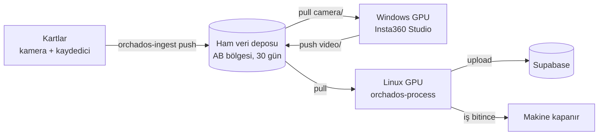

# Bulutta İşleme

22 Ekim 2026 · Operasyon için adım adım

Pilotta işleme bulutta yapılır (karar: [teknik-mimari.md](teknik-mimari.md), "İşleme pilotta bulutta"). **Sağlayıcı seçilmedi**; araçlar AWS, Azure ve Google Cloud'u aynı yolla destekler, seçim yapılandırmayla yapılır. Aynı araçlar tek bir bilgisayarda (yerel klasör ya da MinIO) da çalışır.

| Parça | Yer | Ne yapar |
| --- | --- | --- |
| `orchados-ingest` | [services/ingest](../services/ingest/README.md) | Kartı/oturum klasörünü sağlama toplamıyla ham veri deposuna yükler, işlem makinesinde indirir ve doğrular, 30 günden eskiyi siler |
| İşlem imajı | [deploy/processing/Dockerfile](../deploy/processing/Dockerfile) | `ghcr.io/yusuftiryaki/orchados-processing`: işleme hattı + AI worker + ingest + RTKLIB + ffmpeg + Docker istemcisi |
| `orchados-process <oturum>` | İmajın içinde | `pull` → `run --trees-from-db [--boundary] --upload` → `lidar/raw` varsa `lidar process --upload` → isteğe bağlı `ai-worker run` |
| LiDAR ön uç imajı | [deploy/lidar-frontends/point-lio](../deploy/lidar-frontends/point-lio/README.md) | `orchados-lio-point-lio:local`: Point-LIO (GPL); yerelde derlenir, kayda gönderilmez, makineye `machine.sh <sağlayıcı> lio-image` ile kopyalanır |
| `machine.sh` | [deploy/processing](../deploy/processing/README.md) | Linux ve Windows GPU makinesini açar, iş çalıştırır, kapatır; bütçe uyarısı kurar |

## Akış



### 1. Ofis: kart → depo

Kameranın kartı ve kaydedicinin microSD'si ofis bilgisayarına takılır. Oturumun veritabanı kimliği (`session_id`) saha uygulamasındaki ziyaretten alınır.

```bash
# Kaydedici kartı: sessions/<session_id>/ → gnss/
orchados-ingest push /media/SD --session-id <uuid> --org-id <org> --parcel-id <parsel>
# Kamera kartı: DCIM/ → camera/ (orijinaller; Studio'nun girdisi). Kimlikler artık depodan gelir.
orchados-ingest push /media/CAMERA --session-id <uuid> --bwlimit 60 --bwlimit-hours 08-19
# Saha uygulamasının session.json'u ve varsa baz RINEX'i olan oturum klasörü
orchados-ingest push ~/oturumlar/<uuid> --session-id <uuid>
orchados-ingest verify <uuid>
```

- 90 GB, 99 Mbps'de ~2 saat. Gündüz `--bwlimit 60 --bwlimit-hours 08-19` ofis internetini tıkamaz (saat dışında tam hız); gece tam hız.
- Kesilirse aynı komut kaldığı yerden sürer. Kartı çıkarmadan önce `verify` "0 problems" demeli.
- Ham medya değiştirilemez: aynı yolda başka içerik reddedilir.
- Linux SDK gelince kamera orijinalleri yerine doğrudan `video/*.mp4` üretilecek; Windows adımı kalkar.

### 2. Windows GPU makinesi: Insta360 Studio (pilotta elle)

```bash
deploy/processing/machine.sh <aws|azure|gcp> win-start      # (ilk sefer: win-create)
```

Uzak masaüstüyle bağlanılır (RDP, 3389; kurulum aşağıda). Makinede:

```powershell
.\studio-job.ps1 pull -SessionId <uuid>        # camera/* → D:\orchados\<uuid>\camera
# Insta360 Studio: dışa aktarma ayarları aşağıda → D:\orchados\<uuid>\export
.\studio-job.ps1 push -SessionId <uuid>        # export\*.mp4 → video/*.mp4, sonra verify
```

İş bitince makine kapatılır: `machine.sh <sağlayıcı> win-stop`. Boşta unutulursa sağlayıcının otomatik kapatma kuralı kapatır (aşağıda).

### 3. Linux GPU makinesi: işleme ve Supabase

```bash
cp deploy/processing/process.env.example deploy/processing/process.env   # bir kez; doldurulur
deploy/processing/machine.sh <aws|azure|gcp> create      # bir kez (ilk açılış ~10 dk: sürücü + yeniden başlatma)
deploy/processing/machine.sh <aws|azure|gcp> run <uuid>
```

`run` sırasıyla: makineyi açar, SSH bekler, `process.env`'i makineye sadece root okuyabilecek şekilde kopyalar, `sudo orchados-run-job <uuid>` çalıştırır (imajı çeker, `orchados-process <uuid>`), sonra makineyi durdurur. Sonuç: oturum `processed`, kesitler ve önizlemeler Supabase'de; uzman kuyruğuna düşer.

LiDAR'lı oturumlar için makinede ön uç imajı da bulunmalı. İmaj yerelde derlenir ([deploy/lidar-frontends/point-lio](../deploy/lidar-frontends/point-lio/README.md)) ve bir kez, her imaj değişikliğinde yeniden, makineye kopyalanır: `machine.sh <sağlayıcı> lio-image` (makineyi açar ve açık bırakır; boşta bekçisi kapatır). İmaj yoksa `orchados-process` kamera işine başlamadan durur ve bunu söyler; LiDAR'sız işlemek için `PROCESS_LIDAR=0`.

### 4. Kapanış ve saklama

- `run` iş bitince makineyi durdurur; makine de `SHUTDOWN_AFTER_JOB=1` ile kendini 2 dakika sonra kapatır. İkisi de olmazsa boşta bekçisi 30 dakikada kapatır.
- Ham veri 30 gün sonra silinir: sağlayıcının yaşam döngüsü kuralı (aşağıda) ve yedek yol olarak haftalık `orchados-ingest prune --older-than 30d`.
- Disk ücreti makine dururken de sürer; uzun ara verilecekse `machine.sh <sağlayıcı> delete` (bir sonraki `create` yeniden kurar).

## Container

`orchados-process <session-id>` imajın içinde çalışır; ayarlar ortam değişkenlerinden. Makinede `/etc/orchados/process.env`, örneği [`process.env.example`](../deploy/processing/process.env.example).

| Değişken | Zorunlu | Anlamı |
| --- | --- | --- |
| `ORCHADOS_STORE_*` | Evet | Ham veri deposu ([services/ingest/README.md](../services/ingest/README.md#yapılandırma)) |
| Sağlayıcı kimliği | Duruma göre | AWS: makinenin rolü (değişken yok). Azure: yönetilen kimlik + `ORCHADOS_STORE_ACCOUNT_URL`. R2/GCS: `AWS_ACCESS_KEY_ID`/`AWS_SECRET_ACCESS_KEY` (HMAC) |
| `SUPABASE_URL`, `SUPABASE_ANON_KEY`, `ORCHADOS_EMAIL`, `ORCHADOS_PASSWORD` | Evet | ops kullanıcısı; servis anahtarı kullanılmaz |
| `PROCESS_BOUNDARY` | Hayır | `auto` (vars.): envanter oturumu ya da kaydedicide `corner` olayı varsa sınır aşaması; `1`/`0` zorla |
| `PROCESS_TREES_FROM_DB` | Hayır | `1` (vars.): kesitler veritabanı envanterinden |
| `PROCESS_LIDAR` | Hayır | `auto` (vars.): oturumda `lidar/raw` varsa hat çalıştıktan sonra `orchados-pipeline lidar process <oturum> --frontend <ön uç> --trajectory … --panoramas … --upload` (kayıt, kalite kararı, taç, 3D dünya, yükleme; yörünge ve panoramalar hattın az önce yazdığı çalıştırma klasöründen); `1`/`0` zorla |
| `PROCESS_LIDAR_FRONTEND` | Hayır | `point_lio` (vars.): Docker soketi ve ön uç imajı gerekir (aşağıda); `fake` yalnız sentetik oturumlar |
| `ORCHADOS_POINT_LIO_IMAGE` | Hayır | Ön uç imajı (vars. `orchados-lio-point-lio:local`) |
| `PROCESS_AI` | Hayır | `1`: yüklemeden sonra `ai-worker run`; `ANTHROPIC_API_KEY` gerekir |
| `PROCESS_PARAMS` | Hayır | Hat parametre dosyası (JSON) |
| `PROCESS_UPLOAD_ONLY` | Hayır | `upload --only` (vars. hattın varsayılanı: önizleme, kesit, yörünge) |
| `PROCESS_STATION` | Hayır | `capture.uri`'deki istasyon adı (vars. `cloud-<makine adı>`) |
| `PROCESS_PULL_EXCLUDE` | Hayır | İndirilmeyenler (vars. `camera/*`) |
| `PROCESS_KEEP_WORK` | Hayır | `1`: iş klasörü silinmez |
| `ORCHADOS_WORK_DIR` | Hayır | İş diski (imajda `/work`; makinede `/srv/orchados/work`, aşağıda) |

**LiDAR ön ucu kardeş container olarak çalışır.** Point-LIO GPL lisanslı; hat onu kendi imajında `docker run` ile çağırır, koda bağlamaz. İşlem container'ı bu yüzden makinenin Docker soketini alır ve kardeş container'ı makinenin Docker'ı başlatır. Üç şart:

- **Soket:** `-v /var/run/docker.sock:/var/run/docker.sock --group-add <soketin grubu>` (container kullanıcısı root değil). İmajda yalnız Docker istemcisi var. Soketi alan container makinede root yetkisine eşdeğerdir; işlem makinesi tek amaçlı olduğu için kabul edildi.
- **İmaj:** `orchados-lio-point-lio:local` (ya da `ORCHADOS_POINT_LIO_IMAGE`) makinenin Docker'ında bulunur (`machine.sh <sağlayıcı> lio-image`).
- **Aynı yol:** Kardeş container'ın bağlama yollarını (`-v <oturum>:/in/session`, `-v <iş klasörü>:/out`) makinenin Docker'ı çözer, işlem container'ı değil. Bu yüzden iş diski container'ın içinde makinedekiyle **aynı yola** bağlanır ve `ORCHADOS_WORK_DIR` o yol olur: `orchados-run-job` `-v /srv/orchados/work:/srv/orchados/work -e ORCHADOS_WORK_DIR=/srv/orchados/work` ile çalıştırır. `orchados-process` LiDAR adımında `TMPDIR`'i de iş klasörüne (`<iş>/<oturum>/tmp`) alır; ön uca giden geçici dosyalar da makinede görünür. `/work` gibi farklı bir yola bağlamak Point-LIO adımını bozar (kardeş container boş klasör görür).

`orchados-process` LiDAR'lı bir oturumda Docker'a ve imaja kamera işinden önce bakar, eksikse durur. LiDAR adımı kamera sonuçları yüklendikten sonra çalışır; başarısız olursa iş başarısız biter, kamera sonuçları Supabase'de kalır.

**GPU:** İmajın tabanı NVIDIA'nın CUDA imajı (`nvcr.io`). Makinede NVIDIA container toolkit varsa `orchados-run-job` `--gpus all` ile çalıştırır; ffmpeg NVDEC/NVENC'i kullanabilir. GPU yoksa her şey işlemciyle çalışır. **Not:** işleme hattı bugün tamamen işlemcide (OpenCV); GPU asıl olarak Windows'ta Studio birleştirmesi ve ileride Linux Media SDK için. Pilotta Linux işlem makinesi GPU'suz, işlemci ağırlıklı bir tür de olabilir; ilk gerçek ziyarette süre ölçülüp karar verilir.

**Yerelde:**

```bash
docker build -f deploy/processing/Dockerfile -t orchados-processing:dev .
docker run --rm --env-file process.env -v /srv/work:/work orchados-processing:dev orchados-process <uuid>
# LiDAR'lı oturum (Point-LIO): iş klasörü aynı yolda, soket içeride
docker run --rm --env-file process.env -v /srv/work:/srv/work -e ORCHADOS_WORK_DIR=/srv/work \
  -v /var/run/docker.sock:/var/run/docker.sock --group-add "$(stat -c %g /var/run/docker.sock)" \
  orchados-processing:dev orchados-process <uuid>
deploy/processing/tests/e2e.sh orchados-processing:dev     # pnpm db:start && pnpm db:reset önce
deploy/processing/tests/process-dry-run.sh                 # orchados-process, sahte araçlarla (LiDAR adımı)
```

TLS denetleyen bir vekil sunucu arkasında derlerken: `docker build --secret id=extra_ca,src=ca.pem ...`.

**Yayın:** `main`'e her birleştirmede CI imajı derler, sentetik bir oturumla baştan sona dener (MinIO, yerel Supabase, işlemci) ve `ghcr.io/yusuftiryaki/orchados-processing:main` ile `:sha-<kısa>` olarak yayımlar; `processing-v1.2.3` etiketi `:1.2.3` verir. Paket özelse makinede bir kez `docker login ghcr.io` (okuma yetkili belirteçle) gerekir; ya da paket GitHub'da herkese açık yapılır (içinde gizli bilgi yok).

## Makine betikleri

`deploy/processing/machine.sh <aws|azure|gcp> <komut>`; ayarlar `deploy/processing/machine.env` (örnek: [`machine.env.example`](../deploy/processing/machine.env.example)). Sağlayıcıya özgü kısım `providers/<sağlayıcı>.sh`'de, her biri ~80 satır.

| Komut | Ne yapar |
| --- | --- |
| `create` / `delete` | Linux GPU makinesini açar (başlangıç betiğiyle) / siler |
| `start` / `stop` / `status` | Başlatır / durdurur (Azure'da **deallocate**) / durum ve IP |
| `run <uuid>` | Başlat → iş ortamını kopyala → işle → durdur |
| `lio-image` | Yereldeki LiDAR ön uç imajını (`LIO_IMAGE`, vars. `orchados-lio-point-lio:local`) makineye kopyalar (`docker save` → SSH → `docker load`) |
| `ssh [komut]` | Makineye bağlanır |
| `budget` | Aylık bütçe uyarısı |
| `win-create`, `win-start`, `win-stop`, `win-delete`, `win-status` | Windows GPU makinesi |

**Başlangıç betiği** ([`linux/startup.sh`](../deploy/processing/linux/startup.sh)): AWS'de user data, Azure'da custom data, GCP'de startup script olarak aynı dosya. NVIDIA sürücüsü (`ubuntu-drivers install --gpgpu`), Docker (Ubuntu'nun `docker.io` paketi), NVIDIA container toolkit, `orchados-run-job` (iş diski aynı yolda, Docker soketi içeride) ve boşta bekçisi (5 dakikada bir; iş yok, oturum açmış kullanıcı yok, 30 dakikadır hareket yoksa kapatır). Ayarlar makinede `/etc/orchados/machine.conf`: `IMAGE`, `IDLE_MINUTES`, `SHUTDOWN_AFTER_JOB`.

**Karar: Terraform/OpenTofu yok.** Pilotta iş başına tek bir makine açılıp kapanıyor; kalıcı altyapı bir kova ve bir rol. Üç sağlayıcı için üç modül, durum dosyası ve onun saklanması bu ölçekte betiklerden fazla iş. Düz CLI betikleri sağlayıcının kendi belgelerindeki komutlarla birebir, okunması ve elle tekrarlanması kolay. Sağlayıcı seçildikten sonra kalıcı parçalar (kova, rol, ağ, bütçe) çoğalırsa o sağlayıcı için OpenTofu'ya geçilir.

### Önerilen makine türleri (AB)

| | AWS (`eu-central-1` Frankfurt) | Azure (`westeurope` / `germanywestcentral`) | GCP (`europe-west4` Hollanda) |
| --- | --- | --- | --- |
| Linux, T4 | `g4dn.xlarge` (4 vCPU, 16 GB) | `Standard_NC4as_T4_v3` (4 vCPU, 28 GB) | `n1-standard-8` + `nvidia-tesla-t4` |
| Linux, L4 | `g6.xlarge` | — | `g2-standard-4` (önerilen) |
| Linux, A10 | `g5.xlarge` (A10G) | `NVads_A10_v5` (GPU bölümü, GRID sürücüsü; Linux betiğiyle değil) | — |
| Windows (Studio) | `g4dn.xlarge` + Windows Server 2022 | `Standard_NV12ads_A10_v5` (1/2 A10) ya da `NC4as_T4_v3` | `n1-standard-8` + `nvidia-tesla-t4-vws` |

Disk: Linux 300 GB (bir ziyaretin ham verisi ~90 GB + çıktılar); Windows 256–300 GB.

### Kimlik ve izinler (depoya erişim)

Kimlik bilgileri makinenin diskine yazılmaz; makineye rol verilir:

- **AWS:** `AWS_INSTANCE_PROFILE` rolü, sadece ham kovada `s3:ListBucket`, `s3:GetObject`, `s3:PutObject`, `s3:DeleteObject`, `s3:AbortMultipartUpload`, `s3:ListMultipartUploadParts`, `s3:ListBucketMultipartUploads`. Ofis bilgisayarı için ayrı bir IAM kullanıcısı/SSO profili, aynı izinler.
- **Azure:** `create` makineye sistem yönetilen kimliği verir ve ham depolama hesabında `Storage Blob Data Contributor` rolü atar. Ofis için `az login` + aynı rol.
- **GCP:** S3 uyumluluk modu HMAC anahtarı ister. Bir servis hesabı (`roles/storage.objectAdmin`, sadece ham kova) ve onun HMAC anahtarı (`gcloud storage hmac create <sa>`); anahtar `process.env`'e ve ofiste `~/.aws/credentials` profiline girer. Repoya girmez.

`process.env` (Supabase ops parolası ve varsa HMAC/API anahtarı) ofiste repo dışında durur (`deploy/processing/.gitignore`); `run` her işte makineye `/etc/orchados/process.env` (root, 600) olarak kopyalar. Sağlayıcı seçildikten sonra bir sonraki adım: bu değerleri sağlayıcının gizli bilgi servisine (Secrets Manager / Key Vault / Secret Manager) taşımak.

### Windows GPU makinesi: kurulum

| | AWS | Azure | GCP |
| --- | --- | --- | --- |
| Aç | `machine.sh aws win-create` | `machine.sh azure win-create` (yönetici parolası sorar) | `machine.sh gcp win-create` |
| Parola | `aws ec2 get-password-data --instance-id <id> --priv-launch-key key.pem` | Oluştururken verilen | `gcloud compute reset-windows-password orchados-studio` |
| NVIDIA sürücüsü | NVIDIA "gaming" ya da GRID sürücüsü, AWS'nin sürücü kovasından: `aws s3 cp --recursive s3://nvidia-gaming/windows/latest/ .` (ya da `s3://ec2-windows-nvidia-drivers/latest/`), kur, yeniden başlat ([AWS belgesi](https://docs.aws.amazon.com/AWSEC2/latest/UserGuide/install-nvidia-driver.html)) | `win-create` NVIDIA GPU Driver uzantısını (`NvidiaGpuDriverWindows`, GRID) kurar | `nvidia-tesla-t4-vws` GRID lisanslı; Google'ın betiği: `Invoke-WebRequest https://github.com/GoogleCloudPlatform/compute-gpu-installation/raw/main/windows/install_gpu_driver.ps1 -OutFile install.ps1; .\install.ps1` |
| Uzak masaüstü | RDP 3389, güvenlik grubu sadece ofis IP'si | RDP 3389, `win-create` NSG kuralını `OFFICE_CIDR`'a daraltır | RDP 3389, güvenlik duvarı kuralı sadece ofis IP'si (`gcloud compute firewall-rules create orchados-rdp --allow tcp:3389 --source-ranges <ofis>/32`) |

Sürücü kurulduktan sonra Aygıt Yöneticisi'nde NVIDIA kartı görünmeli; `nvidia-smi` çalışmalı. RDP'nin varsayılan görüntü sürücüsü GPU'yu kullanmayabilir: Studio'nun önizlemesi yavaşsa grup ilkesinde "Use hardware graphics adapters for all Remote Desktop Services sessions" açılır. Gerekirse NICE DCV (AWS'de ücretsiz) ya da Parsec gibi GPU hızlandırmalı bir uzak masaüstü kullanılır.

**Insta360 Studio:**

1. insta360.com'dan Windows sürümü indirilir ve kurulur; `studio-job.ps1 setup -IngestSource <services/ingest kopyası>` ile `uv` ve `orchados-ingest` kurulur (repo kopyası RDP sürücü yönlendirmesiyle ya da `git clone` ile gelir). Depo ayarları `%APPDATA%\orchados\ingest.toml` ya da ortam değişkenleri; kimlik bilgileri sağlayıcının yolundan (AWS'de makine rolü, Azure'da yönetilen kimlik ya da `az login`, GCP'de HMAC profili).
2. `studio-job.ps1 pull -SessionId <uuid>` → `D:\orchados\<uuid>\camera`'daki `.insv` dosyaları Studio'ya sürüklenir. Bir çekimin parçaları (`_00_`, `_10_` lens dosyaları ve ardışık bölümler) Studio'da tek klip olarak açılır.
3. **Dışa aktarma ayarları** (hat bunları bekler, [arayuzler.md → Oturum klasörü](arayuzler.md#oturum-klasörü)):
   - Biçim: **360° video, equirectangular (2:1)**; "reframe"/düz video değil.
   - Çözünürlük: kameranın tam çözünürlüğü, ör. **5.7K: 5760 × 2880** (X3/X4); 8K kamerada 7680 × 3840. 4K'ya düşürülmez: kesitler bu çözünürlükten kesilir.
   - Codec: **H.264** (en uyumlu; OpenCV ve ffmpeg okur). H.265 daha küçük dosya verir ama 5.7K H.264 sınırını aşıyorsa kullanılır; ilk denemede ikisi de karşılaştırılır. Bit hızı: en yüksek ("Bitrate: High" ya da ~100–150 Mbps).
   - Kare hızı: kaynakla aynı (ör. 30 fps). **Stabilizasyon (FlowState) açık, yön kilidi (direction lock) kapalı**: panorama orta sütunu hareket yönünü izlemeli (`camera_yaw_offset_deg`).
   - Renk: standart; ses gerekmez (açık kalabilir).
   - "Chromatic calibration" ve "stitching: optical flow / dynamic" açık; birleştirme kalitesi kesit kalitesini belirler.
   - Dosya adı: `VID_0001.mp4`, `VID_0002.mp4` ...; birden çok parça **dosya adı sırasıyla ardışık** kabul edilir.
   - Hedef: `D:\orchados\<uuid>\export`.
4. `studio-job.ps1 push -SessionId <uuid>` → `video/*.mp4` olarak depoya, sonra `verify`.

**Denenecek** (teknik mimarideki gibi): Studio'nun buluttaki Windows GPU makinesinde çalışması ve 2 saatlik bir ziyaretin dışa aktarma süresi. Çalışmazsa birleştirme NVIDIA kartlı yerel bir bilgisayarda yapılır ve aynı `push --layout video` ile yüklenir.

### Maliyet koruması

| Koruma | AWS | Azure | GCP |
| --- | --- | --- | --- |
| İş bitince | `run` → `stop`; makine içi kapatma = durur, işlem ücreti biter (`instance-initiated-shutdown-behavior stop`) | `run` → `deallocate`. **Makine içinden kapatma "Stopped" bırakır ve işlem ücreti sürer**; sadece deallocate durdurur | `run` → `stop`; makine içi kapatma = TERMINATED, işlem ücreti biter |
| Boşta | Bekçi 30 dk'da kapatır | Bekçi kapatır ama deallocate etmez; bu yüzden ayrıca günlük otomatik kapatma (`az vm auto-shutdown`, `AZ_AUTO_SHUTDOWN_UTC`, deallocate eder) | Bekçi 30 dk'da kapatır |
| Windows | Zamanlayıcı: EventBridge Scheduler ile her akşam `ec2:StopInstances` ya da Görev Zamanlayıcı'da `shutdown /s` (boşta 30 dk koşulu) | `win-create` günlük otomatik kapatmayı kurar | Instance schedule: `gcloud compute resource-policies create instance-schedule orchados-night --vm-stop-schedule="0 20 * * *" --timezone=Europe/Istanbul --region=europe-west4` ve `gcloud compute instances add-resource-policies orchados-studio --resource-policies=orchados-night` |
| Bütçe | `machine.sh aws budget`: aylık `BUDGET_AMOUNT` USD, gerçekleşen %80 ve öngörülen %100'de e-posta | `machine.sh azure budget` bütçeyi kaynak grubunda açar; e-posta uyarısı Portal → Cost Management → Budgets'ta eklenir (CLI bildirim ayarlayamıyor) | `machine.sh gcp budget`: %80 ve öngörülen %100; e-postalar faturalama yöneticilerine |

Bütçe uyarısı harcamayı durdurmaz, sadece haber verir. Hepsinde ilk ay maliyet panosuna haftada bir bakılır.

## Ham veri deposu: yaşam döngüsü (30 gün)

Kural nesne başınadır ve `raw/` ön ekiyle sınırlıdır; dışa aktarılan video gibi sonradan eklenen dosya kendi tarihinden 30 gün kalır. `orchados-ingest prune --older-than 30d` oturumu bütün olarak siler ve her sağlayıcıda çalışan yedek yoldur (ofis bilgisayarında haftalık zamanlanmış görev). Yarım çok parçalı yüklemeler 7 günde temizlenir.

**AWS S3:**

```bash
cat > lifecycle.json <<'EOF'
{"Rules": [{"ID": "raw-30d", "Status": "Enabled", "Filter": {"Prefix": "raw/"},
  "Expiration": {"Days": 30}, "AbortIncompleteMultipartUpload": {"DaysAfterInitiation": 7}}]}
EOF
aws s3api put-bucket-lifecycle-configuration --bucket orchados-raw-eu --lifecycle-configuration file://lifecycle.json
```

**Azure Blob:**

```bash
cat > policy.json <<'EOF'
{"rules": [{"enabled": true, "name": "raw-30d", "type": "Lifecycle", "definition": {
  "filters": {"blobTypes": ["blockBlob"], "prefixMatch": ["orchados-raw/raw/"]},
  "actions": {"baseBlob": {"delete": {"daysAfterCreationGreaterThan": 30}}}}}]}
EOF
az storage account management-policy create --account-name orchadosraw -g orchados --policy @policy.json
```

Onaylanmamış bloklar Azure'da 7 günde kendiliğinden silinir.

**Google Cloud Storage:**

```bash
cat > lifecycle.json <<'EOF'
{"rule": [
  {"action": {"type": "Delete"}, "condition": {"age": 30, "matchesPrefix": ["raw/"]}},
  {"action": {"type": "AbortIncompleteMultipartUpload"}, "condition": {"age": 7}}]}
EOF
gcloud storage buckets update gs://orchados-raw-eu --lifecycle-file=lifecycle.json
```

**Cloudflare R2:** `npx wrangler r2 bucket lifecycle add orchados-raw raw-30d raw/ --expire-days 30` (ya da Dashboard → R2 → bucket → Settings → Object lifecycle rules).

**MinIO (yerel):** `mc ilm rule add local/orchados-raw --prefix raw/ --expire-days 30`.

## Sağlayıcı seçimi

Fiyatlar **doğrulanmadı**: liste fiyatlarından kabaca, isteğe bağlı (on-demand), vergisiz, Ekim 2026 öncesi bilgiyle. Seçimden önce her sağlayıcının fiyat hesaplayıcısıyla güncellenmeli.

**Seçim ölçütleri** (karar: [hukuk/kararlar.md](hukuk/kararlar.md) H02, takip işi T01):
1. KVKK standart sözleşmesini değiştirmeden imzalaması (birinci ölçüt). Kurul'un ilan ettiği “veri sorumlusundan veri işleyene” modülü değiştirilmeden imzalanır ve imzadan itibaren 5 iş günü içinde Kurum'a bildirilir ([yurt-disi-aktarim-kaydi.md](hukuk/yurt-disi-aktarim-kaydi.md)). İmzalamayan sağlayıcı seçilmez.
2. GPU kotasının ne kadar hızlı açıldığı, kredi programları, fiyat ve Windows GPU kolaylığı (aşağıdaki tablo ve değerlendirme).

**Ham video, seçilen sağlayıcıyla standart sözleşme imzalanıp Kurum'a bildirilmeden yüklenmez.** O zamana kadar buluttaki depoya yalnızca sentetik ya da test verisi yüklenir.

| | AWS | Azure | Google Cloud | Cloudflare R2 (sadece depo) |
| --- | --- | --- | --- | --- |
| AB bölgesi | Frankfurt, İrlanda, Stockholm ... | Batı Avrupa (Hollanda), Almanya Batı-Orta ... | Hollanda, Frankfurt, Belçika ... | Otomatik; "EU jurisdiction" seçeneği |
| Linux T4 makine / saat | `g4dn.xlarge` ~0,66 $ | `NC4as_T4_v3` ~0,60 $ | `n1-standard-8` + T4 ~0,75 $ | — |
| Linux L4 / A10 / saat | `g6.xlarge` ~0,95 $; `g5.xlarge` ~1,25 $ | — | `g2-standard-4` ~0,85 $ | — |
| Windows GPU / saat | `g4dn.xlarge` Windows ~0,85 $ | `NV12ads_A10_v5` Windows ~1,10 $ | `n1-standard-8` + T4 VWS + Windows lisansı ~1,15 $ | — |
| Windows GPU kolaylığı | AMI hazır, sürücüyü elle indir | Sürücü uzantısı tek komut (GRID) | VWS GPU GRID lisanslı, sürücü betiği | — |
| Depo / GB-ay | S3 Standard ~0,024 $ | Blob Hot LRS ~0,02 $ | Standard ~0,02 $ | ~0,015 $ |
| Veri girişi (ofisten yükleme) | Ücretsiz | Ücretsiz | Ücretsiz | Ücretsiz |
| Aynı bölgede depo → makine | Ücretsiz | Ücretsiz | Ücretsiz | Ücretsiz (çıkış ücreti yok) |
| İnternete çıkış / GB | ~0,09 $ (ilk 100 GB/ay ücretsiz) | ~0,087 $ (ilk 100 GB/ay ücretsiz) | ~0,12 $ | Ücretsiz |
| İstek ücreti | PUT ~0,005 $/1000 | Yazma ~0,0065 $/10.000 | Sınıf A ~0,005 $/1000 | Sınıf A 4,50 $/milyon |

**Ziyaret başına kaba hesap** (doğrulanmadı): 2–3 saat Linux GPU (~2 $) + Windows birleştirme 2–3 saat (~3 $) + 90 GB × 30 gün depo (~2 $) + Supabase'e ~1 GB çıkış (~0,1 $) → **~7 $**. Ham video buluttan dışarı çıkmadığı için çıkış ücreti küçük; depo ve makine aynı bölgede olmalı.

**Değerlendirme:** Üçü de bu iş için yeterli. Windows GPU makinesinde sürücü kurulumu Azure'da en kolay, AWS'de Linux tarafı en olgun ve Frankfurt'ta, GCP'de L4 fiyat/performansı iyi. Standart sözleşmeyi imzalayanlar arasında belirleyici olan çoğunlukla **GPU kotasının ne kadar hızlı açıldığı** ve kredi programları olacak. R2, depo için sağlayıcıdan bağımsız ve çıkış ücretsiz bir seçenek; ama işlem makinesi başka buluttaysa veri internet üzerinden çekilir (R2 çıkış ücretsiz, makine tarafı giriş ücretsiz), aynı bölge avantajı yok.

## Hesap ve kota hazırlığı

GPU kotası birçok sağlayıcıda yeni hesapta **0** gelir ve artırma talebi saatler ile günler sürer; ilk ziyaretten en az bir hafta önce açılmalı.

**AWS**
1. Hesap; kök kullanıcıya MFA; günlük iş için IAM Identity Center (SSO) kullanıcısı.
2. Service Quotas → EC2 → **"Running On-Demand G and VT instances"** (vCPU) `eu-central-1`'de en az **8** (Linux + Windows `g4dn.xlarge` aynı anda). Windows için ayrı kota yok. Yeni hesaplarda ilk talep elle incelenir.
3. Kova (`orchados-raw-eu`, Block Public Access açık, sürümleme kapalı), yaşam döngüsü kuralı, makine rolü (instance profile), anahtar çifti, güvenlik grubu (22 ve 3389 sadece ofis IP'si).
4. `machine.sh aws budget`.

**Azure**
1. Kullandıkça öde aboneliği. **Ücretsiz deneme ve öğrenci abonelikleri GPU kotası alamaz.**
2. Abonelik → Kullanım + kotalar → **"Standard NCASv3_T4 Family vCPUs"** (Linux) ve **"Standard NVADSA10v5 Family vCPUs"** (Windows) `westeurope`'ta, sırasıyla en az 4 ve 12; ayrıca "Total Regional vCPUs".
3. Kaynak grubu, depolama hesabı (StorageV2, LRS, `orchados-raw` kapsayıcısı, herkese açık erişim kapalı), yönetim ilkesi (yaşam döngüsü).
4. Kaynak sağlayıcıları kayıtlı olmalı: `az provider register -n Microsoft.Compute`, `Microsoft.Storage`, `Microsoft.DevTestLab` (otomatik kapatma), `Microsoft.Consumption`.
5. `machine.sh azure budget` + Portal'da e-posta uyarısı.

**Google Cloud**
1. Proje ve faturalama hesabı. **Ücretsiz deneme hesabında GPU kullanılamaz**; faturalama hesabı ücretli hesaba yükseltilmeli.
2. IAM → Kotalar: global **`GPUS_ALL_REGIONS`** en az **2**; bölgesel `NVIDIA_L4_GPUS` (Linux, `europe-west4`) ve `NVIDIA_T4_VWS_GPUS` (Windows) en az 1.
3. Compute Engine API'si açık; kova (`orchados-raw-eu`, tek bölge `europe-west4`, uniform erişim, public access prevention), yaşam döngüsü; servis hesabı + HMAC anahtarı.
4. `machine.sh gcp budget`.

**Hepsinde:** Depo ve makine aynı AB bölgesinde; ofis IP'si dışında SSH/RDP kapalı; KVKK açısından yurt dışına aktarım hukukçu görüşüne bağlı ([teknik-mimari.md → KVKK](teknik-mimari.md#veri-konumu-kvkk-ve-güvenlik)). Ham video kişisel veri taşımaz varsayılmaz: görüntülerde kişiler görünebilir.

## Testler ve CI

| İş akışı | Ne |
| --- | --- |
| `ci-ingest` | `services/ingest`: lint, birim testleri, MinIO ve Azurite entegrasyon testleri (container'da; atlanırsa başarısız) |
| `build-processing-image` | İmaj derlenir; betikler `shellcheck`'ten ve sahte CLI'larla kuru çalıştırmadan geçer (`machine.sh`; `orchados-process` sahte ingest, hat ve Docker ile: LiDAR adımı ne zaman ve nasıl çalışır); yerel Supabase + MinIO ile sentetik bir oturum ofisten yüklenir, yeni bir container çeker, işler, Supabase'e yükler, oturum `processed` olur (işlemci, GPU yok). `main`'de ghcr.io'ya yayın |

Hiçbir testte gerçek bulut hesabı kullanılmaz. Container imajları Docker Hub dışından gelir: `nvcr.io` (CUDA tabanı), `ghcr.io` (uv), `cgr.dev` (MinIO), `mcr.microsoft.com` (Azurite).

## Açık noktalar

- **Studio bulutta:** Windows GPU makinesinde çalışması, lisans/oturum açma ve 2 saatlik ziyaretin dışa aktarma süresi denenmedi.
- **İşlem süresi:** Gerçek bir ziyarette (`run` ~1.500 panorama) Linux makinesinde ölçülmedi; GPU'suz bir tür yeterli olabilir.
- ~~**`capture.uri`**~~ *(kapandı)*: Depodan çekilen oturumda `upload`, ham kayıtların adresini `pull`'ün bıraktığı manifestten deponun adresi olarak yazar (`s3://`, `az://`, `file://`); `station://cloud-<makine>/...` yalnızca manifestte olmayan dosyalarda kalır. Biçim: [arayuzler.md → Ham kayıtların adresi](arayuzler.md#ham-kayıtların-adresi-captureuri).
- **Gizli bilgiler:** `process.env` pilotta ofisten kopyalanıyor; sağlayıcı seçilince gizli bilgi servisine taşınmalı.
- **Fiyatlar ve kotalar:** Hepsi doğrulanmadı.
