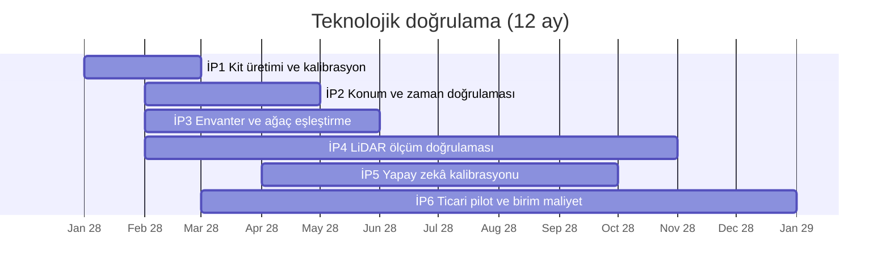

# TÜBİTAK BiGG: İş Planı (Aşama 2)

11 Kasım 2026 · Yusuf

Hızlandırma programının sonunda uygulayıcı kuruluşa, onayından sonra PRODİS üzerinden TÜBİTAK'a sunulacak iş planının taslağı. Bölüm yapısı 1512'nin AGY112 kılavuzundan alındı; 1812'nin PRODİS'teki güncel şablonu farklıysa içerik bölüm bölüm taşınır ([programlar.md](programlar.md) §1.6). Panel üç ölçütle 30 üzerinden puanlar: **teknoloji düzeyi ve yenilikçi yön**, **uygunluk ve yapılabilirlik**, **ticarileşme potansiyeli**.

Teknolojik doğrulama dönemi 12 aydır. Takvim, destek başlangıcı 1 Ocak 2028 (çağrı 2027-2) varsayılarak "Ay 1–12" diye yazıldı.

## Bölüm A: Girişimciye ait bilgiler

| Alan | Değer |
| --- | --- |
| A.1 Girişimci | [DOLDURULACAK: ad soyad, iletişim, üniversite/fakülte/bölüm, mezuniyet ayı ve yılı] |
| A.2 İş fikri adı ve numarası | orchadOS: Meyve Bahçelerinin Ağaç Düzeyinde Dijital İkizi ve Otonom Bahçe Hizmetleri (hızlandırma başvurusundaki adla aynı olmalı; [tubitak-bigg-is-fikri.md](tubitak-bigg-is-fikri.md) §3) · [DOLDURULACAK: PRODİS iş fikri no] |
| A.2 Teknolojik doğrulama süresi ve bütçesi | 12 ay · 1.350.000 TL ([finansal-plan.md](finansal-plan.md) §8.1) |
| A.2 Tematik alan | 1.6 Sürdürülebilir Tarım ve Beslenme › Akıllı ve Temiz Tarım |
| A.3 Teknoloji grubu | Bilgi ve iletişim teknolojileri: görüntü işleme, nokta bulutu işleme, GNSS konumlama, yapay zekâ; tarım teknolojileri |

## Bölüm B: İş fikrinin kısa tanıtımı

### B.1 Girişimcinin yetenek ve birikimi

[DOLDURULACAK: girişimcinin (Furkan) öğrenimi, deneyimi, bölgeyle bağı; hızlandırmada üstlendiği işler (müşteri görüşmeleri, pazar ve finans); kısa, orta ve uzun vadeli hedefleri; katıldığı programlar ve yarışmalar.]

Önerilen vurgu: girişimci (Furkan), teknik danışmanla (Yusuf, bilgisayar mühendisi) birlikte çalışan bir ekibin iş tarafını yürütür. orchadOS'un bütün yazılım yığını (web portalı ve uzman paneli, Android saha uygulaması, Python işleme hattı, ESP32 firmware'i, veritabanı ve yetki kuralları, yapay zekâ servisi) ekipte tasarlandı ve geliştirildi; ürün, fiyatlandırma, hukuki çerçeve ve operasyon kararları belgelenmiş durumda. Girişimci teknik ayrıntıya da hâkim olmalı: panel ve mentörler soracak.

### B.2 İş fikrinin kısa tanıtımı

Antep fıstığı bahçe sahiplerinin çoğu bahçeden uzakta yaşıyor ve bahçesinin durumunu göremiyor. orchadOS, bahçeyi yılda 2–6 kez sırt tipi bir tarama kitiyle (RTK GNSS, 360° kamera, LiDAR) tarar; her ağacı yıllar boyu korunan bir kimlikle eşleştirir, ağacın dört yönden kesitlerini ve LiDAR ile taç ölçümlerini çıkarır; yapay zekâ ön değerlendirme yapar, ziraat mühendisi onaylar ve imzalar; sahip sonuçları web portalında ağaç ağaç görür.

Teknolojik doğrulama döneminde (12 ay): tarama kiti üretilip kalibre edilecek; dört pilot bahçede envanter ve en az üç periyodik ziyaret yapılacak; ağaç eşleştirme doğruluğu, tarama kapsaması, LiDAR ölçüm doğruluğu ve yapay zekâ ile uzman uyumu ölçülecek; ziyaret başına süre ve maliyet ölçülerek fiyat doğrulanacak. Çıktı: sahada doğrulanmış, ücretli satılabilir hizmet (TRL 7) ve ilk ücretli müşteriler.

Özgün yönler: ağaç düzeyinde kimlik ve zaman serisi; yandan (gövde ve dal yüksekliğinden) görüntü ve LiDAR; düşük maliyetli kit ve dışarıdan tetiklenemeyen kamerayı GPS zamanına bağlayan QR yöntemi; değiştirilemez medya ve sürümlü ölçümle izlenebilir, uzman imzalı bağımsız rapor.

### B.3 İş fikriyle oluşturulacak ürün ve hizmetler

| Ürün/hizmet | Teknik özellik ve başarı ölçütü |
| --- | --- |
| Bahçe envanteri | Sınır ve ağaç haritası; her ağaç sıra-numara koduyla; gövde konumu ağaçların %95'inde 50 cm'den iyi; yetişkin ağaçların %99'u yakalanır |
| Periyodik denetim (Temel 2, Standart 4, Kapsamlı 6 ziyaret/yıl) | Tarama kapsaması %95 ve üstü; ağaç eşleştirme doğruluğu %95 ve üstü; uzman imzalı rapor ziyaretten sonra [DOLDURULACAK: hedef gün] içinde |
| Sahip portalı | Parsel karnesi, sağlık haritası, ağaç karnesi ve fotoğraf geçmişi, 360° gezi, 3D bahçe, PDF rapor; telefonda çalışır |
| LiDAR ölçümleri | Ağaç başına taç çapı, boy, taç hacmi, büyüklük sınıfı önerisi; kışın ana kol sayısı, odun hacmi; budama analizi |
| Bahçe hizmetleri (sonraki adım) | Ot biçme gibi işler; kanıt fotoğrafları denetim verisiyle aynı zincirde |

### B.4 Yenilikçi yön ve teknoloji düzeyi

**Yenilik sınıfı:** Ülke için yeni bir hizmet (AGY112 A.4) ve bu hizmeti mümkün kılan yeni bir ölçüm ve işleme yöntemi (B.2).

**Benzerlerle karşılaştırma:**

| Özellik | Uydu izleme | Dron ile ağaç analizi | Bekçi / bilirkişi | orchadOS |
| --- | --- | --- | --- | --- |
| Çözünürlük | Parsel (10 m piksel) | Ağaç, üstten | Göz | Ağaç, yandan; gövde ve dal |
| Ağaç kimliği ve geçmiş | Yok | Kısmen | Yok | Envanter kodu, yıllar boyu |
| Kış (yapraksız) dönemde bilgi | Zayıf | Zayıf | Var, kanıtsız | Dal iskeleti, budama analizi |
| Kanıt | İndeks | Ortofoto | Söz, tek seferlik rapor | Her bulguda fotoğraf, zaman, konum, çeken |
| Bağımsız uzman imzası | Yok | Yok | Var, tek seferlik | Her ziyarette |
| Türkiye'de Antep fıstığında yayımlanmış fiyatlı hizmet | Var | Bulunamadı | Var | — |

**Teknik çekirdek:**
- **Konum:** RTK GNSS ham kayıt; sahada internet gerekmez, konum sonradan TUSAGA-Aktif ya da kendi baz istasyonumuzla PPK ile santimetre düzeyine düzeltilir.
- **Zaman:** GNSS alıcısının PPS sinyali kayıt bilgisayarının saatini GPS zamanına kilitler; tüketici 360° kamera dışarıdan tetiklenemediği için taramanın başında ve sonunda telefondaki GPS saatli QR kodu kameraya okutulur, saat kayması doğrusal düzeltilir.
- **Ağaç eşleştirme:** Envanterde gövde konumu iki panoramadan üçgenlenir; her ziyarette kesitler bu konumlara göre kesilir, sıra dizilişiyle denetlenir.
- **LiDAR:** Ağaç başına bulut ayrılır; taç çapı, boy, hacim, kış iskeleti ve iki tarama arasında budama hesaplanır. Sentetik ağaçlarda en kötü hata: çapta +%1,8, hacimde +%2,8, boyda −%0,6 ([lidar-olcumleri.md](../lidar-olcumleri.md)).
- **Yapay zekâ:** Kesitlerden kalite kontrolü ve görsel ön etiket; uzmana öneri olarak düşer, kararı uzman verir. Kişisel veri modele gönderilmez.
- **Güncel teknolojilerle uyum:** ROS 2 ve MCAP kayıt düzeni, PostGIS, açık standart dosya biçimleri; kit robotlara takılabilir.

**Bugünkü olgunluk:** Yazılım sentetik veriyle uçtan uca çalışıyor ve pilot ortamında yayında (TRL 5–6); saha doğrulaması yapılmadı. Teknolojik doğrulama TRL 7'ye, yani gerçek bahçelerde çalışan, ölçülmüş bir hizmete götürür.

### B.5 Ticari beklenti ve sürdürülebilirlik

Hizmet abonelikle satılır ve her yıl yenilenir; envanter bir kez yapıldıktan sonra her ziyaret aynı ağaç haritasını kullandığı için müşteriyi tutar (geçmiş verisi yalnız orchadOS'ta). Değer zaman serisiyle artar: ikinci yıldan sonra ağaç ağaç değişim, budama ve hasat karşılaştırması mümkün olur. Gelir modeli, fiyat ve 4 yıllık satış planı Bölüm G'de.

## Bölüm C: Teknolojik doğrulama

### C.1 Özet

12 ayda: (1) LiDAR'lı tarama kitinin üretimi, kalibrasyonu ve dayanıklılık testi; (2) konum ve zaman eşlemenin sahada doğrulanması; (3) dört pilot bahçede envanter ve ağaç eşleştirme doğruluğunun ölçülmesi; (4) LiDAR ölçümlerinin referans ağaçlarda elle ölçümle karşılaştırılması; (5) yapay zekâ ön değerlendirmesinin uzman kararlarıyla kalibrasyonu; (6) ücretli pilot ve birim maliyetin ölçülmesi.

### C.2 Çıktılar ve başarı ölçütleri

| # | Çıktı | Başarı ölçütü |
| --- | --- | --- |
| Ç1 | Kalibre edilmiş LiDAR'lı tarama kiti | Kamera–LiDAR–anten dış parametreleri ölçülmüş ve kit kimlik çipine yazılmış; 2 saatlik taramada veri kaybı yok; 4 saat kesintisiz çalışma (ısınma testi) |
| Ç2 | PPK ve zaman eşleme | Taramaların [DOLDURULACAK: hedef, örn. %90]'ında yörüngenin ≥%80'i sabit (fix) çözüm; QR saat okumaları ile olay zamanı farkı < 250 ms |
| Ç3 | Pilot envanterleri | 4 bahçe, ~1.200 ağaç; referans sıralarda yetişkin ağaçların ≥%99'u yakalanır; gövde konumu ağaçların ≥%95'inde ≤50 cm |
| Ç4 | Ağaç eşleştirme | Uzman kontrolünde ≥%95 doğru; tarama kapsaması ≥%95 |
| Ç5 | LiDAR ölçümleri | ≥30 referans ağaçta elle ölçüme göre taç çapı ve boy ortalama mutlak hatası ≤%10; kış iskeletinde ana kol sayısı ≥%80 doğru |
| Ç6 | Yapay zekâ ön değerlendirme | Etiketli kış ve ilkbahar setinde uzmanla uyum ölçülmüş; toplu onay eşiği belirlenmiş; personel–uzman gözlem uyumu ≥%85 |
| Ç7 | Ticari doğrulama | ≥4 bahçede uzman imzalı rapor teslimi; ≥2 sahipten ücretli sözleşme; ziyaret başına saha ve işleme süresi ve maliyeti ölçülmüş |
| Ç8 | Metodoloji v1 | Lisanslı ziraat mühendisiyle kesinleşmiş ölçekler ve referans fotoğraf seti |

Uyulacak standartlar ve mevzuat: KVKK (aydınlatma, açık rıza, yurt dışı aktarımda standart sözleşme), 6502 sayılı Kanun ve Mesafeli Sözleşmeler Yönetmeliği, elektronik ticaret mevzuatı (ETBİS). Ölçüm dosyaları açık biçimlerde (MCAP, PLY, LAS/LAZ, GeoJSON).

### C.3 Yöntemler

- **Kit:** Bileşenler [tarama-kiti.md](../tarama-kiti.md) ve sipariş listesine göre alınır. Dış parametreler kalibrasyon hedefiyle ölçülür, kalibrasyon kaydına ve kitin DS2431 kimlik çipine yazılır. Isınma ve titreşim testi yapılır.
- **Konum:** F9P ham gözlemleri (UBX) ve baz verisiyle RTKLIB PPK; çözüm kalitesi (`fix`/`float`) ve yörünge sürekliliği ölçülür. Baz için TUSAGA-Aktif aboneliği ya da kendi baz istasyonu.
- **Zaman:** PPS ile kilitlenmiş kayıt saati; QR ile kamera saati eşleme; jiroskop–IMU karşılaştırmasıyla ince eşleme.
- **Envanter doğruluğu:** Referans sıralarda ağaçlar elle sayılır ve şeritle konumlanır; üçgenlenen konumlar karşılaştırılır.
- **Eşleştirme doğruluğu:** Uzman, rastgele örneklemde kesitlerin doğru ağaca gittiğini kontrol eder.
- **LiDAR doğruluğu:** Referans ağaçlarda taç çapı (iki yönde şerit metre), boy (ölçüm çubuğu ya da lazer mesafe ölçer), kışın ana kol sayısı elle ölçülür; LiDAR sonuçlarıyla karşılaştırılır. Gövde çapı ölçüm yüksekliği metodolojide sabitlenir.
- **Yapay zekâ:** Uzman kararları etiketli set olur; model sürümü sabit test setinde ölçülür, eşik uzmanla uyuma göre ayarlanır.
- **Ticari doğrulama:** Pilot sahiplere lansman fiyatıyla teklif; ziyaret süreleri ve maliyetleri iş ve oturum kayıtlarından ölçülür.
- **Etik kurul:** Sahip görüşmeleri ve memnuniyet anketi için [DOLDURULACAK: üniversite] etik kuruluna Ay 1'de başvurulur; görüşmeler onaydan sonra yapılır. Görüntülerde kişi bulunabileceği aydınlatma metninde yazılıdır.

### C.4 İş-zaman çubuk grafiği

Not: Kış ziyareti Aralık–Şubat, ilkbahar Nisan–Mayıs, yaz Temmuz, hasat sonrası Eylül–Ekim. Destek 1 Temmuz 2027'de başlarsa (çağrı 2027-1) aynı iş paketleri Temmuz 2027 – Haziran 2028'e kayar; kış ziyareti dönemin ortasına düşer.

### C.5 İş paketi tanımlama formları

**İP1: Tarama kitinin üretimi ve kalibrasyonu (Ay 1–2)**
- Faaliyetler: parça alımı, montaj, kayıt yazılımının kurulumu, kalibrasyon, ısınma ve titreşim testi, kit kimlik çipine manifest yazımı.
- Yöntem ve araçlar: kalibrasyon hedefi, ROS 2 kayıt, `orchados-kit` aracı.
- Çıktı: Ç1. Başarı: Ç1 ölçütü.
- İlişki: İP2–İP4'ün önkoşulu.

**İP2: Konum ve zaman eşlemenin doğrulanması (Ay 2–4)**
- Faaliyetler: tek koridor ve tam bahçe taramaları; PPK; QR ve jiroskop ile zaman eşleme; sınır köşelerinin konumlanması.
- Parametreler: çözüm kalitesi oranı, yörünge sürekliliği, QR ve olay zamanı farkı.
- Çıktı: Ç2. İlişki: İP3'e konumlu panoramalar.

**İP3: Envanter ve ağaç eşleştirme (Ay 2–5)**
- Faaliyetler: dört pilot bahçede sınır, envanter taraması, ofiste üçgenleme, doğrulama turu, sahibin sınır onayı; ilk periyodik ziyaretlerde eşleştirme.
- Testler: referans sıralarda elle sayım ve konum; uzman örneklemi.
- Çıktı: Ç3, Ç4.

**İP4: LiDAR ölçümlerinin doğrulanması (Ay 2–10)**
- Faaliyetler: kayıt adımı (MCAP → SLAM + PPK → nokta bulutu); referans ağaç seçimi; kış iskeleti ve yaz taç ölçümleri; iki kış taraması arasında budama analizi; elle ölçüm karşılaştırması.
- Çıktı: Ç5. Yetersiz çıkan metrik karneden kaldırılır.

**İP5: Yapay zekâ ön değerlendirmesinin kalibrasyonu (Ay 4–9)**
- Faaliyetler: kış etiketlerinden değerlendirme seti; gerçek API ile ilk deneme; eşik kalibrasyonu; rastgele %5 uzman kontrolü.
- Çıktı: Ç6.

**İP6: Ticari pilot ve birim maliyet (Ay 3–12)**
- Faaliyetler: metodoloji v1 (ziraat mühendisiyle), pilot raporları, sahip görüşmeleri ve fiyat cevabı, ücretli sözleşmeler, ziyaret başına süre ve maliyet ölçümü, fiyat listesinin gözden geçirilmesi.
- Çıktı: Ç7, Ç8.

## Bölüm D: Girişimci ile çalışacak personel

| Kişi | Görev | Süre | Özgeçmiş |
| --- | --- | --- | --- |
| Furkan | Girişimci; proje yöneticisi, iş geliştirme, finans | 12 ay, tam zamanlı | [DOLDURULACAK] |
| Yusuf | Teknik danışman (ortak değil); yazılım, işleme hattı, kit | 12 ay, danışmanlık sözleşmesiyle | [DOLDURULACAK] |
| Diğer öğrenci | Saha operasyonu ve ölçüm doğrulaması | [DOLDURULACAK: yarı zamanlı] | [DOLDURULACAK] |
| [DOLDURULACAK] | Danışman ziraat mühendisi | Yarı zamanlı, hizmet alımı | [DOLDURULACAK] |
| [DOLDURULACAK] | Saha personeli | Ziyaret başına yevmiye | Lansman köyünde, eğitimli |

## Bölüm E: Kurulacak işin niteliği

- **E.1 Şirket türü:** Anonim şirket. 1812 Mükemmeliyet Mührü için zorunlu (girişimcinin kurucu ortak olduğu, Türkiye'de yerleşik A.Ş.); ileride yatırım turları ve pay devri için de uygun.
- **E.2 Pay dağılımı:** [DOLDURULACAK: Furkan ve (ortak olursa) Berkay; Yusuf ortak değil; BiGG Fonu %3, devam yatırımıyla en çok %5]. Yönetim ve iş geliştirme Furkan'da, saha operasyonu Berkay'da, yazılım ve teknik altyapıda Yusuf danışman olarak; muhasebe dış hizmet. Sonraki KOSGEB başvurusu için girişimcinin en az %50 payı ya da şirketin teknogirişim rozeti gerekir ([README.md](README.md) §1).
- **E.3 İzin, ruhsat, tescil:** Ticaret sicili tescili ve MERSİS; vergi dairesi; SGK işyeri kaydı; ETBİS kaydı (elektronik ticaret); İYS kaydı (ticari ileti, isteğe bağlı rıza kutuları açılırsa); KVKK aydınlatma ve standart sözleşme bildirimi (yurt dışı aktarım, imzadan sonra 5 iş günü); TÜRKPATENT marka başvurusu; ödeme kuruluşu üye işyeri sözleşmesi. Teknolojik doğrulama için özel izin gerekmez; bahçeye giriş sahibin yazılı izniyle. [DOLDURULACAK: mali müşavirden süre ve maliyet.]
- **Fikri mülkiyet devri:** Kaynak kodu, veri modeli, metodoloji, alan adı ve marka başvurusu yatırımdan önce şirkete bedelsiz devredilir. Kod bugün Yusuf'ta; Yusuf ortak olmadığı için devir ve karşılığı ayrı bir sözleşmeyle yapılır, yatırımdan önce tamamlanır ([README.md](README.md) §5, [tubitak-bigg-is-fikri.md](tubitak-bigg-is-fikri.md) §6).

## Bölüm F: Pazar analizi

### F.1 Sektör

- Türkiye dünyadaki Antep fıstığı üretim alanının ~%41'ine sahip: 421 bin hektar (2023). Meyve veren ağaç sayısı 2005'te 28 milyondan 2024'te 62,4 milyona çıktı; 37,8 milyon ağaç henüz meyve vermiyor. Üretim 2024'te 383 bin ton ile rekor kırdı. 2024'te Şanlıurfa 180 bin, Gaziantep 119 bin, Siirt 29 bin ton üretti; Gaziantep'te alan ~1,43 milyon dönüm.
- Üretim periyodisite ve iklim yüzünden çok dalgalı: 2025'te don ve kuraklıkla %61,5 düştü.
- Bahçeler küçük, hisseli ve rızai taksimli; sahiplerin bir kısmı şehirde ya da gurbette. İşler yevmiyecilerle yürür; kayıt dışılık yüksek.
- Sektör emek yoğun ve mevsimsel: denetim ziyaretleri dört–altı mevsim penceresine sıkışır. Hırsızlık ve yangın hasat öncesi en yüksek.
- Kaynak: [Antep Fıstığı Sektör Politika Belgesi 2025–2029](https://www.tarimorman.gov.tr/TAGEM/Belgeler/yayin/Antep%20F%C4%B1st%C4%B1%C4%9F%C4%B1%20Sektor%20Politika%20Belgesi%20(2025-2029).pdf) (TÜİK verileri).

### F.2 Müşteri

- **Birincil:** Bahçeden uzakta yaşayan sahipler (20 dönüm civarı, ~300 ağaç). İhtiyaç: "bahçem ne durumda, işler yapıldı mı, kaç ağacım var" sorusuna kanıtlı cevap. Telefonla, WhatsApp ve SMS ile iletişim; mobil öncelikli portal.
- **Hisseli bahçelerde diğer hissedarlar:** İzleyici olarak; ortak gerçeklik bir anlaşmazlık konusunu azaltır.
- **Sonraki:** Bahçe alım-satımında ve mirasta ağaç sayısı ve durumu raporu; kooperatifler ve tarım danışmanları; sigorta ve kredi kuruluşları (kurumsal kiracı).
- [DOLDURULACAK: hızlandırma programındaki müşteri görüşmelerinin sonuçları: kaç görüşme, ihtiyaçların sıralaması, ödeme isteği.]

### F.3 Tedarikçiler ve iş birlikleri

| Tedarik | Kim |
| --- | --- |
| LiDAR, RTK alıcısı, 360° kamera, kayıt bilgisayarı | Yurt içi distribütörler ve üretici mağazaları ([kit-siparis-listesi.md](../kit-siparis-listesi.md)) |
| GNSS düzeltme verisi | TUSAGA-Aktif (CORS-TR) ya da kendi baz istasyonu |
| Bulut | Veritabanı ve barındırma (AB'de), nesne depolama, GPU'lu sanal makine |
| Yapay zekâ | Görüntü anlayabilen dil modeli API'si; yerel açık model seçeneği |
| Ödeme ve SMS | Lisanslı ödeme kuruluşu, SMS sağlayıcısı |
| İş birliği adayları | Ziraat Mühendisleri Odası, Antep Fıstığı Araştırma Enstitüsü, ziraat fakülteleri, kooperatifler, köy muhtarlıkları |

### F.4 Rekabet

Türkiye'de fiyatı yayımlanmış bağımsız ve periyodik bahçe denetimi bulunamadı ([fiyatlandirma.md](../fiyatlandirma.md) §3).

| Özellik | Uydu izleme (yerli) | Dron ile ağaç analizi (yabancı) | Bilirkişi / değerleme | orchadOS | Fark |
| --- | --- | --- | --- | --- | --- |
| Ağaç düzeyi | Yok | Var, üstten | Kısmen | Var, yandan | Gövde, dal, budama görülür |
| Periyodik | Var | Var | Yok | Var | Zaman serisi |
| Uzman imzası | Yok | Yok | Var | Var | Bağımsız denetim |
| Fiyat | 35–55 TL/da·yıl | Türkiye'de yok | 8.820–24.051 TL/rapor | 720 TL/da·yıl (Standart, 20 da) | Bekçi ve rapordan ucuz, uydudan pahalı ama içerik farklı |

Güçlü yönlerimiz: ağaç kimliği, kanıt zinciri, kış bilgisi, düşük kit maliyeti, bölgede yaşayan saha personeli. Zayıf yönlerimiz: saha emeğine bağlı ölçek, ilk yıllarda yüksek birim maliyet, marka bilinirliğinin olmaması.

## Bölüm G: Pazarlama planı

### G.1 Rekabet stratejisi

Uyduyla fiyatta değil, içerikte rekabet: ağaç ağaç kanıt ve uzman imzası. Lansman tek köyde ve komşu parsellerde yoğunlaşır (saha maliyeti düşer, ağızdan ağıza yayılır); komşu bahçe indirimi (%10–15) bunu teşvik eder. Hesap açmadan gezilen demo turu satış konuşmasının yerini tutar.

### G.2 Müşteriye ulaşma

- Köy kahvesi ve muhtarlık toplantıları, bayram ve hasat dönemlerinde gurbetteki sahiplerle yüz yüze görüşme.
- WhatsApp ile demo turu bağlantısı; sitede self-servis başvuru, teklif ve kartla ödeme.
- Mevcut müşterinin hissedarları (izleyici olarak eklenir) ve komşuları.
- Ziraat odaları, kooperatifler ve ziraat mühendisleriyle yönlendirme iş birliği.

### G.3 İlk 4 yıl satış tahmini

| Yıl | Müşteri (aktif bahçe) | Hizmet miktarı (ziyaret) | Ortalama fiyat (TL/bahçe·yıl, KDV hariç) | Ciro (TL) |
| --- | --- | --- | --- | --- |
| 1 | 20 | 100 | 14.400 + ilk yıl envanter 6.000 | 408.000 |
| 2 | 60 | 280 | 14.400 | 1.104.000 |
| 3 | 150 | 690 | 14.400 | 2.700.000 |
| 4 | 500 | 2.350 | 14.400 | 9.300.000 |

Varsayımlar ve ayrıntı: [finansal-plan.md](finansal-plan.md) §1–§2.

### G.4 Satış bedeli ve maliyet

[finansal-plan.md](finansal-plan.md) §3: Standart paket, 20 dönüm, yılda 14.400 TL; doğrudan saha, uzman ve ödeme maliyeti 8.942 TL; katkı payı 5.458 TL (%38). Fiyat ikame hizmetlere ve bahçe ekonomisine göre belirlendi; listede her 1 Ocak ve 1 Temmuz'da TÜFE'ye göre revizyon var.

### G.5 Pazarlama faaliyetleri

| Faaliyet | Sorumlu | Yıllık maliyet (TL) |
| --- | --- | --- |
| Köy toplantıları, basılı tanıtım, saha levhaları | Girişimci | 30.000 |
| Dijital tanıtım (sosyal medya, arama) | Girişimci | 20.000 |
| İş birliği ve yönlendirme (oda, kooperatif) | Girişimci | — |
| Demo turu ve site | Yazılım (mevcut) | Altyapı içinde |

## Bölüm H: Üretim (hizmet sunum) planı

- **H.1 Miktar ve biçim:** Hizmet kendi personelimizle verilir. Bir kit yılda ~300 ziyaret yapar; yıllara göre kit sayısı 1 → 2 → 3 → 8 ([finansal-plan.md](finansal-plan.md) §5).
- **H.2 Kaynaklar:** Saha personeli (köyde yaşayan, eğitimli; ziyaret başına yevmiye), tarama kitleri ve bataryalar, işleme için bulutta iş başına açılıp kapanan GPU'lu makine, uzman (ziraat mühendisi, uzaktan), yazılım ve bulut altyapısı. Enerji: alet aküleri; şebeke yalnız şarj için.
- **H.3 İş yeri:** Ofis gerekmiyor; kitler ve kartlar kurucuda ve saha personelinde. Ham veri ofisten buluttaki depoya yüklenir (ziyaret başına ~90 GB video). [DOLDURULACAK: şirket adresi; gerekirse teknopark ya da kuluçka ofisi.]
- **H.4 Dış hizmet:** Yok; bulut ve ödeme sağlayıcıları dışında taşeron kullanılmaz.

## Bölüm I: Finansal plan

[finansal-plan.md](finansal-plan.md) bölümlerinden doldurulur:

| AGY112 tablosu | Bölüm |
| --- | --- |
| Başlangıç yatırım sermayesi ihtiyacı | §5 |
| İşletme giderleri | §4 |
| İşletme finansman yapısı ("1512 hibe" satırı yerine "BiGG Fonu yatırımı") | §7 |
| Gelir-gider tablosu | §4 |
| Nakit akım tablosu (ilk yıl aylık) | §7, aylık kırılım hesap tablosunda |
| Kâra geçiş noktası | §6 |
| Yatırımın kullanımı | §8.1 |

## Bölüm J: Riskler ve önlemler

| Risk | Olasılık / etki | Önlem | B planı |
| --- | --- | --- | --- |
| Kit parçalarının teslimi gecikir (ithalat) | Orta / yüksek | Sipariş Ay 1'in ilk haftasında; yerli distribütör | Kiralık ya da ödünç RTK alıcısı ile İP2'ye başlamak |
| 360° videonun birleştirilmesi otomatikleşmez | Düşük / yüksek | Üretici SDK'sı alındı ve hatta bağlandı | Alternatif kamera |
| Yanlış ağaca eşleştirme | Orta / yüksek | Doğrulanmış envanter, dört yönden kesit, sıra dizilişi denetimi, uzman onayı | Belirsiz ağaçlar yakın planla doğrulanır |
| LiDAR ölçümü yetersiz çıkar | Orta / orta | Referans ölçümler; yetersiz metrik karneden kaldırılır | Hizmet LiDAR'sız da sunulabilir |
| Sahipler ödemeye istekli değil | Orta / yüksek | Erken fiyat görüşmeleri, Temel paket, ziyaret başına ödeme | Hizmet katmanıyla (ot biçme) değer artırma |
| Lisanslı uzman bulunamaz | Düşük / yüksek | Ay 1'de danışmanlık sözleşmesi; ziraat fakülteleriyle görüşme | İkinci uzman adayı |
| KVKK ve bahçeye giriş | Düşük / yüksek | Aydınlatma metni, yazılı giriş izni, saha levhası, avukat incelemesi | — |
| Hava ve mevsim penceresi kaçar | Orta / orta | Pencereler planda; yedek gün | Ziyaret pencere içinde ertelenir |
