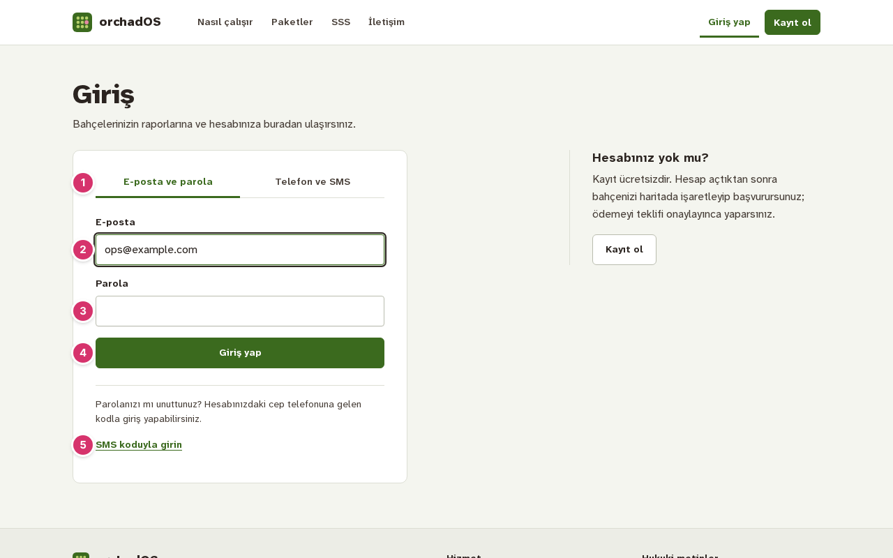
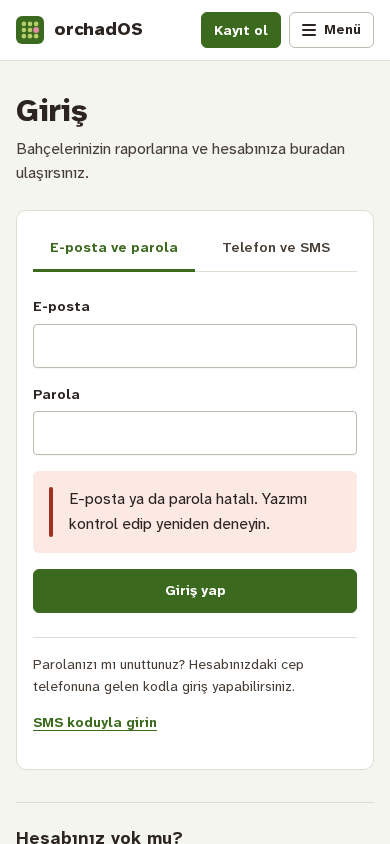
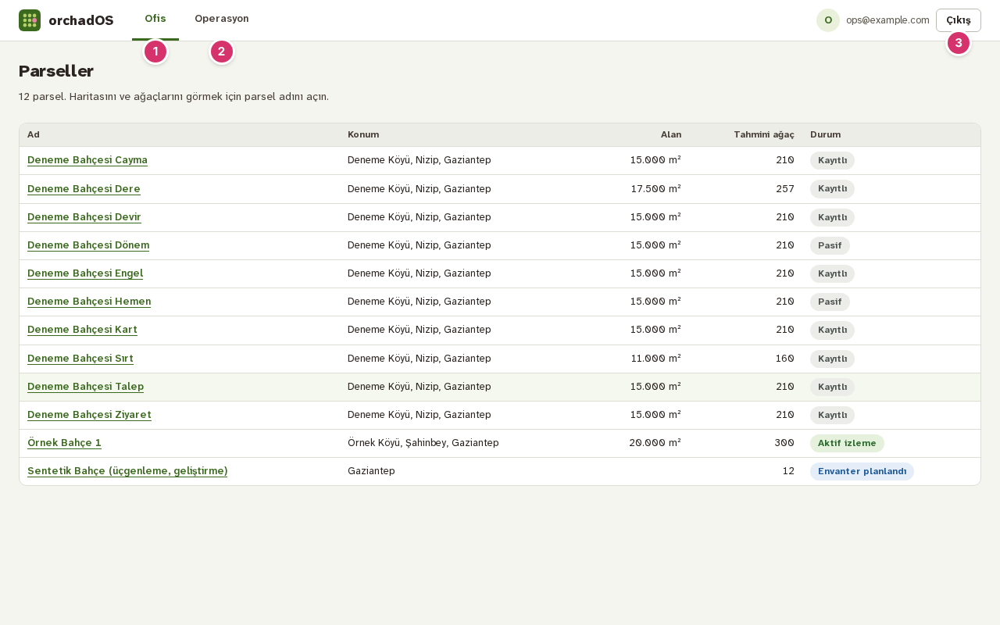
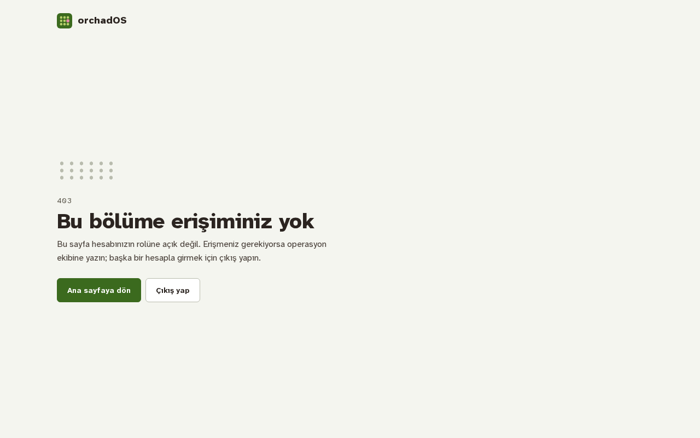

# 01 · Giriş ve roller

[← Kılavuz dizini](README.md)

Bu bölüm web uygulamasına nasıl girileceğini, girince hangi bölümün açıldığını ve rolünüzün hangi bölümleri açtığını anlatır. Saha uygulamasına giriş [07 · Saha uygulaması](07-saha-uygulamasi.md) bölümündedir.

## Roller ve bölümler

Web uygulamasının dört bölümü vardır. Hangi bölümleri göreceğinize hesabınızın rolü karar verir.

| Bölüm | Adres | Kim açabilir |
| --- | --- | --- |
| Bahçelerim (sahip portalı) | `/portal` | Bahçe sahibi, hissedar, self-servis müşteri |
| Uzman paneli | `/uzman` | Uzman |
| Ofis | `/ofis` | Saha personeli ve operasyon |
| Operasyon | `/operasyon` | Yalnız operasyon |

- Bir rolün açamadığı bölüm üst menüde görünmez. Adresi elle yazarsanız "Bu bölüme erişiminiz yok" sayfası çıkar.
- Bölüm içinde hangi kaydı göreceğinize ayrıca veritabanı karar verir. Örneğin sahip yalnız kendi bahçesini görür; personel işletmenin bütün parsellerini görür.
- Hesapları operasyon açar. Parolanızı kimseyle paylaşmayın; parola ve kodlar WhatsApp'tan gönderilmez.

## Giriş ekranı

`/giris`

**Ne için:** E-posta ve parolayla ya da cep telefonuna gelen SMS koduyla web uygulamasına girmek için.
**Kim kullanır:** Herkes.

**Ekranın bölümleri**

1. Giriş yöntemi sekmeleri: "E-posta ve parola" ile "Telefon ve SMS".
2. "E-posta" alanı.
3. "Parola" alanı.
4. "Giriş yap" düğmesi.
5. "SMS koduyla girin": parolasını unutan kişi hesabındaki cep telefonuna gelen kodla girer.

Sağdaki "Hesabınız yok mu?" kutusu bahçe sahibi adayları içindir (self-servis kayıt). Personel bu kutuyu kullanmaz; personel hesabını operasyon açar.

### E-posta ve parolayla girmek

1. Tarayıcıda pilot adresini açın ve sağ üstteki "Giriş yap"a tıklayın (ya da adrese `/giris` yazın).
2. "E-posta ve parola" sekmesinde e-postanızı ve parolanızı yazın.
3. "Giriş yap"a tıklayın. Düğme kısa bir süre "Giriş yapılıyor…" yazar.

### SMS koduyla girmek

1. "Telefon ve SMS" sekmesini seçin (ya da "SMS koduyla girin"e tıklayın).
2. "Cep telefonu" alanına hesabınızdaki numarayı yazın, örneğin 0532 123 45 67. "SMS kodu gönder"e tıklayın.
3. Gelen 6 haneli kodu "SMS kodu" alanına yazıp "Giriş yap"a tıklayın.
4. Kod gelmezse bir süre sonra "Kodu yeniden gönder" açılır. Numara yanlışsa "Numarayı değiştir".

Gerçek SMS gönderimi barındırılan ortamda SMS sağlayıcısı tanımlıyken çalışır. Yerel deneme ortamında kod gönderilmez, mesaj kayıt altına alınır.

**Uyarılar ve ret mesajları**

| Mesaj | Ne zaman çıkar | Ne yapmalı |
| --- | --- | --- |
| "E-posta ya da parola hatalı. Yazımı kontrol edip yeniden deneyin." | E-posta ya da parola tutmuyor | Büyük/küçük harfe ve boşluklara bakın. Olmazsa SMS koduyla girin ya da operasyondan yeni parola isteyin. |
| "E-posta ve parola gerekli." | Alanlardan biri boş | İki alanı da doldurun. |
| "Geçerli bir cep telefonu numarası girin." | Numara eksik ya da yanlış biçimde | 05 ile başlayan 11 haneyi yazın. |
| "Kodu 6 rakam olarak girin." | Kod 6 haneden kısa ya da harf içeriyor | SMS'teki 6 rakamı yazın. |
| "Kod hatalı ya da süresi geçmiş. N deneme hakkınız kaldı." | Yanlış ya da eski kod | Son gelen kodu yazın; gerekirse yeni kod isteyin. |
| "Çok fazla hatalı deneme yapıldı. 15 dakika sonra yeniden deneyin." | Üst üste hatalı kod | 15 dakika bekleyin. |
| "Bu numaraya çok fazla kod gönderildi. Bir saat sonra yeniden deneyin." | Kısa sürede çok kod istendi | Bir saat bekleyin ya da e-postayla girin. |
| "Kod gönderilemedi. Biraz sonra yeniden deneyin." | SMS gönderilemedi | Biraz sonra deneyin; sürerse operasyona haber verin. |

Ekran telefonda da çalışır; hata mesajı formun içinde, "Giriş yap"ın üstünde görünür:

## Girişten sonra açılan ekran

**Ne için:** Rolünüzün açabildiği ilk bölüme götürür; bölümler arasında üst menüden geçilir.
**Kim kullanır:** Herkes.

Girişten sonra uygulama sırasıyla Bahçelerim, Uzman paneli, Ofis, Operasyon bölümlerinden rolünüzün açabildiği **ilkini** açar. Bu yüzden operasyon rolüyle girince önce **Ofis** bölümünün parsel listesi gelir; operasyon panosuna üst menüdeki "Operasyon"la geçersiniz. Saha personeli de Ofis bölümüne düşer.

**Ekranın bölümleri**

1. "Ofis" sekmesi: parsel listesi ve ofis aracı ([06 · Ofis aracı](06-ofis-araci-ucgenleme.md)).
2. "Operasyon" sekmesi: operasyon panosu ve menüsü ([02 · Operasyon panosu](02-operasyon-pano.md)). Yalnız operasyon rolünde görünür.
3. Hesabınızın e-postası ve "Çıkış" düğmesi. Ortak bilgisayarda işiniz bitince mutlaka çıkış yapın.

Bir bağlantıyı açarken giriş isterse, girişten sonra uygulama sizi o sayfaya geri götürür.

**Hesabınızda rol yoksa** ekranda "Hesabınıza henüz bir rol atanmamış. Lütfen operasyon ekibiyle iletişime geçin." yazar. Operasyondan rol isteyin.

## Erişim yok sayfası

**Ne için:** Rolünüzün açamadığı bir sayfaya gittiğinizi söyler.
**Kim görür:** Rolü o bölüme yetmeyen herkes; örneğin saha personeli `/operasyon` adresini açarsa.

| Düğme | Ne yapar |
| --- | --- |
| "Ana sayfaya dön" | Rolünüzün açabildiği ilk bölüme döner. |
| "Çıkış yap" | Oturumu kapatır; başka bir hesapla girebilirsiniz. |

Bu sayfayı sık görüyorsanız ya bağlantı yanlış bölüme gidiyordur ya da rolünüz eksiktir; operasyona yazın.

## Diğer genel sayfalar

| Başlık | Ne zaman çıkar | Ne yapmalı |
| --- | --- | --- |
| "Sayfa şu anda açılamadı" | Geçici bir sunucu ya da bağlantı sorunu | "Yeniden dene". Sürerse saati ve adresi not edip teknik desteğe bildirin. |
| "Sayfa bulunamadı" | Adres yanlış ya da kayıt kaldırılmış | "Ana sayfaya dön" ve menüden gidin. |

---

Sonraki: [02 · Operasyon panosu ve menü →](02-operasyon-pano.md)
