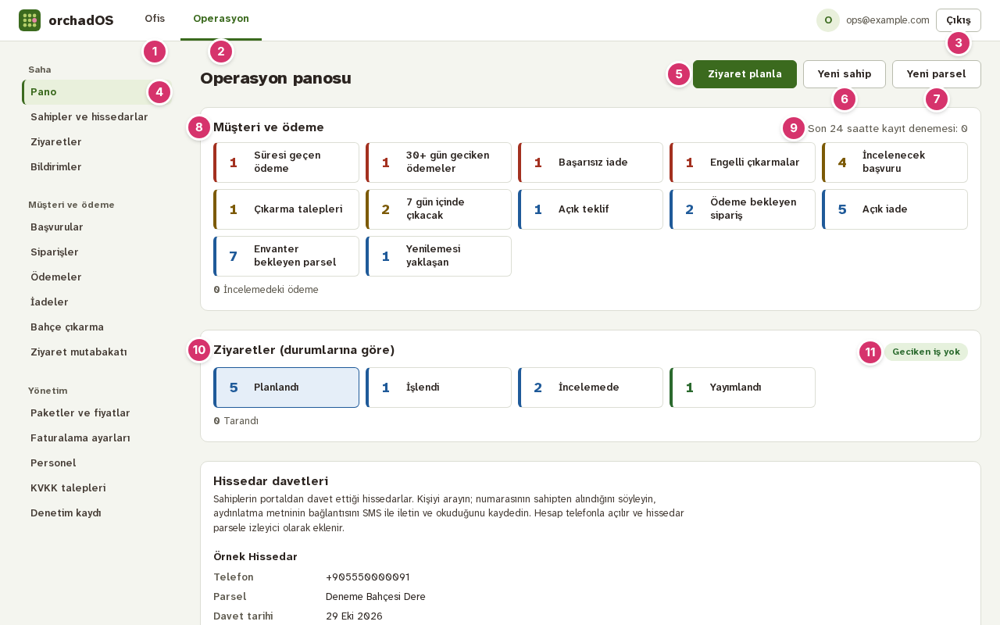
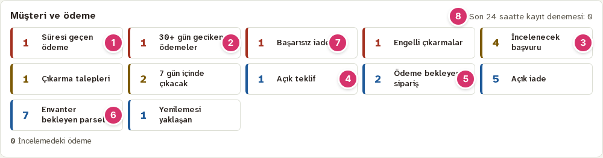
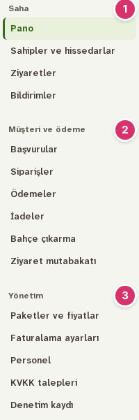
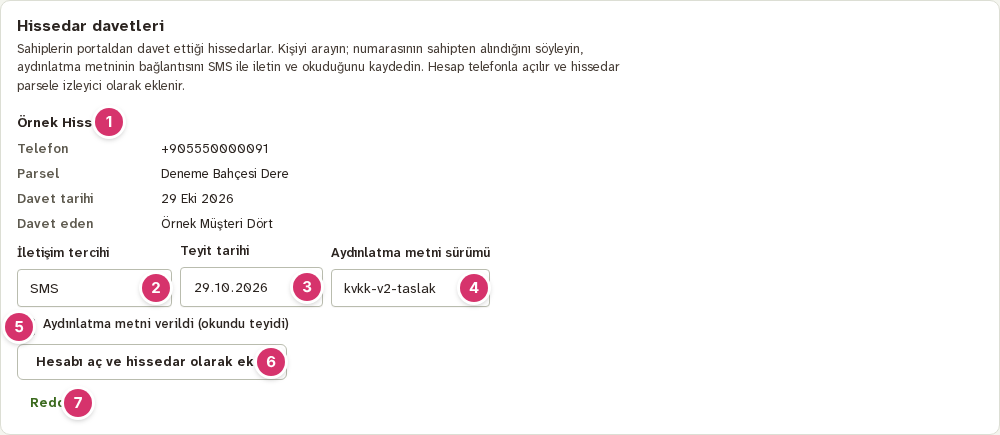
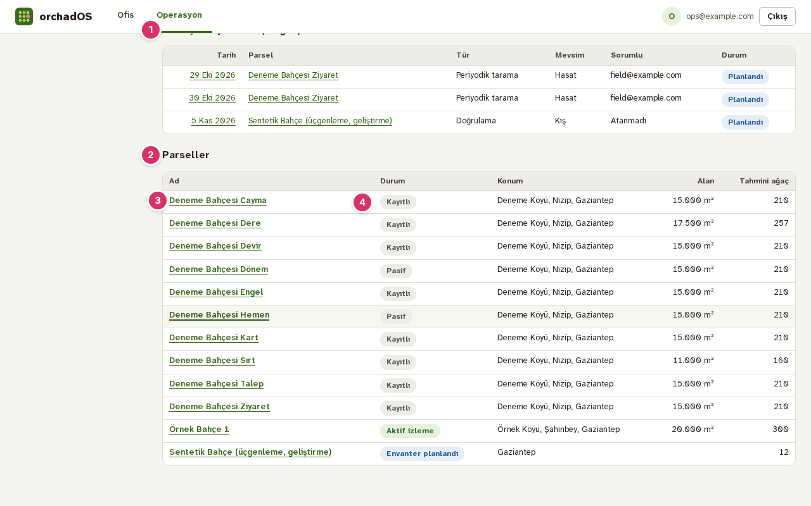

# 02 · Operasyon panosu ve menü

[← Kılavuz dizini](README.md)

Operasyon bölümünün ilk ekranı panodur. Pano her sabah bakılacak işleri sayar: incelenecek başvurular, açık teklifler, geciken ödemeler, iadeler, yaklaşan ve geciken ziyaretler, hissedar davetleri ve uzman istekleri. Bu bölüm panoyu, üst başlığı ve sol menüyü anlatır; menüdeki her ekranın ayrıntısı kendi bölümündedir.

## Panoya ulaşmak

Operasyon rolüyle `/giris`'ten girdiğinizde önce **Ofis** bölümü (`/ofis`) açılır, çünkü rolünüzün açabildiği ilk bölüm odur. Panoya geçmek için üst başlıktaki "Operasyon" sekmesine tıklayın. Bir bağlantıyla doğrudan bir operasyon sayfasına geldiyseniz girişten sonra o sayfa açılır. Giriş için bkz. [01 · Giriş ve roller](01-giris-ve-roller.md).

## Operasyon panosu

`/operasyon`

**Ne için:** Günün işlerini tek bakışta görmek ve ilgili listeye geçmek için.
**Kim kullanır:** Operasyon.

**Ekranın bölümleri**

1. "Ofis" sekmesi: ofis aracına geçer ([06 · Ofis aracı](06-ofis-araci-ucgenleme.md)).
2. "Operasyon" sekmesi: bu bölüm. Açık olan sekmenin altı çizilidir.
3. Sağ üstte hesabınızın e-postası ve "Çıkış" düğmesi.
4. Sol menü (aşağıda "Sol menü" başlığında). Açık olan ekran yeşil zeminle işaretlidir.
5. "Ziyaret planla": yeni ziyaret formunu açar ([05 · Ziyaret planlama](05-ziyaret-planlama.md)).
6. "Yeni sahip": telefonla gelen sahibi kaydeder ([04 · Sahip ve parsel](04-sahip-ve-parsel.md)).
7. "Yeni parsel": sahibe bağlı ya da bağsız parsel kaydeder ([04 · Sahip ve parsel](04-sahip-ve-parsel.md)).
8. "Müşteri ve ödeme" kartı: başvuru, teklif, sipariş, ödeme, iade ve bahçe çıkarma sayaçları.
9. "Son 24 saatte kayıt denemesi": siteden yapılan self-servis kayıt denemelerinin sayısı.
10. "Ziyaretler (durumlarına göre)": ziyaretlerin durumlara göre sayısı.
11. Geciken iş rozeti: geciken ziyaret yoksa yeşil "Geciken iş yok", varsa kırmızı "n geciken iş".

Panonun alt kısmında sırayla "Hissedar davetleri", "Uzman istekleri", "Yaklaşan ziyaretler (14 gün)" ve "Parseller" gelir. Geciken ziyaret varsa en üstte "Geciken işler" tablosu da çıkar.

### Sabah kontrolü

1. Üstte kırmızı bir "Geciken işler" tablosu var mı bakın. Varsa her satırdaki nedene göre ziyareti açın (tarihi geçmiş ama hâlâ planlı ziyaret ya da işlenmeyi bekleyen ziyaret).
2. "Müşteri ve ödeme" kartında kırmızı ve sarı kutulara bakın; her kutu ilgili listeyi süzülmüş olarak açar.
3. "Hissedar davetleri" bölümünde bekleyen kişileri arayın (aşağıda).
4. "Uzman istekleri" varsa doğrulama ya da ek ziyaret isteklerini bir ziyarete bağlayın.
5. "Yaklaşan ziyaretler" tablosunda önümüzdeki 14 günün ziyaretlerine, sorumlu personele ve bildirimin gidip gitmediğine bakın.

**Düğmeler ve alanlar**

| Düğme / alan | Ne yapar |
| --- | --- |
| "Ofis", "Operasyon" | Bölümler arasında geçer. Rolünüzün açamadığı bölüm görünmez. |
| "Çıkış" | Oturumu kapatır. |
| "Ziyaret planla" | `/operasyon/ziyaret/yeni` formunu açar. |
| "Yeni sahip" | `/operasyon/sahip/yeni` formunu açar. |
| "Yeni parsel" | `/operasyon/parsel/yeni` formunu açar. |
| Sayaç kutuları | Tıklayınca ilgili listeyi o duruma süzülmüş açar. Değeri 0 olanlar kutunun altında küçük yazıyla sıralanır. |
| Ziyaret durum kutuları | "Planlandı", "Tarandı", "İşlendi", "İncelemede", "Yayımlandı" sayıları; tıklayınca ziyaret listesini o durumla açar. |

## Müşteri ve ödeme kartı

`/operasyon` (kart)

**Ne için:** Başvuru, ödeme ve iade işlerinde bekleyenleri ve sorunlu olanları saymak için.
**Kim kullanır:** Operasyon.

**Ekranın bölümleri**

Kart önce ters gidenleri (kırmızı), sonra bugün sizi bekleyenleri (sarı), sonra süren işleri (mavi) gösterir. Değeri 0 olanlar en altta küçük yazıyla durur.

1. "Süresi geçen ödeme": ödeme süresi dolmuş, hâlâ ödeme bekleyen siparişler.
2. "30+ gün geciken ödemeler": son gününden 30 gün ya da daha fazla geçmiş, ödenmemiş plan ödemeleri.
3. "İncelenecek başvuru": müşterinin gönderdiği, sizin incelemenizi bekleyen başvurular.
4. "Açık teklif": verilmiş, müşterinin henüz karar vermediği teklifler.
5. "Ödeme bekleyen sipariş": teklifi kabul edilmiş, ilk ödemesi gelmemiş siparişler.
6. "Envanter bekleyen parsel": aktif siparişte, envanteri henüz yapılmamış parseller.
7. Sıfır olan sayaçlar, örneğin "Başarısız iade", "Engelli çıkarmalar", "İncelemedeki ödeme", "Çıkarma talepleri", "7 gün içinde çıkacak", "Açık iade", "Yenilemesi yaklaşan".
8. "Son 24 saatte kayıt denemesi".

**Düğmeler ve alanlar**

| Düğme / alan | Ne yapar |
| --- | --- |
| "Süresi geçen ödeme" | Sipariş listesini "Ödeme bekleniyor" süzgeciyle açar. |
| "30+ gün geciken ödemeler" | Sipariş listesini açar; geciken ödemeler listenin altındaki tablodadır. |
| "Başarısız iade" | İadeler sayfasını açar ([08](08-iade-cikarma-mutabakat-kvkk.md)). |
| "Engelli çıkarmalar", "Çıkarma talepleri", "7 gün içinde çıkacak" | Bahçe çıkarma sayfasını açar ([08](08-iade-cikarma-mutabakat-kvkk.md)). |
| "İncelenecek başvuru" | Başvuru listesini "İncelemede" süzgeciyle açar. |
| "İncelemedeki ödeme" | Ödeme listesini "İncelemede" süzgeciyle açar (dolandırıcılık incelemesine düşen kart ödemeleri). |
| "Açık teklif" | Başvuru listesini "Teklif verildi" süzgeciyle açar. |
| "Ödeme bekleyen sipariş" | Sipariş listesini "Ödeme bekleniyor" süzgeciyle açar. |
| "Açık iade" | İadeler sayfasını açar. |
| "Envanter bekleyen parsel", "Yenilemesi yaklaşan" | Sipariş listesini "Aktif" süzgeciyle açar. |

**Uyarılar ve ret mesajları**

| Mesaj | Ne zaman çıkar | Ne yapmalı |
| --- | --- | --- |
| "Son 24 saatte n kayıt denemesi var (eşik 300). Kötüye kullanım olabilir: SMS gönderimlerini izleyin, gerekirse Ayarlar'dan dışarıdan kaydı kapatın." | Son 24 saatte 300'den fazla kayıt denemesi olduğunda | Bildirimler ekranında SMS'leri izleyin; gerekirse "Faturalama ayarları"nda dışarıdan kaydı kapatın ([09](09-fiyat-ayarlar-personel.md)). |

## Sol menü

Her operasyon ekranının solunda aynı menü durur. Dar ekranda menü başlığın altında "Menü" düğmesiyle açılır.

**Ekranın bölümleri**

1. **Saha** grubu.
2. **Müşteri ve ödeme** grubu.
3. **Yönetim** grubu.

**Düğmeler ve alanlar**

| Menü öğesi | Adres | Ne açar | Kılavuzda |
| --- | --- | --- | --- |
| "Pano" | `/operasyon` | Bu pano | Bu bölüm |
| "Sahipler ve hissedarlar" | `/operasyon/sahip` | Sahip ve müşteri listesi; parsel sayfaları da bu öğenin altındadır | [04](04-sahip-ve-parsel.md) |
| "Ziyaretler" | `/operasyon/ziyaret` | Ziyaret listesi ve planlama | [05](05-ziyaret-planlama.md) |
| "Bildirimler" | `/operasyon/bildirimler` | Gönderilen SMS'ler ve durumları | [08](08-iade-cikarma-mutabakat-kvkk.md) |
| "Başvurular" | `/operasyon/basvuru` | Başvurular; teklif sayfaları da bu öğenin altındadır | [03](03-basvuru-teklif-siparis-odeme.md) |
| "Siparişler" | `/operasyon/siparis` | Siparişler ve ödeme planları | [03](03-basvuru-teklif-siparis-odeme.md) |
| "Ödemeler" | `/operasyon/odeme` | Kart ve havale ödemeleri, makbuzlar | [03](03-basvuru-teklif-siparis-odeme.md) |
| "İadeler" | `/operasyon/iade` | İade kuyruğu | [08](08-iade-cikarma-mutabakat-kvkk.md) |
| "Bahçe çıkarma" | `/operasyon/cikarma` | Bahçe çıkarma talepleri | [08](08-iade-cikarma-mutabakat-kvkk.md) |
| "Ziyaret mutabakatı" | `/operasyon/mutabakat` | Pencere ya da dönem sonunda yapılamayan ziyaretler | [08](08-iade-cikarma-mutabakat-kvkk.md) |
| "Paketler ve fiyatlar" | `/operasyon/fiyat` | Paketler ve fiyat listeleri | [09](09-fiyat-ayarlar-personel.md) |
| "Faturalama ayarları" | `/operasyon/ayarlar` | Kayıt, ödeme, satıcı ve süre ayarları | [09](09-fiyat-ayarlar-personel.md) |
| "Personel" | `/operasyon/personel` | Personelin adı ve unvanı | [09](09-fiyat-ayarlar-personel.md) |
| "KVKK talepleri" | `/operasyon/kvkk` | Kişisel veri başvuruları | [08](08-iade-cikarma-mutabakat-kvkk.md) |
| "Denetim kaydı" | `/operasyon/denetim-kaydi` | Faturalama kayıtlarındaki her değişiklik | [08](08-iade-cikarma-mutabakat-kvkk.md) |

Menüde "Yeni sahip" gibi işlemler yoktur; her ekran kendi işlemini başlığında gösterir.

## Hissedar davetleri

`/operasyon` (bölüm)

**Ne için:** Sahiplerin portaldan davet ettiği hissedarları arayıp hesaplarını açmak ya da daveti reddetmek için.
**Kim kullanır:** Operasyon.

Bu bölüm yalnız bekleyen davet varken görünür.

**Ekranın bölümleri**

1. Davet edilen kişi: ad, "Telefon", "Parsel", "Davet tarihi" ve "Davet eden" sahip.
2. "İletişim tercihi": "WhatsApp", "SMS" ya da "Telefonla arama".
3. "Teyit tarihi": aydınlatma metnini okuduğunu teyit ettiği gün (bugün hazır gelir).
4. "Aydınlatma metni sürümü": kişiye ilettiğiniz metnin sürümü.
5. "Aydınlatma metni verildi (okundu teyidi)" kutusu.
6. "Hesabı aç ve hissedar olarak ekle".
7. "Reddet".

### Bir hissedarı eklemek

1. Kişiyi telefonla arayın. Numarasının sahipten alındığını ve hangi bahçe için davet edildiğini söyleyin.
2. Aydınlatma metninin bağlantısını SMS ile iletin ve okuduğunu sorun.
3. "İletişim tercihi"ni seçin, "Teyit tarihi"ni ve "Aydınlatma metni sürümü"nü kontrol edin.
4. "Aydınlatma metni verildi (okundu teyidi)" kutusunu işaretleyin. Bu bir onay ya da rıza kaydı değildir; kişinin metni aldığını kaydeder.
5. "Hesabı aç ve hissedar olarak ekle"ye tıklayın. Hesap telefonla açılır; hissedar parsele izleyici olarak eklenir ve SMS koduyla portala girer.

İletişim tercihi WhatsApp olsa bile parola, kod, bildirim ve rapor WhatsApp'tan gönderilmez.

### Daveti reddetmek

Kişi istemiyorsa ya da ulaşılamıyorsa "Reddet"e tıklayın. Sahip reddi portalda görür.

**Düğmeler ve alanlar**

| Düğme / alan | Ne yapar |
| --- | --- |
| "İletişim tercihi" | Hissedarla hangi kanaldan iletişim kurulacağını kaydeder. |
| "Teyit tarihi" | Aydınlatma metninin okunduğunun teyit edildiği gün (zorunlu). |
| "Aydınlatma metni sürümü" | Kayıtlı sürümlerden biri; en güncel olan önce gelir (zorunlu). |
| "Aydınlatma metni verildi (okundu teyidi)" | İşaretlenmeden hesap açılmaz. |
| "Hesabı aç ve hissedar olarak ekle" | Hesabı açar, kişiyi parsele "Hissedar (izleyici)" rolüyle ekler. |
| "Reddet" | Daveti kapatır. |

**Uyarılar ve ret mesajları**

| Mesaj | Ne zaman çıkar | Ne yapmalı |
| --- | --- | --- |
| "Hissedar eklendi; telefonla (SMS koduyla) portala girebilir." | Hesap açıldı | Kişiye telefonla girebileceğini söyleyin. |
| "Davet reddedildi; sahip portalda görür." | Davet reddedildi | Gerekirse sahibe nedenini telefonla açıklayın. |
| "Bu kişi parselin sahibi; hissedar olarak eklenemez." | Davet edilen kişi zaten o parselin sahibi | Daveti reddedin. |
| "Portal hesabı açılamadı: hesap servisi (invite-user) erişilemiyor. …" | Hesap açma servisine ulaşılamadı | Biraz sonra yeniden deneyin; sürerse teknik desteğe bildirin. |
| "E-posta ile telefon farklı hesaplara ait. Bilgileri kontrol edin." | Telefon başka bir hesaba kayıtlı | Numarayı kişiyle teyit edin. |

## Uzman istekleri

`/operasyon` (bölüm)

**Ne için:** Uzmanın istediği ek ziyaretleri ve doğrulamaları planlı bir ziyarete bağlamak için.
**Kim kullanır:** Operasyon.

Bu bölüm yalnız açık ya da planlanmış istek varken görünür; görüntüdeki deneme ortamında istek olmadığı için resmi yoktur. Tablonun sütunları: "İstek", "Parsel", "Kaynak", "Durum", "Tarih", "Not", "Ziyaret".

### Bir isteği ziyarete bağlamak

1. "Ziyaret" sütununda parselin planlı ziyaretlerinden birini seçin ve "Ziyarete bağla"ya tıklayın. İstek "planlandı" olur; ziyaret taranınca tamamlanır.
2. Parselin uygun planlı ziyareti yoksa sütunda "Doğrulama ziyareti planla" ya da "Ziyaret planla" düğmesi çıkar; ziyaret formu o parselle açılır.
3. Yakın plan istekleri bağlanmaz: "Sonraki taramanın yakın plan listesine kendiliğinden girer."

| Mesaj | Ne zaman çıkar | Ne yapmalı |
| --- | --- | --- |
| "İstekler ziyarete bağlandı." | Bağlama başarılı | Bir şey gerekmez. |

## Yaklaşan ziyaretler ve parseller

`/operasyon` (alt kısım)

**Ne için:** Önümüzdeki 14 günün ziyaretlerini ve bütün parselleri yaşam döngüsü durumlarıyla görmek için.
**Kim kullanır:** Operasyon.

**Ekranın bölümleri**

1. "Yaklaşan ziyaretler (14 gün)": "Tarih", "Parsel", "Tür", "Mevsim", "Sorumlu", "Durum". Tarihe tıklayınca ziyaret sayfası açılır.
2. "Parseller" tablosu: "Ad", "Durum", "Konum", "Alan", "Tahmini ağaç".
3. Parsel adı: parsel sayfasını açar ([04](04-sahip-ve-parsel.md)).
4. Parselin yaşam döngüsü durumu: "Kayıtlı", "Envanter planlandı", "Envanter tamam", "Aktif izleme", "Pasif".

Yaklaşan ziyaret yoksa "Önümüzdeki günlerde planlanmış ziyaret yok" yazar. Parsel listesi uzunsa altında sayfa düğmeleri ("Önceki", "Sonraki") çıkar.

## Geciken işler

`/operasyon` (yalnız gecikme varken)

Tarihi geçtiği hâlde hâlâ "Planlandı" durumundaki ya da uzun süredir işlenmeyi bekleyen ziyaretler panonun en üstünde "Geciken işler" tablosunda listelenir. Her satırda neden yazar:

| Neden | Ne yapmalı |
| --- | --- |
| "Tarihi n gün önce geçti, hâlâ planlandı" | Saha personeline sorun. Ziyaret yapılamadıysa yapılamayan ziyaret kaydını açıp yeni tarih verin ([05](05-ziyaret-planlama.md)). |
| "n gündür işlenmeyi bekliyor" | Kartların ofise gelip gelmediğine bakın; işleme ve yüklemeyi çalıştırın ([05](05-ziyaret-planlama.md)). |

Görüntülerdeki deneme ortamında geciken ziyaret olmadığı için bu tablonun resmi yoktur.

---

Önceki: [01 · Giriş ve roller](01-giris-ve-roller.md) · Sonraki: [03 · Başvuru, teklif, sipariş, ödeme](03-basvuru-teklif-siparis-odeme.md)
