# 03 · Başvuru, teklif, sipariş, ödeme

[← Kılavuz dizini](README.md)

Bu bölüm bir bahçe sahibinin başvurusundan ödemesine kadar operasyonun yaptığı her işi anlatır: başvuruyu incelemek, bahçe alanını doğrulamak, teklif vermek ya da başvuruyu reddetmek, siparişi ve ödeme planını izlemek, havaleyi kaydetmek, ödemeyi açıp iade istemek ve makbuzu görmek. Hepsi sol menünün **Müşteri ve ödeme** grubundadır. Akışın kısa özeti [personel kılavuzunda](../personel-kilavuzu.md), kuralların ayrıntısı [musteri-yonetimi.md](../musteri-yonetimi.md) ve [bahce-yonetimi.md](../bahce-yonetimi.md)'dedir.

Akış: müşteri başvurur (`B-…`) → siz bahçeleri doğrular ve teklif verirsiniz (`T-…`) → müşteri teklifi ve ödeme planını onaylar, sipariş açılır (`S-…`) → planın ilk ödemesi gelince sipariş "Aktif" olur, her bahçe için parsel açılır → her ödemeye makbuz verilir (`M-…`). Makbuz fatura değildir.

## Başvuru listesi

`/operasyon/basvuru`

**Ne için:** Müşterilerin gönderdiği başvuruları durumlarına göre görmek ve açmak için.
**Kim kullanır:** Operasyon.

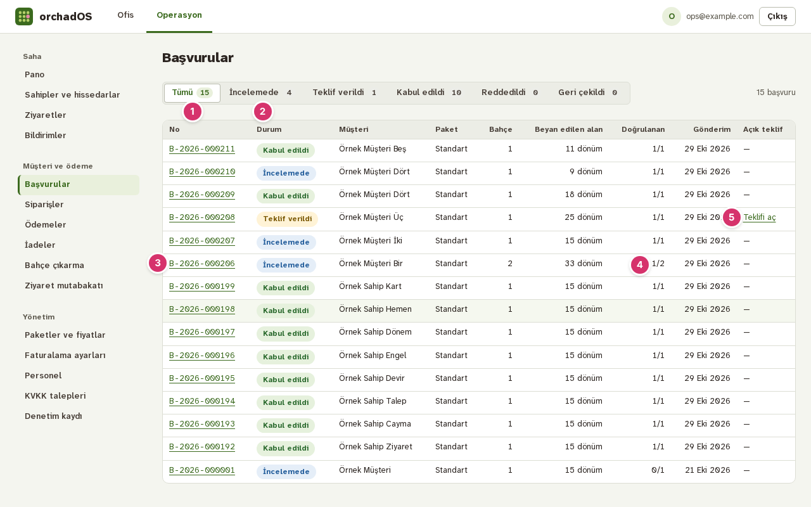

**Ekranın bölümleri**

1. Durum süzgeci "Tümü" ve her durumun sayısı.
2. "İncelemede": sizi bekleyen başvurular. Diğerleri "Teklif verildi", "Kabul edildi", "Reddedildi", "Geri çekildi".
3. Başvuru numarası (`B-…`): başvuru sayfasını açar.
4. "Doğrulanan": doğrulanmış bahçe sayısı / toplam bahçe sayısı (ör. 1/2).
5. "Açık teklif": açık bir teklif varsa "Teklifi aç" bağlantısı.

Diğer sütunlar: "Müşteri", "Paket", "Bahçe", "Beyan edilen alan", "Gönderim". Müşterinin taslak hâlindeki başvuruları listede görünmez.

**Uyarılar ve ret mesajları**

| Mesaj | Ne zaman çıkar | Ne yapmalı |
| --- | --- | --- |
| "Henüz başvuru yok." / "Bu durumda başvuru yok" | Liste ya da seçilen durum boş | Bir şey gerekmez. |

## Başvuru sayfası

`/operasyon/basvuru/<başvuru>`

**Ne için:** Bir başvurunun bahçelerini incelemek, alanlarını doğrulamak, mükerrer kaydı kontrol etmek ve teklif vermek ya da reddetmek için.
**Kim kullanır:** Operasyon.

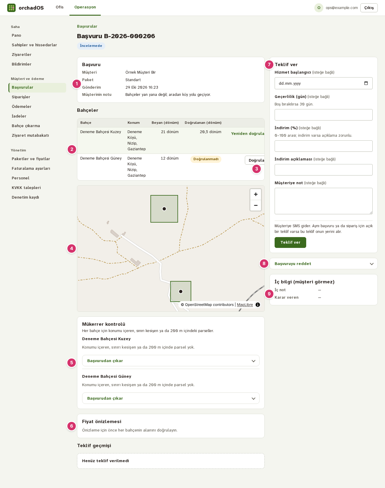

**Ekranın bölümleri**

1. "Başvuru": "Müşteri", "Paket", "Gönderim" zamanı, "Müşterinin notu".
2. "Bahçeler" tablosu: her bahçenin konumu, "Beyan (dönüm)" ve "Doğrulanan (dönüm)". Doğrulanmamış bahçede sarı "Doğrulanmadı" rozeti durur.
3. Satır düğmesi: doğrulanmamış bahçede "Doğrula", doğrulanmışta "Yeniden doğrula". Başvuru kapandıysa "Ayrıntı".
4. Harita: bahçelerin konumu ve müşterinin çizdiği sınırlar. Müşterinin hizmetteki parselleri varsa soluk gri katmanda görünür.
5. "Mükerrer kontrolü": her bahçe için konumu içeren, sınırı kesişen ya da 200 m içindeki parseller.
6. "Fiyat önizlemesi": bütün bahçeler doğrulanınca teklifin satırlarını gösterir. Önce "Önizleme için önce her bahçenin alanını doğrulayın." yazar.
7. "Teklif ver" formu (sağda).
8. "Başvuruyu reddet" (kapalı bölme; tıklayınca açılır).
9. "İç bilgi (müşteri görmez)": "İç not" ve "Karar veren".

En altta "Teklif geçmişi" bu başvuruya verilmiş teklifleri ("Teklif no", durum, "KDV dahil toplam", "Veriliş") listeler.

### Bir başvuruyu incelemek

1. Listede "İncelemede" süzgecini seçin ve başvuruyu açın.
2. "Müşterinin notu"nu okuyun; haritada bahçelerin yerine bakın.
3. Her bahçede "Doğrula"ya tıklayıp alanı doğrulayın (aşağıda "Bahçe doğrulama").
4. "Mükerrer kontrolü"ne bakın (aşağıda).
5. Bütün bahçeler doğrulanınca "Fiyat önizlemesi" çıkar; teklif verin ya da başvuruyu reddedin.

### Mükerrer kontrolü

- Bahçeye yakın parsel yoksa "Konumu içeren, sınırı kesişen ya da 200 m içinde parsel yok." yazar.
- Yakın parsel varsa tabloda "Parsel", "Durum" (ve hizmetteyse "Hizmette"), "İlişki" ("Bu müşterinin" ya da "Başka müşteri", konum sınırın içindeyse "Konum sınırın içinde") ve "Uzaklık" görünür.
- Bahçe aynı müşterinin hizmette olmayan eski parseliyse "Eski parsele bağla"ya tıklayın: aktivasyonda yeni parsel açılmaz, eski parsel kullanılır. Bağı kaldırmak için "Bağı kaldır".
- "Başka müşterinin parseli bağlanamaz; bahçe mükerrerse reddedin."
- Başvuruda birden çok bahçe varsa her bahçenin altında "Başvurudan çıkar" bölmesi vardır. Mükerrer ya da hizmet verilemeyecek tek bir bahçeyi, nedenini "Neden (iç not, zorunlu)" alanına yazarak çıkarırsınız; başvurunun kalanı sürer.

### Teklif vermek

1. "Fiyat önizlemesi"nde indirim gerekiyorsa "İndirim (%)" yazıp "Önizlemeyi indirimle hesapla"ya tıklayın (aşağıda resim).
2. Sağdaki "Teklif ver" formunda gerekirse "Hizmet başlangıcı" ve "Geçerlilik (gün)" girin. Boş geçerlilik ayardaki süreyi alır (ör. "Boş bırakılırsa 30 gün.").
3. İndirim verdiyseniz "İndirim açıklaması" zorunludur. Aynı köyden komşu bahçeye %10–15 indirim bu alanla verilir; açıklama: "Komşu bahçe indirimi, <köy>". Ayrı bir kurucu indirimi yoktur.
4. İsterseniz "Müşteriye not" yazın; müşteri teklifte görür.
5. Formun altında "Önizlemedeki toplam (KDV dahil)" yazar. "Teklif ver"e tıklayın. Müşteriye SMS gider. Aynı başvuru için açık bir teklif varsa yeni teklif onun yerini alır.

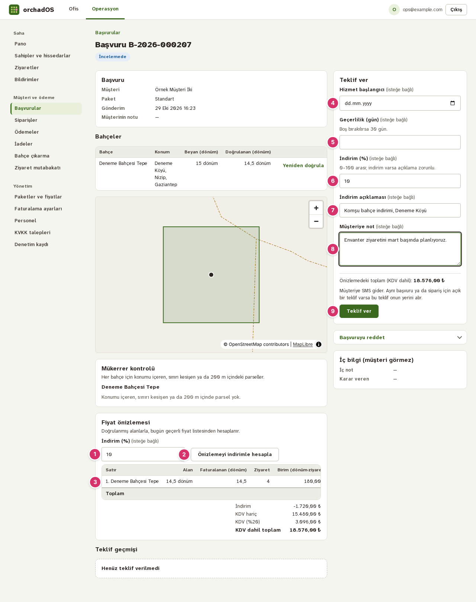

1. Önizleme için "İndirim (%)".
2. "Önizlemeyi indirimle hesapla".
3. Önizleme satırları: "Satır", "Alan", "Faturalanan (dönüm)", "Ziyaret", "Birim (dönüm·ziyaret)", "Minimum", "Envanter", "Taban", "İndirim"; altında "KDV hariç", "KDV (%20)", "KDV dahil toplam".
4. "Hizmet başlangıcı".
5. "Geçerlilik (gün)".
6. "İndirim (%)" (önizlemedeki indirim buraya gelir).
7. "İndirim açıklaması".
8. "Müşteriye not".
9. "Teklif ver".

Önizleme bugün geçerli fiyat listesinden hesaplanır; teklif verildiğinde girdiler teklifte dondurulur. Fiyat listesi değişse de verilmiş teklif değişmez.

### Başvuruyu reddetmek

1. "Başvuruyu reddet" bölmesini açın.
2. "Neden" seçin: "Bahçenin konumuna şu an hizmet veremiyoruz", "Alan bilgisi tutmuyor", "Yetki belgesi yetersiz", "Mükerrer başvuru", "Kapasite dolu", "Diğer". Neden müşteriye gösterilir.
3. "İç not" yalnız operasyon içindir.
4. "Başvuruyu reddet"e tıklayın. Başvuru reddedilmiş olarak kapanır ve müşteriye bildirim gider.

**Konuma göre ret:** "Bahçenin konumuna şu an hizmet veremiyoruz" nedeni yalnız yazılı iç ölçüte (mesafe, yol süresi, kapasite, erişim güvenliği) göre seçilir ve hangi ölçütü uyguladığınızı "İç not"a yazarsınız. Not boşsa sistem reddi kabul etmez. Aynı ölçüt herkese uygulanır. Müşteriye "hizmet bölgemiz dışı" denmez; bölge adı verilmez.

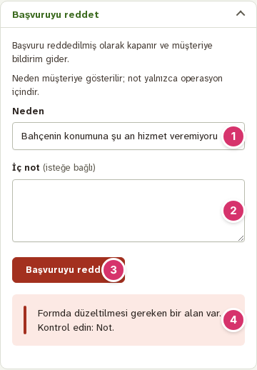

1. "Neden".
2. "İç not".
3. "Başvuruyu reddet".
4. Not boş bırakıldığında çıkan uyarı: "Formda düzeltilmesi gereken bir alan var. Kontrol edin: Not."

**Düğmeler ve alanlar**

| Düğme / alan | Ne yapar |
| --- | --- |
| "Doğrula" / "Yeniden doğrula" | Bahçe doğrulama sayfasını açar. |
| "Eski parsele bağla" / "Bağı kaldır" | Bahçeyi müşterinin eski parseline bağlar ya da bağı kaldırır. |
| "Başvurudan çıkar" | Tek bir bahçeyi başvurudan çıkarır; "Neden (iç not, zorunlu)". Başvuruda tek bahçe kalınca görünmez. |
| "Önizlemeyi indirimle hesapla" | Önizlemeyi girilen indirimle yeniden hesaplar; teklif vermez. |
| "Hizmet başlangıcı" | Teklifteki önerilen başlangıç günü (isteğe bağlı). |
| "Geçerlilik (gün)" | Teklifin kaç gün açık kalacağı (isteğe bağlı). |
| "İndirim (%)" | 0–100 arası; indirim varsa açıklama zorunlu. |
| "İndirim açıklaması" | İndirimin gerekçesi. |
| "Müşteriye not" | Müşterinin teklifte göreceği not. |
| "Teklif ver" | Teklifi verir, müşteriye SMS gider. |
| "Neden" (ret) | Müşteriye gösterilen ret nedeni. |
| "İç not" (ret) | Yalnız operasyonun gördüğü not; konuma göre retde zorunlu. |
| "Başvuruyu reddet" | Başvuruyu kapatır, müşteriye bildirim gider. |

**Uyarılar ve ret mesajları**

| Mesaj | Ne zaman çıkar | Ne yapmalı |
| --- | --- | --- |
| "Teklif verildi; müşteriye bildirim gidecek." | Teklif verildi | Bir şey gerekmez. |
| "Başvuru reddedildi; müşteriye bildirim gidecek." | Ret kaydedildi | Bir şey gerekmez. |
| "Formda düzeltilmesi gereken bir alan var. Kontrol edin: <alan>." | Bir alan eksik ya da hatalı (ör. "İndirim açıklaması", "Not") | Adı geçen alanı düzeltin. |
| "Teklif için önce her bahçenin alanı doğrulanmalı." | Doğrulanmamış bahçe varken teklif | Kalan bahçeleri doğrulayın. |
| "Yayımlanmış bir fiyat listesi yok." / "Bu paketin fiyat listesinde fiyatı yok." | Fiyat listesi eksik | Fiyat listesini yayımlayın ([09](09-fiyat-ayarlar-personel.md)). |
| "Başvuru açık değil; teklif ya da ret verilemez." | Başvuru kapanmış (kabul, ret, geri çekme) | Bir şey gerekmez. |
| "Mükerrer kontrolü yapılamadı (…). Sayfayı yenileyin." / "Mükerrer kontrolü her bahçe için yapılamadan teklif verilemez." | Mükerrer kontrolü okunamadı | Sayfayı yenileyin. |
| "Müşterinin üyeliği okunamadı (…); ek teklif mi ayrı dönem mi verileceği bilinemiyor. Sayfayı yenileyin." | Üyelik bilgisi okunamadı | Sayfayı yenileyin. |
| "Başvuruda tek bahçe kaldı; bunun yerine başvurunun tamamını geri çekin." | Son bahçe başvurudan çıkarılmak istendi | Başvuruyu reddedin. |
| "Kayıt bu arada değişti; sayfayı yenileyip yeniden deneyin." | Başka biri aynı anda değiştirdi | Sayfayı yenileyin. |

## Bahçe doğrulama

`/operasyon/basvuru/<başvuru>/bahce/<bahçe>`

**Ne için:** Bir bahçenin alanını dönüm olarak doğrulamak; gerekirse sınırı haritada yeniden çizmek için.
**Kim kullanır:** Operasyon.

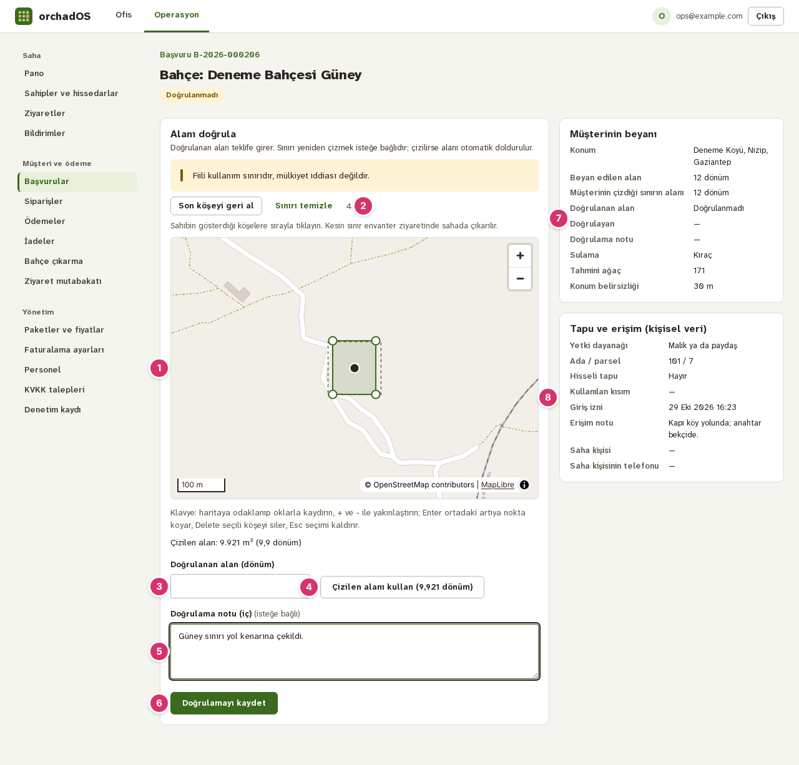

**Ekranın bölümleri**

1. Harita: müşterinin çizdiği sınır kesik çizgiyle; sizin çizdiğiniz sınır yeşil köşelerle.
2. Köşe sayısı ("4 köşe"); yanında "Son köşeyi geri al" ve "Sınırı temizle".
3. "Doğrulanan alan (dönüm)".
4. "Çizilen alanı kullan (… dönüm)": çizdiğiniz sınırın alanını alana yazar.
5. "Doğrulama notu (iç)": müşteri görmez.
6. "Doğrulamayı kaydet".
7. "Müşterinin beyanı": konum, "Beyan edilen alan", "Müşterinin çizdiği sınırın alanı", "Doğrulanan alan", "Doğrulayan", "Doğrulama notu", "Sulama", "Tahmini ağaç", "Konum belirsizliği".
8. "Tapu ve erişim (kişisel veri)": "Yetki dayanağı", "Ada / parsel", "Hisseli tapu", "Kullanılan kısım", "Giriş izni", "Erişim notu", "Saha kişisi", "Saha kişisinin telefonu" (maskeli).

Haritanın üstündeki "Fiili kullanım sınırıdır, mülkiyet iddiası değildir." uyarısı her çizim haritasında durur.

### Alanı doğrulamak

1. Başvuru sayfasında bahçenin "Doğrula" düğmesine tıklayın.
2. Sağdaki beyanla uydu görüntüsünü karşılaştırın.
3. Sınır yanlışsa haritada köşelere sırayla tıklayarak yeni sınırı çizin, sonra "Çizilen alanı kullan"a tıklayın. Sınır çizmek isteğe bağlıdır; alanı elle de yazabilirsiniz (ör. 9,5).
4. Gerekirse "Doğrulama notu (iç)" yazın.
5. "Doğrulamayı kaydet". Başvuru sayfasına dönülür ve "Bahçe alanı doğrulandı." yazar.

Klavyeyle çizim: haritaya odaklanıp oklarla kaydırın, + ve - ile yakınlaştırın; Enter ortadaki artıya nokta koyar, Delete seçili köşeyi siler, Esc seçimi kaldırır.

**Düğmeler ve alanlar**

| Düğme / alan | Ne yapar |
| --- | --- |
| Harita tıklaması | Sınıra köşe ekler. Köşe sürüklenerek taşınır. |
| "Son köşeyi geri al" | Son eklenen köşeyi siler. |
| "Sınırı temizle" | Çizdiğiniz sınırı siler; müşterinin sınırı kalır. |
| "Doğrulanan alan (dönüm)" | Teklife giren alan (zorunlu). |
| "Çizilen alanı kullan" | Çizilen alanı dönüm olarak alana yazar. |
| "Doğrulama notu (iç)" | İç not. |
| "Doğrulamayı kaydet" | Alanı (ve çizdiyseniz sınırı) kaydeder. |

**Uyarılar ve ret mesajları**

| Mesaj | Ne zaman çıkar | Ne yapmalı |
| --- | --- | --- |
| "Bahçe alanı doğrulandı." | Kayıt başarılı | Diğer bahçelere geçin. |
| "Formda düzeltilmesi gereken bir alan var. Kontrol edin: Doğrulanan alan (dönüm)." | Alan boş ya da sayı değil | Alanı dönüm olarak yazın. |
| "Çizilen sınır geçersiz: en az üç nokta olmalı ve kenarlar kesişmemeli." | Sınır kendini kesiyor ya da üçten az köşe var | "Sınırı temizle" ile yeniden çizin. |
| "Altlık harita yüklenemedi (bağlantı ya da harita sunucusu). Sınır ve ağaçlar yine de gösteriliyor." | Harita altlığı yüklenemedi | İnternet bağlantınızı kontrol edin; sınır yine çizilebilir. |

## Ek bahçe başvurusu ve ek teklif

`/operasyon/basvuru/<başvuru>` (üyeliği olan müşteri)

**Ne için:** Hizmet alan bir müşterinin sonradan eklediği bahçeye, mevcut üyelik dönemine katılan **ek teklif** vermek için.
**Kim kullanır:** Operasyon.

Bu görünüm yalnız "Faturalama ayarları"nda bahçe ekleme ve çıkarma açıkken çıkar. Kapalıyken üye müşterinin başvurusu da normal başvuru gibi görünür ve "Bahçe ekleme ve çıkarma kapalı (Ayarlar)." yazar. Barındırılan projelerde bu ayar avukat onayına kadar kapalıdır.

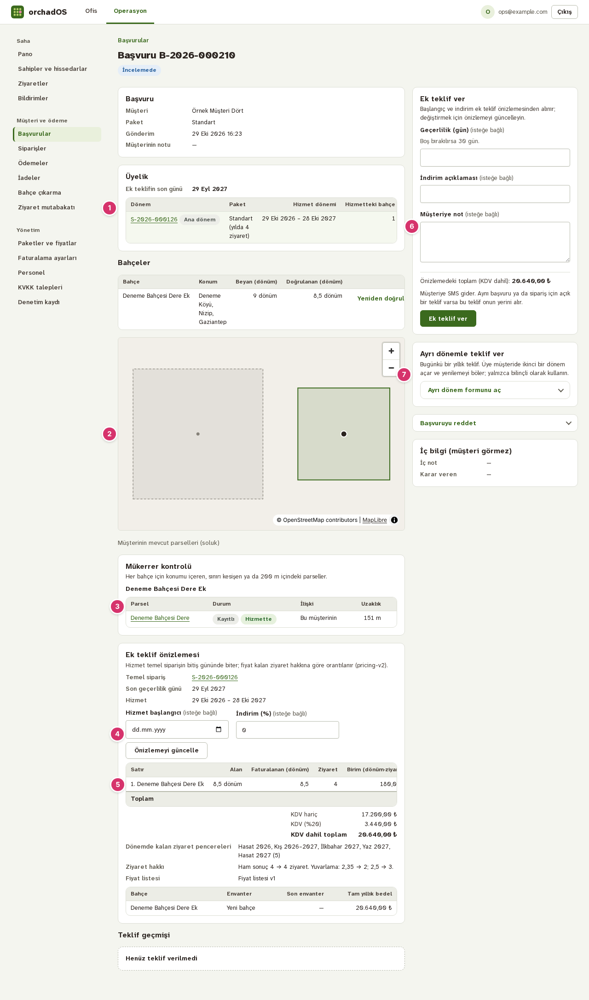

**Ekranın bölümleri**

1. "Üyelik": "Ek teklifin son günü", "Dönem" (temel sipariş, "Ana dönem"), "Paket", "Hizmet dönemi", "Hizmetteki bahçe", "Sonraki dönem", "Yenileme teklifi".
2. Harita: yeni bahçe yeşil, müşterinin mevcut parselleri soluk gri ("Müşterinin mevcut parselleri (soluk)").
3. "Mükerrer kontrolü": burada mevcut parsel 151 m uzakta, "Bu müşterinin" ve "Hizmette".
4. "Ek teklif önizlemesi": "Temel sipariş", "Son geçerlilik günü", "Hizmet"; "Hizmet başlangıcı" ve "İndirim (%)" girip "Önizlemeyi güncelle".
5. Önizleme satırları ve hesap dökümü: "Dönemde kalan ziyaret pencereleri", "Ziyaret hakkı" (ör. "Ham sonuç 4 → 4 ziyaret. Yuvarlama: 2,35 → 2; 2,5 → 3."), "Fiyat listesi", bahçe bazında "Envanter" ve "Tam yıllık bedel".
6. "Ek teklif ver" formu: "Geçerlilik (gün)", "İndirim açıklaması", "Müşteriye not" ve "Ek teklif ver" düğmesi. Başlangıç ve indirim önizlemeden alınır.
7. "Ayrı dönemle teklif ver": müşteriye ikinci bir hizmet dönemi açan normal yıllık teklif. Yalnız "Ayrı dönem formunu aç" ile açılır ve "Bu müşteriye ikinci bir hizmet dönemi açılacak" kutusu işaretlenmeden verilmez.

### Ek teklif vermek

1. Mükerrer kontrolüne bakın; bahçe müşterinin eski (pasif) parseliyse "Eski parsele bağla".
2. Bahçeyi "Doğrula" ile doğrulayın.
3. Gerekirse "Hizmet başlangıcı" ve "İndirim (%)" girip "Önizlemeyi güncelle"ye tıklayın.
4. Dökümü kontrol edin. Ziyaret hakkı kalan pencere sayısını aşıyorsa uyarı çıkar; başlangıcı değiştirin.
5. Sağdaki formda "Ek teklif ver". Hizmet temel siparişin bitiş gününde biter; fiyat kalan ziyaret hakkına göre orantılanır. Geçerlilik ek teklifin son gününü geçmez.

**Uyarılar ve ret mesajları**

| Mesaj | Ne zaman çıkar | Ne yapmalı |
| --- | --- | --- |
| "Başvurunun paketi (…) üyeliğin paketinden (…) farklı; ek teklif üyeliğin paketiyle verilir." | Başvurudaki paket üyelikten farklı | Müşteriye paketin üyelik paketi olacağını söyleyin. |
| "Üyelik döneminin sonuna çok az kaldı; ek bahçeniz yenilemeyle başlayan yeni döneme eklenir." | Dönem sonuna ayardaki günden az kaldı | Bahçeyi yenileme teklifine ekleyin. |
| "Ziyaret hakkı (n) dönemde kalan ziyaret penceresi sayısını (m) aşıyor. …" | Başlangıç günü çok geç | Başlangıcı öne alın. |
| "Bu bahçe aynı dönemde başka bir siparişle hizmet alıyor." | Parsel zaten hizmette | Mükerrer kaydı reddedin. |
| "Bu bahçe bu hesaba yeniden bağlanamaz." | Parsel devirle çıkarılmış | Yeni parselle devam edin. |
| "Müşterinin birden fazla hizmet dönemi var. …" | Müşterinin iki ayrı dönemi var | Yenileme zamanı "Dönemleri birleştir" kullanın. |

## Teklif sayfası

`/operasyon/teklif/<teklif>`

**Ne için:** Verilmiş bir teklifi okumak ve yazdırmak için. Teklif burada değiştirilmez; yeni teklif eskisinin yerini alır.
**Kim kullanır:** Operasyon.

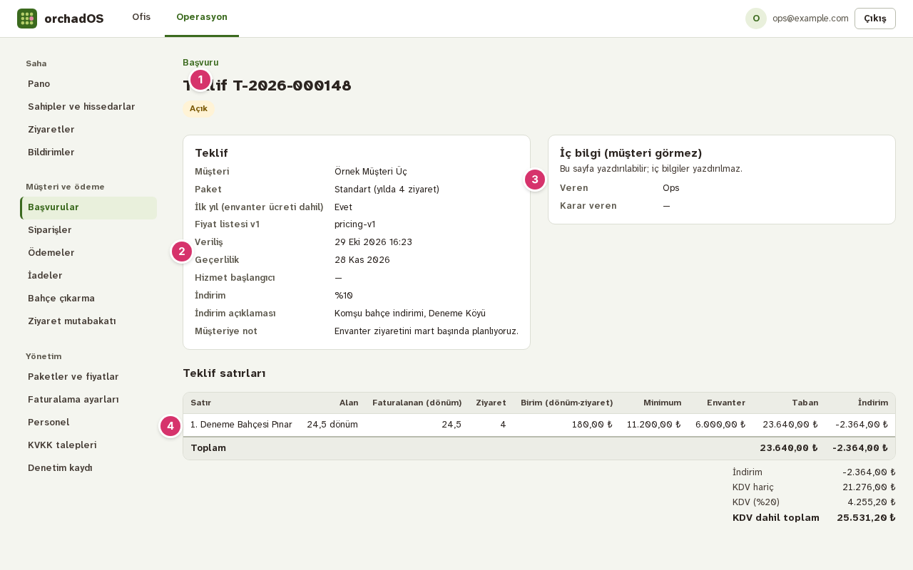

**Ekranın bölümleri**

1. Geri bağlantısı: başvuruya (ek teklifte temel siparişe, yenilemede yenilenen siparişe) döner.
2. "Teklif": "Müşteri", "Paket", "İlk yıl (envanter ücreti dahil)", fiyat listesi sürümü, "Veriliş", "Geçerlilik", "Hizmet başlangıcı", "İndirim", "İndirim açıklaması", "Müşteriye not"; kabul edildiyse "Sipariş" › "Siparişi aç".
3. "İç bilgi (müşteri görmez)": "Veren", "Karar veren". Bu kutu yazdırılmaz.
4. "Teklif satırları" ve toplamlar.

Başlığın altındaki rozet teklifin durumudur: "Açık", "Kabul edildi", "Reddedildi", "Yenisiyle değişti", "Süresi doldu", "İptal edildi". Ek teklifte ayrıca "Ek teklif bilgisi" (temel sipariş, üyelik dönemi, hizmet, kalan dönem, ziyaret, son geçerlilik günü) görünür.

## Başvurusuz teklif: parsel teklifi, yenileme, ek teklif

`/operasyon/teklif/yeni?sahip=<sahip>` · `?siparis=<sipariş>` · `?ek=<temel sipariş>`

**Ne için:** Başvurusu olmayan parseller için teklif vermek: operasyonun açtığı parsellerin ilk teklifi ("Parsel teklifi ver"), biten ya da bitmek üzere olan siparişin yenilemesi ("Yenileme teklifi ver") ve mevcut parsellerin üyeliğe ek teklifi ("Ek teklif ver").
**Kim kullanır:** Operasyon.

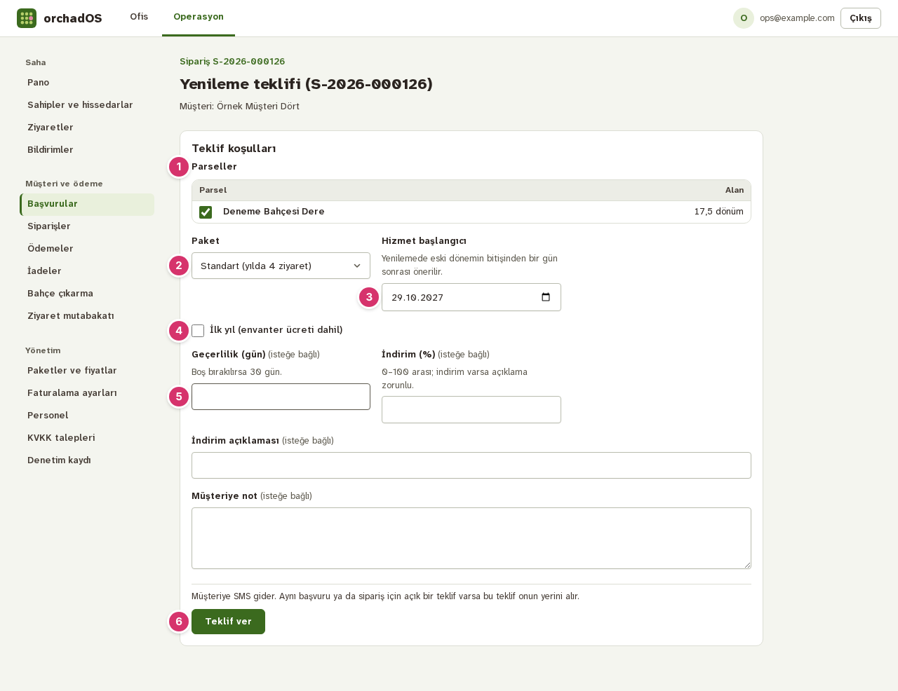

**Ekranın bölümleri**

1. "Parseller": teklife girecek parseller işaretli gelir. Yenilemede hizmetteki bahçeler işaretli, çıkmakta olanlar işaretsiz ve "Açık çıkarma: <gün>" etiketli; müşterinin diğer parselleri ayrı tabloda işaretsiz gelir.
2. "Paket".
3. "Hizmet başlangıcı": yenilemede eski dönemin bitişinden bir gün sonrası önerilir.
4. "İlk yıl (envanter ücreti dahil)": parsel teklifinde işaretli, yenilemede işaretsiz gelir.
5. "Geçerlilik (gün)"; altında "İndirim (%)", "İndirim açıklaması", "Müşteriye not".
6. "Teklif ver".

Parsel teklifi sahip sayfasındaki "Parsel teklifi ver"le, yenileme sipariş sayfasındaki "Yenileme teklifi ver"le açılır. Ek siparişin kendisi yenilenmez; yenileme temel siparişten verilir. Müşterinin daha geç biten bir dönemi varsa yenileme ekranında "Dönemleri birleştir" önerisi çıkar.

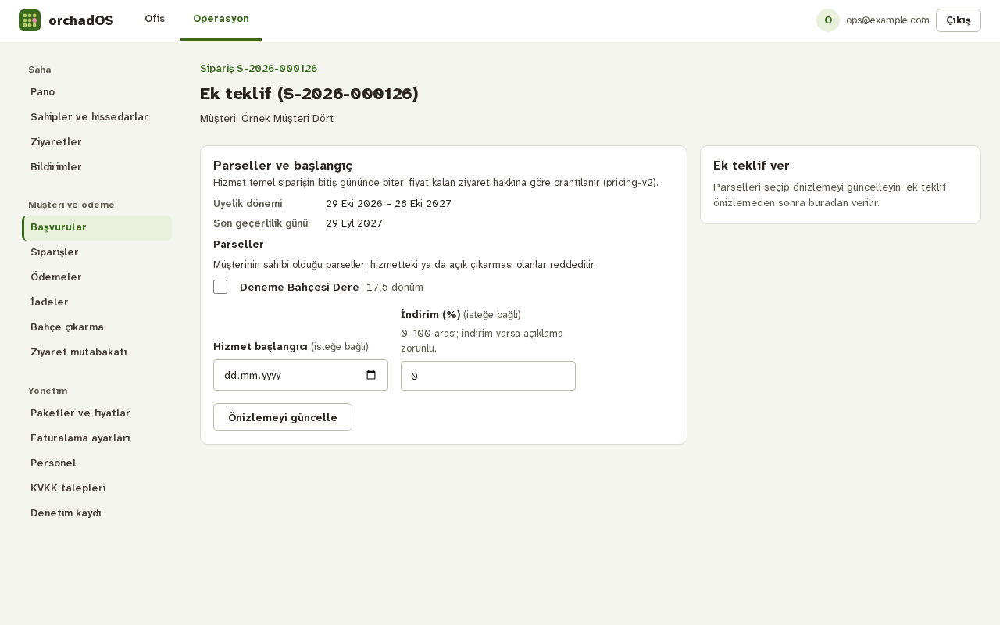

Ek teklif ekranında ("Ek teklif (S-…)") önce "Parseller ve başlangıç" bölümünde parselleri işaretler, gerekirse "Hizmet başlangıcı" ve "İndirim (%)" girip "Önizlemeyi güncelle"ye tıklarsınız. Hizmetteki ya da açık çıkarması olan parseller reddedilir. Son envanterden bu yana 24 ay geçmediyse envanter ücreti alınmaz; yeni envanter gerekiyorsa "Yeni envanter gerekli (gerekçe)" alanına gerekçeyi yazın. "Ek teklif ver" formu önizlemeden sonra sağda çıkar.

**Uyarılar ve ret mesajları**

| Mesaj | Ne zaman çıkar | Ne yapmalı |
| --- | --- | --- |
| "Teklif verilecek parsel yok" / "Müşterinin sahibi olduğu parsel yok; önce parsel kaydedin." | Sahibin parseli yok | "Bu sahibe parsel ekle" ile parsel kaydedin. |
| "Formda düzeltilmesi gereken bir alan var. Kontrol edin: Parseller." | Hiç parsel işaretlenmedi | En az bir parsel işaretleyin. |
| "Açık yenileme teklifinden sonra eklenen bahçeler var; teklifi yeniden verin (eskisi yenisiyle değişir)." | Yenileme teklifinden sonra bahçe eklendi | Yenileme teklifini yeniden verin. |
| "Bu sipariş bir üyeliğin temel siparişi değil ya da aktif değil." | Ek teklif yanlış siparişten açıldı | Temel siparişten açın. |

## Sipariş listesi

`/operasyon/siparis`

**Ne için:** Siparişleri durumlarıyla görmek; süresi geçen ödemeleri, 30 günden uzun geciken plan ödemelerini ve sözleşme belgesi eksik siparişleri bulmak için.
**Kim kullanır:** Operasyon.

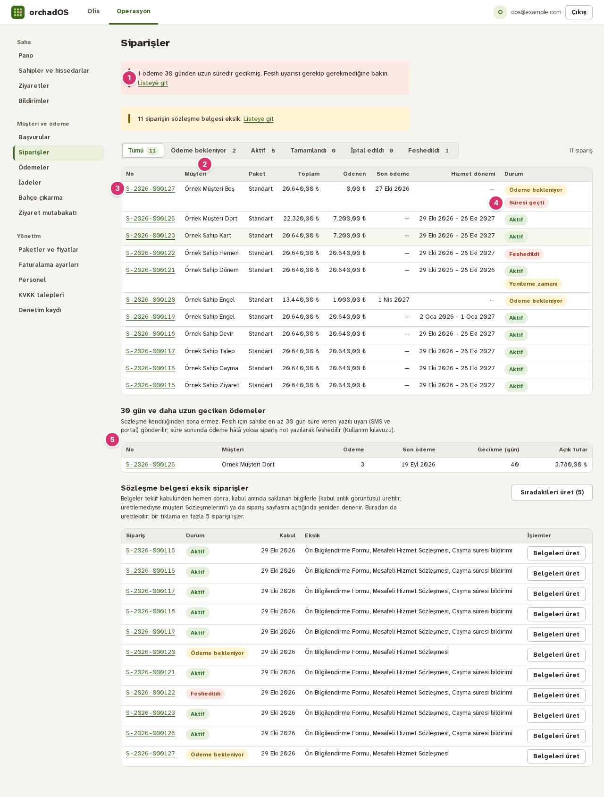

**Ekranın bölümleri**

1. Kırmızı uyarı: "n ödeme 30 günden uzun süredir gecikmiş. Fesih uyarısı gerekip gerekmediğine bakın." ve "Listeye git". Sözleşme belgesi eksikse sarı bir uyarı daha çıkar.
2. Durum süzgeci: "Tümü", "Ödeme bekleniyor", "Aktif", "Tamamlandı", "İptal edildi", "Feshedildi".
3. Sipariş numarası (`S-…`): sipariş sayfasını açar. Ek siparişte altında "Ek sipariş" rozeti durur.
4. Durum rozetleri: "Süresi geçti" (ödeme süresi doldu), "Yenileme zamanı", "Kart ödemesi sürüyor".
5. "30 gün ve daha uzun geciken ödemeler": "No", "Müşteri", "Ödeme" (plandaki sırası), "Son ödeme", "Gecikme (gün)", "Açık tutar".

Diğer sütunlar: "Müşteri", "Paket", "Toplam", "Ödenen" (iadeler düşülmüş), "Son ödeme" (yalnız ödeme bekleyen siparişte), "Hizmet dönemi".

### Geciken ödeme

Sözleşme kendiliğinden sona ermez. Ödeme nedeniyle fesih elle yürür: sahibe SMS ve portal mesajıyla, son günü ve sonucu yazan, en az 30 gün süreli yazılı uyarı gönderilir ve tarihi nota yazılır; süre sonunda ödeme hâlâ açıksa sipariş not yazılarak feshedilir. Sahip ödediğini söylüyorsa 2 iş günü içinde cevap verin; havaleyse dekontu isteyip kaydedin.

### Sözleşme belgeleri

- "Sözleşme belgesi eksik siparişler": belgeler teklif kabulünden hemen sonra üretilir; üretilemediyse burada listelenir. Satırda "Belgeleri üret", başlıkta "Sıradakileri üret (5)" (bir tıklama en fazla 5 sipariş).
- "Elle kopya gereken siparişler": belgeleri otomatik üretilemeyen siparişler. Müşteriye onayladığı sürümün kopyası elle hazırlanır; "Yeniden dene" yalnız o siparişi bir kez daha dener.

Görüntüdeki deneme ortamında belgeler üretilmediği için bütün siparişler bu listede görünür.

## Sipariş sayfası

`/operasyon/siparis/<sipariş>`

**Ne için:** Bir siparişin özetini, ödeme planını, kalemlerini ve ödemelerini görmek; havale kaydetmek ve seyrek işlemleri (cayma, bahçe çıkarma, süre uzatma, iptal, fesih) yapmak için.
**Kim kullanır:** Operasyon.

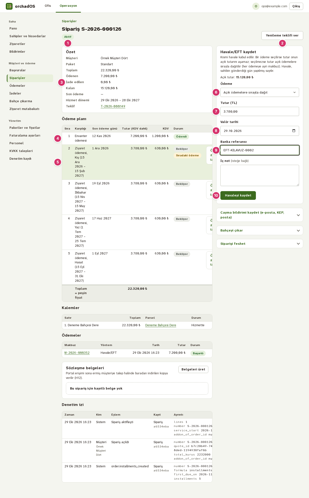

**Ekranın bölümleri**

1. Sipariş durumu: "Ödeme bekleniyor", "Aktif", "Tamamlandı", "İptal edildi", "Feshedildi"; ek siparişte "Ek sipariş".
2. "Yenileme teklifi ver": aktif ya da tamamlanmış temel siparişte görünür.
3. "Özet": "Müşteri", "Paket", "Toplam", "Ödenen", "İade edilen", "Kalan", "Son ödeme", "Hizmet dönemi", "Teklif"; varsa "Yenilediği sipariş", "Temel sipariş", "Ek siparişler", "Fesih notu".
4. "Ödeme planı": ilk satır "Envanter ödemesi" (ilk yıl), burada "Ödendi".
5. Ziyaret ödemeleri: her biri bir ziyaret penceresine bağlıdır ("Ziyaret ödemesi, Kış (…)"); durum "Bekliyor", "Ödendi" ya da "İptal". Sıradaki ödeme "Sıradaki ödeme" ile işaretlidir. Plan toplamı peşin fiyata eşittir ("Toplam = peşin fiyat").
6. "Ödeme": havalenin hangi plan ödemesine yazılacağı ya da "Açık ödemelere sırayla dağıt".
7. "Tutar (TL)".
8. "Valör tarihi".
9. "Banka referansı".
10. "Havaleyi kaydet".

Sağdaki formun altında kapalı bölmeler durur (aşağıda "Seyrek işlemler"). Sayfanın altında "Kalemler", "Ödemeler", "Sözleşme belgeleri" ve "Denetim izi" gelir.

### Havale/EFT kaydetmek

Kartla ödeme kendiliğinden düşer. Havalede:

1. Banka hesabında havaleyi bulun; dekonttaki tutarı, gönderim gününü ve referansı not alın.
2. Sipariş sayfasında "Havale/EFT kaydet" formunda "Ödeme" seçin. Seçmezseniz tutar açık ödemelere sırayla dağıtılır ve her ödemeye ayrı makbuz verilir. Bir ödeme seçerseniz tutar onun açık tutarını aşamaz.
3. "Tutar (TL)" yazın (ör. 3.780,00). Kısmi havale kabul edilir.
4. "Valör tarihi": sahibin gönderdiği gün. Havale o gün yapılmış sayılır. Gelecek bir gün seçilemez.
5. "Banka referansı" zorunludur; "İç not" isteğe bağlıdır.
6. "Havaleyi kaydet". "Havale kaydedildi; her ödeme için ayrı makbuz numarası verildi." yazar. Planın ilk ödemesi gelince sipariş "Aktif" olur, her bahçe için parsel "Kayıtlı" durumunda açılır ve müşteriye sahip erişimi verilir.
7. Aktivasyondan sonra "Kalemler" tablosundaki parsel bağlantısından parsele geçip envanter ziyaretini planlayın ([05](05-ziyaret-planlama.md)).

### Ödemesiz ziyarete izin vermek

Bir ziyaret ödemesi yapılmamışsa o pencerenin ziyareti planlanamaz. Sahip portal, SMS ya da e-postayla yazılı olarak isterse izin verebilirsiniz.

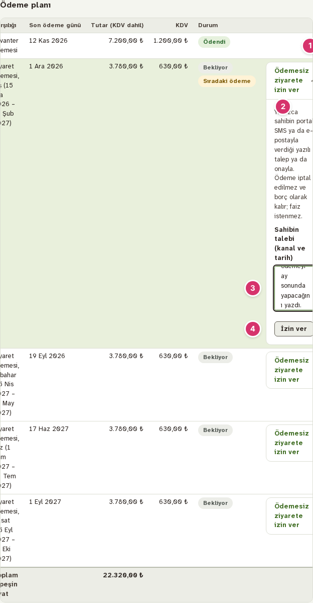

1. Ödenmiş envanter ödemesi.
2. Bekleyen ziyaret ödemesinin satırındaki "Ödemesiz ziyarete izin ver" bölmesi.
3. "Sahibin talebi (kanal ve tarih)": talebin nereden ve ne zaman geldiğini yazın.
4. "İzin ver".

İzin verilince satırda "Ödemesiz ziyarete izin verildi: <not>" yazar ve o ziyaret planlanabilir. Ödeme iptal edilmez, borç olarak kalır; faiz istenmez. Pencere ödemesiz biterse ödeme kendiliğinden düşer ("Pencere ödemesiz bitti; ziyaret yapılmadı, ödemesi istenmez"); sonradan gelen ödeme iade edilir.

### Kalemler, ödemeler, belgeler

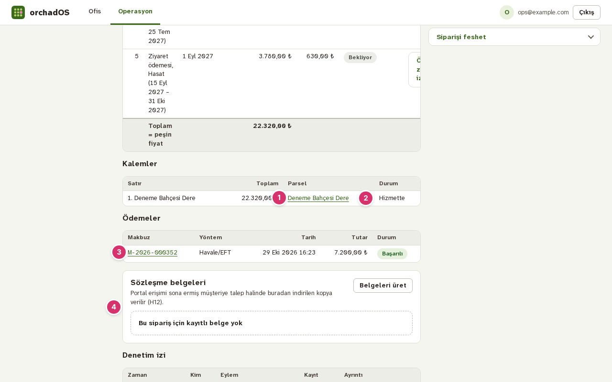

1. "Parsel": aktivasyonda açılan parselin bağlantısı.
2. Satırın durumu: "Hizmette", "Çıkacak: <gün>" (çıkarma sayfasına bağlantı) ya da "Çıkarıldı: <gün>".
3. "Ödemeler": makbuz numarası ödeme sayfasını açar; "Yöntem", "Tarih", "Tutar", "Durum".
4. "Sözleşme belgeleri": siparişin sözleşme belgeleri. Eksikse başlıkta "Belgeleri üret". Portal erişimi sona ermiş müşteriye talep hâlinde buradan indirilen kopya verilir.

En altta "Denetim izi" siparişteki her değişikliği ("Zaman", "Kim", "Eylem", "Kayıt", "Ayrıntı") gösterir.

### Seyrek işlemler

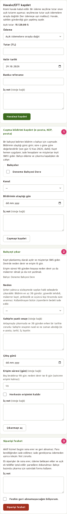

1. **"Cayma bildirimi kaydet (e-posta, KEP, posta)"**: Sahip portalda "Cayma" ile kendisi bildirir. E-posta, KEP ya da postayla gelen caymayı buradan kaydedin: "Bahçeler"i işaretleyin, "Kanal" ("E-posta", "KEP", "Posta") ve "Bildirimin ulaştığı gün"ü girin, "Caymayı kaydet". Bir bahçeyi belirten bildirim o bahçe için caymadır. Süre ulaştığı güne göre değerlendirilir (son gün bölmede yazar). Kayıt hemen uygulanır, iade hesaplanır ve sahibe teyit SMS'i gider. Bahçe ekleme ve çıkarma kapalıyken de çalışır.
2. **"Bahçeyi çıkar"**: Şirket'in bir bahçeyi hizmetten çıkarması. "Neden" yalnız sözleşmede sayılan haklı sebeplerden seçilir: "Bahçenin gerçek konumunun başvuruda bildirilenden esaslı biçimde farklı olması", "Sahip'in Madde 5 yükümlülüklerini esaslı ya da tekrar tekrar ihlali", "Sahip'in yetkisinin bulunmaması", "Üçüncü kişi itirazı (Madde 6/4)", "Personelin güvenliğini tehdit eden durum", "Devir (yeni sahibe geçti)", "Mükerrer kayıt", "Madde 8/6'daki uyarıya rağmen bir ödemenin yapılmaması", "İlçedeki saha hizmetinin o ilçedeki bütün sahipler için aynı tarihte sona erdirilmesi", "Sahip'le anlaşarak (yazılı onay)". Ayrıca "Sahip'in yazılı onayı", "Çıkış günü", "Erişim süresi (gün)", "Herkesin erişimini kaldır" ve "İç not"; sonra "Çıkarmayı aç". Kayıt planlanmış olarak açılır ve müşteriye SMS gider. Bahçe satıldıysa neden devir ve erişim 0 gün. Çıkarmanın sonraki adımları [08 · İade, çıkarma, mutabakat, KVKK](08-iade-cikarma-mutabakat-kvkk.md)'dedir.
3. **"Siparişi feshet"**: aktif siparişin idari feshi. "İç not" zorunlu, "Feshin geri alınamayacağını biliyorum." kutusu işaretlenir, "Siparişi feshet". Aktif hizmet bugün sona erer; para kendiliğinden iade edilmez, iade gerekiyorsa ödemeden ayrıca istenir. Temel siparişte ek siparişler de sona erer, ödeme bekleyen ekler ve açık ek teklifler iptal edilir. **Hizmet sonu erişim akışı açılana kadar gerçek müşteride kullanmayın**; bahçe bazında çıkarma için "Bahçeyi çıkar"ı, üyeliği sonlandırmak için sahip sayfasındaki "Tüm bahçeleri çıkar"ı kullanın.

"Cayma bildirimi kaydet" ve "Bahçeyi çıkar" yalnız aktif siparişte, hizmeti sürmekte olan bahçe varken görünür.

### Ödeme bekleyen sipariş: süre uzatma ve iptal

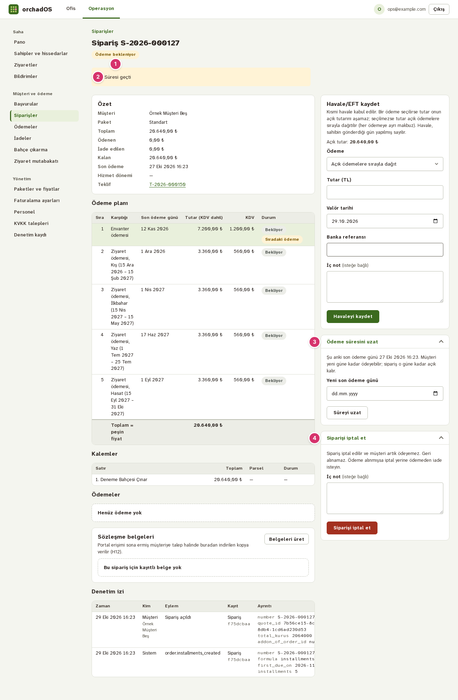

1. Durum "Ödeme bekleniyor".
2. "Süresi geçti": ödeme süresi doldu.
3. **"Ödeme süresini uzat"**: "Yeni son ödeme günü" seçip "Süreyi uzat". Müşteri yeni güne kadar ödeyebilir; sipariş o güne kadar açık kalır. Ek siparişte en geç gün bölmede yazar ("Ek siparişte en geç …").
4. **"Siparişi iptal et"**: "İç not" isteğe bağlı, "Siparişi iptal et". Sipariş iptal edilir ve müşteri artık ödeyemez; geri alınamaz. Ödeme alınmışsa iptal yerine ödemeden iade isteyin.

**Düğmeler ve alanlar**

| Düğme / alan | Ne yapar |
| --- | --- |
| "Yenileme teklifi ver" | Yenileme teklifi formunu açar. |
| "Ödeme" | Havalenin yazılacağı plan ödemesi; boşsa sırayla dağıtılır. |
| "Tutar (TL)", "Valör tarihi", "Banka referansı", "İç not" | Havale bilgileri. |
| "Havaleyi kaydet" | Havaleyi kaydeder, makbuz verir. |
| "Ödemesiz ziyarete izin ver" › "İzin ver" | O pencerenin ziyaretini ödemesiz planlanabilir yapar. |
| "Cayma bildirimi kaydet (e-posta, KEP, posta)" › "Caymayı kaydet" | E-posta, KEP ya da postayla gelen caymayı uygular. |
| "Bahçeyi çıkar" › "Çıkarmayı aç" | Bahçe için çıkarma kaydı açar. |
| "Ödeme süresini uzat" › "Süreyi uzat" | Ödeme bekleyen siparişin son gününü ileri alır. |
| "Siparişi iptal et" | Ödemesi alınmamış siparişi iptal eder. |
| "Siparişi feshet" | Aktif siparişi bugün sona erdirir. |
| "Belgeleri üret" / "Yeniden dene" | Eksik sözleşme belgelerini üretir. |

**Uyarılar ve ret mesajları**

| Mesaj | Ne zaman çıkar | Ne yapmalı |
| --- | --- | --- |
| "Havale kaydedildi; her ödeme için ayrı makbuz numarası verildi." | Havale kaydedildi | Bir şey gerekmez. |
| "Bu ödemenin ziyareti ödemesiz planlanabilir; ödeme borç olarak kalır." | İzin verildi | Ziyareti planlayın. |
| "Ödeme süresi uzatıldı." | Süre uzatıldı | Müşteriye yeni günü bildirin. |
| "Sipariş iptal edildi." | İptal edildi | Bir şey gerekmez. |
| "Sipariş feshedildi. İade gerekiyorsa ödeme ayrıntısından isteyin." | Fesih yapıldı | Gerekirse ödemeden iade isteyin. |
| "Cayma kaydedildi ve uygulandı; müşteriye teyit SMS'i gidecek. İade satırları açıldıysa iadeler listesindedir." | Cayma kaydedildi | İadeleri [08](08-iade-cikarma-mutabakat-kvkk.md)'deki gibi işleyin. |
| "Bahçe çıkarma planlandı; müşteriye SMS gidecek." | Çıkarma açıldı | Çıkarma kuyruğundan izleyin. |
| "Tutar kalan bakiyeden fazla." | Havale tutarı açık tutardan büyük | Tutarı düzeltin; fazlası varsa iade edilir. |
| "Süren bir ödeme denemesi var; birkaç dakika sonra yeniden deneyin." | Müşterinin kart ödemesi sürerken havale kaydı | Birkaç dakika bekleyin. |
| "Formda düzeltilmesi gereken bir alan var. Kontrol edin: <alan>." | "Tutar", "Valör tarihi" gibi bir alan hatalı | Alanı düzeltin. |
| "Ödemesi alınmış sipariş iptal edilemez; iade yoluna gidin." | Ödemesi olan siparişi iptal | Ödemeden iade isteyin. |
| "Bu ödeme artık açık değil." | Seçilen plan ödemesi ödenmiş ya da düşmüş | Sayfayı yenileyin. |
| "Cayma süresi doldu." | Cayma süresi geçtikten sonra cayma kaydı | Sahibe cayma süresinin dolduğunu yazılı bildirin; çıkarma isteyebilir. |
| "Şirket bir bahçeyi yalnızca sözleşmede sayılan haklı sebeplerle hizmetten çıkarabilir." | Uygun olmayan neden | Nedeni değiştirin. |
| "Bu sebeple çıkarmada en az 30 gün (ilçedeki hizmetin sona ermesinde 60 gün) önceden bildirim gerekir; …" | Çıkış günü çok yakın | Günü ileri alın ya da Sahip'in yazılı onayını girin. |
| "Ödeme nedeniyle çıkarma için siparişin bir ödemesinin son gününden itibaren en az 30 gün geçmiş ve ödenmemiş olması gerekir." | Ödeme nedeniyle çıkarma koşulu yok | Uyarı süresini bekleyin. |
| "Bu bahçe için açık bir çıkarma talebi var." | Bahçenin zaten açık çıkarması var | Çıkarma kuyruğuna bakın. |
| "Süresi geçti" (sayfa üstü) / "Süren bir ödeme denemesi var; …" | Ödeme süresi doldu / kart ödemesi sürüyor | Müşteriyi arayın ya da süreyi uzatın. |

## Ödeme listesi

`/operasyon/odeme`

**Ne için:** Bütün kart ve havale ödemelerini durum ve yönteme göre süzmek, bir ödemeyi açmak için.
**Kim kullanır:** Operasyon.

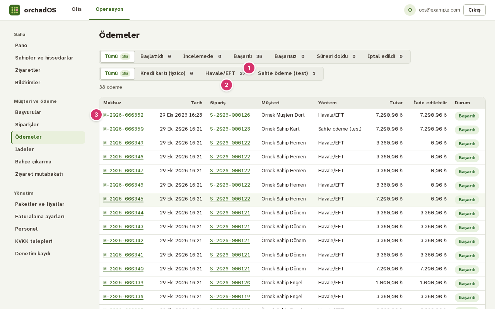

**Ekranın bölümleri**

1. Durum süzgeci: "Tümü", "Başlatıldı", "İncelemede", "Başarılı", "Başarısız", "Süresi doldu", "İptal edildi".
2. Yöntem süzgeci: "Tümü", "Kredi kartı (iyzico)", "Havale/EFT", "Sahte ödeme (test)". Sahte ödeme yalnız yerel ve test ortamındadır.
3. Makbuz numarası (`M-…`): ödeme sayfasını açar.

Sütunlar: "Makbuz", "Tarih", "Sipariş", "Müşteri", "Yöntem", "Tutar", "İade edilebilir", "Durum". Süzgece uyan ödeme yoksa "Bu filtrelere uyan ödeme yok" ve "Filtreleri temizle" çıkar.

## Ödeme sayfası

`/operasyon/odeme/<ödeme>`

**Ne için:** Bir ödemenin ayrıntısını görmek, makbuzu açmak, iade istemek, yanlış girilmiş havaleyi geri almak ve dolandırıcılık incelemesine düşen kart ödemesini sonuçlandırmak için.
**Kim kullanır:** Operasyon.

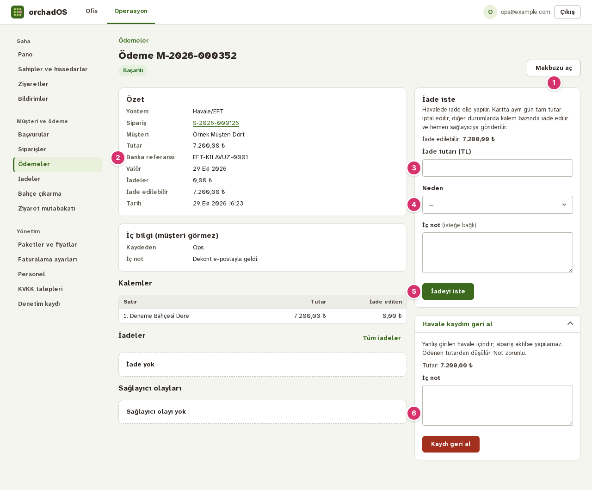

**Ekranın bölümleri**

1. "Makbuzu aç": makbuzu yeni sekmede PDF olarak açar.
2. "Özet": "Yöntem", "Sipariş", "Müşteri", "Tutar"; havalede "Banka referansı" ve "Valör", kartta "Karttan çekilen", "Kart taksiti", "Kart", "Dolandırıcılık durumu"; "İadeler", "İade edilebilir", "Tarih", varsa "Hata kodu".
3. "İade iste" › "İade tutarı (TL)".
4. "Neden": "Cayma", "Yapılmayan ziyaret", "Fesih", "Fazla ödeme", "Jest", "Diğer". Çok kalemli ödemede "Kalem (çok kalemli kısmi iadede zorunlu)" de çıkar.
5. "İadeyi iste".
6. "Havale kaydını geri al": "İç not" zorunlu, "Kaydı geri al".

Sol altta "İç bilgi (müşteri görmez)" ("Kaydeden", "İç not"), "Kalemler", "İadeler" ("Tüm iadeler" bağlantısıyla) ve "Sağlayıcı olayları" (kart ödemesinde ödeme kuruluşundan gelen bildirimler) durur.

### İade istemek

1. "İade tutarı (TL)" ve "Neden"i girin; gerekirse "İç not".
2. "İadeyi iste". Havalede iade elle yapılır: iade İadeler listesine "İstendi" olarak düşer, bankadan gönderip orada "Havale iadesi yapıldı" ile kapatırsınız. Kartta aynı gün tam tutar iptal edilir, diğer durumlarda kalem bazında iade edilir ve hemen ödeme kuruluşuna gönderilir.
3. İadenin sonraki adımları: [08 · İade, çıkarma, mutabakat, KVKK](08-iade-cikarma-mutabakat-kvkk.md).

Bütün iadeler sahibe masraf yüklenmeden yapılır; havale iadesi tam tutarla gönderilir.

### Yanlış girilmiş havaleyi geri almak

"Havale kaydını geri al" yanlış girilen havale içindir ve yalnız sipariş aktif değilken yapılır. Geri alınan tutar ödenen tutardan düşülür. Aktif siparişte yanlış havale için iade isteyin.

### Dolandırıcılık incelemesi (kart)

Kart ödemesi "İncelemede" durumuna düşerse sağda "Dolandırıcılık incelemesini sonuçlandır" çıkar. Ödeme kuruluşunun panelinde ödemeyi kontrol edin; kabul için "Sağlayıcı referansı" zorunludur. "Kabul et (başarılı)" ya da "Reddet (başarısız)". Tutar ya da referans uyuşmazlığında sayfanın üstünde uyarı çıkar ve sistem bir iptal iadesi açar.

**Uyarılar ve ret mesajları**

| Mesaj | Ne zaman çıkar | Ne yapmalı |
| --- | --- | --- |
| "İade istendi." | İade istendi | Havalede İadeler'den tamamlayın. |
| "İade ödeme sağlayıcısında işlendi." | Kart iadesi işlendi | Bir şey gerekmez. |
| "İade sağlayıcıda başarısız oldu ya da sonucu belirsiz; İadeler sayfasından izleyin." | Kart iadesi başarısız ya da belirsiz | İadeler sayfasından izleyin. |
| "Havale kaydı geri alındı." | Geri alma yapıldı | Bir şey gerekmez. |
| "Ödeme incelemesi sonuçlandı." | İnceleme kaydedildi | Bir şey gerekmez. |
| "İade tutarı ödenen tutarı aşıyor." | Tutar fazla | Tutarı düzeltin. |
| "Birden çok kalemli ödemede iade edilecek kalemi seçin." | Kısmi iadede kalem seçilmedi | "Kalem" seçin. |
| "Sipariş aktif olduğu için bu ödeme geri alınamaz." | Aktif siparişte havale geri alma | İade isteyin. |
| "Ödeme servisine ulaşılamadı; biraz sonra yeniden deneyin." | Ödeme kuruluşuna ulaşılamadı | Biraz sonra yeniden deneyin. |
| "Tutar uyuşmazlığı: …" / "Referans uyuşmazlığı: …" | Ödeme kuruluşunun bildirdiği tutar ya da kimlik tutmuyor | Açılan iptal iadesini İadeler'den izleyin. |
| "Bu ödemenin durumunda yapılacak işlem yok." | Ödeme başarısız, süresi dolmuş ya da tamamen iade edilmiş | Bir şey gerekmez. |

## Makbuz

`/makbuz/<ödeme>`

**Ne için:** Bir ödemenin makbuzunu PDF olarak görmek, yazdırmak ya da müşteriye iletmek için. Makbuz fatura değildir.
**Kim kullanır:** Operasyon (işletmesinin bütün makbuzları), müşteri (kendi makbuzları).

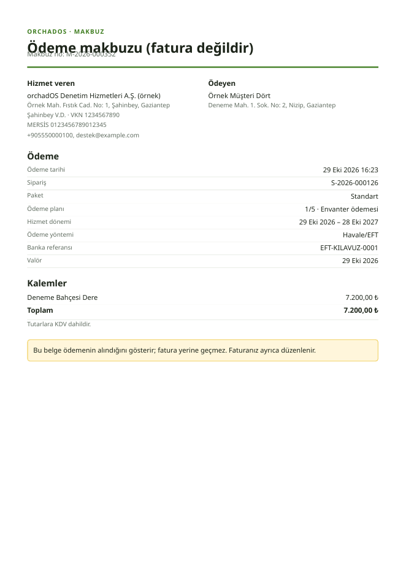

Makbuzu ödeme sayfasındaki "Makbuzu aç"la ya da sipariş sayfasının "Ödemeler" tablosundaki makbuz numarasından açarsınız. PDF'te sırayla:

- Başlık "Ödeme makbuzu (fatura değildir)" ve "Makbuz no".
- "Hizmet veren": satıcı bilgileri ("Faturalama ayarları"ndan; [09](09-fiyat-ayarlar-personel.md)).
- "Ödeyen": müşterinin fatura profilindeki ad ve adres.
- "Ödeme": "Ödeme tarihi", "Sipariş", "Paket", "Ödeme planı" (ör. "1/5 · Envanter ödemesi"), "Hizmet dönemi", "Ödeme yöntemi"; havalede "Banka referansı" ve "Valör", kartta "Kart taksiti".
- "Kalemler" ve "Toplam"; "Tutarlara KDV dahildir."
- İade varsa "İadeler" ve "İadeler sonrası net".
- Alt not: "Bu belge ödemenin alındığını gösterir; fatura yerine geçmez. Faturanız ayrıca düzenlenir."

Makbuz yalnız makbuz numarası verilmiş (başarılı) ödemede açılır; yetkisi olmayan kişi için açılmaz.

---

Önceki: [02 · Operasyon panosu ve menü](02-operasyon-pano.md) · Sonraki: [04 · Sahip ve parsel](04-sahip-ve-parsel.md)
