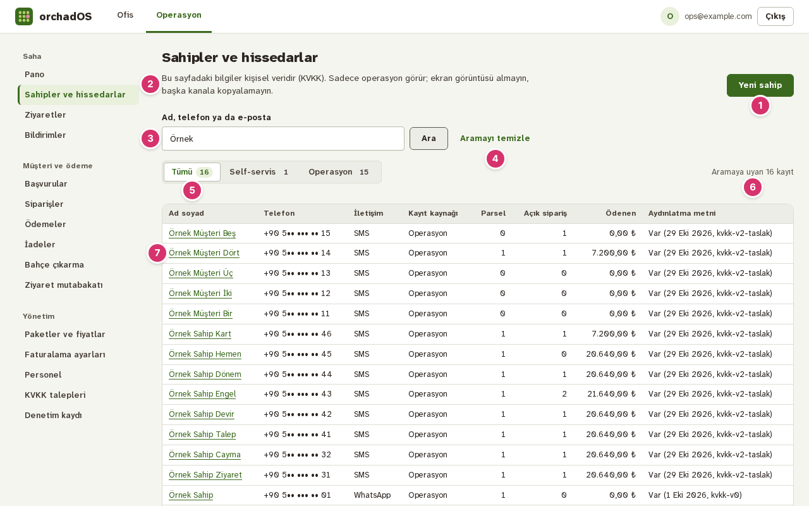
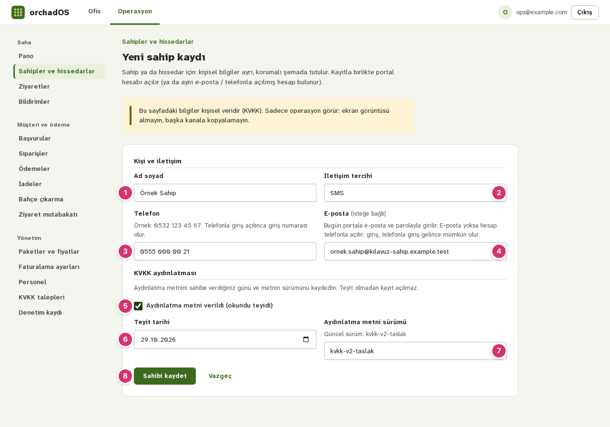
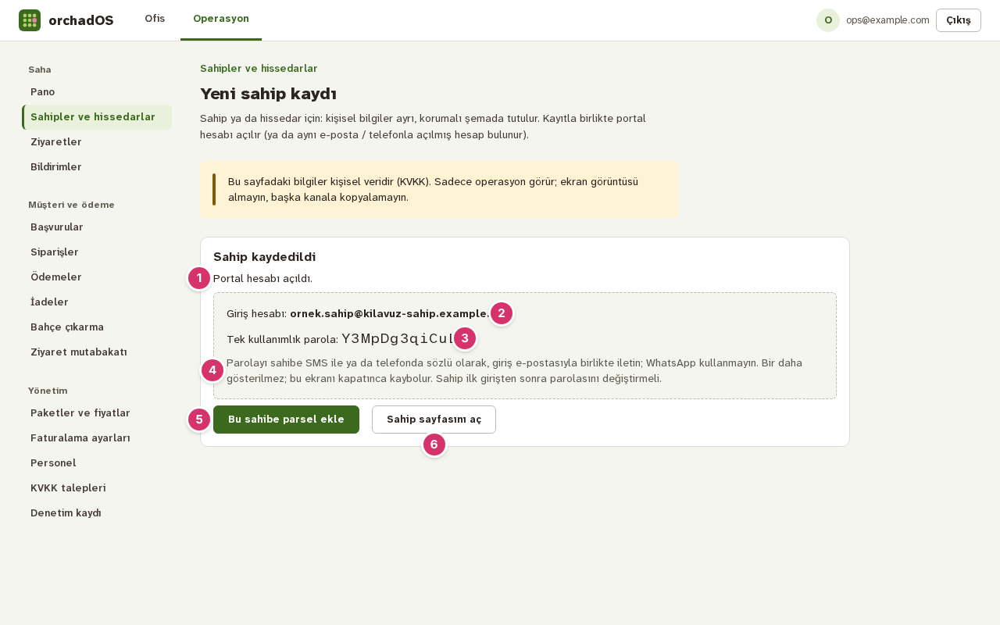
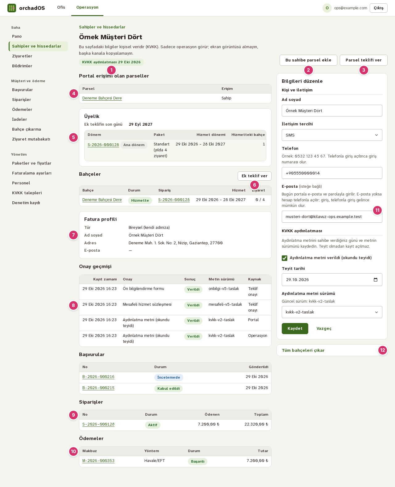
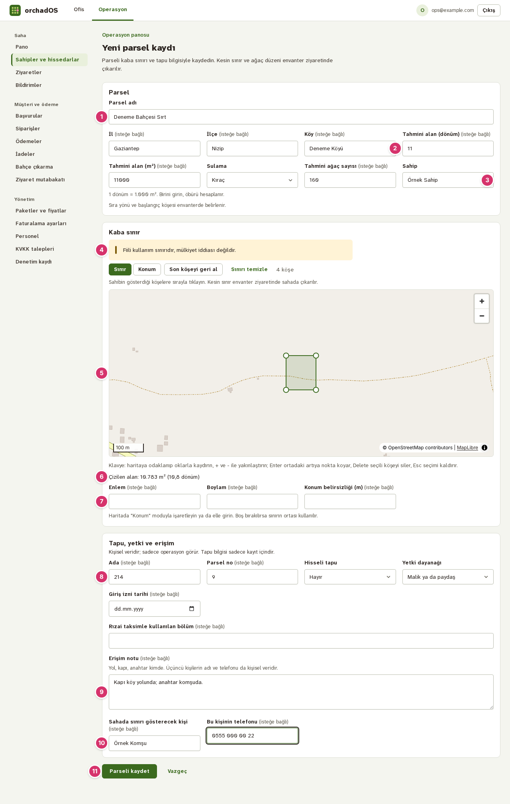
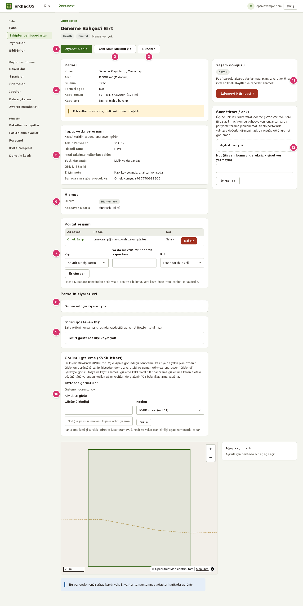
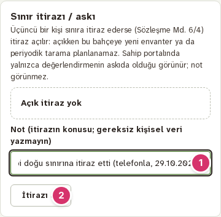
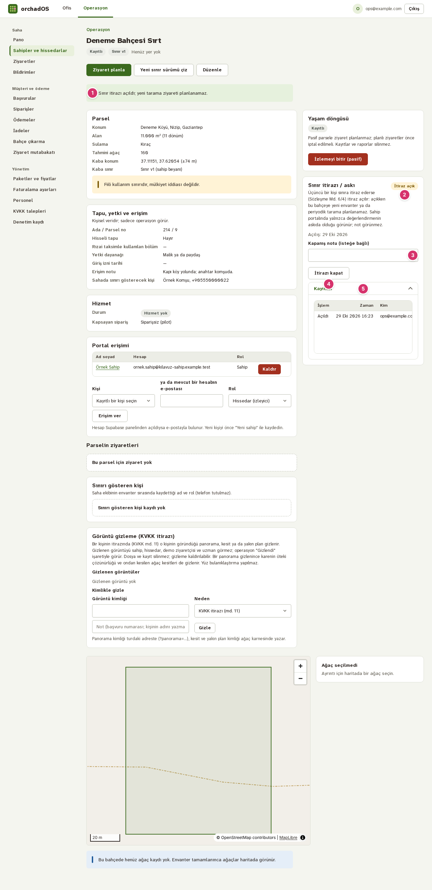
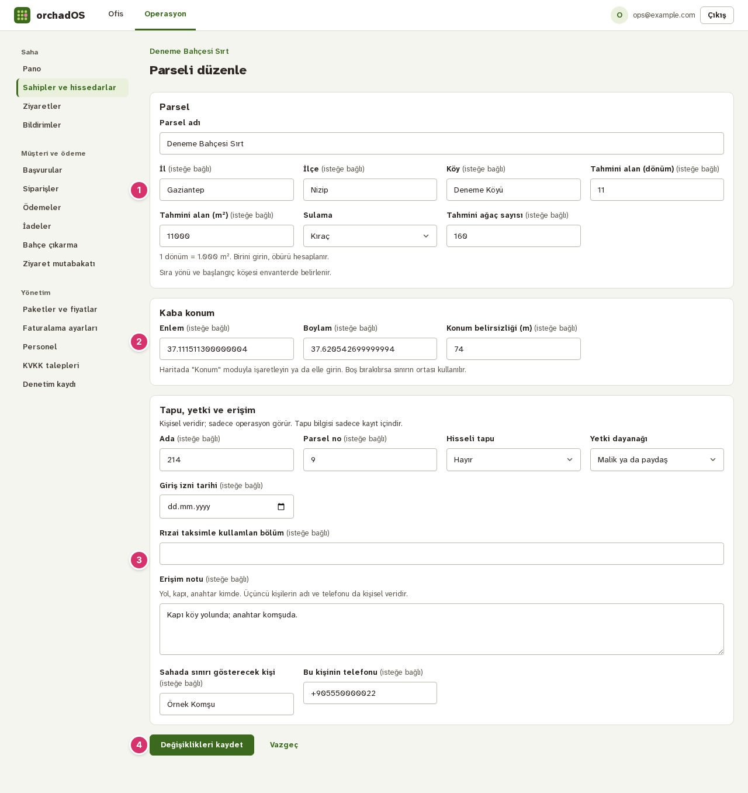
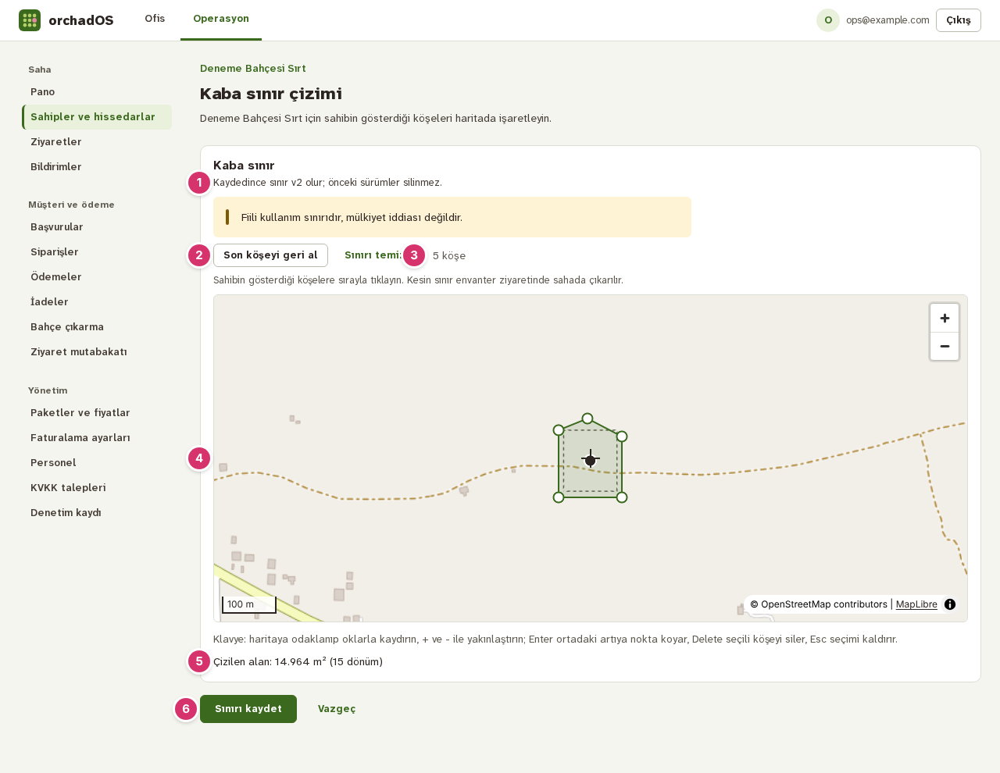

# 04 · Sahip ve parsel

[← Kılavuz dizini](README.md)

Bu bölüm sahip ve parsel kayıtlarını anlatır: sahip listesi ve arama, telefonla gelen sahibin kaydı (aydınlatma metni ve tek kullanımlık parola), sahip sayfası ve "Müşteri hesabı", yeni parsel, parsel sayfası (yaşam döngüsü, portal erişimi, sınır, sınır itirazı, sınırı gösteren kişi, görüntü gizleme), parseli düzenleme ve yeni sınır sürümü. Self-servis müşteriler kendileri kaydolur; iki yol aynı sahip listesinde buluşur.

Bu sayfalardaki bilgiler kişisel veridir. Yalnız operasyon görür; ekran görüntüsü almayın, başka kanala kopyalamayın. Telefonlar listelerde maskelidir.

## Sahip listesi

`/operasyon/sahip`

**Ne için:** Sahipleri, hissedarları ve self-servis müşterileri bulmak; sahip sayfasını açmak için.
**Kim kullanır:** Operasyon.

**Ekranın bölümleri**

1. "Yeni sahip": yeni sahip kaydı formunu açar.
2. Kişisel veri uyarısı.
3. Arama kutusu "Ad, telefon ya da e-posta" ve "Ara".
4. "Aramayı temizle": arama yapınca çıkar.
5. Kayıt kaynağı süzgeci: "Tümü", "Self-servis", "Operasyon".
6. Kayıt sayısı ("n kayıt" ya da "Aramaya uyan n kayıt").
7. Ad: sahip sayfasını açar.

Sütunlar: "Ad soyad", "Telefon" (maskeli), "İletişim", "Kayıt kaynağı", "Parsel", "Açık sipariş", "Ödenen", "Aydınlatma metni" ("Var (<gün>, <sürüm>)" ya da sarı "Yok").

### Bir sahibi bulmak

1. Arama kutusuna adın, telefonun ya da e-postanın bir parçasını yazın ve "Ara"ya tıklayın. Aranan sözcük adres çubuğuna yazılmaz.
2. Gerekirse "Self-servis" ya da "Operasyon" süzgecini seçin.
3. Adına tıklayıp sahip sayfasını açın.

**Uyarılar ve ret mesajları**

| Mesaj | Ne zaman çıkar | Ne yapmalı |
| --- | --- | --- |
| "Aramaya uyan kayıt yok" | Arama sonuç vermedi | Yazımı kontrol edin ya da adın, telefonun veya e-postanın bir parçasıyla arayın. |
| "Kayıtlı sahip yok" / "Bu kaynaktan kayıt yok." | Liste ya da süzgeç boş | "Yeni sahip" ile kaydedin. |
| "Bir işletmede 1000'den çok kayıt var; yalnızca en yeni 1000 kayıt gösteriliyor. Daha eskiler için arayın." | Kayıt sayısı 1000'i aştı | Arama kutusunu kullanın. |

## Yeni sahip kaydı

`/operasyon/sahip/yeni`

**Ne için:** Telefonla ya da yüz yüze gelen sahibi (ya da hissedarı) kaydetmek ve portal hesabını açmak için.
**Kim kullanır:** Operasyon.

**Ekranın bölümleri**

1. "Ad soyad".
2. "İletişim tercihi": "WhatsApp", "SMS", "Telefonla arama".
3. "Telefon": ör. 0532 123 45 67. Telefonla giriş açılınca giriş numarası olur.
4. "E-posta" (isteğe bağlı): bugün portala e-posta ve parolayla girilir. E-posta yoksa hesap telefonla açılır.
5. "Aydınlatma metni verildi (okundu teyidi)".
6. "Teyit tarihi": bugün hazır gelir; gelecek bir gün seçilemez.
7. "Aydınlatma metni sürümü": kayıtlı sürümler, güncel olan önce. Altında "Güncel sürüm: …" yazar.
8. "Sahibi kaydet" (yanında "Vazgeç").

### Telefonla gelen sahibi kaydetmek

1. Sahiple görüşün; ad, telefon ve iletişim tercihini alın.
2. Aydınlatma metnini verin: basılı nüsha ya da SMS bağlantısı. Kâğıtta imzalı alındı alınır: "Kişisel Verilerin İşlenmesine İlişkin Aydınlatma Metni'nin (sürüm …) bir nüshasını aldım ve okudum. Ad soyad / Tarih / İmza."
3. Formu doldurun. "Aydınlatma metni verildi (okundu teyidi)" kutusunu işaretleyin, metni verdiğiniz günü ve sürümü seçin. Bu bir onay ya da rıza değildir; ekipte "KVKK onayı" demeyin, "aydınlatma metni verildi" deyin. Kutu işaretlenmeden kayıt açılmaz.
4. "Sahibi kaydet"e tıklayın.
5. Açılan "Sahip kaydedildi" ekranında tek kullanımlık parola görünür (aşağıda).

Sahip ilk girişte portalda aydınlatma metnini bir kez daha görür ve "Aydınlatma metnini okudum" ile kaydeder; kaydetmeden portal açılmaz.

1. "Portal hesabı açıldı." (Aynı e-posta ya da telefonla açılmış hesap varsa "Bu e-posta ya da telefonla açılmış bir hesap vardı; kayıt ona bağlandı.")
2. "Giriş hesabı": giriş e-postası.
3. "Tek kullanımlık parola".
4. Parolanın nasıl iletileceği.
5. "Bu sahibe parsel ekle": yeni parsel formunu bu sahip seçili açar.
6. "Sahip sayfasını aç".

**Tek kullanımlık parola ekranda yalnız bir kez görünür.** Bu ekranı kapatınca kaybolur. Parolayı giriş e-postasıyla birlikte sahibe SMS ile ya da telefonda sözlü iletin; **WhatsApp kullanmayın**. Sahip ilk girişten sonra parolasını değiştirmeli. E-posta girilmediyse parola verilmez: "E-posta olmadığı için parola verilmedi. Telefonla giriş açılınca sahip aynı hesapla telefon numarasıyla girer."

**Düğmeler ve alanlar**

| Düğme / alan | Ne yapar |
| --- | --- |
| "Ad soyad", "Telefon" | Zorunlu. |
| "İletişim tercihi" | Sahibe hangi kanaldan ulaşılacağı. WhatsApp seçilse de parola ve kod WhatsApp'tan gönderilmez. |
| "E-posta" | İsteğe bağlı; varsa hesap e-postayla açılır ve parola verilir. |
| "Aydınlatma metni verildi (okundu teyidi)" | Yeni kayıtta zorunlu. |
| "Teyit tarihi", "Aydınlatma metni sürümü" | Kutu işaretliyse zorunlu. |
| "Sahibi kaydet" | Hesabı açar (ya da var olan hesabı bulur) ve sahip kaydını oluşturur. |
| "Vazgeç" | Listeye döner, hiçbir şey kaydetmez. |
| "Bu sahibe parsel ekle", "Sahip sayfasını aç" | Kayıttan sonraki adımlar. |

**Uyarılar ve ret mesajları**

| Mesaj | Ne zaman çıkar | Ne yapmalı |
| --- | --- | --- |
| "Formda düzeltilecek alanlar var." ve alan altında "Gerekli." | Zorunlu alan boş ya da aydınlatma kutusu işaretsiz | Alanı doldurun, kutuyu işaretleyin. |
| Alan altında "Geçersiz." | Telefon, e-posta ya da tarih hatalı | Düzeltin (telefon ör. 0532 123 45 67). |
| "E-posta ile telefon farklı hesaplara ait. Bilgileri kontrol edin." | E-posta bir hesaba, telefon başka bir hesaba kayıtlı | Sahiple bilgileri teyit edin; listede telefonla arayın. |
| "Bu kayıt zaten var." | Bu kişinin bu işletmede sahip kaydı var | Listede arayıp mevcut kaydı açın. |
| "Portal hesabı açılamadı: hesap servisi (invite-user) erişilemiyor. …" | Hesap açma servisine ulaşılamadı | Biraz sonra yeniden deneyin; sürerse teknik desteğe bildirin. |
| "Operasyon rolünüz olan bir işletme yok." | Hesabınız bir işletmeye bağlı değil | Yöneticinize bildirin. |

## Sahip sayfası

`/operasyon/sahip/<sahip>`

**Ne için:** Bir sahibin parsellerini, üyeliğini, bahçelerini, fatura profilini, onay geçmişini, başvurularını, siparişlerini ve ödemelerini tek yerde görmek; bilgilerini düzeltmek ve teklif vermek için.
**Kim kullanır:** Operasyon.

**Ekranın bölümleri**

1. Aydınlatma rozeti: "KVKK aydınlatması <gün>" (yeşil) ya da "KVKK aydınlatması yok" (sarı).
2. "Bu sahibe parsel ekle".
3. "Parsel teklifi ver": sahibin parselleri için başvurusuz teklif ([03](03-basvuru-teklif-siparis-odeme.md)).
4. "Portal erişimi olan parseller": "Parsel" ve "Erişim" ("Sahip" ya da "Hissedar (izleyici)").
5. "Üyelik": hizmet dönemi, paket, hizmetteki bahçe, sonraki dönem, yenileme teklifi; "Ek teklifin son günü".
6. "Bahçeler" ve "Ek teklif ver": her bahçenin durumu ("Hizmette", "Çıkacak", "Sonraki dönemde başlıyor", "Hizmetten çıkarıldı"), siparişi, hizmeti, kullanılan ziyaret (ör. 0 / 4), "Cayma sonu", "Çıkarma".
7. "Fatura profili": "Tür", "Ad soyad" ya da "Unvan", vergi bilgileri, "Adres", "E-posta". TCKN hiçbir zaman saklanmadığı için görünmez.
8. "Onay geçmişi": "Kayıt zamanı", "Onay", "Sonuç", "Metin sürümü", "Kaynak".
9. "Siparişler" (ve üstünde "Başvurular").
10. "Ödemeler": makbuz numarası ödeme sayfasını açar.
11. "Bilgileri düzenle": sahip formunun aynısı; "Kaydet" ya da "Vazgeç".
12. "Tüm bahçeleri çıkar": üyeliği sonlandırmanın önerilen yolu.

Sol sütundaki 5–10 numaralı bölümlerin hepsine birlikte "Müşteri hesabı" denir. Operasyonun kaydettiği ve henüz siparişi olmayan sahipte bunlar boş görünür ("Müşterinin güncel bir hizmet dönemi yok", "Sipariş yok" gibi).

### Sahibin bilgilerini düzeltmek

1. Sağdaki "Bilgileri düzenle" formunda alanı değiştirin.
2. Aydınlatma metni yeniden verildiyse kutuyu, tarihi ve sürümü güncelleyin.
3. "Kaydet". Sayfanın üstünde "Kaydedildi." yazar.

### Tüm bahçeleri çıkarmak

"Tüm bahçeleri çıkar" bölmesi yalnız hizmetteki ya da başlamamış (ödenmiş yenileme, ek sipariş) bahçe varken görünür. "Neden", "Sahip'in yazılı onayı", "Çıkış günü", "Erişim süresi (gün)" ve "İç not" girip "Tüm bahçeler için çıkarma aç"a tıklayın. Her bahçe için aynı tarihle çıkarma açılır ve müşteriye her bahçe için SMS gider; sonuç satır satır listelenir ("açıldı (C-…)", "zaten açık bir çıkarması var; atlandı"). Çıkarmanın sonraki adımları: [08](08-iade-cikarma-mutabakat-kvkk.md).

**Uyarılar ve ret mesajları**

| Mesaj | Ne zaman çıkar | Ne yapmalı |
| --- | --- | --- |
| "Kaydedildi." | Bilgiler kaydedildi | Bir şey gerekmez. |
| "Müşteri henüz fatura profilini doldurmadı." | Fatura profili yok | Teklif kabulünden önce müşteri doldurur. |
| "Müşterinin birden fazla hizmet dönemi var. Yenileme zamanı geldiğinde bahçeleri tek döneme toplayın (Dönemleri birleştir)." | İki ayrı dönem var | Yenilemede "Dönemleri birleştir"i kullanın. |
| "Ödenmiş yenilemede olmayan bahçeler var; sonraki döneme ek teklifle taşıyın." | Bazı bahçeler yeni dönemde yok | Ek teklif verin. |
| "Bahçe ekleme ve çıkarma kapalı (Ayarlar)." | Ayar kapalı | Bilgi amaçlı. |

## Yeni parsel kaydı

`/operasyon/parsel/yeni`

**Ne için:** Telefonla gelen sahibin bahçesini kaba sınırı, tapu ve erişim bilgisiyle kaydetmek için.
**Kim kullanır:** Operasyon.

Self-servis müşterinin parselleri bu formla açılmaz; siparişi aktif olunca kendiliğinden açılır.

**Ekranın bölümleri**

1. "Parsel adı".
2. "Tahmini alan (dönüm)" ve "Tahmini alan (m²)": birini girin, öbürü hesaplanır (1 dönüm = 1.000 m²). Yanlarında "İl", "İlçe", "Köy", "Sulama" ("Sulu", "Kıraç", "Bilinmiyor"), "Tahmini ağaç sayısı".
3. "Sahip": "Bu sahibe parsel ekle"den gelindiyse sahip seçili gelir; "Şimdilik sahip bağlama" da seçilebilir.
4. "Fiili kullanım sınırıdır, mülkiyet iddiası değildir."
5. Çizim haritası; üstünde "Sınır" ve "Konum" modları, "Son köşeyi geri al", "Sınırı temizle" ve köşe sayısı.
6. "Çizilen alan: … m² (… dönüm)".
7. "Enlem", "Boylam", "Konum belirsizliği (m)": haritada "Konum" moduyla işaretleyin ya da elle girin. Boş bırakılırsa sınırın ortası kullanılır.
8. "Tapu, yetki ve erişim": "Ada", "Parsel no", "Hisseli tapu", "Yetki dayanağı" ("Malik ya da paydaş", "İzinle kullanan (vekil, kiracı, ortakçı)", "Mirasçı (paylaşılmamış miras)"), "Giriş izni tarihi", "Rızai taksimle kullanılan bölüm". Tapu bilgisi yalnız kayıt içindir.
9. "Erişim notu": yol, kapı, anahtar kimde.
10. "Sahada sınırı gösterecek kişi" ve "Bu kişinin telefonu".
11. "Parseli kaydet" (yanında "Vazgeç").

### Parsel kaydetmek

1. Sahip sayfasında "Bu sahibe parsel ekle"ye tıklayın (ya da panodan "Yeni parsel").
2. Parsel adını, il/ilçe/köyü, tahmini alanı, sulamayı ve ağaç sayısını girin.
3. Haritada "Sınır" modunda sahibin gösterdiği köşelere sırayla tıklayın. En az üç köşe gerekir. Kesin sınır envanter ziyaretinde sahada çıkarılır; sıra yönü ve başlangıç köşesi de envanterde belirlenir.
4. Tapu ve yetki bilgisini girin.
5. "Erişim notu"nu kapı, anahtar ve yol bilgisiyle sınırlı tutun; gereksiz kişi bilgisi yazmayın. Üçüncü kişilerin adı ve telefonu da kişisel veridir.
6. Sınırı gösterecek kişiyi ilk aradığınızda şu kısa bilgiyi okuyun (istenirse bağlantıyı SMS ile gönderin): "Numaranızı bahçe sahibi bize verdi. orchadOS bahçe denetimi için sizi ziyaret günü aramak ve sınırı göstermeniz için kullanıyoruz. Ayrıntılı bilgi: [alanadi]/kvkk."
7. "Parseli kaydet". Parsel sayfası açılır ve "Parsel kaydedildi." yazar. Sınır "v1 (sahip beyanı)" olarak kaydedilir; seçtiğiniz sahibe parselde "Sahip" erişimi verilir.

**Düğmeler ve alanlar**

| Düğme / alan | Ne yapar |
| --- | --- |
| "Sınır" / "Konum" | Harita tıklamasının sınıra köşe mi, kaba konum mu ekleyeceğini seçer. |
| "Son köşeyi geri al", "Sınırı temizle" | Çizimi düzeltir. |
| "Sahip" | Parsele "Sahip" erişimiyle bağlanacak kişi. |
| "Hisseli tapu" | "Bilinmiyor", "Evet", "Hayır". |
| "Parseli kaydet" | Parseli, kaba sınırı (v1), tapu bilgisini ve sahip erişimini birlikte kaydeder. |

**Uyarılar ve ret mesajları**

| Mesaj | Ne zaman çıkar | Ne yapmalı |
| --- | --- | --- |
| "Formda düzeltilecek alanlar var." | Bir alan hatalı | Alanın altındaki mesaja bakın. |
| "Gerekli." / "Geçersiz." / "Çok uzun." | Alan boş, hatalı ya da uzun | Düzeltin. |
| "En az üç ayrı köşe çizin." | Sınırda üçten az köşe | Köşe ekleyin. |
| "Sınır kendini kesiyor." | Kenarlar kesişiyor | "Sınırı temizle" ile yeniden çizin. |
| "Çok fazla köşe." | Köşe sayısı sınırı aştı | Daha az köşeyle çizin. |
| "Sınır geçersiz (kendini kesiyor ya da alanı yok)." | Sınır veritabanında reddedildi | Yeniden çizin. |
| "Parsel kaydedildi." | Kayıt başarılı | Parsel sayfasından devam edin. |

## Parsel sayfası

`/operasyon/parsel/<parsel>`

**Ne için:** Bir parselin bütün operasyon bilgisini görmek; ziyaret planlamak, sınırı ve bilgileri düzeltmek, portal erişimi vermek, yaşam döngüsünü değiştirmek ve sınır itirazını yönetmek için.
**Kim kullanır:** Operasyon.

Başlıkta parselin adı, durum rozeti ("Kayıtlı" gibi), güncel sınır sürümü ("Sınır v1") ve yer sayısı ("Henüz yer yok" ya da "n yer, m aktif ağaç") durur.

**Ekranın bölümleri**

1. "Ziyaret planla": ziyaret formunu bu parselle açar ([05](05-ziyaret-planlama.md)).
2. "Yeni sınır sürümü çiz" (sınırı yoksa "Sınır çiz").
3. "Düzenle": parsel bilgilerini düzeltir.
4. "Parsel": "Konum", "Alan", "Sulama", "Tahmini ağaç", "Kaba konum", "Kaba sınır" (ör. "Sınır v1 (sahip beyanı)"; envanterden sonra "saha ölçümü").
5. "Tapu, yetki ve erişim": "Ada / Parsel no", "Hisseli tapu", "Rızai taksimle kullanılan bölüm", "Yetki dayanağı", "Giriş izni tarihi", "Erişim notu", "Sahada sınırı gösterecek kişi".
6. "Hizmet": "Durum" ("Hizmette", "Çıkacak", "Hizmetten çıkarıldı", "Hizmet yok"), "Kapsayan sipariş" (siparişsiz parselde "Siparişsiz (pilot)"), müşteri, dönem; açık çıkarma varsa numarası.
7. "Portal erişimi": erişimi olanlar ve "Erişim ver" formu.
8. "Parselin ziyaretleri".
9. "Sınırı gösteren kişi": saha ekibinin envanterde kaydettiği ad ve rol ("Sahip", "Sahibin yakını", "Bahçe çalışanı", "Komşu", "Diğer"); telefon tutulmaz. Envanterden önce "Sınırı gösteren kişi kaydı yok" yazar.
10. "Görüntü gizleme (KVKK itirazı)": bu parselin ziyaretlerinde gizlenen görüntüler ve "Kimlikle gizle" formu. Ayrıntı ve ziyaret sayfasındaki tam hâli: [08](08-iade-cikarma-mutabakat-kvkk.md).
11. "Yaşam döngüsü": durum ve "İzlemeyi bitir (pasif)" / "İzlemeyi sürdür".
12. "Sınır itirazı / askı" (aşağıda).

En altta parselin haritası ve ağaç ayrıntısı ("Ağaç seçilmedi") durur; envanter tamamlanınca ağaçlar haritada görünür.

### Portal erişimi vermek

1. "Kişi" listesinden kayıtlı bir kişiyi seçin ya da "ya da mevcut bir hesabın e-postası"na e-posta yazın. Yeni kişiyi önce "Yeni sahip" ile kaydedin.
2. "Rol": "Sahip" ya da "Hissedar (izleyici)". Parselin sahibi varsa "Hissedar (izleyici)" seçili gelir.
3. "Erişim ver". Kaldırmak için satırdaki "Kaldır".

Hissedar ilk arandığında numarasının sahipten alındığını ve hangi bahçe için davet edildiğini söyleyin; aydınlatma metninin bağlantısını SMS ile iletin ve okuduğunu kaydedin. Sahibin portaldan davet ettiği hissedarlar panodaki "Hissedar davetleri"nden eklenir ([02](02-operasyon-pano.md)).

### Yaşam döngüsü

Parsel durumları: "Kayıtlı" → "Envanter planlandı" (ilk envanter ziyareti planlanınca) → "Envanter tamam" (uzman envanteri onaylayınca) → "Aktif izleme" (ilk yayımlanan tarama). "İzlemeyi bitir (pasif)" ile izleme biter: pasif parsele ziyaret planlanmaz, planlı ziyaretler önce iptal edilmeli; kayıtlar ve raporlar silinmez. "İzlemeyi sürdür" parseli ziyaretlerine göre yaşam döngüsüne döndürür.

**Düğmeler ve alanlar**

| Düğme / alan | Ne yapar |
| --- | --- |
| "Ziyaret planla" | Ziyaret formunu açar. |
| "Yeni sınır sürümü çiz" / "Sınır çiz" | Sınır çizim sayfasını açar. |
| "Düzenle" | Parsel düzenleme formunu açar. |
| "Kişi", "ya da mevcut bir hesabın e-postası", "Rol", "Erişim ver" | Portal erişimi verir. |
| "Kaldır" | O kişinin erişimini kaldırır. |
| "İzlemeyi bitir (pasif)" / "İzlemeyi sürdür" | Yaşam döngüsünü değiştirir. |
| "İtirazı aç" / "İtirazı kapat" | Sınır itirazını açar ya da kapatır. |

**Uyarılar ve ret mesajları**

| Mesaj | Ne zaman çıkar | Ne yapmalı |
| --- | --- | --- |
| "Erişim verildi." / "Erişim kaldırıldı." | İşlem başarılı | Bir şey gerekmez. |
| "Kayıt bulunamadı." | E-postayla hesap bulunamadı | Kişiyi önce "Yeni sahip" ile kaydedin. |
| "Bu kayıt zaten var." | Kişinin bu parselde zaten erişimi var | Bir şey gerekmez. |
| "Parsel pasif: izleme bitti." | Parsel pasife alındı | Bir şey gerekmez. |
| "İzleme sürüyor; parsel ziyaretlerine göre yaşam döngüsüne döndü." | İzleme sürdürüldü | Bir şey gerekmez. |
| "Parselin planlı ziyaretleri var; önce onları iptal edin." | Planlı ziyaret varken pasife alma | Ziyaretleri iptal edin. |
| "Bahçe hizmetten çıkarıldı; sürdürülemez. Yeniden eklemek için ek teklif verin." | Çıkarılmış bahçeyi sürdürme | Ek teklif verin ([03](03-basvuru-teklif-siparis-odeme.md)). |
| "Kaydedildi." | Parsel bilgileri düzenlendi | Bir şey gerekmez. |
| "Sınır v2 kaydedildi." | Yeni sınır sürümü kaydedildi | Bir şey gerekmez. |

## Sınır itirazı / askı

`/operasyon/parsel/<parsel>` (sağ sütun)

**Ne için:** Üçüncü bir kişi sınıra itiraz ettiğinde (Sözleşme Md. 6/4) bahçeyi askıya almak ve itiraz çözülünce kapatmak için.
**Kim kullanır:** Operasyon.

1. "Not (itirazın konusu; gereksiz kişisel veri yazmayın)".
2. "İtirazı aç".

1. "Sınır itirazı açıldı; yeni tarama ziyareti planlanamaz."
2. "İtiraz açık" rozeti ve "Açılış: <gün>".
3. "Kapanış notu (isteğe bağlı)".
4. "İtirazı kapat".
5. "Kayıtlar": "İşlem" ("Açıldı", "Kapatıldı"), "Zaman", "Kim", "Not".

### İtirazı açmak ve kapatmak

1. İtirazı aldığınızda parsel sayfasında "Not" alanına itirazın konusunu, kanalını ve gününü yazın. İtiraz eden kişinin adını ve telefonunu yazmayın.
2. "İtirazı aç". Açıkken bu bahçeye yeni envanter ya da periyodik tarama planlanamaz. Uzman ve operasyon itirazı görür; sahip portalında yalnız şu not çıkar: "Bu bahçenin sınırıyla ilgili bir itiraz incelendiği için değerlendirme şimdilik askıda. Süreç tamamlanınca size bilgi verilecek." Notunuz sahibe görünmez.
3. İtiraz çözülünce isterseniz "Kapanış notu" yazın ve "İtirazı kapat".

**Uyarılar ve ret mesajları**

| Mesaj | Ne zaman çıkar | Ne yapmalı |
| --- | --- | --- |
| "Sınır itirazı açıldı; yeni tarama ziyareti planlanamaz." | İtiraz açıldı | Planlı ziyaretleri gözden geçirin. |
| "Sınır itirazı kapatıldı." | İtiraz kapatıldı | Ziyaret planlanabilir. |
| "Bu bahçede zaten açık bir sınır itirazı var." | İtiraz zaten açık | Bir şey gerekmez. |
| "Bu bahçede açık bir sınır itirazı yok." | Kapalı itirazı kapatma | Sayfayı yenileyin. |
| "Bilgiler eksik ya da hatalı." | Not boş | Not yazın. |
| "Bu bahçede açık bir sınır itirazı var; itiraz kapatılmadan envanter ya da periyodik tarama planlanamaz." | Ziyaret formunda, itiraz açıkken | İtiraz çözülene kadar bekleyin ([05](05-ziyaret-planlama.md)). |

## Parseli düzenleme

`/operasyon/parsel/<parsel>/duzenle`

**Ne için:** Parselin adını, konumunu, alanını, tapu ve erişim bilgisini düzeltmek için.
**Kim kullanır:** Operasyon.

**Ekranın bölümleri**

1. "Parsel": yeni parsel formundaki alanlar (sahip seçimi yok).
2. "Kaba konum": yalnız "Enlem", "Boylam", "Konum belirsizliği (m)". Sınır bu formda değişmez; "Yeni sınır sürümü çiz"i kullanın.
3. "Tapu, yetki ve erişim".
4. "Değişiklikleri kaydet" (yanında "Vazgeç").

Kaydedince parsel sayfasına dönülür ve "Kaydedildi." yazar. Hatalar yeni parsel formundakiyle aynıdır.

## Yeni sınır sürümü

`/operasyon/parsel/<parsel>/sinir`

**Ne için:** Sahibin gösterdiği kaba sınırı yeniden çizmek için. Her kayıt yeni bir sürümdür; önceki sürümler silinmez.
**Kim kullanır:** Operasyon.

**Ekranın bölümleri**

1. "Kaydedince sınır v2 olur; önceki sürümler silinmez."
2. "Son köşeyi geri al".
3. "Sınırı temizle" ve köşe sayısı.
4. Harita: önceki sürüm kesik çizgiyle, yeni çizim yeşil köşelerle.
5. "Çizilen alan".
6. "Sınırı kaydet" (en az üç köşe çizilince açılır; yanında "Vazgeç").

### Yeni sınır çizmek

1. Parsel sayfasında "Yeni sınır sürümü çiz".
2. Sahibin gösterdiği köşelere sırayla tıklayın; yanlış köşeyi "Son köşeyi geri al" ile silin ya da sürükleyerek taşıyın.
3. "Sınırı kaydet". Parsel sayfasında "Sınır vN kaydedildi." yazar ve "Kaba sınır" yeni sürümü gösterir. Kaynak "sahip beyanı"dır; envanterde sahada ölçülen sınır "saha ölçümü" olarak ayrıca kaydedilir.

**Uyarılar ve ret mesajları**

| Mesaj | Ne zaman çıkar | Ne yapmalı |
| --- | --- | --- |
| "En az üç ayrı köşe çizin." / "Sınır kendini kesiyor." / "Çok fazla köşe." | Çizim geçersiz | Yeniden çizin. |
| "Sınır geçersiz (kendini kesiyor ya da alanı yok)." | Veritabanı sınırı reddetti | Yeniden çizin. |

---

Önceki: [03 · Başvuru, teklif, sipariş, ödeme](03-basvuru-teklif-siparis-odeme.md) · Sonraki: [05 · Ziyaret planlama ve işleme](05-ziyaret-planlama.md)
