# 05 · Ziyaret planlama ve işleme

[← Kılavuz dizini](README.md)

Bir bahçeye yapılan her iş bir **ziyarettir**: envanter, periyodik tarama ya da doğrulama. Ziyareti ofis planlar; saha personeli telefonundaki görev listesinde görür, bahçede tarar; ofis kartlardaki kayıtları işleme istasyonunda işler ve yükler; uzman inceleyip yayımlar. Bu bölüm ziyaret listesini, "Ziyaret planla" formunu, tek bir ziyaretin sayfasını (planı değiştirme, iptal, tarih bildirimi, erteleme, yapılamayan ziyaret, sahadan gelen kayıtlar, yakın plan listesi, görüntü gizleme) ve işleme istasyonundaki adımları anlatır. Ziyaretin durumları sırasıyla **Planlandı → Tarandı → İşlendi → İncelemede → Yayımlandı**'dır; iptal edilen ziyaret "İptal" olur.

Parsel ve sahip kaydı için bkz. [04 · Sahip ve parsel](04-sahip-ve-parsel.md); panodaki "Yaklaşan ziyaretler" ve "Uzman istekleri" için [02 · Operasyon panosu](02-operasyon-pano.md).

## Ziyaret listesi

`/operasyon/ziyaret`

**Ne için:** Bütün ziyaretleri tarihe göre görmek, süzmek ve birini açmak için.
**Kim kullanır:** Operasyon.

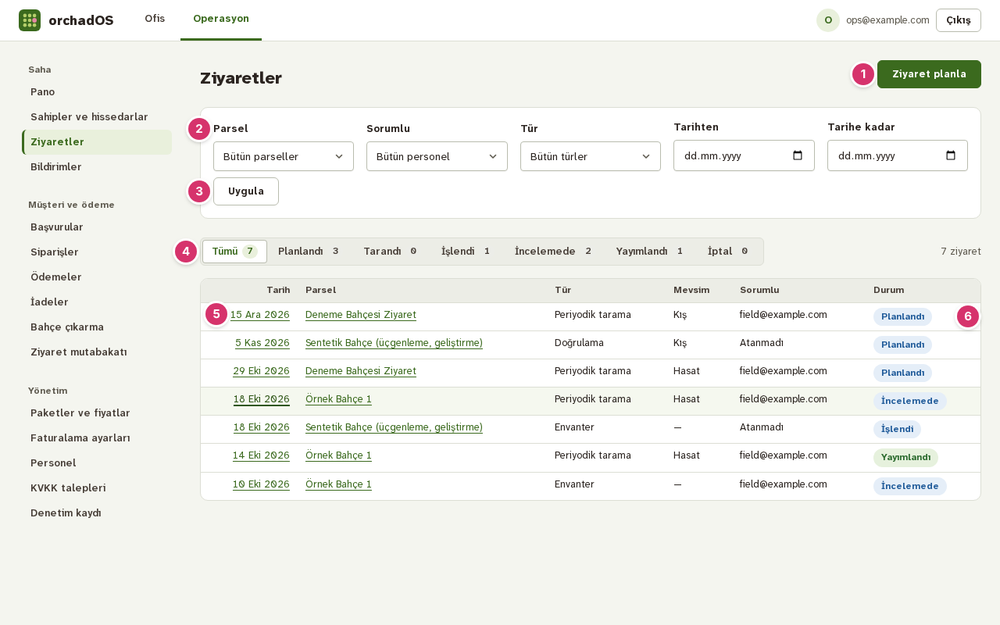

**Ekranın bölümleri**

1. "Ziyaret planla": yeni ziyaret formunu açar.
2. Süzgeç alanları: "Parsel", "Sorumlu", "Tür", "Tarihten", "Tarihe kadar".
3. "Uygula": süzgeci uygular. Süzgeç varken yanında "Filtreleri temizle" çıkar.
4. Durum sekmeleri: "Tümü", "Planlandı", "Tarandı", "İşlendi", "İncelemede", "Yayımlandı", "İptal"; her birinin yanında o durumdaki ziyaret sayısı. Sağda toplam ("6 ziyaret").
5. Tarih: tıklayınca ziyaretin sayfası açılır. Parsel adı da parselin sayfasına gider.
6. Durum rozeti.

Liste en yeni planlı tarih üstte olacak şekilde sıralıdır. Sütunlar: "Tarih", "Parsel", "Tür", "Mevsim" (periyodik taramada tarihe göre Kış, İlkbahar, Yaz ya da Hasat; envanterde "—"), "Sorumlu" (atanmadıysa "Atanmadı") ve "Durum". Sayfa başına belli sayıda satır gösterilir; altta sayfa düğmeleri çıkar.

### Bir ziyareti bulmak

1. "Parsel" listesinden bahçeyi seçin; gerekirse "Sorumlu" ve "Tür"ü de seçin.
2. Tarih aralığı için "Tarihten" ve "Tarihe kadar"ı doldurun.
3. "Uygula"ya basın, sonra üstteki durum sekmesiyle daraltın.
4. Satırdaki tarihe tıklayın.

**Düğmeler ve alanlar**

| Düğme / alan | Ne yapar |
| --- | --- |
| "Ziyaret planla" | `/operasyon/ziyaret/yeni` formunu açar. |
| "Parsel" | Tek parselin ziyaretleri ("Bütün parseller" hepsi). |
| "Sorumlu" | Bir saha personelinin ziyaretleri ("Bütün personel" hepsi). |
| "Tür" | "Envanter", "Periyodik tarama" ya da "Doğrulama" ("Bütün türler" hepsi). |
| "Tarihten", "Tarihe kadar" | Planlanan güne göre aralık. |
| "Uygula" | Süzgeci uygular. |
| "Filtreleri temizle" | Süzgeci kaldırır, seçili durum sekmesi kalır. |
| Durum sekmeleri | Listeyi bir duruma daraltır. |

**Uyarılar ve ret mesajları**

| Mesaj | Ne zaman çıkar | Ne yapmalı |
| --- | --- | --- |
| "Henüz ziyaret yok" | Hiç ziyaret planlanmamış. | "Ziyaret planla" ile başlayın. |
| "Bu filtrelere uyan ziyaret yok" | Süzgece uyan ziyaret yok. | "Filtreleri temizle"ye basın ya da süzgeci değiştirin. |
| "\"Planlandı\" durumunda ziyaret yok" (ya da başka bir durum) | Seçili sekmede ziyaret yok. | "Ziyaret planla" ya da "Bütün ziyaretleri göster". |

## Ziyaret planlamak

`/operasyon/ziyaret/yeni`

**Ne için:** Bir parsele envanter, periyodik tarama ya da doğrulama ziyareti planlamak için. Ziyaret, seçilen saha personelinin telefonundaki görev listesine düşer.
**Kim kullanır:** Operasyon.

Forma panodan, ziyaret listesinden ya da parselin sayfasındaki "Ziyaret planla"dan gelinir; parselden gelinirse parsel seçili açılır.

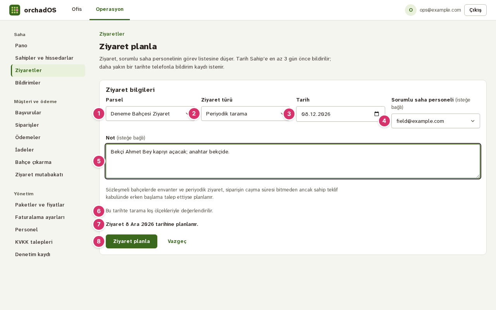

**Ekranın bölümleri**

1. "Parsel": operasyon rolünüz olan işletmenin parselleri.
2. "Ziyaret türü": "Envanter", "Periyodik tarama", "Doğrulama". Varsayılan "Periyodik tarama".
3. "Tarih": bugünden önce bir gün seçilemez.
4. "Sorumlu saha personeli" (isteğe bağlı): parselin işletmesindeki saha personeli; boş bırakılırsa "Atanmadı".
5. "Not" (isteğe bağlı): kapı, anahtar, bekçi gibi bilgiler. Saha personeli görür.
6. Mevsim notu: periyodik taramada "Bu tarihte tarama kış ölçekleriyle değerlendirilir." gibi; envanterde "Envanter ziyaretinde sağlık ölçeği girilmez. İlk envanter planlanınca parsel "Envanter planlandı" olur."
7. Onay satırı: "Ziyaret 8 Ara 2026 tarihine planlanır." Tarih seçilmediyse "Planlamak için bir tarih seçin."
8. "Ziyaret planla": kaydeder. "Vazgeç" listeye döner.

Formun altında sabit bir kural notu durur: "Sözleşmeli bahçelerde envanter ve periyodik ziyaret, siparişin cayma süresi bitmeden ancak sahip teklif kabulünde erken başlama talep ettiyse planlanır."

### Bir ziyaret planlamak (en az 3 gün sonrası)

1. "Parsel"i ve "Ziyaret türü"nü seçin.
2. "Tarih"e **bugünden en az 3 gün sonrasını** girin.
3. "Sorumlu saha personeli"ni seçin, gerekiyorsa "Not" yazın.
4. Onay satırındaki tarihi kontrol edip "Ziyaret planla"ya basın.
5. Ziyaretin sayfası açılır, üstte "Ziyaret planlandı; sorumlu personelin görev listesine düşer." yazar.

Envanter ve periyodik taramada sistem sahibe tarih bildirimini (SMS ya da WhatsApp) kendiliğinden kuyruğa koyar; "Ziyaret tarihi bildirimi" tablosunda "SMS / WhatsApp" satırı "kuyrukta" olarak görünür. Doğrulama ziyaretinde bildirim gitmez.

> Bildirim mesajı yalnızca **ziyaret bildirim SMS'i ayarı** açıkken gider. Bu ayar ekrandan değiştirilemez, veritabanından açılır; yerel deneme ortamında açıktır, barındırılan ortamlarda kapalı başlar. Kapalıyken tabloda satır oluşmaz; sahibi telefonla arayıp aşağıdaki gibi telefon bildirimini kaydedin.

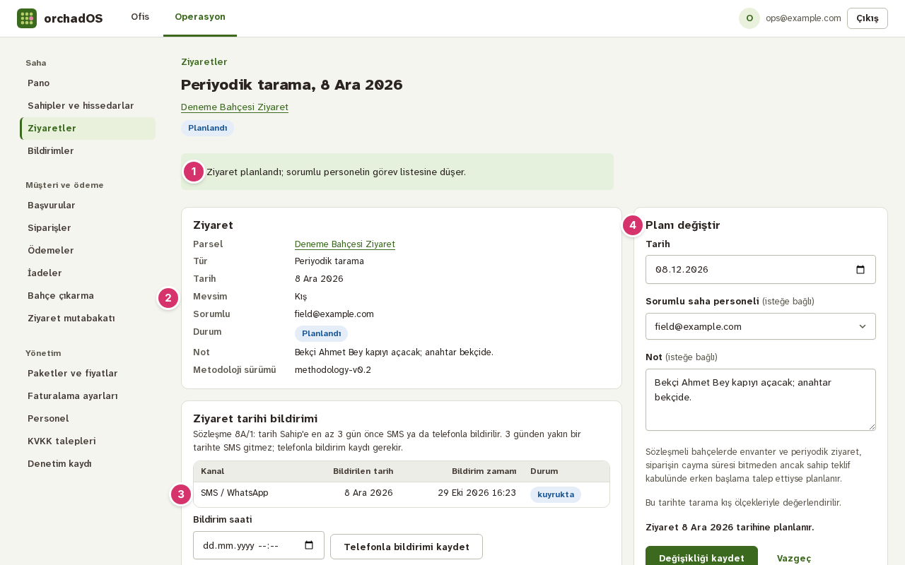

1. Kayıt bildirimi.
2. "Ziyaret" kutusu: parsel, tür, tarih, mevsim, sorumlu, durum, not ve "Metodoloji sürümü".
3. Tarih bildirimi: "SMS / WhatsApp", bildirilen tarih, bildirim zamanı ve durum ("kuyrukta", "gönderildi", "gönderilemedi").
4. "Planı değiştir" kutusu (aşağıda).
5. "Ziyareti iptal et".

### Tarih 3 günden yakınsa: telefonla bildirim

Sözleşmeye göre ziyaret tarihi sahibe en az 3 gün önce bildirilir. 3 günden yakın bir tarihte SMS gitmez; sahibi telefonla aramanız ve arama saatini kaydetmeniz gerekir.

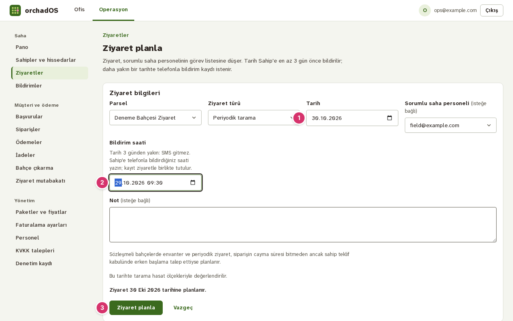

1. Bugünden 3 günden yakın bir tarih seçince form "Bildirim saati" alanını açar.
2. "Bildirim saati": sahibi telefonla aradığınız gün ve saat. Altında açıklama yazar: "Tarih 3 günden yakın: SMS gitmez. Sahip'e telefonla bildirdiğiniz saati yazın; kayıt ziyaretle birlikte tutulur."
3. "Ziyaret planla": ziyareti ve telefon bildirimini birlikte kaydeder.

Adımlar:

1. Önce sahibi arayın ve tarihi söyleyin.
2. Formda tarihi seçin, açılan "Bildirim saati"ne aramanın gününü ve saatini girin. Gelecekte bir saat girilemez.
3. "Ziyaret planla"ya basın. Ziyaret sayfasında bildirim tablosunda "Telefon" satırı görünür.

### Planlama reddedilirse

Kaydettiğinizde sistem bazı durumlarda planı reddeder ve nedeni formun altında kırmızı kutuda yazar.

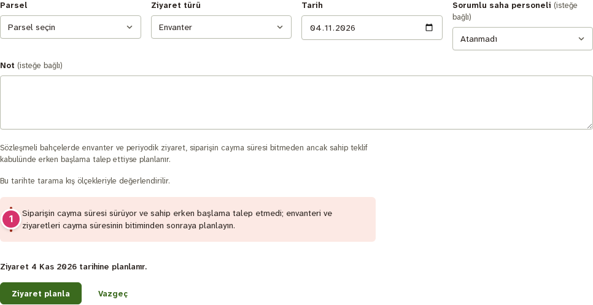

1. Ret mesajı. Bu örnekte siparişin 14 günlük cayma süresi sürüyor ve sahip erken başlama istememiş.

Ret olunca form tarih dışındaki seçimleri sıfırlayabilir; parseli ve türü yeniden seçip tekrar deneyin.

**Düğmeler ve alanlar**

| Düğme / alan | Ne yapar |
| --- | --- |
| "Parsel" | Ziyaretin parseli. Kaydettikten sonra değiştirilemez. |
| "Ziyaret türü" | Envanter, periyodik tarama ya da doğrulama. Kaydettikten sonra değiştirilemez. |
| "Tarih" | Planlanan gün. Geçmiş gün seçilemez. |
| "Sorumlu saha personeli" | Görevin düşeceği kişi. Listede yalnızca parselin işletmesinin saha personeli çıkar. |
| "Bildirim saati" | Yalnızca tarih 3 günden yakınsa çıkar ve zorunludur. |
| "Not" | Saha personeline not. Telefon numarası yazmayın. |
| "Ziyaret planla" | Ziyareti kaydeder. |
| "Vazgeç" | Kaydetmeden listeye döner. |

**Uyarılar ve ret mesajları**

| Mesaj | Ne zaman çıkar | Ne yapmalı |
| --- | --- | --- |
| "Formda düzeltilecek alanlar var." ve alanın altında "Gerekli." | Parsel, tarih ya da (3 günden yakın tarihte) "Bildirim saati" boş. | Eksik alanı doldurun. |
| "Geçmiş bir gün seçilemez." | Tarih bugünden önce. | Bugün ya da sonrasını seçin. |
| "Siparişin cayma süresi sürüyor ve sahip erken başlama talep etmedi; envanteri ve ziyaretleri cayma süresinin bitiminden sonraya planlayın." | Sözleşmeli bahçede 14 günlük cayma süresi bitmemiş, sahip teklif kabulünde erken başlama istememiş. | Tarihi cayma süresinin bitiminden sonraya alın. |
| "Bu ziyaretin ödemesi yapılmadı; ziyaret ödemeden sonra planlanır. Sahip yazılı olarak isterse siparişin ödeme planından not yazarak ödemesiz ziyarete izin verebilirsiniz." | Ziyaretin düştüğü pencerenin ödemesi yapılmamış. | Ödemeyi bekleyin ya da sahibin yazılı isteğiyle sipariş sayfasından ödemesiz ziyarete izin verin ([03 · Başvuru, teklif, sipariş, ödeme](03-basvuru-teklif-siparis-odeme.md)). |
| "Bu bahçede açık bir sınır itirazı var; itiraz kapatılmadan envanter ya da periyodik tarama planlanamaz." | Parselde açık sınır itirazı var. | İtiraz kapanınca planlayın ([04 · Sahip ve parsel](04-sahip-ve-parsel.md)). Doğrulama ziyareti planlanabilir. |
| "Parsel pasif; ziyaret planlamak için önce izlemeyi sürdürün." | Parsel pasif (izleme bitmiş). | Parsel sayfasında "İzlemeyi sürdür" (yetkiniz varsa) ya da operasyon sorumlusuna danışın. |
| "Bahçe bu tarihte hizmetten çıkıyor; ziyareti çıkış tarihinden önceye planlayın." | Parsel için planlanmış bir bahçe çıkarma var ve tarih çıkış gününden sonra. | Tarihi çıkış gününden önceye alın ([08 · İade, çıkarma](08-iade-cikarma-mutabakat-kvkk.md)). |
| "Bahçe hizmetten çıkarıldı; sürdürülemez. Yeniden eklemek için ek teklif verin." | Bahçe hizmetten çıkarılmış. | Bahçe yeniden eklenmeden ziyaret planlanamaz. |
| "Sorumlu, işletmenin saha personeli olmalı." | Seçilen kişi saha personeli değil. | Listeden başka bir kişi seçin. |
| "Girilen bilgilerden biri geçersiz." | Telefon bildirimi saati gelecekte ya da biçim hatalı. | Aramanın gerçek saatini girin. |
| "Bu işlem için yetkiniz yok." | Parselin işletmesinde operasyon rolünüz yok. | Yöneticinize başvurun. |

## Ziyaretin sayfası: planı değiştirmek, iptal, tarih bildirimi

`/operasyon/ziyaret/<ziyaret>`

**Ne için:** Bir ziyaretin bilgilerini, hukuki kayıtlarını (tarih bildirimi, erteleme, yapılamayan ziyaret, sahadaki bilgilendirme) görmek; planlı ziyaretin tarihini, sorumlusunu ve notunu değiştirmek ya da iptal etmek için.
**Kim kullanır:** Operasyon. (Hukuki kayıt kutuları yalnızca operasyon rolüne ve yalnızca envanter ile periyodik taramada görünür.)

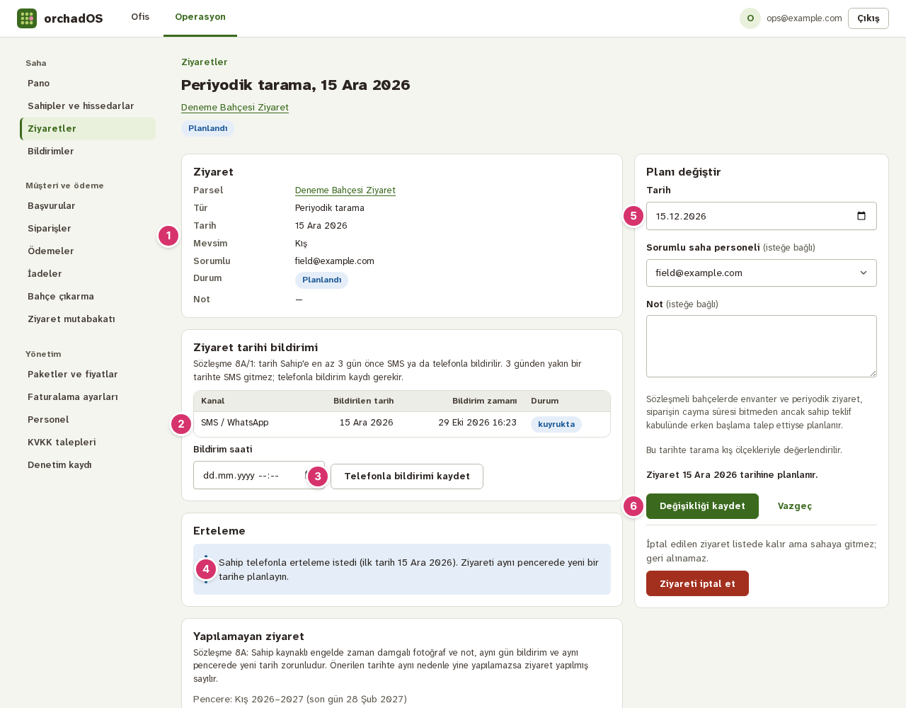

**Ekranın bölümleri**

1. "Ziyaret": parsel, tür, tarih, mevsim, sorumlu, durum, not.
2. "Ziyaret tarihi bildirimi" tablosu: "Kanal" ("SMS / WhatsApp" ya da "Telefon"), "Bildirilen tarih", "Bildirim zamanı", "Durum".
3. "Bildirim saati" ve "Telefonla bildirimi kaydet": sahibi telefonla aradığınızı sonradan kaydetmek için.
4. "Erteleme": sahip erteleme istediyse mavi kutuda yazar (aşağıda).
5. "Planı değiştir" kutusunda "Tarih", "Sorumlu saha personeli", "Not".
6. "Değişikliği kaydet". Altında iptal bölümü ve "Ziyareti iptal et" düğmesi.

Planlı ziyaretin o günkü tarihi için hiç bildirim kaydı yoksa tablonun altında sarı "Bu tarih için bildirim kaydı yok." uyarısı çıkar.

### Tarihi, sorumluyu ya da notu değiştirmek

1. "Planı değiştir" kutusunda yeni "Tarih"i seçin. Onay satırı "Ziyaret 15 Ara 2026 yerine 22 Ara 2026 tarihine alınır." gibi yazar.
2. Gerekirse "Sorumlu saha personeli"ni ve "Not"u değiştirin.
3. Yeni tarih bugünden 3 günden yakınsa "Bildirim saati" alanı açılır; sahibi arayıp saati girin.
4. "Değişikliği kaydet"e basın. Üstte "Plan güncellendi." yazar.

Tarih değişince (3 gün ve sonrası için) sahibe yeni tarihin bildirimi yeniden kuyruğa girer; yalnızca not değişirse bildirim gitmez. Parsel ve tür değiştirilemez; yanlışsa ziyareti iptal edip yenisini planlayın.

### Telefonla bildirimi sonradan kaydetmek

1. Sahibi arayın.
2. "Ziyaret tarihi bildirimi" kutusunda "Bildirim saati"ne aramanın gününü ve saatini girin.
3. "Telefonla bildirimi kaydet"e basın. Üstte "Telefonla bildirim kaydedildi." yazar ve tabloya "Telefon" satırı eklenir.

### Ziyareti iptal etmek

1. "Planı değiştir" kutusunun altındaki "Ziyareti iptal et"e basın. Ayrıca onay sorulmaz.
2. Üstte "Ziyaret iptal edildi." yazar; durum "İptal" olur.

İptal geri alınamaz: "İptal edilen ziyaret listede kalır ama sahaya gitmez; geri alınamaz." Yanlışlıkla iptal ettiyseniz yeni bir ziyaret planlayın.

### Taranmış ya da iptal edilmiş ziyaret

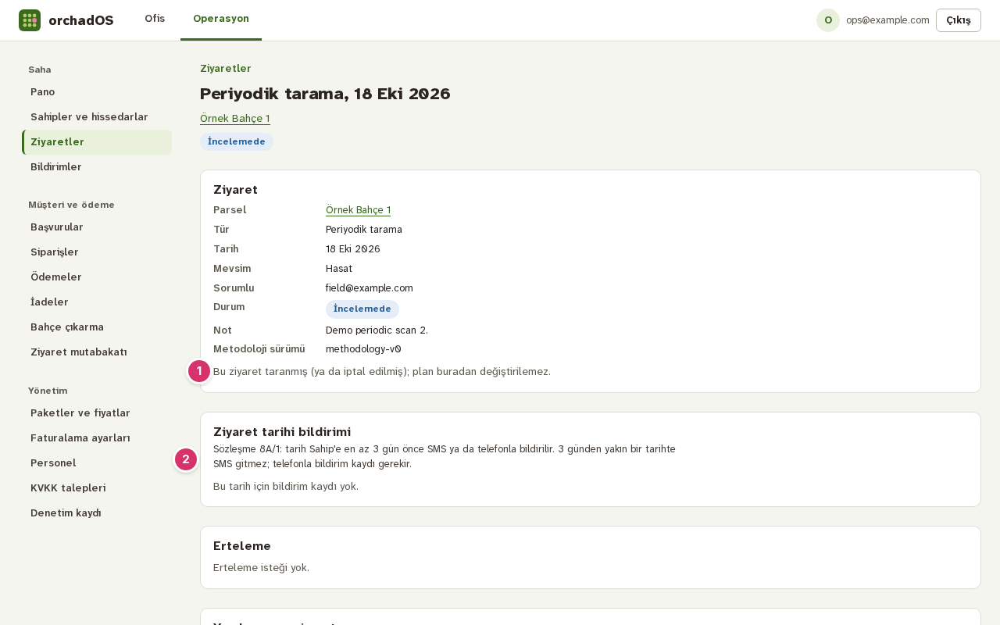

1. "Bu ziyaret taranmış (ya da iptal edilmiş); plan buradan değiştirilemez." "Planı değiştir" kutusu ve iptal düğmesi görünmez.
2. Hukuki kayıt kutuları yine görünür. Bu ziyaret için bildirim kaydı yoksa "Bu tarih için bildirim kaydı yok." yazar.

**Düğmeler ve alanlar**

| Düğme / alan | Ne yapar |
| --- | --- |
| Parsel bağlantısı (başlığın altında ve "Ziyaret" kutusunda) | Parselin sayfasını açar. |
| "Bildirim saati" + "Telefonla bildirimi kaydet" | Telefonla yapılan bildirimi kaydeder. Yalnızca planlı ziyarette çıkar. |
| "Tarih" (Planı değiştir) | Ziyaretin gününü değiştirir. |
| "Sorumlu saha personeli" | Görevi başka bir personele verir. |
| "Not" | Saha personeline not. |
| "Değişikliği kaydet" | Değişikliği kaydeder. |
| "Vazgeç" | Değişikliği bırakır. |
| "Ziyareti iptal et" | Ziyareti iptal eder; geri alınamaz. |

**Uyarılar ve ret mesajları**

| Mesaj | Ne zaman çıkar | Ne yapmalı |
| --- | --- | --- |
| "Bu tarih için bildirim kaydı yok." | Planlı ziyaretin bugünkü tarihi için ne SMS ne telefon kaydı var. | Sahibi arayıp "Telefonla bildirimi kaydet" ile girin. |
| "Ziyaret taranmış; plan değiştirilemez, iptal edilemez." | Siz sayfadayken saha ziyareti taradı. | Sayfayı yenileyin; değişiklik gerekiyorsa uzman ya da operasyon sorumlusuyla konuşun. |
| "Ziyaret iptal edilmiş; yeni bir ziyaret planlayın." | İptal edilmiş ziyareti değiştirmeye çalıştınız. | Yeni ziyaret planlayın. |
| "Planlanan ziyaretin tarihi olmalı." | Tarih boş kaydedildi. | Tarih seçin. |
| Planlama formundaki ret mesajları | Yeni tarihte cayma süresi, ödeme, sınır itirazı ya da çıkış günü kuralı tutmuyor. | Yukarıdaki tabloya bakın. |

## Erteleme

`/operasyon/ziyaret/<ziyaret>` ("Erteleme" kutusu)

**Ne için:** Sahibin erteleme isteğini görmek ya da telefonla veya yazılı gelen isteği kaydetmek için.
**Kim kullanır:** Operasyon.

Sahip planlı bir ziyareti **bir kez** ve **ziyaretten en geç bir gün önce** erteletebilir. Portaldan istediyse kayıt kendiliğinden düşer. Size telefonla ya da yazılı geldiyse siz kaydedersiniz.

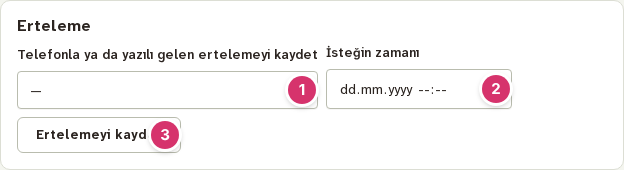

1. "Telefonla ya da yazılı gelen ertelemeyi kaydet": "telefonla" ya da "yazılı olarak".
2. "İsteğin zamanı": sahibin istediği gün ve saat.
3. "Ertelemeyi kaydet".

### Telefonla gelen ertelemeyi kaydetmek

1. Ziyaretin sayfasını açın, "Erteleme" kutusuna inin.
2. Yolu seçin ("telefonla" ya da "yazılı olarak"), "İsteğin zamanı"nı girin.
3. "Ertelemeyi kaydet"e basın. Üstte "Erteleme kaydedildi; ziyareti aynı pencerede yeni bir tarihe planlayın." yazar ve kutuda mavi bir not çıkar: "Sahip telefonla erteleme istedi (ilk tarih 15 Ara 2026). Ziyareti aynı pencerede yeni bir tarihe planlayın." (bkz. yukarıdaki ekranın 4 numarası).
4. "Planı değiştir"den yeni tarihi **aynı ziyaret penceresi içinde** seçip kaydedin.

Ziyaret gününe bir günden az kaldıysa form çıkmaz; kutuda "Erteleme isteği yok; ziyaret gününe bir günden az kaldığı için artık kaydedilemez." yazar.

**Düğmeler ve alanlar**

| Düğme / alan | Ne yapar |
| --- | --- |
| "Telefonla ya da yazılı gelen ertelemeyi kaydet" | İsteğin hangi yolla geldiği. |
| "İsteğin zamanı" | İsteğin gün ve saati. |
| "Ertelemeyi kaydet" | Ertelemeyi kaydeder. Bir ziyarette yalnızca bir kez. |

**Uyarılar ve ret mesajları**

| Mesaj | Ne zaman çıkar | Ne yapmalı |
| --- | --- | --- |
| "Erteleme yalnızca bir kez ve ziyaretten en geç bir gün önce istenebilir." | İkinci erteleme ya da ziyaret günü/sonrası. | Sahibe kuralı anlatın; ziyaret yapılamazsa "Yapılamayan ziyaret" kaydı açın. |
| "Girilen bilgilerden biri geçersiz." | Yol seçilmedi ya da zaman biçimi hatalı. | İki alanı da doldurun. |

## Yapılamayan ziyaret

`/operasyon/ziyaret/<ziyaret>` ("Yapılamayan ziyaret" kutusu)

**Ne için:** Bahçeye gidilip ziyaret yapılamadığında (kapı kapalı, hava, ekip gelemedi...) sözleşmenin istediği kaydı tutmak ve sonucunu (yeni tarih, yapılmış sayma, iade, aktarma) girmek için.
**Kim kullanır:** Operasyon. Kaydın kaynağı çoğu zaman saha personelinin telefonundaki "Ziyaret yapılamadı" kaydıdır.

Kutunun üstünde kural yazar: "Sözleşme 8A: Sahip kaynaklı engelde zaman damgalı fotoğraf ve not, aynı gün bildirim ve aynı pencerede yeni tarih zorunludur. Önerilen tarihte aynı nedenle yine yapılamazsa ziyaret yapılmış sayılır."

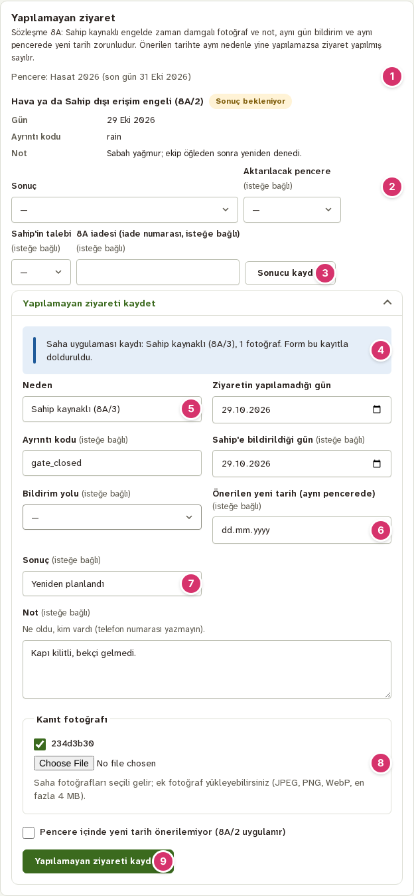

**Ekranın bölümleri**

1. Pencere: ziyaretin düştüğü ziyaret penceresi ve son günü ("Pencere: Hasat 2026 (son gün 31 Eki 2026)"). Gün bir pencerede değilse "Bu gün bir ziyaret penceresinde değil."
2. Daha önce girilmiş bir kayıt: neden, gün, ayrıntı kodu, not ve sonuç rozeti ("Sonuç bekleniyor" ya da sonuç).
3. Sonucu girilmemiş kayıtta "Sonuç", "Aktarılacak pencere", "Sahip'in talebi", "8A iadesi (iade numarası, isteğe bağlı)" ve "Sonucu kaydet".
4. Saha kaydı bildirimi: "Saha uygulaması kaydı: Sahip kaynaklı (8A/3), 1 fotoğraf. Form bu kayıtla dolduruldu." Saha personeli telefondan "Ziyaret yapılamadı" kaydettiyse form açık gelir ve nedeni, ayrıntı kodunu, notu ve fotoğrafları o kayıttan alır.
5. "Neden": "Sahip kaynaklı (8A/3)", "Şirket kaynaklı (8A/2)", "Hava ya da Sahip dışı erişim engeli (8A/2)", "Mücbir sebep (8A/4)".
6. "Önerilen yeni tarih (aynı pencerede)".
7. "Sonuç": "Sonuç bekleniyor", "Yeniden planlandı", "Yapılmış say (ikinci başarısız deneme)", "İade edildi (8A/2)".
8. "Kanıt fotoğrafı": saha fotoğrafları işaretli gelir (kimliğin ilk 8 hanesiyle); ek fotoğraf yükleyebilirsiniz.
9. "Yapılamayan ziyareti kaydet".

Diğer alanlar: "Ziyaretin yapılamadığı gün", "Ayrıntı kodu" (sahadan gelen kod, ör. `gate_closed` kapı kapalı, `rain` yağmur), "Sahip'e bildirildiği gün", "Bildirim yolu" ("SMS", "WhatsApp", "Telefon"), "Not" ("Ne oldu, kim vardı (telefon numarası yazmayın).") ve "Pencere içinde yeni tarih önerilemiyor (8A/2 uygulanır)" kutusu. Taranmış ama yayımlanamayacak bir ziyarette (ör. veri kaybı) neden "Şirket kaynaklı" seçili gelir ve "Raporu yayımlanamıyor (örneğin veri kaybı); kullanılmış ziyaret sayılmaz" kutusu işaretli çıkar.

Form planlı ziyarette ve taranmış ama henüz yayımlanmamış ziyarette ("Tarandı", "İşlendi", "İncelemede") görünür. Saha kaydı yoksa form kapalı bir "Yapılamayan ziyareti kaydet" başlığı olarak durur; tıklayınca açılır.

### Sahip kaynaklı engeli kaydetmek (kapı kapalı)

1. Saha personeli sizi aradığında ziyaretin sayfasını açın. Saha kaydı geldiyse form doludur.
2. Sahibi **aynı gün** arayın; "Sahip'e bildirildiği gün" bugün kalsın, "Bildirim yolu"nu seçin.
3. Sahiple **aynı pencere içinde** bir gün kararlaştırıp "Önerilen yeni tarih"e girin. Pencerede hiç gün kalmadıysa "Pencere içinde yeni tarih önerilemiyor" kutusunu işaretleyin (o zaman tarih girmeyin).
4. "Not"un ve en az bir "Kanıt fotoğrafı"nın dolu olduğunu kontrol edin.
5. "Sonuç"u "Yeniden planlandı" bırakın, "Yapılamayan ziyareti kaydet"e basın.
6. Üstte "Yapılamayan ziyaret kaydedildi." yazar; kayıt listede "Yeniden planlandı" rozetiyle görünür.
7. Ziyaretin tarihini "Planı değiştir"den önerilen güne alın.

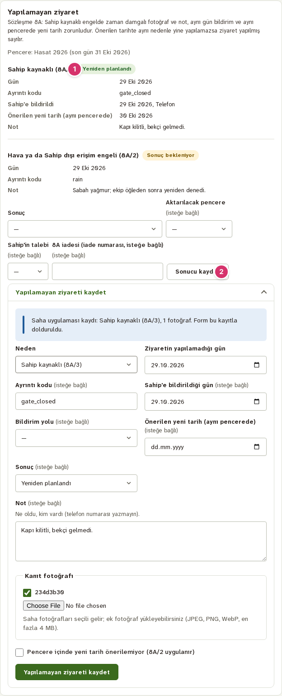

1. Kaydedilen kayıt ve sonucu ("Yeniden planlandı"); altında gün, ayrıntı kodu, sahibe bildirim, önerilen tarih ve not.
2. Sonucu henüz girilmemiş başka bir kayıt ve "Sonucu kaydet".

Sahip kaynaklı nedende not, fotoğraf, aynı gün bildirim ve (pencerede gün varsa) önerilen tarih zorunludur; biri eksikse kayıt reddedilir.

### Önerilen günde yine yapılamazsa: "Yapılmış say"

Sahip kaynaklı engel yüzünden ikinci kez, **önerilen günde** yine yapılamadıysa ziyaret yapılmış sayılır (sözleşme 8A/3):

1. Önerilen gün yeni bir "Yapılamayan ziyareti kaydet" açın; neden "Sahip kaynaklı (8A/3)", gün önerilen gün.
2. "Sonuç"tan "Yapılmış say (ikinci başarısız deneme)"yi seçip kaydedin.

Bir kaydın sonucunu sonradan girerken listede "Yapılmış say (ikinci başarısız deneme)" seçeneği yalnızca bu koşul tutuyorsa çıkar. Hava, şirket ya da mücbir sebepte ziyaret hiçbir zaman yapılmış sayılmaz.

### Sonucu sonradan girmek

1. Kayıttaki "Sonuç"tan birini seçin:
    - "Yeniden planlandı": aynı pencerede yeni gün verildi.
    - "İade edildi (8A/2)": ziyaretin bedeli iade edilecek. İadeyi önce "İadeler" ekranından açın ([08 · İade, çıkarma](08-iade-cikarma-mutabakat-kvkk.md)); iade numarasını "8A iadesi" alanına yazabilirsiniz.
    - "Sonraki pencereye aktarıldı (Sahip'in talebiyle)": yalnızca dönemin sonraki bir penceresi varsa çıkar. "Aktarılacak pencere"yi ve "Sahip'in talebi"ni ("Portal" ya da "Yazılı") seçin.
2. "Sonucu kaydet"e basın. Üstte "Sonuç kaydedildi." yazar.

Kayıt ve sonucu bir kez girilir, sonra değiştirilemez ve silinemez.

**Düğmeler ve alanlar**

| Düğme / alan | Ne yapar |
| --- | --- |
| "Neden" | Engelin kimden kaynaklandığı; sözleşmedeki sonuçlar buna göre değişir. |
| "Ziyaretin yapılamadığı gün" | Bugün ya da önceki bir gün. |
| "Ayrıntı kodu" | Sahadan gelen kısa kod; küçük harf ve alt çizgi. |
| "Sahip'e bildirildiği gün", "Bildirim yolu" | Sahibe ne zaman ve nasıl haber verildiği. |
| "Önerilen yeni tarih (aynı pencerede)" | Yeni gün; pencerenin dışında olamaz. |
| "Sonuç" | Kayıtla birlikte sonuç. Boş ("Sonuç bekleniyor") bırakılabilir. |
| "Not" | Ne oldu; telefon numarası yazmayın. |
| "Kanıt fotoğrafı" | Saha fotoğrafları ve isteğe bağlı ek dosya (JPEG, PNG, WebP, en fazla 4 MB). |
| "Pencere içinde yeni tarih önerilemiyor (8A/2 uygulanır)" | Pencerede gün kalmadığını kaydeder; tarih girilmez. |
| "Raporu yayımlanamıyor (örneğin veri kaybı); kullanılmış ziyaret sayılmaz" | Taranmış ziyarette verinin kullanılamadığını kaydeder. |
| "Yapılamayan ziyareti kaydet" | Kaydı açar. |
| "Sonuç", "Aktarılacak pencere", "Sahip'in talebi", "8A iadesi", "Sonucu kaydet" | Sonucu girilmemiş kaydın sonucunu bir kez kaydeder. |

**Uyarılar ve ret mesajları**

| Mesaj | Ne zaman çıkar | Ne yapmalı |
| --- | --- | --- |
| "Girilen bilgilerden biri geçersiz." | Sahip kaynaklı nedende not, fotoğraf, aynı gün bildirim ya da önerilen tarih eksik; gün gelecekte; "yeni tarih önerilemiyor" işaretliyken tarih girilmiş; dosya türü ya da boyutu uygun değil. | Eksik alanı tamamlayın. |
| "Önerilen tarih aynı ziyaret penceresinin içinde olmalı." | Önerilen gün pencerenin dışında. | Pencerenin son gününden önce bir gün seçin ya da "yeni tarih önerilemiyor"u işaretleyin. |
| "Yapılmış sayma yalnızca Sahip kaynaklı ikinci başarısız denemede, önerilen tarihte olur (8A/3)." | Koşul tutmuyor. | "Yeniden planlandı" ya da "İade edildi" seçin. |
| "Aktarma yalnızca aynı dönemin sonraki bir penceresine yapılabilir (8A/2)." | Seçilen pencere uygun değil ya da sahibin talebi seçilmedi. | Sonraki bir pencere ve "Portal" ya da "Yazılı" seçin. |
| "Bu kaydın sonucu zaten girilmiş." | Sonucu girilmiş kayda yeniden sonuç girildi. | Değiştirilemez; gerekirse yeni bir kayıt açın. |

## Sahada bilgilendirme kayıtları

`/operasyon/ziyaret/<ziyaret>` ("Sahada bilgilendirme kayıtları" kutusu)

**Ne için:** Saha personelinin bahçede tuttuğu hukuki kayıtları görmek için: levha ve tanıtım kartı, bahçedeki kişilere sözlü bilgilendirme ve itirazlar.
**Kim kullanır:** Operasyon (okur). Kayıtları saha uygulaması gönderir ([07 · Saha uygulaması](07-saha-uygulamasi.md)).

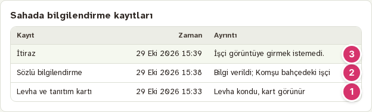

1. "Levha ve tanıtım kartı": "Levha kondu, kart görünür" ya da konmadıysa nedeni.
2. "Sözlü bilgilendirme": "Bilgi verildi", "Bahçede kimse yoktu" ya da "Verilemedi" ve not.
3. "İtiraz": bahçedeki birinin görüntüye girmeye itiraz ettiği; not.

Kayıt yoksa "Bilgilendirme kaydı yok" yazar. Bu kutuda düğme yoktur. İtiraz varsa ve kişi görüntülerde görünüyorsa aşağıdaki "Görüntü gizleme" bölümünü kullanın.

## Yakın plan listesi

`/operasyon/ziyaret/<ziyaret>` ("Yakın plan listesi" kutusu)

**Ne için:** Periyodik taramada saha ekibinin yakından fotoğraflayacağı ağaçları ve nedenlerini görmek için. Liste sunucuda kendiliğinden üretilir; elle değiştirilmez.
**Kim kullanır:** Operasyon (okur); saha personeli aynı listeyi telefonda görür.

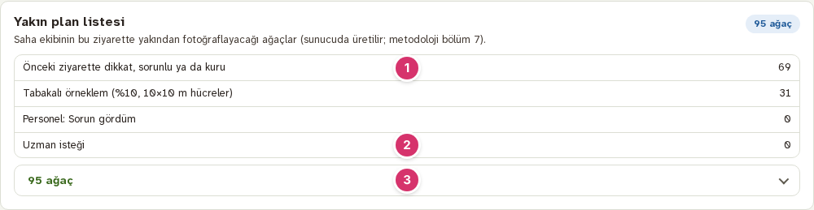

1. Nedenlere göre ağaç sayıları: "Önceki ziyarette dikkat, sorunlu ya da kuru", "Tabakalı örneklem (%10, 10×10 m hücreler)", "Personel: Sorun gördüm".
2. "Uzman isteği": uzmanın bir sonraki taramada yakın plan istediği ağaçlar. Uzman istekleri panoda "Uzman istekleri" bölümünde de listelenir ([02 · Operasyon panosu](02-operasyon-pano.md)); yakın plan isteği bir sonraki taramanın listesine kendiliğinden girer.
3. "95 ağaç" başlığı: tıklayınca ağaç kodlarının (S5-12 gibi) ve nedenlerinin tam listesi açılır.

Liste yalnızca iptal edilmemiş periyodik taramada görünür. Envanteri olmayan parselde liste boştur ("Listede ağaç yok.").

## Görüntü gizleme (KVKK itirazı)

`/operasyon/ziyaret/<ziyaret>` ("Görüntü gizleme (KVKK itirazı)" kutusu)

**Ne için:** Bir kişi görüntüsüne itiraz ettiğinde (KVKK md. 11) o kişinin göründüğü panoramayı, ağaç kesitini ya da yakın planı gizlemek için.
**Kim kullanır:** Operasyon. Kutu yalnızca taranmış ziyarette ("İşlendi", "İncelemede", "Yayımlandı") ve envanter ya da periyodik taramada görünür.

Gizlenen görüntüyü sahip, hissedar, demo ziyaretçisi ve uzman görmez; operasyon "Gizlendi" işaretiyle görmeye devam eder. Dosya ve kayıt silinmez, gizleme kaldırılabilir. Bir panorama gizlenince o karenin öteki çözünürlüğü ve ondan kesilen ağaç kesitleri de gizlenir. Yüz bulanıklaştırma yapılmaz.

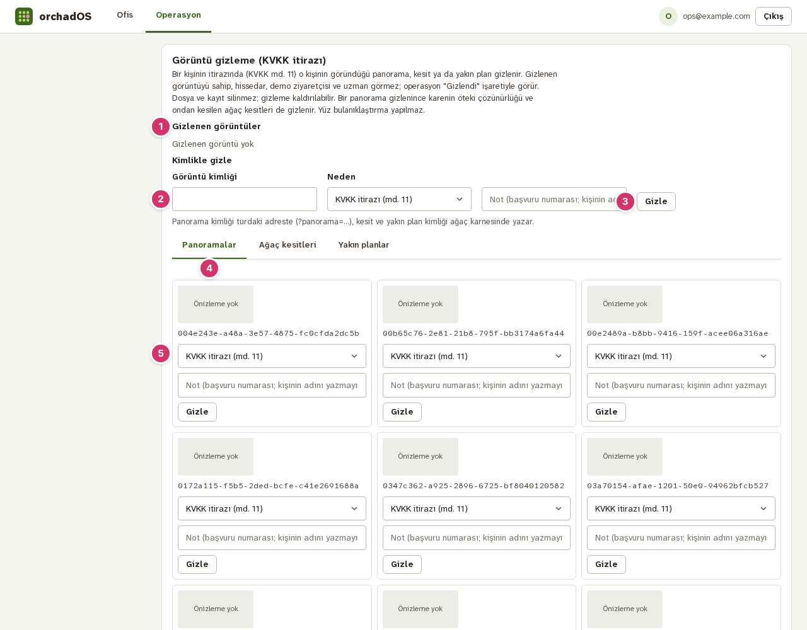

1. "Gizlenen görüntüler": şu an gizli olanlar (önizleme, tür, neden, zaman) ve her birinde "Gizlemeyi kaldır". Yoksa "Gizlenen görüntü yok".
2. "Kimlikle gizle" bölümünde "Görüntü kimliği": panorama kimliği tur adresinde (`?panorama=…`), kesit ve yakın plan kimliği ağaç karnesinde yazar.
3. "Neden" ("KVKK itirazı (md. 11)", "Üçüncü kişi görünüyor", "Diğer"), not alanı ve "Gizle".
4. Sekmeler: "Panoramalar", "Ağaç kesitleri", "Yakın planlar".
5. Görüntü kutusu: önizleme, kimlik, neden, not ve "Gizle". Altta "Önceki sayfa" / "Sonraki sayfa".

Deneme ortamında görüntü dosyaları olmadığı için kutularda "Önizleme yok" yazar; canlıda orada küçük resim görünür.

### Bir görüntüyü gizlemek

1. KVKK başvurusunu alın ve başvuru numarasını not edin ([08 · KVKK talepleri](08-iade-cikarma-mutabakat-kvkk.md)).
2. Görüntüyü sekmelerde bulun ya da kimliğini "Görüntü kimliği"ne yapıştırın.
3. "Neden"i seçin, not alanına **başvuru numarasını** yazın (kişinin adını yazmayın).
4. "Gizle"ye basın. Üstte "Görüntü gizlendi. Sahip, hissedar ve uzman artık görmez." yazar.

Gizlemeyi kaldırmak için "Gizlenen görüntüler" tablosunda "Gizlemeyi kaldır"a basın ("Gizleme kaldırıldı."). Bütün işlemler kutunun altındaki "Kayıtlar" bölümünde kim, ne zaman ve neden bilgisiyle tutulur.

**Uyarılar ve ret mesajları**

| Mesaj | Ne zaman çıkar | Ne yapmalı |
| --- | --- | --- |
| "Bu görüntü zaten gizli." | Gizli görüntüyü yeniden gizlediniz. | Bir şey yapmanız gerekmez. |
| "Bu görüntü gizli değil." | Gizli olmayan görüntünün gizlemesini kaldırdınız. | Bir şey yapmanız gerekmez. |
| "Kayıt bulunamadı." | Kimlik yanlış ya da bu ziyarete ait değil. | Kimliği kontrol edin. |
| "Bilgiler eksik ya da hatalı." | Kimlik biçimi ya da neden hatalı. | 36 karakterlik kimliği tam yapıştırın. |
| "Bu demo görüntüsünün herkese açık kopyası (demo-media) duruyor. Önce o kopyayı kaldırın, sonra gizleyin." | Demo turunun görüntüsü. | Teknik ekibe bildirin. |
| "İşlem tamamlanamadı. Tekrar deneyin." | Beklenmeyen hata. | Tekrar deneyin. |

## İşleme istasyonu: kartlardan yüklemeye

Bu adımlar web ekranı değil, işleme istasyonundaki (ya da bulut işleme makinesindeki) terminalde yapılır. Saha personeli ziyaretten sonra kameranın hafıza kartını ve kaydedicinin SD kartını ofise getirir (ziyaret başına yaklaşık 90 GB). Kartları siz işlersiniz.

**Ne için:** Ham video ve GNSS kayıtlarından konumlu panoramalar ve ağaç kesitleri üretip ziyarete yüklemek için. Yükleme bitince ziyaret "İşlendi" olur ve uzmanın kuyruğuna düşer.
**Kim kullanır:** İşleme istasyonunu kullanan operasyon personeli.

Gerekenler: ziyaretin kimliği (36 karakter; ziyaret sayfasının adres çubuğundaki `/operasyon/ziyaret/<ziyaret>` kısmı, saha uygulamasındaki ziyaretle aynıdır) ve istasyonda kurulu `.env` dosyası (operasyon hesabının e-postası ve parolası; kurulumu teknik ekip yapar).

### Adım adım (istasyonda)

1. Kartları istasyona takın. Kaydedici kartındaki `sessions/<ziyaret>/` klasörünü ziyaretin klasöründe `gnss/`'e, kamera videolarını `video/`'ya kopyalayın. Saha uygulamasının `session.json` dosyası klasörün kökünde olmalı.
2. Hattı çalıştırın; konum düzeltilir, video GNSS zamanıyla QR koduyla eşlenir, panoramalar ve ağaç kesitleri üretilir:

    ```bash
    cd services/pipeline
    uv run orchados-pipeline run /veri/oturumlar/<ziyaret> --trees-from-db
    ```

    `--trees-from-db` ağaç konumlarını parselin envanterinden alır (periyodik taramada kullanın). Çıktı `/veri/oturumlar/<ziyaret>.processed/v<sürüm>_<kod>/` klasörüne yazılır; aynı oturumu yeniden işlemek yeni bir klasör açar, eskisini silmez.
3. Çıktıyı yükleyin:

    ```bash
    set -a && . ./.env && set +a
    uv run orchados-pipeline upload /veri/oturumlar/<ziyaret>.processed/v<sürüm>_<kod> --session-id <ziyaret>
    ```

4. Ziyaret sayfasında durumun "İşlendi" olduğunu kontrol edin. Ham video istasyonda (ya da ham veri deposunda) kalır; siteye yalnızca önizlemeler ve kesitler yüklenir.

İki adımı tek komutta da yapabilirsiniz: `uv run orchados-pipeline run <klasör> --trees-from-db --upload --session-id <ziyaret>`.

**Bulutta işleme (pilot):** Kartlar ofiste `orchados-ingest push <kart> --session-id <ziyaret>` ile ham veri deposuna yüklenir; kartı çıkarmadan önce `orchados-ingest verify <ziyaret>` "0 problems" demelidir. İşleme bulut makinesinde `deploy/processing/machine.sh <sağlayıcı> run <ziyaret>` ile çalışır ve iş bitince makine kendini kapatır. Ayrıntı: [bulut-isleme.md](../bulut-isleme.md).

**Sık karşılaşılan durumlar**

| Durum | Ne yapmalı |
| --- | --- |
| Ingest hatası: eksik ya da bozuk dosya listesi | Hata bütün eksikleri birlikte listeler; kartlardan eksik dosyayı kopyalayıp yeniden çalıştırın. |
| `session_id` / `parcel_id` uyuşmuyor | Klasördeki `session.json` başka bir ziyarete ait. Doğru ziyaretin kimliğini kullanın. |
| Yükleme "kamera yüksekliği" yüzünden reddedildi | Ziyarette kayıtlı yükseklik ile işlemedeki değer 5 cm'den çok farklı. Teknik ekibe bildirin; `session.json` düzeltilip yeniden işlenir. |
| Yükleme yarıda kesildi | Aynı komutu yeniden çalıştırın; kaldığı yerden devam eder, iki kez yüklemez. |
| Kapsama eşiğin altında | Yükleme yine yapılır; veritabanı kendiliğinden ek ziyaret isteği açar ve panoda "Uzman istekleri"nde görünür. |

Teknik ayrıntı: [services/pipeline/README.md](../../services/pipeline/README.md).

---

Önceki: [04 · Sahip ve parsel](04-sahip-ve-parsel.md) · Sonraki: [06 · Ofis aracı: gövde üçgenleme](06-ofis-araci-ucgenleme.md)
