# 06 · Ofis aracı: envanter üçgenleme

Envanter ziyaretinden sonra her bahçenin ağaç haritası ofiste, bilgisayarda çıkarılır. Saha personelinin taradığı 360° panoramalarda her ağacın gövdesine iki farklı panoramadan tıklarsınız; yazılım iki yön çizgisinin kesiştiği yeri ağacın konumu olarak hesaplar. Ağaçlar bitince yazılım sıraları oturtur, her yere bir kod verir (S5-12: 5. sıranın 12. yeri; sıra arasındaki ağaç S5-12a), ağacı olmayan yerleri "boş yer" olarak işaretler ve sahada bakılacak yerlerin listesini çıkarır. Son adımda envanteri veritabanına kaydedersiniz. Ardından "Envanteri düzenle" sayfasında ağaç özelliklerini (büyüklük, aşı, gövde), altyapıyı (kuyu, sulama hattı…), saha sınırını ve doğrulama turunu girersiniz.

Bu bölüm baştan sona çalışılmış bir örnekle ilerler: geliştirme ortamındaki sentetik parsel "Sentetik Bahçe (üçgenleme, geliştirme)" (3 sıra, 12 ağaç). Örnekte bir boş yer oluşsun diye **S2-3'teki ağacı bilerek eklemedik**; 11 ağaç işaretlendi.

[← Kılavuz dizini](README.md)

> **Ekran genişliği.** Ofis aracı harita ile iki panoramayı yan yana gösterir; geniş bir ekran kullanın. Bu bölümün araç ekran görüntüleri 1440×900 boyutunda alındı (öteki bölümler 1280×800). 1000 pikselden dar pencerede harita ile paneller alt alta dizilir.

## İş akışı bir bakışta

1. Parsel listesinden parseli açın ("Ofis" bölümü, `/ofis`).
2. "Üçgenleme aracını aç" → envanter oturumunu ve panorama setini seçin.
3. **Üçgenleme** sekmesi: haritada ağacın yakınına tıklayın → iki panorama açılır → iki panoramada aynı gövdeye tıklayın → "Ağacı ekle". Her ağaç için tekrarlayın (ağaç başına yaklaşık 10 saniye).
4. **Kodlama** sekmesi: başlangıç köşesi ve sıra yönü → özet ve kodlar.
5. **Doğrulama listesi** sekmesi: sahada bakılacak yerler, "CSV olarak indir".
6. **Kaydet** sekmesi: önizleme, onay kutusu, "Veritabanına kaydet".
7. "Envanteri düzenle": ağaç özellikleri, altyapı, sınır, doğrulama turu.

Kim kullanır: "Ofis" bölümünü saha personeli ve operasyon görür. Envanteri her ikisi de kaydedebilir. Numaralandırmayı (başlangıç köşesi, sıra yönü) parsele ilk kez yalnız operasyon yazabilir; altyapı kaydını yalnız operasyon silebilir.

---

## Parsel listesi
`/ofis`

**Ne için:** Ofis aracında çalışılacak parseli seçmek. **Kim kullanır:** saha personeli, operasyon.

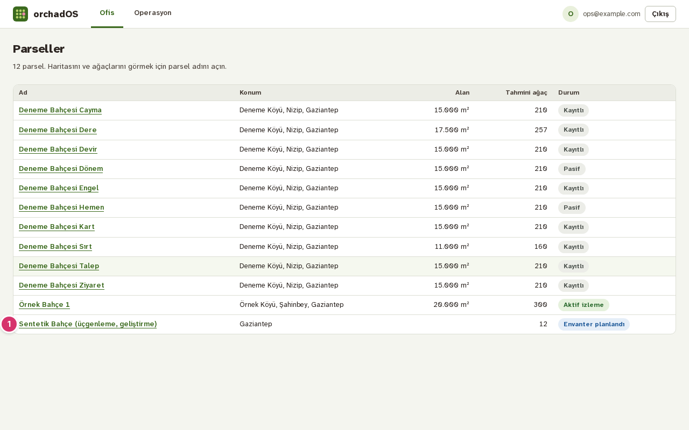

**Ekranın bölümleri:**
1. Parsel adı: tıklayınca parselin sayfası açılır. Tabloda konum, alan, sahibin tahmin ettiği ağaç sayısı ve parselin durumu ("Envanter planlandı", "Aktif izleme"…) görünür.

**Nasıl yapılır:**

### Envanteri yapılacak parseli bulmak
1. Üst menüden "Ofis"i açın (operasyon kullanıcısı girişte buraya gelir).
2. Durumu "Envanter planlandı" olan parseli bulun ve adına tıklayın.

**Düğmeler ve alanlar:**

| Düğme / alan | Ne yapar |
| --- | --- |
| Parsel adı (bağlantı) | Parsel sayfasını açar |
| "Ofis" / "Operasyon" (üst menü) | Bölümler arasında geçer |

## Parsel sayfası
`/ofis/parsel/<parsel>`

**Ne için:** Parselin haritasına bakmak ve ofis aracını ya da envanter düzenlemeyi açmak. **Kim kullanır:** saha personeli, operasyon.

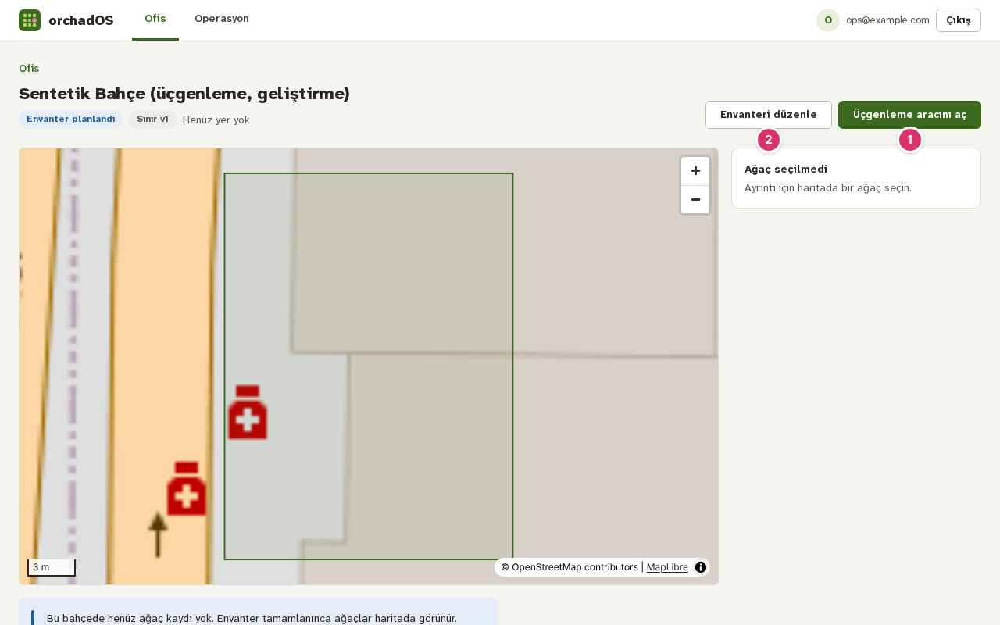

**Ekranın bölümleri:**
1. "Üçgenleme aracını aç": oturum ve panorama seti seçimine gider.
2. "Envanteri düzenle": kaydedilmiş envanterin özelliklerini, altyapısını, sınırını ve doğrulama turunu düzenler. Envanter kaydedilmeden önce burada iş yoktur (aşağıda "Envanter düzenleme: henüz envanter yok").

Haritada parsel sınırı ("Sınır v1") görünür; envanter yokken başlıkta "Henüz yer yok", haritanın altında "Bu bahçede henüz ağaç kaydı yok. Envanter tamamlanınca ağaçlar haritada görünür." yazar. Sağdaki "Ağaç seçilmedi" kartı, envanter kaydedildikten sonra haritada seçtiğiniz ağacın bilgisini gösterir.

**Düğmeler ve alanlar:**

| Düğme / alan | Ne yapar |
| --- | --- |
| "Üçgenleme aracını aç" | Üçgenleme aracını açar |
| "Envanteri düzenle" | Envanter düzenleme sayfasını açar |
| Harita "+" / "−" | Yakınlaştırır / uzaklaştırır |

## Envanter düzenleme: henüz envanter yok
`/ofis/parsel/<parsel>/envanter/duzenle`

**Ne için:** Envanter kaydedilmeden "Envanteri düzenle"ye basılırsa ne olacağını göstermek. **Kim kullanır:** saha personeli, operasyon.

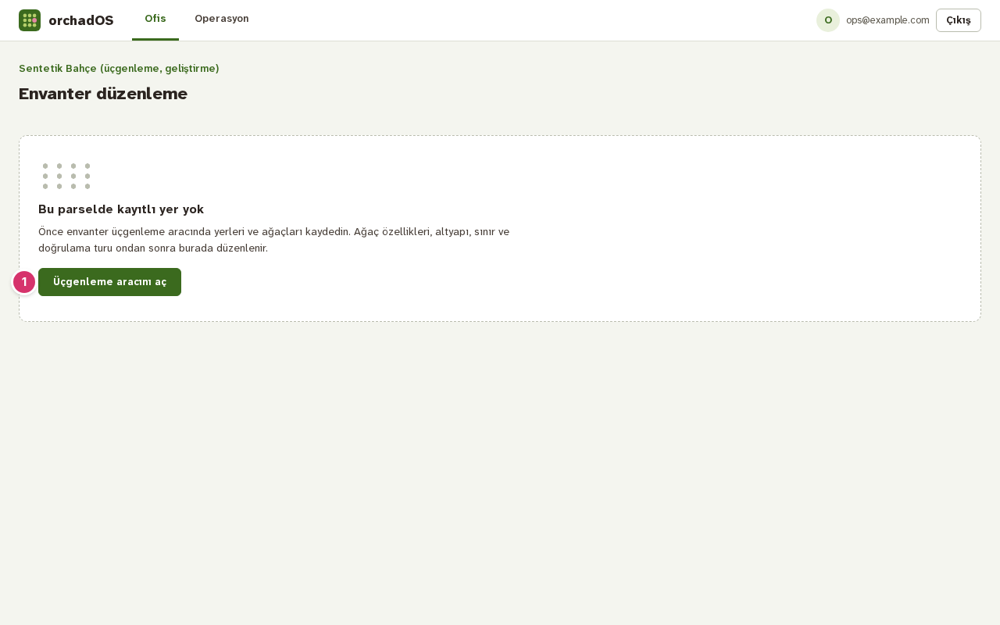

**Ekranın bölümleri:**
1. "Üçgenleme aracını aç": önce ağaçları üçgenleme aracında kaydetmeniz gerekir.

**Uyarılar ve ret mesajları:**

| Mesaj | Ne zaman çıkar | Ne yapmalı |
| --- | --- | --- |
| "Bu parselde kayıtlı yer yok" / "Önce envanter üçgenleme aracında yerleri ve ağaçları kaydedin. …" | Parselde henüz kaydedilmiş yer yok | Üçgenleme aracında envanteri çıkarıp kaydedin |

## Oturum ve panorama seti
`/ofis/parsel/<parsel>/envanter`

**Ne için:** Hangi ziyaretin panoramalarıyla çalışacağınızı seçmek. Ağaç konumları seçilen oturuma bağlanarak kaydedilir. **Kim kullanır:** saha personeli, operasyon.

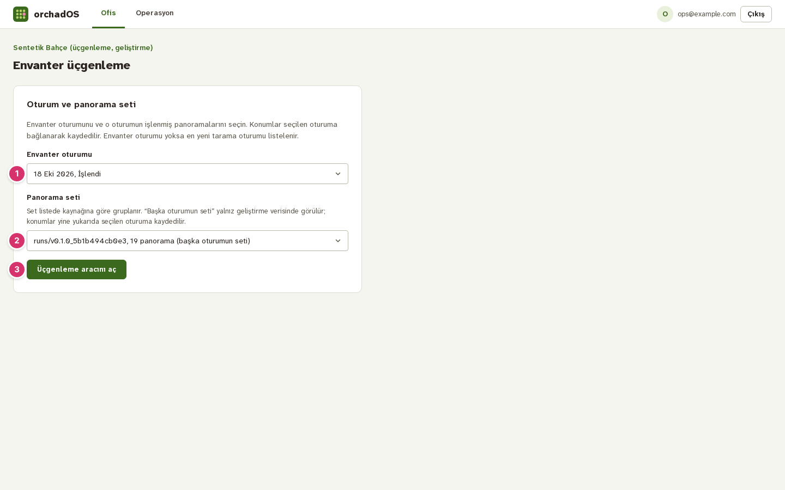

**Ekranın bölümleri:**
1. "Envanter oturumu": parselin envanter ziyaretleri, tarih ve durumuyla ("18 Eki 2026, İşlendi"). Envanter ziyareti yoksa en yeni tarama ziyareti "(tarama oturumu)" ekiyle listelenir.
2. "Panorama seti": işleme hattının ürettiği panoramalar ("…, 19 panorama"). Liste kaynağa göre gruplanır: "Depo" (sunucuya yüklenmiş) ve "Yerel klasör" (yalnız geliştirme). Normalde oturuma ait set kendiliğinden seçilidir.
3. "Üçgenleme aracını aç": aracı açar.

> Örnekteki set "(başka oturumun seti)" ekiyle görünüyor: geliştirme verisinde panoramalar başka bir oturum adıyla üretildi. Bu ek yalnız geliştirme verisinde görülür; konumlar yine yukarıda seçilen oturuma kaydedilir.

**Nasıl yapılır:**

### Aracı açmak
1. "Envanter oturumu"nda envanter ziyaretini seçin (durumu "İşlendi" olmalı: panoramalar işleme hattından geçmiş olur).
2. "Panorama seti"nde bu ziyaretin setini seçin.
3. "Üçgenleme aracını aç"a basın.

**Düğmeler ve alanlar:**

| Düğme / alan | Ne yapar |
| --- | --- |
| "Envanter oturumu" | Konumların bağlanacağı ziyaret |
| "Panorama seti" | Açılacak panoramalar |
| "Üçgenleme aracını aç" | Aracı açar (oturum ya da set yoksa basılamaz) |

**Uyarılar ve ret mesajları:**

| Mesaj | Ne zaman çıkar | Ne yapmalı |
| --- | --- | --- |
| "Bu parselde envanter ya da tarama oturumu yok. Operasyon önce bir envanter oturumu açmalı." | Parselde hiç ziyaret yok | Operasyon envanter ziyareti planlamalı (bkz. ziyaret planlama bölümü) |
| "Bu parsel için yüklenmiş panorama yok. İşleme hattı panoramaları yükleyince burada listelenir (orchados-pipeline upload)." | İşleme hattı bu parselin panoramalarını henüz yüklemedi | İşleme istasyonunda "run" ve "upload" adımlarının bittiğini kontrol edin |

---

## Üçgenleme aracı
`/ofis/parsel/<parsel>/envanter?oturum=…&set=…`

**Ne için:** Panoramalardan ağaç konumlarını işaretlemek, kodlamak, doğrulama listesini çıkarmak ve kaydetmek. **Kim kullanır:** saha personeli, operasyon.

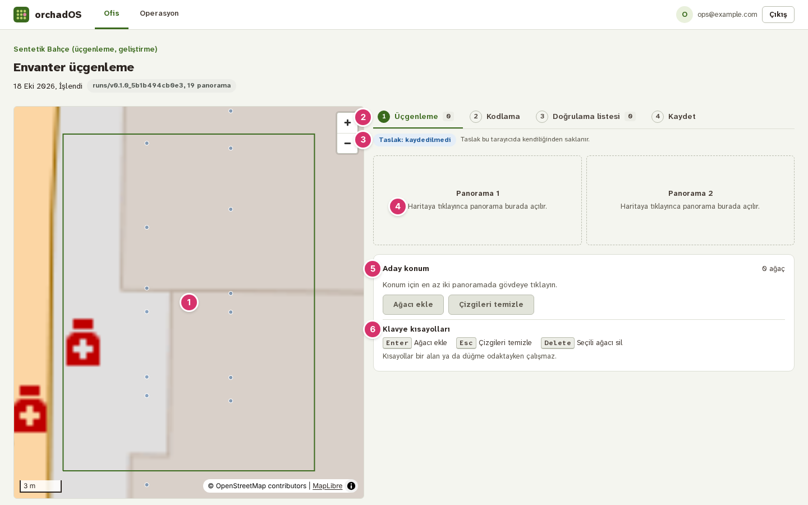

**Ekranın bölümleri:**
1. **Parsel haritası.** Yeşil çizgi parsel sınırı, mavi küçük noktalar panoramaların çekildiği yerler (tarama izi). Eklediğiniz ağaçlar yeşil daire olarak çıkar.
2. **Adımlar:** "Üçgenleme", "Kodlama", "Doğrulama listesi", "Kaydet". Sekmedeki küçük sayı: Üçgenleme'de eklenen ağaç sayısı, Doğrulama listesi'nde kontrol edilecek yer sayısı. Klavyeyle de gezilir (sekme odaktayken ← → Home End).
3. **Kayıt durumu:** "Taslak: kaydedilmedi" (yanında "Taslak bu tarayıcıda kendiliğinden saklanır."), kayıttan sonra "Veritabanına kaydedildi", envanteri zaten kayıtlı parselde "Kaydetme kapalı".
4. **İki panorama alanı** ("Panorama 1", "Panorama 2"): haritaya tıklayana kadar boştur ("Haritaya tıklayınca panorama burada açılır.").
5. **"Aday konum" kartı:** tıklamalarınızdan hesaplanan konum, belirsizliği ve kesişme açısı; sağ üstte eklenen ağaç sayısı ("0 ağaç").
6. **"Klavye kısayolları":** aşağıdaki tabloya bakın.

Haritanın altında hatırlatma yazar: "Haritada bir ağacın yakınına tıklayın: en yakın iki panorama açılır. Sonra her panoramada aynı ağacın gövdesine tıklayın."

### Klavye kısayolları

| Tuş | Ne yapar |
| --- | --- |
| Enter | "Ağacı ekle" (yalnız Üçgenleme sekmesinde, aday konum hazırken) |
| Esc | "Çizgileri temizle": o ana kadarki gövde tıklamalarını siler |
| Delete (ya da Backspace) | Seçili ağacı taslaktan siler ("Geri al" ile döner) |
| Panoramada sürükleme ya da ok tuşları | Panoramayı çevirir (önce panoramaya tıklayın ya da Tab ile odaklayın) |
| Panoramada + / − | Yakınlaştırır / uzaklaştırır; yakınlaşınca tam çözünürlüklü görüntü yüklenir |

"Kısayollar bir alan ya da düğme odaktayken çalışmaz." Bir düğmeye bastıktan sonra Enter çalışmıyorsa panoramaya ya da haritaya bir kez tıklayın.

### 1. adım: haritada ağacın yakınına tıklamak

Örnekte ilk ağaç S1-1 (güneybatı köşesindeki ağaç). Haritada onun olduğu yere tıkladık.

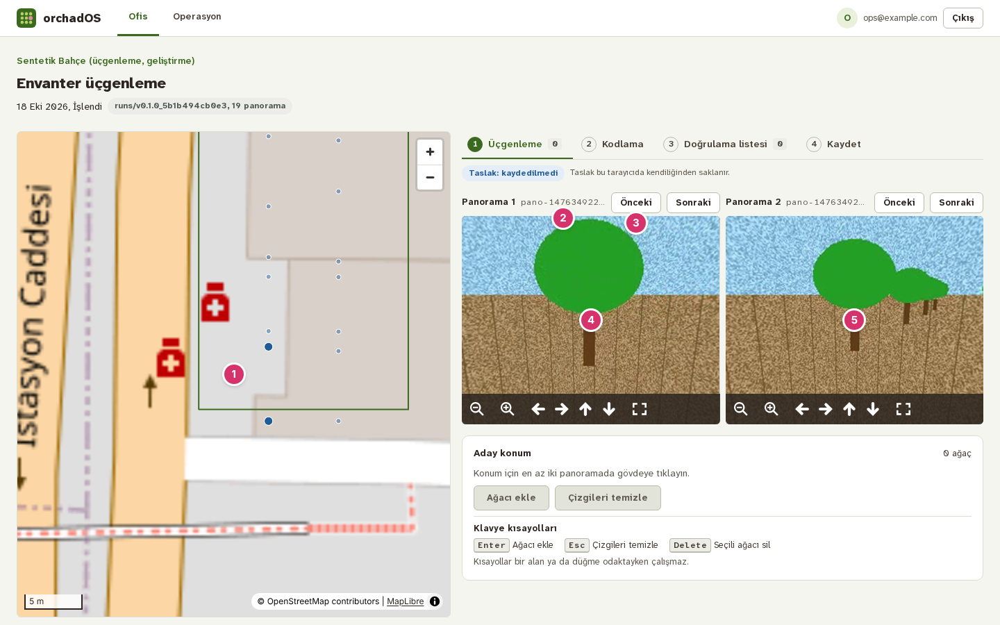

1. Haritada tıkladığınız yer. Açılan iki panoramanın noktaları koyu mavi ve büyük görünür.
2. Panoramanın kimliği (ör. "pano-1476349224174"); uzunsa kısaltılır, üstüne gelince tamamı görünür.
3. "Önceki" / "Sonraki": bu alanda tarama sırasına göre bir önceki ya da sonraki panoramayı açar. Ağaç görünmüyorsa ya da açı kötüyse başka panoramaya geçmek için kullanın.
4. Panorama 1, tıkladığınız yere dönük açılır.
5. Panorama 2, aynı yere başka bir noktadan bakar.

Yazılım tıkladığınız yere **en yakın panoramayı** ve ondan **en az 2 m uzaktaki en yakın ikinci panoramayı** açar (aynı noktadan iki bakış paralel çizgi verir). Panoramanın altındaki araç çubuğu: uzaklaştır, yakınlaştır, sola/sağa/yukarı/aşağı dön, tam ekran.

### 2. adım: birinci panoramada gövdeye tıklamak

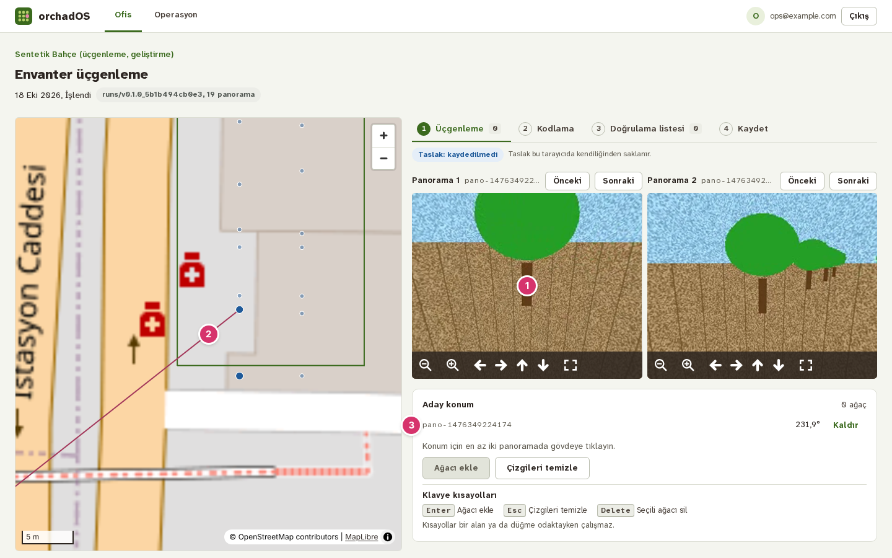

1. Gövdeye tıklayın: **gövdenin ortasına, yere yakın** (aşı yerinin altı). Dal ya da taç değil.
2. Haritada o panoramadan çıkan kırmızı yön çizgisi belirir.
3. "Aday konum" kartında tıklanan panorama ve yön açısı (ör. "231,9°") listelenir. Yanlış tıkladıysanız "Kaldır" ile yalnız bu çizgiyi silin ya da aynı panoramada yeniden tıklayın (yeni tıklama eskisinin yerine geçer).

Tek çizgiyle konum çıkmaz: "Konum için en az iki panoramada gövdeye tıklayın."

### 3. adım: ikinci panoramada aynı gövdeye tıklamak

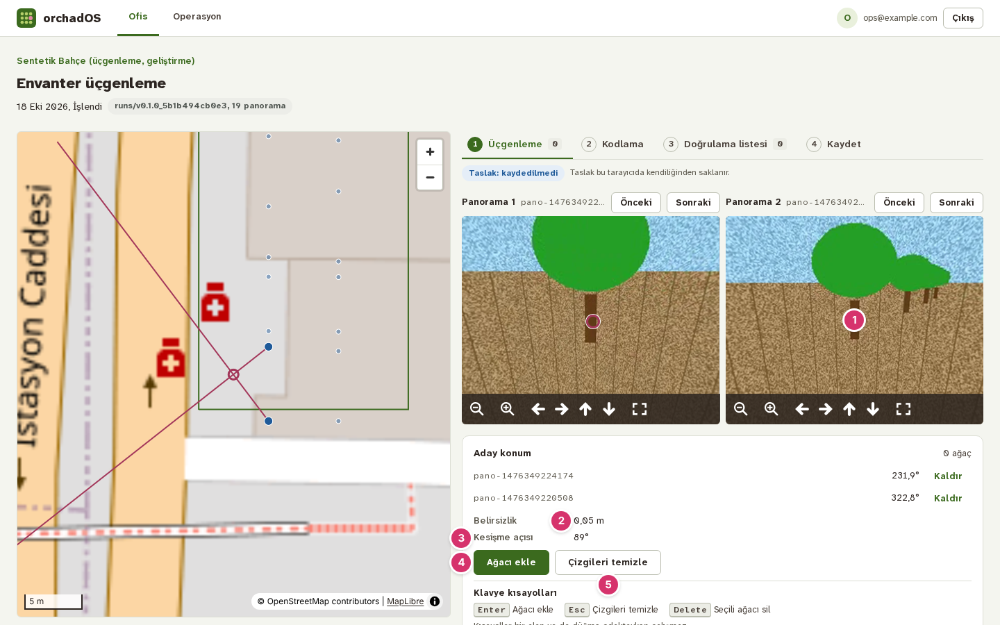

1. İkinci panoramada **aynı ağacın** gövdesine tıklayın. Haritada iki çizgi kesişir; kesişim yerinde halka (aday konum) çıkar.
2. "Belirsizlik": konumun ne kadar kayabileceği, metre (örnekte 0,05 m = 5 cm).
3. "Kesişme açısı": iki çizgi arasındaki açı (örnekte 89°, en iyisi 90°'ye yakın olanı).
4. "Ağacı ekle": ağacı taslağa ekler (Enter da aynı işi yapar).
5. "Çizgileri temizle": tıklamaları siler, baştan başlarsınız (Esc).

İsterseniz "Önceki"/"Sonraki" ile başka panoramaya geçip aynı gövdeye üçüncü, dördüncü kez de tıklayabilirsiniz: her panoramadan bir çizgi eklenir, konum daha sağlam olur ve yazılım çizgilerin birbiriyle uyuşup uyuşmadığını da denetler. Haritada başka bir yere tıklamak çizgileri temizler.

### Uyarılar: kötü bir panorama çifti

Uyarıyı göstermek için bilerek kötü bir çift seçtik: koridorun güney ucundaki iki panorama (aralarında 6,35 m) ile 22 m kuzeydeki S1-4'e baktık. İki çizgi neredeyse aynı doğrultuda gider.

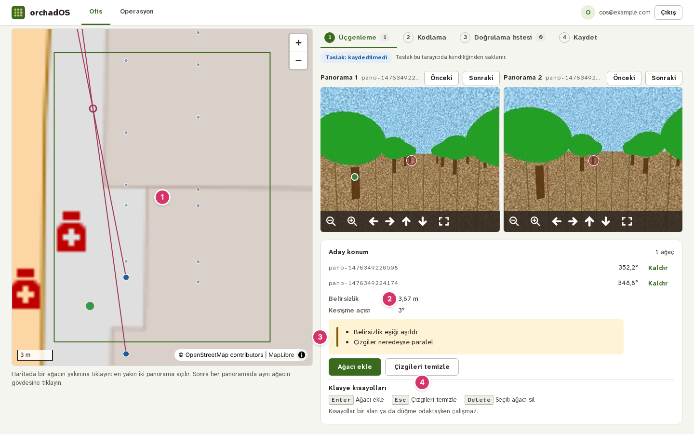

1. Haritada iki çizgi çok dar açıyla kesişiyor; halka (aday konum) gerçek ağacın birkaç metre uzağına düşebilir.
2. Belirsizlik 3,67 m, kesişme açısı 3°.
3. Uyarı kutusu: "Belirsizlik eşiği aşıldı" ve "Çizgiler neredeyse paralel".
4. Bu durumda "Çizgileri temizle"ye basıp daha iyi bir çift seçin. Örnekte bu konumu eklemedik.

"Ağacı ekle" uyarıya rağmen basılabilir. Uyarılı eklenen ağaç taslakta uyarısını taşır ve doğrulama listesine düşer. Elinizdeki en iyi çift buysa ekleyin, ama önce başka bir panorama deneyin.

#### Uyarıların anlamı ve eşikleri

| Uyarı | Eşik | Ne demek | Ne yapmalı |
| --- | --- | --- | --- |
| "Belirsizlik eşiği aşıldı" | Belirsizlik **0,50 m'den büyük** | Konum yarım metreden fazla kayabilir. Komşu yerle karışabilir. | Ağaca daha yakın panoramalar seçin; kesişme açısını büyütün; gövdeye yakınlaştırıp ortasından tıklayın; üçüncü bir panoramadan tıklayın. |
| "Çizgiler neredeyse paralel" | Çizgiler arasındaki en büyük açı **15°'den küçük** | İki panorama ağaca aşağı yukarı aynı yönden bakıyor; küçük bir tıklama hatası konumu metrelerce kaydırır. | Ağacın yan tarafındaki ya da karşı koridordaki bir panoramayı açın ("Önceki"/"Sonraki" ya da haritada ağacın öbür yanına tıklayın). |
| "Kesişim bir panoramanın arkasında" | Hesaplanan konum, panoramalardan en az birinde tıkladığınız yönün **arkasında** kalıyor | Çizgiler ağacın önünde değil, kameranın arkasında kesişiyor. Genellikle iki panoramada **farklı ağaçlara** tıklandı. | "Çizgileri temizle", her iki panoramada aynı ağacı bulup yeniden tıklayın. Komşu ağaçları ayırmak için harita üzerindeki çizgiye bakın. |
| "Çizgiler birbiriyle uyuşmuyor" | Yalnız **3 ya da daha fazla** panoramadan tıklandığında: bir çizgi bulunan konumdan, beklenen tıklama hatasının **3 katından** fazla uzak (beklenen hata: panorama konum hatası ile uzaklık × 0,5°; 10 m'de yaklaşık 9 cm, yani eşik yaklaşık 26 cm) | Panoramalardan birinde yanlış gövdeye ya da gövdenin kenarına tıklandı. | Ray listesinde o panoramanın yanındaki "Kaldır" ile şüpheli çizgiyi silin ya da o panoramada yeniden tıklayın. |

Ayrıca iki çizgi arasındaki açı **1°'den küçükse** konum hiç hesaplanmaz: "Çizgiler paralel; başka bir panoramadan tıklayın."

#### İyi bir panorama çifti için ipuçları

- **Açı:** Kesişme açısı 30° ile 90° arasında olsun; en iyisi 90°'ye yakın. 15°'nin altı uyarı verir.
- **Uzaklık:** Ağaca 3–10 m uzaktaki panoramaları seçin. Uzaklık arttıkça aynı tıklama hatası daha büyük konum hatası yapar (20 m'de 0,5° yaklaşık 17 cm).
- **İki yandan bakın:** Ağacın iki yanındaki koridorlardan ya da aynı koridorda ağacın önünden ve arkasından çekilmiş panoramalar iyi açı verir. Aynı koridorda, ağaca doğru dizilmiş iki panorama kötü açı verir (örnekteki uyarı).
- **Gövdenin ortası:** Taç değil gövde; gövdenin sağ ya da sol kenarı değil ortası. Gerekirse + ile yakınlaştırın: tam çözünürlüklü görüntü yüklenir.
- **Aynı ağaç mı:** Panoramalarda daha önce eklediğiniz ağaçlar 25 m'ye kadar yeşil işaretle gösterilir. Tıklayacağınız gövde işaretliyse o ağaç zaten eklenmiştir.
- **Kontrol:** Haritada halka ağacın beklenen yerine (sıranın üstüne) düşmeli. Düşmüyorsa tıklamayı yenileyin.

### Bütün ağaçlar eklendi

Örnekte S2-3 dışındaki 11 ağacı aynı yolla ekledik (her biri için haritada ağacın yanına tıkla, iki panoramada gövdeye tıkla, "Ağacı ekle").

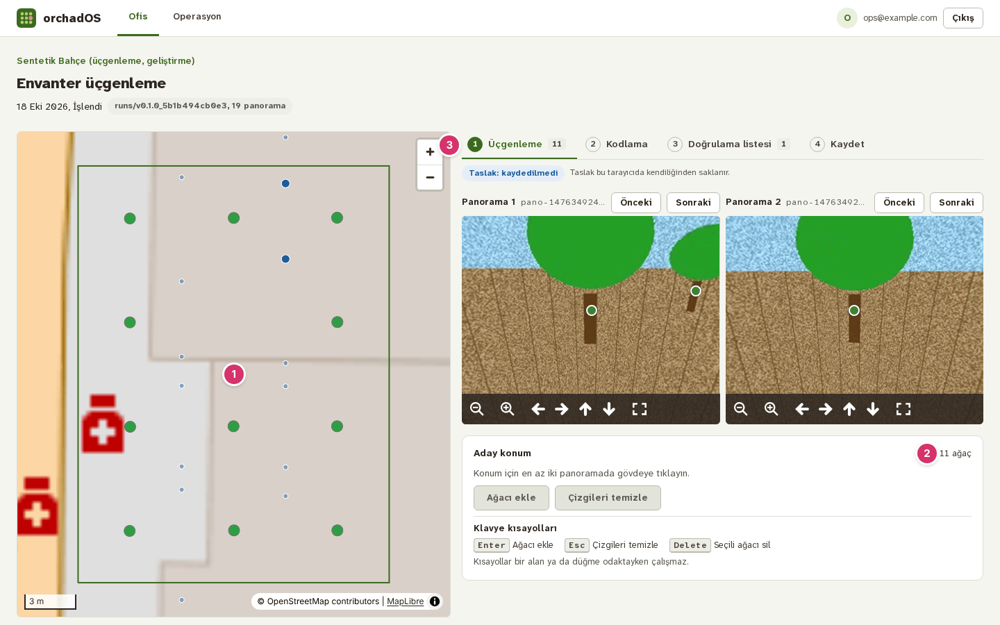

1. Haritada eklenen ağaçlar yeşil daire. S2-3'ün yeri (ortadaki sıranın üçüncüsü) boş.
2. "11 ağaç".
3. "Üçgenleme" sekmesindeki sayı (11). "Doğrulama listesi" sekmesinde 1 görünür: boş yer.

### Taslak: tarayıcıda saklanır

Bir parselin üçgenlemesi bir saati bulabilir. Yaptığınız her değişiklik bu bilgisayardaki tarayıcıya **taslak** olarak kendiliğinden yazılır (parsel ve oturum başına). Sayfayı yenilerseniz ya da kapatıp açarsanız taslak geri gelir.

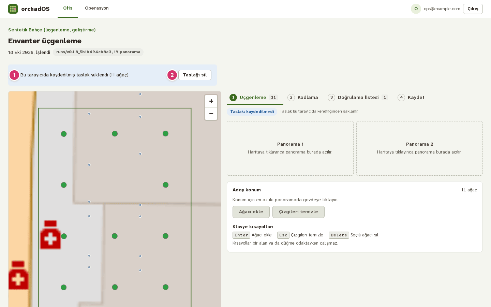

1. "Bu tarayıcıda kaydedilmiş taslak yüklendi (11 ağaç)."
2. "Taslağı sil": taslağı tamamen siler (onay ister).

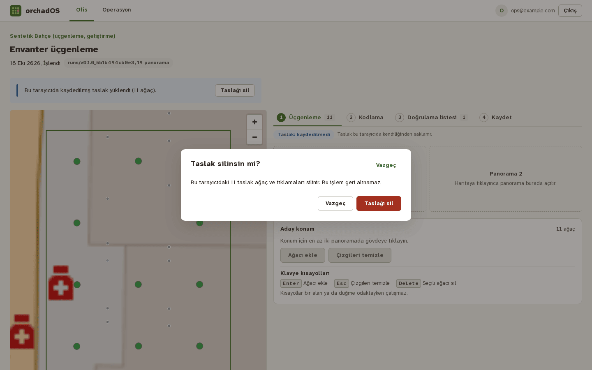

Onay penceresi: "Taslak silinsin mi?" — "Bu tarayıcıdaki 11 taslak ağaç ve tıklamaları silinir. Bu işlem geri alınamaz." "Vazgeç" pencereyi kapatır; kırmızı "Taslağı sil" siler.

Dikkat:
- Taslak **yalnız o bilgisayarda ve o tarayıcıdadır.** Başka bilgisayardan açan kişi görmez. İşi yarıda bırakıp başka bilgisayara geçmeyin.
- Tarayıcı verilerini (geçmiş, site verileri) silmek ya da gizli pencerede çalışmak taslağı kaybettirir. İş bitince mutlaka "Veritabanına kaydet".

---

## Kodlama sekmesi

**Ne için:** Sıraları oturtmak, her yere kod vermek, boş yerleri ve ara ağaçları bulmak. **Kim kullanır:** saha personeli, operasyon (numaralandırmayı ilk kez yazmak: yalnız operasyon).

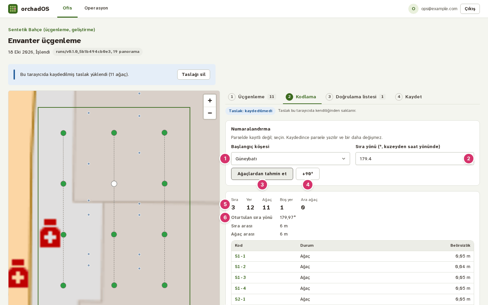

**Ekranın bölümleri:**
1. "Başlangıç köşesi": numaralandırmanın başladığı köşe ("Güneybatı", "Güneydoğu", "Kuzeybatı", "Kuzeydoğu"). 1. sıra ve her sıranın 1. yeri bu köşe tarafındadır.
2. "Sıra yönü (°, kuzeyden saat yönünde)": sıraların uzandığı yön. 0 kuzey, 90 doğu. 0 ile 180 (ya da 75 ile 255) aynı sıraları anlatır.
3. "Ağaçlardan tahmin et": sıra yönünü eklenen ağaçlardan hesaplar (en az 3 ağaç gerekir). Örnekte 179,4° buldu; sıralar kuzey-güney.
4. "+90°": yönü 90° çevirir. Kare dikimde iki yön de aynı iyi oturur; yazılım yanlış olanı seçtiyse buna basın (sıralar yanlış yönde sayılır, "Sıra" ile "Yer" sayıları beklenmedik olur).
5. Özet: "Sıra" 3, "Yer" 12, "Ağaç" 11, "Boş yer" 1, "Ara ağaç" 0.
6. "Oturtulan sıra yönü" (yazılımın verdiğiniz yönü ±3° içinde inceltmiş hali, 179,97°), "Sıra arası" 6 m, "Ağaç arası" 6 m.
7. Yer tablosu: "Kod", "Durum" ("Ağaç" ya da "Boş yer"), "Belirsizlik". Ağaçlı satırın koduna tıklamak o ağacı seçer.

Kodlama sekmesinde harita sıra çizgilerini (kesikli) ve boş yerleri (beyaz daire) gösterir.

**Kodlama kuralı (kısaca):**
- Kod **S<sıra>-<yer>**: S1-1, başlangıç köşesine en yakın ağaç.
- Yazılım ağaçların ortak aralığını bulur. Bir ağaç bir yer noktasına **ağaç aralığının dörtte biri** kadar yakınsa o yerin ağacıdır.
- İki yer noktasının arasında duran (hiçbirine dörtte bir aralık kadar yakın olmayan) ağaç **ara ağaç** olur ve önceki yerin kodu ile harf alır: S5-12a, S5-12b.
- Aynı yere ikinci bir ağaç düşerse ara ağaç olarak kodlanır ve doğrulama listesine "Çift gövde" nedeniyle girer.
- Sıra çizgisinden **sıra aralığının dörtte birinden** fazla uzak ağaç "Sıra dışında" nedeniyle doğrulama listesine girer.
- **Boş yer:** sırada ağacı olmayan yer noktası. Sıranın ilk ve son ağacı arasındaki her boşluk boş yerdir. Parselin sınırı varsa boş yerler sınıra kadar da uzanabilir (ama hiçbir sıranın ağacının bulunmadığı uca kadar değil).

**Nasıl yapılır:**

### Numaralandırmayı seçmek
1. "Başlangıç köşesi"ni seçin. Şirketin parselde kullandığı başlangıç köşesi bellidir (ör. bahçe girişine en yakın köşe); emin değilseniz operasyona sorun.
2. "Ağaçlardan tahmin et"e basın. Sıra yönü dolar.
3. Özete bakın: sıra sayısı ve yer sayısı bahçeyle uyuşuyor mu? Uyuşmuyorsa "+90°" deneyin.
4. Tabloda kodları kontrol edin: S1-1 doğru köşede mi?

Numaralandırma parsele kaydedildikten sonra **bir daha değişmez** (bütün raporlarda kodlar aynı kalsın diye). Kayıtlı bir parselde alanlar kapalıdır ve "Parsel kaydından; değiştirilemez." yazar.

**Düğmeler ve alanlar:**

| Düğme / alan | Ne yapar |
| --- | --- |
| "Başlangıç köşesi" | Numaralandırmanın başladığı köşe |
| "Sıra yönü (°, kuzeyden saat yönünde)" | Sıraların yönü; elle de yazılabilir |
| "Ağaçlardan tahmin et" | Yönü ağaçlardan hesaplar (en az 3 ağaç) |
| "+90°" | Yönü 90° çevirir |
| Özet ("Sıra", "Yer", "Ağaç", "Boş yer", "Ara ağaç") | Kodlamanın sonucu |
| Yer tablosunda kod | Ağaçlı yerde ağacı seçer |

**Uyarılar ve ret mesajları:**

| Mesaj | Ne zaman çıkar | Ne yapmalı |
| --- | --- | --- |
| "Kodlama için en az iki ağaç ve bir sıra aralığı gerekiyor." | Ağaç sayısı ikiden az ya da ağaç aralığı bulunamadı | Daha fazla ağaç ekleyin |
| "Parselde kayıtlı değil; seçin. Kaydedince parsele yazılır ve bir daha değişmez." | Parselin numaralandırması henüz yok | Köşe ve yönü dikkatle seçin |
| "Numaralandırmayı parsele sadece operasyon rolü yazabilir; bu parselde kaydetmeyi operasyon yapmalı." | Saha personeli, numaralandırması olmayan bir parselde | Üçgenlemeyi yapın; kaydı operasyona bırakın (taslak sizin tarayıcınızdadır, kaydı aynı bilgisayardan operasyon hesabıyla yapın) |

### Boş yer

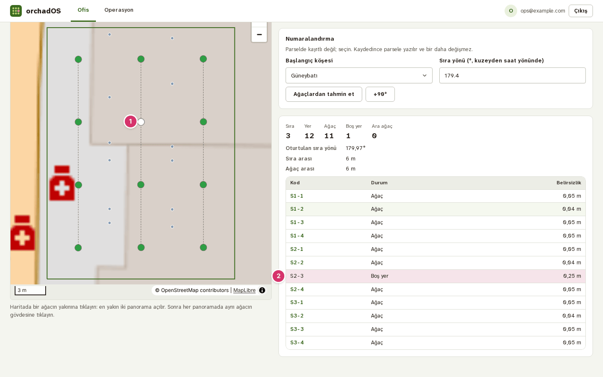

1. Haritada S2-3'ün yeri beyaz daire: sırada ağaç beklenen ama işaretlenmemiş yer.
2. Tabloda "S2-3 — Boş yer". Boş yerin belirsizliği ağaçların sıraya ne kadar iyi oturduğundan hesaplanır, en az 0,25 m.

Boş yer iki anlama gelebilir: orada gerçekten ağaç yok (kurumuş, sökülmüş) ya da ağaç var ama siz işaretlemediniz. Örnekte ikincisi: S2-3 ağacını bilerek atladık. Gerçek işte boş yer görünce önce panoramalarda o yere bakın; ağaç varsa ekleyin. Emin olamadıklarınız doğrulama listesinde kalır.

---

## Ağaç seçmek, "Emin değilim", silmek ve geri almak

**Ne için:** Eklenmiş bir ağacı işaretlemek, silmek ya da kaydırmak. Üçgenleme sekmesinde yapılır; örnekte kodlamadan sonra Üçgenleme sekmesine döndük, bu yüzden kartta ağacın kodu da görünüyor. **Kim kullanır:** saha personeli, operasyon.

Haritada bir ağaca tıklayınca seçilir ve "Seçili ağaç" kartı açılır. Örnekte S1-2'yi seçip "Emin değilim" işaretledik (gövde mi, dip sürgünü mü karar veremediğimiz bir ağaç gibi).

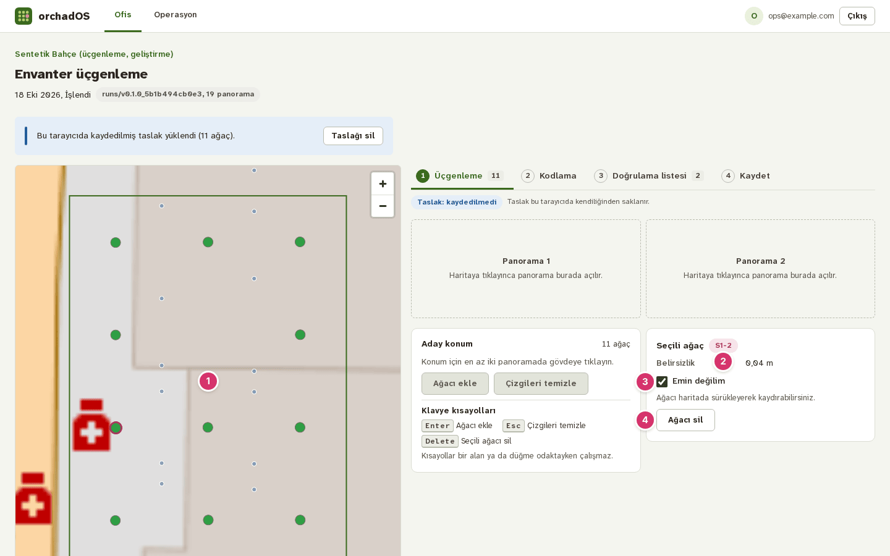

1. Seçili ağaç haritada kalın kırmızı halkayla görünür. Doğrulama listesindeki ağaçlar turuncu halkalıdır.
2. Ağacın kodu (kodlama yapıldıysa, ör. "S1-2") ve "Belirsizlik".
3. "Emin değilim": ağacı doğrulama listesine koyar; saha personeli doğrulama turunda bakar.
4. "Ağacı sil": ağacı taslaktan çıkarır.

Ağacı haritada sürükleyerek kaydırabilirsiniz ("Ağacı haritada sürükleyerek kaydırabilirsiniz."). Kaydırılan ağaçta "Elle kaydırıldı" etiketi çıkar. Kaydırmayı yalnız konum açıkça yanlışsa ve panoramadan düzeltemiyorsanız yapın.

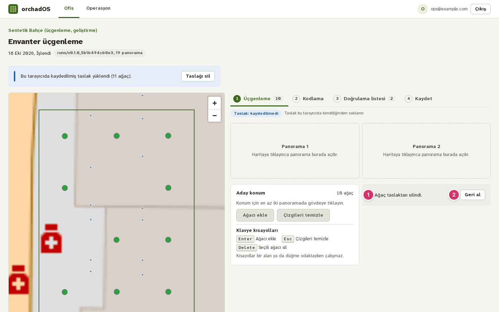

1. "Ağaç taslaktan silindi."
2. "Geri al": son silinen ağacı (işaretleriyle birlikte) geri getirir. Yalnız son silme geri alınır.

---

## Doğrulama listesi sekmesi

**Ne için:** Sahada bakılması gereken yerleri görmek ve CSV olarak indirmek. **Kim kullanır:** saha personeli, operasyon.

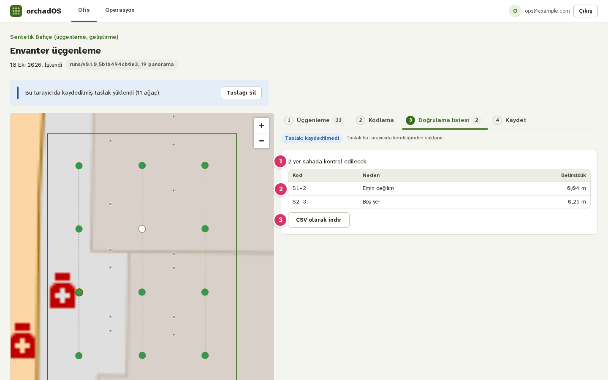

**Ekranın bölümleri:**
1. "2 yer sahada kontrol edilecek".
2. Tablo: "Kod", "Neden", "Belirsizlik". Örnekte S1-2 "Emin değilim", S2-3 "Boş yer".
3. "CSV olarak indir": listeyi `dogrulama-listesi.csv` olarak indirir.

**Listeye giren nedenler:**

| Neden | Ne zaman |
| --- | --- |
| "Emin değilim" | Ağacı "Emin değilim" işaretlediniz |
| "Belirsizlik yüksek" | Ağacın belirsizliği 0,50 m'den büyük |
| "Üçgenleme uyarısı" | Ağaç paralel çizgi, arkada kesişim ya da uyuşmayan çizgi uyarısıyla eklendi |
| "Boş yer" | Ağacı olmayan yer |
| "Sıra dışında" | Ağaç sıra çizgisinden sıra aralığının dörtte birinden fazla uzak |
| "Çift gövde" | Aynı yer noktasına iki ağaç düştü |

CSV dosyasının sütunları: `kod, neden, enlem, boylam, belirsizlik_m`. Excel Türkçe harfleri doğru açar. Örnekteki dosya:

```
kod,neden,enlem,boylam,belirsizlik_m
S1-2,Emin değilim,37.06008998,37.37996640,0.04
S2-3,Boş yer,37.06014415,37.38003379,0.25
```

Bu liste kaydetmeden önceki ön izlemedir. Asıl doğrulama turu, envanter kaydedildikten sonra "Envanteri düzenle" → "Doğrulama" sekmesinde oluşturulur (aşağıda).

**Düğmeler ve alanlar:**

| Düğme / alan | Ne yapar |
| --- | --- |
| "CSV olarak indir" | Listeyi CSV indirir (kodlama yapılamıyorsa basılamaz) |

**Uyarılar ve ret mesajları:**

| Mesaj | Ne zaman çıkar | Ne yapmalı |
| --- | --- | --- |
| "Doğrulama listesi boş." | Kontrol edilecek yer yok | İşlem gerekmez |

---

## Kaydet sekmesi

**Ne için:** Envanteri (yerler, ağaçlar, numaralandırma, gövde tıklamaları) veritabanına yazmak. **Kim kullanır:** saha personeli, operasyon.

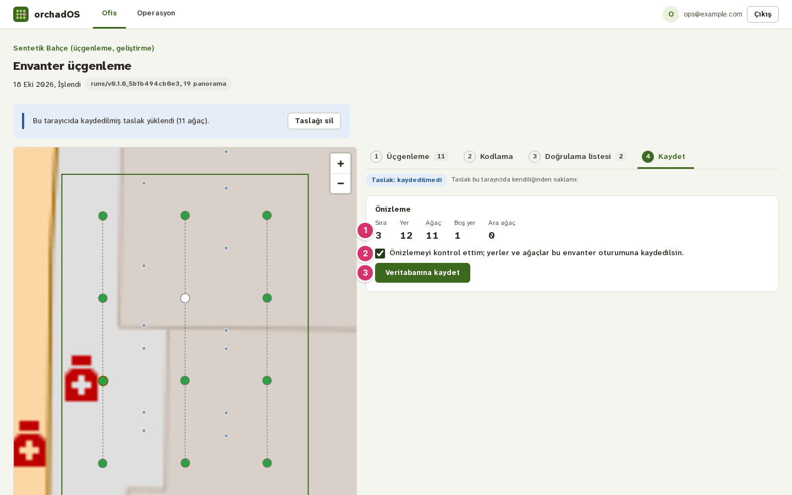

**Ekranın bölümleri:**
1. "Önizleme": kaydedilecek "Sıra", "Yer", "Ağaç", "Boş yer", "Ara ağaç".
2. Onay kutusu: "Önizlemeyi kontrol ettim; yerler ve ağaçlar bu envanter oturumuna kaydedilsin."
3. "Veritabanına kaydet": kutu işaretlenmeden basılamaz. Basınca "Kaydediliyor…" yazar.

**Nasıl yapılır:**

### Envanteri kaydetmek
1. Kodlama ve Doğrulama listesi sekmelerini kontrol edin.
2. "Kaydet" sekmesinde önizlemeyi okuyun.
3. Onay kutusunu işaretleyin, "Veritabanına kaydet"e basın.

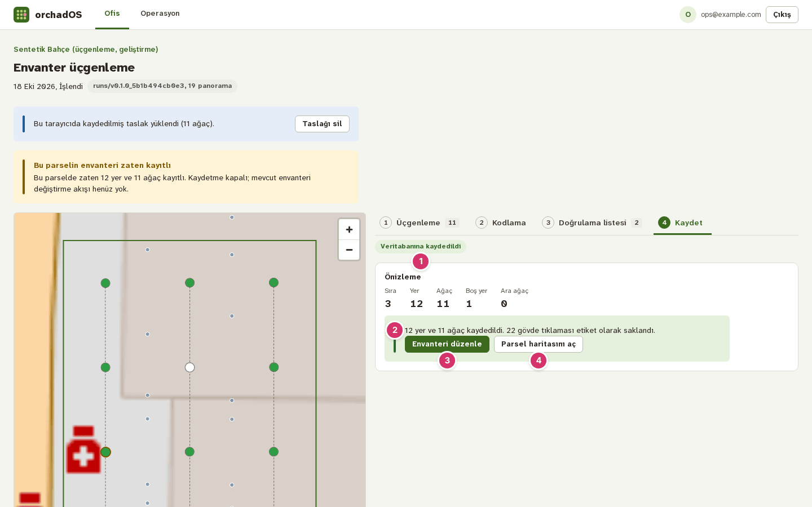

1. Durum "Veritabanına kaydedildi" olur.
2. "12 yer ve 11 ağaç kaydedildi. 22 gövde tıklaması etiket olarak saklandı." Gövde tıklamalarınız (ağaç başına iki) ileride gövdeleri otomatik bulacak yazılımı eğitmek için saklanır.
3. "Envanteri düzenle": düzenleme sayfasını Doğrulama sekmesinde açar.
4. "Parsel haritasını aç": parsel sayfasına döner.

Kayıtla birlikte taslak tarayıcıdan silinir ve sayfanın üstünde "Bu parselin envanteri zaten kayıtlı" uyarısı belirir (bir sonraki bölüm).

**Düğmeler ve alanlar:**

| Düğme / alan | Ne yapar |
| --- | --- |
| Onay kutusu | Kaydetmeyi açar |
| "Veritabanına kaydet" | Envanteri kaydeder |
| "Envanteri düzenle" | Kayıttan sonra düzenleme sayfası |
| "Parsel haritasını aç" | Parsel sayfası |

**Uyarılar ve ret mesajları:**

| Mesaj | Ne zaman çıkar | Ne yapmalı |
| --- | --- | --- |
| "Gönderilen veri geçersiz." | Taslakta bozuk veri | Sayfayı yenileyin; sürerse taslağı silip yeniden üçgenleyin |
| "Parsel bulunamadı ya da görme yetkiniz yok." | Parsel silinmiş ya da yetkiniz yok | Operasyona bildirin |
| "Envanteri sadece saha personeli ve operasyon kaydedebilir." | Başka rolde bir hesap | Doğru hesapla girin |
| "Envanter oturumu bu parsele ait değil." | Seçilen oturum başka parselin | Oturum seçimine dönüp doğru oturumu seçin |
| "Parselde zaten yer ve ağaç var; kaydetme engellendi." | Bu arada başka biri envanteri kaydetti | Mevcut envanteri "Envanteri düzenle"de kontrol edin |
| "Numaralandırma parsel kaydıyla uyuşmuyor; sayfayı yenileyin." | Bu arada parsele başka bir numaralandırma yazıldı | Sayfayı yenileyin, Kodlama'yı kontrol edin |
| "Numaralandırma parsele yazılamadı: bunu sadece operasyon rolü yapabilir." | Saha personeli, numaralandırması olmayan parselde kaydetmeye çalıştı | Kaydı operasyon yapsın |
| "Kodlama hesaplanamadı." | Sıralar oturtulamadı | Ağaç sayısını ve sıra yönünü kontrol edin |
| "Veritabanı kaydı reddetti (yetki ya da veri hatası)." | Sunucu kaydı kabul etmedi | Taslak yerinde durur; bir süre sonra tekrar deneyin, sürerse operasyona bildirin |

## Envanter zaten kayıtlı

**Ne için:** Envanteri kaydedilmiş bir parselde aracın neden kaydetmeye izin vermediğini göstermek. **Kim kullanır:** saha personeli, operasyon.

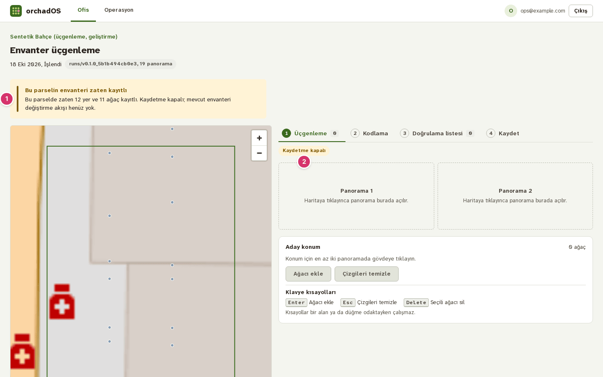

**Ekranın bölümleri:**
1. "Bu parselin envanteri zaten kayıtlı" — "Bu parselde zaten 12 yer ve 11 ağaç kayıtlı. Kaydetme kapalı; mevcut envanteri değiştirme akışı henüz yok."
2. Durum: "Kaydetme kapalı".

Araç açılır ama kayıtlı ağaçları göstermez ve kaydetmez. **Kaydedilmiş bir envanteri ofis aracıyla değiştirmenin yolu henüz yok.** Eksik ya da yanlış ağaçlar doğrulama turuyla düzeltilir ("Ağaç var" boş yere ağaç ekler, "Ağaç yok" ağacı kayıp yapar; aşağıda). Daha büyük bir hata varsa operasyona bildirin.

---

## Envanter düzenleme
`/ofis/parsel/<parsel>/envanter/duzenle`

**Ne için:** Kaydedilmiş envanterde ağaç özelliklerini, altyapıyı, saha sınırını ve doğrulama turunu girmek. "Ağaç özellikleri, altyapı, saha sınırı ve doğrulama turu. Haritaya tıklamanın ne yaptığı açık sekmeye göre değişir." **Kim kullanır:** saha personeli, operasyon.

Sayfada solda envanter haritası, sağda dört sekme vardır: "Ağaç özellikleri", "Altyapı", "Sınır", "Doğrulama". Haritanın altında lejant ("Ağaç", "Ara ağaç", "Boş yer", "Doğrulama / denetim"; panorama seti bulunursa "Tarama izi (panoramalar)") ve "Kodları göster" kutusu (yer kodlarını haritaya yazar) bulunur. Lejantın altındaki satır, açık sekmede haritaya tıklamanın ne yaptığını söyler. Sayfa adresine `?sekme=attributes`, `infrastructure`, `boundary` ya da `verification` eklemek o sekmeyi açar.

Envanter uzman tarafından onaylandıysa üstte "Envanter … tarihinde uzman tarafından onaylandı. Yer kodları ve konumları artık değişmez; ağaç özellikleri değiştirilebilir." yazar.

### Ağaç özellikleri

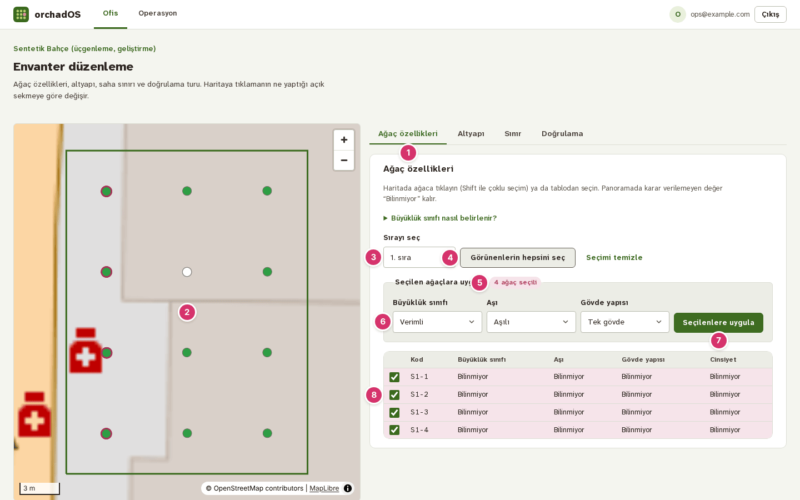

**Ekranın bölümleri:**
1. "Ağaç özellikleri" sekmesi.
2. Harita: ağaca tıklamak onu seçer; Shift ile tıklamak seçime ekler. Seçili ağaçlar kırmızı halkalı.
3. "Sırayı seç": tabloyu bir sıraya daraltır ("Bütün sıralar", "1. sıra"…).
4. "Görünenlerin hepsini seç" (yanında "Seçimi temizle").
5. "4 ağaç seçili".
6. "Büyüklük sınıfı", "Aşı", "Gövde yapısı" seçimleri. "Değiştirme" seçili kalan özellik olduğu gibi kalır.
7. "Seçilenlere uygula".
8. Tablo: "Kod", "Büyüklük sınıfı", "Aşı", "Gövde yapısı", "Cinsiyet" ve seçim kutuları.

Değerler: "Büyüklük sınıfı" = "Fidan", "Genç", "Verimli", "Yaşlı", "Bilinmiyor"; "Aşı" = "Aşılı", "Aşısız", "Bilinmiyor"; "Gövde yapısı" = "Tek gövde", "Çok gövdeli", "Bilinmiyor". Panoramada karar veremediğiniz değeri "Bilinmiyor" bırakın. "Cinsiyet" burada değiştirilmez; ilkbaharda çiçeklerden uzman belirler.

"Büyüklük sınıfı nasıl belirlenir?" açılır notu: "Panoramadan gövde kalınlığına (aşı yerinin yaklaşık 50 cm üstü) ve taç çapına bakılır. İkisi çelişirse taç çapı esas alınır."

**Nasıl yapılır:**

#### Bir sıranın ağaçlarına özellik vermek
1. "Sırayı seç"te sırayı seçin (örnekte "1. sıra").
2. "Görünenlerin hepsini seç"e basın (ya da tabloda kutuları, haritada ağaçları tek tek seçin).
3. Değiştirmek istediğiniz özellikleri seçin (örnekte "Verimli", "Aşılı", "Tek gövde").
4. "Seçilenlere uygula".

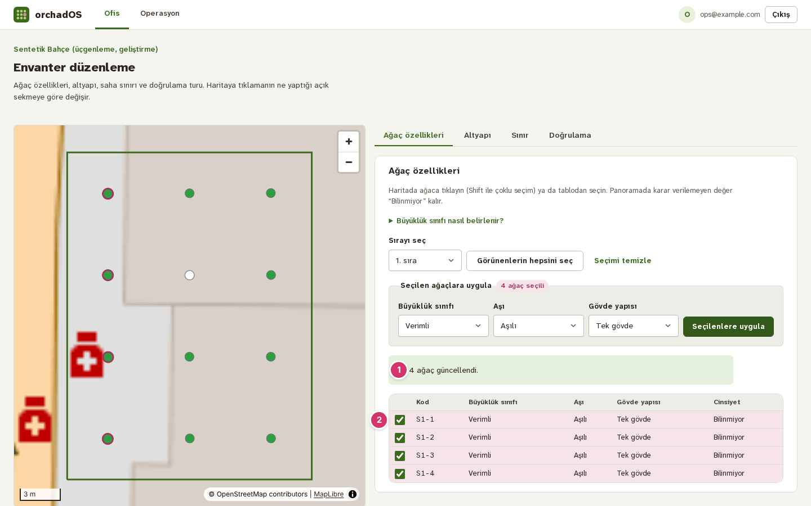

1. "4 ağaç güncellendi."
2. Tablo yeni değerleri gösterir.

### Altyapı

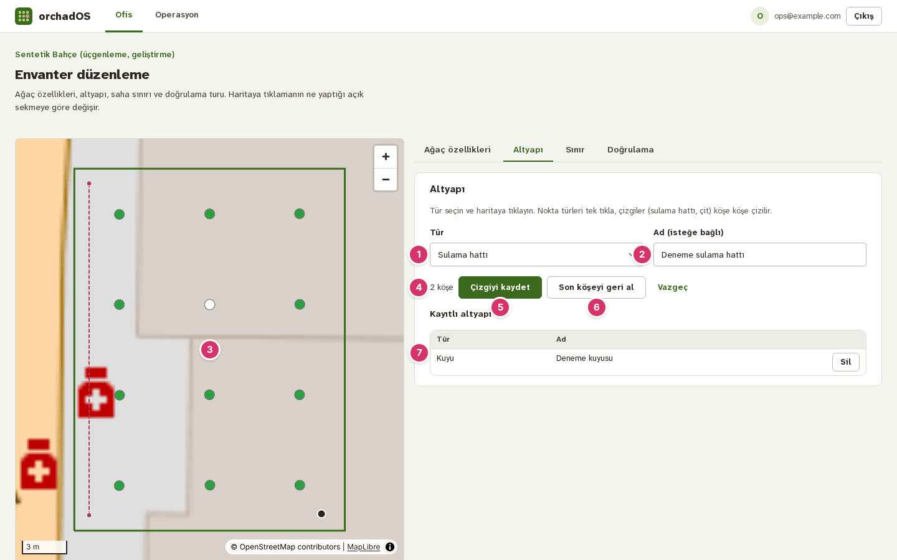

**Ekranın bölümleri:**
1. "Tür": "Kuyu", "Havuz", "Kapı", "Kulübe" (nokta, tek tıkla eklenir); "Sulama hattı", "Çit" (çizgi, köşe köşe çizilir).
2. "Ad (isteğe bağlı)".
3. Harita: tıklamak seçili türde altyapı ekler. Örnekte sağ altta siyah nokta "Deneme kuyusu"; solda kesikli çizgi çizilmekte olan sulama hattı.
4. Çizgi türlerinde köşe sayısı ("2 köşe").
5. "Çizgiyi kaydet" (en az 2 köşe).
6. "Son köşeyi geri al" (yanında "Vazgeç": çizimi bırakır).
7. "Kayıtlı altyapı" tablosu: "Tür", "Ad" ve operasyon için "Sil".

**Nasıl yapılır:**

#### Kuyu (nokta) eklemek
1. "Tür"de "Kuyu"yu seçin, isterseniz ad yazın ("Deneme kuyusu").
2. Haritada kuyunun yerine tıklayın. "Altyapı eklendi." çıkar.

#### Sulama hattı (çizgi) eklemek
1. "Tür"de "Sulama hattı"nı seçin, ad yazın.
2. Haritada hattın köşelerine sırayla tıklayın.
3. "Çizgiyi kaydet".

#### Altyapı silmek (yalnız operasyon)
1. Tabloda "Sil"e basın.
2. "Altyapı silinsin mi?" penceresinde "Sil". Silme geri alınamaz. Saha personeli "Altyapıyı yalnız operasyon rolü silebilir." notunu görür.

### Sınır

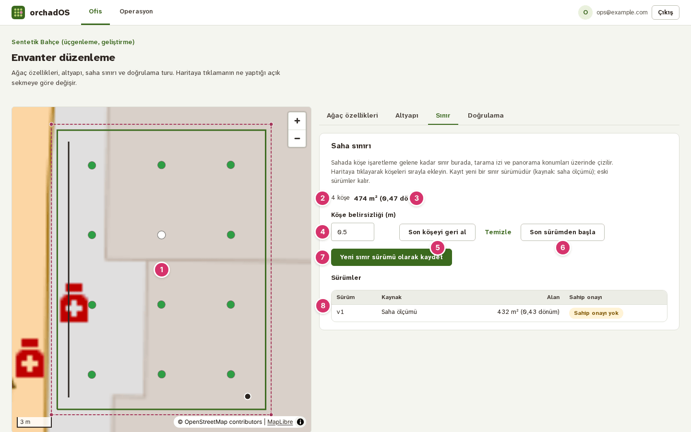

**Ekranın bölümleri:**
1. Harita: tıklamak sınıra sıradaki köşeyi ekler. Çizilen sınır kırmızı kesikli, kayıtlı sınır yeşil çizgi.
2. Köşe sayısı ("4 köşe").
3. Alan ("474 m² (0,47 dönüm)").
4. "Köşe belirsizliği (m)": köşelerin ne kadar doğru olduğu (varsayılan 0,5).
5. "Son köşeyi geri al" (yanında "Temizle": bütün köşeleri siler).
6. "Son sürümden başla": kayıtlı son sınırın köşelerini çizime alır; küçük düzeltmeler için.
7. "Yeni sınır sürümü olarak kaydet".
8. "Sürümler": "Sürüm", "Kaynak", "Alan", "Sahip onayı".

Sahada köşe işaretleme gelene kadar sınır burada, tarama izi ve panorama konumları üzerinde çizilir. Kayıt yeni bir sınır sürümüdür (kaynak: "Saha ölçümü"); eski sürümler silinmez.

**Nasıl yapılır:**

#### Yeni sınır sürümü kaydetmek
1. "Sınır" sekmesini açın.
2. Haritada köşelere sırayla tıklayın (saat yönünde ya da tersine, atlamadan). Ya da "Son sürümden başla" ile mevcut sınırı alıp düzeltin.
3. "Köşe belirsizliği"ni girin.
4. "Yeni sınır sürümü olarak kaydet".

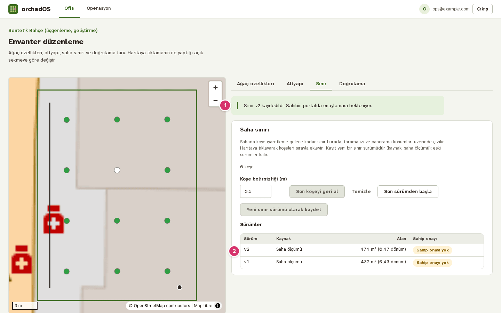

1. "Sınır v2 kaydedildi. Sahibin portalda onaylaması bekleniyor."
2. Sürümler tablosunda v2, "Sahip onayı yok". Sahip sınırı portalda onaylayınca tarih yazılır.

**Uyarılar ve ret mesajları:**

| Mesaj | Ne zaman çıkar | Ne yapmalı |
| --- | --- | --- |
| "Sınır en az üç köşe ister." | 3'ten az köşe | Köşe ekleyin |
| "Sınırın kenarları kesişiyor." | Köşeler sırasız tıklandı | "Son köşeyi geri al" ya da "Temizle", köşeleri sırayla tıklayın |
| "Sınır çok küçük." | Alan 1 m²'den küçük | Haritayı uzaklaştırıp yeniden çizin |

### Doğrulama turu

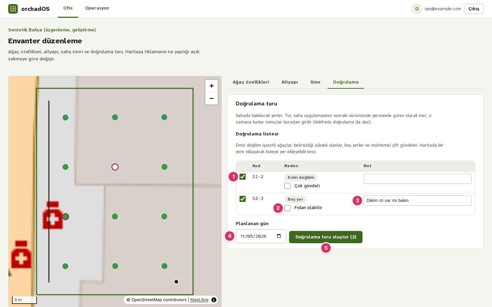

**Ekranın bölümleri:**
1. Satır kutusu: işaretli yerler tura girer. Liste kendiliğinden doldurulur: "Emin değilim" işaretli ağaçlar, belirsizliği 0,50 m'den yüksek olanlar, boş yerler ve muhtemel çift gövdeler (başka bir ağaca 1 m'den yakın ara ağaçlar, "Çok gövdeli").
2. Ek neden: ağaçlı yerde "Çok gövdeli", boş yerde "Fidan olabilir".
3. "Not": saha personeline not (örnekte S2-3 için "Dikim izi var mı bakın").
4. "Planlanan gün".
5. "Doğrulama turu oluştur (2)": parantezdeki sayı tura girecek yer sayısı.

Haritada bir yere tıklamak o yeri listeye ekler ya da çıkarır (elle eklenen yerin nedeni "Diğer"). Not: ofis aracındaki "Üçgenleme uyarısı" ve "Sıra dışında" nedenleri veritabanına yazılmaz; bu yerleri tura almak istiyorsanız haritadan elle ekleyin.

Tur, saha uygulamasının sonraki sürümünde personele görev olarak iner; **o zamana kadar sonuçlar bu sayfadan girilir** (telefonla doğrulama da olur).

**Nasıl yapılır:**

#### Tur oluşturmak
1. "Doğrulama" sekmesini açın; listeyi gözden geçirin, gerekmeyen satırın kutusunu kaldırın.
2. Gerekirse ek neden ve not girin.
3. "Planlanan gün"ü seçin.
4. "Doğrulama turu oluştur"a basın. "Doğrulama turu oluşturuldu: 2 kalem." çıkar.

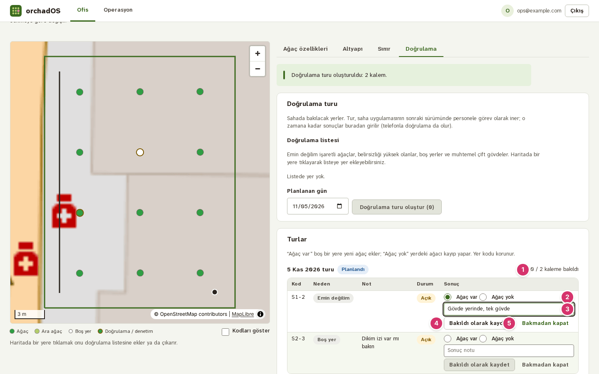

Oluşturulan tur aşağıda "Turlar" başlığı altında görünür ("5 Kas 2026 turu", durum "Planlandı"). Tura giren yerler listeden çıkar ("Listede yer yok.").

1. İlerleme: "0 / 2 kaleme bakıldı".
2. Sonuç: "Ağaç var" ya da "Ağaç yok".
3. "Sonuç notu".
4. "Bakıldı olarak kaydet": sonucu kaydeder, kalemin durumu "Bakıldı" olur.
5. "Bakmadan kapat": sahaya gitmeden kapatır; not (kapatma nedeni) zorunludur. Durum "Kapatıldı".

"“Ağaç var” boş bir yere yeni ağaç ekler; “Ağaç yok” yerdeki ağacı kayıp yapar. Yer kodu korunur." Uzman envanteri onaylayıp imzalamadan önce açık kalemlerin hepsi kapanmalıdır.

**Düğmeler ve alanlar (Envanter düzenleme):**

| Düğme / alan | Ne yapar |
| --- | --- |
| "Ağaç özellikleri" / "Altyapı" / "Sınır" / "Doğrulama" | Sekmeyi açar; haritaya tıklamanın işini değiştirir |
| "Kodları göster" | Yer kodlarını haritaya yazar |
| "Sırayı seç", "Görünenlerin hepsini seç", "Seçimi temizle" | Ağaç seçimi |
| "Büyüklük sınıfı", "Aşı", "Gövde yapısı" | Uygulanacak değerler ("Değiştirme" dokunmaz) |
| "Seçilenlere uygula" | Seçili ağaçlara yazar |
| "Tür", "Ad (isteğe bağlı)" | Eklenecek altyapı |
| "Çizgiyi kaydet", "Son köşeyi geri al", "Vazgeç" | Çizgi altyapı çizimi |
| "Sil" | Altyapıyı siler (yalnız operasyon, onay ister) |
| "Köşe belirsizliği (m)" | Yeni sınırın köşe doğruluğu |
| "Son köşeyi geri al", "Temizle", "Son sürümden başla" | Sınır çizimi |
| "Yeni sınır sürümü olarak kaydet" | Sınırın yeni sürümünü kaydeder |
| Satır kutusu, "Çok gövdeli" / "Fidan olabilir", "Not" | Tur kalemleri |
| "Planlanan gün", "Doğrulama turu oluştur" | Turu oluşturur |
| "Ağaç var" / "Ağaç yok", "Sonuç notu", "Bakıldı olarak kaydet" | Kalemin sonucunu kaydeder |
| "Bakmadan kapat" | Kalemi gerekçeyle kapatır |

**Uyarılar ve ret mesajları (Envanter düzenleme):**

| Mesaj | Ne zaman çıkar | Ne yapmalı |
| --- | --- | --- |
| "Girdi geçersiz." | Eksik ya da hatalı alan | Alanları kontrol edin |
| "Kayıt bulunamadı ya da görme yetkiniz yok." | Kayıt silinmiş ya da yetkiniz yok | Sayfayı yenileyin; sürerse operasyona bildirin |
| "Bu işlem için yetkiniz yok." | Rolünüz bu işi yapamaz (ör. altyapı silme) | Operasyona bırakın |
| "Envanter onaylandı: yer kodları ve konumları değiştirilemez." | Onaylı envanterde yer ya da konum değiştirmeye çalıştınız | Yalnız ağaç özellikleri değiştirilebilir |
| "Bu kalem kapatılmış." | Kapatılmış kaleme sonuç girmeye çalıştınız | Gerekirse yeni tur oluşturun |
| "Bu kaleme zaten bakılmış ya da kapatılmış." | Kalem zaten işlenmiş | Sayfayı yenileyin |
| "Kaydedilemedi." | Sunucu kaydı kabul etmedi | Tekrar deneyin; sürerse operasyona bildirin |
| "Bu parselde aktif ağaç yok." | Ağaç özellikleri sekmesinde hiç ağaç yok | Önce envanter kaydedilmeli |
| "Listede yer yok." | Doğrulama listesi boş (hepsi tura alındı ya da neden yok) | Gerekirse haritadan yer ekleyin |

---

## Sık karşılaşılan durumlar

| Durum | Ne yapmalı |
| --- | --- |
| Panoramada "Panorama görüntüsü açılamadı." | "Sonraki"/"Önceki" ile başka panoramaya geçin; sürerse işleme hattının yüklemesini kontrol ettirin |
| "Bu tarayıcı 360° görüntüyü gösteremiyor (WebGL kapalı ya da desteklenmiyor). …" | Güncel Chrome ya da Firefox kullanın, donanım hızlandırmayı açın |
| "Altlık harita yüklenemedi (bağlantı ya da harita sunucusu). Sınır ve ağaçlar yine de gösteriliyor." | Harita altlığı (sokak/uydu katmanı) gelmedi; sınır, panoramalar ve ağaçlar yine çizilir, iş sürdürülebilir. Sürerse internet bağlantısını kontrol edin, operasyona bildirin |
| Haritaya tıklayınca açılan panoramalarda ağaç görünmüyor | Panoramayı sürükleyerek çevirin; ağaç arkada kalmış olabilir. Ya da "Sonraki"/"Önceki" |
| Aynı ağacı iki kez eklediniz | Haritada fazlasını seçip "Ağacı sil" (Delete) |
| Kodlamada sıra sayısı beklenenden çok | "+90°" deneyin; sıra dışında kalmış ağaçları kontrol edin |
| Envanter kaydedildi ama bir ağaç eksik | Doğrulama turunda boş yer için "Ağaç var" girin |

Teknik not: taslak tarayıcının yerel depolamasında `orchados:office:<parsel>:<oturum>` anahtarıyla tutulur.

← [05 · Ziyaret planlama](05-ziyaret-planlama.md) · [07 · Saha uygulaması](07-saha-uygulamasi.md) →

[← Kılavuz dizini](README.md)
