# 07 · Saha uygulaması

[← Kılavuz dizini](README.md)

Saha uygulaması, saha personelinin Android telefonda kullandığı "orchadOS Saha" uygulamasıdır. Bir ziyaret telefonda hep aynı sırayla yürür: görevi açın, ön kontrolü bitirin, kaydı başlatın, başlangıç QR'ını kameraya gösterin, tarayın (envanterde önce sınırı yürüyün), bitiş QR'ını gösterip kaydı durdurun, yakın planları çekin, ziyaret özetini doldurup ziyareti bitirin. Doğrulama turu ve "Ziyaret yapılamadı" kaydı bu sıranın dışındadır; ayrı başlıklarda anlatılır. Uygulama bahçede internetsiz çalışır. Her kayıt önce telefona yazılır, internet olunca kendiliğinden gönderilir. Bu bölüm her ekranı sırayla anlatır; kısa özet için bkz. [personel kılavuzu](../personel-kilavuzu.md#saha-personeli).

**Sahada uyulacak üç kural**

- **Fotoğraflar yalnız uygulamanın içinden çekilir.** Uygulamada galeriden fotoğraf seçme yolu yoktur. Telefonun kendi kamerasıyla çekilen fotoğraf sisteme girmez.
- **Notlara telefon numarası ve başka kişilerin adını yazmayın.** Kişiyi rolüyle anın (bekçi, komşu). Uygulama telefon numarasına benzeyen metni kaydetmez ("Telefon numarası yazmayın"). Tarih ve saat (ör. `28.10.2026 09:30`) yazılabilir.
- **Kartları elden getirin.** Kameranın hafıza kartı ve kaydedicinin SD kartı ofise elden gelir. Ham video telefondan gönderilmez.

Görüntülerdeki bahçeler, köyler, kişiler ve numaralar sentetiktir (deneme verisi). Görüntüler telefon boyutundadır; uzun ekranlar tek parça ya da kaydırılarak iki parça gösterilir.

## İçindekiler

1. [Giriş](#giriş)
2. [Bugünkü görevler](#bugünkü-görevler) ve [gönderim kartı](#gönderim-kartı-ve-gönderilemeyen-kayıtlar)
3. [Ziyaret yapılamadı](#ziyaret-yapılamadı)
4. [Ön kontrol](#ön-kontrol)
5. [Tarama ekranı: kaydediciyi hazırlamak](#tarama-ekranı-kayıttan-önce)
6. [QR saat](#qr-saat)
7. [Tarama ekranı: rota, kapsama ve adımlar](#tarama-ekranı-kayıt-sürerken)
8. [Sorun gördüm](#sorun-gördüm) ve [Bir kişi itiraz etti](#bir-kişi-itiraz-etti)
9. [Sınır ve köşeler (envanter)](#sınır-envanter) ve [Sınırı gösteren kişi](#sınırı-gösteren-kişi)
10. [Kayıt durdu](#kayıt-durdu)
11. [Yakın plan görevi](#yakın-plan-görevi), [ağaç formu](#ağaç-formu) ve [çekim ekranı](#çekim-ekranı-ve-fotoğraf-kalite-kontrolü)
12. [Ziyaret özeti](#ziyaret-özeti), [ziyaret kaydı](#ziyaret-kaydı) ve [sözlü bilgi sorusu](#sözlü-bilgi-sorusu-ve-ziyareti-bitirmek)
13. [Doğrulama turu](#doğrulama-turu) ve [kalem ekranı](#doğrulama-kalemi)
14. [İnternetsiz çalışma ve gönderim](#i̇nternetsiz-çalışma-ve-gönderim)

## Giriş

Uygulama açılışı (giriş yapılmamışsa)

**Ne için:** Uygulamaya kendi hesabınızla girmek için.
**Kim kullanır:** Saha personeli.

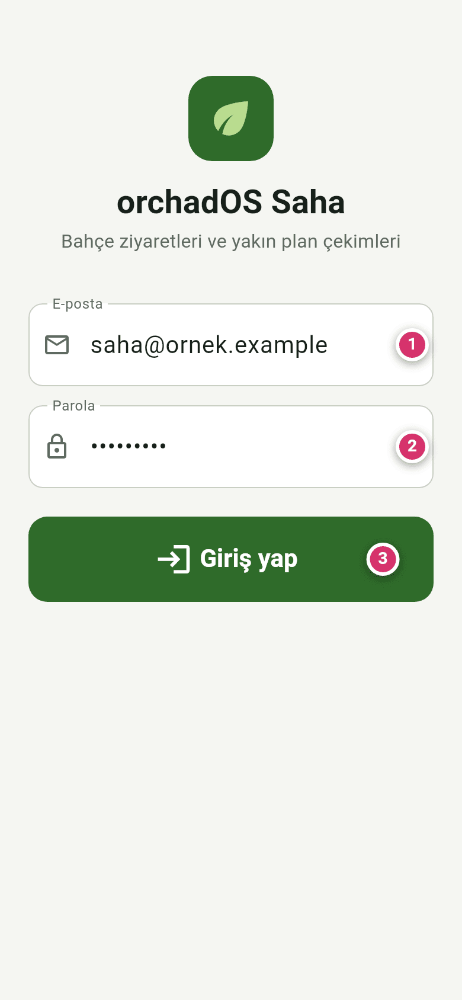

**Ekranın bölümleri**

1. "E-posta" alanı.
2. "Parola" alanı.
3. "Giriş yap" düğmesi.

**Nasıl yapılır**

### Uygulamaya girmek

1. Uygulamayı açın. Operasyonun verdiği e-postayı ve parolayı yazın.
2. "Giriş yap"a dokunun. "Bugünkü görevler" açılır.
3. İlk giriş internet ister. Giriş yaptıktan sonra uygulama kapatılıp açılsa da oturum açık kalır; bahçede internet gerekmez.

### Çıkmak

"Bugünkü görevler" ekranında sağ üstteki çıkış simgesine ("Çıkış") dokunun. Telefonda başka biri giriş yaparsa sizin görev listenizi görmez.

**Düğmeler ve alanlar**

| Düğme / alan | Ne yapar |
| --- | --- |
| "E-posta" | Hesabınızın e-posta adresi. |
| "Parola" | Parolanız. Klavyede "Tamam" da giriş yapar. |
| "Giriş yap" | Girişi dener; olmazsa düğmenin üstünde kırmızı bir mesaj çıkar. |

**Uyarılar ve ret mesajları**

| Mesaj | Ne zaman çıkar | Ne yapmalı |
| --- | --- | --- |
| "E-posta ya da parola hatalı" | Adres ya da parola yanlış. | Yazımı kontrol edin; olmazsa operasyondan parolanızı isteyin. |
| "Sunucuya ulaşılamadı" | İlk girişte internet yok. | İnternete bağlanıp tekrar deneyin. |
| "Giriş yapılamadı" | Sunucu girişi kabul etmedi. | Operasyona haber verin. |

Not: Ekranın altında "Geliştirme modu: …" yazıyorsa telefondaki uygulama deneme sürümüdür; sahada kullanmayın, operasyona haber verin.

## Bugünkü görevler

Uygulamanın ana ekranı

**Ne için:** Size ve ekibinize planlanan ziyaretleri görmek, birini başlatmak ve gönderim durumunu izlemek için.
**Kim kullanır:** Saha personeli.

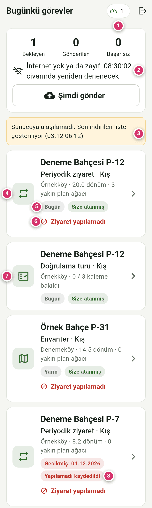

**Ekranın bölümleri**

1. Bulut simgeli sayı: telefonda gönderilmeyi bekleyen kayıt sayısı.
2. Gönderim kartı: bekleyen, gönderilen, başarısız kayıt sayısı, gönderimin durumu ve "Şimdi gönder" (aşağıda, [gönderim kartı](#gönderim-kartı-ve-gönderilemeyen-kayıtlar)).
3. Sarı not: sunucuya ulaşılamadı, son indirilen liste gösteriliyor (parantezde indirildiği gün ve saat).
4. Görev kartı: parsel adı, ziyaret türü ve mevsim, köy, alan (dönüm), yakın plan ağaç sayısı. Karta dokununca ziyaret açılır.
5. Gün etiketleri: "Bugün", "Yarın", "Gecikmiş: 01.12.2026" ya da "Planlanan gün: …"; ziyaret lideri sizseniz "Size atanmış".
6. "Ziyaret yapılamadı" düğmesi (aşağıda, [Ziyaret yapılamadı](#ziyaret-yapılamadı)).
7. Doğrulama turu kartı: kaç kaleme bakıldığını gösterir ("0 / 3 kaleme bakıldı").
8. "Yapılamadı kaydedildi": bu ziyaret için bu telefonda yapılamadı kaydı var. Ziyaret yine de taranabilir.

Liste, bugünden en çok 7 gün sonrasına kadar planlanmış ziyaretleri ve tarihi geçmiş ama hâlâ planlı olanları gösterir. Ziyaret lideri sizseniz ziyaret üstte görünür. Üç tür görev vardır: "Envanter" (harita simgesi), "Periyodik ziyaret" (döngü simgesi) ve "Doğrulama turu" (liste simgesi). Mevsim ("Kış", "İlkbahar", "Yaz", "Hasat") ziyaretin planlandığı aydan gelir.

**Nasıl yapılır**

### Bir ziyareti başlatmak

1. Kartın üstüne dokunun.
2. Envanter ve periyodik ziyaret [ön kontrol](#ön-kontrol) ile açılır. Doğrulama turu ön kontrolsüz, doğrudan [tur ekranı](#doğrulama-turu) ile açılır.

### Listeyi yenilemek

Listeyi parmağınızla aşağı çekin. İnternet varsa liste sunucudan yeniden iner. İnternet yoksa son indirilen liste kalır ve sarı not çıkar; bu normaldir, çalışmaya devam edin.

### Biten ziyaretler

Bu telefonda kaydı yapılmış ziyaretin kartında yeşil onay ve "Tamamlandı" görünür; karta yeniden dokunulamaz. Doğrulama turu, bütün kalemlerine bakılınca "Tamamlandı" olur; o zamana kadar yeniden açılabilir.

**Düğmeler ve alanlar**

| Düğme / alan | Ne yapar |
| --- | --- |
| Bulut simgeli sayı | Bekleyen kayıt sayısı; dokunulmaz, bilgi içindir. |
| Çıkış simgesi ("Çıkış") | Hesaptan çıkar, giriş ekranına döner. |
| Görev kartı | Ziyareti açar (ön kontrol ya da doğrulama turu). |
| "Ziyaret yapılamadı" | Bahçeye girilemediğini kaydetme ekranını açar. Yalnız planlanmış envanter ve periyodik ziyarette görünür, doğrulama turunda yoktur. |
| "Şimdi gönder" | Bekleyen kayıtları hemen göndermeyi dener. |

**Uyarılar ve ret mesajları**

| Mesaj | Ne zaman çıkar | Ne yapmalı |
| --- | --- | --- |
| "Sunucuya ulaşılamadı. Son indirilen liste gösteriliyor (…)." | İnternet yok ya da zayıf (20 saniyede yanıt gelmedi). | Sorun değil. Listeyle çalışın; internet olunca listeyi aşağı çekip yenileyin. |
| "Bugün görev yok" | Size planlanmış ziyaret yok. | İnternetteyseniz listeyi yenileyin; hâlâ yoksa operasyona sorun (ziyaret size atandı mı, tarih doğru mu?). |
| "Görevler yüklenemedi: …" | Liste ne sunucudan ne telefondan okunabildi. | İnternete bağlanıp listeyi yenileyin; sürerse ekranın fotoğrafını çekip operasyona gönderin. |
| "Kaydedildi. İnternet olunca gönderilecek." | "Ziyaret yapılamadı" kaydedildikten sonra. | Bilgi. Operasyonu telefonla da haberdar edin. |

### Gönderim kartı ve gönderilemeyen kayıtlar

Gönderim kartı "Bugünkü görevler"in, ziyaret özetinin ve doğrulama turunun içinde aynı biçimde görünür. Görevler ekranında bütün kayıtları, ziyaret özetinde ve turda yalnız o ziyaretin kayıtlarını sayar.

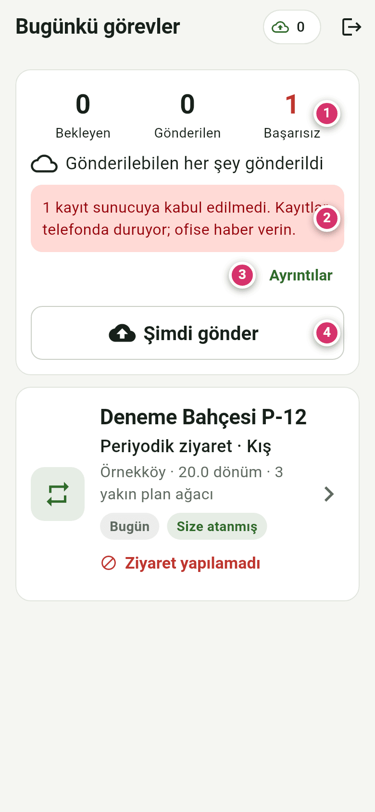

**Ekranın bölümleri**

1. "Bekleyen", "Gönderilen", "Başarısız" sayıları. Başarısız sayısı sıfırdan büyükse kırmızıdır.
2. Kırmızı uyarı: kaç kaydın sunucuya kabul edilmediği.
3. "Ayrıntılar": kabul edilmeyen kayıtların listesini açar.
4. "Şimdi gönder".

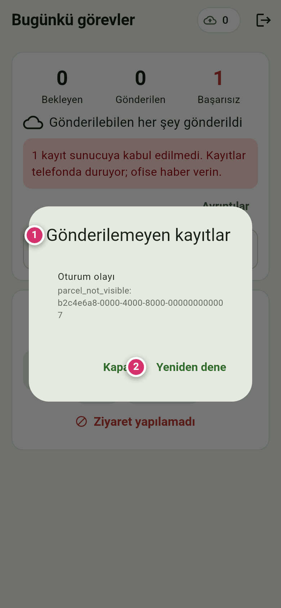

1. "Gönderilemeyen kayıtlar" penceresi: her satırda kaydın türü ("Ziyaret", "Oturum olayı", "Fotoğraf", "Cevap") ve sunucunun verdiği teknik neden.
2. "Kapat" ve "Yeniden dene".

**Nasıl yapılır**

### Başarısız kayıt çıkınca

1. "Ayrıntılar"a dokunun; pencerenin fotoğrafını çekin ya da nedenleri operasyona okuyun. Neden kodları teknik bilgidir; ofis anlar.
2. Kayıtlar telefonda durur, silinmez. Ofis sorunu düzeltince (ör. iptal edilen ziyareti açınca) "Yeniden dene"ye dokunun.

**Düğmeler ve alanlar**

| Düğme / alan | Ne yapar |
| --- | --- |
| "Şimdi gönder" | Göndermeyi hemen başlatır. Gönderim sürerken ya da sunucu bağlantısı ayarlı değilken kapalıdır. |
| "Ayrıntılar" | "Gönderilemeyen kayıtlar" penceresini açar. |
| "Kapat" | Pencereyi kapatır. |
| "Yeniden dene" | Kabul edilmeyen kayıtları yeniden kuyruğa koyar ve göndermeyi başlatır. |

**Uyarılar ve durum satırları**

| Mesaj | Ne zaman çıkar | Ne yapmalı |
| --- | --- | --- |
| "Gönderilecek kayıt yok" | Kuyruk boş. | — |
| "N kayıt gönderilmeyi bekliyor" | Kayıtlar bekliyor, gönderim şu an çalışmıyor. | İnternet varsa "Şimdi gönder". |
| "Gönderiliyor…" | Gönderim sürüyor. | Bekleyin; uygulamayı kapatmanız sorun değil, kaldığı yerden devam eder. |
| "İnternet yok ya da zayıf; 08:30:02 civarında yeniden denenecek" | Gönderim internet yüzünden durdu. Uygulama 2 sn, 4 sn, 8 sn… en çok 5 dakika arayla kendisi yeniden dener. | Bir şey yapmanız gerekmez. İnternet gelince kendiliğinden gönderir. |
| "Her şey gönderildi" / "Bu ziyaretin her şeyi gönderildi" | Bütün kayıtlar sunucuda. | — |
| "Gönderilebilen her şey gönderildi" | Kalanlar kabul edilmeyen kayıtlar. | Kırmızı uyarıya bakın. |
| "N kayıt sunucuya kabul edilmedi. Kayıtlar telefonda duruyor; ofise haber verin." | Sunucu bazı kayıtları kalıcı olarak reddetti (ör. ziyaret ofiste iptal edilmiş). | Operasyonu arayın; ofis düzeltince "Ayrıntılar" → "Yeniden dene". |
| "Sunucu bağlantısı ayarlı değil; kayıtlar telefonda bekliyor" | Telefondaki uygulama sunucuya bağlı olmayan bir deneme sürümü. | Sahada kullanmayın; operasyona haber verin. |

## Ziyaret yapılamadı

"Bugünkü görevler" → görev kartında "Ziyaret yapılamadı"

**Ne için:** Bahçeye girilemediğini nedeni, fotoğrafı ve notuyla kaydetmek için. Bu kayıt sahibe bildirim ve ücret kararı için delildir.
**Kim kullanır:** Saha personeli.

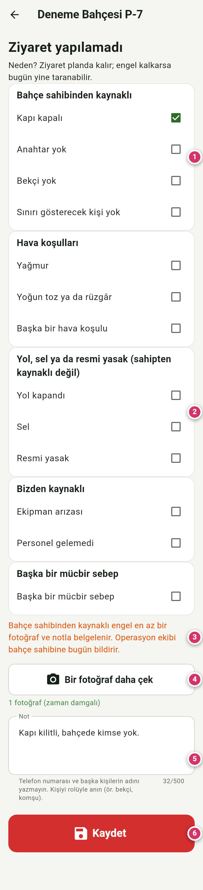

**Ekranın bölümleri**

1. "Bahçe sahibinden kaynaklı" nedenler: "Kapı kapalı", "Anahtar yok", "Bekçi yok", "Sınırı gösterecek kişi yok".
2. Sahipten kaynaklı sayılmayan nedenler: "Hava koşulları" ("Yağmur", "Yoğun toz ya da rüzgâr", "Başka bir hava koşulu"), "Yol, sel ya da resmi yasak (sahipten kaynaklı değil)" ("Yol kapandı", "Sel", "Resmi yasak"), "Bizden kaynaklı" ("Ekipman arızası", "Personel gelemedi") ve "Başka bir mücbir sebep".
3. Turuncu not: sahipten kaynaklı engel en az bir fotoğraf ve notla belgelenir.
4. "Fotoğraf çek" / "Bir fotoğraf daha çek" ve altında çekilen fotoğraf sayısı ("1 fotoğraf (zaman damgalı)").
5. "Not" alanı.
6. "Kaydet".

**Nasıl yapılır**

### Yapılamayan ziyareti kaydetmek

1. Görev kartında "Ziyaret yapılamadı"ya dokunun.
2. Tek bir neden seçin.
3. Kapalı kapıyı, engeli ya da durumu fotoğraflayın ("Fotoğraf çek"; uygulama içi kamera, bkz. [çekim ekranı](#çekim-ekranı-ve-fotoğraf-kalite-kontrolü)). Birden çok fotoğraf çekebilirsiniz.
4. Ne olduğunu kısaca yazın. Kişileri adıyla değil rolüyle anın; telefon numarası yazmayın.
5. "Kaydet". Görev listesine dönersiniz; kartta "Yapılamadı kaydedildi" görünür.
6. Operasyonu telefonla arayın. Sahipten kaynaklı engelde operasyon sahibe aynı gün bildirir; yeni tarihi ofis verir.

### Engel kalkarsa

Ziyaret planda kalır. Kapı açılır ya da sınırı gösterecek kişi gelirse aynı gün görev kartına dokunup normal şekilde tarayın.

**Düğmeler ve alanlar**

| Düğme / alan | Ne yapar |
| --- | --- |
| Neden kutuları | Bir neden seçer; ikinci seçim birincinin yerine geçer. Sel hava, yol kapanması ve resmi yasak mücbir sebep sayılır; ikisi de sahipten kaynaklı değildir. |
| "Fotoğraf çek" / "Bir fotoğraf daha çek" | Uygulama içi kamerayı açar. Fotoğraf kalite kontrolünden geçer. |
| "Not" / "Not (isteğe bağlı)" | En çok 500 karakter. Sahipten kaynaklı nedenlerde, "Başka bir hava koşulu" ve "Başka bir mücbir sebep"te zorunludur. |
| "Kaydet" | Kaydı telefona yazar ve göndermeyi dener. Neden seçilmeden, zorunlu not ya da fotoğraf eksikken kapalıdır. |

**Uyarılar ve ret mesajları**

| Mesaj | Ne zaman çıkar | Ne yapmalı |
| --- | --- | --- |
| "Bahçe sahibinden kaynaklı engel en az bir fotoğraf ve notla belgelenir. Operasyon ekibi bahçe sahibine bugün bildirir." | Sahipten kaynaklı bir neden seçilince. | Fotoğraf çekin ve not yazın; "Kaydet" ancak o zaman açılır. |
| "Bu alan gerekli" | Zorunlu not boş. | Notu yazın. |
| "Telefon numarası yazmayın" | Notta telefon numarasına benzeyen bir sayı var. | Numarayı silin; kişiyi rolüyle anın. |
| "En çok 500 karakter" | Not çok uzun. | Kısaltın. |
| "Fotoğraf kaydedilemedi: …" / "Kaydedilemedi: …" | Telefonda yazma hatası. | Tekrar deneyin; sürerse ekranın fotoğrafını çekip operasyona gönderin. |

Not: Ekrandan "Kaydet" demeden çıkarsanız çekilen fotoğraflar silinir, hiçbir şey kaydedilmez.

## Ön kontrol

Görev kartı → "Ön kontrol"

**Ne için:** Taramadan önce kitin, havanın ve bilgilendirmenin hazır olduğunu doğrulamak için. Liste tamamlanmadan tarama başlamaz.
**Kim kullanır:** Saha personeli.

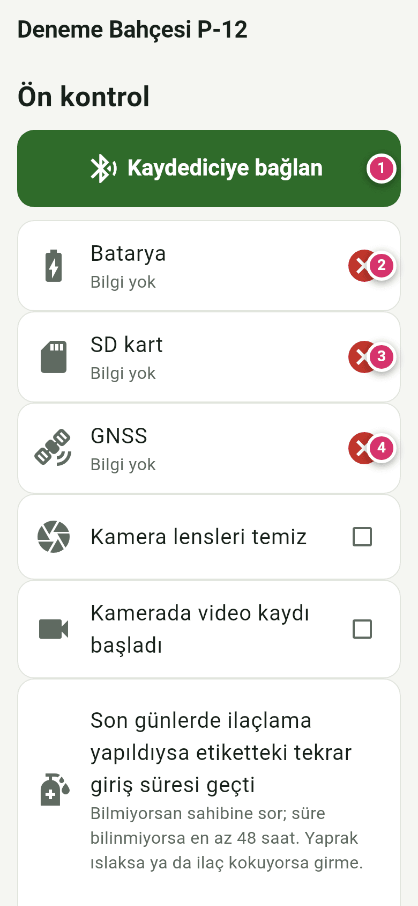

**Ekranın bölümleri (bağlanmadan önce)**

1. "Kaydediciye bağlan": Bluetooth ile GNSS kaydediciyi bulur ve bağlar.
2. "Batarya": kit bataryasının gerilimi, kaydediciden.
3. "SD kart": kaydedicideki SD kartın boş yeri.
4. "GNSS": alıcının durumu ve uydu sayısı.

Bağlanmadan bu üç satır "Bilgi yok" ve kırmızı çarpıdır.

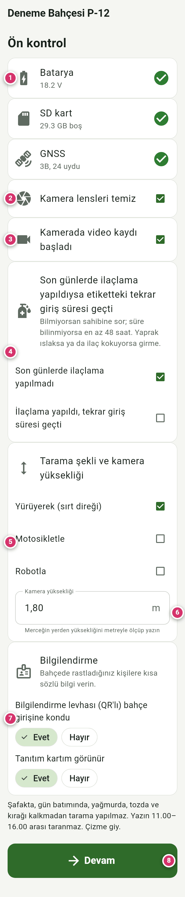

**Ekranın bölümleri (doldurulmuş)**

1. Kaydediciden gelen üç madde: "Batarya", "SD kart", "GNSS". Yeşil onay = tamam.
2. "Kamera lensleri temiz".
3. "Kamerada video kaydı başladı".
4. İlaçlama sorusu: "Son günlerde ilaçlama yapıldıysa etiketteki tekrar giriş süresi geçti" ve iki cevap.
5. "Tarama şekli ve kamera yüksekliği": "Yürüyerek (sırt direği)", "Motosikletle", "Robotla".
6. "Kamera yüksekliği" alanı (metre).
7. "Bilgilendirme": levha ve tanıtım kartı soruları, "Evet" / "Hayır".
8. "Devam": bütün maddeler tamamsa açılır, tarama ekranına geçer.

**Nasıl yapılır**

### Ön kontrolü bitirmek

1. Kaydediciyi açın, "Kaydediciye bağlan"a dokunun. Düğme "Aranıyor…", "Bağlanıyor…" der; bağlanınca kaybolur. Telefon ilk açılışta Bluetooth (yakındaki cihazlar) izni ister; izin verin.
2. Batarya, SD kart ve GNSS satırlarının yeşil olmasını bekleyin. GNSS için alıcının en az 3B konum bulması gerekir; açık alanda birkaç dakika sürebilir.
3. Kamera lenslerini silin, işaretleyin.
4. 360° kamerada video kaydını başlatın, "Kamerada video kaydı başladı"yı işaretleyin. Kamera kaydı uygulamadan değil kameradan başlatılır.
5. İlaçlama sorusunu cevaplayın: "Son günlerde ilaçlama yapılmadı" ya da "İlaçlama yapıldı, tekrar giriş süresi geçti". Bilmiyorsanız sahibine sorun. Süre geçmediyse, süre bilinmiyor ve 48 saat dolmadıysa, yaprak ıslaksa ya da ilaç kokuyorsa bahçeye girmeyin; ziyaret yapılamaz (bkz. [Ziyaret yapılamadı](#ziyaret-yapılamadı), operasyonu arayın).
6. Hasat mevsimindeki periyodik ziyarette ayrıca "Hasat bitti mi, çöpleme sürüyor mu?" sorusu çıkar: "Hasat bitti, çöpleme de bitti", "Hasat bitti, çöpleme sürüyor" ya da "Hasat bitti, çöpleme yapılmayacak". Hasat sürüyorsa bahçeye girmeyin; ziyaret ertelenir.
7. Tarama şeklini seçin. Merceğin yerden yüksekliğini metreyle ölçüp yazın (ör. `1,80`; virgül ya da nokta).
8. Bilgilendirme levhasını (QR'lı) bahçe girişine koyun, tanıtım kartınızı görünür takın. İki soruya da açıkça "Evet" ya da "Hayır" deyin. "Hayır" derseniz "Neden? (kısa)" alanı açılır; nedenini yazın (ör. "Levha ikinci araçta kaldı").
9. "Devam"a dokunun.

### Önceki taramayla karşılaştırma

Bu telefonda aynı parselin daha önce kaydedilmiş bir taraması varsa tarama şekli ve yükseklik ondan doldurulur ve "Bu parselde son tarama: Motosikletle, 2,10 m — aynı yükseklik karşılaştırmayı kolaylaştırır" yazar. Şekil değişirse ya da yükseklik 0,25 m'den fazla farklıysa turuncu bir uyarı çıkar; engellemez, ama ölçümü kontrol edin.

Kartın altındaki hatırlatma: "Şafakta, gün batımında, yağmurda, tozda ve kırağı kalkmadan tarama yapılmaz. Yazın 11.00–16.00 arası taranmaz. Çizme giy."

**Düğmeler ve alanlar**

| Düğme / alan | Ne yapar |
| --- | --- |
| "Kaydediciye bağlan" | Kaydediciyi arar ve bağlar. Bağlıyken görünmez. |
| "Batarya" | Kit bataryası en az 16,5 V ise yeşil. Değilse bataryayı değiştirin. |
| "SD kart" | Kart takılı, dolu değil ve hatasızsa yeşil ("29.3 GB boş"). Diğer durumlar: "Takılı değil", "Hata", "Dolu (… MiB)". |
| "GNSS" | Alıcı ayarlı ve en az 3B konum varsa yeşil ("3B, 24 uydu"). Yoksa "Konum yok (N uydu)" ya da alıcı durumu. |
| "Kamera lensleri temiz", "Kamerada video kaydı başladı" | Sizin onayınız; ikisi de işaretlenmeden devam edilmez. Kaydedilmez, yalnız kapıdır. |
| İlaçlama cevapları | Biri seçilmeli. Kaydedilir. |
| Hasat cevapları | Yalnız hasat mevsimindeki periyodik ziyarette; biri seçilmeli. Kaydedilir. |
| "Yürüyerek (sırt direği)", "Motosikletle", "Robotla" | Tarama şekli; biri seçilmeli. Kaydedilir. |
| "Kamera yüksekliği" | 0,50–3,50 m arası sayı. Kaydedilir. |
| "Evet" / "Hayır" (levha, tanıtım kartı) | İkisi de cevaplanmalı. Seçili cevaba yeniden dokunmak cevabı geri alır. |
| "Neden? (kısa)" | Bir "Hayır" varsa zorunlu; en çok 200 karakter. |
| "Devam" | Hepsi tamamsa tarama ekranını açar. |

**Uyarılar ve ret mesajları**

| Mesaj | Ne zaman çıkar | Ne yapmalı |
| --- | --- | --- |
| "Bilgi yok" (kırmızı) | Kaydedici bağlı değil. | "Kaydediciye bağlan". Bulamıyorsa kaydedicinin açık ve yakında olduğuna bakın. |
| "0,50 ile 3,50 m arasında bir sayı yazın" | Yükseklik sayı değil ya da aralık dışında. | Ölçüp yeniden yazın. |
| "Platform son taramadan farklı (…)" / "Kamera yüksekliği son taramadan … m farklı (… m). Karşılaştırma zorlaşır; ölçümü kontrol edin." | Önceki taramadan farklı kurulum. | Mümkünse önceki kurulumla tarayın; değilse devam edebilirsiniz. |
| "Bu alan gerekli", "Telefon numarası yazmayın", "En çok 200 karakter" | "Neden" alanında. | Kısa, numarasız bir neden yazın. |
| "Devam" kapalı | Bir madde eksik ya da kırmızı. | Kırmızı ya da boş maddeyi tamamlayın. |

## Tarama ekranı: kayıttan önce

Ön kontrol → "Devam"

**Ne için:** Kaydedicinin canlı durumunu görmek ve kaydı başlatmak için.
**Kim kullanır:** Saha personeli.

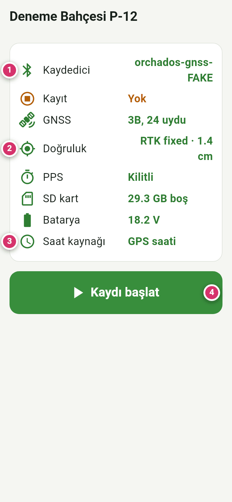

**Ekranın bölümleri**

1. Kaydedici paneli: "Kaydedici" (bağlı kaydedicinin adı), "Kayıt" ("Yok" ya da "Sürüyor · … MB"), "GNSS".
2. "Doğruluk": RTK durumu ("RTK fixed", "RTK float", "RTK yok") ve yatay doğruluk; ayrıca "PPS", "SD kart", "Batarya".
3. "Saat kaynağı": "GPS saati" (yeşil) ya da "Telefon saati" (turuncu).
4. "Kaydı başlat".

Paneldeki renkler: yeşil iyi, turuncu dikkat, kırmızı sorun. Doğruluk 5 cm'ye kadar yeşildir. PPS "Kilitli" olmalıdır.

**Nasıl yapılır**

### Kaydı başlatmak

1. Paneldeki satırların yeşil olduğuna bakın. "Saat kaynağı" turuncuysa ("Telefon saati") kaydediciden GPS zamanı gelmiyordur; birkaç saniye bekleyin.
2. "Kaydı başlat"a dokunun. Kaydedici kaydı başlatır, "Kayıt" satırı "Sürüyor" olur ve ekran [kayıt sürerken](#tarama-ekranı-kayıt-sürerken) haline geçer.
3. Hemen ardından "Başlangıç QR"a geçin.

Kayıt başladıktan sonra geri tuşu çalışmaz; ziyaret ancak "Kaydı durdur" ile kapanır.

**Düğmeler ve alanlar**

| Düğme / alan | Ne yapar |
| --- | --- |
| "Kaydediciye bağlan" | Bağlantı koparsa panelin üstünde yeniden görünür. |
| "Kaydı başlat" | Kaydediciye kayıt komutunu gönderir, telefonda ziyaret kaydını açar. |

**Uyarılar ve ret mesajları**

| Mesaj | Ne zaman çıkar | Ne yapmalı |
| --- | --- | --- |
| "Kayıt başlamadı: SD kart takılı değil" / "… SD kart dolu" / "… SD kart hatası" | Kaydedicinin kartı hazır değil. | Kartı takın ya da değiştirin, yeniden deneyin. |
| "Kayıt başlamadı: Kaydedici yanıt vermedi" / "… Kaydedici bağlı değil" | Bluetooth bağlantısı yok ya da koptu. | Kaydediciye yaklaşın, "Kaydediciye bağlan", yeniden deneyin. |
| "Kayıt başlamadı: Kayıt zaten sürüyor" | Kaydedici başka bir kayıtta. | Kaydediciyi kapatıp açın; sürerse operasyonu arayın. |
| "Bu ziyaret bu telefonda zaten kaydedildi" | Aynı ziyaret bu telefonda daha önce taranmış. | İkinci kez taranamaz. Gerekirse ofis yeni bir ziyaret planlar. |

## QR saat

Tarama ekranı → "Başlangıç QR" / "Bitiş QR"

**Ne için:** 360° kameranın videosunu GPS zamanıyla eşlemek için. Telefon ekranındaki QR her 0,1 saniyede o anın GPS saatini taşır; kamera onu kaydeder. Bu adım atlanmaz.
**Kim kullanır:** Saha personeli.

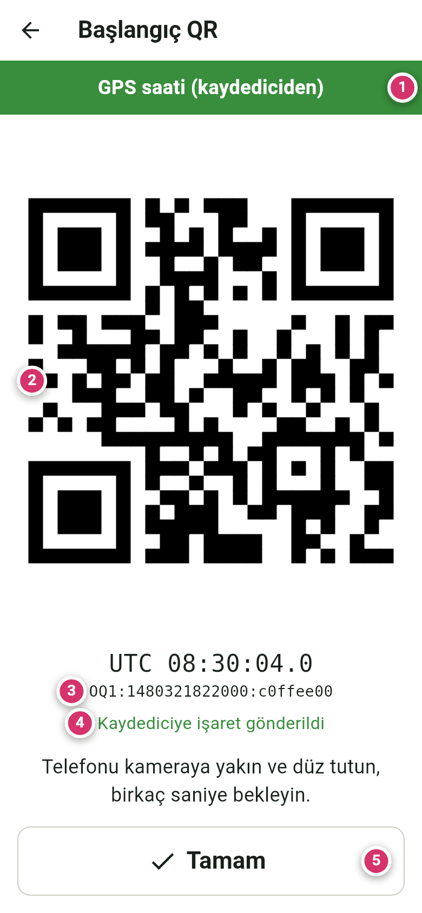

**Ekranın bölümleri**

1. Zaman kaynağı şeridi: yeşil "GPS saati (kaydediciden)" ya da turuncu "DİKKAT: Telefon saati kullanılıyor, kaydediciden GPS zamanı yok".
2. QR kodu.
3. UTC saat ve QR'ın metni (`OQ1:…`).
4. Kaydediciye işaret durumu: "Kaydediciye işaret gönderiliyor…", "Kaydediciye işaret gönderildi" ya da "İşaret gönderilemedi: …".
5. "Tamam": tarama ekranına döner.

**Nasıl yapılır**

### QR'ı kameraya göstermek

1. "Başlangıç QR"a dokunun (kaydı başlattıktan hemen sonra).
2. Telefonu 360° kameranın merceklerinden birine yakın ve düz tutun, birkaç saniye bekleyin.
3. "Kaydediciye işaret gönderildi" yazısını görün, "Tamam"a dokunun. Tarama ekranında "1. Başlangıç QR’ını kameraya göster" yeşil onay alır.
4. Tarama bitince aynı şeyi "Bitiş QR" ile yapın.

**Uyarılar ve ret mesajları**

| Mesaj | Ne zaman çıkar | Ne yapmalı |
| --- | --- | --- |
| "DİKKAT: Telefon saati kullanılıyor, kaydediciden GPS zamanı yok" | Kaydediciden son 10 dakikada GPS zamanı gelmedi. | QR yine kaydedilir ama daha az doğrudur. Kaydedicinin bağlı ve GNSS'in yeşil olduğuna bakın; düzelince QR'ı yeniden gösterin. Ziyaret özetinde "Telefon saatiyle QR" sayısı görünür. |
| "İşaret gönderilemedi: Kaydedici yanıt vermedi" (ya da başka neden) | İşaret kaydediciye ulaşmadı. | QR telefonda yine kaydedildi ve videoda okunur. Kaydediciye yaklaşıp QR'ı bir kez daha gösterin. |

## Tarama ekranı: kayıt sürerken

"Kaydı başlat"tan sonra aynı ekran

**Ne için:** Taramayı rotaya göre yürümek, kapsamayı izlemek ve sıradaki adımları yapmak için.
**Kim kullanır:** Saha personeli.

Ekran uzundur; aşağı kaydırdıkça üstte kaydedici paneli, sonra **Rota**, **Kapsama** ve adım düğmeleri gelir.

### Rota kartı

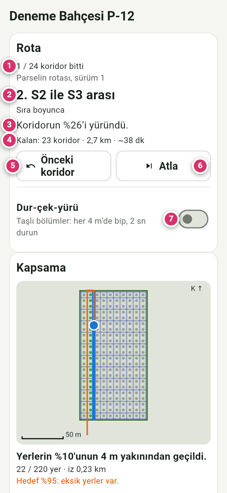

**Ekranın bölümleri**

1. İlerleme: "1 / 24 koridor bitti" (atlanan varsa "· 1 atlandı") ve "Parselin rotası, sürüm 1".
2. Sıradaki koridor ("2. S2 ile S3 arası") ve türü ("Sıra boyunca", dik ya da kenar).
3. Yol tarifi: koridora girmeden "Koridorun başına 38 m, kuzeydoğuda.", başındaysanız "Koridorun başındasınız; yürümeye başlayın.", koridordayken "Koridorun %26’i yüründü.".
4. "Kalan: 23 koridor · 2,7 km · ~38 dk".
5. "Önceki koridor".
6. "Atla".
7. "Dur-çek-yürü" anahtarı.

Rota parselin sabit grid rotasıdır: önce sıralar boyunca bütün koridorlar, sonra dik koridorlar, en son kenarlar. Her ziyaret aynı rotayı yürür. Koridorun %95'i yürününce sıradaki koridora geçilir.

**Nasıl yapılır**

#### Rotayı yürümek

1. Kartta yazan koridorun başına gidin; haritada sıradaki koridor kalın mavi çizgidir.
2. Koridoru baştan sona yürüyün. Bitince kart kendiliğinden sıradakini gösterir; biten koridorlar haritada soluk yeşil olur.
3. Bir koridor yürünemiyorsa (taş yığını, su) "Atla". Atlanan koridor haritada kesik kırmızı çizgidir ve ziyaret özetinde listelenir.
4. Atladığınız ya da yarım kalan koridora dönmek için "Önceki koridor": o koridor baştan sayılır.

#### Dur-çek-yürü

Taşlı, sarsıntılı bölümlerde anahtarı açın. Her 4 m yürüyüşte telefon bip sesi verir ve titrer; kartta 2 saniye kırmızı "DUR · 2 sn" yazar. Durun, sonra "Yürü · sonraki bip 1,6 m" görünce yürüyün. Bölüm bitince anahtarı kapatın.

#### İlk envanterde rota önerisi

Parselin henüz rotası yoksa ve sıra yönü bilinmiyorsa rota haritada kesik çizgiyle **öneri** olarak çizilir. Kartta "Sıra yönü sınırın en uzun kenarından tahmin edildi." yazar.

1. Haritadaki çizgiler sıralara paralel değilse "Yönü düzelt"e dokunun.
2. Haritada bir sıranın bir ucuna ("1 / 2"), sonra aynı sıranın öbür ucuna ("2 / 2") dokunun. Çizgiler döner.
3. "Rotayı kullan"a dokunun. Bu andan sonra rota ziyaret boyunca değişmez.

Envanterde sınır henüz yürünmediyse kartta "Rota için parselin sınırı gerekli: önce Sınır adımında köşeleri işaretleyin." yazar; rota köşeler girildikçe çıkar.

**Düğmeler ve alanlar**

| Düğme / alan | Ne yapar |
| --- | --- |
| "Atla" | Sıradaki koridoru "atlandı" sayar, bir sonrakine geçer. |
| "Önceki koridor" | Bir önceki koridora döner; o koridor baştan sayılır. |
| "Dur-çek-yürü" | Her 4 m'de bip ve 2 saniyelik "DUR". |
| "Yönü düzelt" / "Vazgeç" | Yalnız öneri rotada: sıra yönünü haritada iki dokunuşla belirler. |
| "Rotayı kullan" | Yalnız öneri rotada: rotayı kesinleştirir. |

**Uyarılar ve ret mesajları**

| Mesaj | Ne zaman çıkar | Ne yapmalı |
| --- | --- | --- |
| "Koridordan 9 m saptınız. Koridora dönün." (kırmızı) | Koridora başladıktan sonra 6 m'den fazla uzaklaştınız. | Koridora geri dönün. |
| "Koridorun başına gidin (konum bekleniyor)." | Kaydediciden konum gelmiyor. | Bekleyin; sürerse kaydedicinin bağlantısına bakın. |
| "Parselin sınırı da yer konumları da yok; rota çizilemiyor." | Periyodik ziyarette parselin sınırı ve ağaç konumları yok. | Sıraları bildiğiniz düzende tarayın; ofise bildirin. |
| "Rota bitti." / "Rota bitti; N koridor atlandı." | Bütün koridorlar bitti ya da atlandı. | Atlananları mümkünse "Önceki koridor" ile tamamlayın. |

### Kapsama kartı

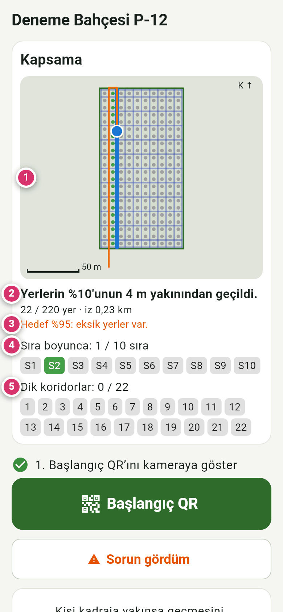

**Ekranın bölümleri**

1. Harita: parselin sınırı (yeşil), ağaç yerleri (kapsanan yeşil nokta, kalan gri), rota koridorları, sizin iziniz (turuncu çizgi) ve şu anki konumunuz (mavi nokta). Kuzey yukarıdadır ("K ↑"), solda ölçek çubuğu vardır.
2. Oran: "Yerlerin %10'unun 4 m yakınından geçildi." ve altında yer sayısı ile iz uzunluğu.
3. Hedef uyarısı: "Hedef %95: eksik yerler var." (envanterde hedef %98).
4. "Sıra boyunca: 1 / 10 sıra" ve sıra kutucukları.
5. "Dik koridorlar: 0 / 22" ve koridor kutucukları.

Bir ağaç yerinin 4 m yakınından geçtiyseniz o yer kapsanmış sayılır. Kutucuklar: yeşil bitti, sarı kısmen, gri hiç geçilmedi. Harita internetsiz çalışır; altında uydu görüntüsü yoktur.

| Mesaj | Ne zaman çıkar | Ne yapmalı |
| --- | --- | --- |
| "Kaydediciden konum gelmiyor; kapsama gösterilemiyor." | Kaydedici konum göndermiyor. | Taramaya rotayla devam edin; kapsama ofiste GNSS kaydından hesaplanır. |
| "Yer konumu yok; yalnızca iz çiziliyor (… km)." | Parselin ağaç konumları henüz yok (ilk envanter). | Normal. |
| "Hedef %95: eksik yerler var." | Oran hedefin altında. | Gri kalan bölümleri tarayın. |

### Adım düğmeleri

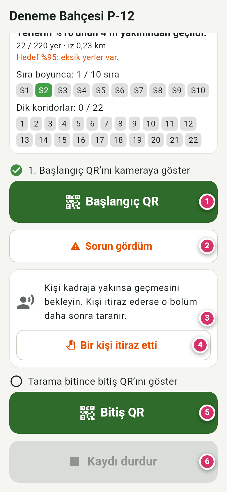

**Ekranın bölümleri**

1. "1. Başlangıç QR’ını kameraya göster" ve "Başlangıç QR".
2. "Sorun gördüm" (yalnız periyodik ziyarette, aşağıda).
3. Saha talimatı: "Kişi kadraja yakınsa geçmesini bekleyin. Kişi itiraz ederse o bölüm daha sonra taranır."
4. "Bir kişi itiraz etti" (aşağıda).
5. "Tarama bitince bitiş QR’ını göster" ve "Bitiş QR".
6. "Kaydı durdur".

Envanter ziyaretinde "Başlangıç QR"ın altında bir adım daha vardır: "2. Sınır boyunca yürü, her köşede "Köşe"ye bas" ve "Sınır (N köşe)" düğmesi (aşağıda, [Sınır](#sınır-envanter)).

**Nasıl yapılır**

### Sıra

Düğmeler sırayla açılır, önceki adım yapılmadan sonraki çalışmaz:

1. "Kaydı başlat" → 2. "Başlangıç QR" → 3. (envanterde) "Sınır" → 4. tarama → 5. "Bitiş QR" → 6. "Kaydı durdur".

"Sınır" ve "Bitiş QR" başlangıç QR'ı gösterilmeden, "Kaydı durdur" bitiş QR'ı gösterilmeden açılmaz.

### Kaydı durdurmak

1. Tarama bitince "Bitiş QR"ı kameraya gösterin, "Tamam".
2. "Kaydı durdur"a dokunun. Ekran [Kayıt durdu](#kayıt-durdu) haline geçer.
3. 360° kameradaki videoyu da kameradan durdurun.

**Düğmeler ve alanlar**

| Düğme / alan | Ne yapar |
| --- | --- |
| "Başlangıç QR" | QR saat ekranını açar. Gerekirse yeniden gösterilebilir. |
| "Sınır (N köşe)" | Envanterde sınır ekranını açar. |
| "Sorun gördüm" | Sorunlu ağacı seçme listesini açar. |
| "Bir kişi itiraz etti" | İtiraz notu penceresini açar; kayıt sayısı parantezde görünür. |
| "Bitiş QR" | QR saat ekranını açar. |
| "Kaydı durdur" | Kaydediciyi durdurur, rota ve kapsama sonucunu kaydeder. |

**Uyarılar ve ret mesajları**

| Mesaj | Ne zaman çıkar | Ne yapmalı |
| --- | --- | --- |
| "Kaydedici kaydı durdurdu (SD kart dolu ya da hatalı). Bitiş QR’ını gösterip oturumu durdurun." (kırmızı kart) | Kaydedici kaydı kendisi bıraktı. | Bitiş QR'ını gösterin, "Kaydı durdur"; operasyonu arayın. Kartı değiştirip yeniden tarama gerekiyorsa ofis yeni ziyaret planlar. |
| "Kayıt durmadı: …" | Durdurma komutu kaydediciye ulaşmadı. | Kaydediciye yaklaşıp yeniden deneyin. |

## Sorun gördüm

Tarama ekranı → "Sorun gördüm"

**Ne için:** Tarama sırasında sorunlu görünen bir ağacı bu ziyaretin yakın plan listesine eklemek için. İşaretlenen ağaç uzmanın zorunlu incelemesine de girer.
**Kim kullanır:** Saha personeli.

Düğme yalnız **periyodik ziyarette**, kayıt sürerken ve parselin ağaçları kayıtlıyken (envanterden sonra) görünür. Envanter ziyaretinde ve doğrulama turunda yoktur.

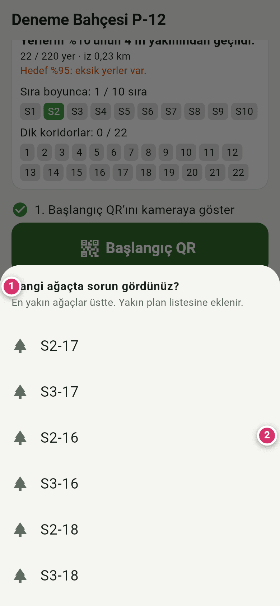

**Ekranın bölümleri**

1. "Hangi ağaçta sorun gördünüz?" ve açıklama: "En yakın ağaçlar üstte. Yakın plan listesine eklenir."
2. En yakın 8 ağacın yer kodu. Daha önce işaretlenen ağaçta yeşil onay vardır.

**Nasıl yapılır**

1. "Sorun gördüm"e dokunun.
2. Listeden ağacın yer kodunu seçin. Kaydediciden konum gelmiyorsa liste yer koduna göre sıralanır; kodu sıra sayımıyla bulun.
3. "S2-17 yakın plan listesine eklendi" mesajı çıkar; düğmede işaretli ağaç sayısı görünür ("Sorun gördüm (1)"). Taramaya devam edin.
4. Kayıt durunca bu ağaç yakın plan listesinin sonunda "Sorun gördüm" nedeniyle çıkar.

İnternet olmadan da çalışır. Vazgeçmek için listenin dışına dokunun.

## Bir kişi itiraz etti

Tarama ekranı → "Bir kişi itiraz etti"

**Ne için:** Bahçede bir kişi çekime itiraz ettiğinde bunu kaydetmek için. O bölüm şimdi taranmaz, daha sonra taranır.
**Kim kullanır:** Saha personeli.

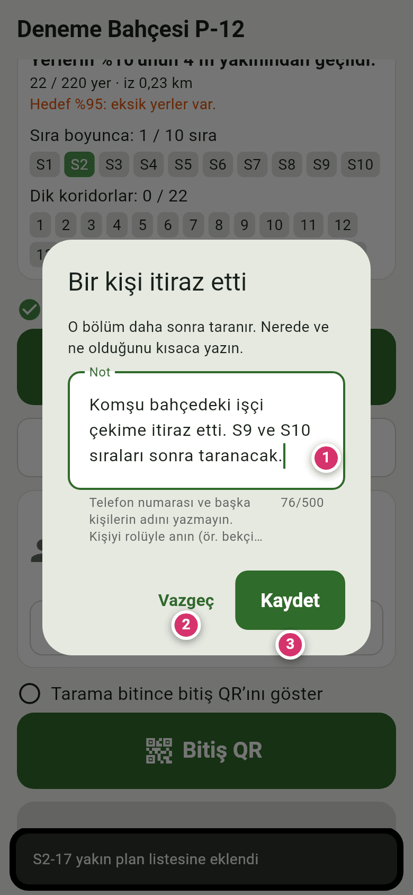

**Ekranın bölümleri**

1. "Not" alanı: nerede ve ne olduğu.
2. "Vazgeç".
3. "Kaydet".

**Nasıl yapılır**

1. Kişi kadraja yakınsa önce geçmesini bekleyin. Kişi itiraz ederse çekimi o bölümde durdurun.
2. "Bir kişi itiraz etti"ye dokunun.
3. Nerede ve ne olduğunu kısaca yazın (ör. "S9 ve S10 sıraları sonra taranacak"). Kişinin adını ve telefonunu yazmayın; rolüyle anın.
4. "Kaydet". "İtiraz kaydedildi. Bu bölümü şimdi taramayın; daha sonra taranacak." mesajı çıkar.

Düğme kayıt sürerken ve kayıt durduktan sonra da kullanılabilir.

| Mesaj | Ne zaman çıkar | Ne yapmalı |
| --- | --- | --- |
| "Telefon numarası yazmayın" | Notta numaraya benzeyen sayı var. | Numarayı silin. |
| "En çok 500 karakter" | Not çok uzun. | Kısaltın. |
| "İtiraz kaydedilemedi" | Kayıt açık değil ya da yazma hatası. | Yeniden deneyin; sürerse operasyonu arayın. |

## Sınır (envanter)

Tarama ekranı → "Sınır (N köşe)" (yalnız envanter ziyaretinde)

**Ne için:** Bahçe sahibinin ya da yetkilendirdiği kişinin gösterdiği sınırı yürürken her köşeyi işaretlemek için.
**Kim kullanır:** Saha personeli.

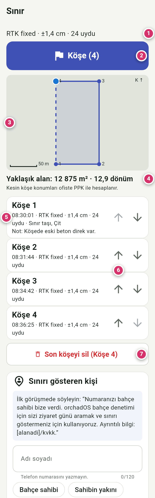

**Ekranın bölümleri**

1. Kaydedicinin şu anki konum kalitesi ("RTK fixed · ±1,4 cm · 24 uydu").
2. "Köşe (N)": basıldığı anı köşe olarak kaydeder.
3. Harita: köşelerden çizilen yaklaşık sınır (kapanış kenarı kesik çizgi), köşe numaraları, sizin konumunuz.
4. "Yaklaşık alan: 12 875 m² · 12,9 dönüm". Altında "Kesin köşe konumları ofiste PPK ile hesaplanır."
5. Köşe listesi: köşe saati, konum kalitesi, sınır işaretleri, fotoğraf sayısı ve not. Köşeye dokununca [köşe ekranı](#köşe-ekranı) açılır.
6. Yukarı / aşağı okları: köşenin sırasını değiştirir.
7. "Son köşeyi sil (Köşe N)".

Ekranın altında "Sınırı gösteren kişi" kartı vardır (aşağıda).

**Nasıl yapılır**

### Sınırı yürümek

1. Başlangıç QR'ını gösterdikten sonra "Sınır"a dokunun.
2. Sınırı gösteren kişiyle birlikte sınır boyunca yürüyün. Her köşede durun ve "Köşe"ye basın.
3. Köşeler yürüdüğünüz sırayla listelenir. Üç konumlu köşeden sonra alan çıkar.
4. Bitince geri tuşuyla tarama ekranına dönün; "Sınır (4 köşe)" yazar. Sonra taramaya geçin.

### Yanlış sırayı ve fazla köşeyi düzeltmek

- Köşelerin sırası yanlışsa harita kendini kesen bir şekil çizer ve alan çok küçük çıkar. Okları kullanarak köşeyi doğru yere taşıyın; alan düzelir.
- Fazla basılan köşeyi silmek için "Son köşeyi sil"e dokunun ve "Sil" ile onaylayın. Yalnız listenin son köşesi silinir; ortadaki bir köşeyi silmek için önce oklarla sona taşıyın.
- Köşeler kayıt durduktan sonra da "Sınır köşeleri (N)" düğmesiyle düzenlenebilir.

**Düğmeler ve alanlar**

| Düğme / alan | Ne yapar |
| --- | --- |
| "Köşe (N)" | O anın GPS zamanını ve kaydedicinin konumunu köşe olarak kaydeder. Kayıt sürerken ve başlangıç QR'ından sonra açıktır. |
| Köşe satırı | Köşe ekranını açar (sınır işareti, fotoğraf, not). |
| Yukarı / aşağı oku | Köşeyi listede bir yukarı ya da aşağı taşır. |
| "Son köşeyi sil (Köşe N)" | Onaydan sonra son köşeyi listeden çıkarır ("Köşe N silinsin mi?" → "Vazgeç" / "Sil"). |

**Uyarılar ve ret mesajları**

| Mesaj | Ne zaman çıkar | Ne yapmalı |
| --- | --- | --- |
| "Kaydediciden konum yok" | Kaydedici konum göndermiyor. | Köşeye yine basın; köşe saatiyle kaydedilir, konumu ofiste GNSS kaydından bulunur. |
| "N köşenin konumu yok; ofiste GNSS kaydından bulunacak." | Bazı köşeler konumsuz kaydedildi. | Bilgi. |
| "Alan için en az 3 konumlu köşe gerekir" | Üçten az konumlu köşe var. | Yürümeye devam edin. |
| "Köşe kaydedilemedi: …" | Kaydedici komutu almadı. | Kaydediciye yaklaşıp yeniden basın. |

### Köşe ekranı

Sınır ekranı → köşe satırı

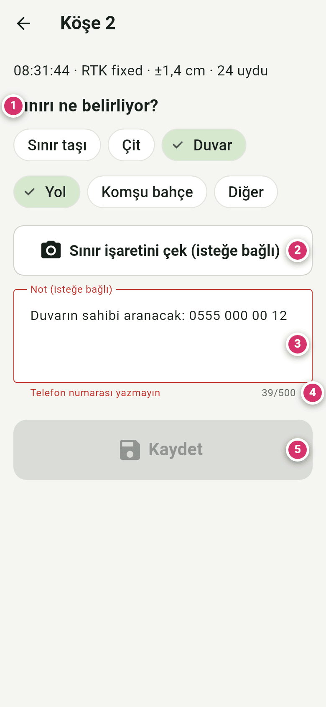

**Ekranın bölümleri**

1. "Sınırı ne belirliyor?": "Sınır taşı", "Çit", "Duvar", "Yol", "Komşu bahçe", "Diğer" (birden çok seçilebilir).
2. "Sınır işaretini çek (isteğe bağlı)": taşı, çiti ya da duvarı köşeyle birlikte çekin.
3. "Not (isteğe bağlı)".
4. Not hatası: bu örnekte notta telefon numarası olduğu için "Telefon numarası yazmayın".
5. "Kaydet": hata varken kapalıdır.

**Nasıl yapılır**

1. Köşe satırına dokunun.
2. Sınırı belirleyen şeyleri seçin, sınır işaretinin fotoğrafını çekin (uygulama içi kamera).
3. Gerekirse kısa bir not yazın (ör. "Köşede eski beton direk var."). Telefon numarası ve kişi adı yazmayın.
4. "Kaydet". Kaydetmeden geri dönerseniz yeni çekilen fotoğraf silinir.

### Sınırı gösteren kişi

Sınır ekranının altı; unutulursa ziyaret özetinde de çıkar.

**Ne için:** Envanterde sınırı gösteren kişiyi adı ve rolüyle kaydetmek ve ona kısa bilgiyi okumak için. Kaydedilmeden envanter bitirilemez.
**Kim kullanır:** Saha personeli.

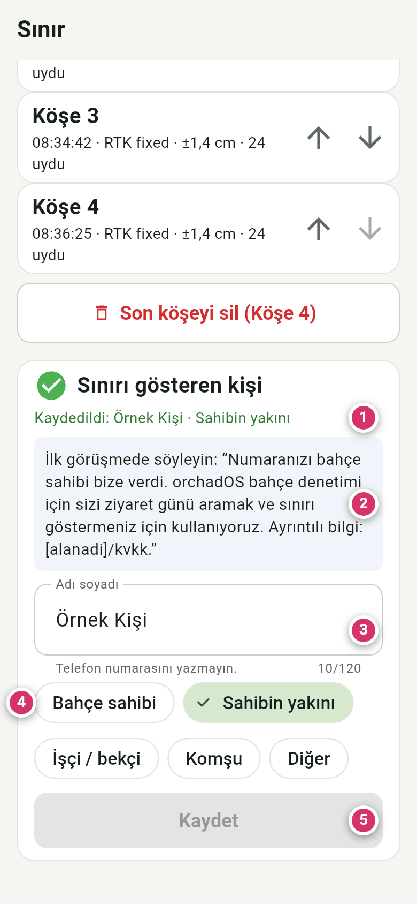

**Ekranın bölümleri**

1. "Kaydedildi: Örnek Kişi · Sahibin yakını" (kayıttan sonra).
2. Okunacak bilgi metni: "İlk görüşmede söyleyin: “Numaranızı bahçe sahibi bize verdi. orchadOS bahçe denetimi için sizi ziyaret günü aramak ve sınırı göstermeniz için kullanıyoruz. Ayrıntılı bilgi: …/kvkk.”"
3. "Adı soyadı".
4. Rol: "Bahçe sahibi", "Sahibin yakını", "İşçi / bekçi", "Komşu", "Diğer".
5. "Kaydet".

**Nasıl yapılır**

1. Kişiyle ilk görüşmede kutudaki metni okuyun.
2. Adını soyadını yazın, rolünü seçin. **Telefon numarasını yazmayın.**
3. "Kaydet". Değiştirirseniz yeniden kaydedin; en yeni kayıt geçerlidir. Değişiklik yoksa "Kaydet" kapalıdır.

| Mesaj | Ne zaman çıkar | Ne yapmalı |
| --- | --- | --- |
| "Bu alan gerekli" / "En çok 120 karakter" / "Telefon numarası yazmayın" | Ad boş, çok uzun ya da numara içeriyor. | Yalnız adı soyadı yazın. |
| "Kaydedilemedi" | Yazma hatası. | Yeniden deneyin. |

Not: Bilgi metninde adres yerine "[alanadi]" görünüyorsa uygulamanın bu sürümüne şirketin alan adı henüz girilmemiştir; operasyona bildirin.

## Kayıt durdu

"Kaydı durdur"dan sonraki tarama ekranı

**Ne için:** Kaydın kapandığını görmek ve yakın plan görevine (ya da özete) geçmek için.
**Kim kullanır:** Saha personeli.

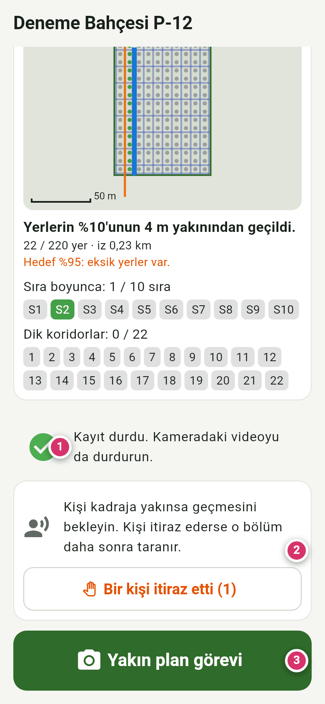

**Ekranın bölümleri**

1. "Kayıt durdu. Kameradaki videoyu da durdurun."
2. Saha talimatı ve "Bir kişi itiraz etti" (kayıttan sonra da kullanılabilir).
3. "Yakın plan görevi" (listede ağaç varsa) ya da "Ziyaret özeti".

Envanter ziyaretinde ayrıca "Sınır köşeleri (N)" düğmesi vardır; köşeler hâlâ düzeltilebilir.

**Nasıl yapılır**

1. 360° kameradaki videoyu durdurun.
2. "Yakın plan görevi"ne dokunun. Listede ağaç yoksa düğme "Ziyaret özeti"dir.

## Yakın plan görevi

Kayıt durdu → "Yakın plan görevi"

**Ne için:** Bu ziyarette yakından fotoğraflanacak ağaçları görmek ve sırayla açmak için.
**Kim kullanır:** Saha personeli.

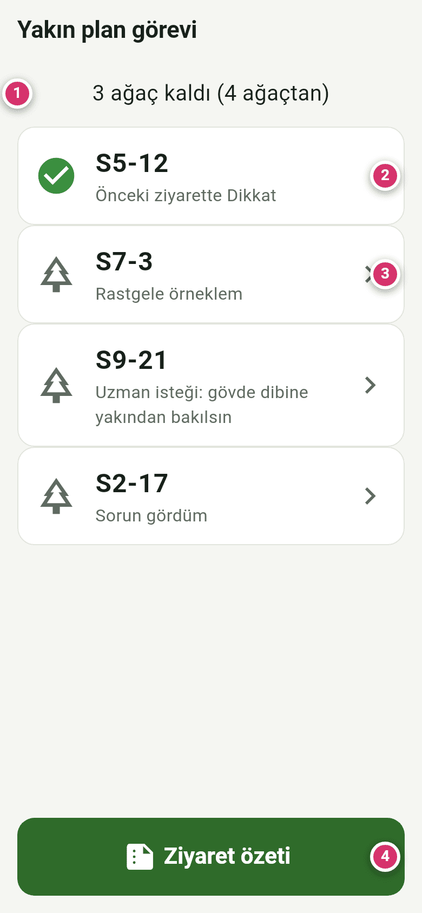

**Ekranın bölümleri**

1. "3 ağaç kaldı (4 ağaçtan)"; hepsi bitince "Tüm ağaçlar tamam".
2. Biten ağaç: yeşil onay, yeniden açılmaz.
3. Bekleyen ağaç: yer kodu ve seçilme nedeni ("Önceki ziyarette Dikkat", "Rastgele örneklem", uzman isteği, "Sorun gördüm"). Dokununca [ağaç formu](#ağaç-formu) açılır.
4. "Ziyaret özeti".

Liste ofisten gelir: önceki ziyarette sorunlu çıkan ağaçlar, parselden rastgele seçilen ağaçlar, uzmanın istekleri ve taramada "Sorun gördüm" ile işaretledikleriniz. Yaz mevsiminde listenin başında bir **parsel sorusu** durur: "Parsel: Tel ya da çitte yeni açılmış geçit var mı?" ("Evet", "Hayır", "Göremedim"); ziyarette bir kez cevaplanır.

**Nasıl yapılır**

1. Ağacı yer koduyla bulun (sıra ve sıradaki yer sayısı).
2. Listede ağaca dokunun, formu doldurun, "Kaydet".
3. Bütün ağaçlar bitince "Ziyaret özeti"ne dokunun. Bir ağaca ulaşılamadıysa yine özete geçebilirsiniz; özette "Yakın plan ağaç" turuncu görünür, ofise bildirin.

Bu ekrandan geri tuşuyla tarama ekranına dönülmez.

## Ağaç formu

Yakın plan görevi → ağaç

**Ne için:** Bir ağacın mevsime göre fotoğraflarını çekmek ve sorularını cevaplamak için.
**Kim kullanır:** Saha personeli.

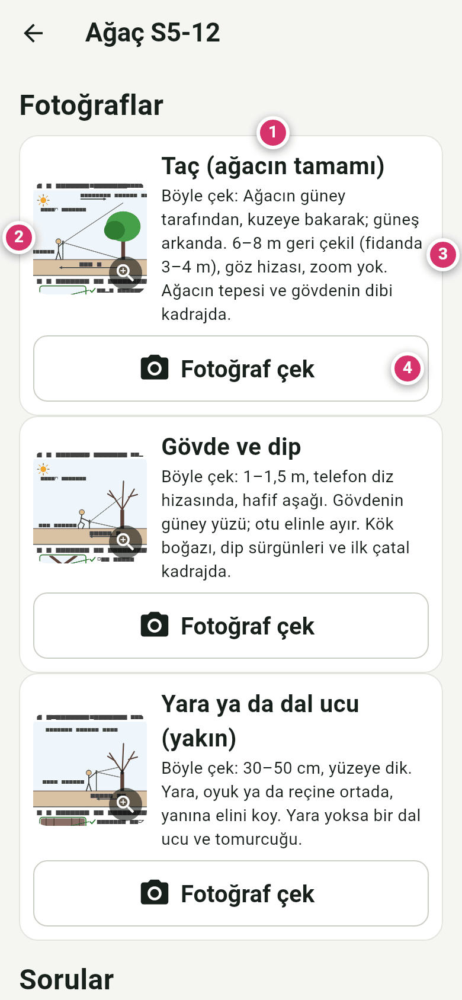

**Ekranın bölümleri (fotoğraflar)**

1. Çekimin adı (ör. "Taç (ağacın tamamı)"). İsteğe bağlı çekimlerde "(isteğe bağlı)" yazar.
2. "Böyle çek" çizimi: dokununca büyür, "Kapat" ile kapanır.
3. Yönerge: "Böyle çek: Ağacın güney tarafından, kuzeye bakarak; güneş arkanda. …". Çekildikten sonra altında "Çekildi · …" ya da "Çekildi (uyarıyla) · …".
4. "Fotoğraf çek" (çekildikten sonra "Yeniden çek").

Çekimler uzaktan yakına sıralıdır: önce taç, sonra mevsimin yakın çekimleri (kış: "Gövde ve dip", "Yara ya da dal ucu (yakın)"; ilkbahar: "Çiçek ya da sürgün salkımı", "Yaprak"; yaz: "Meyve salkımı", "Yaprak (üst yüz)", "Yaprak (alt yüz)"; hasat: "Kırık dal (varsa)" isteğe bağlı, "Ağaç altı").

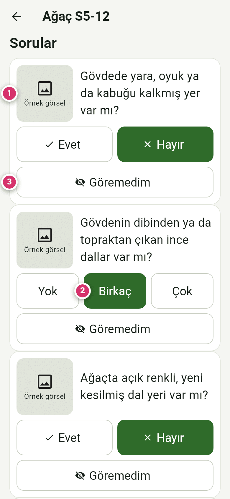

**Ekranın bölümleri (sorular)**

1. Soru metni ve örnek görsel yeri ("Örnek görsel"; görseller henüz yok).
2. Cevaplar: "Evet" / "Hayır" ya da kategori ("Yok", "Birkaç", "Çok"). Seçilen cevap yeşil dolu görünür.
3. "Göremedim": soruya bakılamadıysa.

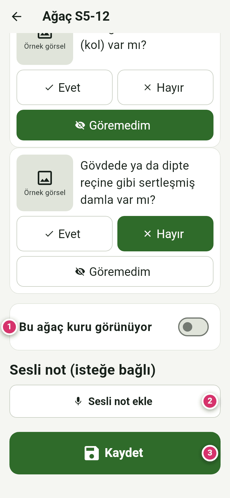

**Ekranın bölümleri (formun sonu)**

1. "Bu ağaç kuru görünüyor" anahtarı (yalnız kışın).
2. "Sesli not ekle" (isteğe bağlı).
3. "Kaydet".

**Nasıl yapılır**

### Bir ağacı tamamlamak

1. Her zorunlu çekimde "Fotoğraf çek"e dokunun; [çekim ekranı](#çekim-ekranı-ve-fotoğraf-kalite-kontrolü) açılır. Yönergeye ve çizime uyun.
2. Her soruyu cevaplayın. Göremediğiniz bir şey için tahmin etmeyin, "Göremedim" seçin. Seçilen cevaba yeniden dokunmak cevabı geri almaz; başka bir cevaba dokunarak değiştirin.
3. İsterseniz "Sesli not ekle"ye dokunup konuşun, "Durdur"a dokunun. Birden çok sesli not eklenebilir ("Bir sesli not daha (N kayıtlı)"). Telefon ilk seferde mikrofon izni ister.
4. "Kaydet". Ağaç listede yeşil onay alır.

"Kaydet" bütün zorunlu fotoğraflar çekilip bütün sorular ("Göremedim" dahil) cevaplanmadan ve sesli not kaydı sürerken açılmaz.

### Kışın kuru şüphesi

Ağaç kuru görünüyorsa "Bu ağaç kuru görünüyor" anahtarını açın. Üç dal ucu çekimi ("Dal ucu testi 1/3" … "3/3") ve üç test sorusu eklenir ve zorunlu olur. Yönerge: farklı yönlerden kalem kalınlığında üç dal seçin, her dalda tomurcuğa bakın, dalı bükün, kabuğu tırnağınızla 1 cm kazıyın. Anahtarı kapatırsanız bu çekimler ve cevaplar atılır.

**Düğmeler ve alanlar**

| Düğme / alan | Ne yapar |
| --- | --- |
| "Böyle çek" çizimi | Dokununca tam ekran açılır. |
| "Fotoğraf çek" / "Yeniden çek" | Çekim ekranını açar. Yeniden çekilen fotoğraf öncekinin yerine geçer. |
| "Evet", "Hayır", "Yok", "Birkaç", "Çok" | Cevabı seçer. |
| "Göremedim" | Bakılamadığını kaydeder; ölçüm yazılmaz, uzman bunu bilir. |
| "Bu ağaç kuru görünüyor" | Kışın ek dal testi çekimlerini ve sorularını açar. |
| "Sesli not ekle" / "Durdur" | Sesli not kaydını başlatır ve bitirir. |
| "Kaydet" | Fotoğrafları ve cevapları birlikte kaydeder, listeye döner. |

**Uyarılar ve ret mesajları**

| Mesaj | Ne zaman çıkar | Ne yapmalı |
| --- | --- | --- |
| "Mikrofon izni yok: ayarlardan izin verin." | Mikrofon izni verilmedi. | Telefon ayarlarından uygulamaya mikrofon izni verin ya da sesli notu atlayın. |
| "Sesli not kaydedilemedi: …" / "Fotoğraf kaydedilemedi: …" | Telefonda yazma hatası. | Yeniden deneyin; telefonda yer olduğuna bakın. |

Kaydetmeden geri dönerseniz o ağacın çekilen fotoğrafları silinir.

## Çekim ekranı ve fotoğraf kalite kontrolü

Ağaç formu → "Fotoğraf çek" (sınır işareti, doğrulama ve yapılamayan ziyaret fotoğraflarında da aynı ekran)

**Ne için:** Fotoğrafı uygulama içinden çekmek ve kalitesini hemen kontrol etmek için.
**Kim kullanır:** Saha personeli.

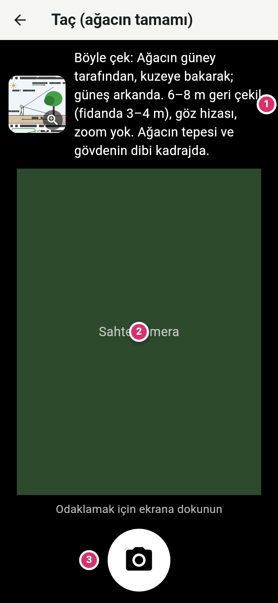

**Ekranın bölümleri**

1. Üstte "Böyle çek" çizimi ve yönerge.
2. Canlı görüntü. Dokunduğunuz yere odaklanır ("Odaklamak için ekrana dokunun"). (Görüntüdeki yeşil alan deneme ortamının sahte kamerasıdır.)
3. Deklanşör.

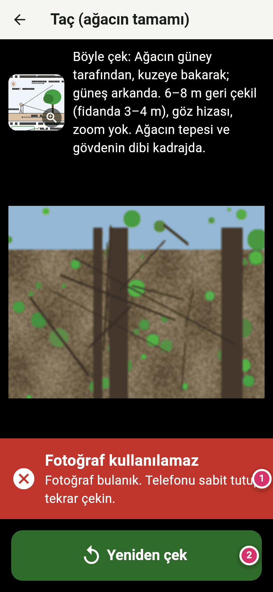

**Ekranın bölümleri (çekimden sonra)**

1. Kalite sonucu: yeşil "Fotoğraf iyi", turuncu "Dikkat" ya da kırmızı "Fotoğraf kullanılamaz" ve nedeni.
2. "Yeniden çek". Sonuç yeşil ya da turuncuysa yanında "Kullan" da vardır.

**Nasıl yapılır**

1. Yönergedeki uzaklık ve açıdan çerçeveleyin; flaş kapalıdır, ışığı arkanıza alın.
2. Gerekirse ekrana dokunup odaklayın, deklanşöre basın. "Fotoğraf kontrol ediliyor" kısa sürer.
3. Sonuç yeşilse "Kullan". Turuncuysa fotoğrafa bakın: ayrıntı görünüyorsa "Kullan", değilse "Yeniden çek". Kırmızıysa yalnız "Yeniden çek" vardır; reddedilen fotoğraf hiçbir yere kaydedilmez.

**Uyarılar ve ret mesajları**

| Mesaj | Ne zaman çıkar | Ne yapmalı |
| --- | --- | --- |
| "Fotoğraf bulanık. Telefonu sabit tutup tekrar çekin." | Fotoğraf net değil (ret). | Telefonu iki elle sabit tutun, odaklayıp yeniden çekin. |
| "Fotoğraf biraz bulanık olabilir. Netse kullanın, değilse tekrar çekin." | Hafif bulanık (uyarı). | Bakıp karar verin. |
| "Fotoğraf çok karanlık. Işığı arkanıza alıp tekrar çekin." | Çok karanlık (ret). | Işığı arkanıza alın; şafakta ve gün batımında çekmeyin. |
| "Fotoğraf biraz karanlık. Ayrıntılar görünüyorsa kullanın." | Loş (uyarı). | Bakıp karar verin. |
| "Fotoğraf çok parlak. Güneşi arkanıza alıp tekrar çekin." | Aşırı parlak (ret). | Güneşi arkanıza alın. |
| "Fotoğraf biraz parlak. Ayrıntılar görünüyorsa kullanın." | Parlak (uyarı). | Bakıp karar verin. |
| "Fotoğraf okunamadı. Tekrar çekin." | Dosya bozuk. | Yeniden çekin. |
| "Yakın plan fotoğrafları için kamera izni gerekli. "Tekrar dene"ye basıp izin verin." | Kamera izni verilmedi. | "Tekrar dene" ve izin verin. |
| "Kamera izni kapalı. Ayarlar → İzinler → Kamera → "İzin ver" seçin, sonra bu ekrana dönün." | İzin kalıcı olarak reddedilmiş. | "Ayarları aç", izni verin, uygulamaya dönün; kamera kendiliğinden açılır. |
| "Bu telefonda arka kamera bulunamadı." | Telefonda arka kamera yok. | Operasyona haber verin; başka telefon gerekir. |
| "Kamera açılamadı. Kamerayı kullanan başka uygulamayı kapatıp tekrar deneyin." | Kamera başka uygulamada açık. | O uygulamayı kapatıp "Tekrar dene". |
| "Fotoğraf çekilemedi: …" | Çekim sırasında hata. | Yeniden çekin. |

## Ziyaret özeti

Yakın plan görevi → "Ziyaret özeti"

**Ne için:** Ziyaretin sonuçlarını kontrol etmek, ziyaret kaydını ve sözlü bilgi sorusunu doldurup ziyareti bitirmek için.
**Kim kullanır:** Saha personeli.

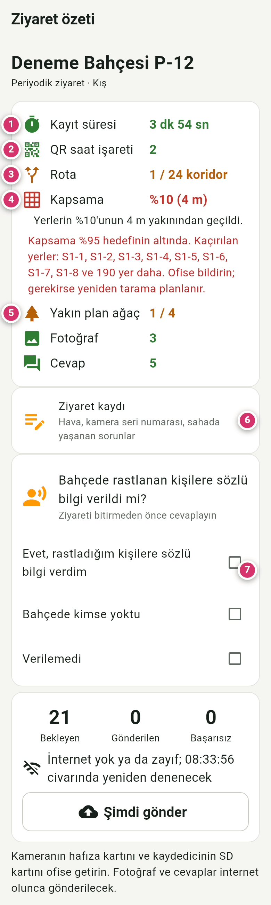

**Ekranın bölümleri**

1. "Kayıt süresi".
2. "QR saat işareti": en az 2 olmalı (başlangıç ve bitiş). Telefon saatiyle gösterilen QR varsa ayrıca "Telefon saatiyle QR".
3. "Rota": "1 / 24 koridor" ve atlanan koridorlar ("Atlanan koridorlar: …").
4. "Kapsama": "%10 (4 m)", açıklama cümlesi ve hedefin altındaysa kırmızı uyarı ile kaçırılan yerler.
5. "Yakın plan ağaç" (biten / planlanan), "Fotoğraf", "Cevap" ("Göremedim" de cevap sayılır).
6. "Ziyaret kaydı" satırı: dokununca [ziyaret kaydı](#ziyaret-kaydı) açılır.
7. "Bahçede rastlanan kişilere sözlü bilgi verildi mi?" kartı.

Envanter ziyaretinde ayrıca "Sınır köşesi" ve "Yaklaşık alan" satırları ve "Sınırı gösteren kişi" kartı vardır. Kartın altında bu ziyaretin gönderim kartı ve hatırlatma bulunur: "Kameranın hafıza kartını ve kaydedicinin SD kartını ofise getirin. Fotoğraf ve cevaplar internet olunca gönderilecek."

Satır renkleri: yeşil tamam, turuncu eksik ya da dikkat, kırmızı sorun (QR 2'den az, kapsama hedefin altında).

**Uyarılar ve ret mesajları**

| Mesaj | Ne zaman çıkar | Ne yapmalı |
| --- | --- | --- |
| "Kapsama %95 hedefinin altında. Kaçırılan yerler: … Ofise bildirin; gerekirse yeniden tarama planlanır." | Kapsama hedefin altında (periyodik %95, envanter %98). | Kayıt durdu; eksik bölümü bu ziyarette taramak mümkün değildir. Operasyonu arayın. |
| "Atlanan koridorlar: …" | Rotada atlanan koridor var. | Operasyona bildirin. |
| "QR saat işareti" kırmızı | 2'den az QR. | Operasyona bildirin; eşleme ofiste zorlaşır. |
| "Özet okunamadı: …" | Telefondaki kayıt okunamadı. | Ekranın fotoğrafını çekip operasyona gönderin. |

## Ziyaret kaydı

Ziyaret özeti → "Ziyaret kaydı"

**Ne için:** Hava, kamera ve sahada yaşanan sorunları ziyaretle birlikte kaydetmek için.
**Kim kullanır:** Saha personeli.

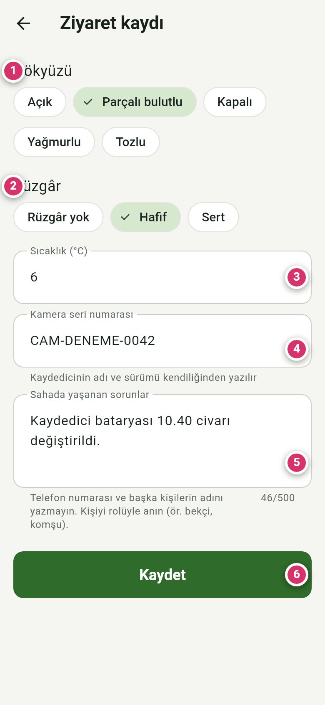

**Ekranın bölümleri**

1. "Gökyüzü": "Açık", "Parçalı bulutlu", "Kapalı", "Yağmurlu", "Tozlu".
2. "Rüzgâr": "Rüzgâr yok", "Hafif", "Sert".
3. "Sıcaklık (°C)".
4. "Kamera seri numarası" (kaydedicinin adı ve sürümü kendiliğinden yazılır).
5. "Sahada yaşanan sorunlar" (en çok 500 karakter).
6. "Kaydet".

**Nasıl yapılır**

1. Özette "Ziyaret kaydı"na dokunun.
2. Alanları doldurun, "Kaydet". Özete dönersiniz; satırda girdiğiniz hava görünür ("Parçalı bulutlu · 6 °C · Hafif").
3. Değiştirmek için yeniden açıp kaydedin; en yeni kayıt geçerlidir.

Ziyaret kaydı isteğe bağlıdır ama her ziyarette doldurun; hava ofiste ziyaretle birlikte görünür. "Sahada yaşanan sorunlar"a telefon numarası ve kişi adı yazmayın; yazarsanız "Telefon numarası yazmayın" çıkar ve "Kaydet" kapanır.

## Sözlü bilgi sorusu ve ziyareti bitirmek

Ziyaret özetinin alt kısmı

**Ne için:** Bahçede rastladığınız kişilere sözlü bilgi verip vermediğinizi kaydetmek ve ziyareti kapatmak için.
**Kim kullanır:** Saha personeli.

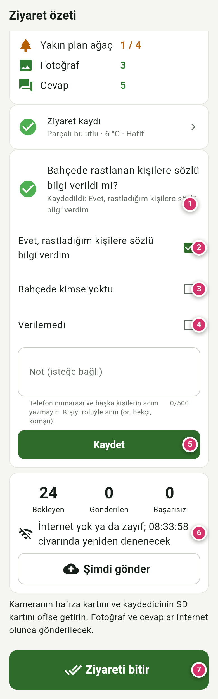

**Ekranın bölümleri**

1. Kaydedilen cevap: "Kaydedildi: …" (kaydetmeden önce "Ziyareti bitirmeden önce cevaplayın").
2. "Evet, rastladığım kişilere sözlü bilgi verdim".
3. "Bahçede kimse yoktu".
4. "Verilemedi": seçilince not "Neden verilemedi?" adını alır ve zorunlu olur.
5. "Kaydet".
6. Bu ziyaretin gönderim kartı.
7. "Ziyareti bitir".

**Nasıl yapılır**

1. Rastladığınız kişilere kısaca söyleyin: bahçe denetimi için görüntü kaydı yapılıyor, kişiler hedeflenmiyor, ayrıntı levhadaki adreste.
2. Cevabı seçin. "Verilemedi" ise nedenini yazın (kişiyi rolüyle anın). Diğer cevaplarda not isteğe bağlıdır.
3. "Kaydet". Cevabı değiştirirseniz yeniden kaydedin; en yeni cevap geçerlidir.
4. Envanterde "Sınırı gösteren kişi" kaydedilmediyse özetteki kartta kaydedin.
5. "Ziyareti bitir"e dokunun. Görev listesine dönersiniz, kart "Tamamlandı" olur ve gönderim başlar. İnternet yoksa kayıtlar bekler.

"Ziyareti bitir", sözlü bilgi cevabı (envanterde ayrıca sınırı gösteren kişi) kaydedilmeden açılmaz. Bu ekrandan geri tuşuyla çıkılmaz.

| Mesaj | Ne zaman çıkar | Ne yapmalı |
| --- | --- | --- |
| "Bu alan gerekli" | "Verilemedi" seçili, neden boş. | Nedeni yazın. |
| "Telefon numarası yazmayın" / "En çok 500 karakter" | Notta. | Düzeltin. |
| "Kaydedilemedi" | Yazma hatası. | Yeniden deneyin. |

## Doğrulama turu

"Bugünkü görevler" → "Doğrulama turu" kartı

**Ne için:** Envanterden sonra ofisin emin olamadığı yerlere (boş yer, belirsiz konum, çok gövdeli olabilir…) gidip yerinde ne olduğunu kaydetmek için. Turda kayıt, ön kontrol ve QR yoktur.
**Kim kullanır:** Saha personeli.

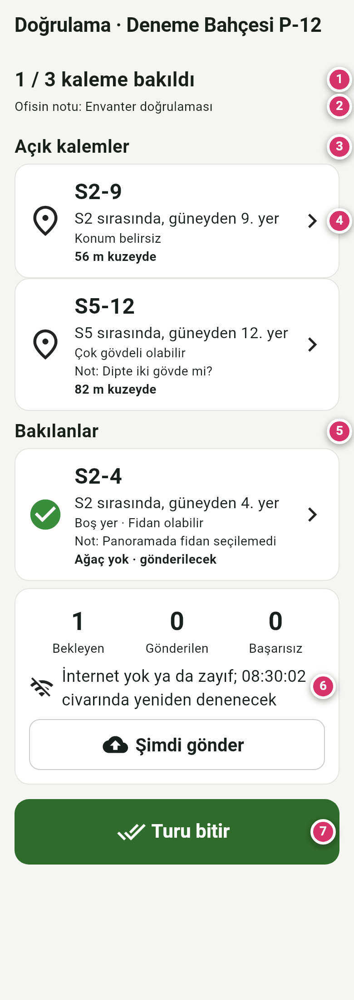

**Ekranın bölümleri**

1. "1 / 3 kaleme bakıldı".
2. "Ofisin notu: …" (turun notu).
3. "Açık kalemler": yürüme sırasıyla (sıra numarası, sonra sıradaki yer).
4. Kalem kartı: yer kodu, yer tarifi ("S2 sırasında, güneyden 9. yer"), nedenler, ofisin kaleme notu, konum varsa uzaklık ve yön ("56 m kuzeyde"; 3 m içinde "Buradasınız").
5. "Bakılanlar": sonucu kaydedilen kalemler ("Ağaç yok · gönderilecek", gönderilince "gönderildi", fotoğraf varsa "fotoğraflı").
6. Turun gönderim kartı.
7. "Turu bitir".

Sunucunun kabul etmediği kalemler en üstte, kırmızı "Gönderilemeyenler" başlığı altında, sade bir nedenle görünür. Kaydedici bağlı değilse üstte "Kaydediciye bağlan" çıkar.

**Nasıl yapılır**

1. Kaydediciyi bağlayın (uzaklık ve yön için; şart değil).
2. İlk açık kalemin yer tarifine göre yürüyün. Yön kuzeye göredir; telefonun pusulası kullanılmaz. Boş yerler de sayılır.
3. Kaleme dokunun, [kalem ekranında](#doğrulama-kalemi) sonucu kaydedin.
4. Bütün kalemlere bakınca "Bütün kalemlere bakıldı." yazar. "Turu bitir"e dokunun; gönderim başlar ve görev "Tamamlandı" olur. Kalem kalmışsa "Turu bitir" turu kapatmaz; görev listede açık kalır, sonra devam edebilirsiniz.

**Uyarılar ve ret mesajları**

| Mesaj | Ne zaman çıkar | Ne yapmalı |
| --- | --- | --- |
| "Konum yok: yeri kod ve sıra sayımıyla bulun." | Kaydedici konum göndermiyor ya da bağlı değil. | Sıra numarasını ve sıradaki yer sayısını sayarak bulun. |
| "Ofis bu kalemi kapatmış; sonucunuz kaydedilmedi. Gerekirse ofise haber verin." | Siz bakarken ofis kalemi kapattı. | Gerekirse operasyonu arayın. |
| "Kalem sunucuda bulunamadı (silinmiş olabilir)." | Kalem artık yok. | Operasyona bildirin. |
| "Bu kalem için yetkiniz yok. Ofise haber verin." | Yetki sorunu. | Operasyonu arayın. |
| "Sonuç eksik gönderildi. Kalemi yeniden kaydedin." | Kayıt eksik ulaştı. | Kalemi açıp yeniden kaydedin. |
| "Sunucu sonucu kabul etmedi (…). Ofise haber verin." | Başka bir ret. | Operasyonu arayın. |

## Doğrulama kalemi

Doğrulama turu → kalem

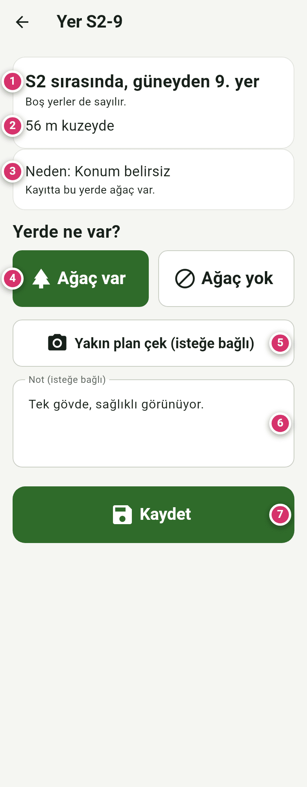

**Ekranın bölümleri**

1. Yer tarifi ("S2 sırasında, güneyden 9. yer"; ara ağaçta "9. ile 10. yer arasında") ve "Boş yerler de sayılır."
2. Uzaklık ve yön ya da "Konum yok: kod ve sıra sayımıyla bulun."
3. "Neden: …", ofisin notu ve kayıttaki durum ("Kayıtta bu yerde ağaç var." / "Kayıtta bu yer boş.").
4. "Yerde ne var?": "Ağaç var" / "Ağaç yok".
5. "Yakın plan çek (isteğe bağlı)": gövdeyi dibiyle birlikte çerçeveye alın.
6. "Not (isteğe bağlı)".
7. "Kaydet".

**Nasıl yapılır**

1. Yere ulaşınca "Ağaç var" ya da "Ağaç yok"a dokunun (zorunlu).
2. Gerekirse yakın plan çekin ve kısa bir not yazın (ör. "Tek gövde, sağlıklı görünüyor."). Telefon numarası ve kişi adı yazmayın.
3. "Kaydet". Tura dönersiniz; kalem "Bakılanlar"a geçer ve internet varsa hemen gönderilir.
4. Yanlış kaydettiyseniz kalemi yeniden açıp tekrar kaydedin; en yeni sonuç geçerlidir.

"Kaydet", "Ağaç var" ya da "Ağaç yok" seçilmeden açılmaz. Kaydetmeden çıkarsanız çekilen fotoğraf silinir.

## İnternetsiz çalışma ve gönderim

- **Her kayıt önce telefona yazılır.** Ön kontrol cevapları, QR'lar, köşeler, fotoğraflar, cevaplar, notlar, itiraz ve yapılamadı kayıtları internet olmadan da kaydedilir ve gönderim kuyruğuna girer. Uygulamayı kapatıp açmak, telefonu yeniden başlatmak kayıtları silmez.
- **Gönderim kendiliğinden olur:** uygulama açılınca, internet geri gelince, "Ziyareti bitir" ve "Turu bitir" ile, doğrulama kalemi kaydedilince ve "Şimdi gönder" ile. Kayıtlar eklendikleri sırayla gider; aynı kaydın ikinci kez gitmesi sunucuda kopya açmaz.
- **İnternet zayıfsa** gönderim durur ve kendisi yeniden dener. Akşam Wi-Fi'ye bağlanıp uygulamayı açın; gönderim kartında "Her şey gönderildi" görünene kadar bekleyin.
- **Fotoğraflar** sunucuya ulaştığı doğrulanınca telefondan silinir. Gönderilmeden telefonu sıfırlamayın, uygulamayı kaldırmayın.
- **Görev listesi** her başarılı indirmede telefonda saklanır; internet yokken son liste kullanılır.
- **Kabul edilmeyen kayıt** telefonda kalır; ofis nedeni düzeltince "Ayrıntılar" → "Yeniden dene".
- **Kartlar:** kameranın hafıza kartı ve kaydedicinin SD kartı internetle gönderilmez; elden ofise gelir (ziyaret başına yaklaşık 90 GB).

## Ekran görüntülerini yeniden üretmek

Geliştirici içindir. Görüntüler `apps/field/test/kilavuz/screens_test.dart` testiyle, telefon donanımı yerine sahte kaydedici, sahte kamera ve bellekte veritabanıyla, yalnız sentetik veriyle üretilir; Android cihaz ya da sunucu gerekmez. `apps/field` içinde (`mobile` devcontainer'ı ya da Flutter 3.47 kurulu bir makine):

```bash
cd apps/field
flutter pub get
./tool/kilavuz_screens.sh
```

Betik testi `--dart-define=KILAVUZ_SHOTS=true` ile çalıştırır, görüntüleri `docs/kilavuz/img/saha/` altına 390×844 mantıksal boyutta (2× piksel) yazar ve `pngquant` kuruluysa küçültür. Yazılar Flutter SDK'daki Roboto ve Material simge yazı tipiyle çizilir. Normal `flutter test` (CI dahil) bu testleri atlar.

---

Önceki: [06 · Ofis aracı: gövde üçgenleme](06-ofis-araci-ucgenleme.md) · Sonraki: [08 · İade, çıkarma, mutabakat, KVKK](08-iade-cikarma-mutabakat-kvkk.md)
