# 08 · İade, çıkarma, mutabakat, KVKK

[← Kılavuz dizini](README.md)

Bu bölüm parayla ve kişisel veriyle ilgili takip ekranlarını anlatır: "İadeler", "Bahçe çıkarma" (liste ve tek kayıt), "Ziyaret mutabakatı", "KVKK talepleri", "Bildirimler" ve "Denetim kaydı". Hepsi sol menüdedir; panodaki sayaçlar da bu listeleri süzülmüş açar ([02 · Operasyon panosu](02-operasyon-pano.md)). İadeyi isteme, havale kaydetme ve siparişten bahçe çıkarma sipariş ve ödeme sayfalarında yapılır; bkz. [03 · Başvuru, teklif, sipariş, ödeme](03-basvuru-teklif-siparis-odeme.md).

Bu ekranlardaki işlemlerin çoğu müşteriye SMS gönderir ve hepsi denetim kaydına yazılır. Ekranlarda kişisel veri vardır; ekran görüntüsü alıp başka kanala kopyalamayın.

## İadeler

`/operasyon/iade`

**Ne için:** İstenen iadeleri işlemek, havale iadesini kaydetmek, başarısız ya da sonucu belirsiz kart iadelerini sonuçlandırmak için.
**Kim kullanır:** Operasyon.

İade iki yoldan açılır: ödeme ayrıntısında elle istenir ya da bahçe çıkarma tamamlanınca sistem kendiliğinden açar (o satırda "Sistem" yazar). Sayfanın üstünde: "Önce istenen, başarısız ve belirsiz (15 dakikadan uzun süredir işlenen) iadeler gelir."

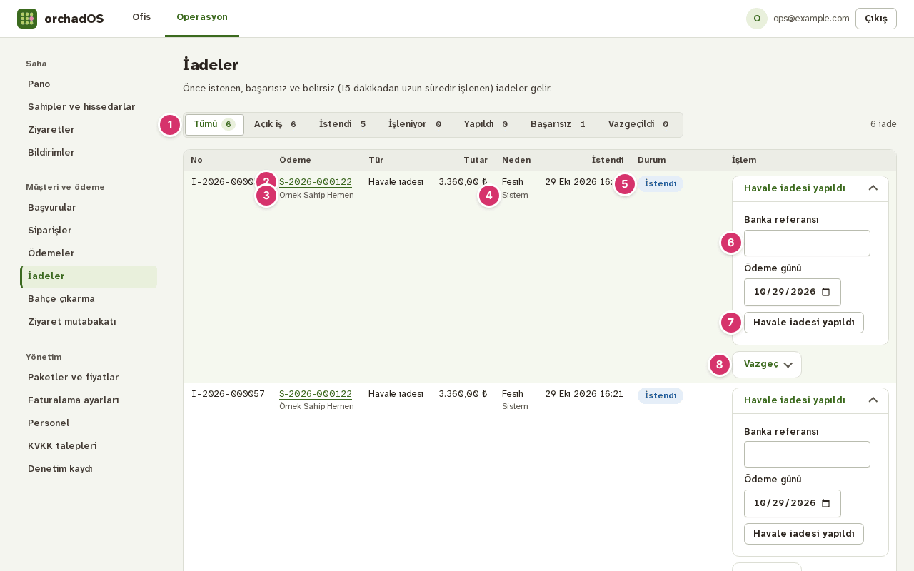

**Ekranın bölümleri**

1. Durum sekmeleri ve sayıları: "Tümü", "Açık iş" (istenen, başarısız ya da belirsiz), "İstendi", "İşleniyor", "Yapıldı", "Başarısız", "Vazgeçildi". Sağda toplam ("6 iade").
2. "Ödeme": iadenin bağlı olduğu siparişin numarası; tıklayınca ödeme ayrıntısı açılır.
3. Müşterinin adı.
4. "Neden" ("Cayma", "Yapılmayan ziyaret", "Fesih", "Fazla ödeme", "Kapalı siparişe ödeme", "Ödeme sağlayıcısı uyuşmazlığı", "Jest", "Diğer"); altında "Sistem" yazıyorsa iadeyi sistem açmıştır.
5. "Durum" rozeti.
6. "Havale iadesi yapıldı" bölümünde "Banka referansı" ve "Ödeme günü".
7. "Havale iadesi yapıldı" düğmesi.
8. "Vazgeç": iade isteğini iptal eder (not alanıyla açılır).

Diğer sütunlar: "No" (I-2026-…), "Tür" ("Kart iadesi", "İptal (aynı gün)", "Havale iadesi"), "Tutar", "İstendi" (zaman).

### Havale iadesini kaydetmek

1. Bankadan iadeyi gönderin.
2. Satırdaki "Havale iadesi yapıldı" bölümüne bankanın verdiği referansı ve ödeme gününü girin (gün bugünden sonra olamaz).
3. "Havale iadesi yapıldı"ya basın. Üstte "Havale iadesi tamamlandı." yazar; durum "Yapıldı" olur ve müşteriye "İade yapıldı" SMS'i gider.

### Kart iadesini işlemek ve başarısız iadeyi sonuçlandırmak

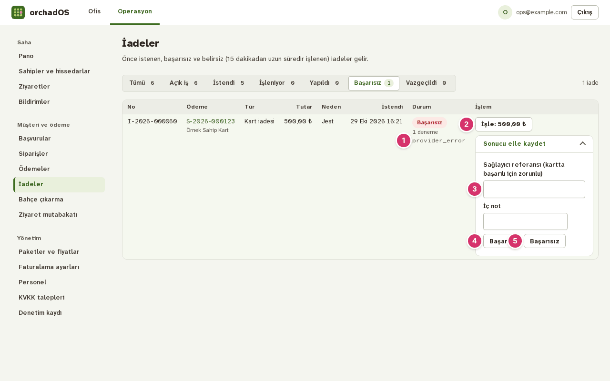

1. Durum "Başarısız", altında deneme sayısı ("1 deneme") ve sağlayıcının hata kodu.
2. "İşle: 500,00 ₺": kart iadesini ödeme sağlayıcısına şimdi gönderir. İstenen kart iadesinde ve yeniden denenebilir başarısız iadede çıkar.
3. "Sonucu elle kaydet" bölümünde "Sağlayıcı referansı (kartta başarılı için zorunlu)" ve "İç not".
4. "Başarılı": sağlayıcı panelinde iadenin yapıldığını gördüyseniz.
5. "Başarısız": iadenin yapılmadığını kesinleştirir; bundan sonra "İşle" çıkmaz.

Adımlar:

1. "İşle"ye basın. Sonuç üstte yazar: "İade ödeme sağlayıcısında işlendi." ya da "İade sağlayıcıda başarısız oldu ya da sonucu belirsiz; İadeler sayfasından izleyin."
2. Başarısız olduysa bir kez daha "İşle" deneyin.
3. Hâlâ olmuyorsa ya da satırda kırmızı "Belirsiz" rozeti varsa (15 dakikadan uzun süredir işleniyor) ödeme sağlayıcısının panelinden durumu kontrol edin, "Sonucu elle kaydet"i açın:
    - iade yapılmışsa sağlayıcı referansını girip "Başarılı",
    - yapılmamışsa not yazıp "Başarısız".
4. "Başarısız" kaydettikten sonra parayı başka yolla (örneğin havaleyle) iade etmeniz gerekiyorsa ödeme sayfasından yeni bir iade isteyin.

**Düğmeler ve alanlar**

| Düğme / alan | Ne yapar |
| --- | --- |
| Durum sekmeleri | Listeyi bir duruma daraltır. |
| Sipariş numarası | Ödeme ayrıntısını açar. |
| "İşle: <tutar>" | Kart iadesini sağlayıcıya gönderir. |
| "Havale iadesi yapıldı" ("Banka referansı", "Ödeme günü") | Bankadan yapılan iadeyi kaydeder. |
| "Sonucu elle kaydet" ("Sağlayıcı referansı", "İç not", "Başarılı", "Başarısız") | Başarısız ya da belirsiz kart iadesinin sonucunu kaydeder. |
| "Vazgeç" ("İç not", "Vazgeç") | İstenen iadeyi iptal eder. Ödeme sağlayıcısı uyuşmazlığı için sistemin açtığı iadede çıkmaz. |

**Uyarılar ve ret mesajları**

| Mesaj | Ne zaman çıkar | Ne yapmalı |
| --- | --- | --- |
| "Bekleyen iade yok" / "İade yok" | Liste ya da "Açık iş" sekmesi boş. | Bir şey yapmanız gerekmez. |
| "Ödeme servisine ulaşılamadı; biraz sonra yeniden deneyin." | "İşle" sırasında ödeme servisi cevap vermedi. | Birkaç dakika sonra yeniden deneyin. |
| "Bu iade işlenmeye açık değil." | İade bu arada işlendi ya da iptal edildi. | Sayfayı yenileyin. |
| "İade tutarı ödenen tutarı aşıyor." | Ödemede iade edilebilecek tutar kalmadı. | Ödeme ayrıntısına bakın. |
| "Kayıt bu arada değişti; sayfayı yenileyip yeniden deneyin." | Başka biri aynı iadeyi değiştirdi. | Sayfayı yenileyin. |
| "Kontrol edin: Banka referansı." (ya da başka bir alan) | Alan boş ya da geçersiz. | Alanı düzeltin. |

## Bahçe çıkarma listesi

`/operasyon/cikarma`

**Ne için:** Bahçe çıkarma taleplerini çıkış gününe göre görmek, yaklaşanları ve engellileri bulmak için.
**Kim kullanır:** Operasyon.

Çıkarma, müşteri portaldan bahçesini çıkarınca ya da siz müşteri veya sipariş sayfasından çıkarma açınca bu listeye düşer. "Talepler çıkış gününde kendiliğinden işler; engelli kayıtlar ödeme bekleyen bir sipariş yüzünden tamamlanamadı."

> Bahçe ekleme ve çıkarma "Faturalama ayarları"ndaki "Üyelik boyunca bahçe ekleme ve çıkarma açık" ayarına bağlıdır. Ayar kapalıyken yeni çıkarma açılamaz; açılmış kayıtlar işlemeye devam eder ([09 · Fiyat, ayarlar ve personel](09-fiyat-ayarlar-personel.md)).

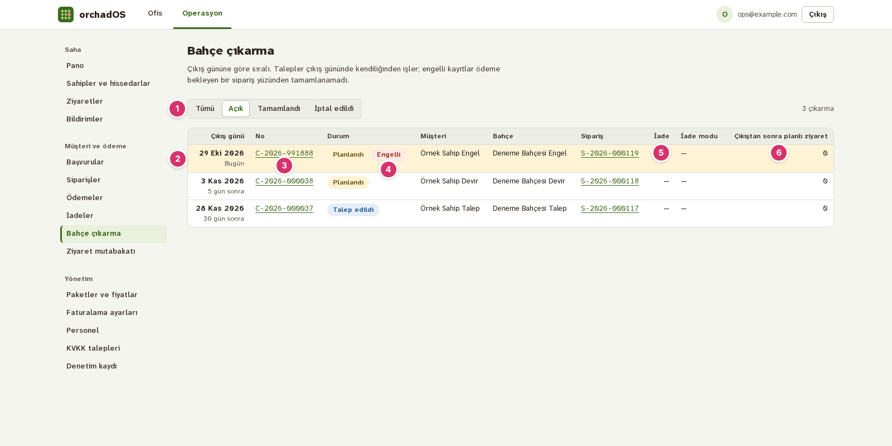

**Ekranın bölümleri**

1. Sekmeler: "Tümü", "Açık" (varsayılan: talep edilen ve planlanan), "Tamamlandı", "İptal edildi".
2. "Çıkış günü" ve ne kadar kaldığı ("Bugün", "5 gün sonra", "3 gün geçti").
3. "No" (C-2026-…): kaydı açar.
4. "Durum": "Talep edildi", "Planlandı", "Tamamlandı", "İptal edildi"; ayrıca kırmızı "Engelli", "Cayma" ya da "Dönem sonunda" rozeti. Engelli satır sarı zeminlidir.
5. "İade": tamamlanan çıkarmada hesaplanan iade tutarı.
6. "Çıkıştan sonra planlı ziyaret": çıkışta iptal edilecek planlı ziyaret sayısı.

Diğer sütunlar: "Müşteri", "Bahçe", "Sipariş", "İade modu".

### Günlük kontrol

1. "Açık" sekmesinde "Bugün" ve birkaç gün sonrasını gösteren satırlara bakın; "Talep edildi" olanların tarihini teyit edin (aşağıda).
2. "Engelli" satırı varsa açın ve engeli kaldırın.
3. "Çıkıştan sonra planlı ziyaret" 0'dan büyükse o ziyaretleri çıkıştan önceye almak isteyip istemediğinize karar verin; yoksa çıkışta iptal edilirler.

**Uyarılar**

| Mesaj | Ne zaman çıkar | Ne yapmalı |
| --- | --- | --- |
| "Açık çıkarma yok" | Açık kayıt yok. | Bir şey yapmanız gerekmez. |
| "Liste 1000 kayıtla sınırlı ve en erken çıkış günleri önce geliyor; en yeni kayıtlar listede yok. …" | Çok sayıda kayıt var. | Kaydı müşteri ya da parsel sayfasından açın. |

## Bahçe çıkarma kaydı

`/operasyon/cikarma/<kayıt>`

**Ne için:** Bir çıkarmanın tarihini teyit etmek ya da değiştirmek, erişim süresini belirlemek, gerekirse hemen tamamlamak ya da iptal etmek; iade hesabını ve parseldeki işleri görmek için.
**Kim kullanır:** Operasyon.

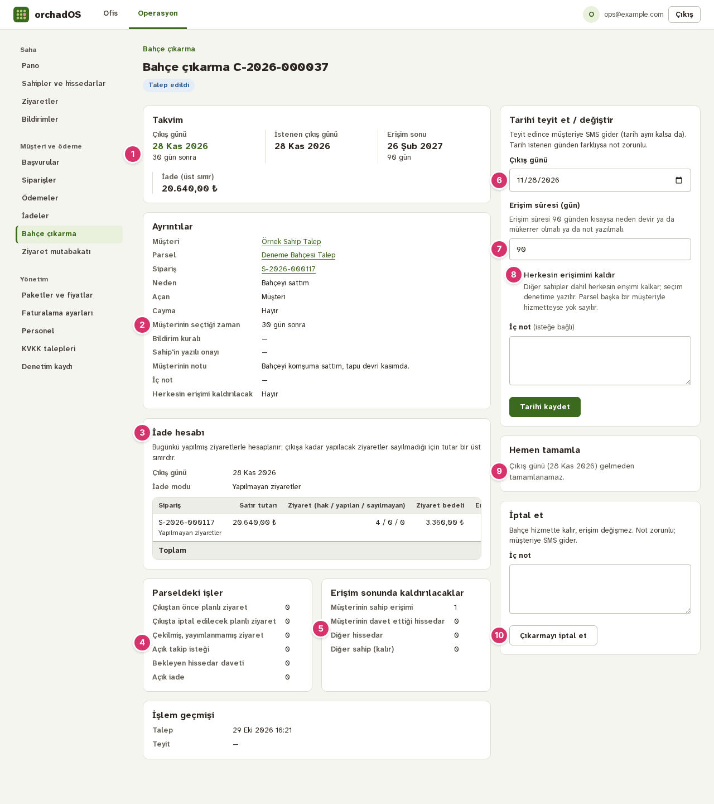

**Ekranın bölümleri**

1. "Takvim": "Çıkış günü", "İstenen çıkış günü", "Erişim sonu" (ve gün sayısı), "İade (üst sınır)".
2. "Ayrıntılar": müşteri, parsel, sipariş, "Neden", "Açan" ("Müşteri", "Operasyon", "Sistem (hizmet sonu)"), "Cayma", "Müşterinin seçtiği zaman" ("Hemen (ertesi gün)", "30 gün sonra", "Dönem sonunda", "Cayma"), "Bildirim kuralı", "Sahip'in yazılı onayı", "Müşterinin notu", "İç not", "Herkesin erişimi kaldırılacak".
3. "İade hesabı": bugünkü yapılmış ziyaretlerle hesaplanır. "Çıkışa kadar yapılacak ziyaretler sayılmadığı için tutar bir üst sınırdır." Tabloda sipariş satırı, "Satır tutarı", "Ziyaret (hak / yapılan / sayılmayan)", "Ziyaret bedeli", "Envanter payı", "Hesap", "Önceki iadeler", "İade", "İçindeki KDV".
4. "Parseldeki işler": çıkıştan önce ve çıkışta iptal edilecek planlı ziyaretler, çekilmiş ama yayımlanmamış ziyaretler, açık takip istekleri, bekleyen hissedar davetleri, açık iadeler.
5. "Erişim sonunda kaldırılacaklar": müşterinin sahip erişimi, davet ettiği hissedarlar, diğer hissedarlar; "Diğer sahip (kalır)".
6. "Tarihi teyit et / değiştir" bölümünde "Çıkış günü".
7. "Erişim süresi (gün)".
8. "Herkesin erişimini kaldır" kutusu.
9. "Hemen tamamla": çıkış günü gelmediyse "Çıkış günü (28 Kas 2026) gelmeden tamamlanamaz."
10. "İptal et" bölümünde "İç not" ve "Çıkarmayı iptal et".

En altta "İşlem geçmişi": talep, teyit, tamamlanma, iptal ve erişimin kaldırıldığı zamanlar.

### Müşterinin talebini teyit etmek

Müşteri portaldan çıkarma isteyince kayıt "Talep edildi" olur. Teyit edince "Planlandı" olur.

1. Kaydı açın; "Takvim"de istenen günü, "İade hesabı"nda tutarı kontrol edin.
2. "Çıkış günü"nü olduğu gibi bırakın (ya da değiştirin; o zaman "İç not" zorunludur).
3. "Erişim süresi (gün)"ü kontrol edin. Varsayılan ayardaki süredir (90 gün): bahçe çıktıktan sonra müşteri raporlarını bu kadar gün salt okunur görür.
4. "Tarihi kaydet"e basın. Üstte "Çıkış tarihi kaydedildi." yazar. Teyitte tarih aynı kalsa da müşteriye SMS gider; sonraki her tarih değişikliğinde de gider.

Çıkış gününde sistem çıkarmayı kendiliğinden tamamlar: planlı ziyaretler iptal edilir, parsel pasife alınır, iade satırları açılır ve müşteriye SMS gider.

### Erişim süresi ve "Herkesin erişimini kaldır"

- **Erişim süresi:** Ayardaki süreden (90 gün) kısa bir süre yalnızca neden "Devir" ya da "Mükerrer kayıt" ise ya da "İç not" yazılırsa kabul edilir ("Erişim süresi 90 günden kısaysa neden devir ya da mükerrer olmalı ya da not yazılmalı."). Devirde erişim 0 gündür; eski sahip raporları görmez.
- **Süre bitince kendiliğinden kalkan erişim:** müşterinin kendi sahip erişimi, müşterinin davet ettiği hissedarlar ve parselde başka sahip kalmıyorsa bütün hissedarlar. Parseldeki diğer sahipler kalır.
- **"Herkesin erişimini kaldır":** işaretlerseniz erişim süresinin sonunda **diğer sahipler dahil** herkesin erişimi kalkar. Sınırları:
    - Seçiminiz denetim kaydına yazılır.
    - Parsel bugün ya da sonrası için başka bir müşterinin siparişindeyse (aktif, dönemi başlamamış ya da ödeme bekleyen) seçim yok sayılır.
    - Kendi siparişi bugün ya da sonrasını kapsayan bir kişinin erişimi hiçbir durumda kaldırılmaz.
    - Yalnızca erişim kaldırılır; raporlar, görüntüler ve ölçümler silinmez (saklama süresi boyunca durur).
  Bu kutuyu yalnızca parselin tamamıyla ilişiğin kesilmesi gereken durumlarda (örneğin parselin tümüyle el değiştirmesi ve diğer sahiplerin de görmemesi gerektiğinin yazılı olarak bildirilmesi) kullanın; emin değilseniz boş bırakın.

### Ops'un açtığı çıkarma

Şirket bir bahçeyi yalnızca sözleşmede sayılan haklı sebeplerle çıkarabilir. Bildirim süresi en az 30 gündür; güvenlik tehdidi, mükerrer kayıt, yetkisizlik ve üçüncü kişi itirazında süre aranmaz. Daha erken bir tarih yalnızca sahibin yazılı onayıyla verilir. Çıkarmayı sipariş ya da müşteri sayfasındaki "Bahçeyi çıkar" ile açarsınız ([03 · Başvuru, teklif, sipariş, ödeme](03-basvuru-teklif-siparis-odeme.md)); kayıt doğrudan "Planlandı" açılır ve müşteriye SMS gider.

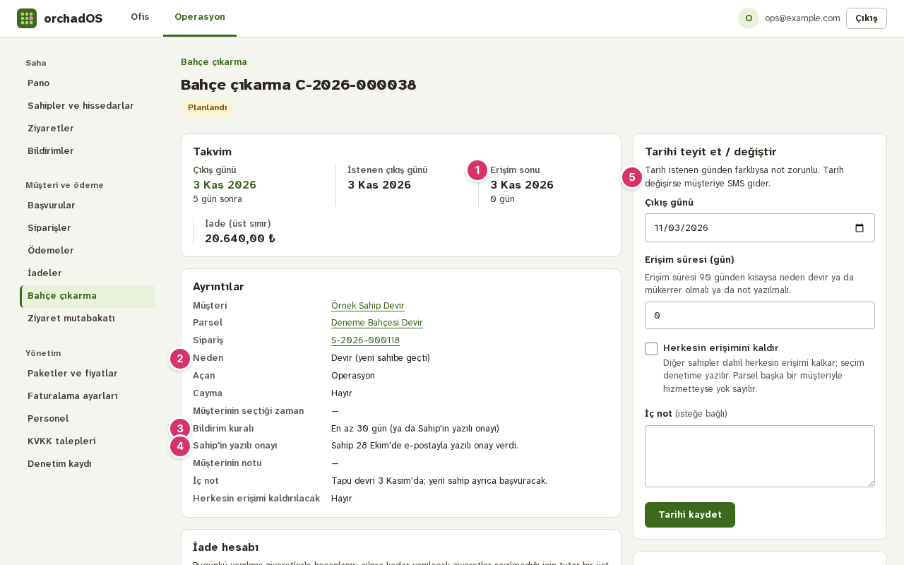

1. "Erişim sonu": devirde çıkış günüyle aynıdır (0 gün).
2. "Neden": "Devir (yeni sahibe geçti)".
3. "Bildirim kuralı": "En az 30 gün (ya da Sahip'in yazılı onayı)".
4. "Sahip'in yazılı onayı": onayın nasıl ve ne zaman alındığı (iç kayıt).
5. Kural notu: "Tarih istenen günden farklıysa not zorunlu. Tarih değişirse müşteriye SMS gider."

Üyeliği bütünüyle sonlandırmanın önerilen yolu müşteri sayfasındaki "Tüm bahçeleri çıkar"dır. Sipariş sayfasındaki "Siparişi feshet" yalnızca idari durumlar içindir: hizmet bugün biter, geri alınamaz, para kendiliğinden iade edilmez ve parsele dokunmaz.

### Engelli çıkarma

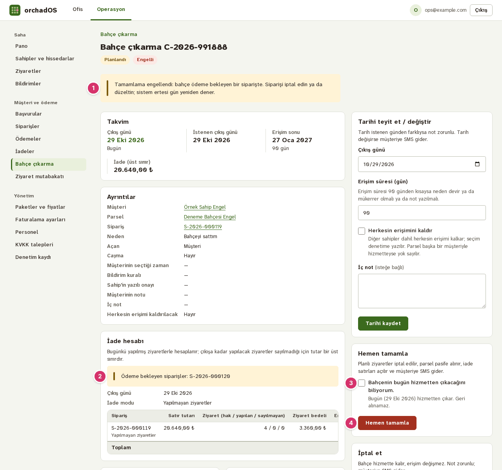

1. "Tamamlama engellendi: bahçe ödeme bekleyen bir siparişte. Siparişi iptal edin ya da düzeltin; sistem ertesi gün yeniden dener."
2. "Ödeme bekleyen siparişler: S-2026-…": engelleyen sipariş (çoğu zaman ödemesi başlamış bir yenileme).
3. Onay kutusu: "Bahçenin bugün hizmetten çıkacağını biliyorum." Altında "Bugün (29 Eki 2026) hizmetten çıkar. Geri alınamaz."
4. "Hemen tamamla".

Yapılacaklar:

1. Engelleyen siparişi açın. Ödemesi alınmadıysa siparişi iptal edin; ödeme alındıysa müşteriyle konuşup iadesini ve iptalini yapın ([03 · Başvuru, teklif, sipariş, ödeme](03-basvuru-teklif-siparis-odeme.md)).
2. Engel kalkınca sistem ertesi gün yeniden dener; beklemeden bitirmek için çıkarma kaydında kutuyu işaretleyip "Hemen tamamla"ya basın.

### Hemen tamamlamak ve iptal etmek

- **Hemen tamamla:** Çıkış günü geldiyse çıkar. Kutuyu işaretleyip "Hemen tamamla"ya basın. "Planlı ziyaretler iptal edilir, parsel pasife alınır, iade satırları açılır ve müşteriye SMS gider." Üstte "Bahçe hizmetten çıkarıldı." yazar. Geri alınamaz; aynı bahçe ancak ek teklifle yeniden eklenir.
- **İptal et:** "Bahçe hizmette kalır, erişim değişmez. Not zorunlu; müşteriye SMS gider." "İç not"u yazıp "Çıkarmayı iptal et"e basın; üstte "Çıkarma iptal edildi; müşteriye SMS gidecek." yazar.

### Tamamlanan çıkarma

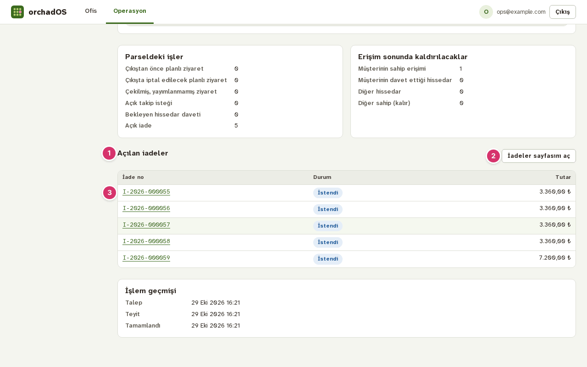

1. "Açılan iadeler": sistemin açtığı iade satırları (her ödeme kalemi için ayrı satır olabilir).
2. "İadeler sayfasını aç": iadeleri işlemek için "İadeler" ekranına gider.
3. İade satırı: numara, durum ("İstendi"), tutar.

Tamamlanan kayıtta "Takvim"de "İade tutarı" yazar ve "İade hesabı" "Kayıttaki hesap (tamamlanırken donduruldu)" olur. "Ayrıntılar"a "İade modu" eklenir ("Yapılmayan ziyaretler", "Cayma", "Mükerrer kayıt", "Ops kararı", "İade yok"). Ayarda iade modu "Ops kararı" ise tutar yalnızca hesaplanır, iade satırı açılmaz; iadeyi siz istersiniz.

**Düğmeler ve alanlar**

| Düğme / alan | Ne yapar |
| --- | --- |
| Müşteri, parsel, sipariş bağlantıları | İlgili sayfayı açar. |
| "Çıkış günü" | Çıkış tarihini belirler; bugünden önce olamaz. |
| "Erişim süresi (gün)" | Çıkıştan sonra raporların salt okunur görüneceği gün sayısı (0–365). |
| "Herkesin erişimini kaldır" | Süre sonunda diğer sahipler dahil herkesin erişimini kaldırır (sınırları yukarıda). |
| "İç not" | Müşteri görmez; tarih istenen günden farklıysa ya da erişim kısaysa zorunlu. |
| "Tarihi kaydet" | Teyit eder ya da değiştirir; müşteriye SMS gider. |
| "Bahçenin bugün hizmetten çıkacağını biliyorum." + "Hemen tamamla" | Bugün çıkarır. Yalnızca çıkış günü geldiyse çıkar. |
| "İç not" + "Çıkarmayı iptal et" | Çıkarmayı iptal eder; müşteriye SMS gider. |
| "İadeler sayfasını aç" | İadeler ekranını açar. |

**Uyarılar ve ret mesajları**

| Mesaj | Ne zaman çıkar | Ne yapmalı |
| --- | --- | --- |
| "Tamamlama engellendi: …" | Bahçe ödeme bekleyen bir siparişte. | Yukarıdaki "Engelli çıkarma" adımları. |
| "<tutar> tutar ödeme kalemlerine dağıtılamadı; bu kısmı ödeme ayrıntısından elle iade edin." | İadenin bir kısmı ödemelere bağlanamadı. | O kısmı ödeme ayrıntısından iade isteyin. |
| "Bu siparişte satıra bağlanamayan iade var; iade elle açılmalı." | Siparişte daha önce satırsız iade yapılmış. | İadeyi ödeme ayrıntısından elle açın. |
| "Çıkış günü (…) gelmeden tamamlanamaz." | Çıkış günü gelmemiş. | Tarihi bugüne alıp kaydedin (not yazarak) ya da günü bekleyin. |
| "Çıkış tarihi henüz gelmedi." | Aynı durum, kaydederken. | Aynı. |
| "Bu sebeple çıkarmada en az 30 gün (ilçedeki hizmetin sona ermesinde 60 gün) önceden bildirim gerekir; daha erken bir tarih yalnızca Sahip'in yazılı onayıyla verilir." | Ops'un açtığı çıkarmada tarih çok yakın. | Tarihi ileri alın ya da sahibin yazılı onayını kaydedin. |
| "İlçedeki hizmetin sona ermesinde çıkış günü, bugünün içinde bulunduğu ve ödenmiş ziyaret penceresinin bitiminden önce olamaz." | İlçe kapanışında tarih erken. | Pencere bitiminden sonrasını seçin. |
| "Bu çıkarma talebi artık açık değil." | Kayıt tamamlanmış ya da iptal edilmiş. | Sayfayı yenileyin. |
| "Bu bahçe ödeme bekleyen bir siparişte; önce o siparişi iptal edin ya da düzeltin." | Tamamlarken parsel ödeme bekleyen bir siparişte. | Siparişi düzeltin. |
| "Kontrol edin: Not." / "Kontrol edin: Erişim süresi (gün)." / "Kontrol edin: Onay kutusu." | Zorunlu not boş, erişim süresi kuralı tutmuyor ya da kutu işaretlenmedi. | Alanı düzeltin. |
| "Bahçe ekleme ve çıkarma şu anda kapalı; bizimle iletişime geçin." | Ayar kapalıyken yeni çıkarma açılmak istendi. | Ayarın açılması için yöneticiye başvurun. |

## Ziyaret mutabakatı

`/operasyon/mutabakat`

**Ne için:** Yapılamayan periyodik ziyaretlerin bedelini sözleşmedeki sürede (14 gün) iade etmek ya da sahip isterse sonraki pencereye aktarmak için.
**Kim kullanır:** Operasyon.

Sistem her ziyaret penceresinin ve hizmet döneminin sonunda yapılan ziyaretleri hakla karşılaştırır; eksik varsa kendiliğinden bir görev açar. Görevi siz kapatırsınız: "bedeli pencerenin bitiminden sonra en geç 14 gün içinde iade edilir ya da Sahip isterse aktarılır. İadeyi İadeler ekranından açın (neden: yapılamayan ziyaret)."

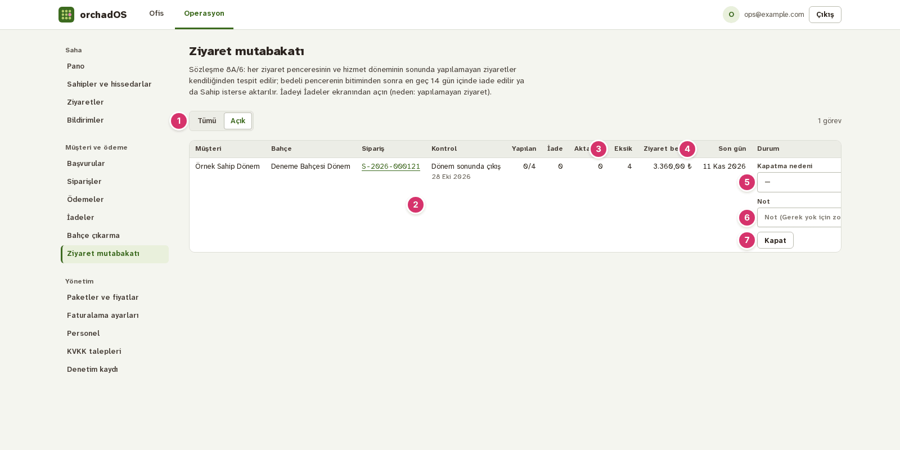

**Ekranın bölümleri**

1. Sekmeler: "Tümü" ve "Açık" (varsayılan). Sağda görev sayısı.
2. "Kontrol": görevin nedeni ("Pencere sonu", "Dönem sonu", "Dönem sonunda çıkış") ve pencere ya da dönemin bittiği gün.
3. "Eksik": yapılmayan ve iade ya da aktarma ile kapanmamış ziyaret sayısı. Yanındaki sütunlar "Yapılan" (yapılan/hak), "İade", "Aktarma"; sonra "Ziyaret bedeli" (bir ziyaretin bedeli).
4. "Son gün": iadenin en geç yapılacağı gün. Geçtiyse altında kırmızı "Gecikti".
5. "Kapatma nedeni": "İade açıldı", "Aktarıldı", "Ziyaret yapıldı", "Gerek yok (not zorunlu)".
6. "Not" ("Not (Gerek yok için zorunlu)").
7. "Kapat".

Geniş tabloda "Durum" sütunu sağa taşabilir; tabloyu yatay kaydırın.

### Bir görevi kapatmak

1. Sahiple konuşun: iade mi, sonraki pencereye aktarma mı istiyor?
2. İade ise: siparişin ödeme ayrıntısından "Yapılmayan ziyaret" nedeniyle eksik ziyaret sayısı × ziyaret bedeli kadar iade isteyin, sonra "İadeler"den işleyin.
3. Aktarma ise: ilgili ziyaretin "Yapılamayan ziyaret" kaydında sonucu "Sonraki pencereye aktarıldı" olarak girin ([05 · Ziyaret planlama](05-ziyaret-planlama.md)).
4. Görev satırında "Kapatma nedeni"ni seçin, gerekirse not yazın, "Kapat"a basın. Üstte "Görev kapatıldı." yazar.

Kapatılan görev "Tümü" sekmesinde "Kapatıldı" rozeti, nedeni ve notuyla kalır; yeniden açılmaz.

**Uyarılar ve ret mesajları**

| Mesaj | Ne zaman çıkar | Ne yapmalı |
| --- | --- | --- |
| "Açık görev yok" / "Mutabakat görevi yok" | Görev yok. "Görevler ziyaret penceresi ya da hizmet dönemi eksik ziyaretle kapanınca kendiliğinden açılır." | Bir şey yapmanız gerekmez. |
| "Gecikti" | Son gün geçti. | İadeyi hemen yapın. |
| "Girilen bilgilerden biri geçersiz." | Kapatma nedeni seçilmedi ya da "Gerek yok"ta not boş. | Nedeni seçin, gerekirse not yazın. |
| "Bu görev zaten kapatılmış." | Görev başka biri tarafından kapatıldı. | Sayfayı yenileyin. |

## KVKK talepleri

`/operasyon/kvkk`

**Ne için:** Sahiplerin portaldan yaptığı kişisel veri başvurularını (KVKK md. 11) 30 günlük cevap süresi içinde takip etmek için.
**Kim kullanır:** Operasyon.

Sahip portalda "Hesabım › İzinler › KVKK başvurusu yapın" ile başvurur. **Portaldaki başvuru formu "KVKK başvuru formu" ayarı açıkken görünür.** Bu ayar ekrandan değiştirilemez, veritabanından açılır; yerel deneme ortamında açıktır, barındırılan ortamlarda kapalı başlar. Ayar kapalıyken portaldan yeni başvuru gelmez (bu ekran yine açılır ve eski başvuruları gösterir); başvurular e-postayla, KEP'le ya da yazılı gelir ve [KVKK başvuru prosedürüne](../hukuk/kvkk-basvuru-proseduru.md) göre deftere işlenir.

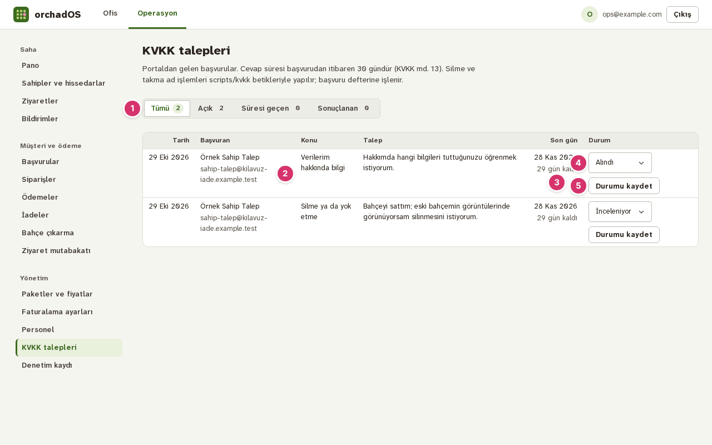

**Ekranın bölümleri**

1. Sekmeler: "Tümü", "Açık", "Süresi geçen", "Sonuçlanan" ve sayıları.
2. "Konu": "Verilerim hakkında bilgi", "Düzeltme", "Silme ya da yok etme", "İtiraz", "Diğer". Solunda "Tarih" ve "Başvuran" (ad ve e-posta), sağında "Talep" metni.
3. "Son gün" (başvurudan 30 gün sonra) ve sayaç: "29 gün kaldı", "3 gün gecikti" ya da kırmızı "Süresi geçti". Sonuçlanan başvuruda "Sonuç: <gün>".
4. "Durum": "Alındı", "İnceleniyor", "Cevaplandı", "Reddedildi".
5. "Durumu kaydet".

Birden çok işletmede operasyon rolünüz varsa üstte işletme seçici çıkar.

### Bir başvuruyu sonuçlandırmak

1. Başvuruyu okuyun, durumu "İnceleniyor" yapıp "Durumu kaydet"e basın. Üstte "Başvurunun durumu güncellendi." yazar.
2. Gereğini yapın: görüntü gizleme ziyaret sayfasındaki "Görüntü gizleme (KVKK itirazı)" ile ([05 · Ziyaret planlama](05-ziyaret-planlama.md)); silme ve takma ad işlemleri teknik ekibin betikleriyle yapılır ve başvuru defterine işlenir.
3. Sahibe cevap verin, durumu "Cevaplandı" ya da "Reddedildi" yapın ve kaydedin.

"Cevaplandı" ya da "Reddedildi" kaydedilince başvuru sonuçlanır: "Sonuçlandı; durum artık değişmez (başvuru defteri kaydı)." Bu yüzden son durumu cevabı gönderdikten sonra seçin.

**Uyarılar ve ret mesajları**

| Mesaj | Ne zaman çıkar | Ne yapmalı |
| --- | --- | --- |
| "Henüz KVKK başvurusu yok" | Başvuru yok. | Bir şey yapmanız gerekmez. |
| "Bu durumda başvuru yok" | Seçili sekme boş. | Başka sekmeye geçin. |
| "Süresi geçti" | 30 gün doldu, başvuru sonuçlanmadı. | Hemen cevaplayın; yöneticinize bildirin. |
| "Bilgiler eksik ya da hatalı." | Durum değeri geçersiz. | Sayfayı yenileyip yeniden deneyin. |
| "Bu işlem için yetkiniz yok." | İşletmede operasyon rolünüz yok. | Yöneticinize başvurun. |
| "İşlem tamamlanamadı. Tekrar deneyin." | Beklenmeyen hata ya da sonuçlanmış başvuru değiştirilmek istendi. | Sayfayı yenileyin. |

## Bildirimler

`/operasyon/bildirimler`

**Ne için:** Sahip ve hissedarlara giden SMS ve WhatsApp bildirimlerinin gidip gitmediğini görmek, gönderilemeyeni yeniden kuyruğa almak için.
**Kim kullanır:** Operasyon.

Bildirimler olaylarla kendiliğinden oluşur (teklif, ödeme, rapor, ziyaret tarihi, bahçe çıkarma, iade, hissedar daveti...) ve gönderici dakikada bir kuyruğu işler. Telefon numaraları maskeli gösterilir.

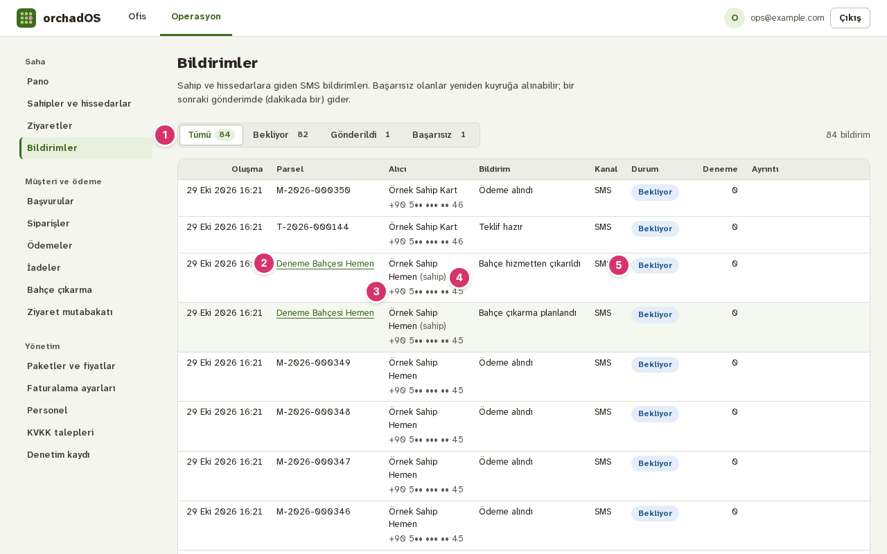

**Ekranın bölümleri**

1. Sekmeler: "Tümü", "Bekliyor", "Gönderildi", "Başarısız" ve sayıları (her durumun en yeni 100 kaydı). Sağda gösterilen sayı.
2. "Parsel": bildirim bir parselle ilgiliyse parselin adı (tıklanır); hesapla ilgiliyse belge numarası (teklif T-…, makbuz M-…).
3. "Alıcı": ad, rol ("sahip", "hissedar") ve maskeli telefon ("+90 5•• ••• •• 45").
4. "Bildirim": "Teklif hazır", "Ödeme alındı", "Rapor hazır", "Kritik bulgu", "Ziyaret tarihi bildirimi", "Bahçe çıkarma planlandı", "Bahçe hizmetten çıkarıldı", "İade yapıldı", "Ödeme hatırlatma", "Hissedar daveti" gibi.
5. "Durum": "Bekliyor", "Gönderildi", "Başarısız".

Diğer sütunlar: "Oluşma", "Kanal" ("SMS", "WhatsApp"), "Deneme" ve gerektiğinde "Ayrıntı" ("Gönderildi: <zaman>", "Yol: <sağlayıcı>", "Sonraki deneme: <zaman>", hata nedeni).

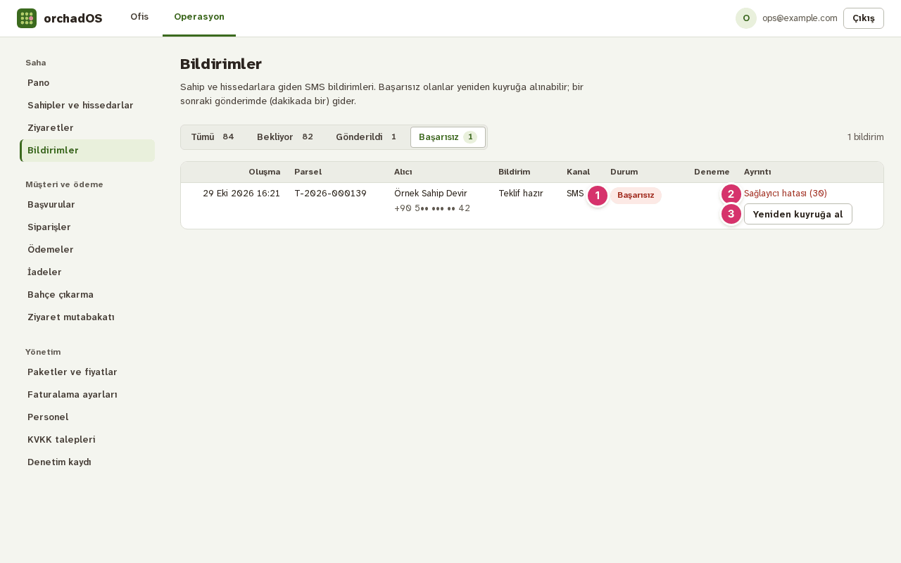

1. "Başarısız" durumu ve deneme sayısı.
2. Hata nedeni, örneğin "Sağlayıcı hatası (30)", "Alıcının telefon numarası yok", "Sağlayıcıya ulaşılamadı", "Portal adresi ayarlı değil".
3. "Yeniden kuyruğa al".

### Gönderilemeyen bildirimi yeniden göndermek

1. "Başarısız" sekmesini açın; "Ayrıntı"daki nedene bakın.
2. Neden alıcının telefonuysa ("Alıcının telefon numarası yok") önce sahibin kaydını düzeltin ([04 · Sahip ve parsel](04-sahip-ve-parsel.md)).
3. "Yeniden kuyruğa al"a basın. Üstte "Bildirim yeniden kuyruğa alındı." yazar; bir sonraki gönderimde (dakikada bir) yeniden denenir.

**Uyarılar ve ret mesajları**

| Mesaj | Ne zaman çıkar | Ne yapmalı |
| --- | --- | --- |
| "Bildirim yok" | Hiç bildirim yok. | Bir şey yapmanız gerekmez. |
| "Gönderilemeyen bildirim yok; yeniden kuyruğa alınacak bir şey yok." | "Başarısız" sekmesi boş. | Bir şey yapmanız gerekmez. |
| "Bildirim yeniden kuyruğa alınamadı." | Kayıt bu arada değişti ya da yetkiniz yok. | Sayfayı yenileyin. |
| Uzun süre "Bekliyor" kalan kayıtlar | Gönderici çalışmıyor olabilir. | Teknik ekibe bildirin. |

## Denetim kaydı

`/operasyon/denetim-kaydi`

**Ne için:** Faturalama kayıtlarındaki her değişikliği (kim, ne zaman, ne yaptı) görmek için. Ayrıntılarda kişisel veri tutulmaz.
**Kim kullanır:** Operasyon.

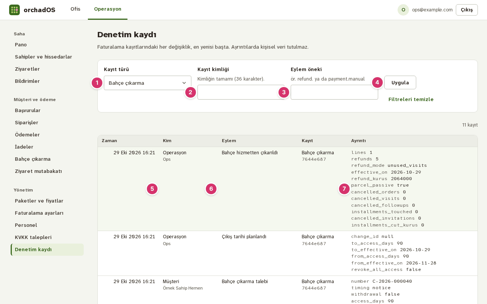

**Ekranın bölümleri**

1. "Kayıt türü": "Tümü", "Kayıt", "Onay", "Fatura profili", "Sahip profili", "Başvuru", "Başvuru bahçesi", "Teklif", "Sipariş", "Ödeme", "İade", "Fiyat listesi", "Paket", "Ayarlar", "Bahçe çıkarma".
2. "Kayıt kimliği": bir kaydın 36 karakterlik kimliği ("Kimliğin tamamı (36 karakter).").
3. "Eylem öneki": örneğin `refund.` ya da `payment.manual`.
4. "Uygula". Süzgeç varken yanında "Filtreleri temizle".
5. "Kim": "Operasyon", "Müşteri", "Sistem" ya da "Ödeme sağlayıcısı" ve kişinin adı.
6. "Eylem": "Bahçe hizmetten çıkarıldı", "Çıkış tarihi planlandı", "İade istendi", "Havale kaydedildi", "Fiyat listesi yayımlandı", "TCKN görüntülendi" gibi.
7. "Ayrıntı": değişikliğin alanları (eski ve yeni değerler, tutarlar kuruş olarak).

Liste en yeni kayıt başta, en fazla 500 kayıt gösterir ("Son 500 kayıt gösteriliyor; daraltmak için filtre uygulayın."). "Kayıt" sütunundaki kısa kimlik kaydın türünü ve kimliğin ilk 8 hanesini gösterir.

### Bir kaydın geçmişini bulmak

1. "Kayıt türü"nü seçin (ör. "İade").
2. Kimliği biliyorsanız "Kayıt kimliği"ne tamamını yapıştırın; ya da "Eylem öneki"ne `refund.` yazın.
3. "Uygula"ya basın.

**Uyarılar**

| Mesaj | Ne zaman çıkar | Ne yapmalı |
| --- | --- | --- |
| "Bu filtrelere uyan kayıt yok" | Süzgece uyan kayıt yok. | "Kayıt türünü ya da eylem önekini değiştirin veya filtreleri temizleyin." |
| "Henüz denetim kaydı yok" | Hiç kayıt yok. | Bir şey yapmanız gerekmez. |

---

Önceki: [07 · Saha uygulaması](07-saha-uygulamasi.md) · Sonraki: [09 · Fiyat, ayarlar ve personel](09-fiyat-ayarlar-personel.md)
