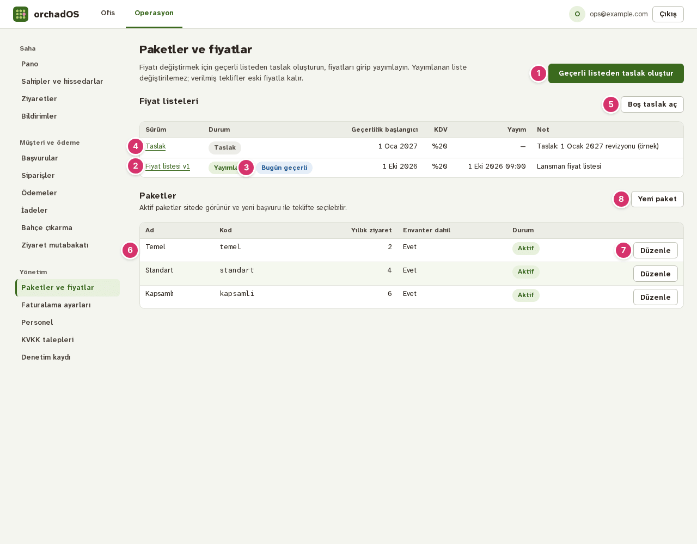
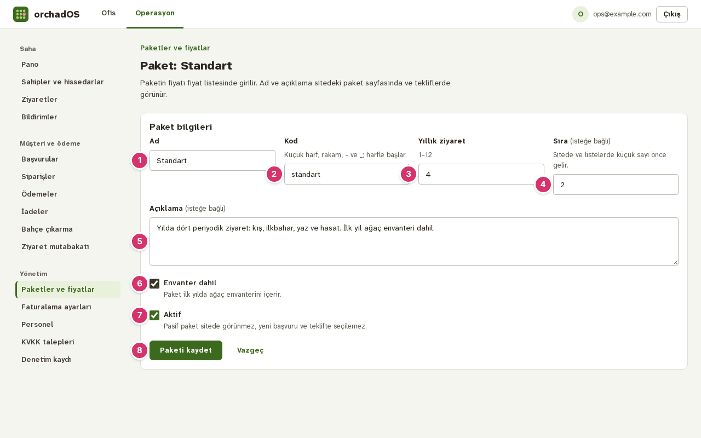
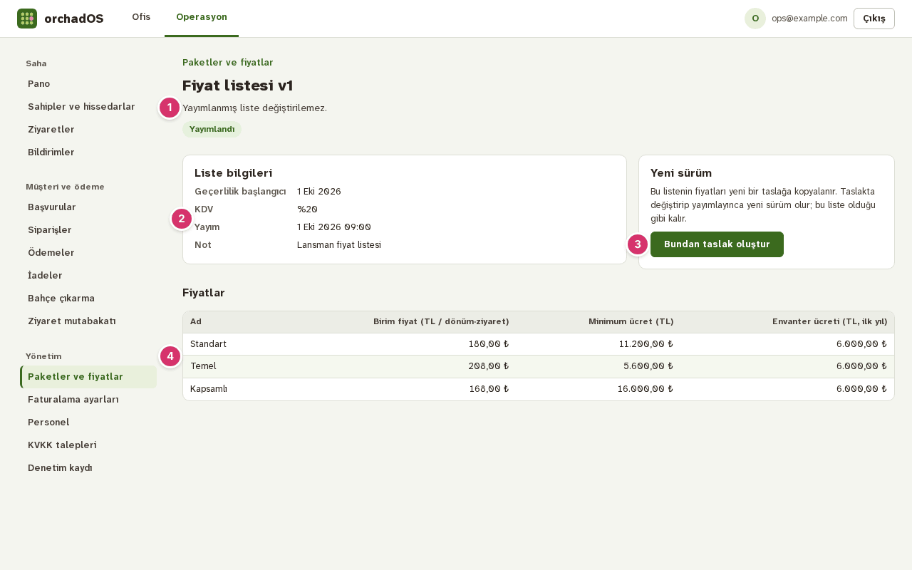
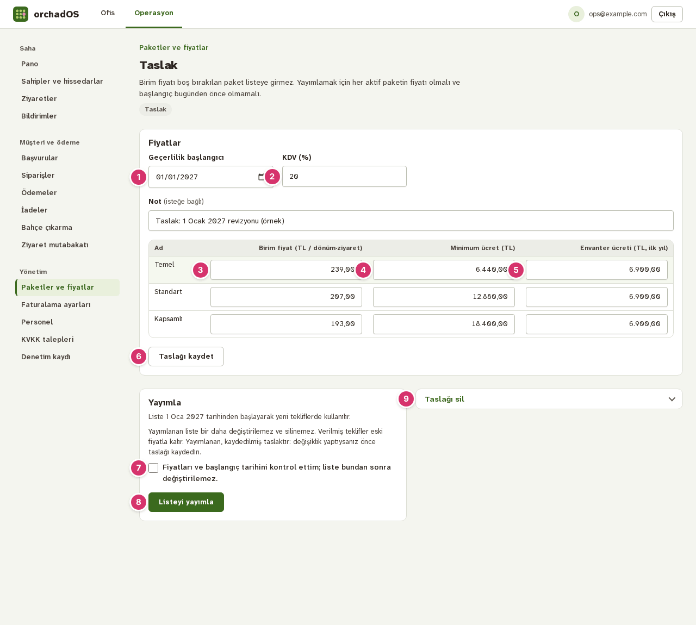
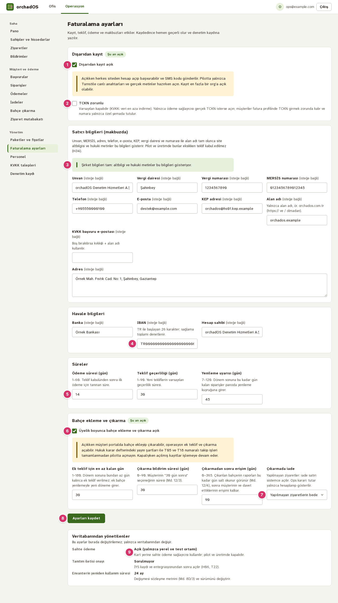
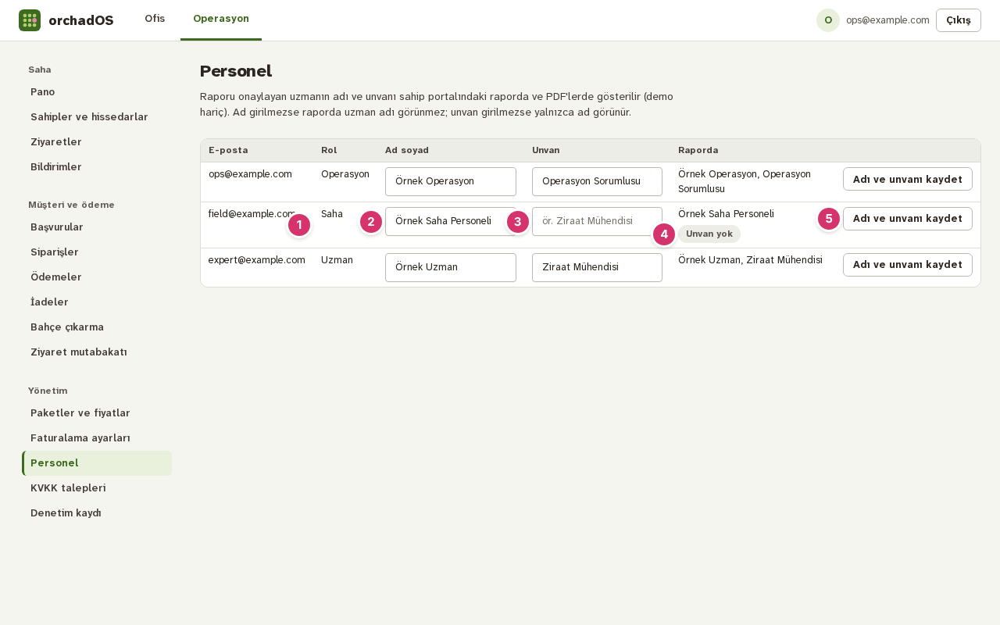

# 09 · Fiyat, ayarlar ve personel

[← Kılavuz dizini](README.md)

Bu bölüm "Yönetim" menüsündeki üç ekranı anlatır: "Paketler ve fiyatlar" (paketler ve fiyat listeleri), "Faturalama ayarları" ve "Personel". Bu ekranlardaki değişiklikler bütün yeni teklifleri, kayıtları ve raporları etkiler; kaydedince hemen geçerli olur ve denetim kaydına yazılır ([08 · Denetim kaydı](08-iade-cikarma-mutabakat-kvkk.md#denetim-kaydı)). Lansman fiyatlarının gerekçesi [fiyatlandirma.md](../fiyatlandirma.md)'dedir.

Birden çok işletmede operasyon rolünüz varsa bu ekranların üstünde işletme seçici çıkar; işletmeyi seçip "Uygula"ya basın.

## Paketler ve fiyatlar

`/operasyon/fiyat`

**Ne için:** Hizmet paketlerini (Temel, Standart, Kapsamlı) ve fiyat listesi sürümlerini görmek, yeni fiyat için taslak açmak için.
**Kim kullanır:** Operasyon (yönetim yetkisi olan kişi).

Kural: "Fiyatı değiştirmek için geçerli listeden taslak oluşturun, fiyatları girip yayımlayın. Yayımlanan liste değiştirilemez; verilmiş teklifler eski fiyatla kalır."

**Ekranın bölümleri**

1. "Geçerli listeden taslak oluştur": bugün geçerli listenin fiyatlarını yeni bir taslağa kopyalar ve taslağı açar. (Hiç yayımlanmış liste yoksa yerinde "Boş taslak aç" durur.)
2. Yayımlanmış liste ("Fiyat listesi v1"): tıklayınca liste açılır.
3. "Bugün geçerli": yeni tekliflerde bugün kullanılan liste.
4. Taslak ("Taslak"): tıklayınca düzenlenir.
5. "Boş taslak aç": fiyatsız boş bir taslak açar.
6. "Paketler" tablosu: "Ad", "Kod", "Yıllık ziyaret", "Envanter dahil", "Durum" ("Aktif" ya da "Pasif").
7. "Düzenle": paketin sayfasını açar.
8. "Yeni paket": yeni paket formunu açar.

"Fiyat listeleri" tablosunun sütunları: "Sürüm", "Durum" ("Taslak", "Yayımlandı"), "Geçerlilik başlangıcı", "KDV", "Yayım", "Not".

### Fiyatı değiştirmek

1. "Geçerli listeden taslak oluştur"a basın. Üstte "Yeni fiyat listesi taslağı açıldı." yazar ve taslak açılır.
2. Taslakta fiyatları ve "Geçerlilik başlangıcı"nı girip "Taslağı kaydet"e basın (aşağıda).
3. Kontrol ettikten sonra "Yayımla" bölümünden yayımlayın.

**Uyarılar ve ret mesajları**

| Mesaj | Ne zaman çıkar | Ne yapmalı |
| --- | --- | --- |
| "Henüz fiyat listesi yok" | Liste yok. | "Boş taslak aç", her aktif paketin fiyatını girip yayımlayın. |
| "Henüz paket yok" | Paket yok. | "Fiyat listesi açmadan önce en az bir paket tanımlayın." |

## Paket

`/operasyon/fiyat/paket/<paket>` (yeni paket: `/operasyon/fiyat/paket/yeni`)

**Ne için:** Bir paketin adını, kodunu, yıllık ziyaret sayısını, açıklamasını ve sitede görünüp görünmeyeceğini değiştirmek için. Paketin fiyatı burada değil, fiyat listesinde girilir.
**Kim kullanır:** Operasyon (yönetim).

"Ad ve açıklama sitedeki paket sayfasında ve tekliflerde görünür."

**Ekranın bölümleri**

1. "Ad".
2. "Kod": "Küçük harf, rakam, - ve _; harfle başlar."
3. "Yıllık ziyaret": 1–12 periyodik ziyaret.
4. "Sıra" (isteğe bağlı): "Sitede ve listelerde küçük sayı önce gelir."
5. "Açıklama" (isteğe bağlı).
6. "Envanter dahil": "Paket ilk yılda ağaç envanterini içerir."
7. "Aktif": "Pasif paket sitede görünmez, yeni başvuru ve teklifte seçilemez."
8. "Paketi kaydet". "Vazgeç" listeye döner.

### Bir paketi düzenlemek

1. "Paketler" tablosunda "Düzenle"ye basın.
2. Alanları değiştirin, "Paketi kaydet"e basın. Üstte "Paket kaydedildi." yazar.

Bir paketi kaldırmak yerine "Aktif" kutusunu boşaltın; verilmiş teklifler ve siparişler etkilenmez. Yeni paket ekledikten sonra yayımlanacak her fiyat listesinde onun da fiyatı olmalıdır.

**Uyarılar ve ret mesajları**

| Mesaj | Ne zaman çıkar | Ne yapmalı |
| --- | --- | --- |
| "Kontrol edin: Kod." (ya da "Ad", "Yıllık ziyaret", "Sıra") | Alan boş ya da kurala uymuyor. | Alanı düzeltin. |
| "Bu kayıt zaten var." | Aynı kodla başka paket var. | Başka bir kod seçin. |

## Fiyat listesi: yayımlanmış

`/operasyon/fiyat/liste/<liste>`

**Ne için:** Yayımlanmış bir listenin fiyatlarını görmek ve ondan yeni sürüm için taslak açmak için.
**Kim kullanır:** Operasyon.

**Ekranın bölümleri**

1. "Yayımlanmış liste değiştirilemez." ve "Yayımlandı" rozeti.
2. "Liste bilgileri": "Geçerlilik başlangıcı", "KDV", "Yayım" zamanı, "Not".
3. "Yeni sürüm" bölümünde "Bundan taslak oluştur": "Bu listenin fiyatları yeni bir taslağa kopyalanır. Taslakta değiştirip yayımlayınca yeni sürüm olur; bu liste olduğu gibi kalır."
4. "Fiyatlar": her paket için "Birim fiyat (TL / dönüm·ziyaret)", "Minimum ücret (TL)", "Envanter ücreti (TL, ilk yıl)". Paketi sonradan silinen ya da pasife alınan satırda "Pasif ya da silinmiş paket" yazar.

## Fiyat listesi: taslak

`/operasyon/fiyat/liste/<liste>` (taslak)

**Ne için:** Yeni fiyatları girmek, taslağı kaydetmek, yayımlamak ya da silmek için.
**Kim kullanır:** Operasyon (yönetim).

Kural: "Birim fiyatı boş bırakılan paket listeye girmez. Yayımlamak için her aktif paketin fiyatı olmalı ve başlangıç bugünden önce olmamalı."

**Ekranın bölümleri**

1. "Geçerlilik başlangıcı": liste bu günden başlayarak yeni tekliflerde kullanılır.
2. "KDV (%)".
3. "Birim fiyat (TL / dönüm·ziyaret)": paket başına. Tutarları "239,00" biçiminde yazın.
4. "Minimum ücret (TL)".
5. "Envanter ücreti (TL, ilk yıl)".
6. "Taslağı kaydet". ("Not" alanı isteğe bağlıdır.)
6a. "Hizmet fiyatları" (İP15, hizmet katmanı açıkken): ot biçme gibi her hizmet için "Dönüm fiyatı (TL, KDV hariç)" ve "Minimum ücret (TL, KDV hariç)"; KDV listenin oranıdır. Kendi düğmesiyle kaydedilir: "Hizmet fiyatlarını kaydet". Fiyatı boş bırakılan hizmet bu sürümde fiyatsızdır: portalda rakam yerine "Fiyat teklifle bildirilir" yazar, operasyon tutarı planlarken elle girer. Yayın için hizmet fiyatı gerekmez. Yayımlı listede bu bölüm salt okunur; fiyatsız satırda "Fiyatsız (teklifle)" yazar.
7. "Yayımla" bölümündeki onay kutusu: "Fiyatları ve başlangıç tarihini kontrol ettim; liste bundan sonra değiştirilemez."
8. "Listeyi yayımla".
9. "Taslağı sil" (açılır bölüm): "Taslak ve girilen fiyatlar silinir. Yayımlanmış listeler ve verilmiş teklifler etkilenmez."

"Yayımla" bölümü sonucu önceden yazar: "Liste 1 Oca 2027 tarihinden başlayarak yeni tekliflerde kullanılır." ve "Yayımlanan liste bir daha değiştirilemez ve silinemez. Verilmiş teklifler eski fiyatla kalır. Yayımlanan, kaydedilmiş taslaktır: değişiklik yaptıysanız önce taslağı kaydedin." Başlangıç girilmediyse "Yayımlamak için önce geçerlilik başlangıcını girip taslağı kaydedin."

### Taslağı hazırlayıp yayımlamak

1. "Geçerlilik başlangıcı"nı (bugün ya da sonrası), "KDV (%)"yi ve her aktif paketin üç fiyatını girin.
2. "Taslağı kaydet"e basın. Üstte "Taslak kaydedildi." yazar.
3. Fiyatları ikinci bir kişiye kontrol ettirin.
4. Onay kutusunu işaretleyip "Listeyi yayımla"ya basın. Üstte "Fiyat listesi yayımlandı; artık değiştirilemez." yazar.

Yayımlanan liste başlangıç gününden itibaren yeni tekliflerde kullanılır; o güne kadar önceki liste geçerli kalır. Yanlış yayımladıysanız yayımlanan listeyi değiştiremezsiniz: ondan "Bundan taslak oluştur" ile yeni bir taslak açıp düzeltilmiş sürümü yayımlayın.

**Düğmeler ve alanlar**

| Düğme / alan | Ne yapar |
| --- | --- |
| "Geçerlilik başlangıcı" | Listenin yeni tekliflerde kullanılmaya başlayacağı gün. |
| "KDV (%)" | Listenin KDV oranı. |
| "Not" | İç not; listede görünür. |
| Paket fiyatları | Birim fiyat, minimum ücret, envanter ücreti. Birim fiyatı boş paket listeye girmez. |
| "Taslağı kaydet" | Taslağı kaydeder; yayımlamaz. |
| Onay kutusu + "Listeyi yayımla" | Kaydedilmiş taslağı yayımlar; geri alınamaz. |
| "Taslağı sil" | Taslağı siler. |
| "Bundan taslak oluştur" / "Geçerli listeden taslak oluştur" | Yayımlanmış listenin kopyasıyla yeni taslak açar. |
| "Boş taslak aç" | Fiyatsız boş taslak açar. |

**Uyarılar ve ret mesajları**

| Mesaj | Ne zaman çıkar | Ne yapmalı |
| --- | --- | --- |
| "Fiyat listesinde her aktif paketin fiyatı olmalı." | Bir aktif paketin birim fiyatı boş. | Fiyatı girip taslağı kaydedin ya da paketi pasife alın. |
| "Geçerlilik başlangıcı bugünden önce olamaz." | Başlangıç geçmişte. | Bugün ya da sonrasını girin. |
| "Yayımlanmış fiyat listesi değiştirilemez; yeni bir taslak açın." | Yayımlanmış listeyi kaydetmeye çalıştınız. | "Bundan taslak oluştur". |
| "Kontrol edin: Birim fiyat." (ya da "KDV (%)", "Geçerlilik başlangıcı", "Onay kutusu") | Alan biçimi hatalı ya da onay kutusu işaretlenmedi. | Alanı düzeltin. |
| "Yayımlanmış bir fiyat listesi yok." | Teklif verirken hiç yayımlanmış liste yok. | Bir liste yayımlayın. |
| "Bu paketin fiyat listesinde fiyatı yok." | Teklifteki paket listede yok. | Paketin fiyatını içeren bir liste yayımlayın. |

## Faturalama ayarları

`/operasyon/ayarlar`

**Ne için:** Dışarıdan kaydı, TCKN zorunluluğunu, makbuzdaki satıcı bilgilerini, havale bilgilerini, süreleri ve bahçe ekleme/çıkarma kurallarını ayarlamak için.
**Kim kullanır:** Operasyon (yönetim yetkisi olan kişi). Bu ayarları yöneticinin onayı olmadan değiştirmeyin.

"Kayıt, teklif, ödeme ve makbuzları etkiler. Kaydedince hemen geçerli olur ve denetim kaydına yazılır." Bütün ayarlar sayfanın altındaki tek "Ayarları kaydet" düğmesiyle kaydedilir.

**Ekranın bölümleri**

1. "Dışarıdan kayıt" grubu ("Şu an açık" / "Şu an kapalı" rozeti) ve "Dışarıdan kayıt açık" kutusu. Uyarı: "Açıkken herkes siteden hesap açıp başvurabilir ve SMS kodu gönderilir. Pilotta yalnızca Turnstile canlı anahtarları ve gerçek metinler hazırken açın. Kayıt en fazla bir org'a açık olabilir."
2. "TCKN zorunlu": "Varsayılan kapalıdır (KVKK: veri en aza indirme). Yalnızca ödeme sağlayıcısı gerçek TCKN isterse açın; müşteriler fatura profilinde TCKN girmek zorunda kalır ve numara yalnızca özel şemada tutulur."
3. "Satıcı bilgileri (makbuzda)": şirket bilgilerinin tam olup olmadığı. Yeşil: "Şirket bilgileri tam: altbilgi ve hukuki metinler bu bilgileri gösteriyor." Sarı: "Şirket bilgileri eksik: hukuki metinler yer tutucularla görünür; pilot ve üretimde teklif kabulü kapalıdır." Alanlar: "Unvan", "Vergi dairesi", "Vergi numarası", "MERSİS numarası", "Telefon", "E-posta", "KEP adresi", "Alan adı" ("Yalnızca alan adı, ör. orchados.com.tr (https:// ve / olmadan)."), "KVKK başvuru e-postası" ("Boş bırakılırsa kvkk@ + alan adı kullanılır."), "Adres".
4. "Havale bilgileri": "Banka", "IBAN" ("TR ile başlayan 26 karakter; sağlama toplamı denetlenir."), "Hesap sahibi".
5. "Süreler": "Ödeme süresi (gün)" (1–60; teklif kabulünden sonra ilk ödeme için), "Teklif geçerliliği (gün)" (1–90; yeni tekliflerin varsayılan geçerliliği), "Yenileme uyarısı (gün)" (7–120; dönem sonuna bu kadar gün kalan siparişler panoda yenileme kuyruğuna girer).
6. "Bahçe ekleme ve çıkarma" grubu ve "Üyelik boyunca bahçe ekleme ve çıkarma açık" kutusu. Uyarı: "Açıkken müşteri portalda bahçe ekleyip çıkarabilir, operasyon ek teklif ve çıkarma açabilir. Hukuk karar defterindeki yayın şartları ile T05 ve T18 numaralı takip işleri tamamlanmadan pilotta açmayın. Kapalıyken açılmış kayıtlar işlemeye devam eder." Altında "Ek teklif için en az kalan gün" (1–180), "Çıkarma bildirim süresi (gün)" (0–90; müşterinin "30 gün sonra" seçeneğinin süresi), "Çıkarmadan sonra erişim (gün)" (0–365; çıkarılan bahçenin raporlarının salt okunur görüneceği süre).
7. "Çıkarmada iade": "Yapılmayan ziyaretlerin bedeli (iade satırı açılır)" ya da "Ops kararı (yalnızca hesap)".
8. "Ayarları kaydet".
9. "Veritabanından yönetilenler": "Bu ayarlar burada değiştirilemez; yalnızca veritabanından değişir."

### Bir ayarı değiştirmek

1. Değiştirmeden önce yöneticinin onayını alın; özellikle sarı uyarılı kutularda.
2. Alanı değiştirin, sayfanın altındaki "Ayarları kaydet"e basın.
3. Üstte "Ayarlar kaydedildi." yazar. Değişiklik denetim kaydına "Faturalama ayarları kaydedildi" olarak düşer.

### Yalnızca veritabanından değişen ayarlar

Bu ayarlar ekranda gösterilir ama değiştirilemez; değişmesi teknik ekibin işidir:

| Ayar | Ekranda | Anlamı |
| --- | --- | --- |
| "Sahte ödeme" | "Açık (yalnızca yerel ve test ortamı)" / "Kapalı" | "Kart yerine sahte ödeme sağlayıcısı kullanılır; pilot ve üretimde kapalıdır." |
| "Tanıtım iletisi onayı" | "Soruluyor" / "Sorulmuyor" | "İYS kaydı ve entegrasyonundan sonra açılır (H06, T22)." |
| "Envanterin yeniden kullanım süresi" | "24 ay" | "Değişmesi sözleşme metnini (Md. 8D/3) ve sürümünü değiştirir." |

Ekranda hiç görünmeyen, yine yalnızca veritabanından açılan başka anahtarlar da vardır; bunlar bazı ekranların görünüp görünmeyeceğini belirler. Yerel deneme ortamında hepsi açıktır, barındırılan ortamlarda kapalı başlar:

- ziyaret tarihi bildirim SMS'i (açıkken planlanan ziyaretin tarihi sahibe kendiliğinden bildirilir; [05 · Ziyaret planlama](05-ziyaret-planlama.md)),
- portaldaki KVKK başvuru formu ([08 · KVKK talepleri](08-iade-cikarma-mutabakat-kvkk.md#kvkk-talepleri)),
- hissedar bildirim akışı, sınır beyanı zorunluluğu ve hizmet sonu erişim akışı.

Teknik not: bu anahtarlar `org_billing_setting` tablosundaki `visit_notice_sms_enabled`, `kvkk_request_form_enabled`, `coowner_notice_flow_enabled`, `boundary_declaration_required`, `service_end_access_flow_enabled` sütunlarıdır.

**Uyarılar ve ret mesajları**

| Mesaj | Ne zaman çıkar | Ne yapmalı |
| --- | --- | --- |
| "Kontrol edin: IBAN." | IBAN TR ile başlamıyor, 26 karakter değil ya da sağlama toplamı tutmuyor. | IBAN'ı bankadan kopyalayıp yeniden girin. |
| "Kontrol edin: Ödeme süresi (gün)." (ya da başka bir süre) | Değer izin verilen aralığın dışında. | Alanın altındaki aralığa göre girin. |
| "Kontrol edin: Alan adı." / "Kontrol edin: KEP adresi." | Biçim hatalı. | Alan adını https:// ve / olmadan, e-postaları tam yazın. |
| "Bu kayıt zaten var." | Dışarıdan kayıt başka bir işletmede zaten açık ("Kayıt en fazla bir org'a açık olabilir"). | Öteki işletmede kapatın ya da yöneticinize danışın. |
| "Kayıt bu arada değişti; sayfayı yenileyip yeniden deneyin." | Başka biri ayarları siz düzenlerken kaydetti. | Sayfayı yenileyip değişikliği yeniden yapın. |

## Personel

`/operasyon/personel`

**Ne için:** Saha personelinin, uzmanların ve operasyonun ad soyadını ve unvanını girmek için. Raporu onaylayan uzmanın adı ve unvanı sahip portalındaki raporda ve PDF'lerde görünür.
**Kim kullanır:** Operasyon.

"Raporu onaylayan uzmanın adı ve unvanı sahip portalındaki raporda ve PDF'lerde gösterilir (demo hariç). Ad girilmezse raporda uzman adı görünmez; unvan girilmezse yalnızca ad görünür."

**Ekranın bölümleri**

1. "Rol": "Saha", "Uzman", "Operasyon" (birden çok olabilir). Solunda "E-posta".
2. "Ad soyad".
3. "Unvan" (ör. "Ziraat Mühendisi").
4. "Raporda": raporda nasıl görüneceği ("Örnek Uzman, Ziraat Mühendisi"). Unvan yoksa gri "Unvan yok", ad yoksa sarı "Ad yok" rozeti.
5. "Adı ve unvanı kaydet": o satırı kaydeder.

### Ad ve unvan girmek

1. Kişinin satırında "Ad soyad"ı (en az 2 karakter) ve "Unvan"ı yazın.
2. Aynı satırdaki "Adı ve unvanı kaydet"e basın. Üstte "Personel bilgisi kaydedildi." yazar.
3. "Raporda" sütununda görünüşü kontrol edin.

Uzmanlar için unvanı mutlaka girin; "Unvan yok" rozeti olan bir uzmanın onayladığı raporda yalnızca ad görünür. Kişiyi kuruluşa eklemek bu ekrandan yapılmaz; yeni personel için teknik ekibe başvurun.

**Uyarılar ve ret mesajları**

| Mesaj | Ne zaman çıkar | Ne yapmalı |
| --- | --- | --- |
| "Ad yok" | Ad girilmemiş: "bu kişinin onayladığı raporlarda uzman adı görünmez." | Adı girip kaydedin. |
| "Unvan yok" | Unvan girilmemiş: "raporda yalnızca ad görünür." | Unvanı girip kaydedin. |
| "Bilgiler eksik ya da hatalı." | Ad 2 karakterden kısa ya da çok uzun. | Adı düzeltin. |
| "Bu işlem için yetkiniz yok." | İşletmede operasyon rolünüz yok. | Yöneticinize başvurun. |
| "Bu kuruluşta personel yok" | Kuruluşta üye yok. | Teknik ekibe başvurun. |

---

Önceki: [08 · İade, çıkarma, mutabakat, KVKK](08-iade-cikarma-mutabakat-kvkk.md) · Sonraki: [10 · Uzman paneli (özet)](10-uzman-paneli-ozet.md)
