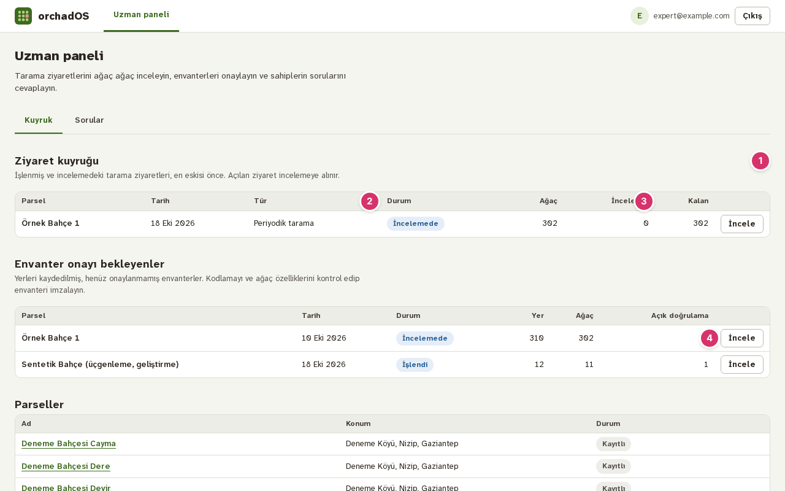
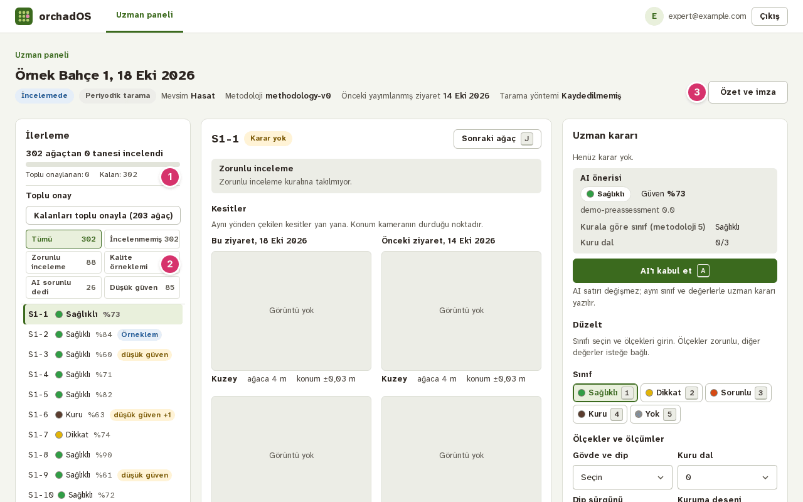
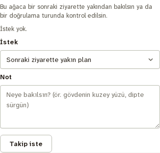
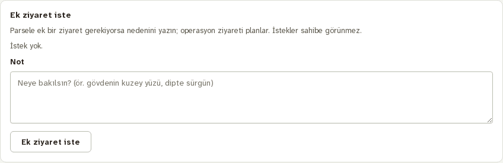

# 10 · Uzman paneli: ofis ve sahanın bilmesi gerekenler

[← Kılavuz dizini](README.md)

Uzman paneli (`/uzman`) ziraat mühendisinin (uzmanın) aracıdır. Ofis ve saha personeli bu paneli kullanmaz. Bu kısa bölüm yalnızca sizin işinizi etkileyen yerleri anlatır: uzman ne zaman işe başlar, sizden ne ister, ziyaret neden "İncelemede" bekler.

## Zincirdeki yeri

1. Saha taramayı bitirir, ziyaret "Tarandı" olur.
2. Ofis işleme hattını çalıştırıp yükler; ziyaret "İşlendi" olur ve uzmanın kuyruğuna düşer ([05 · Ziyaret planlama ve işleme](05-ziyaret-planlama.md)).
3. Uzman ziyareti açınca ziyaret "İncelemede" olur. Uzman her ağaca karar verir, bulgu ve öneri yazar.
4. Uzman "İmzala ve yayımla" deyince ziyaret "Yayımlandı" olur ve sahip sonuçları portalda görür.

Sahip, yayından önce hiçbir sonucu (fotoğraf, değerlendirme, bulgu) göremez. Yayın geri alınamaz.

## Ziyaret kuyruğu

`/uzman`

**Ne için:** Uzmanın inceleyeceği işlenmiş ve incelemedeki ziyaretleri, en eskisi önce listeler.
**Kim kullanır:** Uzman. Ofis yalnızca "ziyaret uzmana ulaştı mı?" sorusu için bilir.

**Ekranın bölümleri**

1. "Ziyaret kuyruğu": "İşlendi" ve "İncelemede" durumundaki tarama ziyaretleri.
2. "Durum" sütunu: ziyaretin durumu.
3. "İncelenen" ve "Kalan" sütunları: kaç ağaca karar verildi, kaç ağaç kaldı.
4. "Envanter onayı bekleyenler": ofis aracında yerleri kaydedilmiş, henüz onaylanmamış envanterler. "Açık doğrulama" sütunu, sahada henüz kapatılmamış doğrulama kalemlerini sayar.

**Sizi ilgilendiren:** İşlediğiniz bir ziyaret burada görünmüyorsa yükleme bitmemiştir ya da ziyaret "İşlendi" olmamıştır. Envanter burada "Açık doğrulama" gösteriyorsa saha personelinin doğrulama turu bitmemiştir; uzman bu kalemler kapanmadan envanteri imzalayamaz ("N açık doğrulama kalemi var. Kalemleri aşağıdaki turlarda kapatın.").

## Ağaç ağaç inceleme

`/uzman/ziyaret/<ziyaret>`

**Ne için:** Uzman her ağacın bu ziyaretteki ve önceki ziyaretteki kesitlerini yan yana görür, AI önerisini kabul eder ya da düzeltir.
**Kim kullanır:** Uzman.

1. "İlerleme": kaç ağaca karar verildi, kaç ağaç kaldı.
2. Ağaç süzgeçleri ("İncelenmemiş", "Zorunlu inceleme", "AI sorunlu dedi", "Düşük güven"...) ve yer koduna göre sıralı ağaç listesi.
3. "Özet ve imza": sınıf dağılımı, bulgular ve yayın.

Bu ekrandaki kesitler, işleme hattının panoramalardan kestiği ağaç görüntüleridir. Kesit yoksa ya da bulanıksa (ekran görüntüsündeki "Görüntü yok", deneme verisinde dosya olmadığı içindir) uzman o ağacı değerlendiremez ve sizden yakın plan ya da ek ziyaret ister. Bu yüzden sahada kamera yüksekliği, lens temizliği ve QR saat adımı önemlidir.

## Uzmanın sizden istekleri

Uzman iki tür istek açar. İkisi de sahibe görünmez.

**Ağaç için takip isteği** (inceleme ekranında "Takip istekleri" sekmesi):

| İstek | Size etkisi |
| --- | --- |
| "Sonraki ziyarette yakın plan" | Ağaç bir sonraki taramanın yakın plan listesine kendiliğinden girer. Saha uygulamasında nedeni "Uzman istedi" olarak görünür. |
| "Doğrulama turunda kontrol" | Ağaç bir doğrulama turunda kontrol edilir. Operasyon panosundaki "Uzman istekleri" kartından "Doğrulama ziyareti planla" ile planlanır. |

**Parsel için ek ziyaret isteği** (özet sayfasında "Ek ziyaret iste"; nedeni zorunludur):

Operasyon bu isteği panodaki "Uzman istekleri" kartında görür, "Ziyaret planla" ile planlar ya da var olan bir ziyarete "Ziyarete bağla" ile bağlar ([02 · Operasyon panosu](02-operasyon-pano.md)). İsteğin durumu "Açık" → "Planlandı" → "Tamamlandı" olarak ilerler; ziyaret taranınca tamamlanır.

İşleme hattı da kapsama eşiğinin altında kalan bir ziyaret için kendiliğinden ek ziyaret isteği açabilir; kaynağı "İşleme hattı (kapsama)" yazar.

## Yayın ve kritik bulgu

- **"İmzala ve yayımla":** Her aktif ağacın uzman kararı yoksa yayın reddedilir ve eksikler "Yayımlamadan önce" başlığında listelenir. Yayınla sahibe "rapor hazır" bildirimi gider.
- **"Onayla ve sahibe hemen bildir":** Uzman kritik bir bulguyu yayını beklemeden sahibe bildirir. Gönderilen mesajları operasyon "Bildirimler" ekranında görür ([08 · İade, çıkarma, mutabakat, KVKK](08-iade-cikarma-mutabakat-kvkk.md)).
- **Envanter onayı:** Uzman "Envanteri onayla ve imzala" deyince parsel "Envanter tamam" olur ve periyodik ziyaretler bu envantere göre eşlenir.

## Sahipten gelen sorular

Sahip portalda soru bırakabilir; uzman bunları "Sorular" sekmesinde cevaplar. Sahip telefonla soru sorarsa portaldaki soru bölümünü kullanmasını söyleyin; cevap uzmandan gelir.

---

← Önceki: [09 · Fiyat, ayarlar ve personel](09-fiyat-ayarlar-personel.md) · Sonraki: [11 · Sorun giderme →](11-sorun-giderme.md)
