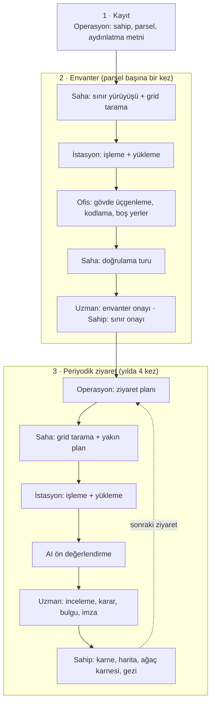

# Kullanım Kılavuzu

21 Ekim 2026 · Yusuf

Bu kılavuz orchadOS'un uçtan uca akışını anlatır: bir bahçe sisteme nasıl girer, sahada ve ofiste kim ne yapar, rapor sahibe nasıl ulaşır. Her adımda hangi rolün hangi aracı kullandığı yazılıdır.

Değerlendirme kuralları [metodoloji.md](metodoloji.md)'de, ürün tanımı [MVP.md](MVP.md)'de anlatılır.

Ofis ve saha personeli için kısa, adım adım kılavuz: [personel-kilavuzu.md](personel-kilavuzu.md).

> **Durum işaretleri:** Yazılım geliştirme sürüyor. Her adımın yanında bugünkü durumu var:
> - ✅ **Hazır:** Kullanılabilir, test ediliyor.
> - 🟡 **Kısmen:** Çalışıyor ama bir parçası eksik ya da geçici bir yolla yapılıyor.
> - ⬜ **Henüz yok:** Planda var, yazılmadı.

## Roller ve araçlar

| Rol | Kim | Ne yapar | Araç |
| --- | --- | --- | --- |
| **Sahip** | Bahçeden uzakta yaşayan bahçe sahibi | Raporu okur, ağaç ağaç inceler, 360° gezer | Web portalı, `/portal` (telefon ya da bilgisayar) |
| **Hissedar** (izleyici) | Hisseli parselde diğer hissedarlar; sahip ekler | Sahiple aynı ekranları görür, değiştiremez | Web portalı, `/portal` |
| **Saha personeli** | Eğitimli öğrenci ya da okur yazar tarım işçisi | Sınır yürüyüşü, grid tarama, yakın plan, doğrulama turu; ofiste gövde üçgenleme | Saha uygulaması (Android) + tarama kiti; ofis aracı, `/ofis` |
| **Uzman** | Ziraat mühendisi, uzaktan çalışır | Ağaçları inceler, kararı verir, bulgu ve öneri yazar, raporu imzalar | Uzman paneli, `/uzman` |
| **Operasyon** | Başlangıçta kurucu | Sahip ve parsel kaydı, ziyaret planı, işleme hattını çalıştırma, kalite takibi | `/operasyon`, işleme istasyonu (`orchados-pipeline`), ofis aracı |

**Araçlar:**

| Araç | Nerede çalışır | Kim kullanır |
| --- | --- | --- |
| **Tarama kiti** | Motosiklette direk: 360° kamera, RTK GNSS anteni, GNSS kaydedici (ESP32) | Saha personeli |
| **Saha uygulaması** | Personelin Android telefonu; internetsiz çalışır | Saha personeli |
| **İşleme istasyonu** | Ofisteki GPU'lu bilgisayar; komut satırı aracı `orchados-pipeline` | Operasyon |
| **Web uygulaması** | Tarayıcı. Rol bazlı dört bölüm: `/portal`, `/uzman`, `/ofis`, `/operasyon` | Herkes, rolüne göre |
| **Veritabanı ve depo** | Supabase: kayıtlar, satır bazlı yetki, medya deposu | Arka planda; şimdilik operasyon panelden de kullanır |

Web uygulamasında herkes sadece rolünün bölümünü görür. Kullanıcının hangi veriyi göreceğine de veritabanındaki satır bazlı yetki karar verir. Örneğin sahip sadece kendi parselini görür; uzman ve personel ise işletmenin bütün parsellerini.

## Büyük resim

**Ziyaretin durumu** (veritabanında `session.status`). Ekranlarda ve kuyruklarda bu durumlar görünür:

| Durum | Anlamı | Kim geçirir |
| --- | --- | --- |
| `planned` | Planlandı | Operasyon |
| `captured` | Sahada tarandı, kayıtlar telefondan gönderildi | Saha uygulaması |
| `processed` | İşlendi, panoramalar ve kesitler yüklendi | İşleme hattı |
| `in_review` | Uzman incelemesinde | Uzman paneli (ziyaret açılınca) |
| `published` | Uzman imzaladı; sahip artık görüyor | Sadece uzman, `publish_session` ile |

**Sahip ne zaman görür?** Bir ziyaretin hiçbir sonucunu (fotoğraf, değerlendirme, bulgu) sahip uzman yayımlamadan önce göremez. Bu kural veritabanında uygulanır. Yayın geri alınamaz; yayımlanmış bir ziyaretin uzman kararları değiştirilemez.

## 0 · Başvuru ve ödeme

**Kim:** Müşteri (site ve `/portal`), Operasyon (`/operasyon`, "Müşteri ve ödeme" menüsü) · **Tasarım:** [musteri-yonetimi.md](musteri-yonetimi.md)

Bahçe sahibi hesabını kendisi açıp başvurabilir. Operasyonun telefonla kayıt yolu (bölüm 1) aynen sürer; iki yol aynı sahip listesinde buluşur.

1. **Kayıt ve başvuru (müşteri).** Siteden kaydolur, telefonunu SMS koduyla doğrular. Portalda bahçelerini (konum, beyan edilen alan, isteğe bağlı kaba sınır, yetki dayanağı, giriş izni) ve paketini girer, fiyat önizlemesini görür, başvuruyu gönderir (`B-2026-…`).
2. **İnceleme (operasyon, `/operasyon/basvuru`).**
    - Pano "Müşteri ve ödeme" kartında incelenecek başvuruları, açık teklifleri, geciken ödemeleri, incelemedeki ödemeleri ve açık iadeleri sayar. Son 24 saatte 300'den fazla kayıt denemesi olursa uyarı çıkar.
    - Başvuru sayfasında bahçeler haritada ve tabloda (beyan edilen ve doğrulanan alan) görünür.
    - Her bahçe için "Doğrula": alan dönüm olarak girilir; gerekirse sınır haritada yeniden çizilir ve çizilen alan kullanılır. Doğrulama notu iç bilgidir, müşteri görmez.
    - Bütün bahçeler doğrulanınca teklif önizlemesi çıkar (bugün geçerli fiyat listesi). İndirim yüzde olarak girilir; indirim varsa açıklama zorunludur. Aynı köyden komşu bahçeye %10–15 indirim bu alanla verilir (açıklama: "Komşu bahçe indirimi, <köy>"); ayrı bir kurucu indirimi yoktur.
    - "Teklif ver" ya da "Başvuruyu reddet" (neden müşteriye gider, not içte kalır). Müşteriye SMS ile bildirim gider.
    - **Hizmet bölgesi yoktur** (H36): sitede ve metinlerde bölge vaat edilmez ve bölge adı verilmez. Konuma göre ret ("Bahçenin konumuna şu an hizmet veremiyoruz") yalnızca yazılı iç ölçüte (mesafe, yol süresi, kapasite, erişim güvenliği) göre yapılır; gerekçe notta yazılır (sistem notsuz konum reddini kabul etmez, T05) ve aynı ölçüt herkese uygulanır.
3. **Teklif onayı (müşteri).** Teklif sayfası kabulden önce **ödeme planını** gösterir (H35): ilk yıl envanter ödemesi ve paketteki ziyaret sayısı kadar ziyaret ödemesi, her birinin son günü ve tutarı, toplam = peşin fiyat. Fatura bilgileri, Ön Bilgilendirme ve Mesafeli Hizmet Sözleşmesi onaylanır; sipariş ve planı açılır (`S-2026-…`). Ayrıntı ve örnekler: [fiyatlandirma.md](fiyatlandirma.md) §2a.
    - **Erken başlama kutusu** (T03): Teklif sayfasındaki isteğe bağlı, işaretsiz kutu. Sahip işaretlemezse cayma süresi (sipariş etkinleşmesinden itibaren 14 gün) bitmeden envanter ya da periyodik ziyaret planlanamaz; sistem `withdrawal_period_open` ile reddeder ve caymada kesinti yapılmaz.
    - **Metin sürümleri** (T21): Teklif yalnızca kayıtlı güncel metin sürümleriyle kabul edilir. KVKK metninin yeni sürümü yayımlandıysa teklif sayfası metni "okudum" ve "Kaydet" ile yeniden teyit ettirir. Metin sürümü değişikliği bir kayıt migration'ı ister (`private.register_legal_text`); sürüm elle yazılmaz.
    - **Ek teklif dökümü** (T18): Ek bahçe teklifinde kalan ziyaret pencereleri, envanter ücreti ve yuvarlama örneği gösterilir; "Bağlayıcı olan teklifteki toplamdır." Ops önizlemesinde pencere aşımı uyarısı ve "yeni envanter gerekli" gerekçe alanı vardır.
4. **Ödeme.** Her ödeme planın bir ödemesini öder; kart taksiti yoktur.
    - Kartla: iyzico ödeme sayfası (3DS); tutar sıradaki açık ödemedir. Müşteri son günü gelmemiş ödemeleri önceden de yapabilir. Sonuç sunucudan doğrulanır; tutar ya da referans tutmazsa ödeme "İncelemede" kalır ve sistem bir iptal iadesi açar (ödeme sayfasında uyarı).
    - **TCKN** (T13, [hukuk/kararlar.md](hukuk/kararlar.md) H16): TCKN zorunluluğu açıksa müşteri numarayı "Kartla öde"nin yanındaki alana ödeme anında yazar. Numara yalnızca ödeme kuruluşuna iletilir; bizde, kayıtlarda ve hata mesajlarında tutulmaz, yalnızca son dört hanesi makbuz bilgisinde kalır. Fatura profilinde TCKN alanı yoktur. Zorunluluk varsayılan olarak kapalıdır ve kararın ön şartları tamamlanmadan açılmaz.
    - Havaleyle: müşteri IBAN'a öder, operasyon sipariş sayfasında "Havale/EFT kaydet" ile tutarı (TL), valör tarihini, banka referansını ve ödemeyi girer. Ödeme seçilmezse tutar açık ödemelere sırayla dağıtılır ve her ödemeye ayrı makbuz verilir. Kısmi havale kabul edilir. Süren bir kart denemesi varsa kayıt reddedilir. Havale, sahibin dekonttaki gönderim gününde yapılmış sayılır (H35).
    - Her başarılı ödemeye makbuz numarası verilir (`M-…`, `/makbuz/<id>`); makbuzda ödemenin plandaki sırası yazar. Makbuz fatura değildir.
    - Hatırlatma: her ödemenin son gününden 7 gün önce ve son gününde SMS (tutar yazmaz).
5. **Aktivasyon.** Planın ilk ödemesi (ilk yıl envanter, yenilemede ilk ziyaret ödemesi) ödenince sipariş "Aktif" olur, her bahçe için parsel "kayıt" durumunda açılır ve müşteriye sahip erişimi verilir. Sipariş sayfasından parsele geçilip envanter ziyareti planlanır (bölüm 1, adım 5).
    - **Ödenmemiş ziyaret ödemesi:** O ziyaret planlanamaz ("Bu ziyaretin ödemesi yapılmadı"). Sahip portal, SMS ya da e-postayla yazılı olarak isterse siparişin ödeme planında "Ödemesiz ziyarete izin ver" ile, talebin kanalı ve tarihi notta yazılarak izin verilir; o ödeme borç olarak kalır, faiz istenmez. Pencere ödemesiz biterse ödeme kendiliğinden düşer ("Pencere ödemesiz bitti"); ziyaret yapılmaz ve ödemesi istenmez, sonradan gelen ödeme iade edilir.
    - **Geciken ödeme:** Son gününden 30 gün geçen ödemeler panoda ve sipariş listesinin başında görünür; sözleşme kendiliğinden sona ermez. Ödeme nedeniyle fesih T30 gelene kadar elle yürür: sahibe SMS ve portal mesajıyla, son günü ve sonucu yazan, en az 30 gün süreli uyarı gönderilir ve tarihi nota yazılır; süre sonunda ödeme hâlâ açıksa fesih bu notla yapılır. Fesihte ödenmemiş ödemeler iptal edilir, ödenmiş ama yapılmamış ziyaretler iade edilir.
    - Sahip ödediği halde açık görünen bir ödeme bildirirse 2 iş günü içinde yanıt verilir.
6. **Sipariş işlemleri (`/operasyon/siparis`).** Ödeme süresi uzatma, ödemesi alınmamış siparişi iptal, aktif siparişi fesih (not zorunlu, onay kutusu). Süresi geçen siparişler listede vurgulanır. Hizmet yılı biten siparişe "Yenileme teklifi ver"; ops'un açtığı mevcut parseller için sahip sayfasındaki "Parsel teklifi ver".
    - **Aktif siparişi fesih** (`ops_terminate_order`) hizmet sonu erişim akışı (T08) açılana kadar gerçek müşteride kullanılmaz; ayrıntı aşağıda, "Bahçe ekleme ve çıkarma" › Operasyon › 11 ([hukuk/kararlar.md](hukuk/kararlar.md) H23).
    - **Sözleşme kendiliğinden uzamaz** (H14). v1 kâğıt sözleşmeyi imzalamış pilot sahiplerine, ilk yenileme tekliflerinden önce ve dönem bitmeden şu SMS gönderilir ve gönderim sahibin notuna yazılır (T22): “orchadOS: Sözleşmeniz [bitiş tarihi]'nde sona erecek ve kendiliğinden uzamayacak. Devam etmek isterseniz bitişten önce portalınızdaki yenileme teklifini onaylayabilirsiniz; onaylayıp ödemedikçe yeni yıl başlamaz ve sizden bedel istenmez.”
7. **İadeler (`/operasyon/odeme`, `/operasyon/iade`).**
    - Ödeme sayfasında "İade iste": havalede iade elle yapılır; kartta aynı gün tam tutar iptal, diğer durumlarda kalem bazında iade edilir ve hemen ödeme servisine gönderilir.
    - İadeler sayfası önce istenen, başarısız ve belirsiz (15 dakikadan uzun süredir işlenen) iadeleri gösterir. Satırda: "İşle" (kart), "Havale iadesi yapıldı" (banka referansı ve gün), "Vazgeç", "Sonucu elle kaydet" (kartta başarılı için sağlayıcı referansı zorunlu). Ödeme servisine ulaşılamazsa ekranda bildirilir.
    - Yanlış girilmiş bir havale, sipariş aktif değilse ödeme sayfasından geri alınır.
    - Havale iadesi tam tutarla gönderilir; banka ücreti Şirket'e ayrı gider olarak yazılır. Bütün iadeler (cayma, 8A, bahçe çıkarma, `order_closed`, fazla ödeme) sahibe masraf yüklenmeden yapılır ([hukuk/kararlar.md](hukuk/kararlar.md) H29).
8. **Fiyatlar (`/operasyon/fiyat`).** Paketler (kod, ad, yıllık ziyaret, envanter dahil mi, aktif mi). Fiyat listeleri sürümlüdür: taslakta birim fiyat (TL / dönüm·ziyaret), minimum ve envanter ücreti, KDV ve geçerlilik başlangıcı girilir, onay kutusuyla yayımlanır. Yayımlanan liste değişmez; "Bundan taslak oluştur" ile kopyalanır. Bugün geçerli liste işaretlidir. Lansman listesi (Temel, Standart, Kapsamlı) ve revizyon takvimi: [fiyatlandirma.md](fiyatlandirma.md).
9. **Müşteriler (`/operasyon/sahip`).** Sahip listesi kayıt kaynağını (self-servis ya da operasyon), açık sipariş sayısını ve ödenen tutarı gösterir; arama ve "Yalnızca self-servis" süzgeci vardır. Sahip sayfasındaki "Müşteri hesabı" panelinde fatura profili, onay geçmişi, başvurular, siparişler ve ödemeler yer alır. Telefonlar maskelidir. TCKN hiçbir zaman saklanmadığı için panelde görünmez (T13).
10. **Ayarlar ve denetim kaydı.** `/operasyon/ayarlar`: dışarıdan kayıt anahtarı (uyarısıyla), TCKN zorunluluğu, satıcı ve havale bilgileri (IBAN denetlenir), süreler. Satıcı bilgileri (unvan, MERSİS, adres, telefon, e-posta, KEP, vergi dairesi ve no) ve sitenin alan adı tam olmadan pilotta teklif kabul edilmez (T21); tamlık durumu sayfada görünür. Sahte ödeme ayarı yalnızca gösterilir; veritabanından değiştirilir. Hukuk takip işlerinin anahtarları (`marketing_consent_enabled`, `coowner_notice_flow_enabled`, `boundary_declaration_required`, `kvkk_request_form_enabled`) yalnızca SQL ile açılır.
    - **Personel** (`/operasyon/personel`, T23): her personelin görünen adı ve unvanı. Raporu onaylayan uzman sahip portalındaki raporda ve PDF'lerde "Onaylayan uzman: Ad Soyad, unvan" olarak görünür (demo hariç). Unvanı girilmemiş kişide uyarı çıkar; raporda yalnız ad görünür. `/operasyon/denetim-kaydi`: faturalama ile ilgili her yazma işlemi kim, ne zaman, hangi kayıtta diye listelenir; kayıt türü, kimlik ve eylemle süzülür.

| Adım | Durum |
| --- | --- |
| Veri modeli, fiyat hesabı, teklif, sipariş, ödeme ve iade fonksiyonları, denetim kaydı | ✅ |
| Site, kayıt ve SMS doğrulaması (bayrak kapalıyken gizli) | ✅ (gerçek SMS için Netgsm, pilotta Turnstile canlı anahtarları gerekiyor) |
| Back office: başvuru, doğrulama, teklif, sipariş, havale, iade, fiyatlar, ayarlar, denetim kaydı, müşteri hesabı paneli | ✅ |
| Müşteri portalı: başvuru, teklif onayı, kartla ödeme, makbuz | 🟡 (ayrı iş paketinde geliştiriliyor) |
| Kartla ödeme (iyzico) | 🟡 (sandbox ve sahte sağlayıcıyla test ediliyor; canlı hesap ve yazılı teyit bekleniyor) |
| Ziyaret başına ödeme planı: plan, ödeme başına kart ve havale, hatırlatma, ödenmemiş ziyaretin engeli ve izni, pencere sonunda düşme | ✅ (`installments-v1`) |
| Ödeme planının sözleşme PDF'inde (Ek-8) ve ön bilgilendirmede gösterilmesi; ödeme nedeniyle fesih uyarısı | ⬜ (T29, T30; o zamana kadar portal ve elle) |
| e-Arşiv / e-Fatura, kart taksiti, otomatik yenileme ödemesi | ⬜ (İP12 kapsamı dışında) |

### Bahçe ekleme ve çıkarma

**Kim:** Müşteri ve hissedar (`/portal`), Operasyon (`/operasyon`), sistem (gece işi) · **Tasarım:** [bahce-yonetimi.md](bahce-yonetimi.md) (İP14)

Müşterinin tek bir üyelik dönemi vardır; bütün bahçeleri aynı gün biter. Sonradan eklenen bahçe bir **ek sipariş** alır: fiyatı kalan döneme göre orantılanır ve hizmeti dönemin bitiş gününde biter. Bahçe bazında çıkarma, sözleşmenin o bahçe için feshidir (Md. 8D, 12/3). Bütün yeni talepler ve ek teklifler `org_billing_setting.garden_changes_enabled` anahtarına bağlıdır; anahtar kapalıyken portal girişleri gizlenir. Barındırılan projelerde anahtar avukat onayına kadar kapalıdır.

**Müşteri**
1. **Bahçe ekle.** Üyeliği olan müşteri "Bahçe ekle"yi üç yerde görür: portal ana sayfasındaki kart, "Bahçelerim" başlığının yanındaki düğme ve Hesabım › Bahçelerim. Başvuru sihirbazı açılır; paket üyeliğin paketiyle kilitlidir, üstte hizmet bitişi ve "fiyat kalan döneme göre hesaplanır" notu, altta hesaptaki bahçeler görünür. Önizleme kalan döneme göre yapılır. Dönemin son ek günü geçtiyse "Ek bahçeniz yenilemeyle başlayan yeni döneme eklenir" yazar.
2. **Ek teklifi izle.** Ek teklif "Mevcut üyeliğinize ek bahçe teklifi" başlığıyla gelir: hizmet dönemi, ziyaret hakkı (ör. 2/4), bahçe bazında envanter ve son geçerlilik günü yazar. Müşteri onaylar ve kartla ya da havaleyle öder; son ek gününden sonra onaylanamaz ve kartla ödenemez. Ödeme tamamlanınca bahçe "Bahçelerim"de görünür ve envanter planlanır. Ek siparişin kendi makbuzu ve 14 günlük cayma süresi vardır.
3. **Bahçeyi hizmetten çıkar.** Bahçenin sayfasındaki "Hizmet" kartından ya da Hesabım › Bahçelerim'den. Neden (satıldı, gerek kalmadı, memnun değilim, maliyet, diğer), isteğe bağlı not ve zaman seçenekleri; her seçenek kendi çıkış tarihi, tahmini iadesi ("en fazla") ve erişim sonuyla gösterilir. **Hiçbir seçenek önceden işaretli değildir**; müşteri açıkça seçer (Md. 12/3, [hukuk/kararlar.md](hukuk/kararlar.md) H20):
    - **Hemen:** bahçe yarın hizmetten çıkar;
    - **30 gün sonra:** 30 gün sonra ya da dönem sonu, hangisi önceyse;
    - **Dönem sonunda:** dönemin bitişinin ertesi günü;
    - **Cayma hakkımı kullanıyorum:** yalnızca cayma süresinde görünür; bahçe bugün çıkar, ödenen tutar iade edilir (erken başlama talebi varsa yapılmış envanter ve ziyaretler düşülür). Cayma süresinde diğer seçeneklerin altında "Bu seçim cayma bildirimi değildir; cayma hakkınız sürüyor." yazar.

    İade "kalan" yöntemiyle hesaplanır: satır tutarı − (envanter yapıldıysa) envanter payı − kullanılmış ziyaret × ziyaret bedeli; önceki 8A iadeleri düşülür (removal-v2). Onay kutusundan sonra talep bir `C-…` numarası alır. Bahçe ödeme bekleyen bir siparişteyse (ör. onaylanmış ama ödenmemiş yenileme) form **"Bekleyen siparişi iptal et ve devam et"** kutusuyla gelir: işaretlenirse sipariş bedelsiz iptal edilir ve talep aynı işlemde alınır. Pilot (siparişsiz) bahçede "Bu bahçeyi çıkarmak için bize ulaşın" yazar.
4. **Talebi geri al.** Çıkış gününe kadar bahçenin sayfasındaki "Talebi geri al" ile. Yalnızca müşterinin kendi talebi geri alınır; ekibin açtığı çıkarmada (devir, mükerrer kayıt, "Tüm bahçeleri çıkar") düğme görünmez, sayfa "Bu çıkarmayı ekibimiz başlattı; değişiklik için bize ulaşın." der.
5. **Salt okunur dönem.** Çıkış gününde bahçenin planlı ziyaretleri iptal edilir, bahçe hizmet dışı olur ve iade ekibe düşer. 90 gün boyunca raporlar açıktır; bahçenin sayfasında "Bu bahçe hizmetten çıkarıldı. Raporlar şu tarihe kadar açık: …" bandı görünür, soru sorulamaz ve hissedar davet edilemez. Erişimin bitmesine 7 gün kala SMS gelir. Son bahçe çıkınca üyelik sona erer; portal "Bahçe ekle" yerine yeni başvuru önerir. Erişim bittikten sonra da bahçe Hesabım › Bahçelerim'de çıkış tarihiyle listelenir ("Hizmetten çıkış: … · raporlara erişim kapandı").
6. **Hizmet sona erince** (yenilenmeyen dönem, Şirket'in feshi, pilotun bitmesi; Md. 12/4, H23): `service_end_access_flow_enabled` açıkken aynı salt okunur dönem uygulanır: 90 gün raporlar açık, soru ve hissedar daveti kapalı, bitişten 7 gün önce SMS, sonra erişim kalkar. Pencere içinde yenileme ödenirse erişim yeniden tam açılır.

**Hissedar**
- Çıkarma talep edemez. Bahçenin sayfasında çıkış tarihini ve salt okunur bandı görür.
- Müşterinin davet ettiği hissedarın erişimi, müşterininkiyle birlikte 90 gün sonra kalkar. Parselde başka sahip kalmıyorsa bütün hissedarların erişimi kalkar. Hissedara SMS gitmez.

**Operasyon**
1. **Ek bahçe başvurusu (`/operasyon/basvuru/[id]`).** Üyelik paneli müşterinin dönemini gösterir (birden çok dönem varsa uyarı). Haritada müşterinin mevcut parselleri soluk bir katmandadır. Her bahçe için **mükerrer uyarısı:** sınırı bahçenin konumunu içeren ya da kaba sınırıyla kesişen parseller ve 200 m içindekiler. Bahçe müşterinin eski (pasif) parseliyse **"Eski parsele bağla"**; başka bir müşterinin parseliyse ya da devirle çıkarılmışsa ret (mükerrer) ya da yeni parsel.
2. **Ek teklif.** Alan doğrulanınca ek teklif önizlenir ve birincil düğme **"Ek teklif ver"**dir. Geçerlilik son ek gününü geçmez. "Ayrı dönemle teklif ver" (ikinci bir dönem açar) yalnızca onay kutusuyla verilir. Mevcut parseller için başvurusuz ek teklif: sahip sayfasında "Ek teklif ver" ya da `/operasyon/teklif/yeni?ek=<temel sipariş>`.
3. **İki dönemi birleştirme.** İki ayrı dönemi olan müşteride (İP12'den kalan veriler) erken biten dönem yenilenmez; yenileme ekranındaki "Dönemleri birleştir" önerisiyle bahçeleri geç biten döneme ek teklifle taşınır. Başlangıç, erken dönemin bitişinin ertesi günüdür.
4. **Çıkarma kuyruğu (`/operasyon/cikarma`).** Pano "Müşteri ve ödeme" kartında yeni talepleri, 7 gün içinde çıkacakları ve engellileri sayar. Ayrıntı sayfasında iade hesabı, planlı ziyaretler, açık takip istekleri ve davetler, ödeme bekleyen siparişler ve erişim kapsamı görünür.
5. **Tarihi teyit et ya da değiştir.** Tarih, erişim günü, "herkesin erişimini kaldır" ve not. İlk teyitte ve her tarih değişikliğinde müşteriye SMS gider. Tarih talepten farklıysa not zorunludur; tarih yalnızca müşteriyle anlaşarak değiştirilir.
    - "Herkesin erişimini kaldır" (`revoke_all_access`) yalnızca kendi sözleşmesi bitmiş kişiler için ya da yazılı bir gerekçeyle (devir, uyuşmazlık, mükerrer kayıt) kullanılır; gerekçe notta yazılır. Kendi sözleşmesi süren başka bir sahibin erişimi bu seçenekle kaldırılmaz ([hukuk/kararlar.md](hukuk/kararlar.md) H22).
6. **Engelli kayıtlar.** Bahçe parası tutulmuş ya da kart denemesi süren bir ödeme bekleyen siparişteyse çıkarma tamamlanmaz ve kuyrukta "engelli" görünür; sipariş çözülünce gece işi yeniden dener.
7. **Hemen tamamla ve iptal.** Çıkış günü gelmiş kaydı beklemeden tamamlar. İptalde not zorunludur ve müşteriye SMS gider.
8. **İadeler.** Tamamlanınca iade satırları "istendi" durumunda açılır ve bugünkü iade ekranından (`/operasyon/iade`) işlenir; çıkarma ayrıntısında bağlantıları vardır. Ayarda iade modu **elle** (`manual`) ise ya da siparişte satıra bağlanamayan bir iade varsa sistem yalnızca hesabı gösterir, iade satırı açmaz; ops "İade iste" ile karar verir. Dağıtılamayan tutar uyarı olarak görünür.
9. **Yenileme.** `/operasyon/teklif/yeni?siparis=<temel sipariş>`: temel siparişin ve ek siparişlerin hizmetteki ya da dönem içinde başlayacak bahçeleri işaretli gelir (dönem bittiyse temel ve ek siparişlerin satırları); çıkmakta olanlar işaretsiz ve etiketlidir. Ek siparişin kendisi yenilenmez.
10. **Ops'un açtığı çıkarma ve devir.** Sipariş ayrıntısında satır başına "Bahçeyi çıkar". Bahçe satıldıysa neden **devir** ve erişim günü **0**; ayardan kısa bir erişim süresi yalnızca devirde, mükerrer kayıtta ya da not girilerek verilir. Devirle çıkarılan parsel aynı müşteriye yeniden bağlanamaz; yeni sahip kendi başvurusuyla yeni parsel alır. Müşteri panelindeki "Tüm bahçeleri çıkar" üyeliği sonlandırmanın önerilen yoludur.
    - **Şirket'in çıkarması yalnızca sayılan sebeplerle yapılır** ([hukuk/kararlar.md](hukuk/kararlar.md) H20, H36, T05). Formdaki neden listesi yalnızca bunlardır; başka nedeni sistem reddeder:
        - gerçek konumun başvuruda bildirilenden esaslı biçimde farklı olması (30 gün; H36),
        - Sahip'in Md. 5 yükümlülüklerinin esaslı ya da tekrarlanan ihlali, örneğin iki pencere boyunca erişim sağlanamaması (30 gün),
        - Sahip'in yetkisizliği ya da Md. 6/4'teki üçüncü kişi itirazı (bildirim süresi yok),
        - personel güvenliğini tehdit eden durum (yok),
        - devir (30 gün),
        - mükerrer kayıt (yok),
        - Madde 8/6 uyarısına rağmen bir ödemenin yapılmaması (H35; bildirim süresi uyarının süresidir). Sistem, siparişin bir ödemesinin son gününden itibaren en az 30 gün geçmiş ve ödenmemiş olmasını arar; uyarının tarihi ve kanalı notta yazılır (uyarı kaydı T30 ile gelir),
        - Bahçe'nin ilçesindeki saha hizmetinin o ilçedeki bütün sahipler için aynı tarihte sona erdirilmesi (en az 60 gün önce bildirim; çıkış, ödenmiş ve içinde bulunulan pencerenin bitiminden önce olamaz; H36),
        - Sahip'le anlaşarak (yok; "Sahip'in yazılı onayı" alanı zorunlu).
    - "Hizmet bölgesi dışında" diye bir neden yoktur (H36).
    - 30 ve 60 günlük sebeplerde çıkış günü en erken 30 (ya da 60) gün sonrası (dönem daha erken bitiyorsa dönem sonunun ertesi günü) olabilir; daha erken bir gün yalnızca Sahip'in yazılı onayı "Sahip'in yazılı onayı" alanına (nasıl ve ne zaman alındığı) yazılınca verilir. İlçedeki hizmetin sona ermesinde ödenmiş pencere kuralı onayla da aşılmaz. İade, kullanılmayan bütün ziyaretlerin ödenmiş bedelidir; ödenmemiş ödemeler iptal edilir; bildirim süresinde ziyaret yapılmazsa o ziyaretler kullanılmamış sayılır.
    - **Devirde** müşteriye çıkış planlandı SMS'inin yanında "raporlarınızı indirin" SMS'i gider (çıkış gününde erişim kapanır; sonrasında kopya talep üzerine verilir, H22).
11. **İdari fesih.** Siparişin tamamını feshetmek (`ops_terminate_order`) idari durumlar içindir. Temel siparişte ek siparişler de sona erer, ödeme bekleyen ekler ve açık ek teklifler iptal edilir (kısmen ödenmiş bir ek siparişin parası için `order_closed` iadesi açılır; kart ödemesi sürüyorsa mutabakata kalır), açık çıkarmalar sistemce iptal edilir (SMS gitmez).
    - **Hizmet sonunda erişim** (T08, H23; `service_end_access_flow_enabled` açıkken): fesihte, dönemi biten ve yenilenmeyen siparişte ve pasife alınan pilot parselinde, müşterinin başka etkin siparişi olmayan parsellere çıkarmadaki salt okunur dönem uygulanır (90 gün, soru ve hissedar daveti kapalı, 7 gün önce SMS, sonra erişim kalkar; yenileme ödenirse yeniden açılır). Çıkarma kuyruğunda "Hizmet dönemi sona erdi", "Sözleşme Şirket tarafından feshedildi" ya da "Pilot hizmet sona erdi" nedeniyle görünür. Anahtar kapalıyken `ops_terminate_order` gerçek müşteride kullanılmaz; zorunlu kalınırsa 90 gün sonunda erişim geliştirici eliyle kaldırılır ve denetim kaydına yazılır ([hukuk/kararlar.md](hukuk/kararlar.md) H23).
12. **Salt okunur dönemde parsel.** Ops parseli bu dönemde yaşam döngüsü formundan "sürdür"emez (`parcel_removed`); geri ekleme ek teklifle olur. Çıkarma açıkken çıkış günü ve sonrasına ziyaret planlanamaz.
13. **Ayarlar (`/operasyon/ayarlar`).** Anahtar (`garden_changes_enabled`), son ek günü için en az gün (30), bildirim süresi (30), erişim süresi (90), iade modu.

**Sistem**
- Gece `garden-removal-housekeeping` işi (03:30 İstanbul saati; cron UTC 00:30, `billing-housekeeping` 03:00'ten sonra): çıkış günü gelen kayıtları tamamlar (planlı ziyaretleri, açık takip isteklerini ve bekleyen davetleri iptal eder, parseli pasife alır, iadeyi hesaplar ve iade satırlarını açar, boşalan siparişleri sona erdirir), erişim bitmeden 7 gün önce SMS gönderir ve erişim süresi dolanların erişimini kaldırır. İki kez çalışması zarar vermez.

| Adım | Durum |
| --- | --- |
| Tasarım, hukuk taslakları v2, site metinleri | ✅ (avukat onayı bekleniyor) |
| Veri modeli, ek teklif, çıkarma, iade, gece işi | ✅ (PR #71; barındırılan projelerde anahtar kapalı) |
| Müşteri portalı ve back office ekranları | ✅ (PR #74, #73; barındırılan projelerde anahtar kapalı) |
| Barındırılan projelerde açılması | ⬜ (avukat onayı ve fiyat kararlarından sonra) |

## 1. Kayıt

**Kim:** Operasyon · **Araç:** `/operasyon`

1. Sahiple telefonda ya da yüz yüze görüşülür. Ad, telefon ve iletişim tercihi alınır. Aydınlatma metni sahibe verilir (basılı ya da SMS bağlantısı) ve aldığı imzalı alındıyla ya da tarihli bir kayıtla tutulur. İsteğe bağlı açık rızalar ayrıca sorulur (bugün sorulan yoktur; hukuk/kararlar.md H06, H31). Kişisel bilgiler ayrı, korumalı bir şemada (`private`) tutulur.
    - **Kâğıt alındı şablonu** ([hukuk/kararlar.md](hukuk/kararlar.md) H30): “Kişisel Verilerin İşlenmesine İlişkin Aydınlatma Metni'nin (sürüm …) bir nüshasını aldım ve okudum. Ad soyad / Tarih / İmza.”
    - Aydınlatma bir onay ya da rıza değildir; ops dilinde "KVKK onayı" denmez, "aydınlatma metni verildi (okundu teyidi)" denir.
    - Kâğıt sözleşme yalnızca Şirket'in işyerinde imzalatılır; sahada ya da sahibin evinde sözleşme kurulacaksa sahip teklifi portalda onaylar ([hukuk/kararlar.md](hukuk/kararlar.md) H10).
2. Her parsel için: il/ilçe/köy, kaba konum ve sınır, tahmini alan ve ağaç sayısı, erişim notu, sınırı sahada gösterecek kişi. Tapu bilgisi sadece kayıt içindir.
    - Erişim notu kapı, anahtar ve yol bilgisiyle sınırlı tutulur; gereksiz kişi bilgisi yazılmaz (H32).
    - **Sınırı gösterecek kişi ilk arandığında** (telefonda ya da sahada) şu kısa bilgilendirme okunur, istenirse bağlantı SMS ile gönderilir ([hukuk/kararlar.md](hukuk/kararlar.md) H32): “Numaranızı bahçe sahibi bize verdi. orchadOS bahçe denetimi için sizi ziyaret günü aramak ve sınırı göstermeniz için kullanıyoruz. Ayrıntılı bilgi: [alanadi]/kvkk.”
3. Kaba sınır haritada çizilir (sınır sürüm 1, kaynağı "sahibin beyanı").
4. Sahibe ve varsa hissedarlara portal erişimi verilir (`parcel_access`: sahip `owner`, hissedar `viewer`).
    - Hesap yoksa açılır; tek kullanımlık parola ekranda bir kez gösterilir.
    - Parola sahibe SMS ile ya da telefonda sözlü iletilir; WhatsApp kullanılmaz. Şirket kod, bildirim, rapor ya da fatura bilgisini WhatsApp'la göndermez ([hukuk/kararlar.md](hukuk/kararlar.md) H02).
    - **Hissedar ilk arandığında** (H30, H32): Kişiyi arayın; numarasının sahipten alındığını söyleyin, aydınlatma metninin bağlantısını SMS ile iletin ve okuduğunu kaydedin. Hesap telefonla açılır ve hissedar parsele izleyici olarak eklenir. Aramada hangi bahçe için davet edildiği de söylenir.
    - **Hissedar akışı açıkken** (`coowner_notice_flow_enabled`, T15): Sahip portaldaki davet formunda zorunlu beyan kutusunu işaretler: “Bu kişinin bahçede hakkı var ve numarasını vermeye yetkiliyim.” (zaman ve metin sürümüyle kaydedilir). Operasyon daveti `/operasyon`'da tamamlayınca hissedara şu SMS gider: “orchadOS: {bahçe} bahçesinin sahibi sizi raporları görmeniz için davet etti; numaranızı bize o verdi. Kişisel verileriniz: {alanadi}/kvkk Giriş: {portal}”. Hissedar ve operasyonun açtığı sahip (henüz bahçesi atanmamış olsa da) portala ilk girişte aydınlatma metnini görür ve "Aydınlatma metnini okudum" + "Kaydet" ile kaydeder; bu bir onay ya da rıza değildir. Kaydetmeden portal açılmaz. Demo hesapları bu ekranı görmez.
    - Hesabı Supabase'deki `invite-user` fonksiyonu açar; servis anahtarı Vercel'e çıkmaz.
5. Envanter ziyareti planlanınca parsel durumu "kayıt"tan "envanter planlandı"ya geçer.
    - **Cayma süresi** (T03, [hukuk/kararlar.md](hukuk/kararlar.md) H11): Sahip teklif kabulünde erken başlama kutusunu işaretlemediyse cayma süresi (etkinleşmeden itibaren 14 gün) bitmeden envanter ya da periyodik ziyaret planlanamaz; sistem `withdrawal_period_open` ile reddeder.
    - **Cayma bildirimi:** Sahip portalda (bahçe ekleme ve çıkarma kapalıyken de) "Cayma" ile bildirir. E-posta, KEP ya da postayla gelen cayma: Sipariş sayfası › "Cayma bildirimi kaydet (e-posta, KEP, posta)": bahçeler işaretlenir, kanal ve bildirimin ulaştığı gün girilir. Kayıt hemen uygulanır, iade hesaplanır, sahibe teyit SMS'i gider.
    - **Sınır itirazı açıksa** (T16) yeni envanter ya da periyodik ziyaret planlanamaz (`boundary_dispute_open`); bölüm 2.4.

| Adım | Durum |
| --- | --- |
| Veri modeli, kişisel verinin ayrı tutulması, yetki kuralları | ✅ |
| Sahip ve parsel kaydı, kaba sınır, portal erişimi ve hesap açma (`/operasyon`) | ✅ |
| Telefonla (SMS kodu) giriş | ✅ (gerçek SMS için Netgsm hesabı gerekiyor) |
| Sahibin portaldan hissedar davet etmesi, operasyonun tamamlaması | ✅ |
| Davet beyanı, hissedar SMS'i, ilk girişte aydınlatma teyidi (T15) | ✅ (anahtar barındırılan projelerde kapalı) |
| Parsel yaşam döngüsü: aktif izleme (ilk yayımlanan tarama) ve pasif (`/operasyon`) | ✅ |

## 2. Envanter

Envanter her parselin dijital haritasını bir kez çıkarır. Sonraki her ziyaret bu haritaya göre eşleşir.

### 2.1 Sahada: sınır ve grid tarama

**Kim:** Saha personeli · **Araç:** saha uygulaması + tarama kiti

1. **Bugünkü görevler:** Uygulamada günün ziyaretleri görünür.
2. **Ön kontrol:** Lens, pil, depolama, GNSS ham kaydı. Liste tamamlanmadan tarama başlamaz.
3. **Kaydediciyi bağla:** Uygulama Bluetooth ile GNSS kaydediciye bağlanır ve konum kalitesini gösterir (fix/float).
4. **QR saat:** Telefonda GPS saatini gösteren QR kodu 360° kameraya okutulur. Böylece video ile GPS zamanı eşlenir.
5. **Bahçede bulunanlar:** Taramadan önce bahçe girişine levha konur; tanıtım kartı ve sözlü bilgi bölüm 3.2'deki gibidir.
6. **Sınır yürüyüşü:** Sahibin ya da yetkilendirdiği kişinin gösterdiği sınır boyunca yürünür. Her köşede uygulamada "köşe" işaretlenir; sınır işaretleri fotoğraflanır.
    - **Sınırı gösteren kişi** (T16, H07, H32): Sınır ekranında kişiye kısa sözlü bilgi okunur ve adı ile rolü (sahip, sahibin yakını, bahçe çalışanı, komşu, diğer) kaydedilir; telefon yazılmaz. Kayıt envanterle birlikte saklanır; ops parsel sayfasında ve uzman envanter görünümünde görünür, sahip görmez.
7. **Grid tarama:** Motosikletle önce sıra boyunca, sonra dik koridorlar, en son kenarlar.
8. **Bitir:** Ziyaret özeti ekranında kayıtların gönderildiği görülür. Kameranın hafıza kartı ofise getirilir; ham video telefondan gönderilmez.

| Adım | Durum |
| --- | --- |
| Görevler, ön kontrol, kaydedici bağlantısı, QR saat | ✅ (telefonda henüz denenmedi; kit bekleniyor) |
| GNSS kaydedici yazılımı | ✅ (gerçek donanımda henüz denenmedi) |
| Sunucuya gönderim (senkronizasyon) | ✅ |
| Köşe işaretleme, kapsama haritası ve oranı | ✅ |
| Köşelerin PPK'lı yörüngeden konumlanıp sınır sürümünün yazılması (işleme hattı) | ✅ |
| Sabit grid rotası, dur-çek-yürü | ✅ |

### 2.2 İşleme istasyonunda

**Kim:** Operasyon · **Araç:** `orchados-pipeline`

1. Hafıza kartındaki video ve kaydedicinin microSD'si oturum klasörüne kopyalanır.
2. `orchados-pipeline run <oturum>`. Hat şunları yapar:
    - GNSS'i PPK ile santimetreye düzeltir.
    - Video ile zamanı eşler.
    - Her 3–4 m'de en net kareyi seçer.
    - Panoramaları ve önizlemeleri üretir.
3. `orchados-pipeline upload <çalıştırma> --session-id <ziyaret>`:
    - Panoramalar depoya, kayıtlar veritabanına gider.
    - Ham video istasyonda kalır.

| Adım | Durum |
| --- | --- |
| PPK, zaman eşleme, kare seçimi, panorama, yükleme | ✅ Sentetik veriyle |
| Gerçek kamera verisiyle deneme | ⬜ Kit bekleniyor |

### 2.3 Ofiste: gövde üçgenleme

**Kim:** Saha personeli ya da operasyon · **Araç:** ofis aracı, `/ofis/parsel/<parsel>/envanter`

1. Solda parsel haritası ve panorama noktaları, sağda iki panorama.
2. Her ağacın gövdesine iki farklı panoramada tıklanır; yazılım konumu hesaplar (ağaç başına ~10 sn). Belirsizlik yüksekse ya da açılar uygun değilse uyarı çıkar.
3. **Sıra oturtma ve kodlama:** Yazılım sıra doğrularını oturtur ve kodları verir (S5-12, ara ağaç S5-12a). Beklenen ama ağaç bulunmayan yerler "boş yer" olur.
4. **Doğrulama listesi:** Belirsiz ağaçlar, boş yerler ve "emin değilim" işaretlileri listelenir; CSV olarak alınabilir.
5. **Kaydet:** Yerler ve ağaçlar veritabanına yazılır.

| Adım | Durum |
| --- | --- |
| Üçgenleme, sıra oturtma, kodlama, boş yerler, doğrulama listesi, kayıt | ✅ |
| Panoramaları depodan okuma; tek işlemde kayıt; tıklamaların etiket olarak saklanması | ✅ |
| Ağaç özellikleri (yaş, aşı) ve altyapının ofiste işaretlenmesi | ✅ |
| Ofiste saha sınırı çizimi (sahada köşe işaretleme gelene kadar) | ✅ |

### 2.4 Doğrulama turu ve onaylar

**Kim:** Saha personeli, uzman, sahip

1. **Saha personeli:** Doğrulama listesindeki ağaçlara gider, yakın plan çeker ve soruları cevaplar. Bu tur, ilk periyodik ziyaretle birleştirilebilir.
2. **Uzman:** Kodlamayı ve ağaç özelliklerini kontrol eder, envanter raporunu imzalar.
3. **Sahip:** Sınırı portalda onaylar.
    - **Sınır beyanı** (`boundary_declaration_required`, T16): Onay ekranında beyan metni gösterilir ve işaretlenmeden onay verilmez: “Gösterdiğim sınırın fiilen kullandığım alan olduğunu ve ekibinizin bu alana girmesine izin vermeye yetkili olduğumu beyan ederim.” Onay, sözleşme metninin sürümü ve zamanıyla kaydedilir.
4. **Sınır itirazı / askı** (Ops, parsel sayfası, T16; Sözleşme Md. 6/4): Üçüncü bir kişi sınıra itiraz ederse ops "İtirazı aç" ile not yazarak açar. Açıkken yeni tarama planlanamaz; uzman ve ops itirazı görür, sahip portalında yalnız "değerlendirme şimdilik askıda" notu çıkar. İtiraz çözülünce "İtirazı kapat". İtirazlı alanın raporda "değerlendirilmedi" sayılması ve bahçenin bu nedenle çıkarılması dalga 3'tedir.

| Adım | Durum |
| --- | --- |
| Sınır onayının veritabanı kuralı (`approve_boundary`) | ✅ |
| Doğrulama turunun ofiste oluşturulması ve kalemlerin kapatılması (telefonla doğrulama) | ✅ |
| Uzmanın envanter onayı (`approve_inventory`; parsel "envanter tamam" olur), sahibin sınır onayı (portal) | ✅ |
| Saha uygulamasında doğrulama turu ekranı | ✅ |
| Sınır beyanı, sınırı gösteren kişi, sınır itirazı (T16) | ✅ (beyan anahtarı barındırılan projelerde kapalı) |

## 3. Periyodik ziyaret

Yılda dört ziyaret: kış, ilkbahar, yaz, hasat. Her ziyarette neye bakıldığı [metodoloji.md](metodoloji.md)'de.

### 3.1 Planlama

**Kim:** Operasyon · **Araç:** `/operasyon`

Parsel için `periodic_scan` türünde, `planned` durumda bir ziyaret açılır; tarihi ve sorumlu personeli girilir. Ziyaret, personelin uygulamasında "bugünkü görevler" listesine düşer.

- **Ziyaret bildirimi** ([hukuk/kararlar.md](hukuk/kararlar.md) H15, H01; T07): Her ziyaretin tarihi sahibe en az 3 gün önce SMS ya da telefonla bildirilir. Envanter ya da periyodik ziyaret en az 3 gün sonrasına planlanınca (ya da taşınınca) sistem sahibe `visit_scheduled` SMS'ini gönderir: tarih, bahçede çalışanlar için kısa bilgilendirme ve /bahcede-bulunanlar bağlantısı (`visit_notice_sms_enabled`; barındırılan projelerde açılana kadar telefonla). 3 günden yakın bir tarihte SMS gitmez: formda uyarı çıkar ve sahibe telefonla bildirdiğiniz saat zorunludur. Ziyaret sayfasındaki "Ziyaret tarihi bildirimi" bölümü bütün bildirimleri (SMS durumu, telefon) gösterir; "Telefonla bildirildi" ayrıca kaydedilebilir.
- **Erteleme:** Sahip ziyaretten en geç bir gün önce, bir kez erteleyebilir: portalda bahçe sayfasındaki "Planlı ziyaretler" kartından ya da telefonla/yazılı (ops ziyaret sayfasında "Ertelemeyi kaydet"). Ziyaret listesi ve sayfası ertelemeyi gösterir; ziyaret aynı pencerede yeni bir tarihe planlanır.
- **Cayma süresi:** Cayma süresi bitmemiş siparişte ziyaret planlanmaz (bölüm 1, adım 5).
- **Ödeme planı:** Ziyaret ödemesi yapılmamış pencerede periyodik ziyaret planlanmaz (bölüm 0, adım 5); izin yalnızca sahibin yazılı talebiyle. Şirket'in yeniden taraması planlanırken sıradaki ödeme açıksa da izin gerekir.
- **Pencere ve dönem sonu kontrolü** (H21, T06): Sistem her ziyaret penceresinin bitiminin ertesi günü, sipariş dönemi bitince ve "dönem sonunda" çıkışlarda yapılamayan ziyaretleri tespit eder ve `/operasyon/mutabakat`'ta görev açar (son gün: pencere ya da dönem sonu + 14, geçince "Gecikti"). Ops bedeli sahibin talebini beklemeden iade eder (İadeler, neden "yapılamayan ziyaret") ya da sahip isterse sonraki pencereye aktarır (ziyaret sayfasında, sahibin portal ya da yazılı talebiyle; dönemin son penceresinden sonraya aktarılamaz) ve görevi kapatır.

| Adım | Durum |
| --- | --- |
| Planlama, tarih ve sorumlu değişikliği, iptal; pano (duruma göre sayılar, yaklaşanlar, gecikenler) | ✅ |
| Görevlerin telefona inmesi | ✅ |
| Ziyaret tarihi SMS'i (`visit_scheduled`, /bahcede-bulunanlar bağlantısıyla), telefonla bildirim kaydı, erteleme | ✅ (T07; SMS barındırılan projelerde anahtarla açılır) |
| Yapılamayan ziyaretin nedeni ve kanıtı (saha uygulamasında "Ziyaret yapılamadı": neden, not, zaman damgalı fotoğraf) | ✅ |
| Pencere ve dönem sonunda yapılamayan ziyaretlerin listesi (`/operasyon/mutabakat`, 14 gün sayacı) | ✅ (T06) |

### 3.2 Sahada: tarama ve yakın plan

**Kim:** Saha personeli · **Araç:** saha uygulaması + tarama kiti

1. Ön kontrol, kaydedici bağlantısı ve QR saat; envanterle aynı.
2. Grid tarama; envanterle aynı rota, aynı kamera yüksekliği.
3. **Yakın plan listesi:**
    - Önceki ziyarette dikkat, sorunlu ya da kuru olanlar
    - Rastgele örneklem
    - Personelin "Sorun gördüm" dedikleri

   Her ağaçta mevsime göre 2–3 çekim yapılır ve evet/hayır soruları cevaplanır. Bulanık ya da karanlık fotoğraf telefonda reddedilir; fotoğraflar sadece uygulama içinden çekilir. Listenin başında parsel soruları bir kez sorulur; ilkbahar ve yazda "Bahçede yabani ot ne boyda?" (kısa, orta, uzun) bunlardan biridir ([metodoloji.md](metodoloji.md) bölüm 7).
4. **Bitir:** Kayıtlar internet olunca kendiliğinden gönderilir. Hafıza kartı ofise getirilir.

**Bahçede bulunan kişiler** ([hukuk/kararlar.md](hukuk/kararlar.md) H01; envanter ziyaretinde de aynıdır):
- **Levha:** Taramaya başlamadan bahçe girişine ya da çalışma noktasına QR kodlu taşınabilir levha konur. Levha metni: “BAHÇE DENETİM TARAMASI — Bugün bu bahçede, bahçe denetimi amacıyla 360° kamerayla görüntü kaydı yapılmaktadır. Veri sorumlusu: OBA Bilişim Teknolojileri LTD. Ayrıntılı bilgi ve başvuru: [alanadi]/bahcede-bulunanlar · [Telefon] · [QR]”
- **Tanıtım kartı:** Personel tarama boyunca görünür bir tanıtım kartı taşır.
- **Sözlü bilgi:** Personel bahçede rastladığı kişilere kısa sözlü bilgi verir: bahçe denetimi için görüntü kaydı yapıldığını, kişilerin hedeflenmediğini ve ayrıntının levhadaki adreste olduğunu söyler.
- **Saha talimatı:** Kişi kadraja yakınsa personel geçmesini bekler. Kişi itiraz ederse o bölüm daha sonra taranır; itiraz ziyaret notuna yazılır.
- **Saha kiti:** QR kodlu levha ve tanıtım kartı saha kitinin parçasıdır; ön kontrolde bakılır.
- **Saha uygulamasındaki kayıtlar** (T07): ön kontrolde "Bilgilendirme levhası kondu" ve "Tanıtım kartım görünür" (Hayır'da neden); ziyaret özetinde "Bahçede rastlanan kişilere sözlü bilgi verildi mi?" (verildi / kimse yoktu / verilemedi + not); tarama ekranında "Bir kişi itiraz etti" (not); görev kartında "Ziyaret yapılamadı" (neden, not, fotoğraf). Notlara telefon numarası ve başka kişilerin adı yazılmaz. Bu kayıtları yalnız personel görür.
- **Operasyon kontrol listesi:** ziyaret bildirimi en az 3 gün önce gönderildi; levha ve tanıtım kartı kitte. Liste ziyaret notuna yazılır.

**Sahip kaynaklı engel** (kapalı kapı, anahtar ya da bekçi yok, sınırı gösterecek kişi yok; [hukuk/kararlar.md](hukuk/kararlar.md) H15, T07):
1. Engel saha uygulamasında "Ziyaret yapılamadı" ile zaman damgalı fotoğraf ve notla belgelenir.
2. Ops ziyaret sayfasında "Yapılamayan ziyaret" kaydını açar; form saha kaydından dolar (neden, ayrıntı, not, fotoğraflar; ek fotoğraf yüklenebilir). Sahip kaynaklı nedende not, fotoğraf, **aynı gün** sahibe bildirim (gün ve yol) ve **aynı pencere içinde yeni tarih** (ya da "pencere içinde tarih önerilemiyor") zorunludur. Sonra ziyaret yeni tarihe taşınır.
3. Önerilen tarihte de aynı nedenle ziyaret yapılamazsa ikinci kayıt "Yapılmış say" sonucuyla girilir: ziyaret yapılmış sayılır, iade edilmez ve çıkarma hesabında kullanılmış ziyarettir.
4. Pencere içinde yeni tarih önerilemiyorsa, ya da neden hava, Sahip dışı erişim engeli, mücbir sebep ya da Şirket ise: aynı pencerede yeniden planlanır; olmazsa sonuç "İade edildi" ya da (sahibin portal ya da yazılı talebiyle) "Sonraki pencereye aktarıldı" olur. Raporu yayımlanamayan (veri kaybı) taranmış ziyaret Şirket kaynaklı kayıtla "raporu yayımlanamıyor" işaretlenir; kullanılmış ziyaret sayılmaz.
5. Ziyaret sayfası saha uygulamasının levha, sözlü bilgi ve itiraz kayıtlarını da gösterir.

| Adım | Durum |
| --- | --- |
| Yakın plan akışı, kamera, cihazda kalite kontrolü, gözlem soruları | ✅ |
| Gönderim | ✅ |
| Kapsama haritası, sabit grid rotası | ✅ |
| Yakın plan listesinin sunucuda üretilmesi (10×10 m tabakalı örneklem, uzman istekleri, "Sorun gördüm") | 🟡 Sunucu ve operasyon ekranı hazır; saha uygulaması listeyi henüz kendisi hesaplıyor, "Sorun gördüm" düğmesi yok |
| Saha uygulamasında levha, tanıtım kartı, sözlü bilgi, itiraz ve yapılamayan ziyaret kayıtları | ✅ |

### 3.3 İşleme istasyonunda

**Kim:** Operasyon · **Araç:** `orchados-pipeline`

Envanterle aynı adımlar. Bunlara ek olarak her ağaç için, ağaca en yakın panoramalardan dört yönden **kesit** çıkarılır. Yükleme bitince ziyaret `processed` olur ve uzmanın kuyruğuna düşer.

| Adım | Durum |
| --- | --- |
| Kesitler, yükleme, `processed` durumu | ✅ Sentetik veriyle |
| Ağaç konumlarının envanterden (veritabanından) alınması | ✅ |
| Kapsama raporu ve yeniden tarama görevi | 🟡 Kapsama haritası portalda (kesitlerden); işleme hattının raporu ve otomatik yeniden tarama görevi yok. Uzman "Ek ziyaret iste" ile isteyebilir |

### 3.4 AI ön değerlendirme

**Kim:** Otomatik

Her ağacın kesitleri, önceki ziyaretin kesitleri ve personelin cevaplarından ölçek önerisi ve güven skoru üretilir. Bu bir **öneridir**: sahibe görünmez, uzman paneline düşer.

**Yurt dışı aktarım kapısı** ([hukuk/kararlar.md](hukuk/kararlar.md) H02): Kesitler yurt dışındaki bir sağlayıcıya (Anthropic ya da yerel olmayan başka bir sağlayıcı) ancak `ORCHADOS_AI_TRANSFER_SAFEGUARD` o sağlayıcının standart sözleşme kaydını taşıyorsa gönderilir. Değişken, sözleşme imzalanıp Kurum'a bildirilmeden tanımlanmaz. Tanımlı değilse gerçek ziyaretle yalnızca yerel model çalışır; yurt dışı sağlayıcıyla iş hiçbir istek göndermeden durur (`--no-write` dahil; test verisi için `--test-data-only`). Ayrıntı: [services/ai-worker/README.md › Yurt dışı aktarım kapısı](../services/ai-worker/README.md#yurt-dışı-aktarım-kapısı).

| Adım | Durum |
| --- | --- |
| AI ön değerlendirme (`ai-worker run --session-id ...`, işleme istasyonunda) | ✅ Sentetik veriyle; ziyaretin bütün kesitleri gönderilir, yakın planlar v0.1'de gönderilmez. İlk kış denetiminde uzman her ağaca kendisi karar verir |

### 3.5 Uzman incelemesi ve yayın

**Kim:** Uzman · **Araç:** uzman paneli, `/uzman`

1. **Ziyaret kuyruğu:** İşlenmiş ve incelemedeki ziyaretler; her birinde incelenen ve kalan ağaç sayısı. Ziyaret açılınca `in_review` olur.
2. **Ağaç ağaç inceleme:**
    - Liste yer koduna göre sıralı. Filtreler: incelenmemiş, AI'ın sorunlu dedikleri, düşük güvenliler.
    - Seçili ağaçta bu ziyaretin ve önceki yayımlanmış ziyaretin kesitleri yan yana durur. Yanlarında AI önerisi, önceki uzman sonucu ve ağaç özellikleri.
3. **Karar:**
    - **AI'ı kabul et** (`A` tuşu): AI'ın önerisi uzman kararı olarak kaydedilir; AI'ın kendi kaydı değişmez.
    - **Düzelt:** Uzman sınıfı seçer (`1`–`5`) ve mevsimin ölçeklerini girer.
    - `J`/`K` tuşlarıyla ağaçlar arasında gezilir.
4. **Bulgu ve öneri:** Ağaca ya da parsele bağlı bulgu yazılır: tür, önem, açıklama, öneri, kanıt kesitleri.
5. **Özet ve imza:**
    - Özette sınıf dağılımı, önceki ziyarete göre değişenler, bulgular ve incelenmemiş ağaçlar görünür.
    - **İmzala ve yayımla:** Her aktif ağacın uzman kararı yoksa yayın reddedilir ve eksikler listelenir.

| Adım | Durum |
| --- | --- |
| Kuyruk, inceleme, kabul/düzelt, bulgu, özet, imza ve yayın, kısayollar | ✅ |
| Zorunlu inceleme kuralları, toplu onay ve %5 kalite örneklemi | ✅ |
| Sahibin sorularını cevaplama (`/uzman`, Sorular) | ✅ |
| Kritik bulgu bildirimi ("Onayla ve sahibe hemen bildir") | ✅ |
| Ek ziyaret, sonraki ziyarette yakın plan ve doğrulama istekleri; operasyonda planlama | ✅ |
| Genel sınıf kuralının öneri olarak gösterilmesi | ✅ |

### 3.6 Sahip raporu okur

**Kim:** Sahip ve hissedar · **Araç:** web portalı, `/portal`

1. **Bahçelerim:** Her parselin son denetim tarihi ve sınıf dağılımı.
2. **Parsel karnesi:**
    - Son denetimde kaç ağaç sağlıklı, dikkat, sorunlu, kuru, yok.
    - Önceki denetime göre kaç ağaç kötüleşti, kaç ağaç iyileşti.
    - Önem sırasıyla bulgular, ziyaret geçmişi.
    - Raporu onaylayan uzman: "Onaylayan uzman: Ad Soyad, unvan" (raporda, karne ve envanter PDF'lerinde; demo hariç, T23).
3. **Sağlık haritası:** Ağaçlar sınıf rengiyle; boş yerler ve bulgular işaretli; sınıfa göre filtre. Personelin tarama izi (rota çizgisi) sahibe gösterilmez (H05); kapsama katmanı ağaç başına görüntülenme halkalarıdır.
4. **Ağaç karnesi:**
    - Kod ve özellikler.
    - Son sınıf ve kimin verdiği; "✓ Uzman onaylı" ayrı gösterilir.
    - Ölçüm geçmişi.
    - Ziyaret ziyaret aynı yönden fotoğraflar.
    - Bulgular ve öneriler.
5. **360° gezi:** Haritada bir noktaya dokununca o noktanın panoraması açılır. Oklarla komşu noktalara geçilir; ağaç işaretçisine dokununca ağaç karnesi açılır.
6. **PDF indir:** Karne sunucuda PDF olarak hazırlanır ve indirilir. İsteyen "Yazdır" ile tarayıcıdan da yazdırabilir.
7. **Envanter raporu:** Envanter onaylandıysa karnenin üstündeki "Envanter raporu" düğmesi ilk sayımın raporunu açar: kaç yer, kaç ağaç, kodlu harita, sınır, bahçe yapısı, ilk gözlemler. Bu rapor da PDF olarak indirilebilir.

| Adım | Durum |
| --- | --- |
| Bahçelerim, karne, harita, ağaç karnesi, gezi, yazdırma, telefon görünümü | ✅ |
| Genel durum skoru (0–100) ve denetim güveni | ✅ (ağırlıklar metodolojide kesinleşecek) |
| Soru bırakma (her sahip ve hissedar yalnız kendi sorularını görür, T23) | ✅ |
| Karne boyutları (envanter değişimi, bahçe yapısı, mekânsal desen, bakım, zararlı, meyve yükü) | ✅ |
| Harita: ziyaret seçici, "bu ziyarette değişenler", 10×10 m ısı haritası, kapsama halkaları (tarama izi gösterilmez) | ✅ |
| Gezide zamanda gezinme ve bakış yönü; ağaç karnesinde kanıt bilgisi ve hash doğrulaması | ✅ |
| "Rapor hazır" ve kritik bulgu bildirimleri, operasyonda bildirim listesi | ✅ (gerçek SMS için Netgsm hesabı gerekiyor; o zamana kadar mesajlar kaydediliyor) |

## 4. Hizmet: yabani ot biçme

**Kim:** Sahip, operasyon, saha personeli · **Ürün kararı:** [MVP.md](MVP.md#modül-6--hizmet-katmanı-yabani-ot-biçme)

Denetimin yanında sahip bahçesi için hizmet de alabilir; bugün tek hizmet yabani ot biçmedir. İşi köydeki saha personeli motorlu tırpanla yapar. Çevrimiçi ödeme yoktur. Hizmet katmanı `services_enabled` anahtarıyla açılır; barındırılan projelerde kapalıdır.

1. **Öneri (sahip):** Yayımlanan ilkbahar ya da yaz ziyaretinde ot orta ya da uzunsa ve sezon açıksa parsel karnesinde öneri kartı çıkar: "Bahçenizde ot uzun. Ot biçme: X TL. Talep et". Tutar tahminidir. Sezon dışında kart "Gelecek sezon için ön talep bırakın" der.
2. **Talep (sahip):** Parsel, tercih edilen zaman aralığı ve not seçilir, hizmet koşulları onaylanır. Talep **Hizmetlerim**'de numarası ve durumuyla görünür; planlanan tarihten önceki güne kadar oradan ücretsiz iptal edilir.
3. **Planlama (operasyon):** `/operasyon/hizmet` kuyruğunda talep açılır, tutar onaylanır (gerekirse düzeltilir) ve tarih verilir. Parsel için biçme oturumu açılır, sahibe bildirim gider. Katalog fiyatı `/operasyon/hizmet/katalog`'da düzenlenir (taslak fiyat işaretiyle).
4. **İş (saha personeli):** Biçmeden önce ve sonra parselin fotoğrafını çeker.
5. **Kapanış (operasyon):** İş kapatılırken en az bir "öncesi" ve bir "sonrası" fotoğrafı bağlanır (yeni yükleme ya da aynı parselin yayımlanmış ziyaretinden medya). Ödeme işten sonra elle kaydedilir (tutar, yöntem, tarih).
6. **Kanıt (sahip):** Hizmetlerim'de tamamlanan işin tarihini ve öncesi/sonrası fotoğraflarını görür. O dönemin karnesindeki bakım uyumu satırı, biçmeyi orchadOS'un yaptığını açıkça yazar.

**Robot uygunluk notları:** Operasyon, ops parsel sayfasında her parsel için eğim, taşlılık, en alçak dal yüksekliği ve serbest not tutar. Notlar ileride robotun önce hangi bahçelere gideceğini seçmek içindir; sahibe gösterilmez.

| Adım | Durum |
| --- | --- |
| Saha sorusu `weed_height` | 🟡 Yazılıyor (İP15) |
| Öneri kartı, talep, Hizmetlerim, iptal | 🟡 Yazılıyor (İP15) |
| Hizmet talepleri kuyruğu, katalog, fotoğraf bağlama, ödeme kaydı, robot uygunluk notları | 🟡 Yazılıyor (İP15) |
| Barındırılan projelerde açılış | ⬜ Avukat onayı ve sahadan gerçek fiyat bekleniyor |

## Kişisel veri başvuruları ve görüntü gizleme

**Kim:** Operasyon, geliştirici · **Tasarım:** [hukuk/kvkk-basvuru-proseduru.md](hukuk/kvkk-basvuru-proseduru.md)

- **KVKK başvuruları** (md. 11) [hukuk/kvkk-basvuru-proseduru.md](hukuk/kvkk-basvuru-proseduru.md)'ye göre yürür: kimlik doğrulama, başvuru defteri, 30 gün sayacı, karar ağacı ve cevap şablonları oradadır. Elle silme ve takma ada çevirme, gözden geçirilmiş betiklerle yapılır (`scripts/kvkk/run.sh`; [scripts/kvkk/README.md](../scripts/kvkk/README.md)); her uygulama denetim kaydına yazılır ([hukuk/kararlar.md](hukuk/kararlar.md) H26).
- **Portaldan KVKK başvurusu** (`kvkk_request_form_enabled`, T11): Sahip, hissedar ya da müşteri Hesabım › İzinler › "KVKK başvurusu yapın" ile başvurur; portal oturumu kimlik doğrulaması sayılır. Ops `/operasyon/kvkk`'da başvuruları son cevap günüyle görür ("n gün kaldı", süresi geçene kırmızı işaret), durumu değiştirir (Alındı, İnceleniyor, Cevaplandı, Reddedildi; her değişiklik denetim kaydına yazılır, metin yazılmaz) ve başvuruyu deftere işler.
- **Görüntü gizleme** (T20, [hukuk/kararlar.md](hukuk/kararlar.md) H01, H26): Ziyaret sayfasındaki "Görüntü gizleme (KVKK itirazı)" bölümünde panoramalar, ağaç kesitleri ve yakın planlar sayfa sayfa listelenir; "Gizle" ile neden (KVKK itirazı, üçüncü kişi, diğer) ve kısa not (başvuru numarası; kişinin adı yazılmaz) girilir. Panorama kimliği turdaki adreste (`?panorama=…`) yazar; kimlikle de gizlenebilir. Gizlenen görüntüyü sahip, hissedar, demo ziyaretçisi ve uzman görmez; operasyon "Gizlendi" işaretiyle görür (ziyaret ve parsel sayfaları). Panorama gizlenince karenin öteki çözünürlüğü ve ondan kesilen ağaç kesitleri de gizlenir. Dosya ve kayıt silinmez; "Gizlemeyi kaldır" yeni bir kayıttır. Yüz bulanıklaştırma yapılmaz. Talep başvuru defterine de girer.
- **Betikler** (`scripts/kvkk`): sınırı gösteren kişinin kaydı, görüntü gizleme ve sınır itirazı notları ve saha notları (`--include-notes`) takma ada çevrilir; sözleşme belgeleri, sınır beyanı ve KVKK başvuruları saklama süresince kalır.

## Rol rol özet

| Rol | Bir ziyarette ne yapar | Ekran |
| --- | --- | --- |
| Operasyon | Ziyareti planlar, kartları alır, işleme ve yüklemeyi çalıştırır, kaliteyi izler | `/operasyon`, işleme istasyonu |
| Saha personeli | Tarar, yakın plan çeker, soruları cevaplar; envanterde ofiste gövde üçgenler | Saha uygulaması, `/ofis` |
| Uzman | İnceler, karar verir, bulgu yazar, imzalar | `/uzman` |
| Sahip, hissedar | Okur, inceler, gezer; sahip ot biçme hizmeti talep eder | `/portal` |

## Demo

**Kim:** Bahçe sahibi adayları; hesap ve ödeme gerekmez · **Araç:** demo dağıtımı, `demo.<alan adı>/demo` · **Tasarım:** [demo-turu.md](demo-turu.md)

Aday, ücretli bir sahibin gördüğü portalı sentetik verilerle dener. Ekranlar gerçek sahip portalıdır; demo ayrı bir Supabase projesinde çalışır ve orada gerçek müşteri verisi yoktur.

1. **Giriş.** Sitedeki "Demoyu dene" (landing, üst menü, `/giris`) `demo.<alan adı>/demo`'ya gider. Sayfa ne görüleceğini ve hangi teknik verinin tutulduğunu anlatır (kişisel veri istenmez; IP'nin takma adlandırılmış özeti 48 saat).
2. **Başlatma.** Turnstile doğrulamasından sonra "Demoyu başlat". Ziyaretçiye 3 saatlik geçici bir demo hesabı açılır ve sahip portalına girilir: iki örnek bahçe, "Örnek Bahçe – Kuzey" ve "Örnek Bahçe – Dere".
3. **Bant.** Her sayfanın üstünde: "Örnek bahçe · veriler ve görüntüler sentetik, konum temsilî · oturum bitişi HH:MM" ve üç düğme:
    - "Turu başlat": rehberli turu açar.
    - "Gerçek hesap aç": demodan çıkarıp asıl sitenin kayıt sayfasına götürür (kayıt kapalı bir dağıtımda "Bize ulaşın" ve iletişim sayfası; turun kapanış kartı da aynı etiketi taşır).
    - "Demodan çık": oturumu kapatır.
4. **Rehberli tur (10 adım).** Ekranları sırayla gezdirir; "Geri / İleri / Turu kapat", Esc ve ok tuşları çalışır:
    1. Bahçeler
    2. 360° gezi (ağaç işaretçisi, zaman yolculuğu)
    3. Sağlık haritası ve katmanları
    4. Karne: sağlık puanı ve boyutlar
    5. Bulgular ve uzman önerileri
    6. Ağaç karnesi: fotoğraf kanıtı ve hash doğrulaması
    7. Ziyaret seçimi: harita bir yıl önceki ziyareti gösterir (karne son ziyareti özetler)
    8. Envanter raporu
    9. PDF
    10. Kapanış: "Gerçek hesap aç", "Paketleri gör"
Oturum sınırları: PDF sınırı dolunca (30) PDF düğmesi sayfaya "PDF sınırına ulaşıldı" notuyla döner; görüntü sınırı dolunca (600) gezi gri yer tutucuyu ve bir not gösterir.
5. **Bitiş.** Süre dolunca ya da "Demodan çık"tan sonra ziyaretçi `/demo?bitti=1`'e döner; hesap kısa süre sonra silinir. Yeniden başlatmak serbesttir (IP başına saatlik sınır var).

**Demoda kapalı olanlar** (formların yerinde "Demoda kapalı" notu görünür; okuma görünümü aynıdır):
- soru sorma ve cevaplama
- hissedar daveti, davet iptali ve hissedar çıkarma
- sınır onayı
- başvuru, teklif ve ödeme ekranları
- hesap ekranı (e-posta, telefon, parola değişmez)

Demo hesabı hiçbir şey yazamaz; bildirim, SMS ve AI işi oluşmaz. Veriler, panoramalar ve fotoğraflar sentetiktir ve "SENTETIK ORNEK" damgası taşır; PDF'lerde her sayfada "ÖRNEK RAPOR" filigranı vardır.

**Kendi bilgisayarında:** `pnpm db:start && pnpm db:reset`, sonra `pnpm db:demo-tour` (demo verisini yükler ve açar) ve `ORCHADOS_DEMO_ENABLED=1 pnpm web:dev` → http://localhost:3000/demo. Yerelde Turnstile yoktur.

| Adım | Durum |
| --- | --- |
| Demo erişimi, yazma ve hesap kilidi, `demo-start` | ✅ (PR #63, #66) |
| Sentetik demo verisi ve yükleyici | ✅ (PR #64) |
| `/demo` sayfası, bant, rehberli tur, filigranlı PDF | ✅ (PR #65) |
| Herkese açık demo (`demo.<alan adı>`) | ⬜ (demo projesi ve alan adı bekleniyor; `docs/deployment.md` › Demo turu) |

## Test ortamı

- **Web:** https://orchados-orchad-os.vercel.app
    - Vercel koruması açık; şimdilik sadece Vercel hesabıyla giriş yapan görebilir.
    - Her PR'ın ayrı bir önizleme adresi var.
- **Veritabanı:** Supabase test projesi (Stockholm).
    - Sentetik "Örnek Bahçe 1": 303 ağaç ve iki örnek ziyaret. 14 Ekim ziyareti yayımlanmış, 18 Ekim ziyareti uzman incelemesinde.
    - Görüntü dosyaları yok; ekranlarda yer tutucu görünür.
- **Kullanıcılar:** Parolaları ayrıca paylaşılır.

  | Kullanıcı | Rol |
  | --- | --- |
  | `ops@orchados.test` | Operasyon |
  | `uzman@orchados.test` | Uzman |
  | `saha@orchados.test` | Saha personeli |
  | `sahip@orchados.test` | Sahip |
  | `hissedar@orchados.test` | Hissedar |

- **Kendi bilgisayarında:** `pnpm db:start && pnpm db:reset && pnpm db:demo && pnpm web:dev`. Örnek kullanıcılar `owner@`, `viewer@`, `field@`, `expert@` ve `ops@example.com`; parola `orchados-dev`.

**Denemek için kısa bir tur:**
1. `uzman@` ile gir → `/uzman` → 18 Ekim ziyaretini aç.
2. Birkaç ağacı kabul et ya da düzelt; bir bulgu ekle. Yayımlamak için 302 ağacın hepsine karar gerekir.
3. `sahip@` ile gir → `/portal` → Örnek Bahçe 1. 14 Ekim karnesi ve harita görünür; 18 Ekim görünmez.
