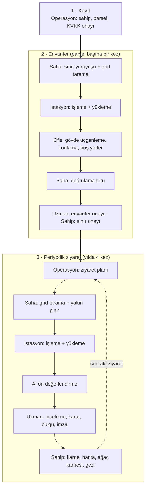

# Kullanım Kılavuzu

21 Ekim 2026 · Yusuf

Bu kılavuz orchadOS'un uçtan uca akışını anlatır: bir bahçe sisteme nasıl girer, sahada ve ofiste kim ne yapar, rapor sahibe nasıl ulaşır. Her adımda hangi rolün hangi aracı kullandığı yazılıdır.

Değerlendirme kuralları [metodoloji.md](metodoloji.md)'de, ürün tanımı [MVP.md](MVP.md)'de anlatılır.

> **Durum işaretleri:** Yazılım geliştirme sürüyor. Her adımın yanında bugünkü durumu var:
> - ✅ **Hazır:** Kullanılabilir, test ediliyor.
> - 🟡 **Kısmen:** Çalışıyor ama bir parçası eksik ya da geçici bir yolla yapılıyor.
> - ⬜ **Henüz yok:** Planda var, yazılmadı.

## Roller ve araçlar

| Rol | Kim | Ne yapar | Araç |
| --- | --- | --- | --- |
| **Sahip** | Bahçeden uzakta yaşayan bahçe sahibi | Raporu okur, ağaç ağaç inceler, 360° gezer | Web portalı, `/portal` (telefon ya da bilgisayar) |
| **Hissedar** (izleyici) | Hisseli parselde diğer hissedarlar; sahip ekler | Sahiple aynı ekranları görür, değiştiremez | Web portalı, `/portal` |
| **Saha personeli** | Eğitimli öğrenci ya da okur yazar tarım işçisi | Sınır yürüyüşü, grid tarama, yakın plan, doğrulama turu; ofiste gövde üçgenleme | Saha uygulaması (Android) + tarama kiti; ofis aracı, `/ofis` |
| **Uzman** | Ziraat mühendisi, uzaktan çalışır | Ağaçları inceler, kararı verir, bulgu ve öneri yazar, raporu imzalar | Uzman paneli, `/uzman` |
| **Operasyon** | Başlangıçta kurucu | Sahip ve parsel kaydı, ziyaret planı, işleme hattını çalıştırma, kalite takibi | `/operasyon`, işleme istasyonu (`orchados-pipeline`), ofis aracı |

**Araçlar:**

| Araç | Nerede çalışır | Kim kullanır |
| --- | --- | --- |
| **Tarama kiti** | Motosiklette direk: 360° kamera, RTK GNSS anteni, GNSS kaydedici (ESP32) | Saha personeli |
| **Saha uygulaması** | Personelin Android telefonu; internetsiz çalışır | Saha personeli |
| **İşleme istasyonu** | Ofisteki GPU'lu bilgisayar; komut satırı aracı `orchados-pipeline` | Operasyon |
| **Web uygulaması** | Tarayıcı. Rol bazlı dört bölüm: `/portal`, `/uzman`, `/ofis`, `/operasyon` | Herkes, rolüne göre |
| **Veritabanı ve depo** | Supabase: kayıtlar, satır bazlı yetki, medya deposu | Arka planda; şimdilik operasyon panelden de kullanır |

Web uygulamasında herkes sadece rolünün bölümünü görür. Kullanıcının hangi veriyi göreceğine de veritabanındaki satır bazlı yetki karar verir. Örneğin sahip sadece kendi parselini görür; uzman ve personel ise işletmenin bütün parsellerini.

## Büyük resim

**Ziyaretin durumu** (veritabanında `session.status`). Ekranlarda ve kuyruklarda bu durumlar görünür:

| Durum | Anlamı | Kim geçirir |
| --- | --- | --- |
| `planned` | Planlandı | Operasyon |
| `captured` | Sahada tarandı, kayıtlar telefondan gönderildi | Saha uygulaması |
| `processed` | İşlendi, panoramalar ve kesitler yüklendi | İşleme hattı |
| `in_review` | Uzman incelemesinde | Uzman paneli (ziyaret açılınca) |
| `published` | Uzman imzaladı; sahip artık görüyor | Sadece uzman, `publish_session` ile |

**Sahip ne zaman görür?** Bir ziyaretin hiçbir sonucunu (fotoğraf, değerlendirme, bulgu) sahip uzman yayımlamadan önce göremez. Bu kural veritabanında uygulanır. Yayın geri alınamaz; yayımlanmış bir ziyaretin uzman kararları değiştirilemez.

## 0 · Başvuru ve ödeme

**Kim:** Müşteri (site ve `/portal`), Operasyon (`/operasyon`, "Müşteri ve ödeme" menüsü) · **Tasarım:** [musteri-yonetimi.md](musteri-yonetimi.md)

Bahçe sahibi hesabını kendisi açıp başvurabilir. Operasyonun telefonla kayıt yolu (bölüm 1) aynen sürer; iki yol aynı sahip listesinde buluşur.

1. **Kayıt ve başvuru (müşteri).** Siteden kaydolur, telefonunu SMS koduyla doğrular. Portalda bahçelerini (konum, beyan edilen alan, isteğe bağlı kaba sınır, yetki dayanağı, giriş izni) ve paketini girer, fiyat önizlemesini görür, başvuruyu gönderir (`B-2026-…`).
2. **İnceleme (operasyon, `/operasyon/basvuru`).**
    - Pano "Müşteri ve ödeme" kartında incelenecek başvuruları, açık teklifleri, geciken ödemeleri, incelemedeki ödemeleri ve açık iadeleri sayar. Son 24 saatte 300'den fazla kayıt denemesi olursa uyarı çıkar.
    - Başvuru sayfasında bahçeler haritada ve tabloda (beyan edilen ve doğrulanan alan) görünür.
    - Her bahçe için "Doğrula": alan dönüm olarak girilir; gerekirse sınır haritada yeniden çizilir ve çizilen alan kullanılır. Doğrulama notu iç bilgidir, müşteri görmez.
    - Bütün bahçeler doğrulanınca teklif önizlemesi çıkar (bugün geçerli fiyat listesi). İndirim yüzde olarak girilir; indirim varsa açıklama zorunludur.
    - "Teklif ver" ya da "Başvuruyu reddet" (neden müşteriye gider, not içte kalır). Müşteriye SMS ya da WhatsApp bildirimi gider.
3. **Teklif onayı (müşteri).** Fatura bilgileri, Ön Bilgilendirme ve Mesafeli Hizmet Sözleşmesi onaylanır; sipariş açılır (`S-2026-…`).
4. **Ödeme.**
    - Kartla: iyzico ödeme sayfası (3DS). Sonuç sunucudan doğrulanır; tutar ya da referans tutmazsa ödeme "İncelemede" kalır ve sistem bir iptal iadesi açar (ödeme sayfasında uyarı).
    - Havaleyle: müşteri IBAN'a öder, operasyon sipariş sayfasında "Havale/EFT kaydet" ile tutarı (TL), valör tarihini ve banka referansını girer. Kısmi havale kabul edilir. Süren bir kart denemesi varsa kayıt reddedilir.
    - Her başarılı ödemeye makbuz numarası verilir (`M-…`, `/makbuz/<id>`). Makbuz fatura değildir.
5. **Aktivasyon.** Ödeme tamamlanınca sipariş "Aktif" olur, her bahçe için parsel "kayıt" durumunda açılır ve müşteriye sahip erişimi verilir. Sipariş sayfasından parsele geçilip envanter ziyareti planlanır (bölüm 1, adım 5).
6. **Sipariş işlemleri (`/operasyon/siparis`).** Ödeme süresi uzatma, ödemesi alınmamış siparişi iptal, aktif siparişi fesih (not zorunlu, onay kutusu). Süresi geçen siparişler listede vurgulanır. Hizmet yılı biten siparişe "Yenileme teklifi ver"; ops'un açtığı mevcut parseller için sahip sayfasındaki "Parsel teklifi ver".
7. **İadeler (`/operasyon/odeme`, `/operasyon/iade`).**
    - Ödeme sayfasında "İade iste": havalede iade elle yapılır; kartta aynı gün tam tutar iptal, diğer durumlarda kalem bazında iade edilir ve hemen ödeme servisine gönderilir.
    - İadeler sayfası önce istenen, başarısız ve belirsiz (15 dakikadan uzun süredir işlenen) iadeleri gösterir. Satırda: "İşle" (kart), "Havale iadesi yapıldı" (banka referansı ve gün), "Vazgeç", "Sonucu elle kaydet" (kartta başarılı için sağlayıcı referansı zorunlu). Ödeme servisine ulaşılamazsa ekranda bildirilir.
    - Yanlış girilmiş bir havale, sipariş aktif değilse ödeme sayfasından geri alınır.
8. **Fiyatlar (`/operasyon/fiyat`).** Paketler (kod, ad, yıllık ziyaret, envanter dahil mi, aktif mi). Fiyat listeleri sürümlüdür: taslakta birim fiyat (TL / dönüm·ziyaret), minimum ve envanter ücreti, KDV ve geçerlilik başlangıcı girilir, onay kutusuyla yayımlanır. Yayımlanan liste değişmez; "Bundan taslak oluştur" ile kopyalanır. Bugün geçerli liste işaretlidir.
9. **Müşteriler (`/operasyon/sahip`).** Sahip listesi kayıt kaynağını (self-servis ya da operasyon), açık sipariş sayısını ve ödenen tutarı gösterir; arama ve "Yalnızca self-servis" süzgeci vardır. Sahip sayfasındaki "Müşteri hesabı" panelinde fatura profili, onay geçmişi, başvurular, siparişler ve ödemeler yer alır. Telefonlar maskelidir. TCKN yalnızca ayarlarda zorunlu yapılmışsa toplanır ve maskeli görünür; "TCKN'yi göster" her seferinde denetim kaydına yazılır.
10. **Ayarlar ve denetim kaydı.** `/operasyon/ayarlar`: dışarıdan kayıt anahtarı (uyarısıyla), TCKN zorunluluğu, satıcı ve havale bilgileri (IBAN denetlenir), süreler. Sahte ödeme ayarı yalnızca gösterilir; veritabanından değiştirilir. `/operasyon/denetim-kaydi`: faturalama ile ilgili her yazma işlemi kim, ne zaman, hangi kayıtta diye listelenir; kayıt türü, kimlik ve eylemle süzülür.

| Adım | Durum |
| --- | --- |
| Veri modeli, fiyat hesabı, teklif, sipariş, ödeme ve iade fonksiyonları, denetim kaydı | ✅ |
| Site, kayıt ve SMS doğrulaması (bayrak kapalıyken gizli) | ✅ (gerçek SMS için Netgsm, pilotta Turnstile canlı anahtarları gerekiyor) |
| Back office: başvuru, doğrulama, teklif, sipariş, havale, iade, fiyatlar, ayarlar, denetim kaydı, müşteri hesabı paneli | ✅ |
| Müşteri portalı: başvuru, teklif onayı, kartla ödeme, makbuz | 🟡 (ayrı iş paketinde geliştiriliyor) |
| Kartla ödeme (iyzico) | 🟡 (sandbox ve sahte sağlayıcıyla test ediliyor; canlı hesap ve yazılı teyit bekleniyor) |
| e-Arşiv / e-Fatura, taksit, otomatik yenileme ödemesi | ⬜ (İP12 kapsamı dışında) |

## 1. Kayıt

**Kim:** Operasyon · **Araç:** `/operasyon`

1. Sahiple telefonda ya da yüz yüze görüşülür. Ad, telefon, iletişim tercihi ve KVKK onayı alınır. Kişisel bilgiler ayrı, korumalı bir şemada (`private`) tutulur.
2. Her parsel için: il/ilçe/köy, kaba konum ve sınır, tahmini alan ve ağaç sayısı, erişim notu, sınırı sahada gösterecek kişi. Tapu bilgisi sadece kayıt içindir.
3. Kaba sınır haritada çizilir (sınır sürüm 1, kaynağı "sahibin beyanı").
4. Sahibe ve varsa hissedarlara portal erişimi verilir (`parcel_access`: sahip `owner`, hissedar `viewer`).
    - Hesap yoksa açılır; tek kullanımlık parola ekranda bir kez gösterilir.
    - Operasyon parolayı sahibe WhatsApp'la iletir.
    - Hesabı Supabase'deki `invite-user` fonksiyonu açar; servis anahtarı Vercel'e çıkmaz.
5. Envanter ziyareti planlanınca parsel durumu "kayıt"tan "envanter planlandı"ya geçer.

| Adım | Durum |
| --- | --- |
| Veri modeli, kişisel verinin ayrı tutulması, yetki kuralları | ✅ |
| Sahip ve parsel kaydı, kaba sınır, portal erişimi ve hesap açma (`/operasyon`) | ✅ |
| Telefonla (SMS kodu) giriş | ✅ (gerçek SMS için Netgsm hesabı gerekiyor) |
| Sahibin portaldan hissedar davet etmesi, operasyonun tamamlaması | ✅ |
| Parsel yaşam döngüsü: aktif izleme (ilk yayımlanan tarama) ve pasif (`/operasyon`) | ✅ |

## 2. Envanter

Envanter her parselin dijital haritasını bir kez çıkarır. Sonraki her ziyaret bu haritaya göre eşleşir.

### 2.1 Sahada: sınır ve grid tarama

**Kim:** Saha personeli · **Araç:** saha uygulaması + tarama kiti

1. **Bugünkü görevler:** Uygulamada günün ziyaretleri görünür.
2. **Ön kontrol:** Lens, pil, depolama, GNSS ham kaydı. Liste tamamlanmadan tarama başlamaz.
3. **Kaydediciyi bağla:** Uygulama Bluetooth ile GNSS kaydediciye bağlanır ve konum kalitesini gösterir (fix/float).
4. **QR saat:** Telefonda GPS saatini gösteren QR kodu 360° kameraya okutulur. Böylece video ile GPS zamanı eşlenir.
5. **Sınır yürüyüşü:** Sahibin ya da yetkilendirdiği kişinin gösterdiği sınır boyunca yürünür. Her köşede uygulamada "köşe" işaretlenir; sınır işaretleri fotoğraflanır.
6. **Grid tarama:** Motosikletle önce sıra boyunca, sonra dik koridorlar, en son kenarlar.
7. **Bitir:** Ziyaret özeti ekranında kayıtların gönderildiği görülür. Kameranın hafıza kartı ofise getirilir; ham video telefondan gönderilmez.

| Adım | Durum |
| --- | --- |
| Görevler, ön kontrol, kaydedici bağlantısı, QR saat | ✅ (telefonda henüz denenmedi; kit bekleniyor) |
| GNSS kaydedici yazılımı | ✅ (gerçek donanımda henüz denenmedi) |
| Sunucuya gönderim (senkronizasyon) | ✅ |
| Köşe işaretleme, kapsama haritası ve oranı | ✅ |
| Köşelerin PPK'lı yörüngeden konumlanıp sınır sürümünün yazılması (işleme hattı) | ✅ |
| Sabit grid rotası, dur-çek-yürü | ✅ |

### 2.2 İşleme istasyonunda

**Kim:** Operasyon · **Araç:** `orchados-pipeline`

1. Hafıza kartındaki video ve kaydedicinin microSD'si oturum klasörüne kopyalanır.
2. `orchados-pipeline run <oturum>`. Hat şunları yapar:
    - GNSS'i PPK ile santimetreye düzeltir.
    - Video ile zamanı eşler.
    - Her 3–4 m'de en net kareyi seçer.
    - Panoramaları ve önizlemeleri üretir.
3. `orchados-pipeline upload <çalıştırma> --session-id <ziyaret>`:
    - Panoramalar depoya, kayıtlar veritabanına gider.
    - Ham video istasyonda kalır.

| Adım | Durum |
| --- | --- |
| PPK, zaman eşleme, kare seçimi, panorama, yükleme | ✅ Sentetik veriyle |
| Gerçek kamera verisiyle deneme | ⬜ Kit bekleniyor |

### 2.3 Ofiste: gövde üçgenleme

**Kim:** Saha personeli ya da operasyon · **Araç:** ofis aracı, `/ofis/parsel/<parsel>/envanter`

1. Solda parsel haritası ve panorama noktaları, sağda iki panorama.
2. Her ağacın gövdesine iki farklı panoramada tıklanır; yazılım konumu hesaplar (ağaç başına ~10 sn). Belirsizlik yüksekse ya da açılar uygun değilse uyarı çıkar.
3. **Sıra oturtma ve kodlama:** Yazılım sıra doğrularını oturtur ve kodları verir (S5-12, ara ağaç S5-12a). Beklenen ama ağaç bulunmayan yerler "boş yer" olur.
4. **Doğrulama listesi:** Belirsiz ağaçlar, boş yerler ve "emin değilim" işaretlileri listelenir; CSV olarak alınabilir.
5. **Kaydet:** Yerler ve ağaçlar veritabanına yazılır.

| Adım | Durum |
| --- | --- |
| Üçgenleme, sıra oturtma, kodlama, boş yerler, doğrulama listesi, kayıt | ✅ |
| Panoramaları depodan okuma; tek işlemde kayıt; tıklamaların etiket olarak saklanması | ✅ |
| Ağaç özellikleri (yaş, aşı) ve altyapının ofiste işaretlenmesi | ✅ |
| Ofiste saha sınırı çizimi (sahada köşe işaretleme gelene kadar) | ✅ |

### 2.4 Doğrulama turu ve onaylar

**Kim:** Saha personeli, uzman, sahip

1. **Saha personeli:** Doğrulama listesindeki ağaçlara gider, yakın plan çeker ve soruları cevaplar. Bu tur, ilk periyodik ziyaretle birleştirilebilir.
2. **Uzman:** Kodlamayı ve ağaç özelliklerini kontrol eder, envanter raporunu imzalar.
3. **Sahip:** Sınırı portalda onaylar.

| Adım | Durum |
| --- | --- |
| Sınır onayının veritabanı kuralı (`approve_boundary`) | ✅ |
| Doğrulama turunun ofiste oluşturulması ve kalemlerin kapatılması (telefonla doğrulama) | ✅ |
| Uzmanın envanter onayı (`approve_inventory`; parsel "envanter tamam" olur), sahibin sınır onayı (portal) | ✅ |
| Saha uygulamasında doğrulama turu ekranı | ✅ |

## 3. Periyodik ziyaret

Yılda dört ziyaret: kış, ilkbahar, yaz, hasat. Her ziyarette neye bakıldığı [metodoloji.md](metodoloji.md)'de.

### 3.1 Planlama

**Kim:** Operasyon · **Araç:** `/operasyon`

Parsel için `periodic_scan` türünde, `planned` durumda bir ziyaret açılır; tarihi ve sorumlu personeli girilir. Ziyaret, personelin uygulamasında "bugünkü görevler" listesine düşer.

| Adım | Durum |
| --- | --- |
| Planlama, tarih ve sorumlu değişikliği, iptal; pano (duruma göre sayılar, yaklaşanlar, gecikenler) | ✅ |
| Görevlerin telefona inmesi | ✅ |

### 3.2 Sahada: tarama ve yakın plan

**Kim:** Saha personeli · **Araç:** saha uygulaması + tarama kiti

1. Ön kontrol, kaydedici bağlantısı ve QR saat; envanterle aynı.
2. Grid tarama; envanterle aynı rota, aynı kamera yüksekliği.
3. **Yakın plan listesi:**
    - Önceki ziyarette dikkat, sorunlu ya da kuru olanlar
    - Rastgele örneklem
    - Personelin "Sorun gördüm" dedikleri

   Her ağaçta mevsime göre 2–3 çekim yapılır ve evet/hayır soruları cevaplanır. Bulanık ya da karanlık fotoğraf telefonda reddedilir; fotoğraflar sadece uygulama içinden çekilir.
4. **Bitir:** Kayıtlar internet olunca kendiliğinden gönderilir. Hafıza kartı ofise getirilir.

| Adım | Durum |
| --- | --- |
| Yakın plan akışı, kamera, cihazda kalite kontrolü, gözlem soruları | ✅ |
| Gönderim | ✅ |
| Kapsama haritası, sabit grid rotası | ✅ |
| Yakın plan listesinin sunucuda üretilmesi (10×10 m tabakalı örneklem, uzman istekleri, "Sorun gördüm") | 🟡 Sunucu ve operasyon ekranı hazır; saha uygulaması listeyi henüz kendisi hesaplıyor, "Sorun gördüm" düğmesi yok |

### 3.3 İşleme istasyonunda

**Kim:** Operasyon · **Araç:** `orchados-pipeline`

Envanterle aynı adımlar. Bunlara ek olarak her ağaç için, ağaca en yakın panoramalardan dört yönden **kesit** çıkarılır. Yükleme bitince ziyaret `processed` olur ve uzmanın kuyruğuna düşer.

| Adım | Durum |
| --- | --- |
| Kesitler, yükleme, `processed` durumu | ✅ Sentetik veriyle |
| Ağaç konumlarının envanterden (veritabanından) alınması | ✅ |
| Kapsama raporu ve yeniden tarama görevi | 🟡 Kapsama haritası portalda (kesitlerden); işleme hattının raporu ve otomatik yeniden tarama görevi yok. Uzman "Ek ziyaret iste" ile isteyebilir |

### 3.4 AI ön değerlendirme

**Kim:** Otomatik

Her ağacın kesitleri, önceki ziyaretin kesitleri ve personelin cevaplarından ölçek önerisi ve güven skoru üretilir. Bu bir **öneridir**: sahibe görünmez, uzman paneline düşer.

| Adım | Durum |
| --- | --- |
| AI ön değerlendirme (`ai-worker run --session-id ...`, işleme istasyonunda) | ✅ Sentetik veriyle; ziyaretin bütün kesitleri gönderilir, yakın planlar v0.1'de gönderilmez. İlk kış denetiminde uzman her ağaca kendisi karar verir |

### 3.5 Uzman incelemesi ve yayın

**Kim:** Uzman · **Araç:** uzman paneli, `/uzman`

1. **Ziyaret kuyruğu:** İşlenmiş ve incelemedeki ziyaretler; her birinde incelenen ve kalan ağaç sayısı. Ziyaret açılınca `in_review` olur.
2. **Ağaç ağaç inceleme:**
    - Liste yer koduna göre sıralı. Filtreler: incelenmemiş, AI'ın sorunlu dedikleri, düşük güvenliler.
    - Seçili ağaçta bu ziyaretin ve önceki yayımlanmış ziyaretin kesitleri yan yana durur. Yanlarında AI önerisi, önceki uzman sonucu ve ağaç özellikleri.
3. **Karar:**
    - **AI'ı kabul et** (`A` tuşu): AI'ın önerisi uzman kararı olarak kaydedilir; AI'ın kendi kaydı değişmez.
    - **Düzelt:** Uzman sınıfı seçer (`1`–`5`) ve mevsimin ölçeklerini girer.
    - `J`/`K` tuşlarıyla ağaçlar arasında gezilir.
4. **Bulgu ve öneri:** Ağaca ya da parsele bağlı bulgu yazılır: tür, önem, açıklama, öneri, kanıt kesitleri.
5. **Özet ve imza:**
    - Özette sınıf dağılımı, önceki ziyarete göre değişenler, bulgular ve incelenmemiş ağaçlar görünür.
    - **İmzala ve yayımla:** Her aktif ağacın uzman kararı yoksa yayın reddedilir ve eksikler listelenir.

| Adım | Durum |
| --- | --- |
| Kuyruk, inceleme, kabul/düzelt, bulgu, özet, imza ve yayın, kısayollar | ✅ |
| Zorunlu inceleme kuralları, toplu onay ve %5 kalite örneklemi | ✅ |
| Sahibin sorularını cevaplama (`/uzman`, Sorular) | ✅ |
| Kritik bulgu bildirimi ("Onayla ve sahibe hemen bildir") | ✅ |
| Ek ziyaret, sonraki ziyarette yakın plan ve doğrulama istekleri; operasyonda planlama | ✅ |
| Genel sınıf kuralının öneri olarak gösterilmesi | ✅ |

### 3.6 Sahip raporu okur

**Kim:** Sahip ve hissedar · **Araç:** web portalı, `/portal`

1. **Bahçelerim:** Her parselin son denetim tarihi ve sınıf dağılımı.
2. **Parsel karnesi:**
    - Son denetimde kaç ağaç sağlıklı, dikkat, sorunlu, kuru, yok.
    - Önceki denetime göre kaç ağaç kötüleşti, kaç ağaç iyileşti.
    - Önem sırasıyla bulgular, ziyaret geçmişi.
3. **Sağlık haritası:** Ağaçlar sınıf rengiyle; boş yerler ve bulgular işaretli; sınıfa göre filtre.
4. **Ağaç karnesi:**
    - Kod ve özellikler.
    - Son sınıf ve kimin verdiği; "✓ Uzman onaylı" ayrı gösterilir.
    - Ölçüm geçmişi.
    - Ziyaret ziyaret aynı yönden fotoğraflar.
    - Bulgular ve öneriler.
5. **360° gezi:** Haritada bir noktaya dokununca o noktanın panoraması açılır. Oklarla komşu noktalara geçilir; ağaç işaretçisine dokununca ağaç karnesi açılır.
6. **PDF indir:** Karne sunucuda PDF olarak hazırlanır ve indirilir. İsteyen "Yazdır" ile tarayıcıdan da yazdırabilir.
7. **Envanter raporu:** Envanter onaylandıysa karnenin üstündeki "Envanter raporu" düğmesi ilk sayımın raporunu açar: kaç yer, kaç ağaç, kodlu harita, sınır, bahçe yapısı, ilk gözlemler. Bu rapor da PDF olarak indirilebilir.

| Adım | Durum |
| --- | --- |
| Bahçelerim, karne, harita, ağaç karnesi, gezi, yazdırma, telefon görünümü | ✅ |
| Genel durum skoru (0–100) ve denetim güveni | ✅ (ağırlıklar metodolojide kesinleşecek) |
| Soru bırakma | ✅ |
| Karne boyutları (envanter değişimi, bahçe yapısı, mekânsal desen, bakım, zararlı, meyve yükü) | ✅ |
| Harita: ziyaret seçici, "bu ziyarette değişenler", 10×10 m ısı haritası, kapsama izi | ✅ |
| Gezide zamanda gezinme ve bakış yönü; ağaç karnesinde kanıt bilgisi ve hash doğrulaması | ✅ |
| "Rapor hazır" ve kritik bulgu bildirimleri, operasyonda bildirim listesi | ✅ (gerçek SMS için Netgsm hesabı gerekiyor; o zamana kadar mesajlar kaydediliyor) |

## Rol rol özet

| Rol | Bir ziyarette ne yapar | Ekran |
| --- | --- | --- |
| Operasyon | Ziyareti planlar, kartları alır, işleme ve yüklemeyi çalıştırır, kaliteyi izler | `/operasyon`, işleme istasyonu |
| Saha personeli | Tarar, yakın plan çeker, soruları cevaplar; envanterde ofiste gövde üçgenler | Saha uygulaması, `/ofis` |
| Uzman | İnceler, karar verir, bulgu yazar, imzalar | `/uzman` |
| Sahip, hissedar | Okur, inceler, gezer | `/portal` |

## Demo

**Kim:** Bahçe sahibi adayları; hesap ve ödeme gerekmez · **Araç:** demo dağıtımı, `demo.<alan adı>/demo` · **Tasarım:** [demo-turu.md](demo-turu.md)

Aday, ücretli bir sahibin gördüğü portalı sentetik verilerle dener. Ekranlar gerçek sahip portalıdır; demo ayrı bir Supabase projesinde çalışır ve orada gerçek müşteri verisi yoktur.

1. **Giriş.** Sitedeki "Demoyu dene" (landing, üst menü, `/giris`) `demo.<alan adı>/demo`'ya gider. Sayfa ne görüleceğini ve hangi teknik verinin tutulduğunu anlatır (kişisel veri istenmez; IP'nin takma adlandırılmış özeti 48 saat).
2. **Başlatma.** Turnstile doğrulamasından sonra "Demoyu başlat". Ziyaretçiye 3 saatlik geçici bir demo hesabı açılır ve sahip portalına girilir: iki örnek bahçe, "Örnek Bahçe – Kuzey" ve "Örnek Bahçe – Dere".
3. **Bant.** Her sayfanın üstünde: "Örnek bahçe · veriler ve görüntüler sentetik, konum temsilî · oturum HH:MM'ye kadar" ve üç düğme:
    - "Turu başlat": rehberli turu açar.
    - "Gerçek hesap aç": demodan çıkarıp asıl sitenin kayıt sayfasına götürür.
    - "Demodan çık": oturumu kapatır.
4. **Rehberli tur (10 adım).** Ekranları sırayla gezdirir; "Geri / İleri / Turu kapat", Esc ve ok tuşları çalışır:
    1. Bahçeler
    2. 360° gezi (ağaç işaretçisi, zaman yolculuğu)
    3. Sağlık haritası ve katmanları
    4. Karne: sağlık puanı ve boyutlar
    5. Bulgular ve uzman önerileri
    6. Ağaç karnesi: fotoğraf kanıtı ve hash doğrulaması
    7. Ziyaret seçimi: bir yıl önceki ziyaret
    8. Envanter raporu
    9. PDF
    10. Kapanış: "Gerçek hesap aç", "Paketleri gör"
5. **Bitiş.** Süre dolunca ya da "Demodan çık"tan sonra ziyaretçi `/demo?bitti=1`'e döner; hesap kısa süre sonra silinir. Yeniden başlatmak serbesttir (IP başına saatlik sınır var).

**Demoda kapalı olanlar** (formların yerinde "Demoda kapalı" notu görünür; okuma görünümü aynıdır):
- soru sorma ve cevaplama
- hissedar daveti, davet iptali ve hissedar çıkarma
- sınır onayı
- başvuru, teklif ve ödeme ekranları
- hesap ekranı (e-posta, telefon, parola değişmez)

Demo hesabı hiçbir şey yazamaz; bildirim, SMS ve AI işi oluşmaz. Veriler, panoramalar ve fotoğraflar sentetiktir ve "SENTETIK ORNEK" damgası taşır; PDF'lerde her sayfada "ÖRNEK RAPOR" filigranı vardır.

**Kendi bilgisayarında:** `pnpm db:start && pnpm db:reset`, sonra `pnpm db:demo-tour` (demo verisini yükler ve açar) ve `ORCHADOS_DEMO_ENABLED=1 pnpm web:dev` → http://localhost:3000/demo. Yerelde Turnstile yoktur.

| Adım | Durum |
| --- | --- |
| Demo erişimi, yazma ve hesap kilidi, `demo-start` | 🟡 (incelemede, PR #63) |
| Sentetik demo verisi ve yükleyici | 🟡 (incelemede, PR #64) |
| `/demo` sayfası, bant, rehberli tur, filigranlı PDF | 🟡 (PR açık) |
| Herkese açık demo (`demo.<alan adı>`) | ⬜ (demo projesi ve alan adı bekleniyor; `docs/deployment.md` › Demo turu) |

## Test ortamı

- **Web:** https://orchados-orchad-os.vercel.app
    - Vercel koruması açık; şimdilik sadece Vercel hesabıyla giriş yapan görebilir.
    - Her PR'ın ayrı bir önizleme adresi var.
- **Veritabanı:** Supabase test projesi (Stockholm).
    - Sentetik "Örnek Bahçe 1": 303 ağaç ve iki örnek ziyaret. 14 Ekim ziyareti yayımlanmış, 18 Ekim ziyareti uzman incelemesinde.
    - Görüntü dosyaları yok; ekranlarda yer tutucu görünür.
- **Kullanıcılar:** Parolaları ayrıca paylaşılır.

  | Kullanıcı | Rol |
  | --- | --- |
  | `ops@orchados.test` | Operasyon |
  | `uzman@orchados.test` | Uzman |
  | `saha@orchados.test` | Saha personeli |
  | `sahip@orchados.test` | Sahip |
  | `hissedar@orchados.test` | Hissedar |

- **Kendi bilgisayarında:** `pnpm db:start && pnpm db:reset && pnpm db:demo && pnpm web:dev`. Örnek kullanıcılar `owner@`, `viewer@`, `field@`, `expert@` ve `ops@example.com`; parola `orchados-dev`.

**Denemek için kısa bir tur:**
1. `uzman@` ile gir → `/uzman` → 18 Ekim ziyaretini aç.
2. Birkaç ağacı kabul et ya da düzelt; bir bulgu ekle. Yayımlamak için 302 ağacın hepsine karar gerekir.
3. `sahip@` ile gir → `/portal` → Örnek Bahçe 1. 14 Ekim karnesi ve harita görünür; 18 Ekim görünmez.
