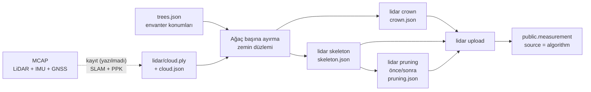

# LiDAR Ölçümleri (İP16)

5 Kasım 2026 · Yusuf

LiDAR'lı tarama kitiyle ([tarama-kiti.md](tarama-kiti.md)) alınan nokta bulutundan ağaç başına iki ölçüm ailesi çıkarılır:

1. **Taç ölçümleri ve büyüklük sınıfı (yapraklı dönem):** taç çapı, ağaç boyu, taç hacmi ve bunlardan büyüklük sınıfı önerisi.
2. **Kış dal iskeleti ve budama analizi (yapraksız dönem, araştırma):** ana kol sayısı, odun hacmi, fraktal boyut; iki kış taraması arasında nelerin budandığı.

Bu doküman yöntemleri, doğruluklarını, veritabanına yazılışlarını ve açık kararları anlatır. Bulutun dosya biçimi bileşenler arası bir sözleşmedir ve [arayuzler.md](arayuzler.md#kayıtlı-nokta-bulutu)'dedir.

## 1. Kapsam ve durum

| Konu | Durum |
| --- | --- |
| Kayıtlı bulut biçimi (`lidar/cloud.ply` + `cloud.json`) | Sözleşme yazıldı ([arayuzler.md](arayuzler.md#kayıtlı-nokta-bulutu)) |
| Ham MCAP'ten kayıtlı buluta (LiDAR-inertial SLAM + PPK) | **Yazılmadı.** Ayrı iş; LiDAR'lı kit yapılınca |
| Ağaç başına ayırma, zemin | Var (`lidar/cloud.py`) |
| Taç ölçümleri, büyüklük sınıfı önerisi | Var (`lidar crown`), sentetik ağaçlarla test edildi |
| Kış iskeleti | Var (`lidar skeleton`), araştırma |
| Budama analizi | Var (`lidar pruning`), araştırma |
| Ölçümlerin veritabanına yazılması | Var (`lidar upload`, `record_lidar_measurements`) |
| Sahibe gösterim | Var (§9): ağaç karnesinde ölçüm tablosu ve kesit fotoğrafları üzerinde çizim, 360° gezide seçilen ağacın değerleri ve çizimi. Sahip kararı (5 Kasım 2026): doğrulama pilotta yapılır, gösterim beklemez |
| Uzman panelinde, ofis aracında gösterim | Yok |
| 3D dünya (gezide renkli bulut ve ölçüler) | Var (İP17, `lidar world`; [3d-dunya.md](3d-dunya.md)) |
| Gerçek ağaçlarda doğrulama | Pilotta, §7 |

**Neden şimdi, kit LiDAR'sızken:** MVP kiti LiDAR'sız ([kit-siparis-listesi.md](kit-siparis-listesi.md)). Yöntemler sentetik verilerle önceden yazılırsa, LiDAR'lı kitin ilk kış taramasında (vizyon aşama 2: "ilk kış iskelet denemesi kendi bahçende") veri doğrudan ölçüme dönüşür ve elle ölçümle karşılaştırma aynı hafta yapılabilir.

## 2. Veri akışı



Komutlar (`services/pipeline/`):

```bash
uv run orchados-pipeline lidar synth /tmp/yaz                    # sentetik yapraklı parsel bulutu
uv run orchados-pipeline lidar synth /tmp/kis-once --leafless --pruned-copy /tmp/kis-sonra --cuts 3
                                                                  # kış bulutu + aynı ağaçlar budanmış
uv run orchados-pipeline lidar crown /tmp/yaz                     # → /tmp/yaz.processed/lidar/crown.json
uv run orchados-pipeline lidar skeleton /tmp/kis-once             # → skeleton.json
uv run orchados-pipeline lidar pruning /tmp/kis-once /tmp/kis-sonra   # → /tmp/kis-sonra.processed/lidar/pruning.json
uv run orchados-pipeline lidar upload /tmp/yaz.processed/lidar --session-id <uuid> [--dry-run]
```

Her aşama `--trees` (varsayılan `<oturum>/trees.json`), `--out` ve `--params` alır. Raporlar aynı girdi ve parametrelerle bayt bayt aynıdır; zaman damgası taşımaz. Parametre hash'i `producer.params_hash`'te ve her ölçümde durur.

## 3. Ağaç başına ayırma

`lidar/cloud.py`, bütün aşamaların ortak girişidir.

- **Ayırma:** Her nokta en yakın envanter gövde konumuna verilir (Voronoi) ve gövdeden yatayda en çok 5 m uzaktaysa tutulur. Birbirine değen taçlar iki gövdenin ortasından bölünür; bu durumda taç çapı alt sınırdır (§4).
- **Zemin:** Her ağaç için gövdenin 5 m çevresindeki noktalardan bir zemin düzlemi bulunur: 50 cm'lik ızgara hücrelerinin en alçak noktaları alınır, düzlem bunlara en küçük kareler yöntemiyle oturtulur, düzlemin 2,5 MAD üstündeki hücreler (alçak dallar, zemin dönüşü olmayan hücreler) üç turda atılır. Eğimli parselde ağaç böylece eğilmez. Ağacın noktaları bu düzleme göre yüksekliğe çevrilir; yerden 25 cm'nin altı (zemin, kısa ot) atılır.
- **Yön kapsaması:** Gövdenin çevresi 45°'lik sekiz dilime bölünür; en az 20 noktası olan dilimlerin oranı ağacın `sector_coverage`'ıdır. Grid tarama her ağacı dört koridordan gördüğü için normalde 1'dir; düşükse ağaç tek taraftan görülmüştür.
- **Envanter hatası:** Gövde konumu envanterden gelir (üçgenleme, ağaçların %95'inde 50 cm altı hata). Ölçümler gövde konumuna değil noktaların kendisine dayanır; konum hatası yalnız ayırma sınırını kaydırır.

## 4. Taç ölçümleri ve büyüklük sınıfı

`orchados-pipeline lidar crown` (`lidar/crown.py`, yöntem `lidar_crown` 0.1.0). Yapraklı dönem için; çıktı `crown.json` (`orchados.lidar_crown/1`).

**Temizleme:** Yerden 0,4 m'nin altı (ot katmanı) kullanılmaz. Noktalar 25 cm'lik voksellere konur, 3 noktadan az olan vokseller atılır, kalanlar komşuluklarına göre (26 komşu) kümelere ayrılır. Ağaç, gövde bölgesine (envanter konumunun 1 m çevresi, yerden 1,5 m'ye kadar) değen en büyük kümedir. Böylece ot, havadaki tekil noktalar ve sınırdan taşan komşu dallar ayıklanır.

**Tanımlar:** Bütün uç değerler "sağlam destek" ile alınır: bir yöndeki en uçtaki noktanın değil, k'inci en uçtaki noktanın konumu (k = en az 8, noktaların ‰0,3'ü). Tek bir gürültü noktası ölçümü büyütmez.

| Ölçüm | Kod | Tanım |
| --- | --- | --- |
| Ağaç boyu | `tree_height` | Temizlenmiş ağacın zemin düzleminden en üst (sağlam) yüksekliği |
| Taç tabanı | (ayrıntıda) | Ağaç 10 cm'lik dilimlere bölünür; genişliği en geniş dilimin %30'una ulaşan ve üstündeki dilim de ulaşan en alt dilim |
| Taç çapı | `crown_diameter` | Taç noktalarının 36 yatay yöndeki kumpas genişliklerinin ortalaması (iki karşı yöndeki sağlam desteklerin toplamı). En dar ve en geniş genişlik ayrıntıda durur |
| Taç hacmi | `crown_volume` | Taç noktalarının dışbükey zarfının hacmi (1000 yönde sağlam destek düzlemlerinin kesişimi, ızgarada toplanır). Düzensiz, açık ya da tek taraflı taçta gerçek yaprak hacmini **olduğundan büyük** gösterir |
| Büyüklük sınıfı | `size_class` | Taç çapından, metodoloji §3 eşikleriyle: < 1,5 m fidan, 1,5–3 m genç, 3–6 m verimli, > 6 m yaşlı. Güven: gerçek çapın önerilen sınıfın içinde olma olasılığı (normal dağılım, çapın belirsizliğiyle), en çok 0,9 |

**Belirsizlik (1σ):** Nokta gürültüsü (`point_sigma_m`), uç değer kuralının duyarlılığı (k yarıya inince ve iki katına çıkınca tahminin oynaması), yönler arası dağılım ve yön kapsamasından gelen pay birleştirilir. Hacmin belirsizliği çap ve taç yüksekliğinin belirsizliğinden yayılır. Zarf modelinin kendi yanlılığı belirsizliğe dahil değildir.

**Kalite:**
- Yön kapsaması temizlenmiş ağaçta yeniden hesaplanır. 0,6'nın altındaysa durum `one_sided` olur ve yalnız boy yazılır. Sayısal ölçümlerin `confidence`'ı yön kapsamasıdır.
- 300 noktadan azsa durum `too_few_points` olur. Gövde bölgesine değen küme yoksa `no_points`.
- **Değen taçlar:** Taç bir komşuya doğru ayırma sınırına 15 cm'den yakın uzanıyorsa not yazılır. Çap ve hacim alt sınırdır ve güvenleri 0,6 ile çarpılır.
- **Yapraksız bulut:** Taç halkasında üstten bakışta dolu hücre oranı (`foliage_cover`) 0,7'nin altındaysa ağaca `low_foliage` işareti konur ve güvenleri yarıya iner. Parseldeki ağaçların ortancası 0,7'nin altındaysa raporda `leafless_cloud` uyarısı çıkar.
- Büyüklük sınıfı yalnız durumu `ok` olan ağaçta önerilir.

**Sentetik doğruluk** (tam kapsama, 3 tohum, envanter konum hatası 0,3 m):

| Büyüklük | Boy | Çap | Hacim |
| --- | --- | --- | --- |
| Fidan | −%0,4 … %0 | +%0,7 … +%1,8 | +%1,8 … +%2,6 |
| Genç | −%0,1 … +%0,2 | +%0,5 … +%0,6 | +%1,8 … +%2,0 |
| Verimli | −%0,2 … %0 | −%0,4 | −%0,7 … −%0,9 |
| Yaşlı | −%0,3 | −%0,6 | −%1,5 … −%1,6 |

Daha zor bir senaryoda en kötü hatalar: çapta +%1,8, hacimde +%2,8, boyda −%0,6. Senaryo 10 tohumdan oluşuyor; zemin eğimli (%8 ve %5), konum hatası 0,3 m, ot 35 cm, havada tekil noktalar var. Ağaç başına süre 0,15–0,5 sn.

Sentetik ağacın tacı düzgün bir elipsoittir; bu sayılar yöntemin tutarlılığını gösterir, gerçek ağaçtaki doğruluğu değil (§7).

**Bilinen sınırlar:**
- 0,4 m'nin altına sarkan taç kısmı dikkate alınmaz.
- Çok seyrek yapraklı fidanda çap yaklaşık %7 düşük okunur.
- Uç değer kuralı yoğun taç kenarı varsayar; gerçek veride daha büyük bir `tail_min_points` gerekebilir.
- Değen taç tespiti envanter konumlarına dayanır.
- Parametreler (`CrownParams`) `--params` ile bir JSON'dan değiştirilir; bilinmeyen alan reddedilir.

## 5. Kış iskeleti ve budama analizi

Araştırma özelliğidir. Fıstık kışın yaprak döktüğü için kış taramasının bulutunda dal yapısı görünür ([vizyon.md](vizyon.md), "LiDAR ile dal iskeleti"). Grid tarama her ağacı dört koridordan, yaklaşık 4 m'den gördüğü için ağacın arkası da taranır.

### 5.1 Kış iskeleti

`orchados-pipeline lidar skeleton` (`lidar/skeleton.py`, yöntem `lidar_qsm` 0.1.0). Çıktı `skeleton.json` (`orchados.lidar_skeleton/1`). Yöntem, QSM'lerin (nicel yapı modeli) "eş uzaklık dilimleri" yaklaşımının sadeleştirilmiş hâlidir.

1. **Voksel grafiği:** Noktalar 4 cm'lik voksellere konur; komşu vokseller (26 komşu) birbirine bağlanır.
2. **Kök:** Envanter konumunun 1 m çevresindeki en büyük alçak voksel öbeğidir.
3. **Dilimler:** Kökten grafik üzerindeki uzaklık (Dijkstra) 8 cm'lik dilimlere bölünür. Her dilimin bağlı kümeleri birer iskelet düğümü olur. Düğümler, en kısa yolların geldiği komşu kümeye bağlanır. 15 cm'den kısa uç çıkıntılar atılır.
4. **Hiyerarşi:**
   - **Gövde:** Kökten, alt ağacı en az 0,5 m uzunluğunda iki ya da daha çok kola ayrılan ilk düğüme kadar.
   - **Ana kollar:** Bu çatalın hemen üstünde (en az 0,3 m ya da iki gövde yarıçapı) gövdeden ayrılan anlamlı kollar.
   - **Sıra:** Bir dalda en uzun alt ağaca sahip kol dalı sürdürür, diğerleri bir üst sıradan yeni dal başlatır.
5. **Yarıçap:**
   - Düğüm noktalarının yerel eksene ortalama kare uzaklığından hesaplanır ve gürültü için düzeltilir.
   - Gürültü (σ) dal uçlarından tahmin edilir.
   - Her dala sağlam bir doğrusal incelme oturtulur.
   - Gürültünün iki katından ince dallarda boru modeli kullanılır: kesit alanı, dalın taşıdığı iskelet uzunluğuyla orantılıdır.

| Ölçüm | Kod | Tanım |
| --- | --- | --- |
| Ana kol sayısı | `scaffold_branch_count` | Gövdenin ilk çatalından çıkan ana kollar |
| Odun hacmi | `wood_volume` | İskelet kenarlarının kesik koni hacimleri ve yerden ilk düğüme kadar gövde silindiri. İnce sürgünler görülmediği için gerçek odun hacminden **azdır** |
| Fraktal boyut | `fractal_dimension` | Voksel kümesinin 5–80 cm arasında kutu sayma boyutu. Yalnız araştırma |
| İlk dallanma yüksekliği, 50 cm'de gövde çapı, sıraya göre dal sayısı, toplam iskelet uzunluğu, iskeletin kendisi | (ayrıntıda) | Ölçüm olarak yazılmaz. Gövde çapı ölçüm yüksekliği açık karar (§8). İskelet düğümleri (konum, yarıçap, üst düğüm, sıra, dal) budama analizi ve ileride bir 3D görüntüleyici içindir |

- **Kalite:** Yön kapsaması 0,75'in altındaysa ağaç `one_sided` olur; iskeleti ayrıntıda kalır ama ölçüm yazılmaz.
- **Yapraklı bulut:** Bulut yapraklı görünüyorsa (tacın içinde kalın gövdeler dışında dağınık nokta payı 0,3'ün üstündeyse) raporda uyarı çıkar. Ölçülen paylar: yapraksız 0–0,06, seyrek yapraklı 0,41–0,60, tam yapraklı 0,74–0,84.

**Sentetik doğruluk** (her büyüklükte 12 tohum, envanter konum hatası yaklaşık 0,3 m):

| Büyüklük | Ana kol sayısı | Odun hacmi | Gövde çapı (50 cm) | Ağaç başına süre |
| --- | --- | --- | --- | --- |
| Genç | 12/12 tam | −%26 … +%30 | −%4 … +%9 | 0,03 sn |
| Verimli | 12/12 tam | −%12 … +%1 | ±%2 | 0,2 sn |
| Yaşlı | 12/12 tam | −%9 … %0 | −%1 … %0 | 0,6 sn |

- İlk dallanma yüksekliği gerçek çataldan 5–30 cm yukarıda çıkar; kolların gözle ayrıldığı yerdir.
- Sıraya göre dal sayıları yalnız kabaca doğrudur.
- Yaşlı bir ağacın `skeleton.json` payı yaklaşık 120 KB'tır.

### 5.2 Budama analizi

`orchados-pipeline lidar pruning <önce> <sonra>` (`lidar/pruning.py`, yöntem `lidar_pruning` 0.1.0). Aynı ağaçların budamadan önceki ve sonraki iki kış taramasını karşılaştırır. Çıktı sonraki oturumun klasöründe `pruning.json` (`orchados.lidar_pruning/1`). Raporun `session_id`'si sonraki taramadır, `before_session_id` öncekini gösterir.

1. **Eşleme:** İki bulut, aynı ağacın envanter enlem/boylamı çevresinden, her biri kendi yerel düzleminde kesilir. Farklı orijinli oturumlar böylece tam eşlenir.
2. **Hizalama:** Sonraki tarama öncekinin üzerine ağaç başına ICP ile oturtulur (öteleme ve düşey eksen çevresinde dönme). Ziyaretler arası birkaç santimlik kayıt sürüklenmesi giderilir; 3 cm'lik kayma yaklaşık 5 mm içinde bulunur. 0,3 m'den ya da 5°'den büyük düzeltme reddedilir.
3. **Kesilen odun:**
   - Önceki taramada olup sonrakinde 8 cm içinde karşılığı olmayan noktalar kesilmiş sayılır.
   - Önceki iskeletin bir düğümü ve alt ağacı en az %60 kesilmişse orası bir kesimdir.
   - Kesim, ekseni boyunca kalan oduna kadar izlenir; kesim noktası ve kesim çapı böyle bulunur.
   - Birbirine 0,5 m'den yakın küçük parçalar birleştirilir.
4. **Büyüme:** Sonraki taramada olup öncekinde olmayan noktalar ayrı raporlanır, budamaya katılmaz.
5. **Durum önerisi** (metodoloji §4.3; v0 eşikleri, uzmanın kararlarıyla ayarlanacak):
   - **`not_done`:** kesim yok.
   - **`done`:** kesimler ana kolların en az yarısına ulaşıyor **ve** en az 3 kesim ya da odunun en az %10'u alınmış.
   - **`partial`:** diğer kesimli ağaçlar.
   - **Güven:** eşiklere uzaklıktan ve sınırdaki kesimlerden gelir.

| Ölçüm | Kod | Birim |
| --- | --- | --- |
| Kesilen odun hacmi | `pruned_wood_volume` | m³ (belirsizliği hiçbir zaman sıfır değildir; tespit tabanı eklenir) |
| Kesilen odun payı | `pruned_wood_fraction` | oran |
| Kesim sayısı | `pruning_cut_count` | adet |
| Budama durumu önerisi | `pruning_status` | `done` / `partial` / `not_done`, güvenle |

**Sentetik doğruluk** (verimli ve yaşlı ağaçlar, senaryo başına 12 ağaç, ağaç çifti başına yaklaşık 2 sn):

| Senaryo | Kesim sayısı ±1 | Kesilen hacim, ortanca (aralık) | Durum önerisi |
| --- | --- | --- | --- |
| 3 ikinci sıra kesim | %92 | −%39 (−88 … +15) | 10 `done`, 2 `partial` |
| 1 ana kol kesimi | %100 | −%23 (−41 … −14) | 11 `partial`, 1 `done` |
| 2 ana kol kesimi | %92 | −%21 (−35 … −14) | 8 `done`, 4 `partial` |
| 1 ikinci sıra kesim | %100 | −%49 (−100 … +55) | `partial` |
| Budanmamış (3 cm kaymayla da) | yanlış kesim yok | ≈ 0 | `not_done` |

**Bilinen sınırlar:**
- **Kesilen hacim sistematik olarak düşük çıkar;** en kötü durum ince tek kesimlerdir. Dilim iskeleti, kesilen dalın kalın dibini komşu bir kola bağlayabilir; bir kesim parçalara bölünebilir ya da dibi kaçabilir. Genç ağaçtaki 0,4 m'den kısa dallar çoğunlukla görülmez.
- **Sentetik ağaç gerçeğinden kolaydır:** ince sürgün kalabalığı, rüzgâr, taç içinde örtme ve uç alma (heading) kesimlerinden kalan güdükler yoktur. Gerçek taramada yakın kolların birleşmesi daha sık olacaktır.
- **Kesim sayısı yaklaşık doğru, hacim değil.** Kesim sayısı ve durum önerisi kesilen hacimden daha güvenilirdir; hacim yalnız eğilim göstergesi olarak okunmalı.
- **Doğrulama:** Ağaç başında ana kol sayımı ve 50 cm gövde çapı, birkaç dalın çapı (gürültü tahmini ve boru modeli geçişi için), budamadan sonra kesim sayısı ve çapları, mümkünse kesilen dalların tartımı (§7).

Parametreler `SkeletonParams` ve `PruningParams`'tadır. `--params` bir JSON alır: `{"skeleton": {...}}`, `{"pruning": {...}}` ya da düz anahtarlar. Budama parametreleri iskelet parametrelerini de içerir.

## 6. Veritabanı

Migration `20261107300000_lidar_measurements.sql`. Yeni tablo yok; ölçümler `public.measurement`'a yazılır.

**Yeni metrikler** (konu: ağaç; mevcut `crown_diameter`, `crown_volume`, `scaffold_branch_count`, `fractal_dimension`, `pruning_status` aynen kullanılır):

| Kod | Birim | Tür | Mevsim | Karnede |
| --- | --- | --- | --- | --- |
| `tree_height` | m | sayı | Tümü | Gösterilir (`20261107400000`) |
| `size_class` | — | kategori: `sapling`, `young`, `productive`, `old` (`age_class` kodları) | Tümü | Gizli (öneri) |
| `wood_volume` | m³ | sayı | Kış | Gizli (araştırma) |
| `pruned_wood_volume` | m³ | sayı | Kış | Değerlendirilecek |
| `pruned_wood_fraction` | oran | sayı | Kış | Değerlendirilecek |
| `pruning_cut_count` | adet | sayı | Kış | Gösterilir (`20261107400000`) |
| `crown_base_height` | m | sayı | Tümü | Gizli; yalnız çizim için (`20261107400000`) |

"Değerlendirilecek" ve "gizli" metrikler karnede ve uzman formunda görünmez. Mevcut `crown_diameter`, `crown_volume`, `scaffold_branch_count` ve `pruning_status` zaten gösteriliyordu. Kesilen odun hacmi ve payı sistematik olarak düşük ölçüldüğü için (§5.2) değerlendirmede kalır. Sahip, yayımlanmış ziyaretin bütün ölçüm satırlarını okuyabilir (satır yetkisi `card_visibility`'ye bakmaz); gizli `crown_base_height` bu yüzden çizimde kullanılabilir.

**`record_lidar_measurements(p_session_id, p_payload)`** (yalnız operasyon) → `{created, existing, skipped: [...]}`. `p_payload`: `{measured_at?, items: [{tree_id, slot_code?, metric, value_numeric | value_category, unit?, uncertainty?, confidence?, method, method_version, params_hash?}]}`.

- Demo claim'i ops hesabında bile reddedilir (`demo_read_only`). Yetki ve oturum denetimleri `record_tree_presence` ile aynı.
- Yöntem ve metrik eşleşmesi sabittir: `lidar_crown` → `tree_height`, `crown_diameter`, `crown_volume`, `size_class`, `crown_base_height`; `lidar_qsm` → `scaffold_branch_count`, `wood_volume`, `fractal_dimension`; `lidar_pruning` → `pruned_wood_volume`, `pruned_wood_fraction`, `pruning_cut_count`, `pruning_status`. Başka bir yöntem ya da metrik reddedilir.
- Ağaç, oturumun parselinin aktif ağacı olmalı. Değer metriğin türüne uymalı, kategori listede olmalı, sayısal değerde belirsizlik zorunlu, birim metriğin birimi olmalı.
- Değeri olmayan kalem (aşama ağacı ölçemediyse) yazılmaz, `skipped`'e `no_value` gerekçesiyle girer.
- Satırlar `source = algorithm`, `method`, `method_version`, `params_hash`, `session_id` taşır. `measured_at` yükten (`cloud.json`'daki tarama başlangıcı), yoksa oturum başlangıcından gelir.
- Aynı oturum, ağaç, metrik, yöntem, sürüm ve parametre hash'iyle ölçüm varsa kalem `existing` sayılır. Yeni yöntem sürümü yeni satır ekler; eski satırlar kalır (ölçümler sürümlüdür). Yük ya hep ya hiç yazılır.
- **Mevsim denetlenmez.** `valid_seasons` hiçbir ölçüm yolunda zorlanmaz (mevsim takvimi metodoloji sürümüne bağlı). Kışın ölçülen taç çapı da yazılır; taç aşaması yapraksız bulutta rapor düzeyinde uyarı verir, uzman ve ofis aracı ölçümü mevsimiyle okumalıdır.

**Yükleme:** `orchados-pipeline lidar upload <oturum>.processed/lidar --session-id <uuid> [--dry-run]` klasördeki raporları okur, oturum ve parsel tutarlılığını ve yukarıdaki kuralları göndermeden önce yerelde denetler, sonra fonksiyonu ops kullanıcısıyla çağırır (ortam değişkenleri `upload` ile aynı). Budama raporunun oturumu budama **sonrası** taramadır.

## 7. Doğrulama planı (pilot)

Metodolojinin kuralı: bir metrik, kendi verimizde doğrulanmadan karneye girmez ([vizyon.md](vizyon.md), "Yeni metrikler için kural"; [veri-modeli.md](veri-modeli.md), "Yöntemler arası tutarlılık"). Referans sıralardaki 40–60 ağaçta (MVP Modül 2, "Pilotta referans sıralarla doğrulama"):

| Ölçüm | Elle referans | Kabul ölçütü (öneri) |
| --- | --- | --- |
| Taç çapı | Şerit metreyle iki dik yönde taç izdüşümü, ortalaması | Ortalama sapma ±%5, ağaçların %95'inde ±%10 |
| Ağaç boyu | Jalon ya da lazer mesafe ölçer / hipsometre | ±15 cm |
| Taç hacmi | Doğrudan referans yok; çap ve boydan elipsoit, yöntemler arası tutarlılık için | Sapma belgelenir, karneye girmeden önce karar |
| Büyüklük sınıfı | Ofis kişisinin kesitlerden verdiği sınıf | Uyum %90, eşiğe yakın vakalar ayrı |
| Ana kol sayısı | Kışın ağaç başında sayım | Ağaçların %90'ında tam eşleşme |
| Budama kesimleri | Budamadan sonra kesim yerlerini sayma, kalın kesimlerin çapı | Kesim sayısı ±1, çap ±2 cm |

Gerçek ağaçlarda sentetikte olmayan zorluklar beklenir: ince sürgün yoğunluğu, sulama hortumları, destek kazıkları, yabani ot, komşu taçların iç içe geçmesi, tarama sırasında rüzgâr, personelin ya da motosikletin gölgesi. Her biri doğrulamada ayrı not edilir.

## 8. Açık kararlar

- **Gövde çapının ölçüm yüksekliği.** Metodoloji §3 gövde çapını yerden yaklaşık 50 cm'de tanımlıyor; metrik kaydındaki kod `trunk_diameter_h30` (30 cm). 1,2 m'deki LiDAR ise görüş açısı yüzünden 4 m'deki gövdeyi ancak 70–80 cm'den yukarıda görür. Bu yüzden LiDAR gövde çapı şimdilik ölçüm olarak yazılmaz; iskelet raporunun ayrıntısında, yüksekliğiyle birlikte durur. Karar seçenekleri: (a) LiDAR'ı alçaltmak ya da eğmek, (b) LiDAR için ayrı bir yükseklik koduyla ayrı metrik, (c) gövde çapını yalnız yakın plan ve şerit metreyle almak.
- **Montaj ve tarama yöntemi.** LiDAR'lı kit sırt direği için tasarlandı; MVP taraması motosikletle. Motosiklette LiDAR yüksekliği, sürücünün kapattığı sektör ve titreşimin SLAM'a etkisi denenmeli (metodoloji §11, "Yönteme göre ayar").
- **Kartta gösterim (karar verildi, 5 Kasım 2026).** Sahip kararıyla taç ölçümleri ve kesim sayısı doğrulama beklenmeden sahibe gösterilir; uzman onayı aranmaz (§9). Pilottaki doğrulama (§7) bir yöntemi yetersiz bulursa metrik `under_evaluation`'a geri alınır ya da yeni yöntem sürümü yazılır; eski değerler sürümleriyle kalır.
- **Büyüklük sınıfının yazılması.** Öneri ağacın `age_class`'ını değiştirmez. Ofis aracında ya da uzman panelinde "LiDAR önerisi: Verimli (güven 0,9)" gibi gösterilip tek tıkla kabul edilmesi sonraki iş.
- **KVKK (karar verildi, 5 Kasım 2026).** Nokta bulutu bahçede bulunan kişilerin şeklini de kaydedebilir. Sahip kararıyla taramalarda bahçede insan bulunmaz; bu yüzden sahibe bulut gösterilir (İP17, [3d-dunya.md](3d-dunya.md) §2). Ham `cloud.ply` yine yalnız personele açıktır. Sahibe ondan türetilen web bulutu (`world.owc`) açılır. Bu bulut zaman, yörünge ya da kare sırası taşımaz; taşıyan kişi ondan atılır (personel izi, H05).

## 9. Sahibe gösterim

**Karar (5 Kasım 2026, sahip):** LiDAR ölçümleri doğrulama beklenmeden sahibe gösterilir; doğrulama pilotta yapılır (§7). Uzman LiDAR ölçümünü ayrıca onaylamaz: ziyaret yayımlandığında (uzman imzası) ölçümler de sahibe açılır. Çizim taç geometrisinin üç değerine dayanır: ağaç boyu, taç çapı ve taç tabanı yüksekliği.

- **Ağaç karnesi:** Ölçüm tablosunda ağaç boyu, taç çapı, taç hacmi, ana kol sayısı, kesim sayısı ve budama durumu ziyaret ziyaret görünür. Kesit fotoğraflarının üzerine çizim konur. Çizimde gövdeden ağacın tepesine boy çizgisi, taç ortası yüksekliğinde taç çapı ayracı ve taç tabanında kesikli çizgi bulunur. Çizim açılıp kapatılabilir. Altında çizimin tarama sırasında ölçülen değerlerden çizildiği ve yaklaşık olduğu yazar.
- **360° gezi:** Seçilen ağacın panelinde bakılan ziyaretin değerleri (boy, taç çapı, taç hacmi) görünür. Aynı çizim panoramanın üzerinde yalnız o ağaç için durur. Ziyaretler arasında gezinince değerler ve çizim o ziyarete geçer.
- **Geometri:** Kesit, kameradan ağaca bakan perspektif görüntüdür. Ağacın yatay uzaklığı, kesitin yukarı bakış açısı ve görüş açısı kesitin `pose`'unda kayıtlıdır; kamera yüksekliği ziyaretin `camera_height_m`'idir. Çizim bu değerlerle, işleme hattının kesit izdüşümünün (`projection.gnomonic_crop`) tersinden hesaplanır. Varsayımlar: ağacın altındaki zemin kameranın durduğu zeminle aynı yükseklikte, taç gövdenin üstünde ortalanmış. Eğimli parselde ya da taç merkezi gövdeden kaymışsa çizim birkaç santimden birkaç desimetreye kadar kayabilir. Bu yüzden çizim yaklaşık diye etiketlenir; değerin kendisi tablodadır.
- **Gizlilik:** Çizim zaman taşımaz (H05). Nokta bulutunun kendisi sahibe açılmaz.
- **Kod:** Geometri `apps/web/src/lib/portal/crown-guide.ts` (saf fonksiyonlar, kesit ve panorama izdüşümü, birim testli), kesit çizimi `components/portal/crop-guide.tsx`, panorama çizgileri `lib/panorama/markers.ts`. Kart kesitleri 4:3 çerçevede gösterdiği için uzun ağaçlarda boy çizgisinin ucu kadraj dışında kalabilir; etiket kadrajın içinde kalır.
- **Uzman formu:** Ağaç boyu ve kesim sayısı karnede gösterilen metrikler olduğundan, uzman inceleme formunda kış ziyaretinde elle girilebilen ölçümler arasına da girdi (ana kol sayısı gibi). Uzmanın elle girdiği değer, kaynak önceliği gereği LiDAR değerinin önüne geçer.
