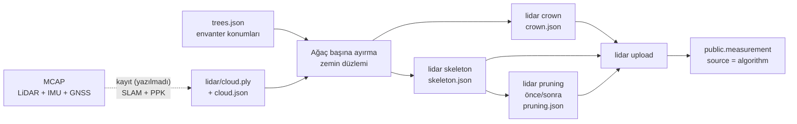

# LiDAR Ölçümleri (İP16)

5 Kasım 2026 · Yusuf

LiDAR'lı tarama kitiyle ([tarama-kiti.md](tarama-kiti.md)) alınan nokta bulutundan ağaç başına iki ölçüm ailesi çıkarılır:

1. **Taç ölçümleri ve büyüklük sınıfı (yapraklı dönem):** taç çapı, ağaç boyu, taç hacmi ve bunlardan büyüklük sınıfı önerisi.
2. **Kış dal iskeleti ve budama analizi (yapraksız dönem, araştırma):** ana kol sayısı, odun hacmi, fraktal boyut; iki kış taraması arasında nelerin budandığı.

Bu doküman yöntemleri, doğruluklarını, veritabanına yazılışlarını ve açık kararları anlatır. Bulutun dosya biçimi bileşenler arası bir sözleşmedir ve [arayuzler.md](arayuzler.md#kayıtlı-nokta-bulutu)'dedir.

## 1. Kapsam ve durum

| Konu | Durum |
| --- | --- |
| Kayıtlı bulut biçimi (`lidar/cloud.ply` + `cloud.json`) | Sözleşme yazıldı ([arayuzler.md](arayuzler.md#kayıtlı-nokta-bulutu)) |
| Ham MCAP'ten kayıtlı buluta (LiDAR-inertial SLAM + PPK) | **Yazılmadı.** Ayrı iş; LiDAR'lı kit yapılınca |
| Ağaç başına ayırma, zemin | Var (`lidar/cloud.py`) |
| Taç ölçümleri, büyüklük sınıfı önerisi | Var (`lidar crown`), sentetik ağaçlarla test edildi |
| Kış iskeleti | Var (`lidar skeleton`), araştırma |
| Budama analizi | Var (`lidar pruning`), araştırma |
| Ölçümlerin veritabanına yazılması | Var (`lidar upload`, `record_lidar_measurements`) |
| Uzman panelinde, ofis aracında, portalda gösterim | Yok. Ölçümler `algorithm` kaynağıyla birikir; karneye girmez |
| Gerçek ağaçlarda doğrulama | Pilotta, §7 |

**Neden şimdi, kit LiDAR'sızken:** MVP kiti LiDAR'sız ([kit-siparis-listesi.md](kit-siparis-listesi.md)). Yöntemler sentetik verilerle önceden yazılırsa, LiDAR'lı kitin ilk kış taramasında (vizyon aşama 2: "ilk kış iskelet denemesi kendi bahçende") veri doğrudan ölçüme dönüşür ve elle ölçümle karşılaştırma aynı hafta yapılabilir.

## 2. Veri akışı



Komutlar (`services/pipeline/`):

```bash
uv run orchados-pipeline lidar synth /tmp/yaz                    # sentetik yapraklı parsel bulutu
uv run orchados-pipeline lidar synth /tmp/kis --leafless          # sentetik kış bulutu
uv run orchados-pipeline lidar crown /tmp/yaz                     # → /tmp/yaz.processed/lidar/crown.json
uv run orchados-pipeline lidar skeleton /tmp/kis                  # → skeleton.json
uv run orchados-pipeline lidar pruning /tmp/kis-once /tmp/kis-sonra   # → <sonra>.processed/lidar/pruning.json
uv run orchados-pipeline lidar upload /tmp/yaz.processed/lidar --session-id <uuid> [--dry-run]
```

Her aşama `--trees` (varsayılan `<oturum>/trees.json`), `--out` ve `--params` alır. Raporlar aynı girdi ve parametrelerle bayt bayt aynıdır; zaman damgası taşımaz. Parametre hash'i `producer.params_hash`'te ve her ölçümde durur.

## 3. Ağaç başına ayırma

`lidar/cloud.py`, bütün aşamaların ortak girişidir.

- **Ayırma:** Her nokta en yakın envanter gövde konumuna verilir (Voronoi) ve gövdeden yatayda en çok 5 m uzaktaysa tutulur. Birbirine değen taçlar iki gövdenin ortasından bölünür; bu durumda taç çapı alt sınırdır (§4).
- **Zemin:** Her ağaç için gövdenin 5 m çevresindeki noktalardan bir zemin düzlemi bulunur: 50 cm'lik ızgara hücrelerinin en alçak noktaları alınır, düzlem bunlara en küçük kareler yöntemiyle oturtulur, düzlemin 2,5 MAD üstündeki hücreler (alçak dallar, zemin dönüşü olmayan hücreler) üç turda atılır. Eğimli parselde ağaç böylece eğilmez. Ağacın noktaları bu düzleme göre yüksekliğe çevrilir; yerden 25 cm'nin altı (zemin, kısa ot) atılır.
- **Yön kapsaması:** Gövdenin çevresi 45°'lik sekiz dilime bölünür; en az 20 noktası olan dilimlerin oranı ağacın `sector_coverage`'ıdır. Grid tarama her ağacı dört koridordan gördüğü için normalde 1'dir; düşükse ağaç tek taraftan görülmüştür.
- **Envanter hatası:** Gövde konumu envanterden gelir (üçgenleme, ağaçların %95'inde 50 cm altı hata). Ölçümler gövde konumuna değil noktaların kendisine dayanır; konum hatası yalnız ayırma sınırını kaydırır.

## 4. Taç ölçümleri ve büyüklük sınıfı

_Ajan sonuçlarıyla doldurulacak._

## 5. Kış iskeleti ve budama analizi

_Ajan sonuçlarıyla doldurulacak._

## 6. Veritabanı

_Ajan sonuçlarıyla doldurulacak._

## 7. Doğrulama planı (pilot)

Metodolojinin kuralı: bir metrik, kendi verimizde doğrulanmadan karneye girmez ([vizyon.md](vizyon.md), "Yeni metrikler için kural"; [veri-modeli.md](veri-modeli.md), "Yöntemler arası tutarlılık"). Referans sıralardaki 40–60 ağaçta (MVP Modül 2, "Pilotta referans sıralarla doğrulama"):

| Ölçüm | Elle referans | Kabul ölçütü (öneri) |
| --- | --- | --- |
| Taç çapı | Şerit metreyle iki dik yönde taç izdüşümü, ortalaması | Ortalama sapma ±%5, ağaçların %95'inde ±%10 |
| Ağaç boyu | Jalon ya da lazer mesafe ölçer / hipsometre | ±15 cm |
| Taç hacmi | Doğrudan referans yok; çap ve boydan elipsoit, yöntemler arası tutarlılık için | Sapma belgelenir, karneye girmeden önce karar |
| Büyüklük sınıfı | Ofis kişisinin kesitlerden verdiği sınıf | Uyum %90, eşiğe yakın vakalar ayrı |
| Ana kol sayısı | Kışın ağaç başında sayım | Ağaçların %90'ında tam eşleşme |
| Budama kesimleri | Budamadan sonra kesim yerlerini sayma, kalın kesimlerin çapı | Kesim sayısı ±1, çap ±2 cm |

Gerçek ağaçlarda sentetikte olmayan zorluklar beklenir: ince sürgün yoğunluğu, sulama hortumları, destek kazıkları, yabani ot, komşu taçların iç içe geçmesi, tarama sırasında rüzgâr, personelin ya da motosikletin gölgesi. Her biri doğrulamada ayrı not edilir.

## 8. Açık kararlar

- **Gövde çapının ölçüm yüksekliği.** Metodoloji §3 gövde çapını yerden yaklaşık 50 cm'de tanımlıyor; metrik kaydındaki kod `trunk_diameter_h30` (30 cm). 1,2 m'deki LiDAR ise görüş açısı yüzünden 4 m'deki gövdeyi ancak 70–80 cm'den yukarıda görür. Bu yüzden LiDAR gövde çapı şimdilik ölçüm olarak yazılmaz; iskelet raporunun ayrıntısında, yüksekliğiyle birlikte durur. Karar seçenekleri: (a) LiDAR'ı alçaltmak ya da eğmek, (b) LiDAR için ayrı bir yükseklik koduyla ayrı metrik, (c) gövde çapını yalnız yakın plan ve şerit metreyle almak.
- **Montaj ve tarama yöntemi.** LiDAR'lı kit sırt direği için tasarlandı; MVP taraması motosikletle. Motosiklette LiDAR yüksekliği, sürücünün kapattığı sektör ve titreşimin SLAM'a etkisi denenmeli (metodoloji §11, "Yönteme göre ayar").
- **Kartta gösterim.** `crown_diameter` ve `crown_volume` kayıtta "karnede gösterilir" olarak duruyor; yeni metrikler "değerlendirilecek" ya da gizli. Doğrulamadan önce portal LiDAR ölçümlerini göstermemeli; gösterim kararı §7'den sonra.
- **Büyüklük sınıfının yazılması.** Öneri ağacın `age_class`'ını değiştirmez. Ofis aracında ya da uzman panelinde "LiDAR önerisi: Verimli (güven 0,9)" gibi gösterilip tek tıkla kabul edilmesi sonraki iş.
- **KVKK.** Nokta bulutu bahçede bulunan kişilerin şeklini de kaydeder. Bulut yalnız personele açık (H05); portala 3D görünüm gelirse kişilerin bulutun içinden ayıklanması ve aydınlatma metinlerinin güncellenmesi gerekir (robot için açılan T36'nın benzeri).
