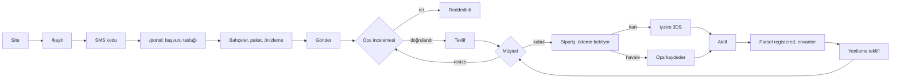

# Müşteri Edinme ve Yönetimi (İP12): Tasarım

27 Ekim 2026 · Yusuf · Sürüm 2 (inceleme bulguları işlendi)

Müşteri artık hesabını kendisi açabilecek:

1. Herkese açık site ürünü anlatır.
2. Müşteri telefonunu SMS koduyla doğrulayarak kaydolur.
3. Bahçelerini ve paketini seçip başvurur.
4. Operasyon alanı ve konumu doğrular, teklif verir.
5. Müşteri teklifi onaylar. Ödemeyi iyzico Checkout Form ile kartla (3DS) ya da havale/EFT ile yapar.
6. Ödeme tamamlanınca bahçe bugünkü parsel yaşam döngüsüne `registered` olarak girer.

Fiyat dönüm başına ve yıllıktır. Sürümlü bir fiyat listesinden hesaplanır ve teklifte dondurulur. Ödeme kodu Supabase Edge Function'larında çalışır; Vercel'de servis anahtarı ya da iyzico anahtarı bulunmaz. Back office, `ops` rolünün `/operasyon` altındaki yeni ekranlarıdır. İş üç dalgada altı akışa bölündü (§17). Hepsi özellik bayrakları kapalıyken birleşir.

Bağlam: [MVP.md](MVP.md), [veri-modeli.md](veri-modeli.md), [deployment.md](deployment.md), [teknik-mimari.md](teknik-mimari.md), [hukuk/](hukuk/README.md).

## 1. Kapsam

| Alan | İP12'de |
| --- | --- |
| Site | `/`, nasıl çalışır, paketler ve fiyatlar, SSS, iletişim, hukuk sayfaları |
| Kayıt ve giriş | Ad soyad, Türkiye cep telefonu (SMS ile doğrulanır), e-posta ve parola, Turnstile. KVKK aydınlatma teyidi (okundu) ve isteğe bağlı açık rızalar, sürümüyle (bugün sorulan yok; hukuk/kararlar.md H06, H31) |
| Başvuru | 1–10 bahçe: konum, beyan edilen alan (dönüm), sulama, yetki dayanağı ve giriş izni. Paket seçimi ve fiyat önizleme |
| Teklif | Doğrulanmış alan ve yayımlı fiyat listesiyle hesaplanır. Girdileri dondurulur, geçerlilik süresi ve indirim içerir |
| Sipariş ve ödeme | Checkout Form (3DS, tek çekim), havale kaydı, makbuz (PDF), ödeme geçmişi, iade ve iptal, mutabakat |
| Hesap | İletişim bilgisi (ad, e-posta, iletişim tercihi), fatura profili, rıza yönetimi |
| Yenileme | Hizmet yılı biten siparişe yenileme teklifi. İP14'ten sonra yenileme, ek siparişle eklenen bahçeler dahil dönemin hizmetteki bütün bahçelerini kapsar ([bahce-yonetimi.md](bahce-yonetimi.md) §4.1 adım 8) |
| Back office | Başvurular, teklifler, siparişler, ödemeler, iadeler, fiyatlar, ayarlar, denetim kaydı. Müşteri görünümü mevcut Sahipler listesine eklenir |
| Bildirim | Teklif hazır, başvuru sonucu, ödeme alındı, iade yapıldı, ödeme hatırlatma (mevcut kuyruk) |

**Kapsam dışı:**
- e-Arşiv ve e-Fatura (makbuz fatura değildir)
- Kart saklama, abonelik, otomatik çekim, taksit (ayarı hazır)
- E-posta kanalı (SMTP yok)
- Telefon numarası değiştirme
- Yabancı uyruklu müşteri
- İletişim formu
- KVKK silme talebinde anonimleştirme (§19)
- Dört göz onayı (§19)

## 2. Kararlar

- **Kullanıcı kararları (27 Ekim, yeniden açılmaz):**
    - Akış başvuru → operasyon onayı → ödeme.
    - Fiyat dönüm başına ve yıllık. Paket, yıllık periyodik ziyaret sayısıdır. Minimum ücret var. Fiyat listesi back office'ten düzenlenir; yayımlanan sürüm değişmez.
    - Kart ödemesi iyzico ile (3DS, sandbox), sağlayıcıdan bağımsız bir arayüzün arkasında. Havale/EFT'yi operasyon elle kaydeder.
- **Checkout Form, tam sayfa yönlendirmeyle.** Kart verisi bize hiç gelmez.
- **Ödeme kodu Edge Function'larda.** Neden:
    - iyzico callback'i siteler arası bir POST'tur, oturum çerezi gelmez.
    - Sonucu yazmak servis rolü ister.
    - iyzico anahtarları Edge secret'ıdır.
- **iyzico'ya SDK'sız gidilir.** REST, IYZWSv2 ve Web Crypto kullanılır; aynı kod Deno'da ve Vitest'te çalışır.
- **Auth'ta dışarıdan kayıt kapalı kalır** (`enable_signup = false`). Hesabı `customer-signup` Edge Function açar. Müşteri profili telefon doğrulandıktan sonra oluşur.
- **Self-servis hesabın e-postası doğrulanmamış sayılır.**
    - Auth'ta `email_confirm: true` ile açılır, çünkü parolayla giriş bunu gerektirir. Ama `app_metadata.signup = 'self'` taşır.
    - Hiçbir hesap eşleştirmesi (davet, hissedar onayı) bu hesaba e-postayla varmaz.
    - Telefonla eşleşme yalnızca telefon doğrulanmışsa olur (§7.4).
    - Parola sıfırlama yok; kurtarma telefon koduyla girişle yapılır.
- **Yeni org rolü yok.** Portal için `UserRoles.customer` bayrağı eklenir: kullanıcının `owner_profile` kaydı varsa doğrudur.
- **Parsel ödeme tamamlanınca oluşur.** Başvurudaki bahçe `application_garden` tablosunda bekler.
- **Para kuruş cinsinden `bigint` tutulur, yanında `currency = 'TRY'`.** KDV satır bazında hesaplanır.
- **TCKN varsayılan olarak toplanmaz** (KVKK md.4, veri en aza indirme).
    - iyzico'ya `identityNumber = "11111111111"` gönderilir. Bu, iyzico'dan yazılı teyit bekleyen bir pilot kapısıdır (§15).
    - iyzico gerçek numara isterse `org_billing_setting.identity_number_required = true` yapılır. TCKN o zaman yalnızca `private.billing_profile` içinde durur. Ödeme anlık görüntüsüne yalnızca son 4 hane yazılır. Bayrak açılmadan önce TCKN'nin saklanmadan iletilmesi ya da şifreli saklanması gerekir; yazılı risk kabulü yeterli değildir (hukuk/kararlar.md H16, T13).
    - Şirket müşteride unvan, vergi dairesi ve VKN istenir.
- **Yapay zekâ için yurt dışı aktarım rızaya bağlanmaz.** Dayanak, sağlayıcıyla imzalanıp Kurum'a bildirilen standart sözleşmedir (hukuk/kararlar.md H02). ai-worker, standart sözleşme kaydı tanımlı değilse gerçek veriyle yurt dışındaki sağlayıcıyı çağırmaz (`ORCHADOS_AI_TRANSFER_SAFEGUARD`; [services/ai-worker/README.md](../services/ai-worker/README.md#yurt-dışı-aktarım-kapısı)).
    - Kayıt formunda ve portalda bu konuda bir kutu yoktur. Aktarım aydınlatma metninde anlatılır.
    - Hizmetin geliştirilmesi rızası sorulmaz; Şirket içi geliştirme meşru menfaate dayanır (hukuk/kararlar.md H31). Tanıtım onayı İYS'den sonra sorulur (H06). Eski kayıtlar silinmez, dayanak olarak kullanılmaz. İşlevi olmayan bir rıza düğmesi yayımlanmaz (`MARKETING_CONSENT_ENABLED`, `apps/web/src/lib/legal/consents.ts`).
- **Kişisel veri `private` şemada tutulur.** Müşterinin görebildiği `public` tablolarda iç sütunlar **sütun yetkisiyle** gizlenir (§6.8).
- **Denetim kaydı `public.audit_event`, ekleme-yalnız.** Aktör ve rolü her fonksiyon açıkça verir.
- **Bildirimler mevcut `public.notification` kuyruğundan gider.**
- **Arayüz metinleri `apps/web/src/lib/i18n/messages/<alan>.ts` dosyalarında.** `tr.ts`'ye yalnızca İP12-A2 dokunur (bildirim etiketleri).
- **Makbuz bir ödeme belgesidir, fatura değildir.**

## 3. Roller

| Rol | Nasıl belirlenir | Yer | İP12'de |
| --- | --- | --- | --- |
| Ziyaretçi | `anon` | Site, `/kayit`, `/giris` | Okur, kaydolur |
| Müşteri | `my_owner_profile()` en az bir satır döner | `/portal` | Başvuru, teklif, ödeme, makbuz, hesap |
| Sahip / hissedar | `parcel_access` | `/portal` | Bugünkü portal. Hissedar başkasının faturalama verisini görmez; kendi profili varsa kendi satırlarını görür |
| Operasyon | `membership.role = 'ops'` | `/operasyon` | Back office |
| Saha, uzman | `field_staff`, `expert` | Değişmez | Faturalama verisine erişmez |
| Sistem | pg_cron | — | Süre dolumu, hatırlatma, mutabakat, temizlik |
| Sağlayıcı | iyzico callback ve webhook | Edge | Sonucu bildirir; sonuç her zaman sunucudan yeniden sorgulanır |

`SECTION_ACCESS.portal = { org: [], parcel: ["owner", "viewer"], customer: true }`.

## 4. Müşteri yolculuğu



1. **Site.** `/` oturum yoksa landing sayfasıdır, oturum varsa kullanıcıyı kendi bölümüne yönlendirir (§9.2). Kayıt bağlantıları `ORCHADOS_SIGNUP_ENABLED=1` olunca görünür.
2. **Kayıt (§7).**
    - **Form alanları:** ad soyad, cep telefonu (`+905…`), e-posta, parola (en az 8 karakter), iletişim tercihi.
    - **Onaylar:** zorunlu aydınlatma teyidi (okundu); isteğe bağlı ve işaretsiz tanıtım onayı yalnızca İYS'den sonra (hukuk/kararlar.md H06; hizmetin geliştirilmesi rızası sorulmaz, H31); Turnstile.
    - **Akış:** `register` çağrılır, ardından kod gönderilir (`requestSignupCode`: `signInWithOtp`, yeni hesapta `signup_disabled` gelirse `auth.resend({type: "sms"})`; §7 web akışı). Kod `verifyOtp` ile doğrulanır, sonra `complete` çağrılır ve kullanıcı `/portal`'a gider.
3. **Başvuru.**
    - Müşteri başına org'da tek açık taslak olur.
    - Bahçe başına: ad, il, ilçe, köy, haritadan konum (zorunlu), isteğe bağlı kaba sınır, alan, sulama, ağaç sayısı, yetki dayanağı, isteğe bağlı tapu, giriş izni (zorunlu), erişim notu, saha kişisi.
    - Gönderimde numara verilir: `B-2026-000123`.
4. **Önizleme.** `price_preview` beyan edilen alanlarla hesaplar. Bağlayıcı değildir.
5. **Ops incelemesi.** Ops her bahçenin alanını doğrular (gerekirse sınırı yeniden çizer). Sonra teklifi önizler ve verir: girdiler kopyalanır, geçerlilik varsayılan 30 gündür, isteğe bağlı indirim için açıklama zorunludur. Müşteriye `quote_ready` ya da `application_rejected` gider.
6. **Teklif onayı.** Üç koşul gerekir:
    - fatura profili tam olmalı,
    - aydınlatma teyidi kayıtlı olmalı,
    - Ön Bilgilendirme ve Mesafeli Hizmet Sözleşmesi onayları verilmeli.

    Kabulde sipariş `S-2026-000123` açılır. Toplam 0 ise sipariş hemen aktifleşir.
7. **Ödeme.**
    - **Kart:** `payments`/`start` çağrılır ve tarayıcı iyzico'ya gider. Dönüşte `payment-callback` sonucu iyzico'dan yeniden sorgular, `payment_finalize` çağırır ve 303 ile `/portal/odeme/[id]`'ye yönlendirir. Webhook ve 10 dakikalık mutabakat yedek kanaldır.
    - **Havale:** IBAN ve referans gösterilir. Ops kaydeder; kısmi havale kabul edilir.
    - Başarılı her ödemeye makbuz numarası verilir (`M-…`) ve `payment_received` bildirimi gider.
8. **Aktivasyon.** `private.activate_order` tek işlemde şunları yapar:
    - bahçe başına parsel (`registered`) oluşturur, kaba sınırı v1 `owner_declared` olarak ve `parcel_detail`'ı yazar,
    - sahip erişimini verir,
    - hizmet dönemini 1 yıl olarak yazar.

    Envanter planlanınca mevcut tetikleyici parseli `inventory_planned` yapar.
9. **Yenileme.**
    - Bitime 45 günden az kalan sipariş panoda görünür.
    - Ops `ops_issue_parcel_quote(..., p_first_year => false, p_renewal_of_order_id)` ile teklif verir. Yeni hizmet dönemi eski bitişten 1 gün sonra başlar.
    - Pilotta ops'un açtığı mevcut parseller de aynı fonksiyonla, `p_first_year => true` vererek ilk siparişlerini alır.
    - **İP14:** Dönem başına tek yenileme vardır. Temel sipariş yenilenir; ek siparişler yenilenmez, bahçeleri aynı teklife girer. İki ayrı dönemi olan müşteride dönemler yenileme zamanında ek teklifle birleştirilir ([bahce-yonetimi.md](bahce-yonetimi.md) §4.1 adım 8, §4.4).
10. **İade ve iptal.**
    - Ödemeden önce sipariş iptal edilir.
    - Ödemeden sonra iade yolu: aynı gün ve tam tutarda `void`, diğer durumlarda kalem bazında `refund`, havalede `manual`.
    - Fesih iadeden ayrı bir işlemdir.

## 5. Durum makineleri

**Ortak kurallar:**
- Durumu yalnızca adı geçen fonksiyonlar değiştirir.
- Her geçiş koşullu bir güncellemedir: `update ... where id = $1 and status = '<beklenen>' returning`. Satır dönmezse P0001 ve neden kodu.
- Her geçiş `audit_event`'e yazılır.

### 5.1 Başvuru

| Geçiş | Fonksiyon |
| --- | --- |
| → `draft` | `customer_create_application` (taslak zaten varsa onu döner) |
| `draft → submitted` | `customer_submit_application` (≥1 bahçe ve tam alanlar; numara verilir) |
| `draft`/`submitted`/`quoted → withdrawn` | `customer_withdraw_application` (açık teklif `cancelled` olur) |
| `submitted → quoted`, `quoted → quoted` (eski teklif `superseded`) | `ops_issue_quote` |
| `quoted → accepted` | `customer_accept_quote` |
| `quoted → submitted` | `customer_decline_quote(p_request_revision => true)` ya da süre dolumu |
| `quoted → withdrawn` | `customer_decline_quote(false)` |
| `submitted`/`quoted → rejected` | `ops_reject_application` (neden zorunlu) |

### 5.2 Teklif

`issued` → `accepted` | `declined` | `superseded` | `expired` | `cancelled`. `issued` dışındaki durumlar sondur. Teklif satırları ve tutarlar hiç değişmez (`quote_guard`).

### 5.3 Sipariş

| Geçiş | Fonksiyon | Koşul |
| --- | --- | --- |
| → `awaiting_payment` | `customer_accept_quote` | Toplam 0 ise doğrudan `active` |
| `→ active` | `private.activate_order` (`payment_finalize` ya da `ops_record_manual_payment` içinden) | `paid_kurus >= total_kurus` |
| `→ cancelled` | `customer_cancel_order`, `ops_cancel_order` | Başarılı ödeme yok (`has_payments`) ve canlı deneme yok (`payment_in_progress`) |
| `active → completed` | housekeeping | `service_end` < bugün |
| `active → terminated` | `ops_terminate_order` | Not zorunlu |

> **İP14:** Siparişe, teklife, başvuruya ve parsele eklenen yeni geçişler (ek sipariş, `addon_base_closed`, `garden_removed`, `all_gardens_removed`, `base_terminated`, `customer_revision`) [bahce-yonetimi.md](bahce-yonetimi.md) §8.4'te listelenir.

**Canlı deneme:** `provider <> 'manual'` olan ve şu iki durumdan birindeki ödeme satırı.
- `pending_review`
- `initiated` ya da `expired`, ve `token_expires_at > now()`

Ödeme süresi (`payment_due_at`) dolunca sipariş kendiliğinden iptal olmaz. Bitimden 3 gün önce bir kez hatırlatma gider.

### 5.4 Ödeme

| Geçiş | Fonksiyon |
| --- | --- |
| → `initiated` | `payment_begin` |
| → `succeeded` (manual) | `ops_record_manual_payment` |
| `initiated`/`expired → succeeded`/`failed`/`pending_review` | `payment_finalize` (callback, webhook, mutabakat). `expired → succeeded` geç onaydır |
| `initiated → expired` | `payment_finalize('expired')`, mutabakat |
| `pending_review → succeeded`/`failed` | `payment_finalize`, `ops_resolve_payment_review` |
| `pending_review → voided` | Tutarsızlık iptali başarılı olunca (`payment_refund_report`) |
| `succeeded → voided` | `void` iadesi başarılı olunca; havalede `ops_void_manual_payment` |

**`payment_finalize` kuralları:**
- **Karşılaştırma:** Sağlayıcının bildirdiği tutar, para birimi, `conversationId` ve `basketId`, **ödeme satırıyla** (`amount_kurus`, `id`, `order_id`) karşılaştırılır; asla siparişle karşılaştırılmaz.
- **Başarı ama uyuşmazlık:** Sağlayıcı SUCCESS der ama değerler uyuşmazsa sonuç `pending_review` olur (`failure_code = amount_mismatch | reference_mismatch`). Sistem `provider_mismatch` nedenli bir `void` iadesi açar ve ödeme panoda görünür. Sonuç `failed` **yazılmaz**.
- **Kapalı sipariş:** Başarılı ödeme `cancelled`, `terminated` ya da `completed` bir siparişe düşerse tam tutarlı `order_closed` iadesi açılır.
- **Fazla ödeme:** Ödeme sipariş toplamını aşarsa aşan kısım (`paid_kurus − total_kurus`) için `overpayment` iadesi açılır.
- **Yinelenen çağrı:** Son durumdaki bir satıra yeniden çağrı bir şey değiştirmez.
- **Sahte sağlayıcı:** `provider = 'fake'` olan ödeme, `allow_fake_payments` açık değilse başarılı yazılmaz (`fake_payments_disabled`).

### 5.5 İade

| Geçiş | Fonksiyon |
| --- | --- |
| → `requested` | `ops_request_refund`; sistem iadeleri (`payment_finalize`) |
| `requested`/`failed → processing` | `payment_refund_claim` (`manual` türünü reddeder) |
| `processing → succeeded`/`failed` | `payment_refund_report` |
| `requested → succeeded` (manual) | `ops_complete_manual_refund` |
| `requested → cancelled` | `ops_cancel_refund` |
| `processing`/`failed → succeeded`/`failed` | `ops_resolve_refund`. Kartta `p_provider_ref` zorunlu |

**Kurallar:**
- **Tavan:** Ödeme satırı `for update` ile kilitlenir. `tutar + Σ(requested, processing, succeeded iadeler)` toplamı, `coalesce(provider_amount_kurus, amount_kurus)` değerini aşamaz. Aynı kural kalem bazında da geçerlidir.
- **Yeniden deneme:** `failed → processing` geçişinde tavan yeniden denetlenir.
- **Tutar güncellemesi:** `refunded_kurus` alanları yalnızca `succeeded`'a geçişte ve bir kez artar; artış koşullu güncellemeden dönen satıra bağlıdır.
- **Zaman aşımı:** Kart iadesi idempotent değildir. Bu yüzden satır API çağrısından önce `processing` yapılır. 15 dakikadan uzun süren `processing` ops'a "belirsiz" olarak gösterilir.

## 6. Veri modeli

### 6.1 Genel kurallar

- **Kiracılık:** Her tabloda `org_id` vardır. Bileşik FK'ler için `unique (id, ..., org_id)` deseni kullanılır. Faturalama tablolarının hepsinde `customer_user_id` bulunur.
- **Silme:** `customer_user_id` FK'si `on delete restrict`'tir. Testler `testing.purge_billing_users` ile temizler.
- **Para:** kuruş `bigint`, `>= 0`, `currency = 'TRY'`.
- **Alan:** m² cinsinden `numeric(12,2)`. Faturalanan birim dönümün onda biri, yukarı yuvarlanır.
- **"Bugün":** `(now() at time zone 'Europe/Istanbul')::date`.
- **Fonksiyon kalıbı:**
    - `security definer`, `set search_path = ''`, nesne adları şemayla yazılır, her fonksiyonun `comment on function` satırı olur.
    - Önce `revoke all on function ... from public, anon, authenticated`, sonra açık grant.
    - **Tablolar:** önce `revoke all on <tablo> from anon, authenticated`, sonra yalnızca §6.8'deki select yetkileri. API'den yazma yoktur.
- **Önekler:**
    - `ops_*`: ops rolü; org varlıktan bulunur.
    - `customer_*`, `my_*`: müşteri; satırlar `auth.uid()` ile süzülür.
    - `signup_*`, `payment_*`: yalnızca `service_role`.
    - `private.*`: yardımcılar.
- **Girdi doğrulama:** Kişisel veri içeren her alan, insert'ten önce fonksiyon içinde doğrulanır ve `invalid_input` (detail = alan adı) döner. Fonksiyon `check_violation` ve `not_null_violation` hatalarını yakalayıp aynı kodla yeniden atar. Böylece Postgres'in "Failing row contains" ayrıntısı istemciye de loga da gitmez (`ops_save_parcel_detail` deseni). CHECK'ler son savunma hattı olarak kalır.
- **Kilit sırası:** başvuru → teklif → sipariş → ödeme → iade. Her biri `select ... for update` ile alınır.
    - Siparişin parasını ya da durumunu değiştiren her fonksiyon önce sipariş satırını kilitler. Ödeme kimliğiyle başlayan fonksiyon `order_id`'yi kilitsiz okur, siparişi kilitler, sonra ödemeyi.
    - Teklif kabulü ve yeni teklif önce başvuruyu, sonra teklifi kilitler.
    - Advisory lock yalnızca iki yerde kalır: fiyat listesi yayını (`price_list:<org>`) ve taslak oluşturma (`service_application:<user>`).
- **Denetim:** `private.audit(p_org_id, p_actor_user_id, p_actor_role, p_action, p_entity_type, p_entity_id, p_details)`. Rol tahmin edilmez:
    - `customer_*` → `customer`, `auth.uid()`
    - `ops_*` → `ops`
    - `signup_*` ve `payment_begin` → `customer`, parametredeki kullanıcı
    - callback, webhook, mutabakat → `provider`
    - cron → `system`
- **Kendi kaydı üzerinde işlem:** Müşteri kaydına dokunan `ops_*` yazma fonksiyonları, varlığın `customer_user_id` değeri `auth.uid()` ise `forbidden` döner.
- **Migration aralıkları:**
    - A1: `20261030100000`–`20261030104999`
    - A2: `20261030105000`–`20261030109999`
    - D: `20261031100000`–`…109999`
    - E: `20261031200000`–`…209999`

    Hepsi main'deki `20261028120000_closeup_protocol_v01.sql` dosyasından sonra gelir. Enum'a değer ekleyen `alter type ... add value` ayrı bir dosyada olur.

### 6.2 Enum'lar (A1; bildirim değerleri A2)

```sql
create type public.application_status as enum ('draft','submitted','quoted','accepted','rejected','withdrawn');
create type public.application_rejection_reason as enum ('out_of_service_area','area_mismatch','not_authorized','duplicate','capacity','other');
create type public.quote_status as enum ('issued','accepted','declined','superseded','expired','cancelled');
create type public.order_status as enum ('awaiting_payment','active','completed','cancelled','terminated');
create type public.payment_provider as enum ('iyzico','manual','fake');
create type public.payment_status as enum ('initiated','pending_review','succeeded','failed','expired','voided');
create type public.refund_kind as enum ('void','refund','manual');
create type public.refund_status as enum ('requested','processing','succeeded','failed','cancelled');
create type public.refund_reason as enum ('withdrawal','missed_visit','termination','overpayment','order_closed','provider_mismatch','goodwill','other');
create type public.price_list_status as enum ('draft','published');
create type public.billing_party_kind as enum ('individual','company');
create type public.consent_kind as enum ('kvkk_notice','explicit_service_improvement','explicit_marketing','distance_sales','pre_information');
create type public.consent_source as enum ('signup','portal','quote_acceptance','ops');
-- A2, ayrı dosya:
alter type public.notification_template add value if not exists 'quote_ready'; -- + application_rejected, payment_received, refund_completed, payment_reminder
```

### 6.3 `public` tabloları (A1)

Sütunlar sözleşmedir. Aşağıda yalnızca önemli check'ler gösterildi. A1 her tabloya `created_at` ve `updated_at` ekler, `*_touch_updated_at` tetikleyicisini kurar.

```sql
public.org_billing_setting (org_id pk → org, accepts_signups bool default false,
  allow_fake_payments bool default false,          -- yalnızca SQL ile açılır; ops ayar fonksiyonu yazmaz
  legal_gate_enforced bool not null default false, -- T21 üretim kapısı; yalnızca SQL ile (pilot)
  identity_number_required bool default false,     -- iyzico gerçek TCKN isterse
  legal_name, tax_office, tax_number ~'^[0-9]{10}$', mersis_number ~'^[0-9]{16}$', address, phone, email,
  bank_name, iban ~'^TR[0-9]{24}$', iban_holder,
  payment_due_days int 14 (1..60), quote_valid_days int 30 (1..90), renewal_notice_days int 45 (7..120),
  updated_by uuid → auth.users set null, updated_at)
  -- unique index (accepts_signups) where accepts_signups: kayıt en fazla bir org'a açık

public.service_package (id, org_id, code ~'^[a-z][a-z0-9_-]{1,31}$', name, description, periodic_visits_per_year smallint 1..12,
  includes_inventory bool, active bool, sort_order, unique(org_id, code), unique(id, org_id))

public.price_list (id, org_id, version int null, status price_list_status default 'draft', valid_from date,
  currency, vat_rate_bp int 0..10000, note, created_by, published_by, published_at,
  unique(org_id, version), unique(id, org_id), check ((status='published') = (version is not null and published_at is not null)))
  -- price_list_guard: yayımlı satırda update ve delete yok (taslak → yayımlı geçişi serbest)
public.price_list_item (id, org_id, price_list_id, package_id, unit_price_kurus > 0, minimum_fee_kurus >= 0, inventory_fee_kurus >= 0,
  unique(price_list_id, package_id))
  -- price_list_item_guard: yalnızca üst liste taslakken yazılır (seed önce taslak yazar, sonra yayımlar)

public.service_application (id, org_id, customer_user_id → auth.users restrict, number unique ~'^B-[0-9]{4}-[0-9]{6}$',
  status default 'draft', package_id, customer_note ≤1000, rejection_reason, ops_note ≤2000 [iç],
  submitted_at, decided_at, decided_by [iç], unique(id, customer_user_id, org_id),
  check (status <> 'draft' or (submitted_at is null and number is null)),
  check (status in ('draft','withdrawn') or (submitted_at is not null and number is not null)),
  check (status <> 'rejected' or rejection_reason is not null))
  -- unique (customer_user_id, org_id) where status='draft'

public.application_garden (id, org_id, application_id, customer_user_id, sort_order, name, province, district, village,
  declared_area_m2 500..10000000, irrigation public.irrigation_type, estimated_tree_count,
  position geometry(Point,4326) not null, position_uncertainty_m > 0, boundary geometry(Polygon,4326),
  verified_area_m2, verified_by [iç], verified_at, verification_note [iç], parcel_id,
  check ((verified_area_m2 is null) = (verified_at is null)))

public.quote (id, org_id, customer_user_id, application_id null, renewal_of_order_id null, number ~'^T-…',
  status default 'issued', price_list_id, price_list_version, package_id, package_code, package_name,
  periodic_visits_per_year, includes_inventory, first_year, vat_rate_bp, discount_bp 0..10000, discount_note,
  base_kurus, discount_kurus, subtotal_kurus, vat_kurus, total_kurus, currency, inputs jsonb,
  proposed_service_start, valid_until, note_to_customer, issued_by [iç], issued_at, decided_at, decided_by [iç],
  check (subtotal = base - discount and total = subtotal + vat), check (discount_bp = 0 or discount_note is not null),
  check ((status='issued') = (decided_at is null)))
  -- unique (application_id) where status='issued'; unique (renewal_of_order_id) where status='issued'
public.quote_item (id, org_id, quote_id, customer_user_id, line_no, application_garden_id | parcel_id (tam olarak biri),
  garden_name, area_m2, billable_area_tenths, visits, unit_price_kurus, minimum_fee_kurus, inventory_fee_kurus,
  visit_amount_kurus, line_base_kurus, line_discount_kurus, line_subtotal_kurus, line_vat_kurus, line_total_kurus)  -- ekleme-yalnız

public.service_order (id, org_id, customer_user_id, quote_id unique, number ~'^S-…', status default 'awaiting_payment',
  total_kurus, paid_kurus default 0, refunded_kurus default 0 check (refunded_kurus <= paid_kurus), currency,
  payment_due_at, reminder_sent_at, service_start, service_end, activated_at, completed_at, cancelled_at,
  cancel_reason ~'^[a-z][a-z0-9_]*$', terminated_at, termination_note [iç], renewal_of_order_id)
public.service_order_item (id, org_id, order_id, customer_user_id, quote_item_id unique, line_no, garden_name, amount_kurus, parcel_id)
  -- guard: yalnızca parcel_id, null'dan dolu değere bir kez

public.payment (id = iyzico conversationId, org_id, order_id, customer_user_id, provider, status,
  amount_kurus > 0,                 -- istenen tutar = sepet price
  provider_amount_kurus,            -- sağlayıcının bildirdiği price (uyuşmazlıkta farklı)
  paid_kurus > 0,                   -- paidPrice (taksit farkı)
  refunded_kurus default 0, currency, installment 1..12,
  provider_token unique [iç], token_expires_at, provider_payment_id, card_association, card_family, card_last4 ~'^[0-9]{4}$',
  fraud_status in (-1,0,1), failure_code ~'^[a-z][a-z0-9_]*(:[a-z0-9_.-]{1,40})?$', return_origin [iç],
  receipt_number unique ~'^M-…', bank_reference, value_date, recorded_by [iç], manual_note [iç],
  initiated_at, succeeded_at, failed_at, voided_at,
  unique (provider, provider_payment_id),
  check (status <> 'succeeded' or (receipt_number is not null and succeeded_at is not null)),
  check (receipt_number is null or status in ('succeeded','voided')),
  check (provider <> 'manual' or (bank_reference is not null and value_date is not null and recorded_by is not null)))
public.payment_item (id, org_id, payment_id, customer_user_id, line_no, order_item_id null (kalan bakiye kalemi), name, amount_kurus > 0,
  provider_item_id, refunded_kurus check (<= amount_kurus))
public.refund (id, org_id, payment_id, order_id, customer_user_id, payment_item_id, number ~'^I-…', kind, status default 'requested',
  amount_kurus > 0, currency, reason, note [iç], requested_by [iç] (null = sistem), requested_at, attempts,
  processing_since, processed_at, provider_ref, failure_code, retryable, bank_reference, completed_on)

public.audit_event (id, org_id, actor_user_id → auth.users set null, actor_role in ('ops','customer','system','provider'),
  action ~'^[a-z_]+\.[a-z_]+$', entity_type in ('signup','consent','billing_profile','owner_profile','application',
  'application_garden','quote','order','payment','refund','price_list','package','billing_setting'), entity_id,
  details jsonb (nesne, en fazla 4 KB, kişisel veri yok), created_at)   -- ekleme-yalnız
```

**Denetim eylemleri:**

| Grup | Eylemler |
| --- | --- |
| Kayıt ve rıza | `signup.completed`, `consent.granted`, `consent.withdrawn` |
| Profiller | `billing_profile.saved`, `billing_profile.revealed`, `owner_profile.created`, `owner_profile.updated` |
| Başvuru | `application.created`, `application.submitted`, `application.withdrawn`, `application.rejected`, `application_garden.verified` |
| Teklif | `quote.issued`, `quote.superseded`, `quote.accepted`, `quote.declined`, `quote.expired`, `quote.cancelled` |
| Sipariş | `order.created`, `order.activated`, `order.cancelled`, `order.completed`, `order.terminated`, `order.due_extended` |
| Ödeme | `payment.initiated`, `payment.succeeded`, `payment.failed`, `payment.pending_review`, `payment.expired`, `payment.manual_recorded`, `payment.voided`, `payment.review_resolved` |
| İade | `refund.requested`, `refund.succeeded`, `refund.failed`, `refund.cancelled`, `refund.resolved` |
| Fiyat ve ayarlar | `price_list.draft_created`, `price_list.draft_saved`, `price_list.published`, `price_list.draft_deleted`, `package.saved`, `billing_setting.saved` |

### 6.4 `private` tabloları (A1)

Hepsinde RLS açıktır ve politika yoktur. `public`, `anon` ve `authenticated` rollerinden yetki alınır; yalnızca `service_role` erişir.

```sql
private.billing_profile (id, org_id, user_id → auth.users cascade, kind, first_name, last_name,
  identity_number null (yalnızca identity_number_required iken; geçerli TCKN), company_title, tax_office, tax_number,
  address, district, city, postal_code, country default 'Türkiye', email, unique(org_id, user_id),
  check ((kind='company') = (company_title is not null and tax_office is not null and tax_number is not null)))
private.payment_billing_snapshot (payment_id pk, org_id, kind, first_name, last_name, identity_number_last4 null,
  company_title, tax_office, tax_number, address, district, city, postal_code, country, email, phone)
  -- ekleme-yalnız; payment_attach_token ve ops_record_manual_payment yazar, payment_begin yazmaz
private.consent_record (id, org_id, subject_id uuid not null (kullanıcı kimliği, FK yok),
  user_id → auth.users on delete set null, kind, granted, text_version ~'^[a-z0-9][a-z0-9.-]{1,40}$',
  source, quote_id, order_id, ip_hash, recorded_at)    -- ekleme-yalnız; kullanıcı silinse de kanıt kalır
private.customer_signup (user_id pk → auth.users cascade, org_id, full_name, email, phone ~'^\+905[0-9]{9}$',
  contact_preference private.contact_preference, consents jsonb, ip_hash, created_at, completed_at)
private.signup_attempt (id, ip_hash, phone_hash, email_hash, created_at)   -- 2 gün saklanır
private.application_garden_detail (application_garden_id pk, org_id, authorization_basis private.authorization_basis,
  deed_block, deed_parcel, is_shared_deed, used_portion_note, entry_permission_at not null, access_note,
  site_contact_name, site_contact_phone)
private.payment_event (id, org_id, provider, event_type in ('initialize','callback','webhook','retrieve','reconcile','cancel','refund','detail'),
  dedup_key, payment_id, refund_id, signature_valid, http_status, outcome, payload jsonb (izinli alanlar), received_at,
  unique (provider, dedup_key))   -- ekleme-yalnız; geçersiz imzalı istek hiç yazılmaz
private.document_sequence (org_id, kind in ('B','T','S','M','I'), year, last_value, pk(org_id, kind, year))
```

**A1 migration'ının yaptığı veri işleri:**
- `kvkk_consent = true` olan her `owner_profile` için `consent_record` yazar: `kvkk_notice`, `source = 'ops'`, `text_version` ve zaman profilden.
- `ops_create_owner_profile` ve `ops_update_owner_profile` aynı imzayla yeniden yazılır. KVKK onayı verildiğinde ya da değiştiğinde `consent_record` ve denetim kaydı yazarlar (denetim yalnızca alan adlarını taşır). Bu kayıtların `recorded_at` değeri yazıldığı andır (`now()`); beyan edilen onay tarihi profilde (`kvkk_consent_at`) kalır. Böylece "en son kayıt geçerlidir" kuralı geriye tarihli bir onayla bozulmaz. Profildeki tarih yalnızca tek seferlik geri doldurmada kullanılır.

**`00_schema.test.sql` (A1):** `tables_are` listesine 14 `public` ve 8 `private` tablo eklenir; ekleme-yalnız tetikleyiciler `has_trigger` ile denetlenir.

### 6.5 Değişen mevcut nesneler

**`public.ops_find_user_id` (A1, yeni migration, aynı imza):**
- E-posta eşleşmesi, `raw_app_meta_data->>'signup' = 'self'` olan hesapları hiç döndürmez.
- Telefon eşleşmesi `phone_confirmed_at is not null` ister.
- Self-servis hesaplarda telefon eşleşmesi ayrıca tamamlanmış bir `customer_signup` kaydı ister.

`invite-user` bu durumda yeni hesap açmaya çalışır. Auth 422 dönerse fonksiyon zaten 409 `conflict` verir. Hissedar onayı da `invite-user`'ın döndürdüğü kimliği kullanır, yani aynı kurala bağlıdır.

**`public.notification` (A2):**
- `parcel_id` ve `session_id` için `drop not null`. Yeni sütun `ref_id uuid`.
- Rapor şablonları parsel ve oturum ister. Hesap şablonları `ref_id` ister.
- `vars` anahtarları: `parcel_name, date, path, ref`.
- `unique (recipient_user_id, template, ref_id) where ref_id is not null`.

**`public.ops_notifications` (A2):** `drop` edilip `left join parcel` ile yeniden yazılır, `ref text` sütunu eklenir. A2 aynı işte `lib/notifications/data.ts` (`ref`, `parcelId`/`parcelName` boş olabilir) ve `notification-table.tsx` (parsel yoksa `ref`) dosyalarını da günceller.

**`private.enqueue_billing_notification(p_template, p_org_id, p_user_id, p_ref_id, p_ref, p_path) returns integer` (A2):** Kanal `contact_preference` alanından seçilir; çakışmada satır atlanır.

**`_shared/messaging.ts` (A2):** Beş yeni şablon, `ref` değişkeni (§12).

### 6.6 Fiyat hesabı (`pricing-v1`, tek kaynak SQL: `private.price_lines`)

| Adım | Formül |
| --- | --- |
| Faturalanan alan | `billable_area_tenths = ceil(area_m2 / 100)` |
| Ziyaret tutarı | `visit_amount = round(visits × tenths × unit_price_kurus / 10)` |
| Satır tabanı | `line_base = greatest(visit_amount, minimum_fee) + (ilk yıl ? inventory_fee : 0)` |
| İndirim | `line_discount = round(line_base × discount_bp / 10000)` |
| KDV hariç | `line_subtotal = line_base − line_discount` |
| KDV | `line_vat = round(line_subtotal × vat_rate_bp / 10000)` |
| Satır toplamı | `line_total = line_subtotal + line_vat` |
| Teklif | Satırların toplamı |

- `round` numeric üzerinde yarımı yukarı yuvarlar.
- Geçerli liste: `status = 'published'` ve `valid_from <= d` olanların en büyük sürümü.
- Paketin listede kalemi yoksa `package_not_priced`.
- **Örnek (lansman fiyatları, seed; [fiyatlandirma.md](fiyatlandirma.md)):** 20 dönüm, standart paket. 4 × 200 × 18.000 / 10 = 1.440.000 kuruş; en az ücret 1.120.000'i geçer. İlk yıl envanter 600.000 eklenir: taban 2.040.000, KDV %20 ile toplam **2.448.000 kuruş** (24.480,00 TL). Sonraki yıllarda envanter yoktur: 1.728.000 kuruş (17.280,00 TL). 10 dönümde ziyaret tutarı 720.000 en az ücretin altında kalır; yıllık 1.120.000, KDV dahil 1.344.000 kuruş.
- `quote.inputs` dondurulan girdileri saklar: `price_list_id`, `version`, `valid_from`, paket alanları, her bahçenin alanı ve alanın kaynağı (`verified` / `boundary` / `estimated`), `formula = 'pricing-v1'`.

### 6.7 Belge numaraları

`private.next_document_number(p_org_id, p_kind)` sayaç satırını `for update` ile kilitler ve `<kind>-<YYYY>-<NNNNNN>` üretir; yıl İstanbul saatine göre alınır.

| Önek | Belge | Ne zaman |
| --- | --- | --- |
| B | Başvuru | Gönderimde |
| T | Teklif | Verilirken |
| S | Sipariş | Kabulde |
| M | Makbuz | Ödeme başarılı olunca |
| I | İade | İstenince |

### 6.8 RLS ve sütun yetkileri

**Politikalar (`<tablo>_select`):**
- Müşteri tabloları: `customer_user_id = (select auth.uid()) or org_id in (select authz.user_org_ids('{ops}'))`.
- Yalnızca ops'un okuduğu tablolar (`org_billing_setting`, `service_package`, `price_list`, `price_list_item`, `audit_event`): ops koşulu.

Satır politikası sütunları korumaz. Bu yüzden müşteri tablolarında `revoke select on <t> from authenticated` ardından `grant select (<sütunlar>) on <t> to authenticated` uygulanır.

**Müşteriye ve ops'a verilmeyen iç sütunlar:**

| Tablo | İç sütunlar |
| --- | --- |
| `service_application` | `ops_note`, `decided_by` |
| `application_garden` | `verified_by`, `verification_note` |
| `quote` | `issued_by`, `decided_by` |
| `service_order` | `termination_note` |
| `payment` | `provider_token`, `return_origin`, `recorded_by`, `manual_note` |
| `refund` | `note`, `requested_by` |

`quote_item`, `service_order_item` ve `payment_item` tablolarının bütün sütunları verilir.

- **Ops iç sütunları nasıl okur:** `ops_billing_internal(p_entity_type text, p_entity_id uuid) returns jsonb` ile (A2). Tür değerleri: `application`, `application_garden`, `quote`, `order`, `payment`, `refund`. Kullanıcı kimlikleri `{id, name}` biçiminde döner.
- **Web tarafı `select("*")` kullanmaz.** A1, `apps/web/src/lib/billing/columns.ts` dosyasında `BILLING_COLUMNS` (`as const` sütun listeleri) dışa verir. D ve E bunu kullanır.
- **`anon` yetkileri:** Main'de `anon` rolü zaten `phone_login_allowed` ve `phone_login_record_failure` çağırabiliyor. İP12 `anon`'a yalnızca `public_package_prices()` ve `price_preview(...)` fonksiyonlarını ekler. İkisi de yalnızca kaydı açık org'un aktif paketlerini ve yayımlı fiyatlarını döner.
- **Testler:**
    - `ops_note` seçen müşteri 42501 alır.
    - `anon` ve `authenticated` rollerinin yeni tablolarda insert, update ve delete yetkisi yoktur.
    - `anon` yeni İP12 fonksiyonlarından (açık ad listesiyle) yalnızca bu ikisini çalıştırabilir.

### 6.9 Fonksiyonlar

Adlar, parametreler ve dönüşler sözleşmedir. Sütun ayrıntıları A1/A2'nin tip üretiminden okunur.

> **İP14:** Bazı fonksiyonlar aynı imzayla yeniden yazılır; aralarında `payment_begin`, `private.activate_order`, `ops_terminate_order` ve `ops_orders` (dönüşüne `addon_of_order_id` eklenir) vardır. Tam liste ve değişiklikler: [bahce-yonetimi.md](bahce-yonetimi.md) §9.6 "Aynı imzayla yeniden yazılanlar". Bu bölümdeki kurallar orada yazılanlar dışında geçerlidir.

**Yardımcılar (`private`):**
- `audit`, `next_document_number`, `signup_org_id`, `is_valid_tckn`, `price_lines`
- `activate_order(p_order_id)`: idempotent.
- `create_customer_parcel(p_garden_id)`: `register_parcel` ile `add_owner_declared_boundary` mantığının kopyası; o iki fonksiyon değişmez.
- `open_system_refund(p_payment_id, p_amount_kurus, p_reason)`: Tutar tam ve ödeme aynı gün ise `void` açar. Değilse son kalemden geriye doğru kalem bazında `refund` satırları açar.
- `enqueue_billing_notification`
- `billing_housekeeping() returns jsonb` (A2): teklif süre dolumu, hatırlatma, `completed`, 7 günden eski ve `payment_id` taşımayan `payment_event` satırlarının silinmesi.
- `signup_housekeeping() returns jsonb` (A1): 24 saati geçen, tamamlanmamış ve hesabının telefonu doğrulanmamış `customer_signup` satırlarını ve 2 günden eski `signup_attempt` satırlarını siler. Telefonu doğrulanmış ama `complete` çağrısı yarım kalmış kayıt silinmez: kullanıcı telefon koduyla girip `complete`'i yeniden çağırabilir.
- `dispatch_signup_cleanup()`, `dispatch_payment_reconcile()`: Vault'tan adres ve `orchados_cron_secret` okur; ikisi de varsa pg_net ile POST eder, yoksa hiçbir şey yapmaz.

**Herkese açık (`anon` ve `authenticated`, A2):**
- `public_package_prices()` → `(package_id, code, name, description, periodic_visits_per_year, includes_inventory, price_list_version, valid_from, currency, vat_rate_bp, unit_price_kurus, minimum_fee_kurus, inventory_fee_kurus)`
- `price_preview(p_package_id uuid, p_areas_m2 numeric[], p_first_year boolean default true)` → satırlar ve `price_list_id`/`version`. Hatalar: `invalid_input`, `not_found`, `package_not_priced`.

**Kayıt (`service_role`, A1):**
- `signup_register_attempt(p_ip_hash text, p_phone_hash text, p_email_hash text) returns text`: `ok`, `too_many` ya da `closed`.
    - Sınırlar: IP başına 10/saat, telefon başına 3/24 saat, e-posta başına 5/24 saat.
    - Org genelinde sert sınır yoktur. Sayı `ops_billing_summary.signup_attempts_24h` alanında görünür; 300'ü aşınca panoda uyarı çıkar.
- `signup_find_account(p_email text, p_phone text)` → `table (user_id uuid, matched_by text, self_signup boolean, phone_confirmed boolean, signup_completed boolean, started_at timestamptz)`.
    - `started_at`: bekleyen kaydın yazıldığı an (yoksa hesabın açıldığı an); bayat hesabın bekleme süresi buna göre hesaplanır (§7.1).
    - `matched_by` değerleri `email`, `phone` (Auth, `+` olmadan) ya da `profile_phone` (kayıt org'unda başka kullanıcının `owner_profile` telefonu).
- `signup_prepare(p_user_id, p_full_name, p_email, p_phone, p_contact_preference, p_consents jsonb, p_ip_hash) returns void`: `invalid_input` (detail alan).
- `signup_complete(p_user_id uuid, p_code_at timestamptz) returns text`: `completed`, `already_completed`, `no_pending` ya da `phone_mismatch`.
    - `p_code_at`: oturumu açan telefon kodunun zamanı (JWT `amr`). Bekleyen kayıt satırı kilitlenir; hesap self-servis değilse, telefonu doğrulanmamışsa, Auth telefonu bekleyen kayıttaki telefon değilse ya da kod bekleyen kayıttan eskiyse `phone_mismatch` döner ve hiçbir şey yazılmaz.
    - Oluşturduğu kayıtlar: `owner_profile` (KVKK alanlarıyla), üç `consent_record` (`kvkk_notice` ve iki `explicit_*`), denetim kaydı.
    - **T27:** Sorulmayan açık rıza türü (`private.explicit_consent_asked`: `explicit_service_improvement` hiçbir zaman, `explicit_marketing` yalnızca `marketing_consent_enabled` açıkken) bekleyen kayıtta `true` olsa da `false` yazılır. `customer-signup` (`_shared/signup.ts` `parseRegister`) iki bayrağı da her zaman `false`'a zorlar; doğrudan Edge POST'u hiçbir rıza açamaz.
    - **T21:** `signup_prepare`, `kvkk_notice_version` değerini kayıtlı güncel KVKK sürümü değilse `invalid_input` (detail `kvkk_notice_version`) ile reddeder.

**Müşteri (`authenticated`):**

A1'de:
- `my_billing_profile()`: TCKN maskelidir. Dönüşte `identity_number_required` alanı da yer alır.
- `customer_save_billing_profile(p_profile jsonb)`: TCKN yalnızca gerekli ise istenir.
- `customer_update_contact(p_full_name text, p_email text, p_contact_preference text) returns void`: İletişim e-postasını değiştirir; giriş e-postası değişmez.
- `my_consents()`, `customer_set_consent(p_kind text, p_granted boolean, p_text_version text)`:
    - `explicit_*` türleri verilir ya da geri alınır. **T27:** `granted = true`, sorulmayan bir tür için `consent_not_asked` (P0001, detail tür) ile reddedilir: `explicit_service_improvement` her zaman, `explicit_marketing` `org_billing_setting.marketing_consent_enabled` açılana kadar. Geri alma (`false`) hiçbir zaman reddedilmez ve yalnızca biçim denetiminden geçer. Portal bu kodu kendi "bu izin şu anda verilemiyor" metniyle (`consent_unavailable`) gösterir.
    - `kvkk_notice` yalnızca `granted = true` ile kabul edilir ve `owner_profile` KVKK alanlarını günceller. **T21:** Sürüm kayıtlı güncel KVKK sürümü olmalıdır, değilse `invalid_input` (detail `text_version`).
    - **Eski kayıtlar:** T27'den önce açılmış `granted = true` `explicit_*` satırları kanıt olarak saklanır (ekleme-yalnız), ama hiçbir işlemenin dayanağı olarak kullanılmaz. Seed'deki müşterinin eski `explicit_service_improvement` satırı bunu örnekler.
- `customer_create_application(p_package_id) returns uuid`: `not_customer`.
- `customer_set_application_package(p_application_id, p_package_id, p_customer_note default null)`
- `customer_save_application_garden(p_application_id, p_garden jsonb, p_detail jsonb, p_garden_id default null) returns uuid`
    - `p_garden`: `name, province, district, village, declared_area_m2, irrigation, estimated_tree_count, lon, lat, position_uncertainty_m, boundary [[lon,lat],…]`
    - `p_detail`: `authorization_basis, deed_block, deed_parcel, is_shared_deed, used_portion_note, entry_permission (true), access_note, site_contact_name, site_contact_phone`
    - Hatalar: `too_many_gardens`, `boundary_invalid`.
- `customer_remove_application_garden(p_garden_id)`, `customer_application_garden_detail(p_garden_id)`
- `customer_submit_application(p_application_id) returns text`: `application_incomplete` (detail).
- `customer_withdraw_application(p_application_id)`

A2'de:
- `customer_accept_quote(p_quote_id, p_consents jsonb) returns uuid`
    - `p_consents`, `distance_sales`, `pre_information` ve isteğe bağlı `early_performance` (T03) için iki biçimden birini alır (bir sürüm boyunca ikisi de geçerli; web önce eski biçimi gönderir):
        - `{"distance_sales": "mesafeli-v3-taslak", …}`: sunucu kayıtlı şablon özetini yazar.
        - `{"distance_sales": {"version": "…", "sha256": "<64 hex>", "display_sha256": "<64 hex>"}, …}`: `sha256` kayıtlı özete eşit olmalıdır; `display_sha256` isteğe bağlıdır, biçimi denetlenir ve olduğu gibi saklanır (§20).
    - Sürüm kayıtlı güncel sürüm değilse ya da özet tutmazsa `legal_text_outdated` (P0001, detail tür). Biçimsiz ya da eksik zorunlu tür `consent_required`.
    - `early_performance` hiçbir zaman zorunlu değildir; yoksa, `null` ya da `false` ise satır yazılmaz. Varsa ayrı bir `consent_record` (granted, `quote_acceptance`, teklif ve sipariş kimliği, `text_sha256`) yazılır; sürümü yanında gösterilen `distance_sales` sürümüdür.
    - Üretim kapısı (T21, §9.4): etkin olduğu org'da `legal_texts_not_final` (P0001, detail ilk neden).
    - Hatalar: `quote_not_open`, `quote_expired`, `billing_profile_incomplete`, `consent_required` (detail `kvkk_notice` | tür), `legal_text_outdated`, `legal_texts_not_final`, `invalid_input` (detail `<tür>.display_sha256`).
- `customer_decline_quote(p_quote_id, p_request_revision default false, p_note default null)`
- `customer_cancel_order(p_order_id)`: `has_payments`, `payment_in_progress`.
- `customer_payment_instructions(p_order_id)` → `(bank_name, iban, iban_holder, reference, outstanding_kurus, currency, payment_due_at)`
- `receipt_data(p_payment_id) returns jsonb`: Müşteri ya da org'un ops'u çağırabilir; başkası için `null`.
    - Anahtarlar: `receipt_number, status, issued_at, provider, amount_kurus, paid_kurus, refunded_kurus, currency, installment, card_association, card_last4, bank_reference, value_date, order_number, package_name, service_start, service_end, items[{line_no,name,amount_kurus}], buyer{name, identity_number_masked, company_title, tax_office, tax_number, address, district, city}, seller{legal_name, tax_office, tax_number, mersis_number, address, phone, email}, refunds[{number, amount_kurus, processed_at}]`

**Operasyon (`authenticated`, ops rolü):**

A1'de:
- `ops_billing_setting(p_org_id)`
- `ops_save_billing_setting(p_org_id, p_settings jsonb)`: `allow_fake_payments`, `marketing_consent_enabled` (T27), `inventory_reuse_months` (T18) ve `legal_gate_enforced` (T21) anahtarlarını kabul etmez (yalnızca SQL). T21 ile `kep_address`, `site_domain` (küçük harfli alan adı) ve `kvkk_email` alır.
- `ops_save_package(p_org_id, p_package jsonb) returns uuid`
- `ops_create_price_list_draft(p_org_id, p_copy_from_id default null) returns uuid`
- `ops_save_price_list_draft(p_price_list_id, p_valid_from, p_vat_rate_bp, p_note, p_items jsonb)`: `price_list_not_draft`.
- `ops_publish_price_list(p_price_list_id) returns integer`: `valid_from_in_past`, `price_list_incomplete`.
- `ops_delete_price_list_draft(p_price_list_id)`
- `ops_billing_profile(p_org_id, p_user_id, p_reveal default false)`: Gösterim (`p_reveal`) denetim kaydı yazar.
- `ops_customer_consents(p_org_id, p_user_id)`
- `ops_applications(p_org_id, p_status default null, p_limit default 200)`
- `ops_application_garden_detail(p_garden_id)`
- `ops_verify_application_garden(p_garden_id, p_verified_area_m2, p_boundary jsonb default null, p_note default null)`
- `ops_reject_application(p_application_id, p_reason, p_note default null)`

A2'de:
- `ops_billing_summary(p_org_id)` → `(applications_submitted, quotes_open, orders_awaiting_payment, orders_overdue, payments_pending_review, refunds_open, refunds_failed, parcels_awaiting_inventory, renewals_due, signup_attempts_24h)`
- `ops_customers(p_org_id, p_query default null, p_limit default 200)` → `(profile_id, user_id, full_name, phone, email, signup_source, created_at, parcel_count, application_count, open_order_count, paid_kurus, has_billing_profile)`
- `ops_billing_internal(p_entity_type, p_entity_id) returns jsonb`
- `ops_preview_quote(p_application_id, p_discount_bp default 0)`
- `ops_issue_quote(p_application_id, p_proposed_service_start default null, p_valid_days default null, p_discount_bp default 0, p_discount_note default null, p_note_to_customer default null) returns uuid`
- `ops_issue_parcel_quote(p_org_id, p_customer_user_id, p_package_id, p_parcel_ids uuid[], p_first_year, p_proposed_service_start, p_renewal_of_order_id default null, p_valid_days default null, p_discount_bp default 0, p_discount_note default null, p_note_to_customer default null) returns uuid`
- `ops_orders(...)`, `ops_cancel_order(p_order_id, p_note default null)`, `ops_extend_payment_due(p_order_id, p_due_on)`, `ops_terminate_order(p_order_id, p_note)`
- `ops_record_manual_payment(p_order_id, p_amount_kurus, p_value_date, p_bank_reference, p_note default null) returns uuid`: `amount_exceeds_balance`, `payment_in_progress`.
- `ops_void_manual_payment(p_payment_id, p_note)`: `order_active`.
- `ops_resolve_payment_review(p_payment_id, p_succeeded boolean, p_provider_ref text, p_note default null)`: Yalnızca dolandırıcılık incelemesi için; uyuşmazlık kodlu satırları reddeder.
- `ops_payments(...)`, `ops_payment_events(p_payment_id)`
- `ops_request_refund(p_payment_id, p_amount_kurus, p_reason, p_note default null, p_payment_item_id default null) returns uuid[]`: `refund_exceeds_payment`, `item_required`.
    - Tür seçimi: havale → `manual`. Kart, tam tutar ve aynı gün → `void`. Kalem verilmişse → o kalem için `refund`. Kalem yok ve tam iade → her kalemin kalanı için `refund`. Kalem yok, kısmi iade ve tek kalem → o kaleme. Çok kalemde → `item_required`.
- `ops_refunds(...)`, `ops_complete_manual_refund(p_refund_id, p_bank_reference, p_completed_on)`, `ops_cancel_refund(p_refund_id, p_note default null)`
- `ops_resolve_refund(p_refund_id, p_succeeded, p_provider_ref default null, p_note default null)`
- `ops_can_process_refund(p_refund_id) returns boolean`
- `ops_audit_events(p_org_id, p_entity_type default null, p_entity_id default null, p_action_prefix default null, p_limit default 200)`

**Ödeme (`service_role`, A2; Edge sözleşmesi B'nin `_shared/payments/db.ts` dosyasında):**
- `payment_begin(p_order_id, p_user_id, p_provider, p_return_origin) returns jsonb`
    - Hatalar: `not_found`, `order_not_payable`, `payment_in_progress` (incelemede bir kart denemesi var), `billing_profile_incomplete`, `fake_payments_disabled`.
    - Alıcının kullanılabilir bir e-postası yoksa (sırayla fatura profili, iletişim, hesap e-postası; boş metin yok sayılır) `billing_profile_incomplete`, detail `email` döner ve deneme yazılmaz: sağlayıcı `buyer.email` ister. Yalnızca telefonla kayıtlı müşteri kartla ödemek için fatura bilgilerine e-posta ekler; portal formu bu durumda e-postayı zorunlu gösterir. Havale etkilenmez.
    - Süresi dolmamış `initiated` denemeleri `expired` yapar (`superseded`).
    - Döner: `{payment_id, order_id, order_number, amount_kurus, currency, items[{payment_item_id, line_no, name, amount_kurus}], buyer{id, first_name, last_name, identity_number, email, phone, address, district, city, country, postal_code, registered_at}, billing{contact_name, address, city, country, postal_code}}`
    - `identity_number` gerçek değer ya da `"11111111111"` olur. Anlık görüntü yazılmaz.
- `payment_attach_token(p_payment_id, p_token, p_expires_at)`: Anlık görüntüyü maskeli yazar.
- `payment_by_token(p_token)` → tablo; PostgREST dizi döner.
- `payment_record_event(p_provider, p_event_type, p_dedup_key, p_payment_id, p_refund_id, p_signature_valid, p_http_status, p_outcome, p_payload) returns boolean`: `p_signature_valid = false` reddedilir.
- `payment_finalize(p_payment_id, p_outcome, p_result jsonb) returns text`
    - `p_outcome`: `succeeded`, `failed`, `pending_review` ya da `expired`.
    - `p_result`: `provider_payment_id, provider_amount_kurus, paid_kurus, installment, card_association, card_family, card_last4, fraud_status, failure_code, items[{payment_item_id, provider_item_id}]`
- `payment_attempts_to_reconcile(p_limit default 50)`: Döner: 2 dakikadan eski `initiated` satırlar, bütün `pending_review` satırları ve `token_expires_at + 10 dk > now()` olan `expired` satırlar.
- `payment_refund_claim(p_refund_id) returns jsonb`
    - Döner: `{refund_id, number, kind, amount_kurus, currency, provider, provider_payment_id, provider_item_id, payment_succeeded_at, payment_amount_kurus}`.
    - Hatalar: `refund_not_open`, `refund_exceeds_payment`.
- `payment_refund_report(p_refund_id, p_outcome, p_kind, p_provider_ref default null, p_failure_code default null, p_retryable default null)`: Yalnızca `processing` durumundan geçiş yapar.

### 6.10 Hata kodları

Mesaj kısa bir koddur. `detail` yalnızca alan adını taşır, değeri taşımaz.

| SQLSTATE | Kodlar |
| --- | --- |
| 42501 | `forbidden`, `contract_document_immutable` (T04: `contract-documents` nesnesi değiştirilemez ya da silinemez) |
| P0002 | `not_found` |
| 22023 | `invalid_input`, `boundary_invalid`, `consent_required`, `item_required` |
| 23505 | `exists` |
| P0001 | `not_customer`, `application_not_draft`, `application_not_open`, `application_incomplete`, `too_many_gardens`, `garden_not_verified`, `no_price_list`, `package_not_priced`, `price_list_not_draft`, `price_list_incomplete`, `valid_from_in_past`, `quote_not_open`, `quote_expired`, `billing_profile_incomplete`, `order_not_payable`, `has_payments`, `payment_in_progress`, `order_active`, `amount_exceeds_balance`, `refund_exceeds_payment`, `refund_not_open`, `fake_payments_disabled`, `signup_closed`, `too_many_attempts`, `state_changed` |
| P0001 (hukuk takip işleri) | `consent_not_asked` (T27, detail tür), `legal_text_outdated` (T21, detail tür), `legal_texts_not_final` (T21, detail `distance_sales_draft` \| `pre_information_draft` \| `kvkk_notice_not_final` \| `company_info_incomplete`), `withdrawal_period_open` (T03, [bahce-yonetimi.md](bahce-yonetimi.md) §9.7), `order_not_active` (T04) |
| 55000 | `payment_not_open` |

### 6.11 Tetikleyiciler ve cron

**Koruma tetikleyicileri:** `price_list_guard`, `price_list_item_guard`, `quote_guard`, `service_order_item_guard`.

**Ekleme-yalnız (`private.forbid_mutation`):** `quote_item`, `audit_event`, `consent_record`, `payment_event`, `payment_billing_snapshot`, `contract_document` (T04).

**pg_cron işleri:**

| İş | Zaman | Sahip |
| --- | --- | --- |
| `signup-housekeeping` + `signup-cleanup` | Saatte bir | A1 |
| `billing-housekeeping` | `0 0 * * *` | A2 |
| `reconcile-payments` | `*/10 * * * *` | A2 |

### 6.12 Seed (A1, yalnızca yerel)

- **Ayarlar:** `org_billing_setting` için `accepts_signups = true`, `allow_fake_payments = true`, `legal_gate_enforced = false` (varsayılan; üretim kapısı kapalı), `identity_number_required = false`, örnek unvan, sahte IBAN, örnek KEP adresi ve `orchados.example` alan adı (şirket bilgileri tam: altbilgi ve hukuki metinler doldurulur). `marketing_consent_enabled = false` (T27; web sabiti `MARKETING_CONSENT_ENABLED` da kapalı; ona ihtiyaç duyan test kendi işleminde açar).
- **Paketler** (lansman listesi, [fiyatlandirma.md](fiyatlandirma.md)): `temel` (`…0002`, 2 ziyaret, sıra 1), `standart` (`91200000-0000-4000-8000-000000000001`, 4 ziyaret, sıra 2), `kapsamli` (`…0003`, 6 ziyaret, sıra 3). Üçünde `includes_inventory = true`.
- **Fiyat listeleri:**
    - v1 (`…0101`): yayımlı, `valid_from = 2026-10-01`, KDV 2000 bp. Kalemler (birim / minimum / envanter, kuruş): temel 20800 / 560000 / 600000, standart 18000 / 1120000 / 600000, kapsamli 16800 / 1600000 / 600000. Önce taslak olarak yazılır, kalemler eklenir, sonra yayımlanır.
    - v2 (`…0102`): taslak, `valid_from = 2027-01-01`, ~%15 artış (örnek): temel 23900 / 644000, standart 20700 / 1288000, kapsamli 19300 / 1840000; envanter 690000.
    - Sipariş, ödeme ve çıkarma mekaniğini sınayan pgTAP dosyaları (46, 48, 49) lansman fiyatlarına bağlı değildir: `testing.use_round_prices()` işlem içinde yuvarlak fiyatlı bir liste yayımlar (standart 12500 / 500000 / 0).
- **Müşteri kullanıcısı:** `customer@example.com` (`a0000000-0000-4000-8000-000000000006`), parola `orchados-dev`.
    - Bu kullanıcı `USERS` listesine **eklenmez**; `fixtures.ts`'de ayrı bir `CUSTOMER` sabiti ve `signInCustomer()` olur.
    - Profili: telefon `+905550000006`, whatsapp, `kvkk-v1-taslak`. Bireysel fatura profili (TCKN yok). Üç rıza kaydı.
- **Başvuru:** `B-2026-000001` (`…0301`), `submitted`. Bahçe `…0401`, Nizip, 15.000 m². `document_sequence` B 2026 = 1.

### 6.13 Test temizliği (A1)

- `testing.purge_billing_users(p_user_ids uuid[])`: `customer_user_id`, `user_id` ve `subject_id` sütunlarından siler; tetikleyiciler kapalıdır.
- `local-db.ts` içine `purgeBillingUsers(ids)` eklenir.
- `27_testing_purge.test.sql` güncellenir.

## 7. Kayıt: `customer-signup` Edge Function (A1)

`index.ts` yalnızca `../_shared/signup.ts` dosyasını import eder (`send-sms` deseni). `signup.ts` import'suzdur ve web Vitest'ten içe aktarılır. `config.toml`'da `verify_jwt = false`: her eylem kendi kimlik denetimini kodda yapar.

```
POST /functions/v1/customer-signup
x-orchados-proxy-secret: <SIGNUP_PROXY_SECRET>   (yalnızca Next sunucusu; varsa client_ip'ye güvenilir)
{ "action":"register", "full_name", "phone":"+905321234567", "email", "password",
  "contact_preference":"whatsapp"|"sms",
  "consents": { "kvkk_notice_version", "explicit_text_version",
                "explicit_service_improvement": false, "explicit_marketing": false },
  "client_ip"?: "203.0.113.5", "captcha_token"?: "..." }
200 {"next":"verify_phone"}
400 {"error":"invalid_input","field":"…"} | {"error":"captcha_failed"}
409 {"error":"email_taken"} | {"error":"phone_registered"}
429 {"error":"too_many_attempts"}   503 {"error":"signup_closed"}   500 {"error":"failed"}

{ "action":"complete" }  Authorization: Bearer <kullanıcı access token>
200 {"status":"completed"|"already_completed"|"no_pending"}   401 {"error":"unauthorized"}   403 {"error":"phone_not_verified"}

{ "action":"cleanup" }   x-orchados-cron-secret: <ORCHADOS_CRON_SECRET>
200 {"deleted": n}   401
```

### 7.1 `register`

1. **Doğrulama.** Ad 2–120 karakter, telefon `^\+905[0-9]{9}$`, e-posta, parola en az 8 karakter, sürüm biçimleri.
2. **Turnstile.** `TURNSTILE_SECRET_KEY` varsa `captcha_token` siteverify ile doğrulanır. Yoksa kayıt kapalıdır (503 `signup_closed`, fail closed); yalnızca yerel yığın ve CI `SIGNUP_TURNSTILE_DISABLED=1` ile adımı atlar (`supabase/config.toml`). Barındırılan projede bu değişken asla tanımlanmaz.
3. **IP.** Proxy sırrı tutarsa (sabit zamanlı karşılaştırma) gövdedeki `client_ip` kullanılır. Tutmazsa `cf-connecting-ip`, o da yoksa `x-forwarded-for`'un ilk değeri.
4. **Oran sınırı.** `ip_hash`, `phone_hash` ve `email_hash` (küçük harfli e-posta) = hex(HMAC-SHA256(`SIGNUP_HASH_SECRET`, değer)). Ardından `signup_register_attempt` çağrılır.
5. **Eşleşmeler.** `signup_find_account` sonucuna göre:
    1. Self-servis, telefonu doğrulanmamış ve kaydı tamamlanmamış eşleşmeler, kayıt 30 dakikadan eskiyse (`started_at`) Admin API ile silinir. Daha yeni olanlar hâlâ kodunu girmekte olan birine aittir: silinmez, alınmış sayılır (e-postayla eşleşen 409 `email_taken`, telefonla eşleşen 409 `phone_registered`). Böylece kimliği doğrulanmamış bir `register` başkasının süren kaydını silemez ya da telefonunu kendi hesabına taşıyamaz.
    2. Telefonu doğrulanmış bir hesap telefonla eşleşir ve e-posta başka bir hesapta değilse 200 döner ve hiçbir şey değişmez. Kullanıcı kodla kendi hesabına girer. Kod adımında şu yazar: "Bu numarayla hesabınız varsa giriş yapmış olursunuz; izin tercihlerinizi Hesabım › İzinler'den değiştirebilirsiniz."
    3. `profile_phone` eşleşmesi 409 `phone_registered` döner.
    4. E-posta başka bir hesaptaysa 409 `email_taken` döner.
6. **Hesap açma.** Admin API çağrısı: `{email, password, phone, email_confirm: true, phone_confirm: false, app_metadata: {signup: "self"}}`. 422 dönerse 5. adım yeniden değerlendirilir.
7. **Bekleyen kayıt.** `signup_prepare` çağrılır; başarısız olursa açılan hesap silinir ve 500 döner.

### 7.2 `complete`

1. Kullanıcı `/auth/v1/user` üzerinden okunur.
2. JWT `amr` dizisinde `otp` ya da `sms` yöntemli öğe aranır; `phone_confirmed_at` dolu olmalıdır. Yoksa 403.
3. `signup_complete(p_user_id, p_code_at)` en yeni kod zamanıyla çağrılır. Kodun bekleyen kayıttan sonra alındığını ve Auth'taki doğrulanmış telefonun bekleyen kayıttaki telefon olduğunu o denetler; `phone_mismatch` dönerse 403 `phone_not_verified`.

### 7.3 `cleanup`

Saatlik çalışır. 24 saati geçmiş, telefonu doğrulanmamış self-servis hesapları Admin API ile siler.

### 7.4 Kurallar

- Hiçbir yanıt ve log telefon, e-posta ya da parola içermez.
- **Hesap ele geçirme önlemi.**
    - Senaryo: Saldırgan kurbanın e-postasıyla kaydolur. Ops kurbanı bu e-postayla davet edince `ops_find_user_id` hesabı döndürmez, Auth 422 verir ve `invite-user` 409 `conflict` döner.
    - A1 bu senaryoyu entegrasyon testiyle, hissedar onayı için de pgTAP ile kanıtlar.

**Web akışı (C):**
1. Server action `register` çağırır; proxy sırrı başlığı ve `x-forwarded-for` bilgisi gönderilir.
2. `phone_login_allowed`, ardından `requestSignupCode(supabase.auth, phone)` (`apps/web/src/lib/billing/signup-code.ts`, A1). Önce `signInWithOtp({phone, options: {shouldCreateUser: false, channel: "sms"}})` dener. Yeni açılan hesabın telefonu henüz doğrulanmadığı için GoTrue bunu kayıt sayar ve `signup_disabled` (422) döner; o zaman `auth.resend({type: "sms", phone})` telefon doğrulama kodunu gönderir. Telefonu doğrulanmış hesapta (numaranın sahibi yeniden kaydoluyor) `signInWithOtp` kodu gönderir. Yalnız `signInWithOtp` çağırmak yeni kayıtta hiç SMS göndermez. Yeniden gönderme düğmesi de aynı yardımcıyı kullanır.
3. `verifyOtp` (başarısızlıkta `phone_login_record_failure`).
4. `complete` çağrılır. `completed` gelirse `/portal`'a, diğer durumlarda `/`'a gidilir.

## 8. Ödeme katmanı (B)

### 8.1 Mimari

**Akış:**
1. Next server action `payments`/`start` çağırır (müşteri JWT'siyle).
2. Edge: `payment_begin` → iyzico initialize → `payment_attach_token`. Tarayıcı iyzico sayfasına yönlenir.
3. iyzico tarayıcıyı `payment-callback` adresine POST eder. Callback retrieve ile sonucu sorgular, `payment_finalize` çağırır ve 303 yönlendirir.
4. Webhook ve mutabakat aynı `confirm` ve `payment_finalize` yolunu kullanır.

**Dosyalar:**
- `supabase/functions/_shared/payments/`: `types.ts`, `provider.ts`, `money.ts`, `iyzico-auth.ts`, `iyzico-signatures.ts`, `iyzico.ts`, `fake.ts`, `acceptance.ts`, `payload.ts`, `origins.ts`, `db.ts`.
    - Deno API'si kullanılmaz. Göreli import'lar `.ts` uzantılıdır; web `tsconfig.json`'a `allowImportingTsExtensions: true` eklenir (`noEmit` zaten açık).
    - `db.ts`: RPC adları, istek gövdeleri ve dönüş tipleri. Tablo dönen fonksiyonlar dizi döner, ilk eleman alınır.
- Edge Function'lar: `payments`, `payment-callback`, `payment-webhook`. Üçü de `verify_jwt = false`; kimlik kodda doğrulanır.

### 8.2 Arayüz (`types.ts`)

```ts
export type PaymentProviderId = "iyzico" | "fake";
export interface StartCheckoutInput { paymentId; orderId; amountKurus; currency: "TRY"; items: {id; name; amountKurus}[];
  buyer: {id; name; surname; identityNumber; email; gsmNumber; registrationAddress; city; country; zipCode?; ip; registrationDate?};
  billing: {contactName; address; city; country; zipCode?}; callbackUrl; returnOrigin; installments: number[] }
export type StartCheckoutResult = {ok:true; redirectUrl; providerToken; expiresAt: Date; raw} | {ok:false; error; raw};
export interface ConfirmExpectation { paymentId; orderId; amountKurus; currency: "TRY" }   // ödeme satırından
export type ConfirmOutcome = "succeeded" | "failed" | "pending_review" | "not_completed";
export interface ConfirmResult { outcome; providerPaymentId; providerAmountKurus; paidKurus; installment;
  card: {association; family; last4} | null; items: {itemId; providerItemId; amountKurus}[];
  fraudStatus: -1|0|1|null; failureCode: string|null; raw }
export interface PaymentProvider { id; startCheckout(i); readCallback(form: URLSearchParams): {providerToken};
  confirm(token, expected): Promise<ConfirmResult>; verifyWebhook(headers, rawBody): Promise<{valid; providerToken; eventType; dedupKey; raw}>;
  refund(i: {refundId; kind: "void"|"refund"; providerPaymentId; providerItemId; amountKurus; currency; ip}): Promise<RefundResult> }
export function choosePaymentProvider(id, env, fetchImpl?): PaymentProvider | null;
```

**`money.ts`:**
- `priceToKurus(s)`: Ondalığı tam ayrıştırır. Kalıp `^\d+(\.\d{1,4})?$`; ikinci haneden sonraki hanelerin hepsi 0 olmalıdır. Diğer her girdi `null` döner: `"0.285"` → null, `"1e3"` → null, `"10.5100"` → 1051.
- `kurusToPrice(k)`: `"12000.00"` biçimi.
- `normalizePriceForSignature(v)`: Sondaki sıfırları atar.

### 8.3 iyzico

- **Ortam değişkenleri:** `IYZICO_API_KEY`, `IYZICO_SECRET_KEY`, `IYZICO_BASE_URL`, `IYZICO_ENABLED_INSTALLMENTS` (varsayılan `1`).
- **Kimlik doğrulama (IYZWSv2):**
    - `signature = hex(HMAC(secret, rnd + uriPath + body))`
    - `Authorization: IYZWSv2 base64("apiKey:"+k+"&randomKey:"+rnd+"&signature:"+sig)` ve `x-iyzi-rnd` başlığı.
    - İstek zaman aşımı 15 sn. `status: failure` yanıtı `iyzico_<errorCode>` koduna çevrilir.
- **Uç noktalar:**

| İşlem | Path | Not |
| --- | --- | --- |
| Initialize | `/payment/iyzipos/checkoutform/initialize/auth/ecom` | `conversationId = payment.id`, `basketId = order.id`, `itemType` VIRTUAL, `shippingAddress` yok, kalem toplamı `price`'a eşit |
| Retrieve | `/payment/iyzipos/checkoutform/auth/ecom/detail` | |
| İptal | `/payment/cancel` | |
| İade | `/payment/refund` | `paymentTransactionId` ile |
| Ayrıntı | `/payment/detail` | Zaman aşımından sonra okuma |

- **Yanıt imzaları:**
    - Initialize: `[conversationId, token]`
    - Retrieve: `[paymentStatus, paymentId, currency, basketId, conversationId, norm(paidPrice), norm(price), token]`
    - İade: `[paymentId, price, currency, conversationId]`
- **Webhook V3:** `hex(HMAC(secret, secret+iyziEventType+iyziPaymentId+token+paymentConversationId+status))`, `dedupKey = "wh:"+iyziReferenceCode+":"+iyziEventType+":"+status`.

### 8.4 Edge sözleşmeleri

```
POST /functions/v1/payments
{action:"start", order_id, return_origin, client_ip}  (müşteri JWT)
  → 200 {payment_id, redirect_url} | 400 invalid_input | 401 | 404 | 409 order_not_payable|payment_in_progress|billing_profile_incomplete (e-posta eksikse field:"email") | 502 provider_error | 503 payments_disabled
{action:"refund", refund_id}  (ops JWT)
  → 200 {status:"succeeded"|"failed", kind, failure_code?, retryable?} | 403 | 404 | 409 refund_not_open | 503
{action:"reconcile"}  x-orchados-cron-secret  → 200 {checked, finalized} | 401
POST /functions/v1/payment-callback   token=…[&outcome=success|failure|review (yalnızca sahte)]
  → 303 <return_origin>/portal/odeme/<id> | 303 <PORTAL_BASE_URL>/portal/odeme?hata=odeme_bulunamadi
POST /functions/v1/payment-webhook  → 200 {ok:true} | 401 {error:"invalid_signature"}
```

**`start`:** Kullanıcı `/auth/v1/user` ile doğrulanır. Dönüş adresi denetlenir. Ardından `payment_begin`, `startCheckout`, `payment_attach_token` ve her sağlayıcı çağrısı için `payment_record_event`. Başarısızlıkta `payment_finalize(failed)` ve 502.

**Dönüş adresi (`origins.ts`):**
- `return_origin`, `URL.origin` ile birebir karşılaştırılır; path ve hash taşıyamaz.
- `https` zorunludur; tek istisna `127.0.0.1` ve `localhost`.
- `PAYMENT_RETURN_ORIGINS` pilotta yalnızca tam adres içerir.
- Kalıp yalnızca `PAYMENT_ALLOW_PREVIEW_ORIGINS=1` iken kabul edilir. Kalıptaki `*` yalnızca `[a-z0-9-]+` ile eşleşir; nokta içeremez.
- Birim testleri şunları reddeder: `evil.com#.vercel.app`, `orchados-a.b-orchad-os.vercel.app`, `http://` ile başlayan adresler.

**Sahte sağlayıcı kilidi:** Callback ve webhook, `provider = 'fake'` olan satırı yalnızca iki koşul birlikte sağlanırsa işler: `PAYMENT_PROVIDER === "fake"` ve `PAYMENT_FAKE_ALLOWED === "1"`. Aksi halde 303 `hata` döner ve olay yazılmaz. Veritabanı da `allow_fake_payments` ile ayrıca reddeder.

**Callback:**
1. `payment_by_token` çağrılır. Sağlayıcı ödeme satırından seçilir (kilit kurallarıyla birlikte).
2. `confirm` çağrılır. Bu kanalda `not_completed` sonucu `failed` olarak yazılır.
3. `payment_finalize` ve 303.
4. Gövdedeki başka hiçbir alana güvenilmez.

**Webhook:**
1. Ham gövde okunur, imza doğrulanır.
2. İmza geçersizse yalnızca neden kodu loglanır ve 401 döner; veritabanına **hiçbir şey yazılmaz**.
3. İmza geçerliyse olay yazılır; olay yeni değilse 200 döner.
4. Değilse `confirm` ve `payment_finalize`.

**Reconcile:**
- Başlık `ORCHADOS_CRON_SECRET` ile HMAC tabanlı, sabit zamanlı karşılaştırılır.
- Uygun satırlar için `confirm` çağrılır.
- `not_completed` sonucu, token süresi 5 dakikadan uzun zaman önce dolmuşsa `expired` yazılır.

**Refund:**
1. `ops_can_process_refund` (çağıranın JWT'siyle) ve `payment_refund_claim`.
2. Sağlayıcı çağrısı, ardından `payment_refund_report`.
3. Zaman aşımında `/payment/detail` okunur. Sonuç hâlâ belirsizse satır `processing` bırakılır ve `{failed, timeout, retryable: false}` döner.

### 8.5 Kabul kuralları (`acceptance.ts`)

**Başarı (`succeeded`) için hepsi gerekir:**
1. İmza geçerli.
2. `status = success` ve `paymentStatus = SUCCESS`.
3. `conversationId = payment.id` ve `basketId = payment.order_id`.
4. `currency = TRY`.
5. `priceToKurus(price) = payment.amount_kurus`.
6. `fraudStatus = 1`.

**Diğer sonuçlar:**

| Durum | Sonuç |
| --- | --- |
| SUCCESS ama 3–5 uyuşmuyor | `pending_review` + `reference_mismatch` / `amount_mismatch`, `providerAmountKurus` dolu |
| `fraudStatus = 0` | `pending_review` |
| `fraudStatus = -1` | `failed` (`fraud_rejected`) |
| İmza geçersiz | `failed` (`signature_invalid`) |
| Ödeme henüz yapılmamış | `not_completed` |

### 8.6 Sahte sağlayıcı

| Davranış | Ayrıntı |
| --- | --- |
| Token | `fake_<paymentId>_<rastgele>` |
| Yönlendirme | `${returnOrigin}/odeme/sahte?token&tutar`, 30 dakika |
| `confirm` | Callback'teki `outcome` değerine göre sonuç üretir; `outcome` yoksa `not_completed` |
| Webhook | `x-fake-signature = HMAC(FAKE_WEBHOOK_SECRET, body)` |
| `refund` | Her zaman başarılı |

`/odeme/sahte` sayfası yalnızca `PAYMENT_FAKE_CHECKOUT=1` iken açılır.

### 8.7 Güvenlik ve KVKK

- Kart verisi sistemimize hiç gelmez.
- `payment_event.payload` alanları izinli listeyle süzülür (`safePayload`).
- Alıcı bilgisi, `binNumber` ve `cardToken` hiçbir zaman yazılmaz.
- iyzico'ya giden veriler (ad, telefon, e-posta, adres, IP; TCKN yalnızca gerekirse) aydınlatma metnindeki aktarım tablosuna eklenir.

## 9. Site (C)

- **Yollar:** `src/app/(site)/` altında `/`, `/nasil-calisir`, `/paketler`, `/sss`, `/iletisim`, `/kvkk`, `/acik-riza`, `/gizlilik`, `/mesafeli-satis`, `/on-bilgilendirme`, `/iade`, `/bahcede-bulunanlar`, `/kayit`, `/kayit/dogrula`. Ayrıca `robots` ve `sitemap`; `ORCHADOS_SITE_INDEXABLE=1` olmadıkça her şey `Disallow`.
- **`/paketler`:** `public_package_prices()` ile yürürlükteki listenin paketlerini gösterir. Tutarlar tüketiciye **KDV dahil** gösterilir (yıllık dönüm başı, ziyaret başı birim, en az ücret, ilk yıl envanter ücreti). Her pakette 20 dönüm örneği `price_preview` ile hesaplanır: yıllık ve ilk yıl (envanterle) toplam.
- **Hukuk metinleri:** `src/lib/legal/` altında; sürüm adı `-taslak` ile bitiyorsa üstte bant görünür.

  ```ts
  LEGAL_TEXT_VERSIONS = { kvkk_notice: "kvkk-v2-taslak", explicit_consent: "riza-v2-taslak", privacy: "gizlilik-v2-taslak",
    distance_sales: "mesafeli-v4-taslak", pre_information: "onbilgi-v4-taslak", refund_policy: "iade-v4-taslak",
    field_notice: "bahcede-v1-taslak" }
  ```

  Üç metin İP14'te v2'ye geçti ([bahce-yonetimi.md](bahce-yonetimi.md) §18); hukuki kararlarla ([hukuk/kararlar.md](hukuk/kararlar.md#surum)) bütün metinler bir sürüm ilerledi ve sahada karşılaşılan kişiler için `bahcede-v1-taslak` (`/bahcede-bulunanlar`) eklendi. Önceki sürümler (v1, sözleşme metinlerinde v2) `docs/hukuk/arsiv/` altında durur; kural [hukuk/README.md](hukuk/README.md)'de. Yeni kayıtlar bu sürümlerle açılır; eski kayıtlar kendi sürümünü korur.
- **`/` davranışı:**
    1. Oturum yoksa landing.
    2. Varsayılan bölüm varsa oraya yönlendirme.
    3. Yoksa `complete` çağrılır: `completed` gelirse `/portal`, `phone_not_verified` gelirse doğrulama kartı.
    4. Diğer durumlarda `noRoles` kartı.
- **Proxy:** `isPublicPath(path)` (`src/lib/site/public-paths.ts`). `/portal`, `/makbuz` ve `/odeme/sahte` girişe kapalıdır.
- **Roller:** `UserRoles.customer`. `loadUserRoles`, `my_owner_profile` çağrısıyla belirler.
- **Görünüm:** CSS Modules, açık tema, mobil önce, görsel varlık yok.
- **Turnstile:** `NEXT_PUBLIC_TURNSTILE_SITE_KEY` varsa widget görünür.

### 9.3 Şirket bilgileri (T21, hukuk/kararlar.md H34)

- **Tek ayar:** Satıcının unvanı, MERSİS, açık adresi, telefonu, e-postası, KEP adresi, vergi dairesi ve numarası ile alan adı `org_billing_setting`'dedir (`legal_name`, `mersis_number`, `address`, `phone`, `email`, `kep_address`, `tax_office`, `tax_number`, `site_domain`; isteğe bağlı `kvkk_email`, boşsa `kvkk@` + alan adı). `/operasyon/ayarlar`'da düzenlenir. Bunların hepsi doluysa bilgiler **tamdır** (`private.company_info_complete`).
- **`public_company_info()`** (`anon`, `authenticated`): yalnızca bu şirket alanları ve `complete`. Satıcı kuralı (`private.seller_org_id`, belirleyici): `private.demo_org`'daki her org yok sayılır; kayıt org'u (`signup_org_id`) varsa ve demo değilse o; yoksa `org_billing_setting` satırı olan tek demo olmayan org; o da yoksa satıcı yoktur (bütün alanlar `null`, `complete = false`). Paylaşılan test barındırıcısında demo org'u hiçbir zaman satıcı olmaz.
- **Gösterim:** Site altbilgisi (`components/site/site-footer.tsx`) ve hukuki metinler (`legal-page.tsx`) bilgiler tamsa onları gösterir; değilse ya da fonksiyon henüz yoksa bugünkü yer tutucular kalır. Yer tutucular `src/lib/legal/company-placeholders.ts` ile yalnızca gösterimde doldurulur; `legal.ts` taslaklarla aynı kalır. Sözleşmedeki "**Hizmet alan:**" satırının alıcı yer tutucuları ([Ad soyad], [adres], [telefon], [e-posta]) şirket bilgisi değildir; sipariş başına doldurulur (§20).

### 9.4 Hukuki metin kaydı ve üretim kapısı (T21)

- **Kayıt:** `private.legal_text_version (kind, version, sha256, is_current, is_final, created_at)`. `kind`, `LEGAL_TEXT_VERSIONS` anahtarları ve `early_performance` (teklif kabulündeki kutu); her türün tek bir güncel satırı vardır ve onun `sha256` değeri şablon özetidir (§20). `is_final`, sürüm `-taslak` ile bitmiyorsa doğrudur. Önceki sürümler (arşiv dosyası olanlar) özetsiz, güncel olmayan satırlardır. İstemci okuyamaz; `registered_legal_text_versions()` (`anon`, `authenticated`) satırları döner. Ops KVKK aydınlatma kaydında (sahip formu, hissedar onayı) sürümü bu listeden seçer; eski serbest metin değerleri olduğu gibi kalır.
- **Kural:** Her metin değişikliği ya da sürüm artışı (yayında "-taslak" ekinin kaldırılması dahil), aynı PR'da `private.register_legal_text(kind, version, sha256)` çağıran bir migration taşır. `text-hash.test.ts` ve `legal-followups.test.ts` bu migration olmadan kırılır. deploy-db ile Vercel yayını arasında veritabanı yeni sürümü bilir, eski web eski sürümü gönderir: kabul `legal_text_outdated` ile reddedilir (güvenli tarafta) ve sayfa müşteriden yenilemesini ister.
- **Her projede doğrulama:** `customer_accept_quote` iki sözleşme metninin kayıtlı güncel sürümle gelmesini ister (`legal_text_outdated`); `customer_set_consent('kvkk_notice', …)` ve kayıt fonksiyonları kayıtlı güncel KVKK sürümünü ister.
- **Üretim kapısı:** `private.legal_gate_active(org)` = `org_billing_setting.legal_gate_enforced` (varsayılan kapalı, yalnızca SQL ile açılır; ops ayar fonksiyonu yazmaz). Pilot, yayın şartları tamamlanınca açar ([deployment.md](deployment.md) "Hukuki metin kapısı"); yerel, CI, barındırılan test projesi ve demoda kapalıdır. Sahte ödeme ayarından çıkarılmaz: test projesinde sahte kilitler kapalıyken (iyzico sandbox) de teklif kabul edilir. Etkinken `customer_accept_quote` şu nedenlerle `legal_texts_not_final` döner (sıra ile): `distance_sales_draft`, `pre_information_draft` (güncel kayıtlı sürüm taslak), `kvkk_notice_not_final` (müşterinin son KVKK kaydı kayıtlı bir son sürüm değil), `company_info_incomplete` (§9.3). Kapı istemcinin gönderdiği metne ya da saklı değerin ekine değil, kayıttaki `is_final`'a bakar. Arayüz anahtarı yoktur.
- **`legal_gate_status(p_org_id default null)`** (`authenticated`) → `(active, reasons)`: verilen org'da çağıranın teklifi varsa o org, yoksa müşteri org'u. Teklif sayfası bunu okur; fonksiyon yoksa ya da hata dönerse hiçbir şey göstermez (karar sunucunundur). Kapı kabul düğmesini kapatır, nedenleri yazar ve `kvkk_notice_not_final` için güncel aydınlatma metninin "okudum" teyidini ("Kaydet") orada sunar.

## 10. Müşteri portalı (D)

**Alt menü:** Bahçelerim · Başvurularım · Siparişlerim · Ödemelerim · Hesabım.

| Yol | Ekran |
| --- | --- |
| `/portal` | Bahçeler ve müşteri kartları; hiçbir şey yoksa "Bahçenizi kaydedin" |
| `/portal/basvuru`, `/yeni`, `/[id]`, `/[id]/bahce/yeni`, `/[id]/bahce/[gardenId]` | Başvuru, bahçe formu (`BoundaryDrawMap`), önizleme |
| `/portal/teklif/[id]` | Satırlar (ek teklifte H19 dökümü), onaylar, isteğe bağlı erken başlama kutusu (T03), üretim kapısı ve KVKK teyidi (T21), kabul, revize, vazgeç. Kabul ve ret işlemleri `app/portal/teklif/[id]/actions.ts`'dedir |
| `/portal/siparis`, `/[id]` | Kartla öde (bayrak açıksa), havale bilgisi, iptal |
| `/portal/odeme`, `/[id]` | Geçmiş; sonuç sayfası 10 sn'de bir yenilenir |
| `/portal/hesap` | İletişim formu (`customer_update_contact`), özetler |
| `/portal/hesap/fatura` | Fatura profili. `?geri=` değeri `safeNextPath` (`src/app/giris/login-methods.ts`) ile süzülür |
| `/portal/hesap/izinler` | Sorulan isteğe bağlı izinler (bugün yok); daha önce verilmiş olanlar yalnızca geri alınabilir; eksikse aydınlatma teyidi |
| `/makbuz/[paymentId]` | PDF (`@react-pdf/renderer`), `private, no-store` |

Tablo okumaları `BILLING_COLUMNS` ile yapılır.

## 11. Back office (E)

Yeni bölüm ya da rol açılmaz; ops rolü kullanılır.

- **Menü:** `OpsNav`'a eklenenler: Başvurular · Siparişler · Ödemeler · İadeler · Fiyatlar · Denetim kaydı · Ayarlar.
- **Müşteri görünümü:** Ayrı bir "Müşteriler" sayfası açılmaz. Mevcut `/operasyon/sahip` listesi `ops_customers` ile beslenir: kayıt kaynağı, açık sipariş ve ödenen tutar sütunları ile "Self-servis" süzgeci eklenir. Sahip ayrıntı sayfasına "Müşteri hesabı" paneli eklenir.

| Yol | İşlev |
| --- | --- |
| `/operasyon` | "Müşteri ve ödeme" kartı (`ops_billing_summary`, kayıt denemesi uyarısı dahil) |
| `/operasyon/basvuru`, `/[id]`, `/[id]/bahce/[gardenId]` | Doğrulama, önizleme, teklif, ret; iç notlar `ops_billing_internal` ile |
| `/operasyon/teklif/yeni`, `/[id]` | Parsel ve yenileme teklifi; teklif ayrıntısı |
| `/operasyon/siparis`, `/[id]` | Havale kaydı, süre uzatma, iptal, fesih, denetim izi |
| `/operasyon/odeme`, `/[id]` | Olaylar, iade formu, havale düzeltmesi, inceleme çözümü |
| `/operasyon/iade` | İşle, havale iadesi, iptal, elle sonuç (kartta sağlayıcı referansı zorunlu) |
| `/operasyon/fiyat/**` | Paketler ve fiyat listeleri |
| `/operasyon/denetim-kaydi` | Denetim kaydı |
| `/operasyon/ayarlar` | Faturalama ayarları, kayıt anahtarı, şirket bilgileri (KEP, alan adı, KVKK e-postası; tamlık durumu). `allow_fake_payments`, `marketing_consent_enabled` ve `inventory_reuse_months` yalnızca gösterilir, düzenlenemez |

## 12. Bildirimler (A2)

| Şablon | Ne zaman | ref | path | Metin |
| --- | --- | --- | --- | --- |
| `quote_ready` | Teklif verilince | T-… | `/portal/teklif/<id>` | `orchadOS teklifiniz ({ref}) hazır. İnceleyip onaylayabilirsiniz: {link}` |
| `application_rejected` | Ret | B-… | `/portal/basvuru/<id>` | `{ref} numaralı başvurunuz sonuçlandı. Ayrıntı: {link}` |
| `payment_received` | Ödeme başarılı | M-… | `/portal/odeme/<id>` | `{ref} numaralı ödemeniz alındı, teşekkür ederiz. Makbuz: {link}` |
| `refund_completed` | İade başarılı | I-… | `/portal/odeme/<payment_id>` | `{ref} numaralı iadeniz yapıldı; hesabınıza yansıması bankanıza göre birkaç gün sürebilir: {link}` |
| `payment_reminder` | Bitimden 3 gün önce, bir kez | S-… | `/portal/siparis/<id>` | `{ref} numaralı siparişinizin ödemesi bekleniyor: {link}` |
| `contract_ready` (T04) | Siparişin iki kabul belgesi kaydedilince, sipariş başına bir kez | S-… | `/portal/hesap/sozlesmeler` | `orchadOS: {ref} numaralı siparişinizin sözleşmesi ve ön bilgilendirme formu portalınızda: {link}` |
| `addon_order_closed` (T18) | Para tutan ek sipariş dönemi kapandığı için iptal edilince | S-… | `/portal/siparis/<id>` | `orchadOS: {ref} numaralı ek siparişiniz, hizmet dönemi kapandığı için iptal edildi. Ödediğiniz tutar 14 gün içinde aynı yöntemle, masrafsız iade edilir: {link}` |
| `withdrawal_received` (T03) | Cayma kaydedilince (portal ya da ops) | C-… | `/portal/parsel/<id>` | [bahce-yonetimi.md](bahce-yonetimi.md) §10 |

Alıcı yalnızca müşteridir. Tutar ve red nedeni SMS'e yazılmaz.

## 13. Ortam değişkenleri

| Değişken | Yer | Not |
| --- | --- | --- |
| `ORCHADOS_SIGNUP_ENABLED`, `ORCHADOS_PAYMENTS_ENABLED`, `ORCHADOS_SITE_INDEXABLE`, `ORCHADOS_SITE_URL` | Web | Bayraklar |
| `PAYMENT_FAKE_CHECKOUT` | Web | Yalnızca yerel, CI ve test projesi |
| `SIGNUP_PROXY_SECRET` | Web (sunucu) + Edge | Yerelde `signup-proxy-local`. Asla `NEXT_PUBLIC` olmaz |
| `NEXT_PUBLIC_TURNSTILE_SITE_KEY` / `TURNSTILE_SECRET_KEY` | Web / Edge | Pilotta zorunlu. Edge secret'ı yoksa `customer-signup` kayıt almaz |
| `SIGNUP_TURNSTILE_DISABLED` | Edge | `1` yalnızca yerel ve CI (`config.toml`); barındırılan projede **asla** |
| `SIGNUP_HASH_SECRET` | Edge | IP ve telefon özeti; yerelde `signup-hash-local` |
| `ORCHADOS_CRON_SECRET` | Edge + Vault `orchados_cron_secret` | Reconcile ve cleanup; yerelde `cron-local` |
| `PAYMENT_PROVIDER` | Edge | `fake` ya da `iyzico`; boşsa 503 |
| `PAYMENT_FAKE_ALLOWED` | Edge | `1` yalnızca yerel ve test projesi; pilotta **asla** |
| `PAYMENT_ALLOW_PREVIEW_ORIGINS` | Edge | Yalnızca test projesi |
| `IYZICO_*`, `PAYMENT_CALLBACK_URL`, `PAYMENT_RETURN_ORIGINS`, `FAKE_WEBHOOK_SECRET`, `PORTAL_BASE_URL` | Edge | §8 |
| `payments_reconcile_url`, `signup_cleanup_url` | Vault | |

Yerel Edge secret'ları ve fonksiyon blokları `supabase/config.toml` dosyasındadır; dosyanın sahibi A1'dir. B'nin üç fonksiyonu (`payments`, `payment-callback`, `payment-webhook`) orada etkindir. Supabase CLI `index.ts`'si olmayan fonksiyonla başlamadığı için A1 bu üç klasöre 501 dönen yer tutucu `index.ts` koyar; #54 ve #55 birleşirken bu dosyalarda add/add çakışması çıkarsa B'nin sürümü alınır (birleştiren: A2). Yerelde `[auth.rate_limit] sms_sent = 300` olur (yorumuyla).

## 14. Test stratejisi

- **pgTAP:**
    - A1: `30_billing_schema`, `30_signup_consent`, `31_billing_rls` (sütun yetkileri, yazma yetkisi yok, `ops_find_user_id` sertleştirmesi).
    - A2: `32_applications_quotes`, `33_orders_payments` (idempotentlik: üç çağrı → bir makbuz ve bir denetim kaydı; uyuşmazlık; kapalı sipariş; fazla ödeme; canlı deneme kuralları; sahte ödeme kilidi), `34_refunds` (tavan, `processing` kuralı, `manual` claim reddi), `35_billing_security` (fonksiyon yetkileri, kendi kaydı üzerinde işlem), `36_billing_notifications_audit` (`jsonb_object_keys(payment_begin)` = §6.9 listesi).
    - Kişisel veri hatası testi: hatalı TCKN, telefon ve e-postanın `message` ve `detail` alanları değer içermez.
    - Mevcut dosyalardan `00_schema`, `17_operations`, `23_notifications`, `27_testing_purge` güncellenir.
- **Vitest birim:**
    - B: imzalar, `money`, `origins`, `acceptance`, istemci, `safePayload`, sahte sağlayıcı.
    - A1: `billing/*`, `signup.ts`.
    - C: `publicPaths`, roller, kayıt ayrıştırıcısı, bayrak kapalıyken render (`renderToStaticMarkup`).
    - D ve E: ayrıştırıcılar, `safeNextPath` ile `geri`.
- **Entegrasyon:**
    - A1: `customer-signup.test.ts` (her test kendi TEST-NET `client_ip` değerini kullanır: 203.0.113.x; proxy sırrı başlığıyla), `account-takeover.test.ts`.
    - A2: `billing-db.test.ts` (tam akış ve **eşzamanlılık**: iki istemci `Promise.all` ile `payment_finalize` ve `ops_record_manual_payment` çağırır; tek aktivasyon, doğru `paid_kurus`), `payments-contract.test.ts` (B'nin Edge fonksiyonlarıyla sahte ödeme).
    - D: `payments-flow`, `customer-billing`.
    - E: `back-office`.
- **E2E:** C `site-*`, D `customer-journey`, E `back-office-*`.
- **Sandbox:** CI dışında, elle; liste `deployment.md`'de.

## 15. Yayına alma

1. **Birleştirme:** Bütün bayraklar kapalı, hiçbir barındırılan projede `accepts_signups` açık değil.
2. **Test projesi, sahte ödeme:**
    - Edge: `PAYMENT_PROVIDER=fake`, `PAYMENT_FAKE_ALLOWED=1`; SQL ile `allow_fake_payments = true`.
    - Turnstile test anahtarları.
3. **Test projesi, iyzico sandbox:** `PAYMENT_PROVIDER=iyzico`; sahte sağlayıcı kilitleri kapatılır.
4. **Pilot kapıları:**
    - hukuki metinlerin [yayın şartları](hukuk/kararlar.md#yayin) (sürümlerde "-taslak" eki kalkar)
    - iyzico canlı hesap ve placeholder `identityNumber` için yazılı teyit
    - **Turnstile canlı anahtarları** (zorunlu)
    - Netgsm
    - Vercel Pro ve alan adı
    - IBAN; lansman fiyat listesi back office'te girilip yayımlanır ([deployment.md](deployment.md) › Lansman fiyat listesi)

    `deploy-db-pilot` iki durumda başarısız olur: `PAYMENT_FAKE_ALLOWED` secret'ı varsa ya da `allow_fake_payments` açık bir org varsa. `accepts_signups` açıkken `TURNSTILE_SECRET_KEY`, `SIGNUP_HASH_SECRET` ya da `SIGNUP_PROXY_SECRET` yoksa ya da `SIGNUP_TURNSTILE_DISABLED` tanımlıysa da başarısız olur. Bu denetim yalnızca dağıtımda çalışır; `accepts_signups` sonradan açılsa bile `customer-signup` Turnstile secret'ı olmadan kayıt almaz.
5. **Geri alma:**
    - Kayıt: `accepts_signups = false` (`/operasyon/ayarlar` › Dışarıdan kayıt). Sunucu tarafındaki anahtar budur; `customer-signup` herkese açık olduğu için doğrudan istekler de `signup_closed` alır. `ORCHADOS_SIGNUP_ENABLED` bayrağını kapatmak yalnızca `/kayit` arayüzünü gizler, kaydı kapatmaz.
    - Kart ödemesi: `ORCHADOS_PAYMENTS_ENABLED` kapatılır ya da Edge'de `PAYMENT_PROVIDER` silinir (`payments` 503 döner).

## 16. İnsan eylemi

| Kim | Ne |
| --- | --- |
| Yusuf | iyzico sandbox ve canlı hesap, V3 webhook, Checkout Form içindeki havalenin kapatılması, `identityNumber` teyidi |
| Avukat | Karara bağlandı: [hukuk/kararlar.md](hukuk/kararlar.md). Kalan şirket eylemleri T01, T22 |
| Şirket | Unvan, VKN, MERSİS, IBAN, İYS |
| Yusuf | Vercel Pro, alan adı, Netgsm, Turnstile hesabı. Fiyatlar karara bağlandı ([fiyatlandirma.md](fiyatlandirma.md)) |

## 17. Paralel geliştirme planı

**Adım 0 (orkestratör, ajanlardan önce):**
1. Bu doküman tek başına bir docs PR'ıyla `docs/musteri-yonetimi.md` olarak main'e konur.
2. Metodoloji dalı (#50, #51) main'de birleşti; `20261028120000_*` main'de.
3. Kısa bir duman testi oturumu `docker info`, `pnpm db:start` ve `playwright install` adımlarını cloud ortamında doğrular.

| Akış | Dalga | Dal | Bağımlılık |
| --- | --- | --- | --- |
| A1 Veri modeli ve kayıt | 1 | `claude/ip12-veri-modeli` | — |
| B Ödeme sağlayıcı | 1 | `claude/ip12-odeme-saglayici` | — (çalışma anında A2) |
| C Site ve kayıt arayüzü | 1 | `claude/ip12-site-kayit` | — (çalışma anında A1) |
| A2 Teklif, sipariş, ödeme fonksiyonları | 2 | `claude/ip12-siparis-odeme-db` | A1, B |
| D Müşteri portalı | 3 | `claude/ip12-portal-odeme` | A1, A2, B, C |
| E Back office | 3 | `claude/ip12-back-office` | A1, A2, B, C |

**Sahiplik:**
- **A1:** `supabase/config.toml`, `invite-user`, `customer-signup`, `_shared/signup.ts`, `lib/billing`, `messages/billing.ts`, `fixtures.ts`, `local-db.ts`; dokümanlar `plan.md`, `CLAUDE.md`, `veri-modeli.md`, `MVP.md`, `mvp-denetimi.md`.
- **A2:** `tr.ts` (yalnızca bildirim etiketleri), `messaging.ts`, `lib/notifications/data.ts`, `notification-table.tsx`.
- **B:** `_shared/payments`, ödeme fonksiyonları, `apps/web/tsconfig.json` (tek satır), `deploy-db*.yml`, `deployment.md`.
- **C:** `(site)`, proxy, `lib/auth`, `giris`, `layout`, `playwright.config.ts`, `.env.example`, README, `sections.test.ts`, `docs/hukuk`.
- **D:** `portal/**` eklemeleri, `makbuz`, `next.config.ts`, README, `ci-db-web.yml` (süre ölçümü ve timeout).
- **E:** `operasyon/**`, `ops-nav`, `kullanim-kilavuzu.md`.

**Kurallar:**
- Dalga 2 ve 3'te yeni tablo eklenmez. Düzeltmeler ileriye dönüktür ve kendi aralıklarına yazılır.
- Her ajan PR açmadan önce son main'e rebase eder.
- Docker çalışmazsa birim testleri, lint ve build çalıştırılır; PR yine açılır ve doğrulamayı CI yapar (her prompt'ta).

## 18. Doküman güncellemeleri

- **`plan.md`:** İP12 satırı (P1, 12 gün), "Müşteri" Gantt bölümü, karar satırı, "geliştirme bulut oturumlarında" notu.
- **`CLAUDE.md`:** İP0–İP12; "önce oku" listesine bu doküman.
- **`MVP.md`, `mvp-denetimi.md`:** Ödeme ve self-servis kayıt notları.
- **`veri-modeli.md`:** Özet bölüm.
- **`deployment.md`:** Secret'lar, kilitler, sandbox kontrol listesi.
- **`kullanim-kilavuzu.md`:** "0 · Başvuru ve ödeme" bölümü.
- **`hukuk/`:** Mevcut hizmet sözleşmesi taslağı mesafeli satış ve cayma maddeleriyle genişletilir. Yeni taslaklar: ön bilgilendirme, iade, gizlilik. Açık rıza metnindeki yapay zekâ maddesi "İP12'de sorulmaz" diye işaretlenir.

## 19. Açık sorular ve kabul edilen riskler

- ~~Gerçek fiyatlar, envanter ücreti, ziyaret sayısı~~: karara bağlandı (28 Ekim), lansman fiyat listesi [fiyatlandirma.md](fiyatlandirma.md). Kapsamlı paketin altı ziyaretlik takvimi de [fiyatlandirma.md](fiyatlandirma.md) §1'de.
- Hizmet bölgesi.
- Süreler.
- Taksit.
- iyzico placeholder `identityNumber` teyidi. Gerçek TCKN gerekirse TCKN'nin saklanmadan iletilmesi ya da şifreli saklanması; yazılı risk kabulü yeterli değildir (hukuk/kararlar.md H16).
- ~~Yapay zekâ aktarımının hukuki dayanağı~~: karara bağlandı, standart sözleşme (hukuk/kararlar.md H02, T01).
- E-posta doğrulanmıyor: `email_taken` ve `phone_registered` hesap varlığını açığa çıkarır; kabul edildi. Hukuki değerlendirme (hukuk/kararlar.md H33): pilotta kabul edilebilir; genel lansmandan önce düzeltilir (T19).
- Barındırılan projede GoTrue'nun saatlik SMS sınırı, kötüye kullanımda telefonla girişi herkes için durdurabilir. Turnstile ve telefon başına sınır bunu azaltır.
- Önizleme adresi kalıbı test projesinde bir yönlendirme riski taşır; yalnızca iç test kullanıcıları içindir.
- **Yenilenmeyen üyelikte erişim:** Dönemi biten ve yenilenmeyen müşterinin parsel erişimi bugün kapanmaz. İP14'te yalnızca hizmetten çıkarılan bahçede erişim 90 gün sonra kalkar. Karara bağlandı: 12/4 bütün sona erme hallerine uygulanır; T08 ilk dönem bitişinden önce ([hukuk/kararlar.md](hukuk/kararlar.md) H23; [bahce-yonetimi.md](bahce-yonetimi.md) §1, §19).
- Pilot sonrası işler:
    - eşik üstü havale ve iadelerde dört göz onayı
    - ayrı `finance` rolü
    - KVKK silme ve anonimleştirme
    - İYS

## 20. Sözleşme belgeleri (T04)

Bu bölüm, siparişe özel sözleşme belgelerinin veri katmanının sözleşmesidir ([hukuk/kararlar.md](hukuk/kararlar.md) H12, H13, H18, T04). PDF'leri dalga 2'deki iş (`claude/hukuk-t04-sozlesme-belgeleri`) üretir, yükler ve gösterir; yalnızca buradaki tablolar, fonksiyonlar, özet yardımcısı (`src/lib/legal/text-hash.ts`), şirket yer tutucusu yardımcısı (`src/lib/legal/company-placeholders.ts`) ve ek teklif dökümü yardımcısı (`src/lib/billing/addon-breakdown.ts`) kullanılır.

### 20.1 Özetlerin anlamı (bütün dalgalar için sabit)

| Alan | Anlamı |
| --- | --- |
| `consent_record.text_sha256` | Sürümlü şablonun SHA-256'sı: `legal_text_version.sha256` ile ve arşiv sabitleriyle doğrulanır |
| `consent_record.display_sha256` | Müşterinin gördüğü, siparişe göre doldurulmuş metnin SHA-256'sı (dalga 2'nin sayfası gönderir) |
| `contract_document.sha256` | Saklanan PDF'in SHA-256'sı |

**Şablon özeti (`text-hash.ts`):** Metnin `legal.ts`'deki blokları (şirket ya da sipariş yer tutucuları doldurulmadan), her nesnenin anahtarları kod birimine göre sıralanmış, boşluksuz, dizeler `JSON.stringify` kaçışıyla (Türkçe harfler olduğu gibi) yazılmış JSON olarak; UTF-8 baytlarının küçük harfli onaltılık SHA-256'sı. Erken başlama kutusu tek paragraf bloğu olarak özetlenir: `[{"kind":"p","text":<kutu metni>}]`. Güncel sürümlerin özetleri taslaklardan türetilen metinle eşleşir (`text-hash.test.ts`); `docs/hukuk/arsiv/` altındaki her dosya dosya SHA-256'sıyla sabitlenir, bir arşiv sürümü sessizce değişemez ("arşiv ile sürüm eşleşmesi testi").

### 20.2 `p_consents` nesne biçimi

`customer_accept_quote` (§6.9) `{tür: {version, sha256, display_sha256?}}` biçimini alır. `version` güncel kayıtlı sürüm, `sha256` onun kayıtlı şablon özeti olmalıdır (`legal_text_outdated`). `display_sha256` doldurulmuş gösterimin özetidir; biçimi denetlenir, kayıtla karşılaştırılmaz. Bu sürümde web eski dize biçimini gönderir (önceki sürümün veritabanıyla da çalışmak için); dalga 2 `display_sha256` ile nesne biçimine geçer.

### 20.3 Tablo

`private.contract_document` (ekleme-yalnız, RLS açık, istemci erişimi yok; demo yazma ve hesap koruması bağlı):

| Sütun | Anlamı |
| --- | --- |
| `id`, `org_id`, `customer_user_id`, `quote_id`, `order_id` | Belgenin siparişi |
| `kind` | `pre_information`, `distance_sales` (kabulde) ya da `withdrawal_confirmation` (sipariş etkinleşince; cayma süresinin somut son gününü yazan belge) |
| `text_version`, `text_sha256` | Kayıtlı şablon sürümü (`pre_information` için ön bilgilendirme, diğerleri için sözleşme) ve özeti |
| `storage_path` | `{org_id}/{order_id}/{kind}.pdf` (`contract-documents` kovasında) |
| `sha256`, `size_bytes` | PDF'in özeti ve boyutu (en fazla 20 MB) |
| `generator` | PDF'i üreten kod sürümü |
| `consent_ids` | Siparişin ilgili onay satırları: `pre_information` için ön bilgilendirme onayı; diğerleri için `distance_sales` ve varsa `early_performance`. `consent_record` güncellenmez |
| `created_at` | |

`(order_id, kind)` tekildir.

### 20.4 Kova ve değiştirilemezlik

- `contract-documents` kovası özeldir (yalnızca `application/pdf`, en fazla 20 MB). İstemci yükleyemez, değiştiremez, silemez. Okuma: siparişin müşterisi ve org'un ops'u (demo ziyaretçi hiçbir zaman).
- `storage.objects` üzerindeki `contract_documents_immutable` tetikleyicisi bu kovadaki her `UPDATE` ve `DELETE`'i reddeder (`contract_document_immutable`, 42501); Storage API'nin hizmet rolüyle yaptığı upsert, taşıma ve silme de reddedilir. Yerel yığında normal bir yüklemenin geçtiği, ikinci yüklemenin (upsert), taşımanın ve silmenin reddedildiği denendi. Barındırılan projede tetikleyici oluşturma yetkisi yoksa migration uyarı yazıp geçer ve `private.contract_documents_guarded()` `false` döner; o zaman kural bu belgedir ve indirme okuyucuları SHA-256'yı denetler.
- **Saklama:** Onay tarihinden itibaren 10 yıl (H12). İleride saklama süresi işi (T10, 2028) bu nesneleri yalnızca kayıt altına alınan, denetimli bir istisnayla kaldırır; tetikleyici olağan yolu kapalı tutar. Test temizliği tetikleyicileri kapatarak siler (`testing.purge_*`).

### 20.5 Fonksiyonlar

- `service_register_contract_document(p_order_id, p_kind, p_text_version, p_text_sha256, p_storage_path, p_sha256, p_size_bytes, p_generator) returns uuid` (yalnızca `service_role`; dalga 2'nin Edge Function'ı nesneyi önce yükler, demo claim'ini reddeder):
    - Siparişi, türü, sürümü ve şablon özetini, yolu ve depodaki nesnenin varlığını ve boyutunu denetler. Sürüm, siparişin kabul ettiği sürümdür (siparişin o metin türündeki ilk onay kaydı: ön bilgilendirme belgesi için `pre_information`, diğerleri için `distance_sales`; H12 "arşiv ile sürüm eşleşmesi"); başka bir kayıtlı sürüm `invalid_input` `text_version`. Özet o onay kaydının `text_sha256`'sı, yoksa kayıttaki özettir; ikisi de yoksa (T04'ten önce arşivlenmiş bir sürümle kabul edilmiş sipariş) belge kaydedilemez (`text_sha256`). Demo org ya da demo hesabı için `demo_read_only`; `withdrawal_confirmation` etkinleşmeden `order_not_active`.
    - Aynı sipariş ve tür için aynı PDF (aynı `sha256`) yeniden kaydedilirse mevcut satırı döner; başka bir PDF `exists`.
    - Siparişin iki kabul belgesi de kaydedilince `contract_ready` SMS'ini kuyruğa koyar (S-…, `/portal/hesap/sozlesmeler`; sipariş başına bir kez).
- `my_contract_documents()` (müşteri; demo ziyaretçi `demo_read_only`): `(id, order_id, order_number, quote_id, kind, text_version, text_sha256, storage_path, sha256, size_bytes, created_at)`.
- `ops_contract_documents(p_order_id)` (org'un ops'u): ek olarak `generator`, `consent_ids`.
- `ops_orders_missing_contract_documents()` (ops; çağıranın ops olduğu org'lar, demo org'lar hariç): `(order_id, org_id, order_number, customer_user_id, status, accepted_at, activated_at, missing text[])`. Kabul edilmiş her siparişte eksik `pre_information`/`distance_sales`, etkinleşmiş siparişte eksik `withdrawal_confirmation`; yalnızca kaydedilebilecek belgeler (kabul edilen sürümün özeti biliniyor, `private.contract_document_registrable`). T04'ten önce özetsiz arşiv sürümüyle kabul edilmiş siparişin o belgesi listelenmez, böylece dalga 2'nin yeniden denemesi kaydedilemeyecek satırda dönmez. Dalga 2 ops listesini ve yeniden denemeyi bunun üzerine kurar.

### 20.6 Kişisel veri

`contract_document` müşteri kimliği ve sipariş bağlantısı taşır; PDF'ler alıcının adını, adresini ve iletişim bilgilerini içerir. KVKK betikleri için kural: saklama süresi (onaydan 10 yıl, H12, H25) dolmadan silinmez ya da anonimleştirilmez; süre dolunca nesne ve satır birlikte, kayıt altına alınan bir işlemle silinir.

