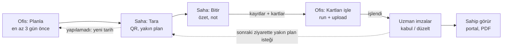

# orchadOS Personel Kullanım Kılavuzu

29 Ekim 2026

## Giriş

Bu kılavuz, orchadOS'ta ofiste ve sahada çalışan personelin günlük işini adım adım anlatır. Bahçe sahibi portalı ve uzman paneli burada yalnızca işin size değdiği yerde geçer.

orchadOS, Antep fıstığı bahçelerini yılda dört kez 360° kamera ve GPS ile tarar. Yapay zekâ ön değerlendirme yapar, ziraat mühendisi (uzman) her ağaca karar verip raporu imzalar, sahip raporu portalda görür. Sizin işiniz bu zincirin başı ve ortasıdır: bahçeyi sisteme almak, ziyareti planlamak, sahada eksiksiz taramak ve veriyi uzmana hazır hale getirmek.

| Rol | Kim | Ne yapar | Kullandığı araç |
| --- | --- | --- | --- |
| Operasyon (ofis) | Başvuru, teklif, ödeme, planlama ve işleme sorumlusu | Müşteriyi ve bahçeyi kaydeder, ziyaret planlar, kartları işler, sorunları çözer | Web: `/operasyon`, işleme istasyonu |
| Ofis aracı kullanıcısı | Saha personeli ya da operasyon | Envanterde ağaç gövdelerini panoramadan işaretler, ağaçları kodlar | Web: `/ofis` |
| Saha personeli | Köyde yaşayan, eğitimli saha çalışanı | Sınır yürüyüşü, grid tarama, yakın plan, doğrulama turu | Android saha uygulaması + tarama kiti |
| Uzman | Ziraat mühendisi, uzaktan | İnceler, karar verir, imzalar | Web: `/uzman` |

Web uygulamasında herkes yalnızca kendi rolünün bölümünü görür. Bir ziyaretin hiçbir sonucunu sahip, uzman imzalayıp yayımlamadan önce göremez.

## Başlarken

Hesabınızı operasyon açar; e-posta ve parola size ayrıca iletilir. Parolayı kimseyle paylaşmayın, WhatsApp'tan göndermeyin.

**Ofis personeli**

1. Bilgisayarda tarayıcıyı açın, pilot adresine (orchados-pilot.vercel.app) gidin ve `/giris`'ten e-posta ve parolanızla girin.
2. Operasyon rolüyle `/operasyon` panosu açılır. Pano bekleyen işleri sayar: incelenecek başvurular, açık teklifler, geciken ödemeler, iadeler, yaklaşan ve geciken ziyaretler.
3. Ofis aracı (`/ofis`) geniş ekran ister; iki panoramayı yan yana göreceğiniz bir bilgisayar kullanın.

**Saha personeli**

1. Android telefona orchadOS saha uygulaması kurulur (operasyon kurar).
2. Uygulamayı açın, E-posta ve Parola ile "Giriş yap"a dokunun. İlk giriş internet ister; sonrasında uygulama bahçede internetsiz çalışır.
3. Tarama kitini tanıyın: motosiklete takılan direkte 360° kamera, RTK GNSS anteni ve GNSS kaydedici. Saha kitinde ayrıca QR kodlu bilgilendirme levhası ve tanıtım kartı bulunur.
4. Kamera, kaydedici ve telefon her ziyaretten önceki akşam şarj edilir; kamera hafıza kartı ve kaydedicinin SD kartı boş olmalıdır.

## Ofis personeli

Ofisin işi dört başlıkta toplanır: müşteriyi ve bahçeyi almak, ziyareti planlamak, sahadan gelen veriyi işlemek ve sorunları kapatmak. Hepsi `/operasyon` menüsünden yapılır.

### Başvurudan aktif müşteriye

1. **Başvuruyu inceleyin** (`/operasyon/basvuru`). Bahçeler haritada ve tabloda görünür. Her bahçede "Doğrula" ile alanı dönüm olarak girin; gerekirse sınırı haritada yeniden çizin. Doğrulama notu iç bilgidir, müşteri görmez.
2. **Teklif verin.** Bütün bahçeler doğrulanınca teklif önizlemesi çıkar. İndirim yüzde olarak girilir ve açıklama ister; aynı köyden komşu bahçeye %10–15 indirim burada verilir. "Teklif ver" ya da "Başvuruyu reddet"; müşteriye SMS gider.
    - Konuma göre ret yalnızca yazılı iç ölçüte (mesafe, yol süresi, kapasite, erişim güvenliği) göre yapılır ve gerekçe nota yazılır. Müşteriye “hizmet bölgemiz dışı” denmez.
3. **Ödemeyi izleyin** (`/operasyon/siparis`). Kartla ödeme kendiliğinden düşer. Havalede sipariş sayfasında "Havale/EFT kaydet" ile tutarı, valör tarihini ve banka referansını girin. Her ödemeye makbuz (`M-…`) verilir; makbuz fatura değildir.
4. **Aktivasyon.** Planın ilk ödemesi gelince sipariş "Aktif" olur, her bahçe için parsel açılır ve sahip portala erişir. Sipariş sayfasından parsele geçip envanter ziyaretini planlayın.

**Telefonla gelen müşteri** (`/operasyon/sahip/yeni`, `/operasyon/parsel/yeni`): Ad, telefon ve iletişim tercihini alın. Aydınlatma metnini verin ve aldığını kaydedin; buna “KVKK onayı” demeyin, “aydınlatma metni verildi” deyin. Parselde il/ilçe/köy, kaba sınır, tahmini alan ve ağaç sayısı, erişim notu ve sınırı gösterecek kişiyi girin. Tek kullanımlık parola ekranda bir kez görünür; sahibe SMS ya da telefonla iletin.

### Ziyaret planlama (`/operasyon/ziyaret`)

1. "Ziyaret planla": parsel, tür (envanter ya da periyodik), tarih ve sorumlu saha personeli. Ziyaret personelin telefonunda "Bugünkü görevler"e düşer.
2. Tarihi **en az 3 gün sonrasına** koyun; sistem sahibe ziyaret SMS'ini gönderir. Daha yakın bir tarihte SMS gitmez; sahibi telefonla arayın ve arama saatini forma yazın.
3. Sistem şu durumlarda planı reddeder; nedeni ekranda yazar:
    - cayma süresi sürüyor ve sahip erken başlama istememiş,
    - o pencerenin ziyaret ödemesi yapılmamış (sahibin yazılı talebiyle "Ödemesiz ziyarete izin ver" açılabilir),
    - parselde açık sınır itirazı var.
4. Sahip ziyaretten en geç bir gün önce, bir kez erteleyebilir. Telefonla gelen ertelemeyi ziyaret sayfasında "Ertelemeyi kaydet" ile girin ve aynı pencerede yeni tarih verin.
5. Ziyaretten önce kontrol: bildirim gitti mi, levha ve tanıtım kartı kitte mi? Sonucu ziyaret notuna yazın.

### Sahadan gelen veriyi işleme

Saha personeli telefondaki kayıtları internetle gönderir; kameranın hafıza kartını ve kaydedicinin SD kartını elden ofise getirir (ziyaret başına yaklaşık 90 GB).

1. Kartlardaki video ve GNSS kayıtlarını işleme istasyonunda ziyaretin klasörüne kopyalayın.
2. `orchados-pipeline run <oturum>` çalıştırın: konum düzeltilir, video ile zaman eşlenir, panoramalar ve ağaç kesitleri üretilir.
3. `orchados-pipeline upload <çalıştırma> --session-id <ziyaret>` ile yükleyin. Ziyaret "işlendi" olur ve uzmanın kuyruğuna düşer. Ham video istasyonda kalır.

### Envanter: ofis aracı (`/ofis`)

Envanter her bahçenin ağaç haritasını bir kez çıkarır; sonraki ziyaretler bu haritaya eşlenir.

1. Parseli açın: solda harita ve panorama noktaları, sağda iki panorama.
2. Her ağacın gövdesine iki farklı panoramada tıklayın; yazılım konumu hesaplar (ağaç başına yaklaşık 10 saniye). Uyarı çıkarsa başka bir panorama çifti seçin.
3. Yazılım sıraları oturtur ve kod verir (S5-12, ara ağaç S5-12a). Ağaç beklenen ama bulunmayan yerler "boş yer" olur. Yaş, aşı ve altyapıyı da burada işaretleyin.
4. Doğrulama listesine bakın (belirsiz ağaçlar, boş yerler, "emin değilim" işaretlileri), sonra "Kaydet" sekmesinde "Veritabanına kaydet". Liste saha personelinin doğrulama turu olur.

### Günlük takip

| Ekran | Ne zaman bakılır |
| --- | --- |
| Pano (`/operasyon`) | Her sabah: sayılar ve uyarılar |
| Mutabakat (`/operasyon/mutabakat`) | Pencere ya da dönem bitince yapılamayan ziyaretler; 14 gün içinde iade ya da aktarım |
| İadeler (`/operasyon/iade`) | İstenen, başarısız ve belirsiz iadeler |
| Çıkarma (`/operasyon/cikarma`) | Bahçe çıkarma talepleri ve tarih teyidi |
| Bildirimler (`/operasyon/bildirimler`) | Gönderilen SMS'ler ve durumları |
| KVKK (`/operasyon/kvkk`) | Kişisel veri başvuruları, 30 gün sayacı |
| Personel (`/operasyon/personel`) | Ad ve unvan; uzmanın unvanı raporda görünür |
| Fiyat (`/operasyon/fiyat`) | Paketler ve fiyat listeleri; yayımlanan liste değişmez, kopyalanır |

## Saha personeli

Sahadaki her ziyaret aynı sırayla yürür: görevi aç, ön kontrolü bitir, saati eşle, tara, yakın plan çek, ziyareti bitir. Uygulama internetsiz çalışır; kayıtlar internet olunca kendiliğinden gönderilir.

### Bir ziyaret adım adım

1. **Bugünkü görevler.** Uygulamayı açın; size atanan ziyaretler "Bugün", "Yarın" ve "Gecikmiş" olarak listelenir. Kartta bahçenin alanı ve yakın plan ağaç sayısı yazar. İnternet yoksa "Son indirilen liste gösteriliyor" yazar; bu normaldir.
2. **Ön kontrol.** Liste bitmeden tarama başlamaz:
    - kamera lensleri temiz, batarya ve SD kart yeterli, kamera yüksekliği metreyle ölçüldü,
    - bilgilendirme levhası bahçe girişine kondu, tanıtım kartınız görünür ("Hayır" derseniz nedenini yazın),
    - hasat ya da çöpleme sürüyorsa, son günlerde ilaçlama yapıldıysa ya da yaprak ıslaksa bahçeye girmeyin; emin değilseniz sahibe sorun.
3. **Kaydediciyi bağlayın.** Uygulama Bluetooth ile GNSS kaydediciye bağlanır ve konum kalitesini gösterir.
4. **Kaydı başlatın.** "Kaydı başlat"a dokunun.
5. **Başlangıç QR.** "Başlangıç QR"a dokunup telefondaki saat QR'ını 360° kameraya okutun. Bu adım video ile GPS zamanını eşler; atlanmaz.
6. **Tarama.** Motosikletle önce sıralar boyunca, sonra dik koridorlar, en son kenarlar. Sorunlu bir ağaç görürseniz "Sorun gördüm"e dokunup ağacı seçin; yakın plan listesine eklenir.
7. **Bitiş QR ve kaydı durdurun.** Bitiş QR'ını kameraya gösterin, "Kaydı durdur", sonra kameradaki videoyu da durdurun.
8. **Yakın plan.** Listedeki her ağaçta mevsime göre 2–3 fotoğraf çekin ve evet/hayır sorularını cevaplayın. Göremediğiniz bir şey için "Göremedim" seçin; isterseniz sesli not ekleyin. Bulanık ya da karanlık fotoğrafı uygulama reddeder; "Yeniden çek". Fotoğraflar yalnızca uygulama içinden çekilir.
9. **Ziyareti bitirin.** Ziyaret özetinde kapsama, atlanan koridorlar ve yakın plan sayısı görünür. Hava, kamera seri numarası ve sahadaki sorunları not edin, "Bahçede rastlanan kişilere sözlü bilgi verildi mi?" sorusunu cevaplayın ve "Ziyareti bitir".
10. **Kartları ofise getirin.** Kameranın hafıza kartı ve kaydedicinin SD kartı elden ofise gider. Ham video telefondan gönderilmez.

### Envanter ziyaretinde ek işler

- **Sınır yürüyüşü.** Sahibin ya da yetkilendirdiği kişinin gösterdiği sınır boyunca yürüyün; her köşede uygulamada "Köşe"ye basın, sınır işaretlerini fotoğraflayın.
- **Sınırı gösteren kişi.** Ekrandaki kısa bilgiyi okuyun; adını ve rolünü (bahçe sahibi, sahibin yakını, işçi / bekçi, komşu, diğer) kaydedin. Telefon numarasını yazmayın.
- **Doğrulama turu.** Ofis aracı ağaçları kodladıktan sonra telefona bir doğrulama listesi gelir. Listedeki ağaçlara gidin, yakın plan çekin ve soruları cevaplayın. Bu tur ilk periyodik ziyaretle birleştirilebilir.

### Bahçede bulunan kişiler

- Kişi kadraja yakınsa geçmesini bekleyin.
- Rastladığınız kişilere kısaca söyleyin: bahçe denetimi için görüntü kaydı yapılıyor, kişiler hedeflenmiyor, ayrıntı levhadaki adreste.
- Kişi itiraz ederse o bölümü sonra tarayın ve tarama ekranında "Bir kişi itiraz etti" notunu girin.
- Notlara telefon numarası ya da başka kişilerin adını yazmayın.

### Ziyaret yapılamadıysa

Kapı kapalıysa, anahtar ya da bekçi yoksa, sınırı gösterecek kişi gelmediyse ya da hava uygun değilse:

1. Görev kartında "Ziyaret yapılamadı"ya dokunun.
2. Nedeni seçin ve kapalı kapıyı ya da engeli fotoğraflayın. Sahipten kaynaklı engelde en az bir fotoğraf ve not zorunludur.
3. "Kaydet". Ziyaret planda kalır; engel aynı gün kalkarsa yine taranabilir. Ofisi telefonla haberdar edin; yeni tarihi ofis verir.

## Ofis–saha iş akışı

Bir ziyaret ofis ile saha arasında iki kez el değiştirir: ofis planlar, saha tarar, ofis işler, uzman imzalar. Kesik çizgiler geri dönüşlerdir.

Yapılamayan ziyaret ofise döner ve aynı pencerede yeni tarih alır. Uzmanın yakın plan ya da ek ziyaret isteği bir sonraki taramada saha personelinin listesine düşer. Envanter ziyaretinde işlemeden sonra ofis aracı ve doğrulama turu araya girer (bkz. Ofis ve Saha bölümleri).

## Sık sorulan sorular ve sorun giderme

| Durum | Ne yapılır |
| --- | --- |
| Telefonda "Sunucuya ulaşılamadı" yazıyor | Sorun değil. Son indirilen görev listesiyle çalışın; kayıtlar internet olunca gönderilir. |
| "Kaydedildi. İnternet olunca gönderilecek." | Kayıt telefonda güvende. Akşam Wi-Fi'ye bağlanıp uygulamayı açın. |
| Kaydedici kaydı durdurdu | SD kart dolu ya da hatalıdır. Kartı değiştirin, başlangıç QR'ından yeniden başlayın, ofise bildirin. |
| Ziyaret özetinde atlanan koridor var | Mümkünse o koridoru hemen tarayın; değilse ofise bildirin, gerekirse yeniden tarama planlanır. |
| Fotoğraf sürekli reddediliyor | Işık yetersiz ya da lens kirli. Lensi silin; şafakta, gün batımında ve kırağı kalkmadan çekmeyin. |
| Görev telefonda görünmüyor | Ofis ziyareti size atadı mı, tarih doğru mu? İnternete bağlanıp listeyi yenileyin. |
| Ziyaret planı reddedildi (ofis) | Ekrandaki nedene bakın: cayma süresi, ödenmemiş ziyaret ya da sınır itirazı. |
| Sahip ziyaret sonucunu görmüyor | Uzman imzalayıp yayımlamadan sahip hiçbir sonuç göremez; ziyaretin durumuna bakın. |
| Sahip ödediğini ama ödemenin açık göründüğünü söylüyor | 2 iş günü içinde cevap verin; havaleyse dekontu isteyip kaydedin. |
| Biri görüntüsünün silinmesini istiyor | Ofis, ziyaret sayfasındaki "Görüntü gizleme (KVKK itirazı)" ile gizler; talep KVKK defterine girer. |

**Ziyaretin durumları**, ekranlarda göreceğiniz sırayla: Planlandı → Tarandı (sahadan gönderildi) → İşlendi → İncelemede (uzman inceliyor) → Yayımlandı. Yayımlanan ziyaret geri alınamaz.

## Destek ve iletişim

Sahadaki her sorunu önce operasyona telefonla bildirin; ofis gerekirse yeniden tarama ya da yeni tarih planlar. Uygulama hatasında ekranın fotoğrafını çekin, saati ve hangi bahçede olduğunuzu not edin.

- Operasyon telefonu: _eklenecek_
- Teknik destek (uygulama ve web): _eklenecek_
- Ayrıntılı kurallar: [kullanim-kilavuzu.md](kullanim-kilavuzu.md) (uçtan uca akış) ve [metodoloji.md](metodoloji.md) (değerlendirme kuralları).
