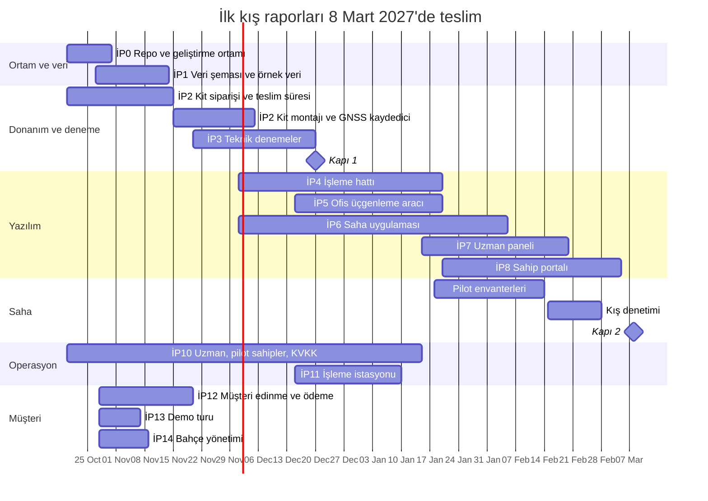

# MVP Geliştirme Planı

18 Ekim 2026 · Yusuf

Hedef, ilk kış denetim raporlarını **8 Mart 2027**'de pilot bahçe sahiplerine teslim etmek (Kapı 2). Bunun için yaklaşık 20 haftada ~55 günlük geliştirme işi gerekiyor. Bu da haftada ~20 saat demek; yan proje için sıkı bir tempo. Plan bu yüzden işleri önceliğe göre sıralar ve geride kalınırsa nelerin kesileceğini baştan söyler.

Ürün tanımı [MVP.md](MVP.md), veri modeli [veri-modeli.md](veri-modeli.md), kit [tarama-kiti.md](tarama-kiti.md) dosyalarında.

## Kilometre taşları

| Tarih | Kilometre taşı | Ne hazır olmalı |
| --- | --- | --- |
| 31 Ekim 2026 | M0 – Geliştirme ortamı | Repo iskeleti, iki devcontainer, şemanın ilk sürümü başlamış |
| 20 Aralık 2026 | M1 – Kapı 1: yöntem kararı | Kit çalışıyor; kendi bahçende tek koridor taraması; PPK, zaman eşleme ve gövde üçgenleme denendi; ağaç eşleştirme doğruluğu ölçüldü |
| 18 Ocak 2027 | M2 – Envantere hazır | Saha uygulamasının envanter modu, işleme hattı, ofis üçgenleme aracı |
| 15 Şubat 2027 | M3 – Kış denetimine hazır | Yakın plan akışı, uzman paneli, pilot envanterleri tamam |
| 8 Mart 2027 | M4 – Kapı 2: ilk raporlar | Sahip portalı; kış raporları uzman imzasıyla teslim |

## Zaman çizelgesi

**Kritik yol:** Kit parçalarının teslim süresi → teknik denemeler → işleme hattı → pilot envanterleri → kış denetimi. Kit siparişi gecikirse her şey kayar; bu yüzden ilk hafta verilmeli.

## İş paketleri

| İP | İş paketi | Öncelik | Tahmini efor | Tamam sayılması için |
| --- | --- | --- | --- | --- |
| İP0 | Repo ve geliştirme ortamı | P0 | 1,5 gün | Repo iskeleti; `core` ve `mobile` devcontainer'ları açılıyor |
| İP1 | Veri şeması ve örnek veri | P0 | 3 gün | Hedef veri modelinin MVP alt kümesi migration olarak yazılı; 300 ağaçlı sentetik bir bahçe örnek verisi; satır bazlı yetki kuralları |
| İP2 | Kit ve GNSS kaydedici | P0 | 5,5 gün | Kit monte; ESP32 ham GNSS'i ve PPS'i microSD'ye kaydediyor; telefona Bluetooth ile durum gönderiyor |
| İP3 | Teknik denemeler | P0 | 5 gün | Tek koridor taraması; PPK çözümü; QR ile zaman eşleme; ~20 ağaçta gövde üçgenleme ve elle ölçümle karşılaştırma; ısınma testi |
| İP4 | İşleme hattı v0.1 | P0 | 8 gün | Alım ve doğrulama, PPK, zaman eşleme, kare seçimi, panorama (4K + 2K), ağaç kesitleri, yükleme; komut satırından çalışıyor |
| İP5 | Ofis üçgenleme aracı | P0 | 6 gün | Harita + iki panorama görünümü; tıklayarak üçgenleme; sıra oturtma, kodlama, boş yerler; doğrulama listesi |
| İP6 | Saha uygulaması v0.1 | P0 | 8 gün | Giriş, günün görevleri, oturum başlat/bitir, QR saat, GNSS durumu, kapsama haritası, sınır köşesi işaretleme, yakın plan akışı, çevrimdışı senkronizasyon |
| İP7 | Uzman paneli v0.1 | P0 | 5 gün | Ziyaret kuyruğu; ağaç başına bu ve önceki ziyaretin kesitleri; ölçek girişi ve onayı; bulgu ve öneri; rapor imzası |
| İP8 | Sahip portalı v0.1 | P0 | 8 gün | Giriş; bahçelerim; parsel karnesi; sağlık haritası; ağaç karnesi; işaretçili panorama gezisi; PDF rapor |
| İP9 | AI worker v0.1 | P1 | 4 gün | Kış etiketlerinden değerlendirme seti; Batch ile ön değerlendirme; uzman paneline öneri olarak düşüyor. İlkbahar denetiminden (15 Nisan) önce |
| İP10 | Operasyon hazırlıkları | P0 | 4 gün + dış süreler | Metodoloji v0 (ölçekler, referans fotoğraflar), KVKK aydınlatma ve rıza metinleri, sözleşme taslağı, uzman anlaşması, pilot sahiplerin onayı |
| İP11 | İşleme istasyonu | P0 | 1 gün | Pilotta bulutta (karar 22 Ekim): ham video ofisten buluttaki depoya yüklenir, GPU'lu sanal makine iş başına açılıp kapanır; işleme hattı orada çalışıyor |
| İP12 | Müşteri edinme ve yönetimi | P1 | 12 gün | Site, self-servis kayıt (SMS doğrulaması, rızalar), başvuru, teklif, kartla (iyzico) ve havaleyle ödeme, makbuz, iade, back office; bayraklar kapalıyken birleşir. Tasarım: `docs/musteri-yonetimi.md` |
| İP13 | Demo turu | P1 | ~7 gün | Bahçe sahibi adayı hesap açmadan ve ödemeden, ayrı demo projesinde (`demo.<alan adı>`) geçici bir hesapla iki sentetik bahçeyi sahip portalında gezer; rehberli tur, filigranlı PDF'ler; demo hesabı hiçbir şey yazamaz; anahtarlar kapalıyken birleşir. Tasarım: [demo-turu.md](demo-turu.md) |
| İP14 | Bahçe yönetimi | P1 | ~8 gün | Müşteri üyeliği boyunca bahçe ekler ve çıkarır: tek üyelik dönemi, ek sipariş ve kalan döneme göre orantılı fiyat (`pricing-v2`), son ek günü; bahçe bazında çıkarma (30 gün, dönem sonu ya da açık cayma), kullanılmayan ziyaret iadesi, 90 gün salt okunur erişim; yenileme bütün bahçeleri kapsar; hukuk taslaklarının ikinci sürümleri; `garden_changes_enabled` kapalıyken birleşir. Tasarım: [bahce-yonetimi.md](bahce-yonetimi.md) |

**Durum (20 Ekim 2026)**

| İP | Durum | Not |
| --- | --- | --- |
| İP0 | Tamam | Repo iskeleti, `core` ve `mobile` devcontainer'ları, bulut ortamı |
| İP1 | Tamam (PR #1, #7) | Şema, satır bazlı yetki, sentetik bahçe; yayımlanmamış sonuçlar sahipten gizli; son değerlendirme/ölçüm görünümleri (önce en yeni oturum, aynı oturumda kaynak önceliği); `media` depolama alanı; 173 pgTAP testi |
| İP2 | Yazılım tamam (PR #2, #7, #22) | Firmware 0.3.0: BLE durum mesajında GPS zamanı ve konum; 74 birim testi, ESP32 derlemesi. Açık: gerçek donanım testleri (README'deki adımlar), kit gelince |
| İP4 | Çekirdek + yükleme tamam (PR #3, #4, #11) | 97 test; `upload` komutu: türetilmiş dosyalar `media` alanına, kayıtlar `capture`/`asset`/`asset_source`'a; ham kayıtlar istasyonda kalır. Açık: gerçek PPK denemesi (İP3), büyük ziyarette yükleme süresi |
| Entegrasyon | Tamam (PR #4) | Sözleşmeler `docs/arayuzler.md` içinde |
| İP5 | v0.2 tamam (PR #9, #15) | Ofis üçgenleme aracı: tıklayarak üçgenleme, sıra oturtma ve kodlama, boş yerler, doğrulama listesi (CSV), kayıt; 12 sentetik ağaç 30 cm içinde. v0.2: panoramalar depodan, `save_inventory` tek işlemde, gövde tıklamaları `trunk_label` tablosunda (etiketli veri) |
| İP7 | v0.1 tamam (PR #12) | Ziyaret kuyruğu, ağaç ağaç inceleme (bu ve önceki ziyaretin kesitleri), AI'ı kabul/düzelt, bulgular, `publish_session` ile imza ve yayın; yayın sadece uzmanla, geri alınamaz, sonuçlar yayından sonra donar |
| İP8 | v0.1 tamam (PR #13) | Bahçelerim, parsel karnesi, sağlık haritası, ağaç karnesi ve fotoğraf geçmişi, işaretçili 360° gezi, yazdırma/PDF, telefon görünümü |
| CI | Tamam (PR #10) | Her PR'da bileşen testleri GitHub Actions'ta; migration'lar `main`'den Supabase test projesine; web Vercel'de. Bkz. `docs/deployment.md` |
| İP10 | Metodoloji v0 taslağı (`docs/metodoloji.md`) | Uzmanla kesinleşecek maddeler bölüm 11'de. Rol rol akış: `docs/kullanim-kilavuzu.md` |
| İP12 tasarım | Tamam (PR #52) | `docs/musteri-yonetimi.md` |
| İP12-A1 | Tamam (PR #55) | Veri modeli ve kayıt: bütün faturalama tabloları (14 `public`, 8 `private`), sütun yetkileri, kayıt ve rıza fonksiyonları, `customer-signup` Edge Function, katalog ve başvuru fonksiyonları, `ops_find_user_id` sertleştirmesi, örnek müşteri (`customer@example.com`) |
| İP12-B | Tamam (PR #54) | Ödeme sağlayıcı: iyzico Checkout Form ve sahte sağlayıcı, `payments`, `payment-callback`, `payment-webhook` Edge Function'ları. Açık: iyzico sandbox kontrol listesi (`docs/deployment.md`) |
| İP12-C | Tamam (PR #53) | Herkese açık site, `/kayit` arayüzü, bayraklar, Turnstile widget'ı |
| İP12-A2 | Tamam (PR #56) | Teklif, sipariş, ödeme, makbuz, iade fonksiyonları; bildirimler, `pg_cron` işleri |
| İP12-D | Tamam (PR #58) | Müşteri portalı: başvuru, teklif, sipariş, kartla ve havaleyle ödeme, hesap |
| İP12-E | Tamam (PR #57) | Back office: başvuru inceleme, teklif, havale kaydı, iade, ödeme incelemesi, ayarlar |
| İP12 entegrasyon düzeltmesi | Tamam (PR #61) | Bütünleşik incelemenin bulguları: alıcı e-postası, `payment_in_progress` eşlemesi, Turnstile olmadan kayıt kapalı, geri alma anahtarı, deploy runbook'u (`docs/gorevler/ip12-entegrasyon-duzeltme.md`). Bayraklar barındırılan projelerde hâlâ kapalı |
| İP13 tasarım | Tamam | [demo-turu.md](demo-turu.md) (sürüm 2) |
| İP13-A | Tamam (PR #63) | Demo erişimi: `private.demo_*` tabloları, yazma kilidi, hesap kilidi, erişim kapsamı, `demo-start` Edge Function, `deploy-db-demo` ve pilot denetimleri |
| İP13-B | Tamam (PR #64) | Demo verisi: sentetik medya, `orchados-pipeline demo`, `pnpm db:demo-tour`, `demo-data` iş akışı |
| İP13-C | Tamam (PR #65) | Demo arayüzü: demo sunucusu, `/demo`, oturum kapısı ve bant, rehberli tur, filigranlı PDF, uçtan uca test |
| İP13 entegrasyon düzeltmesi | Tamam (PR #66) | Bütünleşik incelemenin bulguları: sınır bildirimleri (PDF, görüntü), tur metni, bant, tek GitHub Environment modeli (`test`/`demo`/`pilot`), demo kilidinde Vault `orchados_cron_secret`, demo derleme önbelleği, migration zaman damgası denetimi (`docs/gorevler/ip13-entegrasyon-duzeltme.md`) |
| İP13 yayına alma | Açık (insan eylemi) | Barındırılan projelerde demo kapalı. Sıra: (1) GitHub Environment'ları `test`, `demo`, `pilot` ve secret'ların taşınması, repo düzeyindeki veritabanı secret'larının silinmesi; demo projesi açılana kadar `deploy-db-demo` devre dışı (`docs/deployment.md` › GitHub secret'ları ve ortamları); (2) test projesinde duman testi; (3) demo projesi: Supabase, Vercel (önizlemeler kapalı), DNS, Edge secret'ları, Vault, Auth, harcama tavanı, `demo-data` yükleme ve açma; (4) pilot sitesinde `ORCHADOS_DEMO_URL` ([demo-turu.md](demo-turu.md) §15–§16) |
| İP14 tasarım | Tamam (PR #68) | [bahce-yonetimi.md](bahce-yonetimi.md) (sürüm 2); dört akış, iki dalga (§17) |
| İP14-A | Tamam (PR #71) | Veri modeli ve sözleşmeler: `garden_removal`, ek sipariş, `pricing-v2`, çıkarma ve iade, housekeeping, migration'lar `20261102120000`–`20261102120400` |
| İP14-B | Tamam (PR #69) | Hukuk taslakları v2 (`mesafeli-v2-taslak`, `iade-v2-taslak`, `onbilgi-v2-taslak`), site metinleri, avukat soruları (`docs/hukuk/README.md` 15–23), doküman güncellemeleri |
| İP14-C | Tamam (PR #74) | Müşteri portalı: üyelik kartı, bahçe ekleme, ek teklif, bahçe çıkarma formu, salt okunur bant |
| İP14-D | Tamam (PR #73) | Back office: çıkarma kuyruğu, ek teklif, üyelik ve bahçeler paneli, yenileme ön seçimi, ayarlar |
| İP14 entegrasyon incelemesi | PR açık (`claude/ip14-entegrasyon-duzeltme`) | Bütünleşik incelemenin bulguları: kesin başarısız iade çıkarma iadesinden düşülmez, temel sipariş bitince para tutan ek sipariş iptal ve iade edilir, ödeyen ikinci sahibin erişimi korunur, portalda ops'un açtığı çıkarma geri alınamaz (`removal_initiated_by`), anahtar kapalıyken sunucu da ek bahçeyi reddeder ve ops başvuru sayfası İP12 teklifine döner, yenileme ön seçimi ek siparişleri kapsar; migration `20261102120500` (`docs/gorevler/ip14-entegrasyon-duzeltme.md`) |
| İP14 yayına alma | Açık (insan eylemi) | Barındırılan projelerde `garden_changes_enabled` kapalı. Avukat onayı (`docs/hukuk/README.md` 15–22) ve fiyat kararları ([bahce-yonetimi.md](bahce-yonetimi.md) §16, §19) gelince test projesinde duman testi, sonra anahtar açılır (`docs/deployment.md` › Bahçe ekleme ve çıkarma) |
| Operasyon ekranları | Tamam (PR #19) | `/operasyon`: pano, sahip ve parsel kaydı, kaba sınır, portal erişimi ve hesap açma, ziyaret planlama |
| Envanter onayı | Tamam (PR #18) | Doğrulama listesi veritabanında (`verification_item`), ofiste ağaç özellikleri, altyapı ve saha sınırı; uzmanın envanter onayı; sahibin sınır onayı. Saha tarafı açık |
| İP6 v0.3 | Tamam (PR #21) | Doğrulama turu ekranı, sahada sınır köşesi, kapsama haritası, test projesine bağlı APK (`docs/gorevler/ip6-envanter-saha.md`) |
| İP9 | v0.1 tamam (PR #23) | `ai-worker`: Haiku triaj → Sonnet, Batch API, önbellekli istem, mozaik, `eval`; kişisel veri ve yakın plan fotoğrafı gönderilmez. Ücretsiz sağlayıcılar (PR #43): yerel Ollama ile uçtan uca denendi. Gerçek Claude API ile ilk deneme ve eşik kalibrasyonu açık |
| Pilot ortamı | Kuruldu (22 Ekim) | Supabase `orchados-pilot` (Frankfurt, Free): 29 migration, Edge Function'lar, giriş/telefon kancası, bildirim kuyruğu (mesajlar kaydediliyor). Vercel `orchados-pilot` (`release`, Frankfurt, koruma açık): https://orchados-pilot-orchad-os.vercel.app. İşletme: OBA Bilişim Teknolojileri LTD.; ilk operasyon kullanıcısı açıldı. Açık: Vercel Pro, medya deposu (Supabase Pro), alan adı, Netgsm |
| Kapsama ve ağaç kontrolü | Tamam (PR #32) | Kapsama raporu, eşik altında otomatik ek ziyaret isteği, ağaç var/yok (`tree_visible`), envanter onayında kapsama kapısı |
| Bulutta işleme | Tamam (PR #29) | Sağlayıcıdan bağımsız: `orchados-ingest` (S3 uyumlu: AWS/R2/GCS/MinIO; Azure Blob; yerel), işlem container'ı (`ghcr.io/yusuftiryaki/orchados-processing`), AWS/Azure/GCP makine betikleri, `docs/bulut-isleme.md`. Sağlayıcı seçimi ve hesap açık |
| Dalga 6 | Tamam | Sınır köşeleri (#22), İP9 (#23), grid rotası (#24), uzman/portal v0.2 (#25), bildirimler ve telefonla giriş (#27; Netgsm iskeleti, gerçek hesap yok). Yüz bulanıklaştırma üründen kaldırıldı (karar 21 Ekim, #28) |
| Dalga 5 | Tamam | İP5 v0.2 (PR #15); İP4 v0.2 (PR #16): ağaç konumları veritabanından, CI'da uçtan uca zincir testi (~70 sn) |
| Dalga 4 | Tamam | İP4 yükleme, İP7, İP8, İP6 senkronizasyon birleşti. Örnek tarama verisi: `pnpm db:demo`. Test ortamı: https://orchados-orchad-os.vercel.app (Vercel koruması açık) |
| İP6 | v0.3 tamam (PR #6, #8, #20, #21, #24, #26) | BLE protokolü, QR saat, ekran akışı, çevrimdışı kuyruk, gerçek kamera ve cihazda kalite kontrolü; 66 test. Senkronizasyon: sunucudan görevler, sıralı ve tekrar güvenli gönderim, saha personelinin fotoğraf yüklemesi; APK CI'da derleniyor. Envanter sahası: doğrulama turu, sınır köşesi, kapsama; sabit grid rotası ve dur-çek-yürü; test projesine bağlı APK. Açık: telefonda ve gerçek kaydediciyle deneme |

**Sıradaki işler (26 Ekim 2026; çalışma artık yerel makinede, ağır doğrulama CI'da)**

1. ✅ Toparlama: PR #32 sonrası `main` CI yeşil, test projesi güncel.
2. ✅ **Kit kimlik çipi** (PR #33) (robotla bağlantı; sözleşme `hoverboard/docs/kit-soketi.md`, şema 1): `services/kit-chip/` kodlayıcı, çözücü, ortak test vektörleri, çipe yazma aracı. Kalibrasyon kaydından manifest (`orchados-kit from-calibration`, `calibration.chip_id` + `extrinsics.kit_mount`) PR #39. Açık: kit yapılınca gerçek ölçümler ve gerçek DS2431'e ilk yazma.
3. ✅ **Insta360 SDK** (PR #34) (Camera SDK 2.1.8, Media SDK 3.1.5, InsMetaData SDK 2.0.2 geldi; repoya girmez, yerelde `~/.orchados/sdk/insta360/`). Plan: `docs/gorevler/insta360-sdk.md`. İşleme hattı `.insv`'yi doğrudan alıyor, sadece seçilen kareleri `MediaSDKTest` ile birleştiriyor; meta veri aracı (`native/ins_meta_dump`) SDK'ya karşı derlendi. Sahte SDK ile test edildi; doğrulama için gerçek bir `.insv` deneme çekimi gerekiyor. Jiroskopla ince zaman eşleme sonraki iş.
4. ✅ **Saha uygulaması** (PR #35): yakın plan listesinin sunucudan inmesi (`closeup_list`), "Sorun gördüm", sesli not, hava ve ekipman kaydı (ziyaret kaydı). Yazıldı; sesli not telefonda denenmedi.
5. ✅ **Pilota ilk sürüm** (PR #36, 27 Ekim): 37 migration ve Edge Function'lar pilot projesinde, `orchados-pilot` yayında.
6. ✅ **Bakım** (PR #37, #38): Test temizliği yeni tabloları sütun adından kendiliğinden kapsıyor (`supabase/testing/purge.sql`). Tarayıcı testlerinde CI'da bir tekrar ve 60 sn süre; toplu onay testindeki asıl hata (rastgele örneklemde incelenmiş ağaca karar) düzeltildi.

7. ✅ **27 Ekim işleri:** BLE paketi `universal_ble` (PR #41); dip sürgünü, kuruma deseni, gövde yapısı (PR #42); ücretsiz AI sağlayıcıları: yerel Ollama `gemma3:4b` ile uçtan uca denendi, Gemini ücretsiz katmanı yalnız test verisi (PR #43); envanter raporu ve sunucuda PDF (PR #44); web ve saha arayüzlerinde tasarım yenilemesi (PR #45, #46); **metodoloji v0.1**: uzman ajan kararları (PR #47, `docs/uzman-ajan-onerileri.md`), 27 Ekim'de işletme kararıyla kabul edildi; kalan kurallar kodda (zor ölçekler, mevsimin ilk ziyaretinde toplu onay kapalı, "yok" bir kez, aynı mevsimle trend, envanterde %98 ve 20×20 m kör nokta, AI istemi v0.3, yakın plan protokolü v0.1).

8. **İP12 Müşteri edinme ve yönetimi** (27 Ekim): geliştirme bulut oturumlarında; üç dalgada altı akış (`docs/gorevler/ip12-*.md`, tasarım `docs/musteri-yonetimi.md` §17). Dalga 1: A1 veri modeli ve kayıt, B ödeme sağlayıcı, C site ve kayıt arayüzü; dalga 2: A2 teklif, sipariş, ödeme fonksiyonları; dalga 3: D müşteri portalı, E back office.

9. **İP13 Demo turu** (28 Ekim): tasarım `docs/demo-turu.md`; iki dalgada üç akış (`docs/gorevler/ip13-*.md`). Dalga 1: A demo erişimi (veritabanı, Edge, dağıtım denetimleri), B demo verisi; dalga 2: C demo arayüzü ve uçtan uca test. Sonra test projesinde duman testi, demo projesi, en son pilot sitesine link.

10. **İP14 Bahçe yönetimi** (28 Ekim): tasarım `docs/bahce-yonetimi.md`; iki dalgada dört akış (`docs/gorevler/ip14-*.md`). Dalga 1: A veri modeli ve sözleşmeler, B hukuk taslakları ve dokümanlar; dalga 2: C müşteri portalı, D back office. Anahtar avukat onayına kadar kapalı.

**Açık işler**

- [x] **Karar (28 Ekim, İP14):** Müşterinin birden fazla bahçesi; üyelik boyunca ekleme ve çıkarma; tek dönem, ek sipariş, orantılı fiyat, bahçe bazında fesih. Ayrıntı: `docs/bahce-yonetimi.md` §2.
- [x] **Karar (27 Ekim, İP12):** Akış başvuru → operasyon onayı → ödeme. Fiyat dönüm başına ve yıllık; paket yıllık periyodik ziyaret sayısı, minimum ücret var; fiyat listesi sürümlü, yayımlanan değişmez. Kartla ödeme iyzico ile (3DS, sağlayıcıdan bağımsız arayüzün arkasında), havaleyi operasyon kaydeder. Ayrıntı: `docs/musteri-yonetimi.md` §2.
- [x] **Envanter kaydı tek işlemde:** *(PR #15)* Yer ve ağaç kaydı şu an iki ayrı ekleme; `save_inventory(...)` adlı, kullanıcının yetkisiyle çalışan tek işlemlik bir veritabanı fonksiyonu.
- [x] **Etiketli veri:** *(PR #15)* Ofis aracındaki gövde tıklamaları (gövde tespit modeli için etiket) şimdilik tarayıcıda; veritabanında saklanmalı.
- [x] **Web:** Ağaç rengi uzman ve ofis tarafında da *(PR #15)* `tree_latest_assessment` görünümüne bağlanmalı (portalda yapıldı).
- [x] **Web:** Medya imzalama iki yerde *(PR #15)*: `src/lib/media/` (portal) ve `src/lib/expert/media.ts`. Uzman paneli ortak yardımcıya geçmeli; `fetchAll` kopyası da birleştirilmeli.
- [x] *(PR #30, #37)* **Testler:** Ekleme-yalnız tablolar yüzünden web testleri kendi işletmelerini kurup `docker exec ... psql` ile temizliyor. Testler için bir temizlik fonksiyonu daha temiz olur.
- [x] *(PR #16)* **Örnek veri:** `supabase/demo/scans.sql` `pose` alanları `docs/arayuzler.md`'deki sözleşmeye tam uymuyor (`variant`, `gps_time_ns`, `panorama_asset_id` eksik; MIME türü WebP olmalı).
- [x] **Karar (21 Ekim): yüz bulanıklaştırma üründen kaldırıldı.** Ertelenmiş bir iş değil; panoramalar ve kesitler bu şart olmadan yüklenir, kesitler AI'a gönderilir. Görüntülerde kişiler görünebileceği aydınlatma metninde belirtilir.
- [x] **Karar (20 Ekim):** Yayından sonra sadece uzman ölçümleri kilitli; saha personelinin geç gelen kayıtları serbest.
- [x] *(PR #20)* **Saha uygulaması:** README ve `GnssStatus` yorumu, firmware 0.2.0'daki GPS zamanı alanını hâlâ "önerilen" diye anlatıyor; evet/hayır cevapları gönderilirken `value_bool` → `value_boolean` eşlemesi.
- [x] *(PR #17)* **Metrik kaydı:** `metric_definition` sadece seed'de; metodolojideki ölçekler (`docs/metodoloji.md` Ek B) referans veri olarak migration'la kurulmalı.
- [x] *(PR #21)* **Saha uygulaması:** Doğrulama turu ekranı; sahada sınır köşesi işaretleme; kapsama haritası.
- [x] *(PR #22)* **İşleme hattı:** Sınır köşelerinden `boundary` sürümü; firmware 0.3.0 durum mesajında konum.
- [x] *(PR #26)* **Saha uygulaması:** Firmware 0.3.0 konum geçerli bayrağı (bit6) kontrol ediliyor.
- [x] *(PR #19)* **Operasyon ekranları:** Sahip/parsel kaydı, portal hesabı (`invite-user` Edge Function), ziyaret planlama ve pano.
- [x] *(PR #41)* **Lisans:** `flutter_blue_plus` (ticari kullanımda ücretli) yerine BSD lisanslı `universal_ble`. Gerçek kaydediciyle telefonda denenmesi kit gelince.
- [x] *(PR #20, `permission_handler` 12'ye sabitlendi)* **Saha uygulaması:** `flutter build apk` CI'da kırık: `permission_handler_android` `compileSdk` 37 istiyor (İP6 senkronizasyon görevinde).

Toplam yaklaşık 55 gün (İP9 hariç).

## Hemen başlaması gereken dış işler

Bunlar takvimi bekletebilecek, başkasına bağlı işler. İlk iki hafta içinde başlatılmalı:

- [ ] Kit parçalarının siparişi (ithalat ve gümrükle 2–4 hafta). Liste: `docs/kit-siparis-listesi.md`
- [ ] 360° kamera üreticisinin SDK başvurusu
- [ ] TUSAGA-Aktif (CORS-TR) abonelik başvurusu, ya da kendi baz istasyonu kararı
- [ ] Uzman (ziraat mühendisi) ile ön görüşme
- [ ] 1–4 pilot bahçe sahibinin sözlü onayı; envanter tarihleri
- [ ] KVKK metinleri için hukukçu görüşü. Taslaklar ve avukata sorulacaklar: `docs/hukuk/`
- [x] İşleme istasyonu: pilotta bulut (22 Ekim). Ofisin yükleme hızı 99 Mbps; 90 GB'lık bir ziyaret ~2 saatte yüklenir. Sağlayıcı sonra seçilecek; araçlar AWS, Azure ve Google Cloud'u destekleyecek (`docs/gorevler/bulut-isleme.md`)

## Geride kalınırsa kesilecekler

Sıra, ilk kesilecekten sona doğru:

1. ~~**Portalda PDF rapor**~~ (yapıldı, PR #44): karne ve envanter raporu sunucuda PDF.
2. **Gezide ağaç işaretçileri:** Panoramalar işaretçisiz gezilir, ağaç karnesine haritadan gidilir (~2 gün).
3. **Telefon doğrulamasıyla giriş:** Pilot sahiplere kişiye özel link gönderilir (~1 gün).
4. **Saha uygulamasında kapsama haritası:** Kapsama ofiste işleme sonrası kontrol edilir (~1,5 gün).
5. **Uzman panelinde rahatlık özellikleri:** Toplu onay ve kısayollar sonraya kalır; dört bahçede ~1.200 ağaç elle incelenebilir (~1 gün).

Bunlar yetmezse Kapı 2, ilkbahar denetiminin sonuna (Mayıs 2027) kaydırılır. Kış ziyareti yine yapılır ve veri toplanır; rapor sahiplere ilkbaharla birlikte gider.

## Çalışma düzeni

- **Her iş paketi kendi dalında** geliştirilir ve tamamlanınca `main`'e birleştirilir.
- **Testler:** Her bileşen gerçek donanım olmadan, kısa örnek kayıtlarla ve sentetik veriyle test edilebilir olmalı. İlk örnek kayıtlar İP3'te üretilir ve küçültülmüş halleri repoda değil, ayrı bir depolama alanında tutulur.
- **Haftalık gözden geçirme:** Plan her hafta bu dosyada güncellenir: hangi İP nerede, kesme listesinden bir şey gerekiyor mu?
