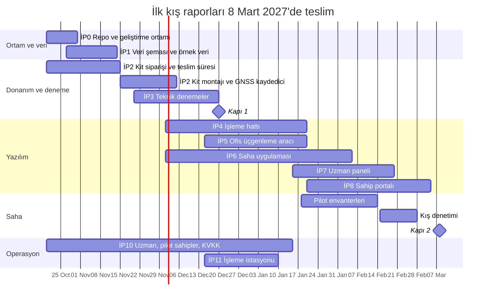

# MVP Geliştirme Planı

18 Ekim 2026 · Yusuf

Hedef, ilk kış denetim raporlarını **8 Mart 2027**'de pilot bahçe sahiplerine teslim etmek (Kapı 2). Bunun için yaklaşık 20 haftada ~55 günlük geliştirme işi gerekiyor. Bu da haftada ~20 saat demek; yan proje için sıkı bir tempo. Plan bu yüzden işleri önceliğe göre sıralar ve geride kalınırsa nelerin kesileceğini baştan söyler.

Ürün tanımı [MVP.md](MVP.md), veri modeli [veri-modeli.md](veri-modeli.md), kit [tarama-kiti.md](tarama-kiti.md) dosyalarında.

## Kilometre taşları

| Tarih | Kilometre taşı | Ne hazır olmalı |
| --- | --- | --- |
| 31 Ekim 2026 | M0 – Geliştirme ortamı | Repo iskeleti, iki devcontainer, şemanın ilk sürümü başlamış |
| 20 Aralık 2026 | M1 – Kapı 1: yöntem kararı | Kit çalışıyor; kendi bahçende tek koridor taraması; PPK, zaman eşleme ve gövde üçgenleme denendi; ağaç eşleştirme doğruluğu ölçüldü |
| 18 Ocak 2027 | M2 – Envantere hazır | Saha uygulamasının envanter modu, işleme hattı, ofis üçgenleme aracı |
| 15 Şubat 2027 | M3 – Kış denetimine hazır | Yakın plan akışı, uzman paneli, pilot envanterleri tamam |
| 8 Mart 2027 | M4 – Kapı 2: ilk raporlar | Sahip portalı; kış raporları uzman imzasıyla teslim |

## Zaman çizelgesi

**Kritik yol:** Kit parçalarının teslim süresi → teknik denemeler → işleme hattı → pilot envanterleri → kış denetimi. Kit siparişi gecikirse her şey kayar; bu yüzden ilk hafta verilmeli.

## İş paketleri

| İP | İş paketi | Öncelik | Tahmini efor | Tamam sayılması için |
| --- | --- | --- | --- | --- |
| İP0 | Repo ve geliştirme ortamı | P0 | 1,5 gün | Repo iskeleti; `core` ve `mobile` devcontainer'ları açılıyor |
| İP1 | Veri şeması ve örnek veri | P0 | 3 gün | Hedef veri modelinin MVP alt kümesi migration olarak yazılı; 300 ağaçlı sentetik bir bahçe örnek verisi; satır bazlı yetki kuralları |
| İP2 | Kit ve GNSS kaydedici | P0 | 5,5 gün | Kit monte; ESP32 ham GNSS'i ve PPS'i microSD'ye kaydediyor; telefona Bluetooth ile durum gönderiyor |
| İP3 | Teknik denemeler | P0 | 5 gün | Tek koridor taraması; PPK çözümü; QR ile zaman eşleme; ~20 ağaçta gövde üçgenleme ve elle ölçümle karşılaştırma; ısınma testi |
| İP4 | İşleme hattı v0.1 | P0 | 8 gün | Alım ve doğrulama, PPK, zaman eşleme, kare seçimi, panorama (4K + 2K), ağaç kesitleri, yükleme; komut satırından çalışıyor |
| İP5 | Ofis üçgenleme aracı | P0 | 6 gün | Harita + iki panorama görünümü; tıklayarak üçgenleme; sıra oturtma, kodlama, boş yerler; doğrulama listesi |
| İP6 | Saha uygulaması v0.1 | P0 | 8 gün | Giriş, günün görevleri, oturum başlat/bitir, QR saat, GNSS durumu, kapsama haritası, sınır köşesi işaretleme, yakın plan akışı, çevrimdışı senkronizasyon |
| İP7 | Uzman paneli v0.1 | P0 | 5 gün | Ziyaret kuyruğu; ağaç başına bu ve önceki ziyaretin kesitleri; ölçek girişi ve onayı; bulgu ve öneri; rapor imzası |
| İP8 | Sahip portalı v0.1 | P0 | 8 gün | Giriş; bahçelerim; parsel karnesi; sağlık haritası; ağaç karnesi; işaretçili panorama gezisi; PDF rapor |
| İP9 | AI worker v0.1 | P1 | 4 gün | Kış etiketlerinden değerlendirme seti; Batch ile ön değerlendirme; uzman paneline öneri olarak düşüyor. İlkbahar denetiminden (15 Nisan) önce |
| İP10 | Operasyon hazırlıkları | P0 | 4 gün + dış süreler | Metodoloji v0 (ölçekler, referans fotoğraflar), KVKK aydınlatma ve rıza metinleri, sözleşme taslağı, uzman anlaşması, pilot sahiplerin onayı |
| İP11 | İşleme istasyonu | P0 | 1 gün | GPU'lu, büyük diskli bir bilgisayar alınmış ya da ayarlanmış; işleme hattı üzerinde çalışıyor |

**Durum (20 Ekim 2026)**

| İP | Durum | Not |
| --- | --- | --- |
| İP0 | Tamam | Repo iskeleti, `core` ve `mobile` devcontainer'ları, bulut ortamı |
| İP1 | Tamam (PR #1, #7) | Şema, satır bazlı yetki, sentetik bahçe; yayımlanmamış sonuçlar sahipten gizli; son değerlendirme/ölçüm görünümleri (önce en yeni oturum, aynı oturumda kaynak önceliği); `media` depolama alanı; 173 pgTAP testi |
| İP2 | Yazılım tamam (PR #2, #7) | Firmware 0.2.0: BLE durum mesajında GPS zamanı; 74 birim testi, ESP32 derlemesi. Açık: gerçek donanım testleri (README'deki adımlar), kit gelince |
| İP4 | Çekirdek + yükleme tamam (PR #3, #4, #11) | 97 test; `upload` komutu: türetilmiş dosyalar `media` alanına, kayıtlar `capture`/`asset`/`asset_source`'a; ham kayıtlar istasyonda kalır; bulanıklaştırılmamış görüntü yüklenmez. Açık: gerçek PPK denemesi (İP3), büyük ziyarette yükleme süresi |
| Entegrasyon | Tamam (PR #4) | Sözleşmeler `docs/arayuzler.md` içinde |
| İP5 | v0.1 tamam (PR #9) | Ofis üçgenleme aracı: tıklayarak üçgenleme, sıra oturtma ve kodlama, boş yerler, doğrulama listesi (CSV), kayıt; 12 sentetik ağaç 30 cm içinde. Açık: depolamadan okuyan panorama kaynağı, tek işlemde kayıt, tıklama verisinin saklanması |
| İP7 | v0.1 tamam (PR #12) | Ziyaret kuyruğu, ağaç ağaç inceleme (bu ve önceki ziyaretin kesitleri), AI'ı kabul/düzelt, bulgular, `publish_session` ile imza ve yayın; yayın sadece uzmanla, geri alınamaz, sonuçlar yayından sonra donar |
| İP8 | v0.1 tamam (PR #13) | Bahçelerim, parsel karnesi, sağlık haritası, ağaç karnesi ve fotoğraf geçmişi, işaretçili 360° gezi, yazdırma/PDF, telefon görünümü |
| CI | Tamam (PR #10) | Her PR'da bileşen testleri GitHub Actions'ta; migration'lar `main`'den Supabase test projesine; web Vercel'de. Bkz. `docs/deployment.md` |
| İP10 | Metodoloji v0 taslağı (`docs/metodoloji.md`) | Uzmanla kesinleşecek maddeler bölüm 11'de. Rol rol akış: `docs/kullanim-kilavuzu.md` |
| Dalga 5 | Sürüyor | İP5 v0.2 envanter zinciri, İP4 v0.2 ağaç konumları ve uçtan uca test |
| Dalga 4 | İP6 senkronizasyon sürüyor | İP4, İP7, İP8 birleşti. Örnek tarama verisi: `pnpm db:demo`. Test ortamı: https://orchados-orchad-os.vercel.app (Vercel koruması açık) |
| İP6 | İskelet + kamera tamam (PR #6, #8) | BLE protokolü, QR saat, ekran akışı, çevrimdışı kuyruk, gerçek kamera ve cihazda kalite kontrolü; 66 test. Açık: senkronizasyon, kapsama haritası, telefonda deneme, APK derlemesi (yerelde) |

**Açık işler**

- [ ] **Envanter kaydı tek işlemde:** Yer ve ağaç kaydı şu an iki ayrı ekleme; `save_inventory(...)` adlı, kullanıcının yetkisiyle çalışan tek işlemlik bir veritabanı fonksiyonu.
- [ ] **Etiketli veri:** Ofis aracındaki gövde tıklamaları (gövde tespit modeli için etiket) şimdilik tarayıcıda; veritabanında saklanmalı.
- [ ] **Web:** Ağaç rengi uzman ve ofis tarafında da `tree_latest_assessment` görünümüne bağlanmalı (portalda yapıldı).
- [ ] **Web:** Medya imzalama iki yerde: `src/lib/media/` (portal) ve `src/lib/expert/media.ts`. Uzman paneli ortak yardımcıya geçmeli; `fetchAll` kopyası da birleştirilmeli.
- [ ] **Testler:** Ekleme-yalnız tablolar yüzünden web testleri kendi işletmelerini kurup `docker exec ... psql` ile temizliyor. Testler için bir temizlik fonksiyonu daha temiz olur.
- [ ] **Örnek veri:** `supabase/demo/scans.sql` `pose` alanları `docs/arayuzler.md`'deki sözleşmeye tam uymuyor (`variant`, `gps_time_ns`, `panorama_asset_id` eksik; MIME türü WebP olmalı).
- [x] **Karar (20 Ekim):** Yayından sonra sadece uzman ölçümleri kilitli; saha personelinin geç gelen kayıtları serbest.
- [ ] **Saha uygulaması:** README ve `GnssStatus` yorumu, firmware 0.2.0'daki GPS zamanı alanını hâlâ "önerilen" diye anlatıyor; evet/hayır cevapları gönderilirken `value_bool` → `value_boolean` eşlemesi.
- [ ] **Metrik kaydı:** `metric_definition` sadece seed'de; metodolojideki ölçekler (`docs/metodoloji.md` Ek B) referans veri olarak migration'la kurulmalı.
- [ ] **Operasyon ekranları:** Sahip/parsel kaydı ve ziyaret planlama şimdilik Supabase panelinden.
- [ ] **Lisans:** `flutter_blue_plus` ticari kullanımda ücretli. Ticari kullanıma geçmeden lisans ya da paket değişikliği.
- [ ] **Saha uygulaması:** `flutter build apk` CI'da kırık: `permission_handler_android` `compileSdk` 37 istiyor (İP6 senkronizasyon görevinde).

Toplam yaklaşık 55 gün (İP9 hariç).

## Hemen başlaması gereken dış işler

Bunlar takvimi bekletebilecek, başkasına bağlı işler. İlk iki hafta içinde başlatılmalı:

- [ ] Kit parçalarının siparişi (ithalat ve gümrükle 2–4 hafta)
- [ ] 360° kamera üreticisinin SDK başvurusu
- [ ] TUSAGA-Aktif (CORS-TR) abonelik başvurusu, ya da kendi baz istasyonu kararı
- [ ] Uzman (ziraat mühendisi) ile ön görüşme
- [ ] 1–4 pilot bahçe sahibinin sözlü onayı; envanter tarihleri
- [ ] KVKK metinleri için hukukçu görüşü
- [ ] İşleme istasyonu: satın alma mı, mevcut bir bilgisayar mı?

## Geride kalınırsa kesilecekler

Sıra, ilk kesilecekten sona doğru:

1. **Portalda PDF rapor:** Kış raporu portaldan gösterilir, PDF ilkbahara kalır (~1 gün).
2. **Gezide ağaç işaretçileri:** Panoramalar işaretçisiz gezilir, ağaç karnesine haritadan gidilir (~2 gün).
3. **Telefon doğrulamasıyla giriş:** Pilot sahiplere kişiye özel link gönderilir (~1 gün).
4. **Saha uygulamasında kapsama haritası:** Kapsama ofiste işleme sonrası kontrol edilir (~1,5 gün).
5. **Uzman panelinde rahatlık özellikleri:** Toplu onay ve kısayollar sonraya kalır; dört bahçede ~1.200 ağaç elle incelenebilir (~1 gün).

Bunlar yetmezse Kapı 2, ilkbahar denetiminin sonuna (Mayıs 2027) kaydırılır. Kış ziyareti yine yapılır ve veri toplanır; rapor sahiplere ilkbaharla birlikte gider.

## Çalışma düzeni

- **Her iş paketi kendi dalında** geliştirilir ve tamamlanınca `main`'e birleştirilir.
- **Testler:** Her bileşen gerçek donanım olmadan, kısa örnek kayıtlarla ve sentetik veriyle test edilebilir olmalı. İlk örnek kayıtlar İP3'te üretilir ve küçültülmüş halleri repoda değil, ayrı bir depolama alanında tutulur.
- **Haftalık gözden geçirme:** Plan her hafta bu dosyada güncellenir: hangi İP nerede, kesme listesinden bir şey gerekiyor mu?
