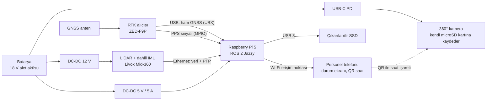

# Tarama Kiti: RTK + 360° Kamera + LiDAR

17 Ekim 2026 · Yusuf

Kit, personelin sırtında taşıdığı tek bir direk düzeneğidir. Üzerinde RTK GNSS, 360° kamera, LiDAR ve kayıt bilgisayarı (Raspberry Pi 5) bulunur. Pi, ROS 2 ile LiDAR ve GNSS verisini kaydeder ve sensörlerin zamanını GPS zamanına bağlar. Sahadan dönünce SSD ve kameranın hafıza kartı ofisteki işleme istasyonuna takılır. LiDAR'lı tam kitin maliyeti yaklaşık **2.400–3.200 $**, LiDAR'sız kitin yaklaşık **1.600–2.300 $**.

Kitin ne için kullanıldığı ve neden bu sensörlerin seçildiği [vizyon.md](vizyon.md) dosyasında. Bu doküman kitin kendisini tarif eder.

## Bileşenler ve bağlantılar



| Bileşen | Görevi | Not |
| --- | --- | --- |
| LiDAR (Livox Mid-360 sınıfı) | 3D geometri; dahili IMU ile SLAM | Ayrı bir IMU gerekmez. Dikey görüş açısı yaklaşık −7° ile +52° arası |
| 360° kamera (Insta360 X serisi vb.) | Panorama, görsel değerlendirme, nokta bulutunu renklendirme | Kendi hafıza kartına kaydeder; içindeki jiroskop verisi zaman eşlemede de kullanılır |
| RTK GNSS (ZED-F9P tabanlı) | Mutlak konum, GPS zamanı (PPS), PPK için ham gözlemler | Sahada internet gerekmez; konum sonradan PPK ile düzeltilir |
| Raspberry Pi 5 (8 GB) | ROS 2 ile kayıt, zaman sunucusu, durum ekranı | Kayıt yapar, ağır işleme yapmaz |
| Çıkarılabilir SSD (USB 3) | LiDAR, IMU ve GNSS kaydı (MCAP) | Kit başına iki SSD, günlük dönüşümlü |
| Batarya | Tüm kiti besler | Değiştirilebilir alet aküleri: ucuz, sağlam, sahada hızlı değişir |
| Personel telefonu | Durum ekranı, kayıt başlat/durdur, QR saat göstergesi | Saha uygulamasının bir ekranı olarak |

## Montaj ve yükseklikler

```
  ~2,1 m   GNSS anteni      gökyüzünü tam görmeli
  ~2,0 m   360° kamera      panorama yüksekliği her ziyarette aynı
    |
  ~1,2 m   LiDAR            gövde ve tacı birlikte görebilmesi için
    |
  sırt çerçevesi: Pi + elektronik kutusu + batarya
```

**LiDAR neden tepede değil:** LiDAR'ın dikey görüş açısı sınırlı (yaklaşık −7° ile +52° arası). 2 m'de dursaydı 4 m ötedeki ağacın gövdesini göremezdi. 1,2 m'de dururken 4 m mesafede yaklaşık 0,7 m ile 6 m arasını görür. Bu aralık fıstık ağacının gövdesinin üst kısmını ve tacın tamamını kapsar.

**Bunun bir sonucu var:** Gövde kalınlığı LiDAR ile yaklaşık 70–80 cm yükseklikte ölçülebilir, 30 cm'de ölçülemez. Ölçüm yüksekliği metodolojide buna göre sabitlenmeli. Bu yükseklikten önce dallanan ağaçlarda gövde ölçümü yakın planla ya da şerit metreyle yapılır.

**Diğer montaj notları:**
- **Görüntüde görünenler:** Kamera tepedeki anteni ve alttaki LiDAR'ı görür; bu bölgeler (gökyüzü ve personelin durduğu alt kısım) maskelenir. LiDAR ise üstündeki kamerayı ve anteni görmez, çünkü onlar görüş açısının dışında kalır.
- **Personelin gövdesi:** LiDAR'ın ön tarafını kapatır. Ağaçlar yanlarda kaldığı için bu kabul edilebilir; kapanan sektör yazılımla maskelenir. İstenirse LiDAR yana açılan kısa bir kola takılabilir.
- **Rijitlik:** Tüm sensörler aynı rijit direkte durur. Aralarındaki mesafeler ve açılar kalibrasyonda ölçülür ve kit sökülmedikçe değişmez.
- **Ağırlık:** Yaklaşık 4–5 kg (çerçeve, iki batarya ve elektronik dahil). İki saatlik tarama için sırt çerçevesi şart, elde taşınamaz.

## Zaman senkronizasyonu

Tüm sensörlerin zamanı GPS zamanına bağlanır:

1. **Pi'ın saati:** RTK alıcısının PPS sinyali Pi'ın GPIO'suna bağlanır. Pi'ın sistem saati bu sinyalle GPS zamanına kilitlenir (gpsd + chrony).
2. **LiDAR:** Zamanını Ethernet üzerinden PTP ile Pi'dan alır. Yazılım tabanlı PTP birkaç yüz mikrosaniye hassasiyet verir. Yürüme hızında (~1 m/s) bu, milimetrenin altında bir konum hatası demek.
3. **360° kamera:** Dışarıdan tetiklenemez, kendi saatiyle kaydeder. İki adımda eşlenir:
    - **Kaba eşleme:** Taramanın başında ve sonunda, telefon Pi'ın saatini QR kod olarak gösterir ve bu QR kameraya okutulur. İki işaret arasındaki saat kayması doğrusal olarak düzeltilir.
    - **İnce eşleme:** Kameranın dahili jiroskop verisi ile LiDAR'ın IMU verisi karşılaştırılır. İkisi aynı direkte aynı dönüşleri yaşadığı için, zaman farkı milisaniye düzeyinde otomatik bulunur.

## Sahadan merkeze iş akışı

**Sahada:**
1. **Kit açılır:** Pi açılır ve kendi Wi-Fi ağını kurar. Telefon bu ağa bağlanıp durum ekranını açar.
2. **Ön kontrol ekranı:**
    - LiDAR veri akışı
    - GNSS uydu sayısı ve konum durumu
    - SSD boş alanı
    - Batarya seviyesi
    - Kameranın kayıtta olduğu (personel onaylar)
3. **Kayıt başlar:** Telefondan başlatılır, kamerada video başlatılır. Başlangıç QR'ı okutulur.
4. **Tarama:** Grid rotası boyunca yürünür. Durum ekranında GNSS izi parsel haritası üzerinde görünür; gezilmemiş koridorlar işaretlidir.
5. **Bitiş:** Bitiş QR'ı okutulur, kayıtlar durdurulur. Pi, oturum bilgisini yazar: bahçe, personel, ekipman seri numaraları, kalibrasyon sürümü.

**Merkezde (işleme istasyonu):**
1. SSD ve kameranın microSD kartı istasyona takılır.
2. Alım betiği dosyaları NAS'a kopyalar, sağlama toplamıyla doğrular ve oturuma bağlar.
3. Otomatik kalite kontrolü:
    - Tüm veri akışları tam mı?
    - Başlangıç ve bitiş QR'ları bulundu mu?
    - Ham GNSS PPK için yeterli mi?
    - Rota kapsaması tamam mı?
4. Oturum işleme kuyruğuna girer.
5. Kalite kontrolü ve işleme başarılı olunca SSD ve kart biçimlendirilip kite geri döner. Ham veri NAS'ta 30 gün kalır.

**Tek ortam seçeneği:** İstenirse gün sonunda kamera USB ile Pi'a bağlanır ve Pi videoları SSD'ye çeker. Bu durumda merkeze sadece SSD gelir. Bunun bedeli, sahada fazladan 15–30 dakikalık kopyalama süresi.

## Depolama ve güç hesabı

| Kalem | Ziyaret başına (2 saat) | Ortam |
| --- | --- | --- |
| LiDAR + IMU + GNSS (MCAP) | ~25–30 GB | SSD |
| 360° video | ~90 GB | Kameranın microSD kartı |
| Ham GNSS (UBX) | ~50–100 MB | SSD |

2 TB'lık bir SSD yaklaşık 60 ziyaret alır; asıl sınırı kameranın kartı belirler. 512 GB'lık bir kart ~5 ziyaret, 1 TB'lık bir kart ~10 ziyaret alır. Günde 1–2 bahçe tarandığı için kit başına iki kart yeterli.

| Tüketici | Yaklaşık güç |
| --- | --- |
| LiDAR | ~7 W |
| Raspberry Pi 5 (kayıt yükü) | ~7 W |
| SSD | ~3 W |
| RTK alıcısı | ~1 W |
| 360° kamera (dışarıdan beslenirse) | ~5 W |
| **Toplam** | **~23 W** |

İki saatlik tarama ~46 Wh tüketir. 18 V 5 Ah'lık bir alet aküsü yaklaşık 90 Wh taşır; bir akü bir bahçeye güvenle yeter, ikinci akü yedek olur. Kameranın kendi pili iki saati karşılamayabilir; kayıt sırasında kitin bataryasından beslenir.

## Kalibrasyon

- **Ne zaman:** Kit ilk kurulduğunda, söküldüğünde ya da darbe aldığında. Ayrıca her sezon başında kontrol amaçlı.
- **Ne ölçülür:**
    - Kameranın iç parametreleri
    - Kamera–LiDAR arasındaki konum ve açı (baskılı bir kalibrasyon hedefiyle)
    - LiDAR–GNSS anteni arasındaki mesafe (şerit metreyle, milimetre hassasiyetinde)
- **Nereye yazılır:** Sürüm numaralı bir kalibrasyon dosyasına. Her kayıt, hangi kalibrasyon sürümüyle yapıldığını taşır ([veri-modeli.md](veri-modeli.md) dosyasındaki Calibration varlığı).

## Maliyet

Yaklaşık uluslararası fiyatlardır, doğrulanmamıştır. Türkiye'de gümrük, KDV ve kur nedeniyle belirgin şekilde yüksek olabilir.

| Kalem | Yaklaşık fiyat |
| --- | --- |
| LiDAR (Livox Mid-360 sınıfı) + kablo | 750–850 $ |
| 360° kamera | 450–600 $ |
| RTK alıcısı (ZED-F9P kartı) + çok bantlı anten | 300–450 $ |
| Raspberry Pi 5 8 GB + soğutucu + saat pili + kutu | 120–150 $ |
| 2 × 2 TB dayanıklı SSD | 250–350 $ |
| 2 × 512 GB microSD (V30) | 80–120 $ |
| 2 × 18 V alet aküsü + adaptör + DC-DC dönüştürücüler | 150–200 $ |
| Sırt çerçevesi, karbon direk, bağlantı parçaları, titreşim sönümleyiciler | 150–250 $ |
| Su geçirmez elektronik kutusu, kablolar, konnektörler | 80–120 $ |
| Kalibrasyon hedefi | 30–60 $ |
| **Toplam (LiDAR'lı)** | **~2.400–3.200 $** |
| **Toplam (LiDAR'sız)** | **~1.600–2.300 $** |

Personel telefonu ve TUSAGA-Aktif (CORS-TR) aboneliği bu toplama dahil değil. Karşılaştırma için: kameralı ticari el tipi SLAM tarayıcılar on binlerce dolar düzeyinde.

## Doğrulanacaklar

- [ ] LiDAR'ın ROS 2 sürücüsü Raspberry Pi 5 (ARM64, Ubuntu 24.04, ROS 2 Jazzy) üzerinde sorunsuz çalışıyor mu?
- [ ] Pi 5, LiDAR + GNSS kaydını SSD'ye iki saat boyunca veri kaybetmeden yazabiliyor mu?
- [ ] Seçilen 360° kameranın jiroskop verisi dışa aktarılabiliyor mu ve ince zaman eşleme için yeterli mi?
- [ ] Kamera iki saatlik kaydı dışarıdan beslenerek kesintisiz yapabiliyor mu, ve ısınma sorunu var mı?
- [ ] 1,2 m LiDAR yüksekliği gerçek ağaçlarda hem gövdeyi hem tacın üstünü görüyor mu?
- [ ] Fıstık ağaçlarında ilk dallanma yüksekliği tipik olarak nerede? Gövde ölçüm yüksekliği buna göre belirlenecek.
- [ ] Bileşenlerin güncel fiyatları ve Türkiye'ye getirme maliyeti.
