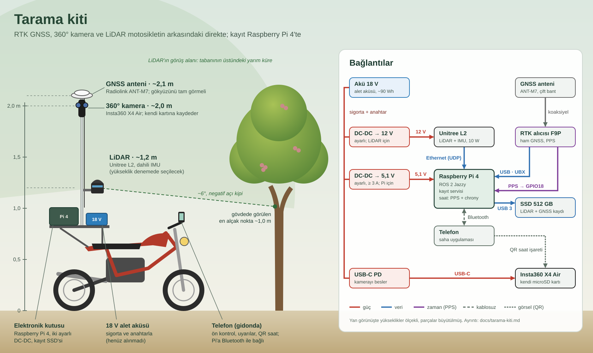
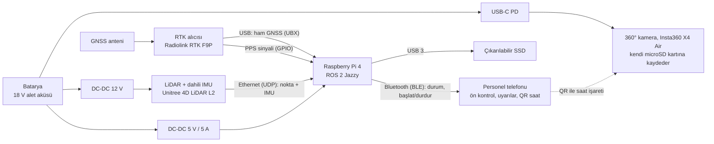

# Tarama Kiti: RTK + 360° Kamera + LiDAR

17 Ekim 2026 · Yusuf

Kit, robota, elle çekilen tekerlekli bir arabaya ya da ATV'ye takılan tek bir direk düzeneğidir. Üzerinde RTK GNSS, 360° kamera, LiDAR ve kayıt bilgisayarı (Raspberry Pi 4) bulunur. Pi, ROS 2 ile LiDAR ve GNSS verisini kaydeder ve sensörlerin zamanını GPS zamanına bağlar. Sahadan dönünce SSD ve kameranın hafıza kartı ofisteki işleme istasyonuna takılır. İlk tahminde LiDAR'lı tam kit yaklaşık **2.400–3.200 $**, LiDAR'sız kit yaklaşık **1.600–2.300 $** tutuyordu; alınan parçaların fiyatları [Maliyet](#maliyet) bölümünde.

> **Güncelleme (16 Kasım 2026): ana parçalar alındı.** Bu doküman artık alınan parçalara göre yazılıdır: LiDAR **Unitree 4D LiDAR L2**, 360° kamera **Insta360 X4 Air**, RTK alıcısı **Radiolink RTK F9P**, kayıt diski **Lexar SL300 512 GB**, kamera kartı **SanDisk High Endurance 256 GB**. İlk tasarım Livox Mid-360 sınıfı bir LiDAR'a göreydi; L2'nin getirdiği farklar (yarım küre görüş alanı, PTP'nin olmaması, daha seyrek bulut) ilgili bölümlerde yazılı. Alınanlar ve kalanlar: [kit-siparis-listesi.md](kit-siparis-listesi.md).

> **Güncelleme (16 Kasım 2026): kayıt yazılımı ve baz verisi.** ESP32 kaydedici kitten çıktı; GNSS kaydını, PPS'i ve telefonla bağlantıyı Pi'daki kayıt servisi üstlendi (`services/kit-recorder/`, [tasarım](superpowers/specs/2026-11-16-pi-kayit-yazilimi-design.md), sözleşme [arayuzler.md](arayuzler.md#kit-kaydedicisi-raspberry-pi)). Telefon Pi'a Bluetooth ile bağlanır; Pi'ın kendi Wi-Fi ağı ve web ekranı yok. Baz verisi TUSAGA-Aktif'ten gelir; kendi baz istasyonu kurulmaz.

> **Güncelleme (20 Kasım 2026, sahip): motosiklet yok, LiDAR 0,6 m'de, kamera 1,6 m'de.** Kit motosiklete göre değil, üç taşıyıcıya göre tasarlanır: robot, yürüyerek taramada elle çekilen tekerlekli bir araba (el arabası vb.) ve motosikletin yerine ATV. LiDAR yerden 0,6 m'ye indi: 1,2 m'de gövdenin alt metresini ve koridorun yakınındaki zemini göremiyordu, ağaçlar 3D dünyada gövdesiz görünecekti. Kamera 2,0 m'den 1,6 m'ye, anten 2,1 m'den 1,7 m'ye indi; direk kısaldı. Ayrıntı [Montaj ve yükseklikler](#montaj-ve-yükseklikler)'de.

Kitin ne için kullanıldığı ve neden bu sensörlerin seçildiği [vizyon.md](vizyon.md) dosyasında. Bu doküman kitin kendisini tarif eder.

## Bileşenler ve bağlantılar





| Bileşen | Görevi | Not |
| --- | --- | --- |
| LiDAR: Unitree 4D LiDAR L2 | 3D geometri; dahili IMU ile SLAM | Ayrı bir IMU gerekmez (6 eksen, 500 Hz). Görüş alanı tabanının üstündeki yarım küre: 360° × 90°, negatif açı kipinde 96°. Ayrıntı [aşağıda](#lidar-unitree-4d-lidar-l2) |
| 360° kamera: Insta360 X4 Air | Panorama, görsel değerlendirme, nokta bulutunu renklendirme | 8K 30 fps, kayıt başına tek `.insv` dosyası. Kendi hafıza kartına kaydeder; içindeki jiroskop verisi zaman eşlemede de kullanılır |
| RTK GNSS: Radiolink RTK F9P | Mutlak konum, GPS zamanı (PPS), PPK için ham gözlemler | Sahada internet gerekmez; konum sonradan PPK ile düzeltilir. PPS çıkışı ve ham gözlem kaydı parça gelince doğrulanacak |
| Raspberry Pi 4 Model B | LiDAR ve ham GNSS kaydı, zaman kaynağı; telefona kayıt durumu | Kayıt yapar, ağır işleme yapmaz. Elde var; Pi 5 yerine (sahip, 19 Kasım 2026). Kayıt yazılımı: `services/kit-recorder/` ([tasarım](superpowers/specs/2026-11-16-pi-kayit-yazilimi-design.md)) |
| Çıkarılabilir SSD (USB 3): Lexar SL300 512 GB | LiDAR, IMU ve GNSS kaydı (MCAP) | MVP'de tek SSD; ziyaretten sonra ofiste boşaltılır |
| Batarya | Tüm kiti besler | Değiştirilebilir alet aküleri: ucuz, sağlam, sahada hızlı değişir |
| Personel telefonu | Ön kontrol, kayıt başlat/durdur, kayıt sırasında uyarılar, QR saat göstergesi | Saha uygulamasının ekranları; Pi'a Bluetooth ile bağlanır. Taramada personelin elinde ya da taşıyıcıdaki tutucuda durur, ekranı açıktır |

## LiDAR: Unitree 4D LiDAR L2

Değerler üreticinin kullanım kılavuzundandır (v1.1); sahada doğrulanmadı.

| Özellik | Değer |
| --- | --- |
| Görüş alanı | 360° × 90°: tabanının üstündeki yarım küre. Negatif açı kipinde 360° × 96° (taban düzleminin 6° altına iner; bu ek bölgede menzil biraz kısalır) |
| Menzil | %90 yansıtıcılıkta 30 m, %10 yansıtıcılıkta 15 m; en yakın 0,05 m |
| Nokta sayısı | Saniyede 64.000 etkin nokta (örnekleme 128.000) |
| Tarama | Yatay 5,55 Hz, dikey 216 Hz; açısal çözünürlük 0,64° |
| Doğruluk | ≤ 2 cm; mesafe çözünürlüğü 4,5 mm |
| IMU | 3 eksen ivme + 3 eksen jiroskop; 1 kHz örnekleme, 500 Hz çıkış |
| Bağlantı | Ethernet (UDP) ya da TTL UART (4 Mbps). Varsayılan: LiDAR `192.168.1.62`, hedef `192.168.1.2`, UDP 6101 → 6201 |
| Besleme | 12 V DC, 1 A; 10 W (soğukta kendini ısıtırken 13 W'a kadar). Fiş DC 3,5 × 1,35 mm |
| Dayanım | IP54 (montaj açısına göre değişir); −10 °C ile 50 °C; 100 klux güneş ışığı |
| Boyut | 75 × 75 × 65 mm, 230 g; tabanda 4 × M3 delik; her yönde monte edilebilir |
| Lazer | 905 nm, Sınıf 1 (göz güvenli) |
| Kutuda | Güç adaptörü, seri bağlantı modülü, veri kablosu |

**Mid-360'a göre farklar** (ilk tasarım o sınıfa göre yapılmıştı):

| Konu | Livox Mid-360 sınıfı | Unitree L2 | Sonucu |
| --- | --- | --- | --- |
| Dikey görüş | Yaklaşık −7° ile +52° | −6° (negatif açı kipi) ile +90° | Alt sınır neredeyse aynı; üstte tacın tamamı ve tepesi görünür. Negatif açı kipi **varsayılan olarak kapalıdır**, açılmalıdır |
| Nokta sayısı | Saniyede ~200.000 | Saniyede 64.000, yarım küreye yayılır | Bulut seyrek. Taç ölçümleri ve 3D dünya için yoğunluk ilk taramada ölçülecek; gerekirse hız düşürülür ya da sıra iki yönden geçilir |
| Menzil (%10) | ~40 m | 15 m | Ağaçlar 2–8 m'de olduğu için yeterli; uzak sıralar buluta girmez |
| Zaman eşleme | Ethernet üzerinden PTP | PTP ya da PPS girişi kılavuzda yok | Zaman damgası Pi'ın saatine göre alınır ([Zaman senkronizasyonu](#zaman-senkronizasyonu)) |
| Güç | ~7 W | 10 W | Batarya hesabı güncellendi |
| Yazılım | Üreticinin ROS 2 sürücüsü, yaygın SLAM uyarlamaları | `unilidar_sdk2` (ROS 2 Foxy ile doğrulanmış), üreticinin Point-LIO uyarlaması | Pi 4 (ARM64, ROS 2 Jazzy) üzerinde denenmeli |

## Neden mikrodenetleyici değil de Raspberry Pi

Kayıt için Pi 4 yeterli: Pi ham veriyi sıkıştırmadan SSD'ye yazar, SLAM çalıştırmaz; L2'nin veri hızı gigabit Ethernet'e ve USB 3'e rahatça sığar. Pi 5'e göre farkları: saat pili yok (saat açılışta GNSS ile kurulur, ön kontrol saat kilitlenmeden kayda izin vermez), USB portları toplam 1,2 A verir, kapalı kutuda soğutucusuz ısınıp yavaşlar. Yine de seçilmesinin nedeni işlem gücü değil, yazılım ekosistemi:

| İş | Mikrodenetleyici (ör. STM32H7, ESP32) | Raspberry Pi |
| --- | --- | --- |
| GNSS kaydı ve PPS | Kolay | Kolay |
| LiDAR verisini almak (Ethernet, ~4 MB/s) | STM32H7 ile mümkün. Ancak LiDAR'ın kontrol protokolünü üreticinin Linux SDK'sı yerine sıfırdan yazmak gerekir | Üreticinin SDK'sı ve ROS 2 sürücüsü hazır |
| İki saat boyunca ~4 MB/s kesintisiz yazma | SD karta mümkün ama sınırda; USB SSD sürmek zor | USB 3 SSD ile rahat |
| Kayıt formatı | Ham paketler; sonradan dönüştürme gerekir | Doğrudan MCAP |
| Sahada kalite kontrolü: LiDAR akışını, saat kilidini ve diski izleyip telefona bildirmek | LiDAR verisini mikrodenetleyicide çözmek gerekir | Aynı yazılımın parçası |
| Robota taşınabilirlik | Ayrı yazılım | Hoverboard robotundaki ROS 2 altyapısının aynısı |

Mikrodenetleyiciyle yapılabilir, ama tasarruf küçük: kart başına ~60–90 $ ve ~5–6 W. Bu, ~2.800 $'lık bir kitin %3'ü kadar ve batarya zaten yetiyor. Buna karşılık LiDAR protokolünü, dosya sistemini ve durum ekranını sıfırdan yazmak aylar sürer. Tek kişilik bir geliştirme için doğru takas Pi.

Aynı nedenle ESP32 kaydedici de kitten çıktı (16 Kasım 2026). Pi zaten kitte olduğu için GNSS kaydını ve PPS'i de üstlenir; ikinci bir kart, ikinci bir hafıza kartı ve iki ayrı kayıt gerekmez. Pi, saha uygulamasına ve işleme hattına ESP32 gibi görünür: aynı Bluetooth protokolü ve aynı `gnss/` dosyaları. ESP32 firmware'i ([firmware/gnss-logger/](../firmware/gnss-logger/)) repoda referans olarak duruyor.

**İleride:** Kit yüzlerce adet üretilirse Pi yerine endüstriyel bir modül (ör. Compute Module) ve özel bir taşıyıcı kart düşünülebilir. Zaman hassasiyeti kritikleşirse, robottaki (maraba) ESP32 + Pi düzenine benzer şekilde, zamanlama işini küçük bir mikrodenetleyici Pi'ın yanında üstlenebilir.

## Montaj ve yükseklikler

```
  ~1,7 m   GNSS anteni      direğin tepesinde; gökyüzünü kamera kapatmasın
  ~1,6 m   360° kamera      göz hizası; panorama yüksekliği her ziyarette aynı
    |
  ~0,6 m   LiDAR            gövdeyi dibe yakın, tacı tepesine kadar görmesi için
    |
  taşıyıcı: direğin dibi anahtarlı yuvaya oturur (robotta yerden 0,18 m); akü ve elektronik kutusu direğin dibinde
```

Yükseklikler taşıyıcıdan değil yerden ölçülür; böylece üç taşıyıcıyla toplanan veri karşılaştırılabilir kalır. Robotta montaj plakası yerden 0,18 m'de olduğu için anten plakanın ~1,52 m, kamera ~1,42 m, LiDAR ~0,42 m üstüne gelir. Arabada ve ATV'de yuvanın yüksekliği farklıdır; direk ve LiDAR kelepçesi kayarak ayarlanır, yükseklikler her taşıyıcı için kalibrasyonda ölçülür.

**Taşıyıcılar (sahip, 20 Kasım 2026):** Kit üç taşıyıcıdan birine takılır. Üçünde de direğin dibi aynı anahtarlı boru yuvasına tek yönde oturur:
- **Robot** (`yusuftiryaki/maraba`): montaj plakası şasinin ortasında, yerden 0,18 m'de; soket ve kimlik çipi [aşağıda](#robota-takılan-kit-için-ölçüm).
- **Elle çekilen araba (yürüyerek tarama):** el arabası ya da benzeri tekerlekli bir araba; personel önden çeker. Sırtta taşımanın yerini alır: sırtta LiDAR 0,6 m'de sabit tutulamaz, bacaklar görüşünü kapatır ve yüksekliği yürüdükçe oynar.
- **ATV:** motosikletin yerine; daha hızlı ve çamura daha dayanıklı. Yuva arka bagajda ortada; LiDAR arka bagajın altına, arkaya bakan kısa bir kolla 0,6 m'ye iner. Sürücü ve ATV'nin gövdesi öndeki sektörü kapatır; yanlar açık kalır.

Motosiklet seçeneği yok: LiDAR'ı 0,6 m'de arka tekerleğin çamuruna ve egzoza açık bırakıyordu.

**Panorama ağacı tam görür, LiDAR görmez.** 360° kamera her yönü görür; gövde dibine kadar fotoğrafta vardır, yalnız kameranın tam altı (taşıyıcı ve direk) maskelenir. L2 ise tabanının üstündeki yarım küreyi görür; taban düzleminin altına yalnız negatif açı kipinde ve 6° iner. Dik monte edilince gördüğü en alçak nokta `LiDAR yüksekliği − mesafe × 0,105` olur. 3D dünyanın noktaları LiDAR'dan geldiği için ([3d-dunya.md](3d-dunya.md)), LiDAR'ın görmediği yer dünyada da yoktur.

| LiDAR yüksekliği | 2 m'deki ağaçta en alçak nokta | 3 m'de | 4 m'de | Zemin şu uzaklıktan görünür |
| --- | --- | --- | --- | --- |
| 1,2 m (eski plan) | ~1,0 m | ~0,9 m | ~0,8 m | ~11 m |
| 0,9 m | ~0,7 m | ~0,6 m | ~0,5 m | ~8,5 m |
| **0,6 m (seçilen)** | **~0,4 m** | **~0,3 m** | **~0,2 m** | **~5,7 m** |
| 0,4 m | ~0,2 m | ~0,1 m | dip | ~3,8 m |

**Neden 0,6 m:** Taşıyıcı koridorun ortasından gittiğinde en yakın gövde sıra arasının yarısı kadar uzaktadır (7 m'lik sıra arasında ~3,5 m). 0,6 m'deki LiDAR 3 m'deki gövdeyi yaklaşık 30 cm'den yukarı, tacı tepesine kadar görür; gövde çapı hem metodolojinin 50 cm'sinde hem metriğin 30 cm'sinde ölçülebilir hale gelir ([lidar-olcumleri.md](lidar-olcumleri.md) §8). Daha aşağısı az kazandırır: gövdenin en alt 30–40 cm'si yazın otun içindedir ve ölçüm yöntemleri yerden 25–40 cm'nin altını ot katmanı sayıp atar. Zemin yaklaşık 5,7 m öteden görünür; ağaçların altındaki zemin buluta girer, koridorun ortasındaki ~3 m'lik şerit seyrek kalır. 1,2 m'de dursaydı gövdenin alt metresi ve koridorun 11 m'lik çevresindeki zemin bulutta olmazdı.

Negatif açı kipi kapalıyken LiDAR kendi yüksekliğinin altını hiç görmez; kip kit kurulurken açılır ve ön kontrolde denetlenir.

**Neden kamera 1,6 m (sahip, 20 Kasım 2026):** Önceki plandaki 2,0 m'yi ne yöntem ne kod gerektiriyordu. Direk ne kadar uzunsa o kadar sorun çıkarır:
- **Sallanma:** Direğin ucundaki sallanma boyunun küpüyle büyür. 2,1 m yerine 1,7 m'lik direk yaklaşık yarı yarıya az sallanır; kamera ve antenin titreşimi azalır.
- **Dallar:** Koridora sarkan dallara daha az takılır. Robotta direğin ucu bir dala takılırsa robotu deviren bir kaldıraç olur (robot reposunda `docs/kit-soketi.md`, "Kalan risk").
- **Taşıma:** Robot, araba ve ATV'de taşımak ve kurmak kolaylaşır.
- **3D dünya:** Dünyanın yürüme kipi zaten göz hizasında, zemin + 1,6 m'de ([3d-dunya.md](3d-dunya.md)); panoramayla aynı yükseklikte olduğu için geçiş doğal görünür.

Görüntüdeki fark küçüktür: 3,5 m ötedeki ağacın 5 m'deki tepesine 2,0 m'den ~41°, 1,6 m'den ~44° yukarı bakılır; 360° kamera tacı yine tepesine kadar görür. Taç biraz daha alttan görünür ve yakın ağacın alt dalları arkadaki taçları biraz daha çok kapatır. 1,5 m'nin altına inilmez. Ağaç var/yok kutuları ve kesitler yerden yükseklikle tanımlıdır, ziyaretin ölçülen kamera yüksekliğiyle izdüşürülür; değişiklik yöntemi bozmaz ([metodoloji.md](metodoloji.md) bölüm 1).

Anten kameranın ~10 cm üstünde, direğin tepesinde kalır; altta kalsaydı kamera tam tepedeki uyduları kapatırdı. ATV'de oturan sürücünün başı 1,5–1,6 m'dedir; anten başın gerisinde aynı yükseklikte kalıp öndeki alçak uyduları kapatırsa direk ATV'de ~1,9 m'ye uzatılır ve kamera yüksekliği ön kontrolde öyle girilir. Bu ilk ATV denemesinde görülür.

**Diğer montaj notları:**
- **Görüntüde görünenler:** Kamera tepedeki anteni, alttaki LiDAR'ı ve taşıyıcıyı görür; bu bölgeler (gökyüzü ve alt kısım) maskelenir. L2 yukarıyı da gördüğü için direği, kamerayı ve anteni tarar; bu noktalar bulutta sabit bir sütun olarak görünür ve yazılımla maskelenir. Direğin kapattığı dar koni taçta veri kaybı yaratıyorsa LiDAR direkten yana açılan kısa bir kola alınır.
- **Taşıyıcının kendisi:** Robotun şasisi (0,18 m) LiDAR'ın görüşüne girmez. Robotun kendi direği (manyetometre; kit direğinin 0,26 m arkasında, ~0,63 m'ye kadar) arkada dar bir sektörü kapatır. Arabada çeken personel, ATV'de sürücü ve ATV'nin gövdesi öndeki sektörü kapatır. Kapanan sektörler yazılımla maskelenir; ağaçlar yanlarda kaldığı için bu kabul edilebilir.
- **Panoramada personel:** Arabayı çeken personel her panoramanın ön sektöründe, ATV'de sürücü yakın planda görünür. Ağaçlar çoğunlukla yanlarda kaldığı için kesitlerde kapattığı az olur; çekme kolu uzun tutulursa daha da azalır. Yüz bulanıklaştırma yapılmaz; bir itirazda o kişinin göründüğü kare elle gizlenir ([H01](hukuk/kararlar.md#h01)).
- **Manyetometre ve LiDAR:** Robotta LiDAR, robotun manyetometresine yaklaştı (~0,26 m, neredeyse aynı yükseklikte); L2'nin dönen motoru yön okumasını bozabilir. Robotun ilk takılıştaki yön kontrolü bunu da yakalar; bozuyorsa LiDAR kolu öne alınır.
- **Ot ve dallar:** 0,6 m'de LiDAR ota ve alçak dallara yakındır. Kubbenin çevresine görüşü az kapatan ince telli bir koruyucu kafes düşünülür; uzun otlu bahçede görüş ilk taramada denetlenir.
- **Rijitlik:** Tüm sensörler aynı rijit direkte durur. Aralarındaki mesafeler ve açılar kalibrasyonda ölçülür ve kit sökülmedikçe değişmez.
- **Ağırlık:** Yaklaşık 4–5 kg (direk, akü ve elektronik dahil). Akü ve elektronik kutusu direğin dibine konur; robotta yukarıda olurlarsa ağırlık merkezi yükselir ve devrilme payı azalır (robot reposunda `docs/kit-soketi.md`, "Soket — mekanik").

## Zaman senkronizasyonu

Tüm sensörlerin zamanı GPS zamanına bağlanır:

1. **Pi'ın saati:** RTK alıcısının PPS sinyali Pi'ın GPIO18'ine bağlanır. Kayıt servisi alıcının zamanını chrony'ye verir, chrony PPS ile kilitlenir; Pi'ın sistem saati böylece GPS zamanına bağlanır. gpsd kullanılmaz, çünkü alıcının seri portunun tek sahibi kayıt servisidir. Ayrıntı: [arayuzler.md](arayuzler.md#saat).
2. **LiDAR:** L2'nin kılavuzunda PTP ya da PPS girişi yok; LiDAR saatini dışarıdan alamaz. Nokta ve IMU paketleri Pi'a vardıkları anda Pi'ın GPS'e kilitli saatiyle damgalanır. SDK nokta ve IMU mesajlarında LiDAR'ın kendi zaman alanını da veriyor; nokta ile IMU arasındaki eşlemenin buna dayanması ve Pi'a varış gecikmesinden etkilenmemesi beklenir (doğrulanacak). Geriye Ethernet ve işletim sistemi gecikmesi kalır (birkaç milisaniye beklenir, ölçülmedi). 2 ms'lik bir hata yürüme ve robot hızında (~1 m/s) 2 mm, ATV hızında (~3 m/s) 6 mm konum hatası demek. Sabit kısmı kalibrasyonda ölçülüp düzeltilir.
3. **360° kamera:** Dışarıdan tetiklenemez, kendi saatiyle kaydeder. İki adımda eşlenir:
    - **Kaba eşleme:** Taramanın başında ve sonunda, telefon Pi'ın saatini QR kod olarak gösterir ve bu QR kameraya okutulur. İki işaret arasındaki saat kayması doğrusal olarak düzeltilir.
    - **İnce eşleme:** Kameranın dahili jiroskop verisi ile LiDAR'ın IMU verisi karşılaştırılır. İkisi aynı direkte aynı dönüşleri yaşadığı için, zaman farkı milisaniye düzeyinde otomatik bulunur. Aynı karşılaştırma LiDAR'ın Pi'a varış gecikmesini de ortaya çıkarır.

## Sahadan merkeze iş akışı

**Sahada:**
1. **Kit açılır:** Pi açılır ve birkaç dakikada kayda hazır olur; ekran ve klavye bağlanmaz. Telefon Pi'a Bluetooth ile bağlanır; durum saha uygulamasının ön kontrol ekranında görünür.
2. **Ön kontrol ekranı:**
    - LiDAR veri akışı ve negatif açı kipi
    - GNSS alıcısı (ham veri geliyor mu), uydu sayısı ve konum durumu
    - Saat (PPS'e kilitli mi)
    - SSD (takılı, yazılabilir, boş alan)
    - Kameranın kayıtta olduğu (personel onaylar)

    LiDAR ve saat maddeleri geçmezse personel taramayı açık bir onayla yine de başlatabilir; atlanan madde kayda geçer. SSD ve alıcı maddeleri atlanamaz. Pi akü gerilimini ölçmez; akü kit açılmadan kontrol edilir. Ayrıntı: [arayuzler.md](arayuzler.md#ön-kontrol-ve-atlama).
3. **Kayıt başlar:** Telefondan başlatılır, kamerada video başlatılır. Başlangıç QR'ı okutulur.
4. **Tarama:** Grid rotası boyunca gidilir. Telefon personelin elinde ya da taşıyıcıdaki tutucuda durur, ekranı açık ve uygulama öndedir. Ekranda GNSS izi parsel haritası üzerinde görünür; gezilmemiş koridorlar işaretlidir. LiDAR susarsa ya da kayda yazılmazsa, alıcı ya da saat koparsa, SSD sorun verirse telefon sesle ve ekranda uyarır. Kopuşlar kaydı durdurmaz; boşluklar kayda geçer.
5. **Bitiş:** Bitiş QR'ı okutulur, kayıtlar durdurulur. Telefon kısa bir özet gösterir: süre, LiDAR verisi ve boşluklar, uyarılar. Oturum bilgisi (bahçe, personel, ekipman seri numaraları, kalibrasyon sürümü) saha uygulamasının ve Pi'ın oturum dosyalarına yazılır.

**Merkezde (işleme istasyonu):**
1. SSD ve kameranın microSD kartı istasyona takılır. SSD'deki oturum klasörü (`gnss/` ve `lidar/`) olduğu gibi oturumun köküne kopyalanır ([arayuzler.md](arayuzler.md#oturum-klasörü)).
2. Alım betiği dosyaları NAS'a kopyalar, sağlama toplamıyla doğrular ve oturuma bağlar.
3. Otomatik kalite kontrolü:
    - Tüm veri akışları tam mı?
    - Başlangıç ve bitiş QR'ları bulundu mu?
    - Ham GNSS PPK için yeterli mi?
    - Rota kapsaması tamam mı?
4. Oturum işleme kuyruğuna girer.
5. Kalite kontrolü ve işleme başarılı olunca SSD ve kart biçimlendirilip kite geri döner. Ham veri NAS'ta 30 gün kalır.

**Tek ortam seçeneği** (şimdilik yapılmıyor): İstenirse gün sonunda kamera USB ile Pi'a bağlanır ve Pi videoları SSD'ye çeker. Bu durumda merkeze sadece SSD gelir. Bunun bedeli, sahada fazladan 15–30 dakikalık kopyalama süresi.

## Depolama ve güç hesabı

| Kalem | Ziyaret başına (2 saat) | Ortam |
| --- | --- | --- |
| LiDAR + IMU + GNSS (MCAP) | En çok ~25–30 GB (Mid-360 için yapılan hesap; L2 üçte bir nokta ürettiği için ~10 GB beklenir, ölçülmedi) | SSD |
| 360° video (8K 30 fps) | ~108 GB (120 Mbps) ya da ~132 GB (180 Mbps, yüksek bit hızı) | Kameranın microSD kartı |
| Ham GNSS (UBX) | ~50–100 MB | SSD |

Video boyutu Insta360'ın X4 Air için verdiği dakika başı değerlerden hesaplandı (0,9 ve 1,1 GB/dk). Diğer dokümanlardaki "ziyaret başına ~90 GB" tahmini bundan öncesine aittir; ilk gerçek kayıtta ölçülüp güncellenecek.

**Karar (16 Kasım 2026, sahip): MVP kiti tek ziyareti taşır.** Kamerada tek bir 256 GB kart, Pi'da tek bir 512 GB SSD var. 256 GB kart en yüksek bit hızında bile bir ziyareti alır, ikincisini almaz; kart her ziyaretten sonra ofiste aktarılıp boşaltılır. 512 GB SSD eski hesapla bile 15'ten fazla ziyaret alır. Aynı gün iki bahçe taranacaksa ikinci bir kart gerekir.

| Tüketici | Yaklaşık güç |
| --- | --- |
| LiDAR (12 V) | ~10 W; soğukta 13 W'a kadar |
| Raspberry Pi 4 (kayıt yükü) | ~5 W |
| SSD | ~3 W |
| RTK alıcısı | ~1 W |
| 360° kamera (dışarıdan beslenirse) | ~5 W |
| **Toplam** | **~26 W** |

İki saatlik tarama ~52 Wh tüketir. 18 V 5 Ah'lık bir alet aküsü yaklaşık 90 Wh taşır; bir akü bir bahçeye yeter, ikinci akü yedek olur. X4 Air'in kendi pili (2.010 mAh) 8K'da yaklaşık 88 dakika dayanır, iki saati karşılamaz; kayıt sırasında kitin bataryasından beslenmesi gerekir. Kameranın kayıt sırasında USB-C'den beslenebildiği henüz doğrulanmadı.

## Kalibrasyon

- **Ne zaman:** Kit ilk kurulduğunda, söküldüğünde ya da darbe aldığında. Ayrıca her sezon başında kontrol amaçlı.
- **Ne ölçülür:**
    - Kameranın iç parametreleri
    - Kamera–LiDAR arasındaki konum ve açı (baskılı bir kalibrasyon hedefiyle)
    - LiDAR–GNSS anteni arasındaki mesafe (şerit metreyle, milimetre hassasiyetinde)
    - Kit robota takılacaksa: anten, kamera ve LiDAR'ın kit tabanına göre konumu ve kameranın ön yüzünün yönü (aşağıda)
- **Nereye yazılır:** Sürüm numaralı bir kalibrasyon dosyasına. Her kayıt, hangi kalibrasyon sürümüyle yapıldığını taşır ([veri-modeli.md](veri-modeli.md) dosyasındaki Calibration varlığı).

### Robota takılan kit için ölçüm

Robot, kitin sensörlerinin nerede olduğunu kitin kimlik çipinden okur ([arayuzler.md](arayuzler.md#kit-kimlik-çipi)). Ölçümler robotun `kit_mount` frame'inde yapılır:
- **Orijin:** Kitin robotun montaj plakasına oturan taban yüzeyinin ortası. Plakada kiti tek yönde oturtan bir anahtar olacak ([kit-siparis-listesi.md](kit-siparis-listesi.md#6-robot-soketi-kit-tarafı-sadece-kit-robota-takılacaksa)). O yokken ölçümler tabanın ortası ve **ileri yönü işaretlenerek** alınır; işaretsiz alınan ölçüm yeniden yapılmak zorunda kalır.
- **Eksenler:** Robotunkiyle aynı. x robotun ilerisi, y solu, z yukarısı.
- **Birim:** Metre ve radyan. Açılar roll, pitch, yaw sırasıyla, x, y, z eksenleri etrafında.

Ölçülecekler, sensör başına `[x, y, z, roll, pitch, yaw]`:
1. **GNSS anteni (`kit_gnss`):** Anten faz merkezinin (yaklaşık anten tabanının ortası) tabana göre yüksekliği ve varsa ileri/yan kayması. Açılar 0.
2. **360° kamera (`kit_cam360`):** İki lensin ortasındaki noktanın konumu. Kameranın ön lensi robotun ilerisine bakmıyorsa, ne kadar döndüğü `yaw` olarak yazılır (sola dönükse pozitif).
3. **LiDAR (`kit_lidar`):** Takılıysa, LiDAR'ın kendi koordinat merkezinin konumu ve açıları.

Değerler `public.calibration` kaydının `extrinsics.kit_mount` alanına girilir, sonra çip `orchados-kit from-calibration` ile yazılır ([services/kit-chip/README.md](../services/kit-chip/README.md)). Kayıt yazıldıktan sonra bu pozlar değiştirilemez; yanlış ölçüm yeni bir kalibrasyon sürümüyle düzeltilir ve çip yeniden yazılır.

## Maliyet

**Alınan parçalar** (16 Kasım 2026, yurt içi; sipariş tutarları, KDV dahil):

| Parça | Ödenen |
| --- | --- |
| Unitree 4D LiDAR L2 | 27.270 TL |
| Radiolink RTK F9P Rover Kit (alıcı + ANT-M7 anten + kablo) | 24.753,04 TL |
| Insta360 X4 Air (Standard Bundle) | 18.599 TL |
| Lexar SL300 512 GB taşınabilir SSD | 3.999 TL |
| SanDisk High Endurance 256 GB microSD | 3.184 TL |
| **Toplam** | **77.805 TL** |

**İlk tahmin** (17 Ekim 2026; Mid-360, iki SSD ve iki kartla). Yaklaşık uluslararası fiyatlardır, doğrulanmamıştır. Türkiye'de gümrük, KDV ve kur nedeniyle belirgin şekilde yüksek olabilir. Güç, mekanik ve kalibrasyon satırları hâlâ alınacaklar için geçerlidir; Raspberry Pi 5 elde var. Kalanların güncel listesi ve tutarı [kit-siparis-listesi.md](kit-siparis-listesi.md#toplam)'de.

| Kalem | Yaklaşık fiyat |
| --- | --- |
| LiDAR (Livox Mid-360 sınıfı) + kablo | 750–850 $ |
| 360° kamera | 450–600 $ |
| RTK alıcısı (ZED-F9P kartı) + çok bantlı anten | 300–450 $ |
| Raspberry Pi 5 8 GB + soğutucu + saat pili + kutu | 120–150 $ |
| 2 × 2 TB dayanıklı SSD | 250–350 $ |
| 2 × 512 GB microSD (V30) | 80–120 $ |
| 2 × 18 V alet aküsü + adaptör + DC-DC dönüştürücüler | 150–200 $ |
| Sırt çerçevesi, karbon direk, bağlantı parçaları, titreşim sönümleyiciler | 150–250 $ |
| Su geçirmez elektronik kutusu, kablolar, konnektörler | 80–120 $ |
| Kalibrasyon hedefi | 30–60 $ |
| **Toplam (LiDAR'lı)** | **~2.400–3.200 $** |
| **Toplam (LiDAR'sız)** | **~1.600–2.300 $** |

Personel telefonu ve TUSAGA-Aktif (CORS-TR) aboneliği bu toplama dahil değil. Karşılaştırma için: kameralı ticari el tipi SLAM tarayıcılar on binlerce dolar düzeyinde.

## Doğrulanacaklar

**LiDAR (Unitree L2):**
- [ ] `unilidar_sdk2` ve ROS 2 sürücüsü Raspberry Pi 4 (ARM64, Ubuntu 24.04, ROS 2 Jazzy) üzerinde derlenip çalışıyor mu? Üretici yalnız Ubuntu 20.04 ve ROS 2 Foxy ile doğrulamış.
- [ ] Negatif açı kipi açıkken 0,6 m'deki LiDAR 3 m'deki gövdeyi ~0,3 m'den, zemini ~5,7 m öteden görüyor mu?
- [ ] Nokta yoğunluğu taç ölçümlerine ve 3D dünyaya yetiyor mu (robot, araba ve ATV hızında)?
- [ ] Yaz güneşinde, yapraklı ve yapraksız ağaçta menzil.
- [ ] Pi'a varış gecikmesi ve oynaması (zaman damgası hatası).
- [ ] Üreticinin Point-LIO uyarlaması bahçede ve taşıyıcının titreşiminde tutarlı bir yörünge veriyor mu?
- [ ] Toz ve çiseleme: IP54 montaj açısına göre değişiyor; gerekirse ek koruma.

**RTK alıcısı (Radiolink RTK F9P):**
- [ ] PPS (TIMEPULSE) çıkışına erişim. Teknik özelliklerde zaman darbesi var, ama hangi konnektörde olduğu yazmıyor; belgelenen UART1 fişinde yok (5 V, RX, TX, SCL, SDA, GND).
- [ ] Ham gözlem (UBX-RXM-RAWX, SFRBX) çıkışı u-center ile açılabiliyor ve USB'den kaydedilebiliyor mu?
- [ ] PPS çıkışının mantık seviyesi (3,3 V bekleniyor; Pi'ın GPIO'su 3,3 V'tur, 5 V ise gerilim bölücü gerekir).
- [ ] ANT-M7 anteninin çift bantta (L1/L2) yeterli sinyal vermesi.

**Kamera (Insta360 X4 Air):**
- [ ] Kayıt sırasında USB-C'den beslenerek iki saat kesintisiz 8K kayıt; ısınma.
- [ ] SanDisk High Endurance 256 GB kartla (yazma 40 MB/s) yüksek bit hızında kart hızı uyarısı çıkıyor mu?
- [ ] Gerçek `.insv` dosyasının işleme hattından geçmesi (Media SDK 3.1.5) ve jiroskop verisinin ince zaman eşlemeye yetmesi.

**Kayıt:**
- [ ] Pi 4, LiDAR + GNSS kaydını SSD'ye iki saat boyunca veri kaybetmeden yazabiliyor mu? USB portlarının toplam 1,2 A'sı SSD ve alıcıya yetiyor mu? Kapalı kutuda ısınıp yavaşlıyor mu?
- [ ] PPS Pi'a geliyor mu, chrony PPS'e kilitleniyor mu?
- [ ] Telefon Pi'ı Bluetooth ile buluyor mu; ön kontrol ve uyarılar çalışıyor mu? Kablo çekip geri takınca kayıt sürüyor mu?
- [ ] 0,6 m LiDAR yüksekliği gerçek ağaçlarda gövdeyi dibe yakın ve tacın üstünü görüyor mu; ot ve alçak dallar görüşü ne kadar kapatıyor? Gerekirse aynı sırada 0,9 m ile karşılaştırılır.
- [ ] Fıstık ağaçlarında ilk dallanma yüksekliği tipik olarak nerede? Gövde ölçüm yüksekliği buna göre belirlenecek.
- [ ] Bileşenlerin güncel fiyatları ve Türkiye'ye getirme maliyeti.
