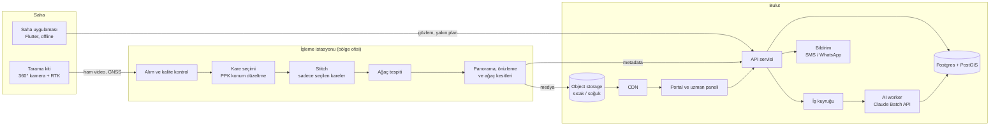

# Teknik Mimari ve Maliyet Fizibilitesi

17 Ekim 2026 · Yusuf

5.000 bahçe ölçeğinde altyapı maliyeti bahçe başına yılda yaklaşık **20–25 $** tutuyor; 50 bahçede bu rakam yaklaşık 50 $. Bu, saha ve uzman emeğinin yanında küçük bir kalem; fiyatlandırmayı belirleyecek olan emek. En büyük teknik kısıt ise ham 360° video hacmi: ziyaret başına yaklaşık 90 GB. Bu yüzden ağır işleme sahaya yakın bir **işleme istasyonunda** yapılır, buluta sadece sonuçlar çıkar (ziyaret başına ~4,4 GB).

Bu doküman [MVP.md](MVP.md)'deki ürün tanımını esas alır. Buradaki tüm rakamlar varsayımlara dayalı tahminlerdir; pilotta ölçülüp güncellenecek.

## Tasarım ilkeleri

- **Ağır iş sahaya yakın:** Ham video buluta çıkmaz. Kare seçimi, stitch ve kesit üretimi işleme istasyonunda yapılır.
- **Tek gerçek kaynak:** Tüm kayıtlar Postgres + PostGIS'te tutulur. Medya object storage'da durur; anahtarı içeriğin hash'idir, bu yüzden değiştirilemez.
- **Taşınabilirlik:** S3 uyumlu depolama API'si, standart Postgres ve konteynerler kullanılır. Hiçbir sağlayıcıya özgü özellik çekirdeğe girmez; sağlayıcı değiştirmek bir taşıma işi olur, yeniden yazım değil.
- **Asenkron ve toplu:** İşleme ve AI değerlendirmesi kuyruktaki işlerle yürür. Gecikmeye duyarlı olmadıkları için LLM çağrıları Batch API ile yapılır (%50 indirim).
- **Katmanlı saklama:** Veri yaşlandıkça otomatik olarak daha ucuz katmana iner.
- **Baştan çok kiracılı:** Her kayıt bir `org_id` taşır. İleride kooperatif, sigorta ya da danışman gibi kurumsal müşteriler aynı sistemde ayrı kiracı olur.
- **Birim maliyet ölçümü:** Her iş ve her dosya ziyaret ve bahçe kimliğiyle etiketlenir. Böylece "ziyaret başına gerçek maliyet" tahmin değil ölçüm olur.

## Ölçek senaryoları

| Senaryo | Bahçe | Ziyaret / yıl | Sezon başına zirve ziyaret / gün | Gereken saha ekibi (zirve) |
| --- | --- | --- | --- | --- |
| Pilot | 4 | ~20 | <1 | 1 |
| S1 | 50 | ~200 | ~1,3 | 1 |
| S2 | 500 | ~2.000 | ~12,5 | ~8 |
| S3 | 5.000 | ~20.000 | ~125 | ~85 |

Varsayımlar: Bahçe başına yılda 4 periyodik ziyaret. Her ziyaret dönemi yaklaşık 8 hafta (40 iş günü) sürer. Bir ekip günde yaklaşık 1,5 bahçe tarar (grid tarama + yakın plan + yol).

**Ölçeklenmede asıl darboğaz insan:** S3'te zirve dönemde 80'den fazla saha ekibi gerekiyor. Yazılım tarafı bu ölçeği rahat taşır; operasyon tarafı (işe alım, eğitim, rota planlama, kalite) ayrıca planlanmalı.

## Mimari genel bakış



1. Saha ekibi taramayı yapar. Ham video ve GNSS kaydı SSD ile işleme istasyonuna gelir. Yakın plan fotoğraflar ve gözlemler saha uygulamasından doğrudan API'ye senkronize olur.
2. İşleme istasyonu panorama, önizleme ve ağaç kesitlerini üretir. Sonuçlar object storage'a, metadata API'ye yüklenir.
3. API, ziyaret için AI değerlendirme işlerini kuyruğa atar. AI worker bunları Batch API'ye gönderir ve sonuçları veritabanına yazar.
4. Uzman paneli ve sahip portalı aynı web uygulamasıdır. Medya CDN üzerinden, imzalı ve süreli linklerle sunulur.

## Bileşenler ve aşamalara göre teknoloji

| Bileşen | Pilot ve S1 | S2 ve S3 |
| --- | --- | --- |
| Veritabanı | Supabase Pro (Postgres + PostGIS) | Daha büyük Supabase compute ya da yönetilen/kendi Postgres; okuma replikası, büyük tablolarda yıla göre bölümleme |
| API | Supabase (PostgREST + satır bazlı yetki) + küçük bir servis | Ayrı API servisi (konteyner), aynı Postgres |
| İş kuyruğu | Postgres tabanlı kuyruk (pgmq ya da graphile-worker) | Aynı; çok yüksek hacimde ayrı bir kuyruk sistemi |
| Object storage | Cloudflare R2 | R2 sıcak katman + daha ucuz soğuk katman; ikinci kopya başka sağlayıcıda |
| CDN | Cloudflare | Cloudflare |
| İşleme istasyonu | Operatör bilgisayarı (GPU'lu masaüstü) | Bölge ofislerinde GPU iş istasyonları, merkezi iş takibi |
| AI | Claude API, Batch | Kendi ağaç modeli istasyonda ilk filtreyi yapar, LLM sadece belirsiz vakalara gider |
| Kimlik doğrulama | Supabase Auth (telefon doğrulaması) | Aynı; gerekirse ayrı bir kimlik servisi |
| Web | Next.js, MapLibre, Photo Sphere Viewer | Aynı |
| Gözlemlenebilirlik | Hata takibi + basit log | OpenTelemetry, metrikler, maliyet panosu |

**Panorama dosya biçimi kararı:** Her panorama karo piramidi yerine **tek dosya** (4K equirectangular, WebP ya da AVIF) olarak saklanır. Karo piramidi panorama başına ~40 dosya yazar. S3 ölçeğinde bu, yalnızca yazma işlemleri için yılda binlerce dolar ödemek demek. Tek dosya ise ziyaret başına ~4.400 nesne yazar ve bu maliyeti ihmal edilebilir seviyeye indirir. Yakın zoom gerekirse karo üretimi sonradan, sadece istenen panoramalar için yapılabilir.

## İşleme pilotta bulutta (karar 22 Ekim 2026)

Pilotta işleme istasyonu satın alınmaz; iş bulutta, iş başına açılıp kapanan GPU'lu bir sanal makinede yapılır. **Sağlayıcı seçilmedi:** depo ve işlem katmanı sağlayıcıdan bağımsızdır (AWS, Azure, Google Cloud; ya da yerel bilgisayar), seçim yapılandırmayla yapılır.

1. **Ofis:** Kameranın kartı ve kaydedicinin microSD'si bir bilgisayara takılır. Yükleme aracı oturum klasörünü sağlama toplamıyla buluttaki ham veri deposuna gönderir.
    - Depo: AB bölgesi; S3 uyumlu ya da Azure Blob.
    - Yükleme kaldığı yerden devam eder.
    - Ofisin yükleme hızı 99 Mbps; 90 GB'lık bir ziyaret ~2 saat sürer, gece yüklenebilir.
2. **Bulut:** GPU'lu sanal makine açılır.
    - Pilotta Windows: Insta360 Studio ile birleştirme, uzak masaüstüyle elle.
    - SDK gelince Linux: Media SDK ile otomatik.
3. **İşleme:** Aynı makinede işleme hattı (`run`, `boundary`, `upload`) ve AI worker çalışır. Ürünler Supabase'e gider, makine kapanır.
4. **Saklama:** Ham veri 30 gün depoda kalır, sonra kendiliğinden silinir.

**Kaba maliyet** (doğrulanmadı):
- GPU'lu makine saatte ~0,6–1,5 $; ziyaret başına 2–3 saat.
- Ham veri deposu ayda ~10–20 $.
- Pilot dönemi ayda ~50–100 $.

**Denenecek:** Insta360 Studio'nun buluttaki Windows GPU makinesinde çalışması. Çalışmazsa birleştirme NVIDIA kartlı yerel bir bilgisayarda yapılır, birleştirilmiş video yüklenir.

**Araçlar ve operasyon adımları:** [bulut-isleme.md](bulut-isleme.md): sağlayıcıdan bağımsız yükleme aracı (`orchados-ingest`), işlem imajı, AWS/Azure/GCP makine betikleri, sağlayıcı karşılaştırması ve kota hazırlığı.

## Veri hacmi

**Varsayımlar:** 20 dönüm ve ~300 ağaç; iki yönlü grid rota ve kenarlar ~5,4 km; ~2 saat video; 5.7K 360° videoda ~100 Mbps bit hızı; ~3,5 m'de bir panorama, yani ~1.500 panorama.

| Veri | Hesap | Ziyaret başına | Nerede ve ne kadar süre |
| --- | --- | --- | --- |
| Ham 360° video | 2 sa × ~100 Mbps | ~90 GB | Sadece işleme istasyonunda; kalite kontrolünden sonra en fazla 30 gün |
| Panoramalar (4K) | 1.500 × ~2 MB | ~3,0 GB | Object storage, sıcak katman, 2 yıl |
| Panorama önizlemeleri (2K) | 1.500 × ~0,3 MB | ~0,45 GB | Kalıcı |
| Ağaç kesitleri | 300 ağaç × 4 yön × ~0,25 MB | ~0,3 GB | Kalıcı |
| Yakın plan fotoğraflar | ~50 ağaç × 3 × ~4 MB | ~0,6 GB | Kalıcı |
| Veritabanı satırları | ~6.000 satır | ~6 MB | Postgres |
| **Buluta çıkan toplam** | | **~4,4 GB** | |

**Katmanlama:** İki yıldan eski ziyaretlerde 4K panoramalar sıcak katmandan kaldırılır. Silinebilir ya da derin arşive taşınabilirler; derin arşiv yaklaşık 1–2 $/TB-ay tutar. Önizleme, kesit ve yakın planlar kalır, yani ziyaret başına ~1,35 GB (%31) kalıcıdır. Bahçe gezisi eski ziyaretlerde 2K önizlemeyle çalışmaya devam eder.

**Bahçe başına birikim:**

| Dönem | Hesap | Birikmiş |
| --- | --- | --- |
| 1. yıl | Envanter + 4 ziyaret = 5 × 4,4 GB | ~22 GB |
| 2. yıl | + 4 × 4,4 GB | ~40 GB |
| 3. yıl | 1. yıl katmanlanır (5 × 1,35 GB) + 2. ve 3. yıl sıcak | ~42 GB |
| Sonrası | Yılda ~5,4 GB artar (eski yıllar katmanlı) | — |

**Toplam depolama (3. yıl sonu):** S1 ~2,1 TB · S2 ~21 TB · S3 ~210 TB.

**Veritabanı:** Ziyaret başına ~6 MB; yılda S1 ~1,2 GB, S2 ~12 GB, S3 ~120 GB büyür. Ham GNSS izleri veritabanına girmez, object storage'da Parquet olarak durur (ziyaret başına ~3 MB). Veritabanında sadece sadeleştirilmiş iz çizgisi tutulur. Bu hacimler Postgres için büyük değil; S3'te büyük tablolar (medya, değerlendirme) yıla göre bölümlenir.

## İşlem gücü

**İşleme istasyonunda ziyaret başına süre** (tahmini, pilotta ölçülecek):

| Adım | Kaynak | Süre |
| --- | --- | --- |
| Aday kare çıkarma ve netlik skoru | CPU | 20–30 dk |
| PPK konum düzeltme ve zaman eşleme | CPU | <5 dk |
| Sadece seçilen ~1.500 karenin stitch'i | GPU | 15–30 dk |
| Ağaç tespiti | GPU | ~10 dk |
| Panorama, önizleme ve kesit üretimi | CPU/GPU | ~10 dk |
| Buluta yükleme (4,4 GB, 50 Mbps) | Ağ | ~12 dk |
| **Toplam** | | **~1–1,5 saat, gözetimsiz** |

**Kritik nokta:** Tüm videoyu birleştirmek (stitch) 1–2 saat sürer. Sadece seçilen kareleri birleştirmek bunu kabaca yarıya indirir. Bunun mümkün olması, kameranın SDK'sının kare bazında stitch'e izin vermesine bağlı. Kamera seçilmeden önce doğrulanmalı.

**Kapasite:** GPU'lu bir iş istasyonu (~1.500–2.500 $) gece ve gündüz çalışarak günde ~10 ziyaret işler.

| Senaryo | Zirve ziyaret / gün | Gereken istasyon |
| --- | --- | --- |
| S1 | ~1,3 | 1 |
| S2 | ~12,5 | 2 |
| S3 | ~125 | ~13 (bölge ofislerine dağıtılmış) |

Taşma kapasitesi gerektiğinde bulutta saatlik GPU kiralanabilir. Ama ham video yükleme süresi (90 GB, 50 Mbps'te ~4 saat) bunu pahalı ve yavaş kılar; varsayılan yol işleme istasyonudur.

**Bulut tarafı** (API, worker'lar, web): Ağır hesap yapmaz. S1'de aylık birkaç on dolar, S3'te birkaç yüz dolar mertebesinde.

## AI ve LLM maliyeti

Fiyatlar Anthropic'in 6 Ekim 2026 tarihli liste fiyatlarıdır. Batch API %50 indirimlidir.

| Model | Girdi $/MTok | Çıktı $/MTok | Batch girdi / çıktı |
| --- | --- | --- | --- |
| Claude Opus 5.5 | 4,00 | 20,00 | 2,00 / 10,00 |
| Claude Sonnet 5.5 | 2,00 | 10,00 | 1,00 / 5,00 |
| Claude Haiku 5.5 (≤100K token istem) | 0,10 | 0,50 | 0,05 / 0,25 |

Önbellekten okunan girdi ana fiyatın ~%10'u kadardır (Opus 5.5'te %5'i).

**Ağaç başına istek varsayımı:**
- Bu ziyaretin dört yön kesitinden oluşan 1024×1024 bir mozaik ve önceki ziyaretin aynı mozaiği; ikisi ~2.800 görsel token
- ~400 token metin (personel cevapları, bağlam)
- ~15.000 token önbellekli ön ek: ölçek tanımları ve referans görseller, her istekte aynı
- Çıktı: yapılandırılmış JSON ve düşünme; Haiku'da ~800, Sonnet ve Opus'ta ~1.500 token
- Yakın plan analizi: ~50 ağaç × 3 fotoğraf

**Ziyaret başına maliyet, stratejiye göre:**

| Strateji | Ziyaret başına | S1 / yıl | S2 / yıl | S3 / yıl |
| --- | --- | --- | --- | --- |
| A. Tüm ağaçlar Opus 5.5 | ~8,1 $ | ~1.600 $ | ~16.200 $ | ~162.000 $ |
| B. Tüm ağaçlar Sonnet 5.5 | ~4,3 $ | ~860 $ | ~8.600 $ | ~86.000 $ |
| C. Haiku 5.5 triaj + %20'si Sonnet 5.5'e | ~1,5 $ | ~300 $ | ~3.000 $ | ~30.000 $ |
| D. Kendi model ilk filtre + %15'i Sonnet 5.5'e | ~1,2 $ | — | ~2.400 $ | ~24.000 $ |

**Model seçimi kalite ölçümüyle yapılır:**
1. Uzman etiketli bir değerlendirme seti hazırlanır; pilotun ilk ziyaretlerinden birkaç yüz ağaç yeterli.
2. Önce en yetenekli model düşük effort ile ölçülür.
3. Daha ucuz bir strateji, uzmanla uyumu koruduğu ölçüde seçilir. Kaskad (C), ancak Haiku'nun triajı ölçümde tutarsa devreye girer.
4. Token sayıları gerçek kesitlerle `count_tokens` üzerinden doğrulanır.

S1'de strateji farkı yılda birkaç yüz dolar, S3'te ise 130.000 $'ı aşıyor. Model seçimi asıl S2'ye geçerken önem kazanıyor. Kendi modelin (D) eğitim verisi, uzmanın her onay ve düzeltmesinden zaten birikiyor.

## Toplam altyapı maliyeti

Aylık tahmin, 3. yıl sonunda, strateji C ile:

| Kalem | S1 (50 bahçe) | S2 (500) | S3 (5.000) |
| --- | --- | --- | --- |
| Object storage (sıcak + soğuk + kalıcı verinin ikinci kopyası) | ~35 $ | ~360 $ | ~3.600 $ |
| Veritabanı | ~40 $ | ~100 $ | ~600 $ |
| Uygulama sunucuları, kuyruk, web | ~40 $ | ~150 $ | ~800 $ |
| LLM | ~25 $ | ~250 $ | ~2.500 $ |
| İşleme istasyonları (36 ay amortisman) | ~55 $ | ~110 $ | ~720 $ |
| SMS, gözlemlenebilirlik, yedekleme | ~20 $ | ~80 $ | ~500 $ |
| **Toplam / ay** | **~215 $** | **~1.050 $** | **~8.700 $** |
| **Bahçe başına / yıl** | **~52 $** | **~25 $** | **~21 $** |
| Ziyaret başına | ~13 $ | ~6 $ | ~5 $ |

**Object storage hesabı:** R2 Standard 15 $/TB-ay, R2 Infrequent Access 10 $/TB-ay. Sıcak veri toplamın ~%84'ü. Kalıcı verinin ikinci kopyası ~7 $/TB-ay'lık bir sağlayıcıda (ör. Backblaze B2). S3'te tüm katmanı daha ucuz bir sağlayıcıya taşımak depolamayı ~%40–50 düşürür. Bunu kolaylaştıran şey, R2'nin ve Cloudflare ortaklarının dışa aktarım ücreti almaması.

**Emek karşılaştırması:** Ziyaret başına maliyet aşağı yukarı şöyle hesaplanır:

```
Ziyaret maliyeti = (ekip günlük maliyeti ÷ 1,5) + yol
                 + (uzman dakikası × dakika ücreti)
                 + altyapı (~5–13 $)
```

Bir saha ekibinin günlük maliyeti ve uzman süresi (tahminen ziyaret başına ~1 saat) altyapı payının birkaç katı olacak. Fiyatlandırma bu emek kalemlerine göre yapılmalı. Bu değerler pilotta ölçülecek.

## Veri yaşam döngüsü ve yedekleme

| Veri | Nerede | Süre | Sonra |
| --- | --- | --- | --- |
| Ham video | Pilotta buluttaki ham veri deposu (AB, S3 uyumlu); ileride istasyon diski / NAS | Kalite kontrolü + 30 gün | Silinir (depo yaşam döngüsü kuralı) |
| Ham GNSS kaydı | Object storage (Parquet) | Kalıcı | — |
| 4K panoramalar | Object storage, sıcak | 2 yıl | Silinir ya da derin arşive taşınır |
| Önizleme, kesit, yakın plan | Object storage, sıcak | Kalıcı | İkinci sağlayıcıda kopyası tutulur |
| Veritabanı | Yönetilen Postgres | Kalıcı | Belirli bir ana geri dönüş (PITR) + başka sağlayıcıda günlük döküm |

Medya dosyaları içerik hash'iyle adreslenir ve değiştirilemez. Her ziyaret, dosya hash'lerinin listesini tutan bir kayıtla mühürlenir. Böylece rapordaki bir kanıtın sonradan değiştirilmediği gösterilebilir.

## Veri konumu, KVKK ve güvenlik

- **Kişisel veri sınırlı tutulur:** Sahip kimliği, telefonu ve parsel konumu kişisel veridir. Bu alanlar ayrı bir şemada tutulur. Görüntülerde kişiler görünebilir; bu, aydınlatma metninde belirtilir.
- **Yurt dışına aktarım:** Veriler AB'de barındırılırsa, ya da LLM sağlayıcısına görüntü gönderilirse, bu KVKK açısından yurt dışına aktarımdır. 2024 değişikliğinden sonra (KVKK md. 9) aktarım için yeterlilik kararı ya da standart sözleşme gibi uygun güvenceler gerekiyor. **Hukukçu görüşüyle netleştirilmeli.**
- **Seçenekler:**
    - Her şey AB'de (ör. Frankfurt): Standart sözleşme ve açık rıza ile yürür. Seçenek bolluğu ve maliyet açısından en rahat yol.
    - Kişisel veriler Türkiye'de, medya ve iş yükü AB'de: Daha karmaşık ama sıkı bir hukuki yorumda daha güvenli.

  Mimari, kişisel veri şemasını ayrı tuttuğu için ikinci seçeneğe sonradan geçebilir.
- **LLM'e giden veri:** Sadece ağaç görselleri ve takma ağaç kimlikleri gönderilir. Ad, telefon ya da konum gönderilmez.
- **Erişim:** Kiracı ve parsel bazında satır seviyesinde yetki; medyaya sadece imzalı, süreli linklerle erişilir; uzman ve personel işlemleri denetim kaydına yazılır.
- **Demo turu (İP13, [demo-turu.md](demo-turu.md) §12):**
    - **Kişisel veri yok:** Ziyaretçiden ad, telefon ya da e-posta istenmez. Demo hesabının e-postası rastgele ve teslim edilemez bir adrestir (`ziyaretci-<uuid>@demo.orchados.invalid`); telefonu ve parolası yoktur, sahip ya da fatura profili, rıza ve kayıt satırı hiç oluşmaz. Demo verisindeki kişiler kurgusaldır, görüntüler sentetiktir ve LLM'e hiçbir şey gitmez.
    - **IP özeti takma adlandırılmış kişisel veridir:** Oran sınırı için IP'nin HMAC-SHA256 özeti (`SIGNUP_HASH_SECRET`, `demo:` önekiyle; IPv6'da /64 önekinden) `private.demo_attempt` ve `private.demo_session` tablolarında tutulur. Sayaçlar 48 saat sonra silinir, oturum satırı hesapla birlikte gider. Anahtara sahip biri IPv4 uzayını tarayarak özeti geri bulabilir; anahtar yalnızca Edge'dedir.
    - **Ham IP:** GoTrue oturum satırında (`auth.sessions.ip`, `user_agent`) hesap silinene kadar, Supabase, Vercel ve Edge altyapı loglarında sağlayıcının saklama süresince kalır. Kodumuz hiçbir log satırına IP, e-posta ya da token yazmaz.
    - **Denetim kayıtları:** Silinen demo hesaplarının GoTrue denetim kayıtları (`auth.audit_log_entries`, IP içerir) temizlikte en iyi çabayla silinir (`demo_purge_audit_log`); yetki yoksa Supabase'in saklama süresi geçerlidir.
    - **Süre:** Hesap oturum süresi (varsayılan 3 saat) dolunca en geç 5 dakikada erişimini kaybeder, en geç 15 dakika sonra silinir.

## Ölçeklenme eşikleri

| Eşik | Değişiklik |
| --- | --- |
| Kamera SDK'sı kare bazında stitch'e izin vermiyorsa | S2'den önce alternatif kamera ya da stitch çözümü bulunmalı; aksi halde işleme darboğaz olur |
| ~2.000 ziyaret/yıl (S2) | Kendi ağaç tespit ve sınıflandırma modeli istasyonda çalışmaya başlar; LLM sadece belirsiz vakalara gider |
| Birden fazla bölge ofisi | Bölgesel işleme istasyonları, merkezi iş kuyruğu ve takip |
| Depolama ~20 TB üstü | Soğuk katman daha ucuz bir sağlayıcıya ya da derin arşive taşınır |
| Veritabanı ~100 GB üstü ya da yoğun okuma | Okuma replikası, büyük tablolarda yıla göre bölümleme |
| Aylık bulut faturası birkaç bin doları aşınca | Kendi sunucularında barındırma (ör. Hetzner) maliyet açısından değerlendirilir |

## Doğrulanacaklar

- [ ] Kamera SDK'sı kare bazında stitch'i destekliyor mu? İşleme süresi ve kamera seçimi buna bağlı.
- [ ] Gerçek panorama boyutu ve kalite: 4K WebP/AVIF yeterli mi?
- [ ] Ham video bit hızı ve tarama süresi: 20 dönümde gerçekten ~2 saat mi?
- [ ] Ağaç mozaiği başına gerçek görsel token sayısı (`count_tokens`).
- [ ] Model stratejisi: uzman etiketli değerlendirme setinde hangi strateji uzmanla yeterince uyuşuyor?
- [ ] Saha ekibinin günlük bahçe kapasitesi ve uzman süresi.
- [ ] KVKK yurt dışı aktarım için hukuki görüş.
- [ ] Hetzner, AWS ve GPU sunucu fiyatları; bu dokümanda yaklaşık değer olarak kullanıldı.

## Kaynaklar

- [Cloudflare R2 fiyatlandırması](https://developers.cloudflare.com/r2/pricing/): Standard 0,015 $/GB-ay, Infrequent Access 0,01 $/GB-ay, dışa aktarım ücretsiz, Class A 4,50 $/milyon, Class B 0,36 $/milyon.
- [Backblaze B2 fiyatlandırması](https://www.backblaze.com/cloud-storage/pricing): 6,95 $/TB-ay; depolamanın 3 katına kadar dışa aktarım ücretsiz; Cloudflare üzerinden ücretsiz.
- [Supabase fiyatlandırması](https://supabase.com/pricing): Pro 25 $/ay, 8 GB disk dahil, aşım 0,125 $/GB; compute eklentileri Small 15 $, Medium 60 $, Large 110 $, XL 210 $/ay.
- Claude model fiyatları: Anthropic liste fiyatları, 6 Ekim 2026.
- Derin arşiv (~1–2 $/TB-ay), GPU sunucu ve iş istasyonu fiyatları yaklaşık değerlerdir; doğrulanmadı.
