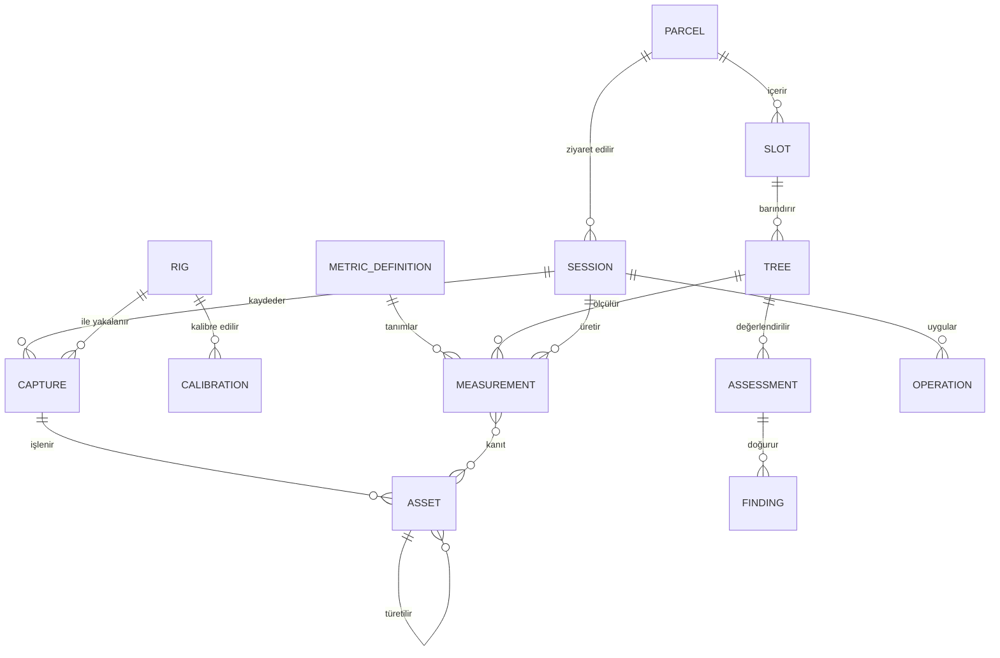

# Hedef Veri Modeli: Sensörden Bağımsız

17 Ekim 2026 · Yusuf

Hedef veri modeli dört soruyu ayrı tutar: **neyi** tarif ediyoruz (ağaç, yer, parsel), veriyi **nasıl** topladık (oturum, cihaz, kalibrasyon, ham kayıt), ham veriden **ne ürettik** (panorama, kesit, nokta bulutu) ve **ne bulduk** (ölçüm, değerlendirme, bulgu). Böylece yeni bir sensör, yöntem ya da robot üreticisi geldiğinde şema değişmez; sadece yeni kayıtlar eklenir.

MVP bu modelin bir alt kümesiyle başlar. MVP tablolarından geçiş en sonda.

## Neden gerekli: bir örnek

Aynı ağacın gövde kalınlığı üç farklı yoldan gelebilir:

| Tarih | Yöntem | Değer | Belirsizlik | Kaynak |
| --- | --- | --- | --- | --- |
| Ocak 2027 | Personel, şerit metre | 24,5 cm | ±0,3 cm | Saha personeli |
| Ocak 2028 | LiDAR, silindir uydurma v1 | 25,8 cm | ±1,2 cm | Algoritma |
| Ocak 2029 | LiDAR, silindir uydurma v2 (2028 verisi yeniden işlendi) | 25,1 cm | ±0,8 cm | Algoritma |

Bunlar aynı ağaçta aynı metriğin ölçümleridir; sadece yöntem, sürüm ve belirsizlik farklıdır. Dar bir şemada her yeni yöntem yeni bir sütun ya da tablo ister. Genel şemada her biri `Measurement` tablosunda bir satırdır.

## Katmanlar

### 1. Konu: neyi tarif ediyoruz

| Varlık | Temel alanlar |
| --- | --- |
| Org | Kiracı: işletme, kooperatif, sigorta vb. |
| Parcel | Sahibin kullandığı bahçe bölümü; tapu referansı opsiyonel |
| Boundary | Poligon, kaynak, sürüm, sahip onayı |
| Slot (yer) | Kod (S5-12, S5-12a), konum, sıra, pozisyon |
| Tree | Kalıcı kimlik, bağlı olduğu yer, cinsiyet, aşı, gövde yapısı (tek/çok gövdeli), çeşit, ilk görülme, durum |
| Zone | Ağaç dışı alanlar: hücre, geçilmez bölge, giriş noktası, sulama hattı |

`Tree` kimliği hiç değişmez. Ağaç kurursa durumu değişir; yerine yeni ağaç dikilirse aynı yere yeni bir `Tree` kaydı bağlanır.

### 2. Toplama: veriyi nasıl topladık

| Varlık | Temel alanlar |
| --- | --- |
| Session | Bahçede yapılan bir oturum (MVP'deki ziyaret); tür (tarama / biçme / ilaçlama / elle kayıt), yapan (ekip ya da robot), tarih, metodoloji sürümü; taramada yöntem (yürüyüş, motosiklet, robot) ve ölçülen kamera yüksekliği |
| Device | Üretici, model, seri no, yazılım sürümü; insan kiti ya da robot |
| Sensor | Bir cihaza bağlı sensör: 360° kamera, LiDAR, GNSS, termal, telefon kamerası |
| Rig | Bir oturumda birlikte kullanılan sensörlerin düzeni |
| Calibration | Sensörlerin iç parametreleri ve birbirlerine göre konumları; geçerlilik tarihleri. Kit robota takılacaksa `extrinsics.kit_mount` sensör pozlarını robotun `kit_mount` frame'inde tutar; `chip_id` kitin kimlik çipine yazılan numaradır. İkisi de yazıldıktan sonra değişmez, yeniden kalibrasyon yeni kayıttır ([arayuzler.md](arayuzler.md#kit-kimlik-çipi)) |
| Capture | Ham kayıt: dosya, zaman aralığı, rig, kalibrasyon sürümü (video, MCAP, GNSS ham, fotoğraf) |

### 3. Ürün: ham veriden ne ürettik

| Varlık | Temel alanlar |
| --- | --- |
| Asset | Türetilmiş dosya: panorama, ağaç kesiti, yörünge, nokta bulutu, ağaç bulutu. Tür, dosya hash'i, poz, kalite skoru, **kaynak kayıtlar** ve **üreten hat + sürüm + parametre hash'i** |

Her ürün, hangi ham kayıttan ve hangi hat sürümüyle üretildiğini bilir. Hat güncellendiğinde ham kayıt hâlâ duruyorsa ürünler yeniden üretilebilir; eski ürünler sürümleriyle birlikte kalır.

### 4. Bulgu: ne bulduk

| Varlık | Temel alanlar |
| --- | --- |
| MetricDefinition | Metrik kaydı: kod, ad, birim, değer tipi (sayı / ölçek / kategori / evet-hayır), geçerli dönemler, karnede gösterilip gösterilmediği |
| Measurement | Konu (ağaç, yer, parsel ya da bölge), metrik, değer, birim, belirsizlik, yöntem + sürüm, kaynak (personel / algoritma / AI / uzman), oturum, kanıt ürünleri, ölçüm zamanı |
| Assessment | Yargı: genel sınıf; dayandığı ölçümler; kaynak (AI / model / uzman); güven |
| Finding | Raporlanan bulgu: tür, önem, açıklama, öneri, kanıtlar, onaylayan |
| Operation | Bahçeye yapılan işlem: biçilen alan, ilaç ürünü, doz, reçete no, toprak işleme alanı; yapan (insan ya da robot) |

`Operation`, robotların yaptığı işleri ve elle girilen işleri aynı yerde tutar. Böylece bir ölçümdeki değişim, öncesindeki işlemlerle (budama, ilaçlama) ilişkilendirilebilir.

## Metrik kaydı örnekleri

| Kod | Birim | Yöntemler | Dönem | Karnede |
| --- | --- | --- | --- | --- |
| `dead_branch_scale` | 0–3 | personel sorusu, AI görsel, uzman | Tümü | Evet |
| `crown_diameter` | m | LiDAR, fotogrametri | Yapraklı | Evet |
| `crown_volume` | m³ | LiDAR | Yapraklı | Evet |
| `trunk_diameter_h30` | cm | şerit metre, LiDAR silindir uydurma | Tümü | Evet |
| `scaffold_branch_count` | adet | uzman gözlemi, QSM | Kış | Evet |
| `fractal_dimension` | — | QSM, kutu sayma | Kış | Hayır (araştırma) |
| `fruit_load_scale` | 0–3 | personel, AI görsel, uzman | Yaz | Evet |
| `canopy_temp_delta` | °C | termal | Yaz | Değerlendirilecek |

Yeni bir ölçüm türü eklemek, bu tabloya bir satır eklemek demektir.

## Kurallar

- **Yöntem önceliği:** Aynı metrik birden çok yöntemle ölçüldüğünde karnede hangisinin gösterileceği metrik başına tanımlanır (örneğin gövde kalınlığında önce LiDAR v2, yoksa şerit metre). Diğer değerler kaybolmaz.
- **Yöntemler arası tutarlılık:** Yeni bir yöntem devreye girmeden önce, aynı ağaçlarda eski yöntemle yan yana ölçülür. Aradaki sapma belgelenir; gerekirse düzeltme uygulanır. Böylece zaman serisinde yöntem değişikliğinden gelen sıçramalar ağaçtaki gerçek değişim sanılmaz.
- **Belirsizlik:** Sayı ve ölçek değerli her ölçüm bir belirsizlik değeri taşır (zorunlu). Kategori ve evet/hayır değerlerinde belirsizlik boş bırakılabilir: personelin "kuru dal var mı?" sorusuna verdiği cevabın sayısal bir hata payı yoktur, uydurulmuş bir değer (ör. 0) yanıltıcı olur. Bu değerlerin güvenilirliği kaynak, yöntem ve gerekiyorsa `confidence` (0–1) ile ifade edilir. Karne, belirsizliği yüksek değişimleri "anlamlı değişim" olarak göstermez.
- **Evet/hayır değerleri:** Ayrı bir değer tipi (`boolean`) ve sütunu (`value_boolean`) vardır; 0/1 ölçeğine ya da `yes`/`no` kategorisine sıkıştırılmaz. Saha uygulamasının personel cevapları (`value_bool`) buraya yazılır. Evet/hayır metriğinin birimi yoktur.
- **Gösterilecek değer:** Bir ağaç için birden çok değerlendirme ya da aynı metrik için birden çok ölçüm varsa, karne ve harita tek bir değer gösterir. Sıra:
  1. **En yeni oturum kazanır.** Oturumun zamanı başlangıcıdır (`started_at`; yoksa planlanan gün, o da yoksa kayıt zamanı). Oturuma bağlı olmayan bir satırda satırın kendi zamanı (`assessed_at` / `measured_at`) kullanılır. Böylece eski bir uzman görüşü, sonraki bir ziyaretin sonucunu gölgelemez.
  2. **Aynı oturum içinde kaynak karar verir:** değerlendirmede uzman > model > AI; ölçümde uzman > algoritma > personel > AI.
  3. **Eşitlikte** satırın zamanı, sonra kayıt zamanı (`created_at`), sonra kimlik.

  Sahip ve izleyici yayımlanmamış oturumları görmediği için onlar için en yeni **yayımlanmış** oturum geçerlidir; kurum rolleri yayımlanmamış daha yeni bir oturumu görür. Veritabanında `tree_latest_assessment` ve `tree_latest_measurement` görünümleri bu kuralı uygular (`session_time` sütunu seçilen oturumun zamanıdır); diğer değerler silinmez. Metrik başına yöntem önceliği (yukarıda) tanımlandığında 2. adım onunla değiştirilecek.
- **Yayın:** Bir oturumun sonuçları (ham kayıt, ürün, ölçüm, değerlendirme, bulgu) sahip ve izleyiciye ancak oturum `published` durumuna geçince görünür. Kurum rolleri (saha personeli, uzman, operasyon) her zaman görür. Oturuma bağlı olmayan kayıtlar (parsel, sınır, yer, ağaç) ve oturum satırının kendisi bundan etkilenmez. Kural veritabanında satır bazlı yetkiyle uygulanır; görünümler ve medya dosyaları da aynı kurala uyar. Yayın sadece uzmanın çağırdığı `publish_session` fonksiyonuyla yapılır; ziyaretteki her aktif ağacın uzman değerlendirmesi olmalıdır. Yayın geri alınamaz; yayımlanmış ziyaretin değerlendirme ve bulguları değiştirilemez, uzman ölçümü eklenemez (düzeltme yeni ziyaretle yapılır). Saha personelinin, algoritmanın ve AI'ın geç gelen ölçümleri eklenebilir.
- **Yeniden hesaplanabilirlik:** Her ölçüm ve ürün, onu üreten hat sürümüne bağlıdır. Yeni bir model eski veriyi yeniden işleyebilir; eski sonuçlar da silinmeden sürümleriyle saklanır.
- **Koordinatlar:** Global koordinatlar WGS84'te tutulur; her parsel için ayrıca yerel bir koordinat sistemi tanımlanır (köşe orijinli, metre cinsinden). Robot navigasyonu ve ağaç bazında ölçümler bu yerel sistemde çalışır. Her poz, hangi koordinat sisteminde olduğunu ve belirsizliğini taşır.
- **Zaman:** Tüm zaman damgaları UTC ve GNSS zamanına bağlıdır.
- **Ölçek:** `Measurement` en büyük tablo olacak. Örneğin 5.000 bahçe × yılda 4 ziyaret × 300 ağaç × ~30 metrik, yılda ~180 milyon satır eder. Bu tablo yıla göre bölümlenir; analiz için object storage'da Parquet kopyası tutulur.

## Etiketli veri: gövde tıklamaları

Ofis üçgenleme aracında (İP5) her ağaç konumu, panoramalarda gövdeye yapılan tıklamalardan hesaplanır. Bu tıklamalar ileride bir gövde tespit modelinin eğitim ve değerlendirme etiketleridir; envanterle birlikte `trunk_label` tablosuna yazılır.

| Alan | Anlamı |
| --- | --- |
| `org_id`, `parcel_id`, `session_id` | Kurum, parsel ve envanterin kaydedildiği oturum |
| `panorama_asset_id` | Tıklanan panoramanın `asset` satırı (tam çözünürlük, yoksa önizleme). Yerel geliştirme kaynağında boş |
| `panorama_gps_time_ns` | Panorama karesinin GPS zamanı; aynı karenin tam ve önizleme satırlarını birlikte tanımlar |
| `yaw_deg`, `pitch_deg` | Tıklamanın panorama orta sütununa (`pose.heading_deg`) göre yatay açısı (sağa pozitif) ve yataya göre dikey açısı (yukarı pozitif). Piksel bunlardan çıkar: `x = (yaw/360 + 0,5) × genişlik`, `y = (0,5 − pitch/180) × yükseklik` |
| `azimuth_deg` | Tıklamanın mutlak yönü (`heading_deg + yaw_deg`) |
| `tree_id`, `slot_id` | Tıklanan ağaç ve yeri |
| `unsure`, `moved` | Kişi ağacı "emin değilim" diye işaretledi; ya da üçgenlenen konumu haritada elle kaydırdı (tıklamalar o zaman şüphelidir) |
| `method`, `method_version` | `office_triangulation` ve aracın sürümü |
| `labelled_by`, `labelled_at` | Kim tıkladı, ne zaman |

Kurallar:

- **Ekleme-yalnız:** API kullanıcıları etiket ekler, değiştiremez ve silemez. Kimse güncelleyemez; güvenilir roller (servis rolü) testler ve veri silme talepleri için silebilir. Etiketi olan bir ağaç ya da yer, etiketleri silinmeden silinemez.
- **Sadece kurum rolleri görür:** saha personeli, uzman, operasyon. Sahip ve hissedar görmez. Yazma saha personeli ve operasyonla sınırlı, yalnız kendi adına (`labelled_by = auth.uid()`).
- Etiketler `save_inventory(...)` ile yer ve ağaçlarla aynı işlemde yazılır; bir satır geçersizse hiçbiri yazılmaz.
- Görüntünün kendisi kopyalanmaz; etiket panorama satırını ve karesini gösterir.

## Doğrulama listesi ve envanter onayı

Envanterde ofis üçgenlemesinden sonra belirsiz yerler sahada kontrol edilir (`docs/MVP.md` Modül 2, adım 8–10). Liste bir `verification` oturumuna (doğrulama turu) bağlı kalemlerdir: `verification_item`.

| Alan | Anlamı |
| --- | --- |
| `org_id`, `parcel_id`, `session_id` | Kurum, parsel ve doğrulama turu (`session.kind = verification`) |
| `slot_id`, `tree_id` | Bakılacak yer; kalem açıldığında yerdeki aktif ağaç (boş yerde boş) |
| `reasons` | Nedenler (en az bir): `high_uncertainty` (belirsizlik yüksek), `empty_slot` (boş yer), `unsure` (emin değilim), `multi_stem` (çok gövdeli), `possible_sapling` (fidan olabilir), `off_row` (sıra dışında), `triangulation` (üçgenleme uyarısı), `other` |
| `note` | Ofisin personele notu |
| `status` | `open` (açık), `checked` (bakıldı: sonuç girildi), `closed` (bakılmadan kapatıldı; not zorunlu) |
| `tree_present`, `closeup_capture_id`, `result_note` | Sonuç: yerde ağaç var mı, yakın plan fotoğrafı (`capture`, tür `photo`), not |
| `checked_by`, `checked_at` | Kim, ne zaman baktı ya da kapattı |

Kurallar:

- **Sadece kurum rolleri görür**; sahip ve hissedar görmez. Yazma yalnızca fonksiyonlarla: `create_verification_tour(...)` (saha personeli, operasyon: `planned` bir `verification` oturumu ve kalemleri), `record_verification_result(...)` (saha personeli, operasyon), `close_verification_item(...)` (saha personeli, uzman, operasyon). Saha uygulamasının okuyacağı ve yazacağı alanlar: `docs/arayuzler.md`, "Doğrulama kalemleri".
- **Sonuç envantere işlenir:** "ağaç var" boş yere yeni bir aktif ağaç ekler (`first_seen_session_id` = doğrulama turu); "ağaç yok" yerdeki ağacı `lost` yapar. Yer kodu korunur, ağaç kimliği silinmez.
- Açık kalemi kalmayan tur `captured` olur.
- **Envanter onayı:** `approve_inventory(oturum)` sadece işletmenin uzmanı çağırır. Parselde yer olmalı ve açık kalem kalmamalı; yoksa eksikler hata ayrıntısında döner. Envanter oturumu `publish_session` gibi yayımlanır (`published_at`, `published_by`; bulgular ve uzman değerlendirmeleri imzalayan adına onaylanır), ama her aktif ağacın uzman değerlendirmesi aranmaz. Parsel `inventory_done` olur (izlemedeki parsel durumunu korur).
- **Onaydan sonra kodlama donar:** yayımlanmış bir envanter oturumu olan parselde yerlerin kodu (`row_no`, `position_no`, `suffix`, `kind`) ve konumu (`position`, belirsizlik, yerel koordinat) kimse tarafından değiştirilemez, API kullanıcıları yer silemez, ağaç başka yere taşınamaz. Ağaç özellikleri (cinsiyet, aşı, yaş, çeşit, durum) değişebilir; yeni yer eklenebilir (sonradan dikilen ara ağaç).
- **Saha sınırı:** Saha uygulamasının köşe olaylarından işleme hattı (`orchados-pipeline boundary`) yeni bir `boundary` sürümü yazar: kaynak `field_survey`, köşe belirsizliğiyle. Gerekirse sınır ofiste de çizilebilir. Sahip `approve_boundary` ile onaylar.

## Kapsama raporu

İşleme hattı her taramada kapsama kalite kapısını hesaplar (`docs/metodoloji.md` bölüm 10): her aktif ağaç iki yönden yeterince görüldü mü, parselde kapsanan ağaçların oranı eşiği geçiyor mu, kapsanmayan ağaçlar 10×10 m hücrelerde kümeleniyor mu (kör nokta). Ağaç başına ayrıntı çalıştırma klasöründeki `coverage.json`'da kalır; yükleme sırasında özet `coverage_report` tablosuna yazılır.

| Alan | Anlamı |
| --- | --- |
| `org_id`, `parcel_id`, `session_id` | Kurum, parsel, ziyaret |
| `pipeline`, `pipeline_version`, `params_hash` | Raporu üreten hat, sürümü ve parametre hash'i |
| `active_trees`, `covered_trees` | Aktif (konumlu) ağaç ve kapsanan ağaç sayısı |
| `ratio`, `passed`, `missing_trees` | Sayılardan veritabanında hesaplanır: oran, `ratio >= threshold`, eksik ağaç sayısı |
| `threshold` | Raporun eşiği (hattın parametresi; ilk değer 0,95) |
| `blind_spots`, `blind_spot_cells` | Kör nokta hücre sayısı ve hücreler (hücre no, köşeler, eksik ağaçların yer kodları) |
| `rescan_needed` | Eşiğin altında ya da kör nokta var: ek ziyaret gerekir |
| `missing_slot_codes` | Kapsanmayan ağaçların yer kodları |
| `rule` | Raporun kuralı: hattın kapsama parametreleri (`min_view_score`, `min_directions`, `min_view_spread_deg`, hücre kuralı) |
| `created_by`, `created_at` | Kaydeden (ops kullanıcısı, hat) ve zaman |

Kurallar:

- **Ekleme-yalnız ve sürümlü.** Yazma yalnız `record_coverage_report(oturum, rapor)` ile, operasyon rolüyle (hattın kullanıcısı). Aynı ziyaretin en yeni raporu aynı hat sürümü, parametreler ve sayılarla geliyorsa yeni satır açılmaz; yeniden işleme yeni bir rapor ekler, eskisi kalır. Ziyaretin geçerli raporu en yenisidir.
- **Görünürlük** diğer sonuçlarla aynıdır: kurum rolleri her zaman, sahip ve hissedar ziyaret yayımlandıktan sonra görür (karnede "Denetim güveni").
- **Karar:** `session` üzerinde bir JSON alan yerine ayrı tablo. Gerekçe: ölçümler gibi sürümlü olmalı (yeniden işleme eskiyi silmez), oturum satırını değiştirme yetkisi hatta verilmemeli, alanlar sorgulanabilir olmalı (eşiğin altındaki ziyaretler, envanter onayının denetimi) ve satır bazlı yetki sonuç tablolarıyla aynı kalmalı. Parsel konulu bir `measurement` (ör. `coverage_ratio`) da düşünüldü; ama eşik, sonuç, kör noktalar ve kural tek bir ölçüm değerine sığmıyor.

## Müşteri, teklif ve ödeme

İP12 ile müşteri hesabını kendisi açar, başvurur, teklif alır ve öder. Tasarım ve bütün sözleşmeler (sütunlar, fonksiyon imzaları, hata kodları) [musteri-yonetimi.md](musteri-yonetimi.md) §6'da; burada yalnızca özet var. Migration'lar `20261030100000`–`104999` (İP12-A1) ve `20261030105000`–`109999` (İP12-A2).

| Tablo | Şema | Ne tutar |
| --- | --- | --- |
| `org_billing_setting` | public | Kayda açık mı (en fazla bir org), satıcı bilgileri, IBAN, süreler, `identity_number_required`, `allow_fake_payments` (yalnız SQL ile) |
| `service_package`, `price_list`, `price_list_item` | public | Paket (yıllık periyodik ziyaret sayısı) ve sürümlü fiyat listesi (dönüm başına birim fiyat, minimum ücret, envanter ücreti, KDV). Yayımlanan sürüm değişmez |
| `service_application`, `application_garden` | public | Başvuru (`B-YYYY-NNNNNN`) ve bahçeleri: konum, kaba sınır, beyan ve doğrulanmış alan. Parsel, ödeme tamamlanınca açılır |
| `quote`, `quote_item` | public | Teklif: girdiler ve tutarlar dondurulur (`quote_guard`, satırlar ekleme-yalnız) |
| `service_order`, `service_order_item` | public | Sipariş, hizmet dönemi, ödenen ve iade edilen tutar |
| `payment`, `payment_item`, `refund` | public | Kart denemesi ya da havale, makbuz numarası, kalem bazında iade |
| `audit_event` | public | Denetim kaydı: aktör ve rolü açıkça verilir, ayrıntıda kişisel veri yok. Ekleme-yalnız |
| `billing_profile`, `payment_billing_snapshot` | private | Fatura bilgisi; TCKN yalnızca gerekirse, anlık görüntüde maskeli |
| `consent_record` | private | KVKK aydınlatma ve açık rızalar, metin sürümüyle. Ekleme-yalnız; hesap silinse de `subject_id` ile kalır |
| `customer_signup`, `signup_attempt` | private | Telefonu doğrulanmayı bekleyen kayıt; oran sınırı için IP, telefon ve e-posta özeti (HMAC) |
| `application_garden_detail` | private | Bahçenin tapu, yetki, erişim notu ve saha kişisi bilgisi |
| `payment_event` | private | Sağlayıcı çağrıları ve bildirimleri (izinli alanlar). Ekleme-yalnız |
| `document_sequence` | private | Belge numarası sayaçları (B, T, S, M, I; yıl başına) |

Kurallar:

- **Para** kuruş cinsinden `bigint`, yanında `currency = 'TRY'`; **alan** m² (`numeric(12,2)`).
- **Görünürlük:** Müşteri kendi satırlarını, işletmenin `ops` kullanıcısı işletmenin satırlarını görür; saha, uzman, sahip ve hissedar faturalama verisi görmez. İç sütunlar (`ops_note`, `provider_token`, `manual_note`, `refund.note` …) **sütun yetkisiyle** gizlidir: `select *` reddedilir, web `BILLING_COLUMNS` (`apps/web/src/lib/billing/columns.ts`) listeleriyle okur. API kullanıcıları bu tablolara yazamaz; her değişiklik `customer_*`, `ops_*`, `signup_*` ya da `payment_*` fonksiyonlarından geçer.
- **Durum geçişleri** koşullu güncellemedir; satır bu arada değiştiyse `state_changed`. Kilit sırası başvuru → teklif → sipariş → ödeme → iade.
- **Silme:** `customer_user_id` `on delete restrict`; testler `testing.purge_billing_users` ile temizler.
- **Hesap eşleştirme:** Self-servis hesap (`app_metadata.signup = 'self'`) e-postayla hiç eşleştirilmez; telefonla eşleşme doğrulanmış telefon ve tamamlanmış kayıt ister (`ops_find_user_id`).
- **Geçiş:** İP12 öncesindeki her KVKK onaylı `owner_profile` için bir `kvkk_notice` rıza kaydı yazıldı (kaynak `ops`, metin sürümü profilden).

### Fonksiyonlar (İP12-A2)

Hepsi `security definer`, `search_path = ''`; hatalar kısa koddur, `detail` yalnızca alan adını taşır. İmzalar [musteri-yonetimi.md](musteri-yonetimi.md) §6.9'da.

| Grup | Fonksiyonlar | Kim |
| --- | --- | --- |
| Fiyat | `public_package_prices`, `price_preview` (kayda açık org, yayımlı liste); `ops_preview_quote`. Hesap tek yerde: `private.price_lines` (`pricing-v1`) | anon + authenticated; ops |
| Teklif | `ops_issue_quote` (doğrulanmış alanlar; açık teklif `superseded`), `ops_issue_parcel_quote` (mevcut parseller: ilk yıl ya da yenileme, yenilemede başlangıç eski bitiş + 1 gün) | ops |
| Müşteri | `customer_accept_quote` (fatura profili, son KVKK aydınlatma kaydı, mesafeli satış ve ön bilgilendirme onayı; toplam 0 ise sipariş hemen aktif), `customer_decline_quote`, `customer_cancel_order`, `customer_payment_instructions`, `receipt_data` | müşteri (makbuz: müşteri ya da ops) |
| Sipariş | `ops_cancel_order`, `ops_extend_payment_due`, `ops_terminate_order` | ops |
| Ödeme | `payment_begin`, `payment_attach_token`, `payment_by_token`, `payment_record_event`, `payment_finalize`, `payment_attempts_to_reconcile` (Edge sözleşmesi `supabase/functions/_shared/payments/db.ts`) | service_role |
| Havale ve inceleme | `ops_record_manual_payment`, `ops_void_manual_payment`, `ops_resolve_payment_review` | ops |
| İade | `ops_request_refund`, `ops_can_process_refund`, `ops_complete_manual_refund`, `ops_cancel_refund`, `ops_resolve_refund`; `payment_refund_claim`, `payment_refund_report` | ops; service_role |
| Back office | `ops_billing_summary`, `ops_customers`, `ops_billing_internal` (iç sütunlar), `ops_orders`, `ops_payments`, `ops_payment_events`, `ops_refunds`, `ops_audit_events` | ops |
| Yardımcı ve zamanlanmış | `private.activate_order`, `private.create_customer_parcel`, `private.open_system_refund`, `private.enqueue_billing_notification`, `private.billing_housekeeping` (her gece), `private.dispatch_payment_reconcile` (10 dakikada bir) | — |

- **Tutulan para:** Siparişin kalan borcu, aktivasyon ve iptal `paid_kurus - refunded_kurus` ile hesaplanır; iade edilmiş havale ödenmiş sayılmaz, tamamı iade edilen sipariş iptal edilebilir.
- **Aktivasyon:** `paid_kurus - refunded_kurus >= total_kurus` olunca tek işlemde her bahçe için `registered` parsel, ayrıntısı, kaba sınırı (v1 `owner_declared`) ve sahip erişimi açılır; hizmet dönemi bir yıldır. Fonksiyon idempotenttir.
- **`payment_finalize`:** Sağlayıcının tutarı ödeme satırıyla karşılaştırılır. Uyuşmazlıkta sonuç `pending_review` olur ve `provider_mismatch` nedenli bir `void` iadesi açılır. Kapalı siparişe düşen başarılı ödeme tam tutarla (`order_closed`), toplamı aşan kısım `overpayment` nedeniyle iade edilir. `succeeded`/`voided` satıra yinelenen çağrı hiçbir şey değiştirmez. `failed` satır yalnızca sağlayıcı paranın çekildiğini bildirirse (geç başarı, `payment.late_success` denetim kaydı) değişir; ops'un reddettiği inceleme (`review_rejected`) değişmez. Uyuşmazlık incelemesindeki satır (`amount_mismatch`, `reference_mismatch`) yalnızca void iadesiyle `voided` olur; o void ops tarafından iptal edilemez. Mutabakat önce `initiated`, sonra token süresinden 10 dakika sonrasına kadar `expired` ve `not_completed` ile `failed`, en son dolandırıcılık incelemesindeki denemeleri listeler; sahte ödeme `allow_fake_payments` kapalıyken başarılı yazılmaz.
- **Canlı deneme:** `pending_review`, ya da süresi dolmamış token'lı `initiated`/`expired` kart denemesi. Token'ı henüz eklenmemiş `initiated` deneme 15 dakika canlı sayılır. Canlı deneme varken sipariş iptal edilmez ve havale kaydedilmez (`payment_in_progress`).
- **İade tavanı:** `tutar + Σ(requested, processing, succeeded)` ödemenin (`coalesce(provider_amount_kurus, amount_kurus)`) ve kalemin tutarını aşamaz; başarısız iadenin yeniden denenmesinde yeniden denetlenir. `retryable = false` iade yeniden gönderilmez; ops `processing` iadeyi ancak sağlayıcı çağrısından 15 dakika sonra elle sonuçlandırır. `refunded_kurus` alanları yalnızca `succeeded`'a geçişte, bir kez artar.
- **Bildirimler:** `notification` artık hesap mesajlarını da taşır (`ref_id` belge kimliği, `vars.ref` belge numarası; parsel ve ziyaret boş). Şablonlar `quote_ready`, `application_rejected`, `payment_received`, `refund_completed`, `payment_reminder`; alıcı başına, şablon ve belge başına bir mesaj (`notification_ref_once`).

## Demo turu (İP13)

Olası müşteriye kısa ömürlü, salt okunur bir demo hesabı açılır; hesap tek bir demo org'unun etkin parsellerine `owner` erişimi alır. Tasarım, sözleşmeler ve hata kodları [demo-turu.md](demo-turu.md) §5–§7'de. Migration'lar `20261101120000`–`120200`. Herkese açık demo yalnızca kendi projesinde çalışır; nesneler her projeye gider ve demo org'u yoksa etkisizdir.

| Tablo | Şema | Ne tutar |
| --- | --- | --- |
| `demo_org` | private | Demo org'u ve turun sınırları: süre (`session_ttl`, 15 dk–24 sa), IP başına saatlik ve günlük başlatma, aynı anda etkin oturum, günlük toplam, oturum başı görüntü eşleme ve PDF, ziyaretçi e-posta alan adı, tur hedefleri (`tour`), veri sürümü, `loaded_at`. En fazla biri `enabled`; etkin satırın `loaded_at` değeri dolu |
| `demo_parcel` | private | Demo org'unun ziyaretçiye açılan parselleri, sırası ve etkinliği. Parsel aynı org'a ait olmalı (tetikleyici) |
| `demo_session` | private | Ziyaretçi hesabı başına bir satır: bitiş, kapanış, IP özeti, sayaçlar (`sign_calls`, `pdf_renders`) |
| `demo_attempt` | private | Başlatma sayacı: IP kovası özeti, sonuç (`admitted`, `rate_limited`, `capacity`, `closed`) ve dakika başına tek satır. Sınırlar yalnızca kabul edilenleri sayar; 48 saat tutulur |

Dördüne de `anon` ve `authenticated` için yetki yoktur; RLS açık, politika yok. Ziyaretçi yalnızca `demo_info`, `demo_end`, `demo_hit` fonksiyonlarını çağırır; Edge `demo_admit`, `demo_start` ve temizlik fonksiyonlarını servis rolüyle çağırır.

**Yazma kilidi:**
- `zz_demo_read_only`, `public` ve `private` şemalarındaki her temel tabloda bir `BEFORE INSERT OR UPDATE OR DELETE OR TRUNCATE ... FOR EACH STATEMENT` tetikleyicisidir. İstekte `app_metadata.demo` claim'i varsa (`authz.is_demo_user()`) `demo_read_only` (42501) yükseltir. Security definer fonksiyonların içindeki yazmaları da yakalar.
- İstisnalar eklenti tabloları ve `private.demo_session`'dır (`demo_end`, `demo_hit`).
- Ayrıca kısıtlayıcı politikalar (`parcel_access`, `question`, `question_reply`, `session` okuma, `storage.objects`) ve `approve_boundary`, `owner_invite_viewer`, `owner_cancel_viewer_invitation` başında `assert_not_demo` vardır.
- **Zorunluluk:** Tablo ekleyen her migration `select private.attach_demo_guard('<tablo>');` çağırır. pgTAP `43_demo_write_guard` eksik tabloyu bulur.
- **Migration sırası:** `db push --include-all` eski zaman damgalı bir migration'ı IP13-A'dan sonra uygulayabilir. Her yayına alma iş akışı push'tan sonra `private.attach_demo_guards()` çalıştırır ve `private.demo_guard_drift()` satır döndürürse başarısız olur (`20261101120300_demo_guard_drift.sql`).
- Demo ziyaretçisi `session` tablosunda yalnızca yayımlanmış ziyaretleri görür (`session_demo_select`, kısıtlayıcı); sıradan sahip incelemedeki ziyareti de görür.
- Bildirimler (`enqueue_notifications`, `enqueue_billing_notification`) demo org'larını ve demo hesaplarını atlar; `save_ai_assessment` demo org'unun ziyaretini `demo_org_no_ai` ile reddeder; demo org'unda `org_billing_setting` kayıt ya da sahte ödeme açamaz (`demo_billing_forbidden`).

**Hesap kilidi ve erişim kapsamı:**
- **Hesap kilidi:** `auth.users` üzerindeki `demo_account_freeze` tetikleyicisi, demo hesabının e-postasını, telefonunu, bekleyen e-posta ve telefon değişikliğini, parolasını ve kullanıcı metaverisini değiştirmez (`demo_account_locked`). GoTrue'nun kendi tuttuğu `email_verified`, `phone_verified`, `email`, `sub` anahtarları, oturum açma ve token sütunları serbesttir. Parolanın boşaltılmasına izin verilir: `demo_start`, Admin API'nin koyduğu rastgele parola özetini siler. Barındırılan proje tetikleyiciye izin vermezse migration uyarıyla geçer; o durumda housekeeping, bilgileri değişen demo hesabının oturumunu bitirir.
- **Erişim kapsamı:** `demo_account_scope_<sütun>` satır tetikleyicileri servis rolü dahil her çağıranda çalışır. Demo hesabı yalnızca demo org'unda `parcel_access` alır; `membership`, `owner_profile`, `billing_profile`, `consent_record` (`user_id` ve `subject_id`), `customer_signup`, `viewer_invitation`, `notification` (alıcı) ve `customer_user_id` taşıyan faturalama tablolarında (`service_application`, `application_garden`, `quote`, `quote_item`, `service_order`, `service_order_item`, `payment`, `payment_item`, `refund`) hiç satırı olmaz (`demo_account_scope`).
- **Zorunluluk:** Kullanıcıya erişim veren ya da kimliğini tutan yeni bir tablo ayrıca `select private.attach_demo_account_guard('<tablo>', '<kullanıcı sütunu>');` çağırır.
- `ops_find_user_id` ve `signup_find_account` demo hesabını hiç döndürmez.

**`demo-media` kovası:** Herkese açık kova; demo org'unun dosyaları `org/<demo org>/parcel/<parsel>/<sha256>` yolunda, `media` ile aynı baytlarla durur ve `/object/public` üzerinden imzasız sunulur. Yalnızca demo org'unun `ops` üyesi yükler (demo claim'i olmadan); güncelleme ve silme politikası yoktur.

## MVP tablolarından geçiş

| MVP | Hedef |
| --- | --- |
| Visit | Session (tür: tarama, yapan: ekip) |
| Track | Capture (GNSS ham) + Asset (yörünge) |
| Panorama, Media | Capture (ham video, yakın plan fotoğraf) + Asset (panorama, kesit) |
| Observation (personel cevapları) | Measurement (kaynak: personel) |
| Assessment içindeki ölçek değerleri | Measurement (kaynak: AI ya da uzman) |
| Assessment (genel sınıf) | Assessment |
| Finding | Finding |
| ParcelScore | Measurement (konu: parsel) |
| — | Yeni: Device, Sensor, Rig, Calibration, MetricDefinition, Operation, Zone |

**Öneri: MVP doğrudan bu modelle başlasın.** Bugün maliyeti düşük; sonradan geçmek, birikmiş veriyi taşımak demek. Sorguların biraz karmaşıklaşmasını, sık kullanılan görünümlerle (örneğin her ağacın son ölçek değerleri) dengelemek mümkün.
