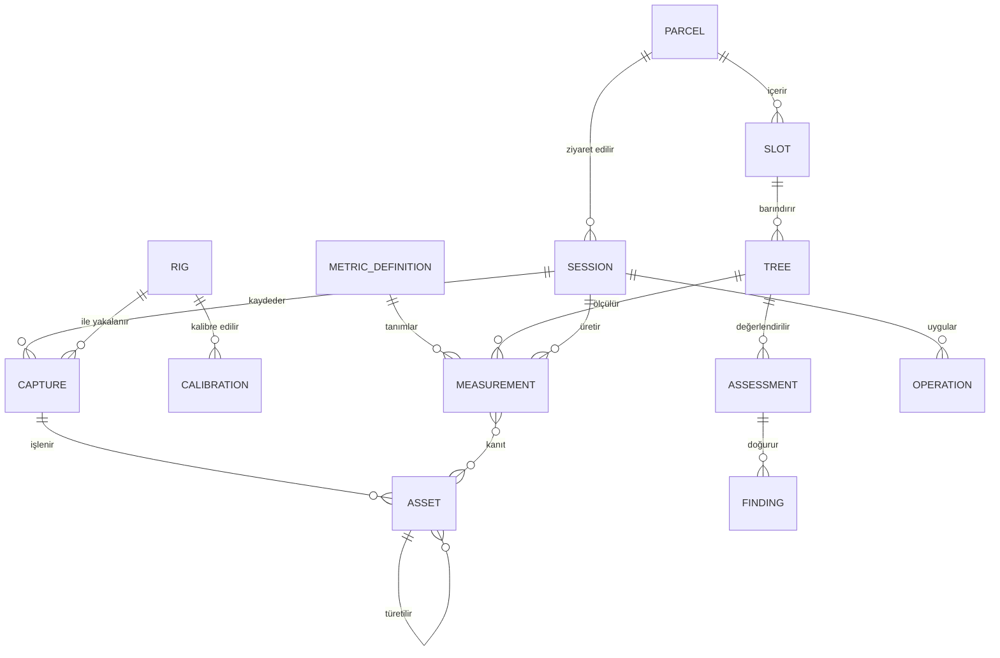

# Hedef Veri Modeli: Sensörden Bağımsız

17 Ekim 2026 · Yusuf

Hedef veri modeli dört soruyu ayrı tutar: **neyi** tarif ediyoruz (ağaç, yer, parsel), veriyi **nasıl** topladık (oturum, cihaz, kalibrasyon, ham kayıt), ham veriden **ne ürettik** (panorama, kesit, nokta bulutu) ve **ne bulduk** (ölçüm, değerlendirme, bulgu). Böylece yeni bir sensör, yöntem ya da robot üreticisi geldiğinde şema değişmez; sadece yeni kayıtlar eklenir.

MVP bu modelin bir alt kümesiyle başlar. MVP tablolarından geçiş en sonda.

## Neden gerekli: bir örnek

Aynı ağacın gövde kalınlığı üç farklı yoldan gelebilir:

| Tarih | Yöntem | Değer | Belirsizlik | Kaynak |
| --- | --- | --- | --- | --- |
| Ocak 2027 | Personel, şerit metre | 24,5 cm | ±0,3 cm | Saha personeli |
| Ocak 2028 | LiDAR, silindir uydurma v1 | 25,8 cm | ±1,2 cm | Algoritma |
| Ocak 2029 | LiDAR, silindir uydurma v2 (2028 verisi yeniden işlendi) | 25,1 cm | ±0,8 cm | Algoritma |

Bunlar aynı ağaçta aynı metriğin ölçümleridir; sadece yöntem, sürüm ve belirsizlik farklıdır. Dar bir şemada her yeni yöntem yeni bir sütun ya da tablo ister. Genel şemada her biri `Measurement` tablosunda bir satırdır.

## Katmanlar

### 1. Konu: neyi tarif ediyoruz

| Varlık | Temel alanlar |
| --- | --- |
| Org | Kiracı: işletme, kooperatif, sigorta vb. |
| Parcel | Sahibin kullandığı bahçe bölümü; tapu referansı opsiyonel; ana meyve türü (bkz. [Meyve türü](#meyve-türü)) |
| Boundary | Poligon, kaynak, sürüm, sahip onayı |
| Slot (yer) | Kod (S5-12, S5-12a), konum, sıra, pozisyon |
| Tree | Kalıcı kimlik, bağlı olduğu yer, cinsiyet (yalnız Antep fıstığı), aşı, gövde yapısı (tek/çok gövdeli), çeşit, isteğe bağlı tür (karışık bahçe), ilk görülme, durum |
| Zone | Ağaç dışı alanlar: hücre, geçilmez bölge, giriş noktası, sulama hattı |

`Tree` kimliği hiç değişmez. Ağaç kurursa durumu değişir; yerine yeni ağaç dikilirse aynı yere yeni bir `Tree` kaydı bağlanır.

### 2. Toplama: veriyi nasıl topladık

| Varlık | Temel alanlar |
| --- | --- |
| Session | Bahçede yapılan bir oturum (MVP'deki ziyaret); tür (tarama / biçme / ilaçlama / elle kayıt), yapan (ekip ya da robot), tarih, metodoloji sürümü; taramada yöntem (yürüyüş, motosiklet, robot) ve ölçülen kamera yüksekliği |
| Device | Üretici, model, seri no, yazılım sürümü; insan kiti ya da robot |
| Sensor | Bir cihaza bağlı sensör: 360° kamera, LiDAR, GNSS, termal, telefon kamerası |
| Rig | Bir oturumda birlikte kullanılan sensörlerin düzeni |
| Calibration | Sensörlerin iç parametreleri ve birbirlerine göre konumları; geçerlilik tarihleri. Kit robota takılacaksa `extrinsics.kit_mount` sensör pozlarını robotun `kit_mount` frame'inde tutar; `chip_id` kitin kimlik çipine yazılan numaradır. İkisi de yazıldıktan sonra değişmez, yeniden kalibrasyon yeni kayıttır ([arayuzler.md](arayuzler.md#kit-kimlik-çipi)) |
| Capture | Ham kayıt: dosya, zaman aralığı, rig, kalibrasyon sürümü (video, MCAP, GNSS ham, fotoğraf) |

### 3. Ürün: ham veriden ne ürettik

| Varlık | Temel alanlar |
| --- | --- |
| Asset | Türetilmiş dosya: panorama, ağaç kesiti, yörünge, nokta bulutu, ağaç bulutu. Tür, dosya hash'i, poz, kalite skoru, **kaynak kayıtlar** ve **üreten hat + sürüm + parametre hash'i** |

Her ürün, hangi ham kayıttan ve hangi hat sürümüyle üretildiğini bilir. Hat güncellendiğinde ham kayıt hâlâ duruyorsa ürünler yeniden üretilebilir; eski ürünler sürümleriyle birlikte kalır.

### 4. Bulgu: ne bulduk

| Varlık | Temel alanlar |
| --- | --- |
| MetricDefinition | Metrik kaydı: kod, ad, birim, değer tipi (sayı / ölçek / kategori / evet-hayır), geçerli dönemler, karnede gösterilip gösterilmediği |
| Measurement | Konu (ağaç, yer, parsel ya da bölge), metrik, değer, birim, belirsizlik, yöntem + sürüm, kaynak (personel / algoritma / AI / uzman), oturum, kanıt ürünleri, ölçüm zamanı |
| Assessment | Yargı: genel sınıf; dayandığı ölçümler; kaynak (AI / model / uzman); güven |
| Finding | Raporlanan bulgu: tür, önem, açıklama, öneri, kanıtlar, onaylayan |
| Operation | Bahçeye yapılan işlem: biçilen alan, ilaç ürünü, doz, reçete no, toprak işleme alanı; yapan (insan ya da robot) |

`Operation`, robotların yaptığı işleri ve elle girilen işleri aynı yerde tutar. Böylece bir ölçümdeki değişim, öncesindeki işlemlerle (budama, ilaçlama) ilişkilendirilebilir.

## Metrik kaydı örnekleri

| Kod | Birim | Yöntemler | Dönem | Karnede |
| --- | --- | --- | --- | --- |
| `dead_branch_scale` | 0–3 | personel sorusu, AI görsel, uzman | Tümü | Evet |
| `crown_diameter` | m | LiDAR (`lidar_crown`), fotogrametri | Yapraklı | Evet |
| `crown_volume` | m³ | LiDAR (`lidar_crown`, dışbükey zarf) | Yapraklı | Evet |
| `tree_height` | m | LiDAR (`lidar_crown`) | Tümü | Evet |
| `crown_base_height` | m | LiDAR (`lidar_crown`) | Tümü | Hayır (portalda taç çizimi için) |
| `size_class` | fidan / genç / verimli / yaşlı | LiDAR önerisi (`lidar_crown`, taç çapından) | Yapraklı | Hayır (ofis ve uzman için öneri) |
| `trunk_diameter_h30` | cm | şerit metre, LiDAR silindir uydurma | Tümü | Evet |
| `scaffold_branch_count` | adet | uzman gözlemi, QSM (`lidar_qsm`) | Kış | Evet |
| `fractal_dimension` | — | QSM, kutu sayma (`lidar_qsm`) | Kış | Hayır (araştırma) |
| `wood_volume` | m³ | QSM (`lidar_qsm`) | Kış | Hayır (araştırma) |
| `pruned_wood_volume` | m³ | iki kış taramasının farkı (`lidar_pruning`) | Kış | Değerlendirilecek (araştırma) |
| `pruned_wood_fraction` | oran | iki kış taramasının farkı (`lidar_pruning`) | Kış | Değerlendirilecek (araştırma) |
| `pruning_cut_count` | adet | iki kış taramasının farkı (`lidar_pruning`) | Kış | Evet |
| `fruit_load_scale` | 0–3 | personel, AI görsel, uzman | Yaz | Evet |
| `canopy_temp_delta` | °C | termal | Yaz | Değerlendirilecek |
| `weed_height` | kısa / orta / uzun (parsel) | personel sorusu | İlkbahar, yaz | Evet |

Yeni bir ölçüm türü eklemek, bu tabloya bir satır eklemek demektir. LiDAR satırlarının yöntemleri ve doğruluğu: [lidar-olcumleri.md](lidar-olcumleri.md). Algoritmanın yazdığı `pruning_status` ve `size_class` birer öneridir; ağacın `age_class` özelliğini ve budama kararını ofis ya da uzman verir.

## Kurallar

- **Yöntem önceliği:** Aynı metrik birden çok yöntemle ölçüldüğünde karnede hangisinin gösterileceği metrik başına tanımlanır (örneğin gövde kalınlığında önce LiDAR v2, yoksa şerit metre). Diğer değerler kaybolmaz.
- **Yöntemler arası tutarlılık:** Yeni bir yöntem devreye girmeden önce, aynı ağaçlarda eski yöntemle yan yana ölçülür. Aradaki sapma belgelenir; gerekirse düzeltme uygulanır. Böylece zaman serisinde yöntem değişikliğinden gelen sıçramalar ağaçtaki gerçek değişim sanılmaz.
- **Belirsizlik:** Sayı ve ölçek değerli her ölçüm bir belirsizlik değeri taşır (zorunlu). Kategori ve evet/hayır değerlerinde belirsizlik boş bırakılabilir: personelin "kuru dal var mı?" sorusuna verdiği cevabın sayısal bir hata payı yoktur, uydurulmuş bir değer (ör. 0) yanıltıcı olur. Bu değerlerin güvenilirliği kaynak, yöntem ve gerekiyorsa `confidence` (0–1) ile ifade edilir. Karne, belirsizliği yüksek değişimleri "anlamlı değişim" olarak göstermez.
- **Evet/hayır değerleri:** Ayrı bir değer tipi (`boolean`) ve sütunu (`value_boolean`) vardır; 0/1 ölçeğine ya da `yes`/`no` kategorisine sıkıştırılmaz. Saha uygulamasının personel cevapları (`value_bool`) buraya yazılır. Evet/hayır metriğinin birimi yoktur.
- **Gösterilecek değer:** Bir ağaç için birden çok değerlendirme ya da aynı metrik için birden çok ölçüm varsa, karne ve harita tek bir değer gösterir. Sıra:
  1. **En yeni oturum kazanır.** Oturumun zamanı başlangıcıdır (`started_at`; yoksa planlanan gün, o da yoksa kayıt zamanı). Oturuma bağlı olmayan bir satırda satırın kendi zamanı (`assessed_at` / `measured_at`) kullanılır. Böylece eski bir uzman görüşü, sonraki bir ziyaretin sonucunu gölgelemez.
  2. **Aynı oturum içinde kaynak karar verir:** değerlendirmede uzman > model > AI; ölçümde uzman > algoritma > personel > AI.
  3. **Eşitlikte** satırın zamanı, sonra kayıt zamanı (`created_at`), sonra kimlik.

  Sahip ve izleyici yayımlanmamış oturumları görmediği için onlar için en yeni **yayımlanmış** oturum geçerlidir; kurum rolleri yayımlanmamış daha yeni bir oturumu görür. Veritabanında `tree_latest_assessment` ve `tree_latest_measurement` görünümleri bu kuralı uygular (`session_time` sütunu seçilen oturumun zamanıdır); diğer değerler silinmez. Metrik başına yöntem önceliği (yukarıda) tanımlandığında 2. adım onunla değiştirilecek.
- **Yayın:** Bir oturumun sonuçları (ham kayıt, ürün, ölçüm, değerlendirme, bulgu) sahip ve izleyiciye ancak oturum `published` durumuna geçince görünür. Kurum rolleri (saha personeli, uzman, operasyon) her zaman görür. Oturuma bağlı olmayan kayıtlar (parsel, sınır, yer, ağaç) ve oturum satırının kendisi bundan etkilenmez. Kural veritabanında satır bazlı yetkiyle uygulanır; görünümler ve medya dosyaları da aynı kurala uyar. Yayın sadece uzmanın çağırdığı `publish_session` fonksiyonuyla yapılır; ziyaretteki her aktif ağacın uzman değerlendirmesi olmalıdır. Yayın geri alınamaz; yayımlanmış ziyaretin değerlendirme ve bulguları değiştirilemez, uzman ölçümü eklenemez (düzeltme yeni ziyaretle yapılır). Saha personelinin, algoritmanın ve AI'ın geç gelen ölçümleri eklenebilir.
- **Yeniden hesaplanabilirlik:** Her ölçüm ve ürün, onu üreten hat sürümüne bağlıdır. Yeni bir model eski veriyi yeniden işleyebilir; eski sonuçlar da silinmeden sürümleriyle saklanır.
- **Koordinatlar:** Global koordinatlar WGS84'te tutulur; her parsel için ayrıca yerel bir koordinat sistemi tanımlanır (köşe orijinli, metre cinsinden). Robot navigasyonu ve ağaç bazında ölçümler bu yerel sistemde çalışır. Her poz, hangi koordinat sisteminde olduğunu ve belirsizliğini taşır.
- **Zaman:** Tüm zaman damgaları UTC ve GNSS zamanına bağlıdır.
- **Ölçek:** `Measurement` en büyük tablo olacak. Örneğin 5.000 bahçe × yılda 4 ziyaret × 300 ağaç × ~30 metrik, yılda ~180 milyon satır eder. Bu tablo yıla göre bölümlenir; analiz için object storage'da Parquet kopyası tutulur.

## Etiketli veri: gövde tıklamaları

Ofis üçgenleme aracında (İP5) her ağaç konumu, panoramalarda gövdeye yapılan tıklamalardan hesaplanır. Bu tıklamalar ileride bir gövde tespit modelinin eğitim ve değerlendirme etiketleridir; envanterle birlikte `trunk_label` tablosuna yazılır.

| Alan | Anlamı |
| --- | --- |
| `org_id`, `parcel_id`, `session_id` | Kurum, parsel ve envanterin kaydedildiği oturum |
| `panorama_asset_id` | Tıklanan panoramanın `asset` satırı (tam çözünürlük, yoksa önizleme). Yerel geliştirme kaynağında boş |
| `panorama_gps_time_ns` | Panorama karesinin GPS zamanı; aynı karenin tam ve önizleme satırlarını birlikte tanımlar |
| `yaw_deg`, `pitch_deg` | Tıklamanın panorama orta sütununa (`pose.heading_deg`) göre yatay açısı (sağa pozitif) ve yataya göre dikey açısı (yukarı pozitif). Piksel bunlardan çıkar: `x = (yaw/360 + 0,5) × genişlik`, `y = (0,5 − pitch/180) × yükseklik` |
| `azimuth_deg` | Tıklamanın mutlak yönü (`heading_deg + yaw_deg`) |
| `tree_id`, `slot_id` | Tıklanan ağaç ve yeri |
| `unsure`, `moved` | Kişi ağacı "emin değilim" diye işaretledi; ya da üçgenlenen konumu haritada elle kaydırdı (tıklamalar o zaman şüphelidir) |
| `method`, `method_version` | `office_triangulation` ve aracın sürümü |
| `labelled_by`, `labelled_at` | Kim tıkladı, ne zaman |

Kurallar:

- **Ekleme-yalnız:** API kullanıcıları etiket ekler, değiştiremez ve silemez. Kimse güncelleyemez; güvenilir roller (servis rolü) testler ve veri silme talepleri için silebilir. Etiketi olan bir ağaç ya da yer, etiketleri silinmeden silinemez.
- **Sadece kurum rolleri görür:** saha personeli, uzman, operasyon. Sahip ve hissedar görmez. Yazma saha personeli ve operasyonla sınırlı, yalnız kendi adına (`labelled_by = auth.uid()`).
- Etiketler `save_inventory(...)` ile yer ve ağaçlarla aynı işlemde yazılır; bir satır geçersizse hiçbiri yazılmaz.
- Görüntünün kendisi kopyalanmaz; etiket panorama satırını ve karesini gösterir.

## Doğrulama listesi ve envanter onayı

Envanterde ofis üçgenlemesinden sonra belirsiz yerler sahada kontrol edilir (`docs/MVP.md` Modül 2, adım 8–10). Liste bir `verification` oturumuna (doğrulama turu) bağlı kalemlerdir: `verification_item`.

| Alan | Anlamı |
| --- | --- |
| `org_id`, `parcel_id`, `session_id` | Kurum, parsel ve doğrulama turu (`session.kind = verification`) |
| `slot_id`, `tree_id` | Bakılacak yer; kalem açıldığında yerdeki aktif ağaç (boş yerde boş) |
| `reasons` | Nedenler (en az bir): `high_uncertainty` (belirsizlik yüksek), `empty_slot` (boş yer), `unsure` (emin değilim), `multi_stem` (çok gövdeli), `possible_sapling` (fidan olabilir), `off_row` (sıra dışında), `triangulation` (üçgenleme uyarısı), `other` |
| `note` | Ofisin personele notu |
| `status` | `open` (açık), `checked` (bakıldı: sonuç girildi), `closed` (bakılmadan kapatıldı; not zorunlu) |
| `tree_present`, `closeup_capture_id`, `result_note` | Sonuç: yerde ağaç var mı, yakın plan fotoğrafı (`capture`, tür `photo`), not |
| `checked_by`, `checked_at` | Kim, ne zaman baktı ya da kapattı |

Kurallar:

- **Sadece kurum rolleri görür**; sahip ve hissedar görmez. Yazma yalnızca fonksiyonlarla: `create_verification_tour(...)` (saha personeli, operasyon: `planned` bir `verification` oturumu ve kalemleri), `record_verification_result(...)` (saha personeli, operasyon), `close_verification_item(...)` (saha personeli, uzman, operasyon). Saha uygulamasının okuyacağı ve yazacağı alanlar: `docs/arayuzler.md`, "Doğrulama kalemleri".
- **Sonuç envantere işlenir:** "ağaç var" boş yere yeni bir aktif ağaç ekler (`first_seen_session_id` = doğrulama turu); "ağaç yok" yerdeki ağacı `lost` yapar. Yer kodu korunur, ağaç kimliği silinmez.
- Açık kalemi kalmayan tur `captured` olur.
- **Envanter onayı:** `approve_inventory(oturum)` sadece işletmenin uzmanı çağırır. Parselde yer olmalı ve açık kalem kalmamalı; yoksa eksikler hata ayrıntısında döner. Envanter oturumu `publish_session` gibi yayımlanır (`published_at`, `published_by`; bulgular ve uzman değerlendirmeleri imzalayan adına onaylanır), ama her aktif ağacın uzman değerlendirmesi aranmaz. Parsel `inventory_done` olur (izlemedeki parsel durumunu korur).
- **Onaydan sonra kodlama donar:** yayımlanmış bir envanter oturumu olan parselde yerlerin kodu (`row_no`, `position_no`, `suffix`, `kind`) ve konumu (`position`, belirsizlik, yerel koordinat) kimse tarafından değiştirilemez, API kullanıcıları yer silemez, ağaç başka yere taşınamaz. Ağaç özellikleri (cinsiyet, aşı, yaş, çeşit, durum) değişebilir; yeni yer eklenebilir (sonradan dikilen ara ağaç).
- **Saha sınırı:** Saha uygulamasının köşe olaylarından işleme hattı (`orchados-pipeline boundary`) yeni bir `boundary` sürümü yazar: kaynak `field_survey`, köşe belirsizliğiyle. Gerekirse sınır ofiste de çizilebilir. Sahip `approve_boundary` ile onaylar.

## Kapsama raporu

İşleme hattı her taramada kapsama kalite kapısını hesaplar (`docs/metodoloji.md` bölüm 10): her aktif ağaç iki yönden yeterince görüldü mü, parselde kapsanan ağaçların oranı eşiği geçiyor mu, kapsanmayan ağaçlar 10×10 m hücrelerde kümeleniyor mu (kör nokta). Ağaç başına ayrıntı çalıştırma klasöründeki `coverage.json`'da kalır; yükleme sırasında özet `coverage_report` tablosuna yazılır.

| Alan | Anlamı |
| --- | --- |
| `org_id`, `parcel_id`, `session_id` | Kurum, parsel, ziyaret |
| `pipeline`, `pipeline_version`, `params_hash` | Raporu üreten hat, sürümü ve parametre hash'i |
| `active_trees`, `covered_trees` | Aktif (konumlu) ağaç ve kapsanan ağaç sayısı |
| `ratio`, `passed`, `missing_trees` | Sayılardan veritabanında hesaplanır: oran, `ratio >= threshold`, eksik ağaç sayısı |
| `threshold` | Raporun eşiği (hattın parametresi; ilk değer 0,95) |
| `blind_spots`, `blind_spot_cells` | Kör nokta hücre sayısı ve hücreler (hücre no, köşeler, eksik ağaçların yer kodları) |
| `rescan_needed` | Eşiğin altında ya da kör nokta var: ek ziyaret gerekir |
| `missing_slot_codes` | Kapsanmayan ağaçların yer kodları |
| `rule` | Raporun kuralı: hattın kapsama parametreleri (`min_view_score`, `min_directions`, `min_view_spread_deg`, hücre kuralı) |
| `created_by`, `created_at` | Kaydeden (ops kullanıcısı, hat) ve zaman |

Kurallar:

- **Ekleme-yalnız ve sürümlü.** Yazma yalnız `record_coverage_report(oturum, rapor)` ile, operasyon rolüyle (hattın kullanıcısı). Aynı ziyaretin en yeni raporu aynı hat sürümü, parametreler ve sayılarla geliyorsa yeni satır açılmaz; yeniden işleme yeni bir rapor ekler, eskisi kalır. Ziyaretin geçerli raporu en yenisidir.
- **Görünürlük** diğer sonuçlarla aynıdır: kurum rolleri her zaman, sahip ve hissedar ziyaret yayımlandıktan sonra görür (karnede "Denetim güveni").
- **Karar:** `session` üzerinde bir JSON alan yerine ayrı tablo. Gerekçe: ölçümler gibi sürümlü olmalı (yeniden işleme eskiyi silmez), oturum satırını değiştirme yetkisi hatta verilmemeli, alanlar sorgulanabilir olmalı (eşiğin altındaki ziyaretler, envanter onayının denetimi) ve satır bazlı yetki sonuç tablolarıyla aynı kalmalı. Parsel konulu bir `measurement` (ör. `coverage_ratio`) da düşünüldü; ama eşik, sonuç, kör noktalar ve kural tek bir ölçüm değerine sığmıyor.

## LiDAR kaydı ve kapısı

LiDAR'lı kitin taramasında ölçümler (İP16) ve 3D dünya bulutu (İP17), ham kayıttan kayıt adımıyla (`orchados-pipeline lidar register`) üretilen buluttan çıkar. LiDAR ölçümleri sahibe uzman onayı beklemeden gider ([lidar-olcumleri.md](lidar-olcumleri.md) §9); bu yüzden kaydın kalite kararı onların önündeki kapıdır. Her kayıt çalıştırması `lidar_registration` tablosunda bir satırdır. Rapor dosyası ve neden kodları: [arayuzler.md](arayuzler.md#kayıtlı-nokta-bulutu); tasarım ve gerekçe: [superpowers/specs/2026-11-18-lidar-kayit-adimi-design.md](superpowers/specs/2026-11-18-lidar-kayit-adimi-design.md) §5.8, §5.11.

| Alan | Anlamı |
| --- | --- |
| `id` | Satır kimliği; ölçümlerin ve dünya bulutunun taşıdığı `registration_id` |
| `run_id` | Hattın çalıştırma kimliği (`registration.json`); tekil |
| `org_id`, `parcel_id`, `session_id` | Kurum, parsel (ziyaretten) ve ziyaret |
| `method`, `method_version`, `params_hash` | Kayıt yöntemi (`point_lio+gtsam_ppk` …), sürümü, parametre hash'i |
| `ppk_status` | `ppk`, `no_ppk`, `ppk_failed` |
| `metrics` | Kalite ölçütleri (`registration.json` `metrics`) |
| `auto_verdict`, `reasons` | Hattın kararı (`accepted_auto`, `review`, `rejected_auto`) ve neden kodları |
| `status` | `recording` (yükleniyor: ölçümleri ve bulutu henüz yükleniyor), `pending_review` (incelemede), `accepted` (kabul), `rejected` (ret), `superseded` (yerine daha yeni bir kabul geldi) |
| `decided_by`, `decided_at`, `decision_note` | Operasyonun kararı; otomatik kararda boş |
| `created_at` | Kayıt zamanı |

Kurallar:

- **Önce yükleme, sonra etkinleştirme:** Kayıt `recording` durumunda açılır. Bu durumda parsel okuyucuları onun satırlarını görmez, önceki kabulün yerine geçmez ve operasyonun inceleme listesine girmez. Hat ölçümleri ve dünya bulutunu yükledikten sonra kaydı `activate_lidar_registration` ile etkinleştirir; durum `auto_verdict`'ten gelir: `accepted_auto` → `accepted`, `review` → `pending_review`, `rejected_auto` → `rejected`. Yükleme yarıda kalırsa kayıt `recording`'de kalır ve sahip ziyaretin önceki kabulünün değerlerini görmeye devam eder.
- **Ekleme-yalnız:** Satır silinmez. Yeniden işleme yeni bir `run_id` ile yeni satır ekler; eskisi kalır.
- **Karar bir kez:** `pending_review` kayıt yalnız `decide_lidar_registration` ile ve yalnız bir kez `accepted` ya da `rejected` olur. `recording` yalnız etkinleştirmeyle ve yalnız kararının verdiği duruma geçer. Başka tek geçiş `accepted` → `superseded`'dir ve kendiliğinden olur (aşağıda). `rejected` ve `superseded` son durumdur.
- **Ziyarette tek geçerli kabul:** Bir kayıt `accepted` olunca (otomatik ya da operasyon kararıyla) aynı ziyaretin o ana kadar geçerli `accepted` kaydı `superseded` olur. Ziyaretin geçerli kaydı tek `accepted` satırıdır; olmayabilir.
- **`record_lidar_registration(p_session_id, p_payload)`** (yalnız operasyon; hat, `lidar upload`) → satırın kimliği. `p_payload`: `registration.json` (`run_id`, `method`, `method_version`, `params_hash`, `ppk_status`, `metrics`, `verdict`, `reasons`). Satır `recording` olarak açılır. Aynı `run_id` yeniden gelirse yeni satır açılmaz, var olanın kimliği döner. Demo claim'i reddedilir.
- **`activate_lidar_registration(p_id)`** (yalnız operasyon; hat, `lidar upload` ölçümleri ve bulutu yükledikten sonra) → güncel satır. `recording` kaydı kararının durumuna geçirir; `accepted` olursa ziyaretin önceki kabulü `superseded` olur. Zaten etkinleşmiş kayıtta bir şey değiştirmeden satırı döner. Demo claim'i reddedilir.
- **`decide_lidar_registration(p_id, p_accept, p_note)`** (yalnız operasyon) → güncel satır. Kayıt `pending_review` değilse (ikinci karar, yarış) hata verir. Ret notu zorunludur. Demo claim'i reddedilir.
- **Tabloyu kim okur:** Kurum rolleri. Parsel okuyucuları (sahip, hissedar, izleyici, demo ziyaretçisi) tabloyu okumaz.
- Migration `private.attach_demo_guard('lidar_registration')` çağırır.

**Kapı (LiDAR ölçümleri ve dünya bulutu):**

- LiDAR yöntemli ölçüm satırı (`lidar_crown`, `lidar_qsm`, `lidar_pruning`) hangi kayıttan geldiğini taşır (`registration_id`, boş olabilir); `world_cloud` asset'i `pose.registration_id` taşır ([arayuzler.md](arayuzler.md#asset-pose-alanı)).
- `record_lidar_measurements` ve `world_cloud` yüklemesi `recording` kaydı da kabul eder (yükleme etkinleştirmeden önce gelir); `rejected` kaydı reddeder.
- Parsel okuyucuları bir LiDAR ölçümünü ya da `world_cloud`'u yalnız kaydı ziyaretin geçerli kabulüyse (`status = accepted`) görür. `recording`, `pending_review`, `rejected` ve `superseded` kaydın satırları ve dosyaları onlara kapalıdır. [Yayın](#kurallar) kuralı ayrıca geçerlidir. Görünümler (`tree_latest_measurement` gibi) ve medya imzası aynı kurala uyar.
- `registration_id`'si boş satırlar bugünkü gibi görünür: bunlar demo, sentetik ve eski verilerdir. Gerçek kit verisinin her zaman kaydı olur, çünkü `lidar upload` kaydı olmayanı `--allow-unregistered` verilmedikçe yüklemez.
- Kurum rolleri hepsini görür; personel dünyasındaki inceleme bunun için var ([3d-dunya.md](3d-dunya.md) §9.4).
- Kabul anında ölçümler ve bulut zaten yüklü olduğu için hemen görünür olur; hattı yeniden çalıştırmak gerekmez. Ret sonrası kapalı kalırlar.
- `record_lidar_measurements`: `registration_id` aynı ziyaretin kaydı olmalıdır, `rejected` bir kayda ölçüm yazılmaz. "Zaten var" denetiminin anahtarı `registration_id`'yi de içerir; yeni çalıştırmanın ölçümleri eskilerin yanına eklenir.
- Mekanizma (sütun ve satır yetkisi ya da görünüm) migration'da seçilir. pgTAP denetler: sahip, hissedar, izleyici ve demo ziyaretçisi bekleyen ya da reddedilmiş bir kaydın ölçümünü ve `world_cloud`'unu göremez; kabulden sonra görür.

## Müşteri, teklif ve ödeme

İP12 ile müşteri hesabını kendisi açar, başvurur, teklif alır ve öder. Tasarım ve bütün sözleşmeler (sütunlar, fonksiyon imzaları, hata kodları) [musteri-yonetimi.md](musteri-yonetimi.md) §6'da; burada yalnızca özet var. Migration'lar `20261030100000`–`104999` (İP12-A1) ve `20261030105000`–`109999` (İP12-A2).

| Tablo | Şema | Ne tutar |
| --- | --- | --- |
| `org_billing_setting` | public | Kayda açık mı (en fazla bir org), satıcı bilgileri, IBAN, süreler, `identity_number_required`, `allow_fake_payments` ve `legal_gate_enforced` (üretim kapısı, T21; ikisi de yalnız SQL ile) |
| `service_package`, `price_list`, `price_list_item` | public | Paket (yıllık periyodik ziyaret sayısı) ve sürümlü fiyat listesi (dönüm başına birim fiyat, minimum ücret, envanter ücreti, KDV). Yayımlanan sürüm değişmez |
| `service_application`, `application_garden` | public | Başvuru (`B-YYYY-NNNNNN`) ve bahçeleri: konum, kaba sınır, beyan ve doğrulanmış alan. Parsel, ödeme tamamlanınca açılır |
| `quote`, `quote_item` | public | Teklif: girdiler ve tutarlar dondurulur (`quote_guard`, satırlar ekleme-yalnız) |
| `service_order`, `service_order_item` | public | Sipariş, hizmet dönemi, ödenen ve iade edilen tutar |
| `order_installment`, `order_installment_item` | public | Ödeme planı (`installments-v1`): envanter ödemesi ve ziyaret ödemeleri, son günleri, ödenen ve iptal edilen tutar; satır payları. Silinmez, tutarı değişmez ([musteri-yonetimi.md](musteri-yonetimi.md) §5.6, §6.14) |
| `payment`, `payment_item`, `refund` | public | Kart denemesi ya da havale, makbuz numarası, kalem bazında iade. Her ödeme tam olarak bir plan ödemesini öder (`order_installment_id`) |
| `audit_event` | public | Denetim kaydı: aktör ve rolü açıkça verilir, ayrıntıda kişisel veri yok. Ekleme-yalnız |
| `billing_profile`, `payment_billing_snapshot` | private | Fatura bilgisi; TCKN yalnızca gerekirse, anlık görüntüde maskeli |
| `consent_record` | private | KVKK aydınlatma ve açık rızalar, metin sürümüyle. Ekleme-yalnız; hesap silinse de `subject_id` ile kalır |
| `customer_signup`, `signup_attempt` | private | Telefonu doğrulanmayı bekleyen kayıt; oran sınırı için IP, telefon ve e-posta özeti (HMAC) |
| `application_garden_detail` | private | Bahçenin tapu, yetki, erişim notu ve saha kişisi bilgisi |
| `payment_event` | private | Sağlayıcı çağrıları ve bildirimleri (izinli alanlar). Ekleme-yalnız |
| `document_sequence` | private | Belge numarası sayaçları (B, T, S, M, I; yıl başına) |

Kurallar:

- **Para** kuruş cinsinden `bigint`, yanında `currency = 'TRY'`; **alan** m² (`numeric(12,2)`).
- **Görünürlük:** Müşteri kendi satırlarını, işletmenin `ops` kullanıcısı işletmenin satırlarını görür; saha, uzman, sahip ve hissedar faturalama verisi görmez. İç sütunlar (`ops_note`, `provider_token`, `manual_note`, `refund.note` …) **sütun yetkisiyle** gizlidir: `select *` reddedilir, web `BILLING_COLUMNS` (`apps/web/src/lib/billing/columns.ts`) listeleriyle okur. API kullanıcıları bu tablolara yazamaz; her değişiklik `customer_*`, `ops_*`, `signup_*` ya da `payment_*` fonksiyonlarından geçer.
- **Durum geçişleri** koşullu güncellemedir; satır bu arada değiştiyse `state_changed`. Kilit sırası başvuru → teklif → sipariş → ödeme → iade.
- **Silme:** `customer_user_id` `on delete restrict`; testler `testing.purge_billing_users` ile temizler.
- **Hesap eşleştirme:** Self-servis hesap (`app_metadata.signup = 'self'`) e-postayla hiç eşleştirilmez; telefonla eşleşme doğrulanmış telefon ve tamamlanmış kayıt ister (`ops_find_user_id`).
- **Geçiş:** İP12 öncesindeki her KVKK onaylı `owner_profile` için bir `kvkk_notice` rıza kaydı yazıldı (kaynak `ops`, metin sürümü profilden).

### Fonksiyonlar (İP12-A2)

Hepsi `security definer`, `search_path = ''`; hatalar kısa koddur, `detail` yalnızca alan adını taşır. İmzalar [musteri-yonetimi.md](musteri-yonetimi.md) §6.9'da.

| Grup | Fonksiyonlar | Kim |
| --- | --- | --- |
| Fiyat | `public_package_prices`, `price_preview` (kayda açık org, yayımlı liste); `ops_preview_quote`. Hesap tek yerde: `private.price_lines` (`pricing-v1`) | anon + authenticated; ops |
| Teklif | `ops_issue_quote` (doğrulanmış alanlar; açık teklif `superseded`), `ops_issue_parcel_quote` (mevcut parseller: ilk yıl ya da yenileme, yenilemede başlangıç eski bitiş + 1 gün) | ops |
| Müşteri | `customer_accept_quote` (fatura profili, son KVKK aydınlatma kaydı, mesafeli satış ve ön bilgilendirme onayı; toplam 0 ise sipariş hemen aktif), `customer_decline_quote`, `customer_cancel_order`, `customer_payment_instructions`, `receipt_data` | müşteri (makbuz: müşteri ya da ops) |
| Sipariş | `ops_cancel_order`, `ops_extend_payment_due`, `ops_terminate_order` | ops |
| Ödeme | `payment_begin`, `payment_attach_token`, `payment_by_token`, `payment_record_event`, `payment_finalize`, `payment_attempts_to_reconcile` (Edge sözleşmesi `supabase/functions/_shared/payments/db.ts`) | service_role |
| Havale ve inceleme | `ops_record_manual_payment` (bir plan ödemesine ya da açık ödemelere sırayla), `ops_void_manual_payment`, `ops_resolve_payment_review` | ops |
| Ödeme planı | `quote_installment_plan` (teklif sayfası), `package_visit_windows` (herkese açık); `ops_order_installments`, `ops_overdue_installments`, `ops_allow_unpaid_visit` | müşteri ya da ops; ops |
| İade | `ops_request_refund`, `ops_can_process_refund`, `ops_complete_manual_refund`, `ops_cancel_refund`, `ops_resolve_refund`; `payment_refund_claim`, `payment_refund_report` | ops; service_role |
| Back office | `ops_billing_summary`, `ops_customers`, `ops_billing_internal` (iç sütunlar), `ops_orders`, `ops_payments`, `ops_payment_events`, `ops_refunds`, `ops_audit_events` | ops |
| Yardımcı ve zamanlanmış | `private.activate_order`, `private.create_customer_parcel`, `private.open_system_refund`, `private.enqueue_billing_notification`, `private.billing_housekeeping` (her gece), `private.dispatch_payment_reconcile` (10 dakikada bir) | — |

- **Tutulan para:** Siparişin kalan borcu, aktivasyon ve iptal `paid_kurus - refunded_kurus` ile hesaplanır; iade edilmiş havale ödenmiş sayılmaz, tamamı iade edilen sipariş iptal edilebilir.
- **Aktivasyon:** `paid_kurus - refunded_kurus >= total_kurus` olunca tek işlemde her bahçe için `registered` parsel, ayrıntısı, kaba sınırı (v1 `owner_declared`) ve sahip erişimi açılır; hizmet dönemi bir yıldır. Fonksiyon idempotenttir.
- **`payment_finalize`:** Sağlayıcının tutarı ödeme satırıyla karşılaştırılır. Uyuşmazlıkta sonuç `pending_review` olur ve `provider_mismatch` nedenli bir `void` iadesi açılır. Kapalı siparişe düşen başarılı ödeme tam tutarla (`order_closed`), toplamı aşan kısım `overpayment` nedeniyle iade edilir. `succeeded`/`voided` satıra yinelenen çağrı hiçbir şey değiştirmez. `failed` satır yalnızca sağlayıcı paranın çekildiğini bildirirse (geç başarı, `payment.late_success` denetim kaydı) değişir; ops'un reddettiği inceleme (`review_rejected`) değişmez. Uyuşmazlık incelemesindeki satır (`amount_mismatch`, `reference_mismatch`) yalnızca void iadesiyle `voided` olur; o void ops tarafından iptal edilemez. Mutabakat önce `initiated`, sonra token süresinden 10 dakika sonrasına kadar `expired` ve `not_completed` ile `failed`, en son dolandırıcılık incelemesindeki denemeleri listeler; sahte ödeme `allow_fake_payments` kapalıyken başarılı yazılmaz.
- **Canlı deneme:** `pending_review`, ya da süresi dolmamış token'lı `initiated`/`expired` kart denemesi. Token'ı henüz eklenmemiş `initiated` deneme 15 dakika canlı sayılır. Canlı deneme varken sipariş iptal edilmez ve havale kaydedilmez (`payment_in_progress`).
- **İade tavanı:** `tutar + Σ(requested, processing, succeeded)` ödemenin (`coalesce(provider_amount_kurus, amount_kurus)`) ve kalemin tutarını aşamaz; başarısız iadenin yeniden denenmesinde yeniden denetlenir. `retryable = false` iade yeniden gönderilmez; ops `processing` iadeyi ancak sağlayıcı çağrısından 15 dakika sonra elle sonuçlandırır. `refunded_kurus` alanları yalnızca `succeeded`'a geçişte, bir kez artar.
- **Bildirimler:** `notification` artık hesap mesajlarını da taşır (`ref_id` belge kimliği, `vars.ref` belge numarası; parsel ve ziyaret boş). Şablonlar `quote_ready`, `application_rejected`, `payment_received`, `refund_completed`, `payment_reminder`; alıcı başına, şablon ve belge başına bir mesaj (`notification_ref_once`).

## Demo turu (İP13)

Olası müşteriye kısa ömürlü, salt okunur bir demo hesabı açılır; hesap tek bir demo org'unun etkin parsellerine `owner` erişimi alır. Tasarım, sözleşmeler ve hata kodları [demo-turu.md](demo-turu.md) §5–§7'de. Migration'lar `20261101120000`–`120200`. Herkese açık demo yalnızca kendi projesinde çalışır; nesneler her projeye gider ve demo org'u yoksa etkisizdir.

| Tablo | Şema | Ne tutar |
| --- | --- | --- |
| `demo_org` | private | Demo org'u ve turun sınırları: süre (`session_ttl`, 15 dk–24 sa), IP başına saatlik ve günlük başlatma, aynı anda etkin oturum, günlük toplam, oturum başı görüntü eşleme ve PDF, ziyaretçi e-posta alan adı, tur hedefleri (`tour`), veri sürümü, `loaded_at`. En fazla biri `enabled`; etkin satırın `loaded_at` değeri dolu |
| `demo_parcel` | private | Demo org'unun ziyaretçiye açılan parselleri, sırası ve etkinliği. Parsel aynı org'a ait olmalı (tetikleyici) |
| `demo_session` | private | Ziyaretçi hesabı başına bir satır: bitiş, kapanış, IP özeti, sayaçlar (`sign_calls`, `pdf_renders`) |
| `demo_attempt` | private | Başlatma sayacı: IP kovası özeti, sonuç (`admitted`, `rate_limited`, `capacity`, `closed`) ve dakika başına tek satır. Sınırlar yalnızca kabul edilenleri sayar; 48 saat tutulur |

Dördüne de `anon` ve `authenticated` için yetki yoktur; RLS açık, politika yok. Ziyaretçi yalnızca `demo_info`, `demo_end`, `demo_hit` fonksiyonlarını çağırır; Edge `demo_admit`, `demo_start` ve temizlik fonksiyonlarını servis rolüyle çağırır.

**Yazma kilidi:**
- `zz_demo_read_only`, `public` ve `private` şemalarındaki her temel tabloda bir `BEFORE INSERT OR UPDATE OR DELETE OR TRUNCATE ... FOR EACH STATEMENT` tetikleyicisidir. İstekte `app_metadata.demo` claim'i varsa (`authz.is_demo_user()`) `demo_read_only` (42501) yükseltir. Security definer fonksiyonların içindeki yazmaları da yakalar.
- İstisnalar eklenti tabloları ve `private.demo_session`'dır (`demo_end`, `demo_hit`).
- Ayrıca kısıtlayıcı politikalar (`parcel_access`, `question`, `question_reply`, `session` okuma, `storage.objects`) ve `approve_boundary`, `owner_invite_viewer`, `owner_cancel_viewer_invitation` başında `assert_not_demo` vardır.
- **Zorunluluk:** Tablo ekleyen her migration `select private.attach_demo_guard('<tablo>');` çağırır. pgTAP `43_demo_write_guard` eksik tabloyu bulur.
- **Migration sırası:** `db push --include-all` eski zaman damgalı bir migration'ı IP13-A'dan sonra uygulayabilir. Her yayına alma iş akışı push'tan sonra `private.attach_demo_guards()` çalıştırır ve `private.demo_guard_drift()` satır döndürürse başarısız olur (`20261101120300_demo_guard_drift.sql`).
- Demo ziyaretçisi `session` tablosunda yalnızca yayımlanmış ziyaretleri görür (`session_demo_select`, kısıtlayıcı); sıradan sahip incelemedeki ziyareti de görür.
- Bildirimler (`enqueue_notifications`, `enqueue_billing_notification`) demo org'larını ve demo hesaplarını atlar; `save_ai_assessment` demo org'unun ziyaretini `demo_org_no_ai` ile reddeder; demo org'unda `org_billing_setting` kayıt ya da sahte ödeme açamaz (`demo_billing_forbidden`).

**Hesap kilidi ve erişim kapsamı:**
- **Hesap kilidi:** `auth.users` üzerindeki `demo_account_freeze` tetikleyicisi, demo hesabının e-postasını, telefonunu, bekleyen e-posta ve telefon değişikliğini, parolasını ve kullanıcı metaverisini değiştirmez (`demo_account_locked`). GoTrue'nun kendi tuttuğu `email_verified`, `phone_verified`, `email`, `sub` anahtarları, oturum açma ve token sütunları serbesttir. Parolanın boşaltılmasına izin verilir: `demo_start`, Admin API'nin koyduğu rastgele parola özetini siler. Barındırılan proje tetikleyiciye izin vermezse migration uyarıyla geçer; o durumda housekeeping, bilgileri değişen demo hesabının oturumunu bitirir.
- **Erişim kapsamı:** `demo_account_scope_<sütun>` satır tetikleyicileri servis rolü dahil her çağıranda çalışır. Demo hesabı yalnızca demo org'unda `parcel_access` alır; `membership`, `owner_profile`, `billing_profile`, `consent_record` (`user_id` ve `subject_id`), `customer_signup`, `viewer_invitation`, `notification` (alıcı) ve `customer_user_id` taşıyan faturalama tablolarında (`service_application`, `application_garden`, `quote`, `quote_item`, `service_order`, `service_order_item`, `payment`, `payment_item`, `refund`) hiç satırı olmaz (`demo_account_scope`).
- **Zorunluluk:** Kullanıcıya erişim veren ya da kimliğini tutan yeni bir tablo ayrıca `select private.attach_demo_account_guard('<tablo>', '<kullanıcı sütunu>');` çağırır.
- `ops_find_user_id` ve `signup_find_account` demo hesabını hiç döndürmez.

**`demo-media` kovası:** Herkese açık kova; demo org'unun dosyaları `org/<demo org>/parcel/<parsel>/<sha256>` yolunda, `media` ile aynı baytlarla durur ve `/object/public` üzerinden imzasız sunulur. Yalnızca demo org'unun `ops` üyesi yükler (demo claim'i olmadan); güncelleme ve silme politikası yoktur.

## Üyelik boyunca bahçe ekleme ve çıkarma (İP14)

Tasarım: [bahce-yonetimi.md](bahce-yonetimi.md). Yeni üyelik tablosu yoktur; üyelik dönemi **temel sipariştir** (`addon_of_order_id` boş). Migration'lar `20261102120000`–`20261102120400`.

| Tablo / sütun | Ne tutar |
| --- | --- |
| `quote.addon_of_order_id`, `service_order.addon_of_order_id` | Ek teklif ve ek sipariş: bağlandığı temel sipariş. Ek sipariş temel siparişle aynı gün biter; yenileme hedefi olamaz |
| `application_garden.withdrawn_at` | Gönderilmiş ya da teklif verilmiş başvurudan geri çekilen bahçe; ön izlemeye, teklife ve doğrulamaya girmez |
| `service_order_item.removed_on`, `garden_removal_id` | Satırın hizmetten çıktığı ilk gün ve çıkarma kaydı; ikisi birlikte, bir kez yazılır (`service_order_item_guard`) |
| `refund.garden_removal_id` | Çıkarmanın açtığı sistem iadesi |
| `org_billing_setting` | `garden_changes_enabled` (anahtar, varsayılan kapalı), `addon_min_days` (30), `removal_notice_days` (30), `removal_access_days` (90), `removal_refund_mode` (`unused_visits` ya da `manual`) |
| `garden_removal` | Bir parselin bir müşteri için hizmetten çıkışı (`C-YYYY-NNNNNN`): `requested` → `scheduled` → `completed` ya da `cancelled`; çıkış günü (`effective_on`), salt okunur erişim sonu (`access_until`), iade hesabı (`calculation`, `removal-v1`), iade modu ve tutarı. Silinmez; tamamlanmış kayıtta yalnızca erişim bildirimi ve erişimin kaldırılması yazılır. Parsel ve müşteri başına tek açık kayıt (`garden_removal_open_uq`) |

**Kurallar:**
- **Fiyat:** Ek teklif `pricing-v2` ile fiyatlanır (`private.price_lines_v2`): ziyaret hakkı kalan güne göre orantılanır (`private.addon_visits`), minimum ücret aynı oranla, envanter ücreti satır bazında. `pricing-v1` artık teklif başına 50 alan alır.
- **Çift kapsama yok:** Bir parsel dönemleri çakışan iki siparişte bulunamaz (`private.parcel_in_service`); teklifte, bağlamada ve kabulde `parcel_coverage:<parsel>` danışma kilidi altında denetlenir. Hesap başına en çok 50 bahçe (`account_garden_limit`).
- **Çıkarma:** Çıkış gününde satırlar `removed_on` alır, parselin bütün planlı ziyaretleri, açık takip istekleri ve bekleyen davetleri iptal edilir, parsel `passive` olur, iade satırları `requested` açılır, boşalan siparişler `terminated` olur. Veri silinmez.
- **Salt okunur dönem:** `access_until` gününe kadar sahip ve hissedar soru yazamaz, hissedar davet edilemez (`parcel_read_only`); ops parseli sürdüremez (`parcel_removed`); çıkış günü ve sonrasına ziyaret planlanamaz (`parcel_removal_scheduled`). Süre bitince müşterinin sahip satırı ve davet ettiği hissedarlar kaldırılır (`private.garden_removal_housekeeping`, her gece 00:30).
- **Yetki:** Müşteri kendi çıkarma kayıtlarını iç sütunlar (`ops_note`, `requested_by`, `decided_by`, `blocked_reason`, `revoke_all_access`) olmadan okur; ops org'unun kayıtlarını. API'den yazma yoktur; bütün geçişler fonksiyonlarla yapılır (`bahce-yonetimi.md` §9.6).
- **Demo:** `garden_removal` yazma kilidini ve hesap kilidini taşır; yeni müşteri yazma fonksiyonları `assert_not_demo` ile başlar; `enqueue_garden_notification` demo org'unu ve demo hesabını atlar.

## Hukuk takip işleri, dalga 1 (T27, T21, T04, T03, T18)

Kararlar: [hukuk/kararlar.md](hukuk/kararlar.md) "Takip işleri"; sözleşmeler [musteri-yonetimi.md](musteri-yonetimi.md) §6.9, §9.3, §9.4, §20 ve [bahce-yonetimi.md](bahce-yonetimi.md) §21. Migration'lar `20261103100000`–`20261103100600`.

| Tablo / sütun | Ne tutar |
| --- | --- |
| `private.legal_text_version` | Hukuki metinlerin veritabanının bildiği sürümleri: tür, sürüm, şablon özeti (güncel olanlarda), güncel mi, son hâli mi (`-taslak` değil). Yalnızca migration'lar yazar (`private.register_legal_text`) |
| `org_billing_setting` | `kep_address`, `site_domain`, `kvkk_email` (satıcının şirket bilgileri; altbilgi ve metinler), `marketing_consent_enabled` (yalnızca SQL, İYS'den sonra açılır), `inventory_reuse_months` (yalnızca SQL, varsayılan 24) |
| `consent_kind` | `early_performance`: teklif kabulündeki isteğe bağlı erken başlama kutusu |
| `consent_record.text_sha256`, `display_sha256` | Onaylanan şablonun kayıtlı özeti; müşterinin gördüğü doldurulmuş metnin özeti (gönderilirse) |
| `private.contract_document` | Siparişe özel sözleşme belgeleri (ön bilgilendirme, sözleşme, cayma teyidi): şablon sürümü ve özeti, depo yolu, PDF özeti ve boyutu, üretici, ilgili onay kayıtları. Ekleme-yalnız; 10 yıl saklanır |
| `garden_removal.notice_channel`, `notice_received_on` | Caymanın nasıl (portal, e-posta, KEP, posta) ve hangi gün geldiği |
| `notification_template` | `contract_ready`, `withdrawal_received`, `addon_order_closed` |

**Kurallar:**
- **Sorulmayan rıza yok (T27):** `explicit_service_improvement` hiçbir zaman, `explicit_marketing` `marketing_consent_enabled` açılana kadar verilemez (`consent_not_asked`); kayıtta `false` yazılır. Geri alma serbesttir. Eski `granted = true` satırları kanıt olarak kalır, dayanak değildir.
- **Kayıtlı sürümler (T21):** Teklif kabulü ve KVKK teyidi yalnızca kayıtlı güncel sürümle olur (`legal_text_outdated`, `invalid_input`). Pilot ve üretimde (`allow_fake_payments` kapalı) taslak metin, son hâli olmayan KVKK kaydı ya da eksik şirket bilgisiyle kabul alınmaz (`legal_texts_not_final`).
- **Belgeler değiştirilemez (T04):** `contract-documents` kovasındaki nesneler güncellenemez ve silinemez (hizmet rolü dahil, `storage.objects` tetikleyicisi).
- **Erken başlama (T03):** Onay yoksa cayma süresi bitmeden envanter ve periyodik ziyaret planlanmaz (`withdrawal_period_open`); caymada kesinti yapılmaz.
- **Ek teklif (T18):** Döküm `quote.inputs.addon` içinde saklanır; envanter ücreti son envanterden 24 ay içinde yeniden eklenen bahçeden alınmaz.

## Hukuk takip işleri, dalga 2 (T23, T09, T20, T15, T16, T13, T11)

Kararlar: [hukuk/kararlar.md](hukuk/kararlar.md) H01, H05, H07, H16, H22, H25, H26, H27, H30, H32. Migration'lar `20261104100000`–`20261104100700`.

| Tablo / sütun | Ne tutar |
| --- | --- |
| `org_billing_setting` | `coowner_notice_flow_enabled` (T15), `boundary_declaration_required` (T16), `kvkk_request_form_enabled` (T11). Yalnızca SQL; barındırılan projelerde `false`, `seed.sql`'de `true`. Kapalıyken bugünkü davranış değişmez |
| `private.staff_profile` | Personelin kurum başına görünen adı ve unvanı (`(org_id, user_id)`; o kurumun ops'u `/operasyon/personel`'de düzenler; başka kurumun ops'u değiştiremez). Raporu onaylayan uzmanın adı ve unvanı raporda ve PDF'lerde (H05); demo org'unda gösterilmez (`visit_approver`) |
| `private.media_suppression` | Görüntü gizleme (T20, H01): hedef (`asset` ya da `capture`), `hide`/`unhide`, neden (`kvkk_objection`, `third_party`, `other`), not, yapan, zaman. Ekleme-yalnız (hesap silinince yalnız `created_by` boşalır, `insert_only_unlink_user`); bir hedefin en yeni kaydı geçerlidir. Medya satırı ve dosya değişmez |
| `private.boundary_approval` | Sınır onayındaki beyan (T16, Md. 6/2): sınır, kullanıcı, kayıtlı `distance_sales` sürümü, metin özeti, zaman. Ekleme-yalnız; hesap silinince yalnız `user_id` boşalır, kayıt kalır |
| `private.boundary_pointer` | Sınırı gösteren kişinin adı ve rolü (T16, H07); `boundary_pointer` olaylarından `session_event` üzerindeki tetikleyiciyle kopyalanır. Yalnız personel okur, telefon tutulmaz. Ekleme-yalnız |
| `private.boundary_dispute` | Sınır itirazı / askı (T16, Md. 6/4): `open`/`close` satırları ve not; ekleme-yalnız (hesap silinince yalnız `created_by` boşalır). Açıkken yeni envanter ve periyodik ziyaret planlanmaz (`boundary_dispute_open`) |
| `private.viewer_invitation.declared_at`, `declaration_version`, `declaration_sha256` | Sahibin hissedar davetindeki beyanı (T15): "Bu kişinin bahçede hakkı var ve numarasını vermeye yetkiliyim." |
| `private.kvkk_request` | Portaldan KVKK başvurusu (T11): tür, metin, durum, `due_at` (+30 gün), sonuçlanma. `answered` ve `rejected` kesindir: durum bir daha değişmez, `settled_at` (10 yıllık saklamanın başlangıcı) bir kez yazılır. Başvuru defteri kaydı; sonuçlandıktan sonra 10 yıl |
| `private.billing_profile.identity_number` | T13: her zaman boş (kısıt). TCKN ödeme anında alınır, yalnızca ödeme kuruluşuna gider; `payment_billing_snapshot.identity_number_last4` tek izdir |
| `notification_template` | `viewer_invited` (hissedar davet SMS'i; değişkenler: bahçe adı, portal yolu) |
| `audit_event.entity_type` | `staff_profile`, `media_suppression`, `boundary`, `boundary_dispute`, `viewer_invitation`, `kvkk_request` |

**Görünürlük (T23):**
- **Soru-cevap:** Sahip ve hissedar yalnız kendi başlattığı dizileri ve cevaplarını okur (`question.created_by`); aynı bahçenin diğer sahibinin ya da hissedarının sorularını görmez, çıkan sahibin soruları kalan sahibe açılmaz (H22, H32). Uzman ve ops org'un bütün dizilerini görür. Demo turunun kurgusal dizileri demo ziyaretçilerine açıktır. Soru bildirimi bugün yoktur; eklenecek bildirim aynı kurala uyar.
- **Personel izi (H05):** Parsel okuyucuları (sahip, hissedar, izleyici, demo ziyaretçisi) zamanı taşıyan satırları okumaz. `asset`'ten yalnız kesit ve fotoğraf satırlarını okur (kesitin `pose`'unda yön, açı ve panorama kimliği vardır, zaman yoktur). Panoramaları `public.portal_panorama_frames` verir: kare başına bir satır, tam ve önizleme kimliği sunucuda eşlenmiş, konum ve yön ile; `pose.gps_time_ns`, kare anahtarı ve çekim sırası dışarı çıkmaz. `capture` satırlarını (`started_at`, konum, `metadata.gps_time_ns`/`phone_time`) hiç okumaz; ağaca bağlı yakın planları `public.portal_closeups` verir: kimlik, ziyaret, ağaç, dosya ve çeken personel. Medya kovası bu dosyaları `authz.parcel_reader_media_object` ile imzalatır. Ham GNSS kaydı, MCAP, 360° video, ses notu, yörünge ve nokta bulutu yalnız personele açıktır (dosyaları da). İstisna, gezinin 3D dünyasının zamansız web bulutudur (`asset.kind = world_cloud`, İP17): parsel okuyucuları yayımlanmış ziyaretin bu satırını (LiDAR kaydı varsa ziyaretin geçerli kabulü olmalı: [LiDAR kaydı ve kapısı](#lidar-kaydı-ve-kapısı)) okur ve dosyasını imzalatır; ham `point_cloud` personelde kalır ([3d-dunya.md](3d-dunya.md) §5). `session_event` yalnız personel (saha, uzman, ops) içindir. Personel (kurum üyeleri) iki tabloyu eskisi gibi okur: ofis aracı, uzman paneli, işleme hattı, AI worker ve saha uygulaması değişmez. Portal tarama izini göstermez; turdaki panoramalar zaman damgası ve aralarında çizgi olmadan ayrık noktalardır. Ağaç karnesindeki fotoğraf kanıtı çekim saati yerine ziyaret gününü gösterir; konum kesitte kameranın durduğu ayrık nokta, yakın planda boştur. Sahip, hissedar ve demo ziyaretçisinin `pose->>'gps_time_ns'` okuyamadığı pgTAP ile denetlenir (`60_`, `42_`).
- **Gizlenen görüntü (T20):** Kısıtlayıcı politikalar gizli satırları ops ve saha personeli dışında herkesten saklar; medya kovası politikası dosyayı da kapatır (imzalı adres verilmez). Gizlenen panoramayla karenin öteki çözünürlüğü ve ondan kesilen ağaç kesitleri de gizlenir. Daha önce verilmiş imzalı adres en fazla 15 dakika geçerli kalır. Demo org'unun dosyalarının herkese açık `demo-media` kovasında aynı adla birer kopyası vardır ve bu kopyayı politikalar kapatmaz. Demo verisi bugün sentetiktir, ama vitrin veri kümesi (`showcase`, H28) gerçek bir bahçe olabilir. Bu yüzden kopyası duran bir demo dosyası gizlenmez (`demo_mirror_public`): ops önce kopyayı kovadan kaldırır, sonra gizler.

**`session_event` kabul edilen sapma (T16):** Sınırı gösteren kişinin adı ve rolü saha uygulamasının `boundary_pointer` olayının `payload`'ında taşınır ve orada kalır (ekleme-yalnız taşıma kaydı); asıl okuma yeri `private.boundary_pointer`'dır. `session_event` T23'ten beri yalnız personele açıktır ve KVKK betikleri her iki yeri de takma ada çevirir (`scripts/kvkk/README.md`). Geçersiz bir yük (bozuk JSON, eksik ad, bilinmeyen rol) sessizce atlanır; saha uygulamasının yazması hiçbir zaman başarısız olmaz.

**Kısa saklama işleri (T09):** `notification-purge` (12 ay), `auth-session-purge` (sona erdikten 30 gün sonra), `auth-audit-log-purge` (30 gün, H27); ayrıntı [hukuk/saklama-imha-politikasi.md](hukuk/saklama-imha-politikasi.md) §5.

## Hukuk takip işleri, dalga 3 (T05, T07, T06, T08, T09, T23, T04)

Kararlar: [hukuk/kararlar.md](hukuk/kararlar.md) H01, H12, H15, H20, H21, H22, H23, H25. Migration'lar `20261105100000`–`20261105100500`; kurallar [bahce-yonetimi.md](bahce-yonetimi.md) §22, tarama [musteri-yonetimi.md](musteri-yonetimi.md) §20.8.

| Tablo / sütun | Ne tutar |
| --- | --- |
| `org_billing_setting` | `visit_notice_sms_enabled` (T07) ve `service_end_access_flow_enabled` (T08). Yalnızca SQL; barındırılan projelerde `false`, `seed.sql`'de `true`. Kapalıyken bugünkü davranış değişmez |
| `garden_removal_reason` | Ops'un haklı sebepleri (H20, H36) `location_misdeclared`, `owner_breach`, `no_authority`, `third_party_objection`, `staff_safety`, `payment_default`, `service_withdrawn_district`, `by_agreement` (ve mevcut `transfer`, `duplicate`); sistem nedenleri `period_ended`, `order_terminated`, `pilot_ended` |
| `garden_removal.timing` | Müşterinin açık zaman seçimi: `immediate`, `notice`, `period_end`, `withdrawal` (kaydın kimliği; T05 öncesi satırlarda boş) |
| `garden_removal.owner_consent_note` | Anlaşmayla ya da bildirim süresinden erken çıkarmada Sahip'in yazılı onayının kaydı (iç; kaydın kimliği) |
| `garden_removal.initiated_by = 'system'` | T08 hizmet sonu penceresi: tamamlanmış, iadesiz satır (`calculation.formula = 'service-end-v1'`); pilot satırında `order_id` ve `order_item_id` boştur |
| `garden_removal.calculation.formula` | `removal-v2` (T05'ten sonra); `removal-v1` kayıtları değişmez |
| `private.visit_notice` | Ziyaret tarihi bildirimi (T07, 8A/1): ziyaret, gün, kanal (`message` = `visit_scheduled`, ya da `phone`), zaman, mesaj kimliği, alıcı, kaydeden. Ekleme-yalnız |
| `private.visit_postponement` | Sahip'in ertelemesi (8A/1): ziyaret başına bir kez, ilk gün, istenme zamanı, kanal (`portal`, `phone`, `written`), isteyen ya da kaydeden. Ekleme-yalnız |
| `private.missed_visit` | Yapılamayan ziyaret (8A/2–4): neden (`customer`, `company`, `weather`, `force_majeure`), ayrıntı kodu, not, `report_lost`, saha olayı (`visit_blocked`), kanıt (yakalama kimlikleri ve `visit-evidence` kovası yolları), Sahip'e bildirim (gün, kanal), önerilen tarih ya da "pencerede tarih yok", sonuç (`rescheduled`, `deemed_done`, `refunded`, `carried_over`; bir kez), iade, aktarılan pencere. Silinmez; kayıt değişmez, sonuç bir kez yazılır |
| `private.visit_reconciliation` | 8A mutabakat görevi (T06): sipariş satırı, kontrol (`window_end`, `period_end`, `removal`), kapsam sonu, ziyaret sayıları, eksik, ziyaret bedeli, son gün (+14), durum ve kapanış. Sayılar dondurulur, görev bir kez kapanır |
| `private.contract_end` | Sözleşmenin parsel ve kullanıcı için sona erme tarihi (T09, H25): son hizmet günü ve neden; her tamamlanan çıkarma ya da hizmet sonu penceresiyle yazılır. Ekleme-yalnız |
| `private.contract_sweep_ticket` | Belge taraması bileti (T04): token özeti, sipariş kimlikleri, 10 dakikalık süre; kişisel veri yok |
| `notification_template` | `visit_scheduled` (parsel ve ziyareti taşır; değişkenler `date`, `path`, `parcel_name`), `garden_transfer_reports` (C-…) |
| `audit_event.entity_type` | `session`, `missed_visit`, `visit_reconciliation`, `parcel` |
| Kova `visit-evidence` | Ops'un yüklediği yapılamayan ziyaret fotoğrafları (`<org>/<parsel>/<sha256>.<uzantı>`; özel, yalnız org'un ops'u okur ve ekler) |

**Kullanılmış ziyaret (`private.visit_usage`):** Faturalanan ziyaretler (§ İP14) artı 8A/3'e göre yapılmış sayılanlar, eksi raporu yayımlanamayanlar (`report_lost`). Çıkarma hesabı ve Bahçelerim'deki ziyaret sayısı bunu okur.

**Erişim (T08, T09):** Hizmet sonu penceresi çıkarmanın salt okunur dönemini ve erişim kaldırmasını kullanır. Pencere kapanınca ve parsele hiçbir satır hizmet vermiyorsa `parcel_detail.site_contact_phone` (ve müşterinin başvuru kopyası) silinir.

## Meyve türü

orchadOS bütün meyve bahçelerine hizmet verir; Antep fıstığı pilottur. Tür bahçe (parsel) düzeyinde tutulur, karışık bahçede ağaç düzeyinde ayrıca işaretlenir. Migration: `20261106090000_fruit_species`.

| Tablo / sütun | Ne tutar |
| --- | --- |
| `fruit_species` | Tür sözlüğü: `code` (ör. `antep_fistigi`, `zeytin`, `nar`, `diger`), Türkçe `name`, `has_methodology`, `active`, `sort_order`. Yalnız migration'la yazılır; herkes (giriş yapmamış ziyaretçi dahil) okur. Bugün `has_methodology` yalnız `antep_fistigi` için `true` |
| `parcel.species` | Bahçenin ana türü, zorunlu. Mevcut parseller pilotun türüyle (`antep_fistigi`) dolduruldu; sütunun varsayılanı da odur, ama formlar seçimi zorunlu tutar ve önceden seçili değer göstermez. Yalnız ops değiştirir (`parcel_update`) |
| `tree.species` | İsteğe bağlı tür (karışık bahçe): `null` = parselin türü. Saha personeli, uzman ve ops yazar (`tree_update`); ofis envanter düzenleyicisinde “Parselin türü (X)” varsayılandır |
| `application_garden.species` | Başvurudaki bahçe için müşterinin seçtiği tür; etkinleşmede (`private.create_customer_parcel`) parsele kopyalanır |
| `tree_species(tree_id)` | Ağacın geçerli türü: kendi türü, yoksa parselinki (çağıranın satır yetkisiyle) |
| `service_type_season` | Bir hizmetin tür başına sezon penceresi; satır yoksa `service_type`'taki varsayılan pencere geçer (bkz. aşağıda "Hizmet katmanı") |

**Kurallar:**
- **Çeşit tür değildir:** `tree.cultivar` çeşittir (ör. Siirt, Kırmızı); tür `species`'tir.
- **Fonksiyonlar:** `register_parcel` (`p_parcel ->> 'species'`), `customer_save_application_garden` (`p_garden ->> 'species'`) ve `private.create_customer_parcel` türü taşır. Listede olmayan ya da etkin olmayan kod `invalid_input`, ayrıntı `species` ile reddedilir. Türü belirtmeyen eski çağrılar: başvuru bahçesinde mevcut tür, yoksa `antep_fistigi`.
- **Metodoloji:** Antep fıstığına özgü alanlar (ağaç cinsiyeti, erkek ağaç oranı bulgusu, fıstık zararlı türleri, polen ve beyaz pul soruları, erken boşaltılmış salkım) yalnız geçerli türü `antep_fistigi` olan ağaç ve parsellerde sorulur ve gösterilir. Diğer türler genel izleme alır ([metodoloji.md](metodoloji.md#kapsam-meyve-türü)). Web uygulamasında kural tek yerdedir: `apps/web/src/lib/species.ts`.

## Hizmet katmanı: yabani ot biçme (İP15)

Ürün kararı: [MVP.md](MVP.md#modül-6--hizmet-katmanı-yabani-ot-biçme). Katalog meyve türünden ve hizmetten bağımsızdır: yeni bir hizmet (toprak işleme, budama) şema değişmeden `service_type`'a bir satır olarak eklenir. İş kaydı mevcut `operation` tablosudur. Sahip kararıyla (2 Kasım 2026) hizmeti otonom robot MARABA-I yapar ve orchadOS bir robot filosu ↔ bahçe sahibi eşleştirme platformuna dönüşür: sahip robotu seçer, fiyat robota göre değişebilir (migration `20261107100000_robot_fleet.sql`). İşi gerçekte kimin yaptığı (`performer`: `robot` ya da `crew`) iç kayıttır, sahibe gösterilmez.

| Tablo / sütun | Ne tutar |
| --- | --- |
| `service_type` | Org başına hizmet kataloğu, hizmet türü başına bir satır: `code` (ör. `weed_mowing`), ad, açıklama, `operation_kind` (mevcut `operation_kind` enum'u, ör. `mowing`), varsayılan sezon penceresi (`season_start_month`/`_day`, `season_end_month`/`_day`; yıl sonunu aşabilir, 29 Şubat seçilemez), `recommend_from_weed_height` (`medium` ya da `tall`), `observation_max_age_days` (varsayılan 60), `active`, `sort_order`, `updated_by`/`updated_at`. Fiyat tutmaz. Yalnız `weed_mowing` yüklenir, fiyatsız |
| `robot_model` | Robot filosunun modelleri, genel katalog (org'a bağlı değil): `code` (ör. `maraba_i`), `name` (ör. "MARABA-I"), `operator_org_id` (modelin robotlarını işleten org; boş: orchadOS'un kendisi, ileride üçüncü taraf işletmeciler), `short_description`, `capabilities` (sahibe gösterilen yetenek cümleleri, en fazla 12), `image_path` (`apps/web/public` altında), `active`, `sort_order`. Giriş yapmış herkes okur; yalnız migration yazar. MARABA-I (`91600000-0000-4000-8000-000000000001`) yüklenir |
| `service_type_robot_model` | Bir org'un kataloğundaki hizmeti hangi robot modellerinin yapabildiği: `org_id`, `service_type_id`, `robot_model_id`, `sort_order`; birincil anahtar (`service_type_id`, `robot_model_id`). Hizmetin varsayılan modeli sıradaki ilk etkin modeldir (`private.service_default_robot_model`). `service_type` gibi okunur; migration, seed ve demo yükleyicisi yazar. Her org'un `weed_mowing` satırına MARABA-I bağlanır |
| `service_type_season` | Bir hizmetin meyve türüne göre sezon penceresi: `service_type_id`, `species` (→ `fruit_species`), başlangıç ve bitiş ay/gün, `updated_by`/`updated_at`; birincil anahtar (`service_type_id`, `species`). Satırı olmayan tür hizmetin varsayılan penceresini kullanır. Her tür için 1 Mart – 30 Haziran yüklenir. Yazma yalnız `ops_save_service_season` ile (ops; demo reddedilir) |
| `price_list_service_item` | Bir fiyat listesi sürümünde hizmet fiyatı: `price_list_id`, `service_type_id`, `robot_model_id` (fiyatın geçtiği robot modeli; boş: "Tüm robotlar"), `unit_price_kurus` (dönüm başına, KDV hariç), `minimum_fee_kurus` (KDV hariç); KDV listenin `vat_rate_bp`'sidir. Liste, hizmet ve model başına bir satır (`unique nulls not distinct`). `price_list_item` gibi yalnız liste taslakken yazılır (`price_list_item_guard`), yalnız ops okur. Yazma `ops_save_price_list_service_items(liste, [{service_type_id, robot_model_id?, unit_price_kurus, minimum_fee_kurus?}])` ile (model, hizmeti yapabilen bir model olmalı; değilse `invalid_input`, ayrıntı `robot_model_id`) (taslağın hizmet fiyatlarını değiştirir; boş dizi hepsini fiyatsız bırakır); `ops_create_price_list_draft` kopyalarken bunları da alır. Satır yoksa hizmet o sürümde fiyatsızdır. Lansman listesinde satır yok |
| `service_request` | Bir sahibin bir parsel ve bir hizmet için talebi (`H-YYYY-NNNNN`). Durum `service_request_status`: `pre_request`, `requested`, `scheduled`, `done`, `cancelled`. Talep eden, `season_year`, `preferred_window` (`asap`, `within_2_weeks`, `within_month`, `flexible`), sahibin notu, `terms_version`. Talepte sabitlenen teklif: `area_m2`, `area_source` (`boundary` ya da `declared`), fiyatın geldiği yayımlı liste (`price_list_id`, `price_list_version`), `price_per_donum_kurus`, `minimum_fee_kurus`, `vat_rate_bp`, ara toplam, KDV ve toplam (kuruş), `pricing_rule` (`service-v1`). Bu sekiz fiyat sütunu ya hep doludur ya hep boştur (hizmet talep günü fiyatsızdı). Ops'un onayladığı `quote_total_kurus`, `scheduled_date`, `session_id`, `operation_id`, `completed_on`, `cancelled_by_role` ve gerekçe, ödeme (`payment_received_on`, `payment_amount_kurus`, `payment_method`: `cash`, `transfer`, `other`), `ops_note`, öneri dayanağı (tetikleyen ölçümün kimliği ve ot boyu; varsa), `robot_model_id` (sahibin seçtiği robot modeli; hizmetin modeli yoksa boş). `customer_request_service` `p_robot_model_id` alır: boşsa hizmetin varsayılan modeli, hizmeti yapamayan model `invalid_input` (ayrıntı `robot_model`); teklif seçilen modelin fiyatıyla sabitlenir |
| `service_request_event` | Durum tarihçesi, ekleme-yalnız: `from_status`, `to_status`, yapan, `actor_role`, not, `created_at` |
| `service_request_photo` | İş kanıtı: bir `asset`'i (tür `photo`, içerik hash'iyle adreslenir, ekleme-yalnız) talebe `phase` (`before` ya da `after`) ile bağlar. Fotoğraf ya işin biçme oturumuna yüklenmiş bir asset'tir ya da aynı parselin yayımlanmış bir ziyaretinin medyasına bağlantıdır |
| `parcel_robot_note` | Parsel başına bir satır robot uygunluk notu: `slope` (`flat`, `gentle`, `steep`), `stoniness` (`low`, `medium`, `high`), `lowest_branch_cm`, not, `updated_by`/`updated_at` |
| `metric_definition` | `weed_height`: kategori (`short`, `medium`, `tall`), özne parsel, dönemler ilkbahar ve yaz, karnede gösterilir. Saha sorusu ziyaret başına bir kez sorulur ([metodoloji.md](metodoloji.md)) |
| `org_billing_setting.services_enabled` | Hizmet katmanının anahtarı. Yalnızca SQL; varsayılanı `true`. Sahip kararıyla (2 Kasım 2026) hizmet katmanı her ortamda açık; gerçek müşteri yok. Avukat incelemesi (T34), fiyat ve diğer açık işler sonra yapılır. |
| `notification_template` | `service_scheduled`, `service_completed`, `service_cancelled`; `ref_id` talebin kimliğidir. Öneri için mesaj yoktur: yeni hizmet öneren SMS ticari elektronik iletidir ve İYS onayı ister (hukuk/kararlar.md H06); öneri yalnız portalda görünür |

**Kurallar:**
- **Biçme oturumu:** Talep planlanınca parsel için `mowing` türünde bir `session` açılır ve talebe bağlanır; yapanı varsayılan olarak `robot`tur (`private.service_default_performer`: `mowing` için robot, diğer işlerde ekip). Bu oturum hiçbir zaman `published` olmaz; sahibin portalında denetim ziyareti olarak görünmez. İş bitince `operation` satırı (tür `mowing`, `details.robot_model` = seçilen modelin kodu) yazılır ve talebe bağlanır.
- **İşi kim yaptı (iç gerçek):** `ops_complete_service_request(talep, gün, not, p_performer)`: operasyon işi kapatırken yapanı seçer (`robot` ya da `crew`; boş: varsayılan, ot biçmede `robot`). Seçim `operation.performer`'a ve oturumun `performer`'ına yazılır, denetim kaydına girer. Ops kuyruğu (`ops_service_requests`) robot modelini (`robot_model_id`, kod, ad) ve yapanı (`performer`: işin, yoksa oturumun) döndürür. Sahibe yapan hiçbir yerde gösterilmez; hizmet sahibe yalnız "otonom robotumuz MARABA-I" ile anlatılır.
- **Fiyat (`service-v1`):** Fiyat sürümlü fiyat listesindedir (`price_list_service_item`); geçerli olan, gün itibarıyla yürürlükteki yayımlı listedir (`private.current_price_list`: başlangıcı o günden sonra olmayan en yüksek sürüm; `private.service_price`). `ara toplam = max(ceil(alan_m² / 100) × dönüm fiyatı / 10, minimum ücret)`, üstüne listenin KDV'si; yuvarlama abonelik fiyatıyla aynıdır ([musteri-yonetimi.md](musteri-yonetimi.md) §6.6). Alan son sınır sürümünden, yoksa beyandan gelir. Tutar ve liste sürümü talep anında sabitlenir; sonradan yayımlanan sürüm talebi değiştirmez. Ops tutarı planlarken `quote_total_kurus` ile onaylar; sabitlenen tutarı aşamaz (H37).
- **Robota göre fiyat:** `private.service_price(hizmet, gün, model)` önce modelin kendi satırını, yoksa "Tüm robotlar" satırını (`robot_model_id` boş) alır; ikisi de yoksa hizmet fiyatsızdır. `service_offers` kartta varsayılan modelin (açık talep varsa talebin modelinin) fiyatını ve modeli (`robot_model_id`, kod, ad) döndürür; `service_robot_offers(parsel, hizmet)` talep formu için hizmeti yapabilen her modeli kendi tahminiyle döndürür.
- **Fiyatsız hizmet:** Yürürlükteki listede hizmetin satırı yoksa `service_offers` tutar ve sürüm döndürmez (portal "Fiyat teklifle bildirilir" yazar), talep fiyat sütunları boş açılır ve `ops_schedule_service_request` tutarsız çağrıyı `invalid_input` (ayrıntı `quote_total`) ile reddeder: ops tutarı elle girer. Onaylanmış tutar varsa yeni gün aynı tutarı korur.
- **Sezon:** Kart, öneri ve ön talep bahçenin meyve türünün penceresini kullanır (`private.service_type_for_species`: `service_type_season` satırı, yoksa varsayılan). Talebin `season_year`'ı bu pencerenin başladığı yıldır.
- **Öneri:** Yalnız yayımlanmış ziyaretin `weed_height` ölçümüne dayanır; sezon penceresi, eşik (`recommend_from_weed_height`), gözlemin yaşı (`observation_max_age_days`) ve gözlemden sonra biçme yapılıp yapılmadığı denetlenir.
- **Görünürlük:** Sahip kendi taleplerini ve tarihçesini görür; bağlı fotoğrafların `asset` satırlarını `asset` üzerindeki ek bir okuma politikasıyla okur (biçme oturumu yayımlanmasa da). `ops_note` sahibe gösterilmez. `parcel_robot_note`'u org üyeleri okur, `field_staff` ve `ops` yazar; sahibe gösterilmez.
- **Medya değiştirilemez:** Kanıt fotoğrafı güncellenmez; yanlış fotoğraf yerine yenisi bağlanır.

## MVP tablolarından geçiş

| MVP | Hedef |
| --- | --- |
| Visit | Session (tür: tarama, yapan: ekip) |
| Track | Capture (GNSS ham) + Asset (yörünge) |
| Panorama, Media | Capture (ham video, yakın plan fotoğraf) + Asset (panorama, kesit) |
| Observation (personel cevapları) | Measurement (kaynak: personel) |
| Assessment içindeki ölçek değerleri | Measurement (kaynak: AI ya da uzman) |
| Assessment (genel sınıf) | Assessment |
| Finding | Finding |
| ParcelScore | Measurement (konu: parsel) |
| — | Yeni: Device, Sensor, Rig, Calibration, MetricDefinition, Operation, Zone |

**Öneri: MVP doğrudan bu modelle başlasın.** Bugün maliyeti düşük; sonradan geçmek, birikmiş veriyi taşımak demek. Sorguların biraz karmaşıklaşmasını, sık kullanılan görünümlerle (örneğin her ağacın son ölçek değerleri) dengelemek mümkün.
