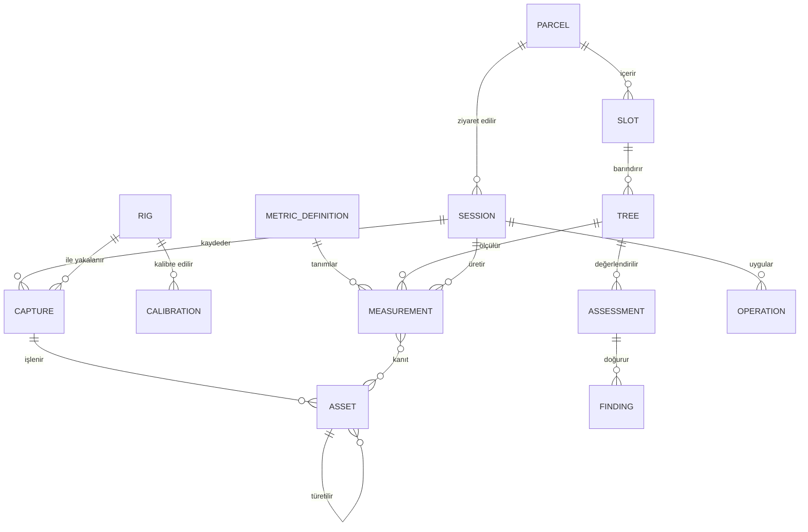

# Hedef Veri Modeli: Sensörden Bağımsız

17 Ekim 2026 · Yusuf

Hedef veri modeli dört soruyu ayrı tutar: **neyi** tarif ediyoruz (ağaç, yer, parsel), veriyi **nasıl** topladık (oturum, cihaz, kalibrasyon, ham kayıt), ham veriden **ne ürettik** (panorama, kesit, nokta bulutu) ve **ne bulduk** (ölçüm, değerlendirme, bulgu). Böylece yeni bir sensör, yöntem ya da robot üreticisi geldiğinde şema değişmez; sadece yeni kayıtlar eklenir.

MVP bu modelin bir alt kümesiyle başlar. MVP tablolarından geçiş en sonda.

## Neden gerekli: bir örnek

Aynı ağacın gövde kalınlığı üç farklı yoldan gelebilir:

| Tarih | Yöntem | Değer | Belirsizlik | Kaynak |
| --- | --- | --- | --- | --- |
| Ocak 2027 | Personel, şerit metre | 24,5 cm | ±0,3 cm | Saha personeli |
| Ocak 2028 | LiDAR, silindir uydurma v1 | 25,8 cm | ±1,2 cm | Algoritma |
| Ocak 2029 | LiDAR, silindir uydurma v2 (2028 verisi yeniden işlendi) | 25,1 cm | ±0,8 cm | Algoritma |

Bunlar aynı ağaçta aynı metriğin ölçümleridir; sadece yöntem, sürüm ve belirsizlik farklıdır. Dar bir şemada her yeni yöntem yeni bir sütun ya da tablo ister. Genel şemada her biri `Measurement` tablosunda bir satırdır.

## Katmanlar

### 1. Konu: neyi tarif ediyoruz

| Varlık | Temel alanlar |
| --- | --- |
| Org | Kiracı: işletme, kooperatif, sigorta vb. |
| Parcel | Sahibin kullandığı bahçe bölümü; tapu referansı opsiyonel |
| Boundary | Poligon, kaynak, sürüm, sahip onayı |
| Slot (yer) | Kod (S5-12, S5-12a), konum, sıra, pozisyon |
| Tree | Kalıcı kimlik, bağlı olduğu yer, cinsiyet, aşı, çeşit, ilk görülme, durum |
| Zone | Ağaç dışı alanlar: hücre, geçilmez bölge, giriş noktası, sulama hattı |

`Tree` kimliği hiç değişmez. Ağaç kurursa durumu değişir; yerine yeni ağaç dikilirse aynı yere yeni bir `Tree` kaydı bağlanır.

### 2. Toplama: veriyi nasıl topladık

| Varlık | Temel alanlar |
| --- | --- |
| Session | Bahçede yapılan bir oturum (MVP'deki ziyaret); tür (tarama / biçme / ilaçlama / elle kayıt), yapan (ekip ya da robot), tarih, metodoloji sürümü |
| Device | Üretici, model, seri no, yazılım sürümü; insan kiti ya da robot |
| Sensor | Bir cihaza bağlı sensör: 360° kamera, LiDAR, GNSS, termal, telefon kamerası |
| Rig | Bir oturumda birlikte kullanılan sensörlerin düzeni |
| Calibration | Sensörlerin iç parametreleri ve birbirlerine göre konumları; geçerlilik tarihleri |
| Capture | Ham kayıt: dosya, zaman aralığı, rig, kalibrasyon sürümü (video, MCAP, GNSS ham, fotoğraf) |

### 3. Ürün: ham veriden ne ürettik

| Varlık | Temel alanlar |
| --- | --- |
| Asset | Türetilmiş dosya: panorama, ağaç kesiti, yörünge, nokta bulutu, ağaç bulutu. Tür, dosya hash'i, poz, kalite skoru, **kaynak kayıtlar** ve **üreten hat + sürüm + parametre hash'i** |

Her ürün, hangi ham kayıttan ve hangi hat sürümüyle üretildiğini bilir. Hat güncellendiğinde ham kayıt hâlâ duruyorsa ürünler yeniden üretilebilir; eski ürünler sürümleriyle birlikte kalır.

### 4. Bulgu: ne bulduk

| Varlık | Temel alanlar |
| --- | --- |
| MetricDefinition | Metrik kaydı: kod, ad, birim, değer tipi (sayı / ölçek / kategori / evet-hayır), geçerli dönemler, karnede gösterilip gösterilmediği |
| Measurement | Konu (ağaç, yer, parsel ya da bölge), metrik, değer, birim, belirsizlik, yöntem + sürüm, kaynak (personel / algoritma / AI / uzman), oturum, kanıt ürünleri, ölçüm zamanı |
| Assessment | Yargı: genel sınıf; dayandığı ölçümler; kaynak (AI / model / uzman); güven |
| Finding | Raporlanan bulgu: tür, önem, açıklama, öneri, kanıtlar, onaylayan |
| Operation | Bahçeye yapılan işlem: biçilen alan, ilaç ürünü, doz, reçete no, toprak işleme alanı; yapan (insan ya da robot) |

`Operation`, robotların yaptığı işleri ve elle girilen işleri aynı yerde tutar. Böylece bir ölçümdeki değişim, öncesindeki işlemlerle (budama, ilaçlama) ilişkilendirilebilir.

## Metrik kaydı örnekleri

| Kod | Birim | Yöntemler | Dönem | Karnede |
| --- | --- | --- | --- | --- |
| `dead_branch_scale` | 0–3 | personel sorusu, AI görsel, uzman | Tümü | Evet |
| `crown_diameter` | m | LiDAR, fotogrametri | Yapraklı | Evet |
| `crown_volume` | m³ | LiDAR | Yapraklı | Evet |
| `trunk_diameter_h30` | cm | şerit metre, LiDAR silindir uydurma | Tümü | Evet |
| `scaffold_branch_count` | adet | uzman gözlemi, QSM | Kış | Evet |
| `fractal_dimension` | — | QSM, kutu sayma | Kış | Hayır (araştırma) |
| `fruit_load_scale` | 0–3 | personel, AI görsel, uzman | Yaz | Evet |
| `canopy_temp_delta` | °C | termal | Yaz | Değerlendirilecek |

Yeni bir ölçüm türü eklemek, bu tabloya bir satır eklemek demektir.

## Kurallar

- **Yöntem önceliği:** Aynı metrik birden çok yöntemle ölçüldüğünde karnede hangisinin gösterileceği metrik başına tanımlanır (örneğin gövde kalınlığında önce LiDAR v2, yoksa şerit metre). Diğer değerler kaybolmaz.
- **Yöntemler arası tutarlılık:** Yeni bir yöntem devreye girmeden önce, aynı ağaçlarda eski yöntemle yan yana ölçülür. Aradaki sapma belgelenir; gerekirse düzeltme uygulanır. Böylece zaman serisinde yöntem değişikliğinden gelen sıçramalar ağaçtaki gerçek değişim sanılmaz.
- **Belirsizlik:** Sayı ve ölçek değerli her ölçüm bir belirsizlik değeri taşır (zorunlu). Kategori ve evet/hayır değerlerinde belirsizlik boş bırakılabilir: personelin "kuru dal var mı?" sorusuna verdiği cevabın sayısal bir hata payı yoktur, uydurulmuş bir değer (ör. 0) yanıltıcı olur. Bu değerlerin güvenilirliği kaynak, yöntem ve gerekiyorsa `confidence` (0–1) ile ifade edilir. Karne, belirsizliği yüksek değişimleri "anlamlı değişim" olarak göstermez.
- **Evet/hayır değerleri:** Ayrı bir değer tipi (`boolean`) ve sütunu (`value_boolean`) vardır; 0/1 ölçeğine ya da `yes`/`no` kategorisine sıkıştırılmaz. Saha uygulamasının personel cevapları (`value_bool`) buraya yazılır. Evet/hayır metriğinin birimi yoktur.
- **Gösterilecek değer:** Bir ağaç için birden çok değerlendirme ya da aynı metrik için birden çok ölçüm varsa, karne ve harita tek bir değer gösterir. Sıra:
  1. **En yeni oturum kazanır.** Oturumun zamanı başlangıcıdır (`started_at`; yoksa planlanan gün, o da yoksa kayıt zamanı). Oturuma bağlı olmayan bir satırda satırın kendi zamanı (`assessed_at` / `measured_at`) kullanılır. Böylece eski bir uzman görüşü, sonraki bir ziyaretin sonucunu gölgelemez.
  2. **Aynı oturum içinde kaynak karar verir:** değerlendirmede uzman > model > AI; ölçümde uzman > algoritma > personel > AI.
  3. **Eşitlikte** satırın zamanı, sonra kayıt zamanı (`created_at`), sonra kimlik.

  Sahip ve izleyici yayımlanmamış oturumları görmediği için onlar için en yeni **yayımlanmış** oturum geçerlidir; kurum rolleri yayımlanmamış daha yeni bir oturumu görür. Veritabanında `tree_latest_assessment` ve `tree_latest_measurement` görünümleri bu kuralı uygular (`session_time` sütunu seçilen oturumun zamanıdır); diğer değerler silinmez. Metrik başına yöntem önceliği (yukarıda) tanımlandığında 2. adım onunla değiştirilecek.
- **Yayın:** Bir oturumun sonuçları (ham kayıt, ürün, ölçüm, değerlendirme, bulgu) sahip ve izleyiciye ancak oturum `published` durumuna geçince görünür. Kurum rolleri (saha personeli, uzman, operasyon) her zaman görür. Oturuma bağlı olmayan kayıtlar (parsel, sınır, yer, ağaç) ve oturum satırının kendisi bundan etkilenmez. Kural veritabanında satır bazlı yetkiyle uygulanır; görünümler ve medya dosyaları da aynı kurala uyar.
- **Yeniden hesaplanabilirlik:** Her ölçüm ve ürün, onu üreten hat sürümüne bağlıdır. Yeni bir model eski veriyi yeniden işleyebilir; eski sonuçlar da silinmeden sürümleriyle saklanır.
- **Koordinatlar:** Global koordinatlar WGS84'te tutulur; her parsel için ayrıca yerel bir koordinat sistemi tanımlanır (köşe orijinli, metre cinsinden). Robot navigasyonu ve ağaç bazında ölçümler bu yerel sistemde çalışır. Her poz, hangi koordinat sisteminde olduğunu ve belirsizliğini taşır.
- **Zaman:** Tüm zaman damgaları UTC ve GNSS zamanına bağlıdır.
- **Ölçek:** `Measurement` en büyük tablo olacak. Örneğin 5.000 bahçe × yılda 4 ziyaret × 300 ağaç × ~30 metrik, yılda ~180 milyon satır eder. Bu tablo yıla göre bölümlenir; analiz için object storage'da Parquet kopyası tutulur.

## MVP tablolarından geçiş

| MVP | Hedef |
| --- | --- |
| Visit | Session (tür: tarama, yapan: ekip) |
| Track | Capture (GNSS ham) + Asset (yörünge) |
| Panorama, Media | Capture (ham video, yakın plan fotoğraf) + Asset (panorama, kesit) |
| Observation (personel cevapları) | Measurement (kaynak: personel) |
| Assessment içindeki ölçek değerleri | Measurement (kaynak: AI ya da uzman) |
| Assessment (genel sınıf) | Assessment |
| Finding | Finding |
| ParcelScore | Measurement (konu: parsel) |
| — | Yeni: Device, Sensor, Rig, Calibration, MetricDefinition, Operation, Zone |

**Öneri: MVP doğrudan bu modelle başlasın.** Bugün maliyeti düşük; sonradan geçmek, birikmiş veriyi taşımak demek. Sorguların biraz karmaşıklaşmasını, sık kullanılan görünümlerle (örneğin her ağacın son ölçek değerleri) dengelemek mümkün.
