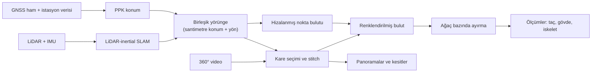

# Uzun Vadeli Vizyon: Robotik Saha Operasyonu ve ML Değerlendirme

17 Ekim 2026 · Yusuf

Uzun vadede saha operasyonlarını robotlar, uzman değerlendirmesini ML modelleri yapacak. Her ağaç için taç, gövde, dal iskeleti, çiçek ve meyve gibi detaylı ölçümler toplanacak. Bu vizyonun temeli, MVP'nin bugünden biriktirmeye başladığı veri: konumu belli, yıllar boyunca tekrarlanan ve uzman tarafından etiketlenmiş ağaç ağaç kayıtlar. Robotlar ve ML bu verinin üzerine kurulur.

Bu doküman bir yön belirler, takvim vermez. Ürün kapsamı için [MVP.md](MVP.md), altyapı için [teknik-mimari.md](teknik-mimari.md), hedef veri modeli için [veri-modeli.md](veri-modeli.md) dosyalarına bakın.

## Vizyonun parçaları ve fizibilitesi

| Parça | Fizibilite | Gerekçe |
| --- | --- | --- |
| Robotla tarama (sadece algılama) | Yüksek | Bahçeye fiziksel müdahale yok, hata maliyeti düşük, bugünkü teknolojiyle yapılabilir |
| ML ile değerlendirme | Yüksek, kademeli | Uzman kararları biriktikçe model önce ön elemeyi, sonra rutin vakaları üstlenir |
| Yabani ot biçme | Orta | Bağ ve meyve bahçesinde ticari örnekleri var; taşlı, eğimli arazi ve alçak dallar zorlaştırıyor. Hizmet olarak bugün elle başlıyor (aşağıda) |
| Toprak işleme | Düşük | Ağır çekiş gücü gerekiyor; mevcut traktörlere takılan otonomi kitleri daha gerçekçi |
| İlaçlama | Teknik orta, hukuken zor | Bitki koruma ürünleri reçeteyle uygulanıyor; sürüklenme ve yanlış uygulamada sorumluluk ağır. En son aşama |

**Uzmanın rolü ortadan kalkmaz, değişir.** Model rutin vakaları üstlendikçe uzman; sınır vakalara, modelin denetimine ve rapor imzasına odaklanır. Bağımsız denetim iddiası, imzayı taşıyan bir insana dayanmaya devam eder.

## Hizmet katmanı: robot filosu ile bahçe sahiplerini buluşturan platform

Saha görüşmelerinde bahçe sahipleri yalnız izlemeye pek istekli olmadı; bahçedeki işler hizmet olarak eklenince ilgilendiler. Hizmet katmanı bu yüzden izleme ile robotlar arasındaki ticari köprü: sahip hizmeti satın alır, izleme işin yapıldığını kanıtlar. Öncesi ve sonrası fotoğrafları parsele bağlıdır ve denetim verisiyle aynı zincirde durur ([MVP.md](MVP.md#modül-6--hizmet-katmanı-yabani-ot-biçme), Modül 6).

Sahip kararıyla (2 Kasım 2026) orchadOS bir **robot filosu ↔ bahçe sahibi eşleştirme platformuna** dönüşür:

- **İşi robot yapar:** İlk hizmet yabani ot biçme; işi otonom robotumuz MARABA-I yapar. Sahibe hizmet yalnız böyle anlatılır. Katalog meyve türünden bağımsızdır; yeni bir hizmet şemaya dokunmadan bir satır olarak eklenir.
- **Sahip robotu seçer, fiyat yeteneğe göre:** Her hizmeti yapabilen robot modelleri kataloğa bağlıdır. Sahip talepte robotu seçer; fiyat listesi hizmet ve robot modeli başına fiyat taşıyabilir, modelin kendi fiyatı yoksa "tüm robotlar" fiyatı geçerlidir. Yeteneği farklı bir robot (daha geniş biçme, dik eğim, taşlı zemin) farklı fiyatlanabilir.
- **MARABA-I ilk model:** Bugün katalogda tek model MARABA-I'dir; işleteni orchadOS'tur. Robot modelinin işleten org alanı boş olabilir; boş, orchadOS'un kendisi demektir. İleride üçüncü taraf işletmeciler kendi robot modelleriyle aynı katalogda yer alabilir; sahip hepsi arasından seçer, iş kanıtı ve denetim aynı zincirde kalır.
- **İç gerçek kayıtlıdır:** Robot işi gözetim altında yapar; ulaşamadığı kısımları saha ekibi tamamlayabilir. İş kaydı ve iş oturumu işi kimin yaptığını (`performer`: robot ya da saha ekibi) tutar; bu iç kayıttır, sahibe gösterilmez.
- **Robot nerede çalışır:** Operasyon ve saha personeli her parsel için robot uygunluk notları tutar: eğim, taşlılık, en alçak dal yüksekliği. Notlar robotun nerede güvenle çalışabileceğini ve hangi kısımları saha ekibinin tamamlaması gerektiğini planlamak için kullanılır.

## Bölgesel işletme modeli: mobil robot birimleri

Bahçeler küçük, hisseli ve köylere dağılmış. Robotu bir bahçeye kalıcı olarak koymak ekonomik değil, ayrıca hırsızlık riski yüksek. Bu nedenle gerçekçi model, bugünkü saha operasyonunun robotlu hali:

- Robotlar bir araçla bahçeden bahçeye taşınır.
- Bir operatör aynı anda 2–4 robotu denetler.
- Robot önce saha ekibini ortadan kaldırmaz; bir operatörün günde taradığı bahçe sayısını katlar.

Teknik mimari dokümanında 5.000 bahçede sezon zirvesinde yaklaşık 85 saha ekibi gerektiğini hesaplamıştık. Robotun ekonomik değeri bu darboğazda.

## Detaylı ölçümler ve gereken veri

360° kamera görsel izleme ve ML eğitimi için yeterli, ama metrik ölçüm için yeterli değil. Ölçüm için ölçeği bilinen 3D veri ve kalibre edilmiş sensörler gerekiyor.

| Ölçüm | Sensör | Çekim | Dönem | Not |
| --- | --- | --- | --- | --- |
| Taç genişliği, boy, hacim | LiDAR ya da yoğun fotogrametri | Ağacın birden çok yönünden | Yapraklı dönem | Santimetre mertebesinde güvenilir |
| Gövde kalınlığı | LiDAR ya da stereo derinlik kamerası | 1–2 m'den, sabit ölçüm yüksekliğinde | Her dönem | ~1 cm doğruluk; ölçüm yüksekliği metodolojide sabitlenir |
| Dal iskelet yapısı | Yoğun LiDAR nokta bulutu, ardından iskelet çıkarma (QSM tipi algoritmalar) | En az 3–4 yönden | Kış (yapraksız) | Aşağıdaki LiDAR bölümüne bakın |
| Fraktal skoru | İskeletten ya da nokta bulutundan hesaplanır | İskeletle aynı | Kış | Araştırma metriği; tarımsal anlamı kanıtlanmadan karneye girmez |
| Çiçek ve meyve sayımı | Yüksek çözünürlüklü RGB, nesne tespiti | 1–2 m'den, tacın alt, orta ve üst kısmı | İlkbahar, yaz | Tacın içi görünmediği için sayım tahmindir, düzeltme katsayısı gerekir |
| Meyve kalitesi | Yakın plan RGB, renk kartıyla kalibre | Salkım düzeyinde, sabit ışıkta | Hasat öncesi | Boyut, renk, olgunlaşma görülür. Çıtlama oranı ve iç dolgunluğu dışarıdan görülmez; örnek hasat ve laboratuvar gerekir |
| Su stresi | Termal kamera | Öğle saatinde, her ziyarette aynı saatte | Yaz | Kıraç bahçeler için muhtemelen en değerli ölçüm |
| Bitki sağlığı | Multispektral kamera | Kalibrasyon paneliyle | İlkbahar, yaz | Yakın mesafede uydudan çok daha net |

**Yeni metrikler için kural:** Bir metriğin hesaplanabiliyor olması yetmez. Karneye girmeden önce verim ya da sağlıkla ilişkisi kendi verimizde gösterilmelidir. O zamana kadar araştırma metriği olarak toplanır.

## LiDAR ile dal iskeleti

Ağacın etrafında tam tur dönmek gerekmez, ama ağaç birden çok yönden görülmelidir. Tek taraftan taranan ağaçta arkadaki dallar görünmez; iskelet eksik çıkar ve dal sayısı olduğundan düşük ölçülür. Tek başına duran bir ağaç için, aralarında yaklaşık 90° olan 3–4 yönden tarama yeterlidir.

**Grid tarama bunu zaten sağlıyor.** 8×8 m dikimde her ağaç dört koridorun ortasında kalır ve her koridordan yaklaşık 4 m mesafeden geçilir:

```
        koridor
   ─────────────────
   │       ↓       │
 → │      ağaç     │ ←
   │       ↑       │
   ─────────────────
```

Koridor taramaları SLAM ile birleştirilir ve RTK ile sabitlenir. Koridor kesişimleri hizalamayı güçlendirir.

**Sınırlar:**
- **Kış şart:** Yapraklar dalları kapatır; fıstık yaprak döktüğü için kış ziyareti doğal zamandır.
- **Hangi dallar çıkar:** Ucuz mobil LiDAR'ların ölçüm gürültüsü birkaç santimetredir. Ana iskelet dalları ve ilk dallanmaları güvenilir çıkar; ince sürgünler ve uç dallar çıkmaz.
- **Yükseklik:** LiDAR yaklaşık 1,5–2 m'de ve yukarı bakan geniş görüş açısıyla durmalı; aksi halde tacın üstü alt dalların arkasında kalır.
- **Komşu ağaçlar:** Sık ya da ara ağaçlı bölgelerde komşu ağaçlar da görüşü kapatır; ek geçiş gerekebilir.
- **Doğrulama:** İlk denemede birkaç ağacın ana dal sayısı ve dal çapları elle ölçülür ve LiDAR sonucuyla karşılaştırılır.

## Birleşik tarama kiti: tek geçişte ham veri

RTK GNSS, 360° kamera ve LiDAR aynı direkte olursa, tek bir grid geçişi hem bahçe gezisi hem metrik ölçümler için işlemeye hazır ham veriyi üretir. Bunun üç koşulu var: **ortak zaman, bilinen sensör konumları (kalibrasyon) ve tek bir kayıt düzeni.**

**Bileşenler**

| Bileşen | Örnek | Görev |
| --- | --- | --- |
| LiDAR (dahili IMU'lu) | Livox Mid-360 sınıfı; ~360°×59° görüş açısı, saniyede ~200 bin nokta | 3D geometri; IMU ile birlikte SLAM |
| 360° kamera | Insta360 X serisi vb. | Panorama, nokta bulutunu renklendirme, görsel değerlendirme |
| RTK GNSS | u-blox ZED-F9P tabanlı alıcı ve anten | Mutlak konum; PPS ile zaman kaynağı; PPK için ham kayıt |
| Kayıt bilgisayarı | Mini PC, Jetson ya da Raspberry Pi 5 sınıfı, ROS 2 | LiDAR, IMU ve GNSS kaydı; zaman sunucusu |
| Güç | Ortak batarya paketi | LiDAR, kayıt bilgisayarı ve GNSS |

**Montaj:** LiDAR direğin en tepesinde durur, çünkü 360° yatay görüşün açık olması gerekir. 360° kamera hemen altında, GNSS anteni de ikisinin arasında ya da yanında, sabit bir kola takılır. Kamera görüntüsünün tepe noktasında LiDAR görünür; bu bölge gökyüzüdür ve maskelenir. Tüm sensörler tek rijit bir gövdeye bağlıdır; aralarındaki konum ilişkisi ölçülür ve sabit kalır.

**Zaman senkronizasyonu:**
- GNSS alıcısının PPS sinyali, kayıt bilgisayarının saatini GPS zamanına kilitler.
- LiDAR, kayıt bilgisayarından PTP ile zaman alır.
- Tüketici 360° kameralar dışarıdan tetiklenemez. Taramanın başında ve sonunda, kayıt bilgisayarının ekranındaki GPS saatini gösteren QR kod kameraya okutulur. İki nokta arasındaki saat kayması doğrusal olarak düzeltilir.
- İşleme sırasında görüntü ile nokta bulutu arasındaki ince hizalama yazılımla iyileştirilebilir.

**Kalibrasyon:** Kamera–LiDAR ve LiDAR–GNSS anteni arasındaki konum ve açılar, kit kurulduğunda bir kalibrasyon hedefiyle ölçülür ve bir kalibrasyon dosyasına yazılır. Kit sökülür ya da darbe alırsa kalibrasyon yenilenir. Her kayıt, kullanılan kalibrasyon sürümüne bağlanır.

**Kayıt:** Kayıt bilgisayarında ROS 2 çalışır: LiDAR sürücüsü, GNSS sürücüsü ve MCAP formatında kayıt. Bu, robot projesindeki (`maraba`) ROS 2 altyapısıyla aynı. Aynı kit ileride robota doğrudan takılabilir.

**Ziyaret başına ham veri paketi**

| Dosya | İçerik | Yaklaşık boyut (2 saat) |
| --- | --- | --- |
| `lidar_imu_gnss.mcap` | LiDAR noktaları, IMU, anlık GNSS çözümü | ~25–30 GB |
| `gnss_raw.ubx` | PPK için ham GNSS gözlemleri | ~50–100 MB |
| `camera360/*.insv` | 360° video | ~90 GB |
| `calibration.yaml` | Kalibrasyon sürümü ve değerleri | KB |
| `sync.json` | QR zaman işaretleri, saat kayması | KB |
| `session.json` | Bahçe, rota, personel, hava, ekipman seri numaraları | KB |

Ziyaret başına toplam ~120 GB. Bunlar da işleme istasyonunda kalır; buluta sadece ürünler çıkar.

**İşleme zinciri**



**Önemli kazanç:** LiDAR SLAM yörüngesi panoramaların konumunu ve yönünü de iyileştirir. Sadece GPS'le eşleştirmeye göre ağaç eşleştirme daha sağlam olur.

**Buluta çıkan ek veri:** Ağaç başına ayrılmış nokta bulutları (~2 MB × 300 ≈ 0,6 GB) ve seyreltilmiş bir parsel bulutu (~1 GB). Ziyaret başına ~1,5–2 GB ek demek. Ham nokta bulutu sadece model eğitimi için seçilmiş ziyaretlerde saklanır.

**Sınırlar:**
- 360° kameranın çözünürlüğü nokta bulutunu renklendirmeye yeter; çiçek ve meyve için yakın plan yine ayrıca çekilir.
- Tüketici kameralarda rolling shutter ve tetiklenememe ince hizalamayı zorlaştırır. İleride global shutter ve tetiklenebilir kameralara geçilebilir.
- LiDAR kitin maliyetini ve ağırlığını artırır. LiDAR yılda sadece kış ve yaz ziyaretlerinde de kullanılabilir.

## Robot filosu ve çok üreticili yapı

Görev ve veri düzeyinde birlikte çalışma fizibil. Farklı üreticilerin robotlarını kendi yazılımımızla doğrudan sürmek ise fizibil değil ve denenmemeli.

**Katmanlar**

1. **Görev katmanı (bizim):** Bahçe haritası (sıralar, ağaçlar, geçilmez bölgeler, yükleme noktaları), görev tanımları ("S3–S8 koridorlarını tara", "kuzey yarıyı biç"), takvim ve sonuçlar.
2. **Filo ve birlikte çalışma katmanı:** Üretici başına bir adaptör. Kullanılabilecek standartlar:
    - Open-RMF: ROS tabanlı, çok üreticili filo yönetimi
    - VDA 5050: lojistikten gelen, robot ile filo yöneticisi arası iletişim standardı
    - ISOBUS / ISO 11783: traktör ile ekipman arası tarım standardı

    Tarım robotlarında baskın tek bir standart yok. Gerçekçi yol, Open-RMF benzeri bir çekirdek ve üretici başına adaptör.
3. **Veri sözleşmesi:** Hangi üreticiden gelirse gelsin, her veri paketi şunları içermek zorunda:
    - Bizim harita koordinatlarımızda poz (RTK kalitesinde)
    - GNSS zamanına bağlı zaman damgaları
    - Sensör kalibrasyon dosyası
    - Standart formatlar: kayıtlar MCAP, nokta bulutları LAS/LAZ, görüntüler yan dosyalı JSON metadata ile

    Sözleşme sağlandığında robotun markası değerlendirme hattı için önemsiz olur.

**Zorluklar:**
- Üreticilerin çoğu kapalı ekosistem ve API'leri sınırlı.
- Otonom tarım makineleri için güvenlik standartları (ISO 18497, ISO 25119) ve sorumluluk meselesi var.
- Kırsalda mobil bağlantı zayıf; robot çevrimdışı çalışabilmeli.
- Taşlı, eğimli arazi zor.
- Robotlar bahçeler arasında taşınmalı.

## ML ile değerlendirme

**Veri çarkı:** Her ziyarette uzman, AI'ın önerisini onaylar ya da düzeltir. Her karar etiketli veri olur. Model iyileştikçe uzmana giden vaka oranı düşer, uzman daha zor vakalara odaklanır ve bu vakalar da etiketlenir.

**Model yönetişimi:**
- Her model sürümü, uzman etiketli sabit bir test setinde ölçülür; uzmanla uyumu belli bir eşiği geçmeden devreye alınmaz.
- Her ölçüm, onu üreten model ya da algoritma sürümünü taşır. Yeni bir sürüm eski veriyi yeniden işleyebilir; eski sonuçlar sürümleriyle birlikte saklanır.
- Kayma takibi yapılır: mevsim, çeşit farkları, yeni bölgeler ve yeni sensörler modelin doğruluğunu değiştirebilir.

## Aşamalar

1. **MVP:** 360° kamera ve RTK ile grid tarama; AI ve uzman değerlendirmesi; etiketli veri birikimi.
2. **Birleşik kit:** LiDAR eklenir. İlk kış iskelet denemesi kendi bahçende yapılır, sonuçlar elle ölçümle karşılaştırılır.
3. **Kendi modeller:** Ağaç tespiti, sınıflandırma ve ölçüm modelleri işleme istasyonunda çalışır; LLM sadece belirsiz vakalara gider.
4. **Robotla tarama:** Kit robota (`maraba`) ya da başka bir platforma takılır. Operatör başına 2–4 robot hedeflenir.
5. **Robot filosu platformu:** Ot biçmeyi otonom robot MARABA-I yapar; sahip robotu seçer, fiyat robotun yeteneğine göre belirlenir. Sonraki adımda partner üreticilerin ve üçüncü taraf işletmecilerin robot modelleri aynı kataloğa girer; görev katmanı ve veri sözleşmesi üzerinden katılırlar.
6. **Toprak işleme ve ilaçlama:** Mevcut makinelere otonomi kitleri ve mevzuata uygun reçete ve kayıt süreçleriyle. En son aşama.

## Bugünden yapılacak hazırlıklar

1. **Sensörden bağımsız veri modeli:** Ölçüm, yakalama ve kalibrasyon ayrı kavramlar olarak tasarlanır. Ayrıntılar [veri-modeli.md](veri-modeli.md) dosyasında.
2. **Envanter haritası robot haritası olarak tasarlanır:** Sıra çizgileri, ağaç konumları, geçilmez bölgeler ve giriş noktaları. Bugün ağaç eşleştirmede, yarın robot navigasyonunda kullanılır.
3. **Kayıt düzeni ROS 2 ve MCAP üzerine kurulur:** İnsan taşıyan kit ile robot aynı formatta veri üretir.
4. **Hoverboard robotu araştırma platformu olur:** Kit robota takılıp kendi bahçende koridor taraması denenir.
